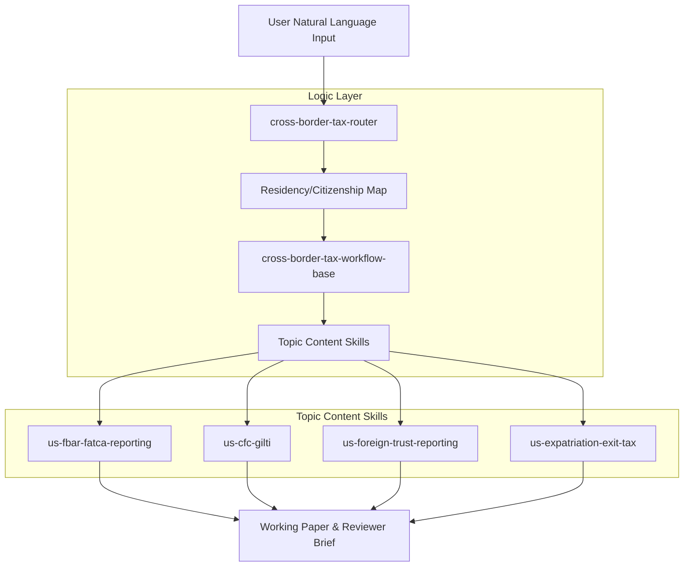
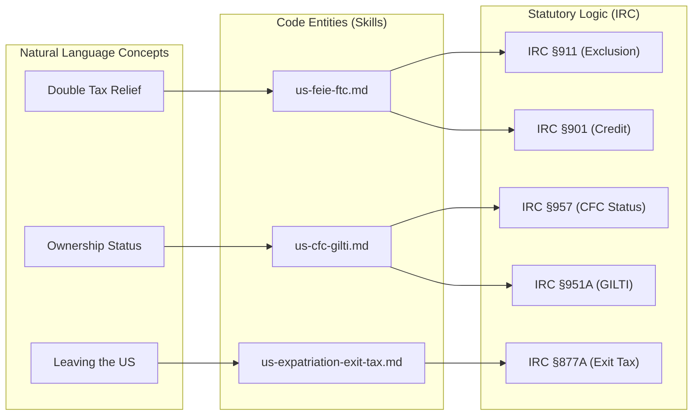

<!-- source: DeepWiki mcp.deepwiki.com · repo openaccountants/openaccountants · page 5.2 US Expat and International Reporting · fetched 2026-10-27 -->

# 5.2 US Expat and International Reporting

Relevant source files

The following files were used as context for generating this wiki page:

- [packages/us-az/az-transaction-privilege-tax.md](packages/us-az/az-transaction-privilege-tax.md)
- [packages/us-co/co-retail-delivery-and-suts.md](packages/us-co/co-retail-delivery-and-suts.md)
- [packages/us-federal/ANNUAL-UPDATE-RUNBOOK.md](packages/us-federal/ANNUAL-UPDATE-RUNBOOK.md)
- [packages/us-federal/rates.2025.json](packages/us-federal/rates.2025.json)
- [packages/us-federal/rates.2026.json](packages/us-federal/rates.2026.json)
- [packages/us-federal/us-1099-k-and-payment-processors.md](packages/us-federal/us-1099-k-and-payment-processors.md)
- [packages/us-federal/us-education-credits-8863.md](packages/us-federal/us-education-credits-8863.md)
- [packages/us-federal/us-estate-gift-706-709.md](packages/us-federal/us-estate-gift-706-709.md)
- [packages/us-federal/us-fbar-and-fatca-8938.md](packages/us-federal/us-fbar-and-fatca-8938.md)
- [packages/us-federal/us-foreign-earned-income-2555.md](packages/us-federal/us-foreign-earned-income-2555.md)
- [packages/us-federal/us-foreign-tax-credit-1116.md](packages/us-federal/us-foreign-tax-credit-1116.md)
- [packages/us-federal/us-form-1040-individual-return.md](packages/us-federal/us-form-1040-individual-return.md)
- [packages/us-federal/us-form-1041-trust-and-estate-income.md](packages/us-federal/us-form-1041-trust-and-estate-income.md)
- [packages/us-federal/us-form-1065-partnership.md](packages/us-federal/us-form-1065-partnership.md)
- [packages/us-federal/us-form-1120-c-corp.md](packages/us-federal/us-form-1120-c-corp.md)
- [packages/us-federal/us-form-5471-cfc-information.md](packages/us-federal/us-form-5471-cfc-information.md)
- [packages/us-federal/us-form-5472-foreign-owned-us.md](packages/us-federal/us-form-5472-foreign-owned-us.md)
- [packages/us-federal/us-form-941-940-payroll.md](packages/us-federal/us-form-941-940-payroll.md)
- [packages/us-federal/us-gilti-fdii-beat.md](packages/us-federal/us-gilti-fdii-beat.md)
- [packages/us-federal/us-irs-collections-and-controversy.md](packages/us-federal/us-irs-collections-and-controversy.md)
- [packages/us-federal/us-pte-state-matrix.md](packages/us-federal/us-pte-state-matrix.md)
- [packages/us-federal/us-r-and-d-section-174-and-41.md](packages/us-federal/us-r-and-d-section-174-and-41.md)
- [skills/cross-border/cross-border-tax-router.md](skills/cross-border/cross-border-tax-router.md)
- [skills/cross-border/cross-border-tax-workflow-base.md](skills/cross-border/cross-border-tax-workflow-base.md)
- [skills/cross-border/us-expat/us-cfc-gilti.md](skills/cross-border/us-expat/us-cfc-gilti.md)
- [skills/cross-border/us-expat/us-expatriation-exit-tax.md](skills/cross-border/us-expat/us-expatriation-exit-tax.md)
- [skills/cross-border/us-expat/us-fbar-fatca-reporting.md](skills/cross-border/us-expat/us-fbar-fatca-reporting.md)
- [skills/cross-border/us-expat/us-feie-ftc.md](skills/cross-border/us-expat/us-feie-ftc.md)
- [skills/cross-border/us-expat/us-foreign-trust-reporting.md](skills/cross-border/us-expat/us-foreign-trust-reporting.md)

The US Expat and International Reporting module provides technical logic for US persons (citizens, green-card holders, and resident aliens) with cross-border financial interests. It covers anti-deferral regimes (CFC/GILTI), information reporting (FBAR/FATCA), trust taxation, and the exit tax regime for expatriating individuals.

## Purpose and Scope

This library addresses the "US-outbound" spine of international taxation. It is designed to function as a **topic content skill** layer that sits above the `cross-border-tax-workflow-base` [skills/cross-border/cross-border-tax-workflow-base.md:1-19](). It produces technical working papers and reviewer briefs for licensed accountants, rather than filed returns, due to the high penalty exposure associated with international non-compliance [skills/cross-border/us-expat/us-fbar-fatca-reporting.md:31-34]().

**Key Reporting Areas:**
*   **Foreign Earned Income:** FEIE (Form 2555) vs. FTC (Form 1116) [skills/cross-border/us-expat/us-feie-ftc.md:4-10]().
*   **Account Disclosure:** FBAR (FinCEN 114) and FATCA (Form 8938) [skills/cross-border/us-expat/us-fbar-fatca-reporting.md:4-8]().
*   **Anti-Deferral:** Controlled Foreign Corporations (CFC), Subpart F, and GILTI (Form 5471) [skills/cross-border/us-expat/us-cfc-gilti.md:4-7]().
*   **Fiduciary Reporting:** Foreign Trusts (Forms 3520/3520-A) [skills/cross-border/us-expat/us-foreign-trust-reporting.md:3-8]().
*   **Expatriation:** Exit Tax and Covered Expatriate status (Form 8854) [skills/cross-border/us-expat/us-expatriation-exit-tax.md:3-9]().

Sources: [skills/cross-border/us-expat/us-cfc-gilti.md:1-16](), [skills/cross-border/us-expat/us-feie-ftc.md:1-17](), [skills/cross-border/us-expat/us-fbar-fatca-reporting.md:1-17]()

## Data Flow and Router Interaction

All US Expat skills require the `cross-border-tax-router` to execute first. The router establishes the "Residency Map" which settles the taxpayer's status (Citizenship, Residence, Domicile) across all involved jurisdictions [skills/cross-border/cross-border-tax-router.md:55-81]().

### The Sequencing Logic
In cross-border scenarios, the order of operations is critical. The router sequences events (e.g., selling an asset before vs. after severing residency) because the sequence changes the tax outcome [skills/cross-border/cross-border-tax-router.md:45-51]().

**Expat Skill Loading Sequence:**
1.  **`cross-border-tax-router`**: Determines if the user is a "US Person" with foreign ties [skills/cross-border/cross-border-tax-router.md:9-16]().
2.  **`cross-border-tax-workflow-base`**: Provides the "Sequenced-Plan" output contract [skills/cross-border/cross-border-tax-workflow-base.md:48-51]().
3.  **Topic Skills**: (e.g., `us-cfc-gilti`, `us-feie-ftc`) are loaded to perform specific calculations and categorization [skills/cross-border/us-expat/us-cfc-gilti.md:22-31]().

### Diagram: International Reporting Data Flow
Title: US Expat Skill Interaction and Data Flow

Sources: [skills/cross-border/cross-border-tax-router.md:5-16](), [skills/cross-border/cross-border-tax-workflow-base.md:1-13](), [skills/cross-border/us-expat/us-cfc-gilti.md:22-31]()

## Key Implementation Details

### FBAR and FATCA (FinCEN 114 / Form 8938)
The system distinguishes between these two overlapping regimes. FBAR is governed by Title 31 (Bank Secrecy Act), while FATCA is Title 26 (IRC §6038D) [skills/cross-border/us-expat/us-fbar-fatca-reporting.md:38-43]().

*   **FBAR Threshold:** $10,000 aggregate maximum value at any point in the year [skills/cross-border/us-expat/us-fbar-fatca-reporting.md:69-73]().
*   **FATCA Thresholds:** Variable based on filing status and residency (e.g., $200k/$400k for expats) [skills/cross-border/us-expat/us-fbar-fatca-reporting.md:88-96]().
*   **Normalization:** The `Procedure` section in the executable layer handles currency conversion using Treasury year-end exchange rates [skills/cross-border/us-expat/us-fbar-fatca-reporting.md:118-120]().

### CFC, Subpart F, and GILTI
The `us-cfc-gilti` skill implements the complex anti-deferral logic required for foreign corporations owned by US persons.

*   **CFC Determination:** Uses §957 (>50% ownership) and §951(b) (10% "United States shareholder" status) [skills/cross-border/us-expat/us-cfc-gilti.md:43-47]().
*   **Ownership Measurement:** Separates §958(a) (direct/indirect for inclusions) from §958(b) (constructive for status) [skills/cross-border/us-expat/us-cfc-gilti.md:51-55]().
*   **Inclusion Hierarchy:** Subpart F income is computed and removed first, followed by GILTI (§951A) [skills/cross-border/us-expat/us-cfc-gilti.md:61-69]().
*   **§962 Election:** Logic for individuals to be taxed at corporate rates to access §250 deductions and §960 credits [skills/cross-border/us-expat/us-cfc-gilti.md:82-85]().

### Foreign Trust Reporting
The `us-foreign-trust-reporting` skill prioritizes characterization before consequence [skills/cross-border/us-expat/us-foreign-trust-reporting.md:30-37]().

*   **Tests:** Implements the "Court Test" and "Control Test" to determine if a trust is foreign [skills/cross-border/us-expat/us-foreign-trust-reporting.md:52-70]().
*   **Grantor Status:** Evaluates §679 (foreign trust with US beneficiary) to determine ownership [skills/cross-border/us-expat/us-foreign-trust-reporting.md:94-103]().
*   **Throwback Regime:** Computes §665–668 interest charges and taxes on undistributed net income (UNI) for non-grantor trusts [skills/cross-border/us-expat/us-foreign-trust-reporting.md:115-134]().

### Expatriation and Exit Tax
The `us-expatriation-exit-tax` skill handles the "severing" of the US tax net [skills/cross-border/us-expat/us-expatriation-exit-tax.md:27-33]().

*   **Covered Expatriate Tests:** Net-worth ($2M), Net-income-tax (indexed), and Certification tests [skills/cross-border/us-expat/us-expatriation-exit-tax.md:67-91]().
*   **Mark-to-Market:** Deemed sale of worldwide property on the day before expatriation [skills/cross-border/us-expat/us-expatriation-exit-tax.md:93-97]().

Sources: [skills/cross-border/us-expat/us-fbar-fatca-reporting.md:35-101](), [skills/cross-border/us-expat/us-cfc-gilti.md:35-85](), [skills/cross-border/us-expat/us-foreign-trust-reporting.md:50-134](), [skills/cross-border/us-expat/us-expatriation-exit-tax.md:58-131]()

## Audit Flash Points and Prohibitions

A core architectural feature of the expat library is the use of `AUDIT FLASH POINT` markers to highlight high-risk judgments [skills/cross-border/cross-border-tax-workflow-base.md:106-115]().

| Topic | Flash Point Detail |
| :--- | :--- |
| **Residency** | Bona-fide residence test (§911(d)(1)(A)) is a facts-and-circumstances judgment frequently challenged by the IRS [skills/cross-border/us-expat/us-feie-ftc.md:80-87](). |
| **CFC** | Downward attribution rules under §958 can trigger CFC status even when a client has no direct control [skills/cross-border/us-expat/us-cfc-gilti.md:49](). |
| **GILTI** | The "Individual GILTI Trap": without a §962 election, individuals face high rates with no §250 deduction [skills/cross-border/us-expat/us-cfc-gilti.md:76-77](). |
| **FBAR** | The $10,000 threshold is an **aggregate** test across all accounts, not per-account [skills/cross-border/us-expat/us-fbar-fatca-reporting.md:71-73](). |

### Diagram: Code Entities and Statutory Logic
Title: Mapping Statutory Logic to Code Entities

Sources: [skills/cross-border/us-expat/us-feie-ftc.md:4-10](), [skills/cross-border/us-expat/us-cfc-gilti.md:4-7](), [skills/cross-border/us-expat/us-expatriation-exit-tax.md:3-9]()

## Summary of Tier 2 Package Integration

While the `skills/` directory contains the source logic, the `packages/us-federal/` directory contains compiled versions for distribution.

*   **`us-fbar-and-fatca-8938.md`**: Implements the Bittner 2023 non-willful penalty logic (per-form vs per-account) [packages/us-federal/us-fbar-and-fatca-8938.md:3-9]().
*   **`us-form-5471-cfc-information.md`**: Covers the five filing categories (Cat 1-5) and the §958(b)(4) repeal expanding the CFC universe [packages/us-federal/us-form-5471-cfc-information.md:3-9]().
*   **`us-form-5472-foreign-owned-us.md`**: Addresses the 2017 expansion treating foreign-owned US SMLLCs as reporting corporations [packages/us-federal/us-form-5472-foreign-owned-us.md:3-9]().

Sources: [packages/us-federal/us-fbar-and-fatca-8938.md:1-10](), [packages/us-federal/us-form-5471-cfc-information.md:1-10](), [packages/us-federal/us-form-5472-foreign-owned-us.md:1-10]()

---

