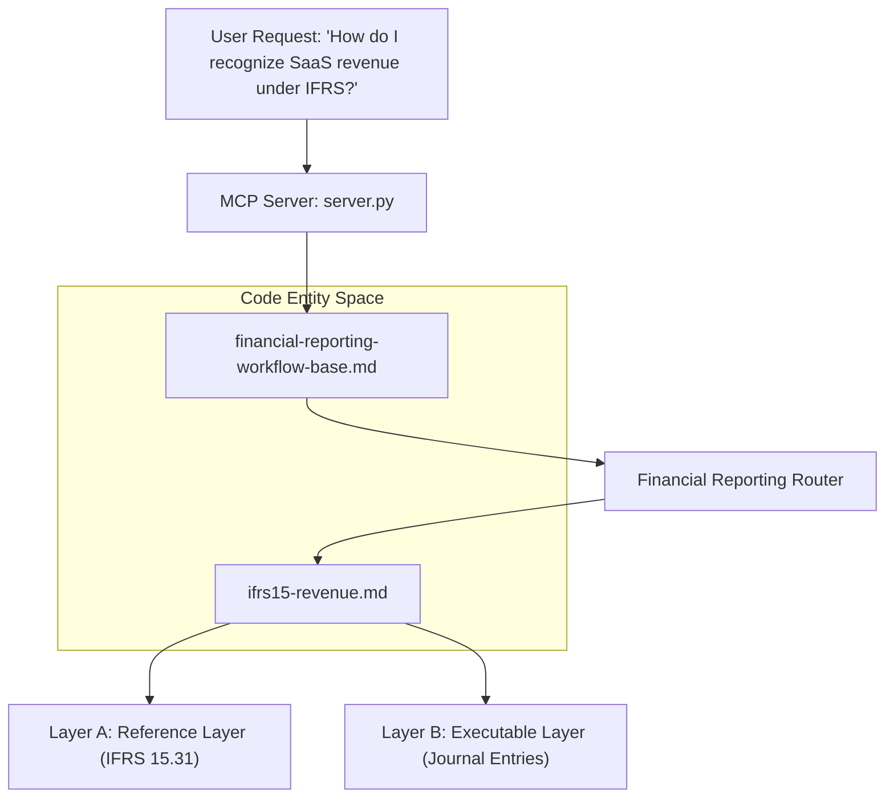
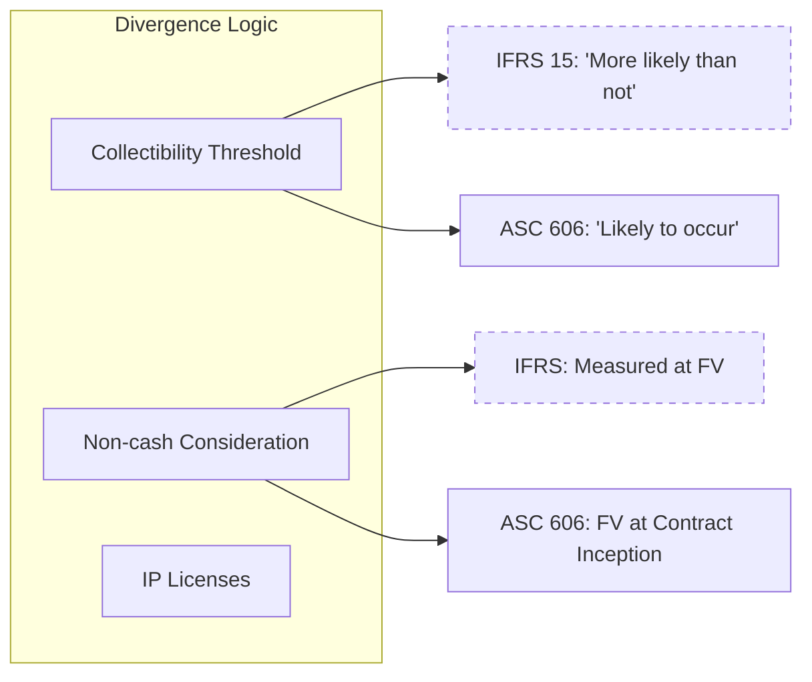

<!-- source: DeepWiki mcp.deepwiki.com · repo openaccountants/openaccountants · page 6.1 Revenue Recognition (ASC 606 / IFRS 15) · fetched 2026-10-27 -->

# Revenue Recognition (ASC 606 / IFRS 15)

<details>
<summary>Relevant source files</summary>

The following files were used as context for generating this wiki page:

- [skills/financial-reporting/business-combinations/ifrs3-business-combinations.md](skills/financial-reporting/business-combinations/ifrs3-business-combinations.md)
- [skills/financial-reporting/business-combinations/us-gaap-asc805-business-combinations.md](skills/financial-reporting/business-combinations/us-gaap-asc805-business-combinations.md)
- [skills/financial-reporting/debt-vs-equity/ias32-debt-vs-equity.md](skills/financial-reporting/debt-vs-equity/ias32-debt-vs-equity.md)
- [skills/financial-reporting/debt-vs-equity/us-gaap-debt-vs-equity.md](skills/financial-reporting/debt-vs-equity/us-gaap-debt-vs-equity.md)
- [skills/financial-reporting/financial-reporting-workflow-base.md](skills/financial-reporting/financial-reporting-workflow-base.md)
- [skills/financial-reporting/leases/ifrs16-leases.md](skills/financial-reporting/leases/ifrs16-leases.md)
- [skills/financial-reporting/leases/us-gaap-asc842-leases.md](skills/financial-reporting/leases/us-gaap-asc842-leases.md)
- [skills/financial-reporting/revenue-recognition/ifrs15-revenue.md](skills/financial-reporting/revenue-recognition/ifrs15-revenue.md)
- [skills/financial-reporting/revenue-recognition/us-gaap-asc606-revenue.md](skills/financial-reporting/revenue-recognition/us-gaap-asc606-revenue.md)
- [skills/international/kazakhstan/kz-simplified-regime.md](skills/international/kazakhstan/kz-simplified-regime.md)
- [skills/manifest.json](skills/manifest.json)

</details>


This page documents the implementation of the converged revenue recognition standard (ASC 606 and IFRS 15) within the OpenAccountants framework. It covers the core five-step model, the dual-standard logic, and the technical orchestration between the financial reporting workflow base and specific standard content skills.

## Purpose and Scope

The Revenue Recognition skills provide a structured mechanism for an AI agent to analyze contracts with customers, determine the timing and measurement of revenue, and generate compliant journal entries. 

**Scope includes:**
* The five-step model (Contract ID, PO ID, Price, Allocation, Recognition) [skills/financial-reporting/revenue-recognition/ifrs15-revenue.md:41-45]().
* Variable consideration and the "Highly Probable" (IFRS) vs "Probable" (US GAAP) constraint [skills/financial-reporting/revenue-recognition/ifrs15-revenue.md:85-85](), [skills/financial-reporting/revenue-recognition/us-gaap-asc606-revenue.md:90-90]().
* Principal vs. Agent (Gross vs. Net) assessments [skills/financial-reporting/revenue-recognition/us-gaap-asc606-revenue.md:46-46]().
* Contract costs (Incremental costs to obtain/fulfill) [skills/financial-reporting/revenue-recognition/ifrs15-revenue.md:48-48]().

## System Architecture: Content vs. Base

Revenue recognition is implemented using a "Layered Skill" pattern. The logic is split between a standard-agnostic workflow base and standard-specific content skills.

### Data Flow: Natural Language to Code Entity
The following diagram illustrates how a user request for revenue advice is routed through the system entities.

**Revenue Recognition Routing Logic**

**Sources:** [skills/financial-reporting/financial-reporting-workflow-base.md:5-13](), [skills/financial-reporting/revenue-recognition/ifrs15-revenue.md:31-31]()

## The Five-Step Model Implementation

Both `us-gaap-asc606-revenue` and `ifrs15-revenue` implement the five-step model as a series of logic gates and computation steps.

| Step | IFRS 15 Reference | ASC 606 Reference | Key Technical Constraint |
| :--- | :--- | :--- | :--- |
| **1. Identify Contract** | `IFRS 15.9` | `ASC 606-10-25-1` | Collectibility threshold: "Probable" (IFRS: >50%) vs "Probable" (US GAAP: ~75-80%) [skills/financial-reporting/revenue-recognition/ifrs15-revenue.md:64-64](). |
| **2. Identify POs** | `IFRS 15.22` | `ASC 606-10-25-14` | Distinctiveness test (Capable of being distinct + Distinct in context) [skills/financial-reporting/revenue-recognition/us-gaap-asc606-revenue.md:77-79](). |
| **3. Transaction Price** | `IFRS 15.46` | `ASC 606-10-32-2` | Variable consideration constraint [skills/financial-reporting/revenue-recognition/ifrs15-revenue.md:85-85](). |
| **4. Allocation** | `IFRS 15.73` | `ASC 606-10-32-28` | Relative Standalone Selling Price (SSP) allocation [skills/financial-reporting/revenue-recognition/ifrs15-revenue.md:92-94](). |
| **5. Recognition** | `IFRS 15.31` | `ASC 606-10-25-24` | Control transfer (Point in Time vs Over Time) [skills/financial-reporting/revenue-recognition/ifrs15-revenue.md:98-103](). |

**Sources:** [skills/financial-reporting/revenue-recognition/ifrs15-revenue.md:56-107](), [skills/financial-reporting/revenue-recognition/us-gaap-asc606-revenue.md:57-97]()

## Technical Output Contract

The system enforces a two-layer output for all revenue queries, defined in the `financial-reporting-workflow-base`.

### Layer A: Reference Layer
Produces a citation-anchored statement of the rules. For example, when assessing Step 5 (Recognition), the system must cite `IFRS 15.35` or `ASC 606-10-25-27` to justify "Over Time" recognition [skills/financial-reporting/financial-reporting-workflow-base.md:41-43]().

### Layer B: Executable Layer
Produces the specific accounting artifacts for the transaction.

**Artifact: Journal Entry Format**
The system uses a strict debit/credit format for revenue recognition events.

```text
[Date] — Revenue Recognition — driving rule: ASC 606-10-25-24
  Dr  Accounts Receivable / Contract Asset         <amount>
      Cr  Revenue                                        <amount>
  (memo: Allocation based on relative SSP per Step 4)
```
**Sources:** [skills/financial-reporting/financial-reporting-workflow-base.md:45-56](), [skills/financial-reporting/financial-reporting-workflow-base.md:70-81]()

## Divergence Points (IFRS vs US GAAP)

The skills specifically flag "Audit Flash Points" where the two standards diverge, which is critical for dual-reporters.

**Standard Divergence and Code Entities**

**Sources:** [skills/financial-reporting/revenue-recognition/ifrs15-revenue.md:70-70](), [skills/financial-reporting/revenue-recognition/ifrs15-revenue.md:90-90](), [skills/financial-reporting/revenue-recognition/us-gaap-asc606-revenue.md:65-65]()

## Implementation Details: Audit Flash Points

Every revenue skill contains `⚑ AUDIT FLASH POINT` markers. These are used by the AI to surface high-judgment areas to the human reviewer.

* **Collectibility Gate:** Misusing Step 1 to defer revenue for credit-risky customers instead of treating it as a price concession [skills/financial-reporting/revenue-recognition/us-gaap-asc606-revenue.md:71-71]().
* **Bundling/Unbundling:** Whether setup/customization is a separate PO, which significantly impacts the timing of revenue [skills/financial-reporting/revenue-recognition/us-gaap-asc606-revenue.md:83-84]().
* **Non-cash Measurement:** Differences in measurement dates between IFRS and US GAAP [skills/financial-reporting/revenue-recognition/ifrs15-revenue.md:90-90]().

**Sources:** [skills/financial-reporting/financial-reporting-workflow-base.md:91-97](), [skills/financial-reporting/revenue-recognition/us-gaap-asc606-revenue.md:71-71]()

---

