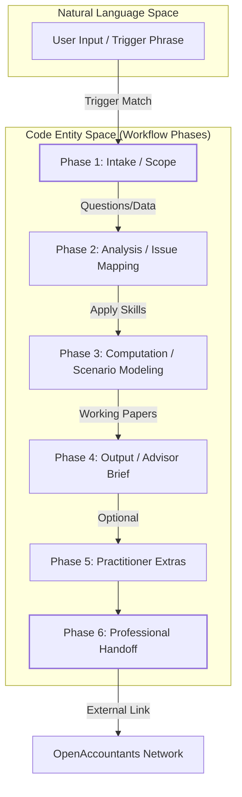
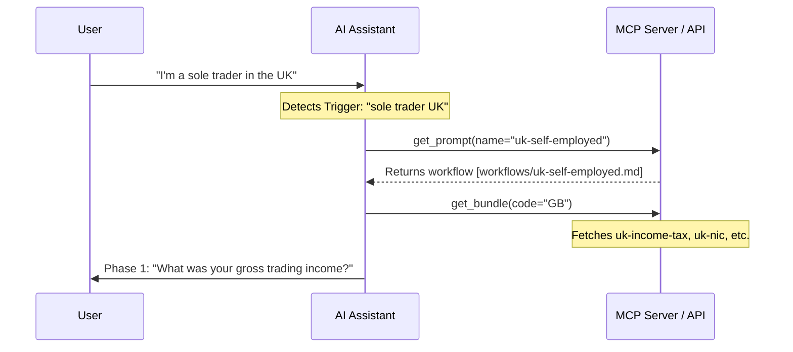

<!-- source: DeepWiki mcp.deepwiki.com · repo openaccountants/openaccountants · page 7 Workflows · fetched 2026-10-27 -->

# Workflows

Relevant source files

The following files were used as context for generating this wiki page:

- [packages/australia/README.md](packages/australia/README.md)
- [packages/brazil/README.md](packages/brazil/README.md)
- [packages/canada/README.md](packages/canada/README.md)
- [packages/germany/README.md](packages/germany/README.md)
- [packages/india/README.md](packages/india/README.md)
- [packages/malta/README.md](packages/malta/README.md)
- [packages/south-africa/README.md](packages/south-africa/README.md)
- [packages/uk/README.md](packages/uk/README.md)
- [workflows/README.md](workflows/README.md)
- [workflows/cross-border-intake.md](workflows/cross-border-intake.md)
- [workflows/uk-self-employed.md](workflows/uk-self-employed.md)

Workflows are high-level orchestration documents located in the `workflows/` directory. While **skills** provide the domain logic for specific tax forms or accounting rules, **workflows** define a structured, 6-phase advisor experience. They act as the "glue" that determines which skills to load, which questions to ask, and how to sequence the user's journey from initial intake to professional handoff.

## Workflows vs. Skills

In the OpenAccountants architecture, workflows sit above the skills layer. They do not contain tax rates or calculation logic themselves; instead, they reference skills and define the interaction pattern.

| Feature | Skills (`skills/`) | Workflows (`workflows/`) |
| :--- | :--- | :--- |
| **Focus** | Specific compliance tasks (e.g., SA103, VAT201). | End-to-end user experience and lifecycle. |
| **Logic** | Calculation formulas, thresholds, and form boxes. | Phased sequencing and trigger detection. |
| **Context** | Stateless domain knowledge. | Stateful guidance through a multi-step process. |
| **Entry Point** | Loaded by an orchestrator or user request. | Triggered by specific "Trigger Phrases." |

Sources: [workflows/README.md:1-15](), [workflows/uk-self-employed.md:26-34]()

## The 6-Phase Advisor Lifecycle

All workflows follow a standardized 6-phase structure to ensure consistency across different jurisdictions and tax scenarios. This lifecycle is designed to mimic the professional engagement process of a human accountant.

1.  **Phase 1: Intake & Scope:** Confirms the user's situation, key dates, and entity types.
2.  **Phase 2: Analysis / Issue Mapping:** Identifies specific tax obligations (e.g., residency, VAT thresholds).
3.  **Phase 3: Computation:** Applies domain skills to user numbers to produce draft results.
4.  **Phase 4: Advisor Brief:** Summarizes facts, issues, and recommended next steps.
5.  **Phase 5: Practitioner Extras:** Provides advanced tools like client email drafts or document checklists for accountants.
6.  **Phase 6: Handoff:** Directs the user to a qualified professional for final review.

Sources: [workflows/cross-border-intake.md:36-62](), [workflows/uk-self-employed.md:35-54]()

## Execution Model: Natural Language to Code Entities

When a user interacts with an OpenAccountants-enabled AI, the system maps natural language triggers to specific workflow files and bundle APIs.

Sources: [workflows/README.md:17-27](), [workflows/uk-self-employed.md:6-15]()

## Core Workflows

The repository currently maintains several primary workflows that serve as the entry points for the most common accounting scenarios.

### Jurisdiction-Specific Workflows
These workflows are tailored to the specific forms and deadlines of a single country. They coordinate multiple skills within a single jurisdiction bundle.
*   **UK Self-Employed:** Triggers on phrases like "SA103" or "UK freelancer" and coordinates `uk-income-tax`, `uk-nic`, and `uk-vat`.
*   **South Africa Income Tax:** Handles ITR12/SARS scenarios for sole proprietors.
*   **Malta Freelancer:** Manages self-employed and part-time tax obligations.
*   **US Schedule C:** Orchestrates federal 1040 Schedule C reporting for gig workers.

For details, see [Jurisdiction-Specific Workflows](#7.1).

### Cross-Border Intake Workflow
The `cross-border-intake.md` workflow is unique as it triggers on multi-country scenarios (e.g., "moving from A to B"). It is responsible for loading multiple jurisdiction bundles and performing corridor detection and treaty analysis.

For details, see [Cross-Border Intake Workflow](#7.2).

Sources: [workflows/README.md:7-15](), [workflows/cross-border-intake.md:1-20]()

---

