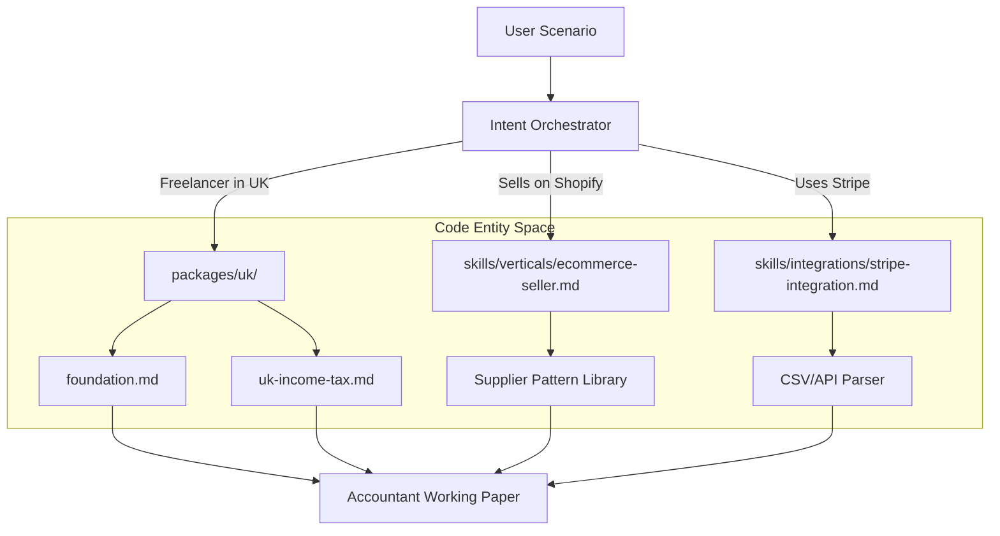
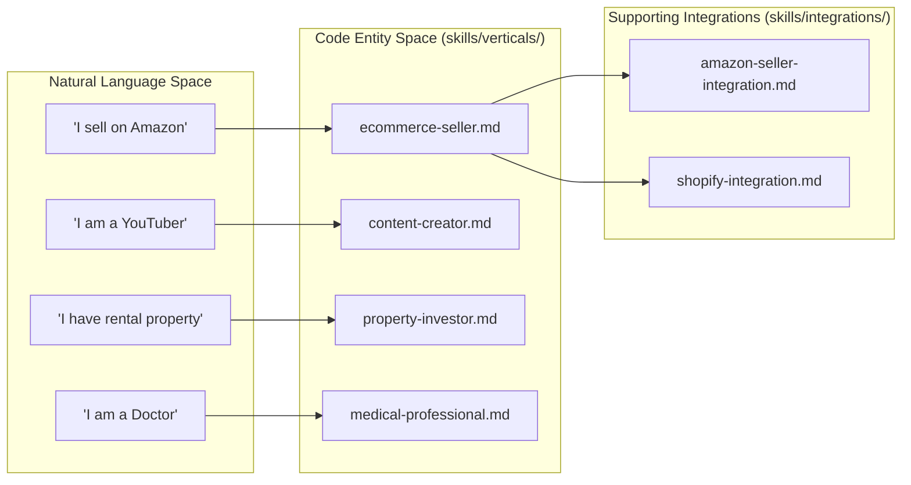

<!-- source: DeepWiki mcp.deepwiki.com · repo openaccountants/openaccountants · page 8 Vertical and Industry Skills · fetched 2026-10-27 -->

# Vertical and Industry Skills

Relevant source files

The following files were used as context for generating this wiki page:

- [CHANGELOG.md](CHANGELOG.md)
- [README.md](README.md)
- [START-HERE.md](START-HERE.md)
- [docs/INTELLIGENCE-ROADMAP.md](docs/INTELLIGENCE-ROADMAP.md)
- [docs/PROMOTION-PLAYBOOK.md](docs/PROMOTION-PLAYBOOK.md)
- [docs/QUALITY-TIERS.md](docs/QUALITY-TIERS.md)
- [docs/USER-JOURNEY-ANALYSIS.md](docs/USER-JOURNEY-ANALYSIS.md)
- [docs/growth-drafts.md](docs/growth-drafts.md)
- [llms.txt](llms.txt)
- [packages/indonesia/README.md](packages/indonesia/README.md)
- [packages/nepal/README.md](packages/nepal/README.md)
- [packages/portugal/README.md](packages/portugal/README.md)
- [packages/saudi-arabia/README.md](packages/saudi-arabia/README.md)
- [skills/financial-reporting/business-combinations/ifrs3-business-combinations.md](skills/financial-reporting/business-combinations/ifrs3-business-combinations.md)
- [skills/financial-reporting/business-combinations/us-gaap-asc805-business-combinations.md](skills/financial-reporting/business-combinations/us-gaap-asc805-business-combinations.md)
- [skills/financial-reporting/debt-vs-equity/ias32-debt-vs-equity.md](skills/financial-reporting/debt-vs-equity/ias32-debt-vs-equity.md)
- [skills/financial-reporting/debt-vs-equity/us-gaap-debt-vs-equity.md](skills/financial-reporting/debt-vs-equity/us-gaap-debt-vs-equity.md)
- [skills/financial-reporting/financial-reporting-workflow-base.md](skills/financial-reporting/financial-reporting-workflow-base.md)
- [skills/financial-reporting/leases/ifrs16-leases.md](skills/financial-reporting/leases/ifrs16-leases.md)
- [skills/financial-reporting/leases/us-gaap-asc842-leases.md](skills/financial-reporting/leases/us-gaap-asc842-leases.md)
- [skills/financial-reporting/revenue-recognition/ifrs15-revenue.md](skills/financial-reporting/revenue-recognition/ifrs15-revenue.md)
- [skills/financial-reporting/revenue-recognition/us-gaap-asc606-revenue.md](skills/financial-reporting/revenue-recognition/us-gaap-asc606-revenue.md)
- [skills/international/kazakhstan/kz-simplified-regime.md](skills/international/kazakhstan/kz-simplified-regime.md)
- [skills/manifest.json](skills/manifest.json)

Vertical skills represent the industry-specific layer of the OpenAccountants architecture. While jurisdiction skills (e.g., `uk-vat-return.md`) handle the "where," vertical skills handle the "what." They provide the AI with the specialized vocabulary, common expense patterns, and regulatory nuances unique to specific sectors, such as e-commerce, SaaS, or medical practices.

## Overview of Vertical Skills

The `skills/verticals/` directory contains 14 industry-specific skill files designed to be loaded alongside base jurisdiction skills [llms.txt:66-66](). These skills refine the transaction classification process by providing industry-standard "Supplier Pattern Libraries"—pre-defined mappings of common vendors to tax categories.

For example, when a user identifies as a **Freelance Developer**, the system loads `freelance-developer.md` on top of the country package. This allows the AI to immediately recognize that a charge from "GitHub" or "AWS" is a deductible software expense, rather than asking the user to classify it manually [START-HERE.md:26-26]().

### Vertical Skill Taxonomy
| Industry | Primary File | Key Features |
|:---|:---|:---|
| **Digital Economy** | `freelance-developer.md`, `saas-digital-products.md`, `content-creator.md` | Focus on global software subscriptions, ad revenue (AdSense/Twitch), and digital services tax [START-HERE.md:26-33](). |
| **Professional Services** | `consultant-professional.md`, `medical-professional.md` | Specialized deductibility rules for private practice and professional indemnity [START-HERE.md:29-30](). |
| **Physical Goods** | `ecommerce-seller.md`, `construction-sector.md` | Inventory accounting, shipping logistics, and subcontractor tax schemes [START-HERE.md:27-27](). |
| **Finance & Property** | `property-investor.md`, `banking-sector.md`, `insurance-sector.md`, `investment-funds-reits.md` | Rental income schedules, regulatory reporting, and fund accounting [START-HERE.md:29-29](). |
| **Heavy Industry** | `oil-gas-extractives.md`, `shipping-aviation-tonnage-tax.md` | Specialized depletion allowances and tonnage tax regimes [CHANGELOG.md:25-26](). |
| **Non-Profit** | `charity-nonprofit.md` | Tax-exempt status verification and restricted fund reporting [CHANGELOG.md:25-26](). |

**Sources:** [llms.txt:66-66](), [START-HERE.md:21-40](), [CHANGELOG.md:25-26]().

---

## Layering Architecture

Vertical skills do not operate in isolation. They are designed to be "mixed in" to a session. This layering allows the AI to resolve conflicts between general rules and industry specificities.

### Vertical Integration Diagram
This diagram illustrates how a user's industry selection triggers the loading of specific code entities.

**Sources:** [START-HERE.md:21-30](), [llms.txt:58-71]().

---

## Industry-Specific Reference

For detailed technical specifications of each industry skill, including their unique Step 0 onboarding questions and classification matrices, see the child pages:

### [Vertical Skill Reference](#8.1)
Covers the 14 core industry files. Each vertical skill includes:
*   **Step 0 Onboarding:** Industry-specific questions (e.g., "Do you hold physical inventory?" for e-commerce).
*   **Deductibility Check:** Blocked or restricted categories unique to the sector.
*   **Edge Case Registry:** Common industry pitfalls (e.g., "Personal use of developer hardware").

### [Platform Integration Skills](#8.2)
Documents the `skills/integrations/` directory. These skills provide the "glue" between external data sources and the vertical skills [llms.txt:67-67]().
*   **Parsers:** Logic for reading exports from **Xero**, **QuickBooks**, **Stripe**, **Shopify**, and **Amazon Seller** [skills/manifest.json:126-135]().
*   **Pattern Mapping:** How integration skills feed into the vertical-specific Supplier Pattern Libraries to automate classification.

**Sources:** [QUALITY-TIERS.md:41-61](), [START-HERE.md:27-27](), [skills/manifest.json:126-135]().

---

## Technical Mapping: Industry to Code

This diagram maps natural language industry terms to the specific markdown files that the system loads to handle them.

**Sources:** [START-HERE.md:27-30](), [skills/manifest.json:126-135]().

---

