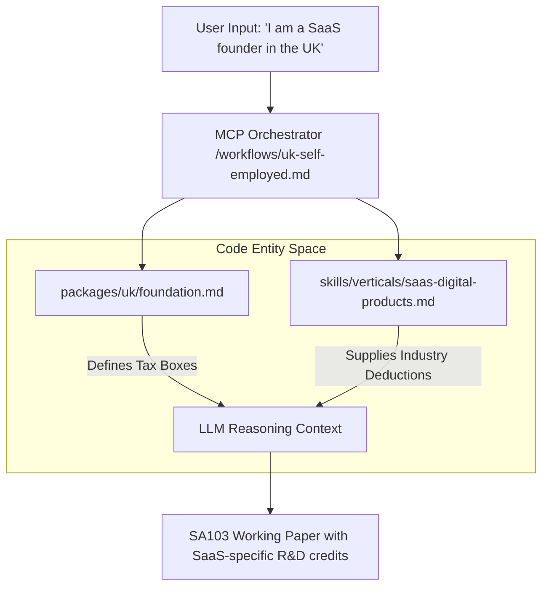
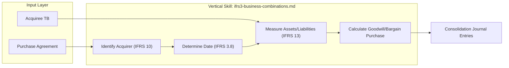

<!-- source: DeepWiki mcp.deepwiki.com · repo openaccountants/openaccountants · page 8.1 Vertical Skill Reference · fetched 2026-10-27 -->

# Vertical Skill Reference

Relevant source files

The following files were used as context for generating this wiki page:

- [README.md](README.md)
- [llms.txt](llms.txt)
- [packages/indonesia/README.md](packages/indonesia/README.md)
- [packages/nepal/README.md](packages/nepal/README.md)
- [packages/portugal/README.md](packages/portugal/README.md)
- [packages/saudi-arabia/README.md](packages/saudi-arabia/README.md)
- [skills/financial-reporting/business-combinations/ifrs3-business-combinations.md](skills/financial-reporting/business-combinations/ifrs3-business-combinations.md)
- [skills/financial-reporting/business-combinations/us-gaap-asc805-business-combinations.md](skills/financial-reporting/business-combinations/us-gaap-asc805-business-combinations.md)
- [skills/financial-reporting/debt-vs-equity/ias32-debt-vs-equity.md](skills/financial-reporting/debt-vs-equity/ias32-debt-vs-equity.md)
- [skills/financial-reporting/debt-vs-equity/us-gaap-debt-vs-equity.md](skills/financial-reporting/debt-vs-equity/us-gaap-debt-vs-equity.md)
- [skills/financial-reporting/financial-reporting-workflow-base.md](skills/financial-reporting/financial-reporting-workflow-base.md)
- [skills/financial-reporting/leases/ifrs16-leases.md](skills/financial-reporting/leases/ifrs16-leases.md)
- [skills/financial-reporting/leases/us-gaap-asc842-leases.md](skills/financial-reporting/leases/us-gaap-asc842-leases.md)
- [skills/financial-reporting/revenue-recognition/ifrs15-revenue.md](skills/financial-reporting/revenue-recognition/ifrs15-revenue.md)
- [skills/financial-reporting/revenue-recognition/us-gaap-asc606-revenue.md](skills/financial-reporting/revenue-recognition/us-gaap-asc606-revenue.md)
- [skills/international/kazakhstan/kz-simplified-regime.md](skills/international/kazakhstan/kz-simplified-regime.md)
- [skills/manifest.json](skills/manifest.json)

Vertical skills in OpenAccountants provide industry-specific logic that layers on top of base jurisdiction skills (like income tax or VAT). While a jurisdiction skill handles the "how" of a tax return (e.g., which box a figure goes in), a vertical skill handles the "what" (e.g., whether a specific expense for a medical professional is deductible).

## Architecture and Data Flow

Vertical skills are stored in the `skills/verticals/` directory and are designed to be composed with jurisdiction-specific packages during the intake process [README.md:66-66](). When an AI agent identifies a user's industry, it pulls the relevant vertical skill to modify the classification logic of the base jurisdiction.

### Vertical Integration Logic
The following diagram illustrates how vertical industry logic interacts with the standard jurisdiction foundation.

**Industry-to-Code Mapping**

Sources: [README.md:17-27](), [README.md:81-83]()

---

## Core Vertical Skillset

The repository contains 14 specialized vertical skills. Each skill defines industry-specific onboarding questions, common income streams, and specialized deduction logic.

### 1. Freelance & Creative
*   **freelance-developer**: Focuses on hardware depreciation (laptops, servers), software subscriptions, and home office apportioning.
*   **content-creator**: Covers equipment (cameras, lighting), platform fees (YouTube/Twitch), and "image rights" vs. royalty income classification.
*   **consultant-professional**: Addresses professional indemnity insurance, travel for client meetings, and professional body memberships.

### 2. Digital Economy
*   **ecommerce-seller**: Integrates with `amazon-seller-integration.md` [skills/manifest.json:126-135](). Handles COGS (Cost of Goods Sold), shipping logistics, and cross-border VAT/GST thresholds for physical goods.
*   **saas-digital-products**: Focuses on server costs (AWS/Azure), API fees, and global digital service tax (DST) compliance [skills/manifest.json:29-29]().

### 3. Professional & Regulated Sectors
*   **medical-professional**: Covers specialized insurance (malpractice), continuing education (CPD), and VAT-exempt healthcare service logic.
*   **construction-sector**: Handles subcontractor payments, CIS (in the UK), and equipment leasing vs. purchase.
*   **property-investor**: Manages rental income, mortgage interest relief restrictions, and capital vs. revenue expenditure for repairs.

### 4. Specialized Industries
*   **banking-sector** & **insurance-sector**: Focus on regulatory reporting and specific financial transaction taxes.
*   **investment-funds-reits**: Covers distribution requirements and pass-through entity logic.
*   **oil-gas-extractives**: Includes depletion allowances and environmental compliance costs.
*   **charity-nonprofit**: Focuses on tax-exempt status maintenance and donor reporting.
*   **shipping-aviation-tonnage-tax**: Covers specialized tonnage tax regimes and international water/airspace jurisdictional rules.

Sources: [skills/manifest.json:24-24](), [README.md:66-66]()

---

## Financial Reporting Verticals (Global)

Unlike jurisdiction-specific tax skills, the financial reporting vertical provides a dual-standard framework for US GAAP and IFRS. This layer is critical for entities requiring audited financial statements.

### Revenue Recognition (ASC 606 / IFRS 15)
The system implements the five-step revenue model. It identifies divergence points where US GAAP and IFRS differ, such as the "collectibility gate" [skills/financial-reporting/revenue-recognition/us-gaap-asc606-revenue.md:65-71]().

| Step | Code Implementation (US GAAP) | Code Implementation (IFRS) | Key Divergence |
| :--- | :--- | :--- | :--- |
| **1. Identify Contract** | `ASC 606-10-25-1` | `IFRS 15.9` | "Probable" threshold (Likely vs. More likely than not) |
| **2. Identify POs** | `ASC 606-10-25-14` | `IFRS 15.22` | Bundling/Unbundling logic for SaaS |
| **3. Transaction Price** | `ASC 606-10-32-2` | `IFRS 15.46` | Measurement date for non-cash consideration |
| **4. Allocation** | `ASC 606-10-32-28` | `IFRS 15.73` | Standalone Selling Price (SSP) estimation |
| **5. Recognition** | `ASC 606-10-25-23` | `IFRS 15.31` | Control transfer vs. Risk/Reward (legacy) |

Sources: [skills/financial-reporting/revenue-recognition/us-gaap-asc606-revenue.md:57-107](), [skills/financial-reporting/revenue-recognition/ifrs15-revenue.md:56-107]()

### Lease Accounting (ASC 842 / IFRS 16)
The vertical skills for leases automate the classification of Finance vs. Operating leases.
*   **US GAAP (ASC 842)**: Uses a dual model where operating leases still result in a Right-of-Use (ROU) asset and Lease Liability [skills/financial-reporting/leases/us-gaap-asc842-leases.md:4-7]().
*   **IFRS (IFRS 16)**: Generally uses a single model (all leases treated as finance-style).

### Business Combinations (IFRS 3 / ASC 805)
This vertical handles the "Acquisition Method," including the identification of the acquirer and the "Concentration Test" to determine if a transaction is a business combination or an asset acquisition [skills/financial-reporting/business-combinations/ifrs3-business-combinations.md:6-13]().

**Consolidation Data Flow**

Sources: [skills/financial-reporting/business-combinations/ifrs3-business-combinations.md:62-95]()

---

## Technical Implementation: The Vertical Layer

Vertical skills are "content skills" that MUST load alongside a `workflow-base` [skills/financial-reporting/revenue-recognition/ifrs15-revenue.md:13-14](). They do not function as standalone entities but provide the "Reference Layer (Layer A)" for the LLM to use when interpreting financial data.

### Key Classifications
Verticals use specific tags in their YAML frontmatter to signal the orchestrator:
*   `category: vertical`: For industry-specific tax logic.
*   `category: financial-reporting`: For accounting standards (GAAP/IFRS) [skills/financial-reporting/revenue-recognition/us-gaap-asc606-revenue.md:17-17]().
*   `standard_family`: Identifies if the skill belongs to `us-gaap` or `ifrs` [skills/financial-reporting/revenue-recognition/us-gaap-asc606-revenue.md:18-18]().

Sources: [skills/manifest.json:24-24](), [skills/financial-reporting/revenue-recognition/us-gaap-asc606-revenue.md:1-23]()

---

