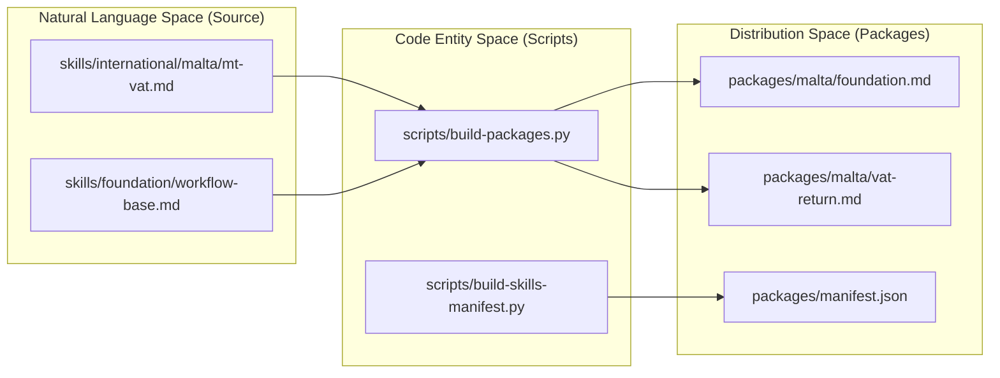

<!-- source: DeepWiki mcp.deepwiki.com · repo openaccountants/openaccountants · page 9 Contributing to OpenAccountants · fetched 2026-10-27 -->

# Contributing to OpenAccountants

Relevant source files

The following files were used as context for generating this wiki page:

- [.github/FUNDING.yml](.github/FUNDING.yml)
- [.github/ISSUE_TEMPLATE/bug-report.md](.github/ISSUE_TEMPLATE/bug-report.md)
- [.github/ISSUE_TEMPLATE/new-country.md](.github/ISSUE_TEMPLATE/new-country.md)
- [.github/ISSUE_TEMPLATE/rate-correction.md](.github/ISSUE_TEMPLATE/rate-correction.md)
- [.github/ISSUE_TEMPLATE/vendor-pattern.md](.github/ISSUE_TEMPLATE/vendor-pattern.md)
- [.github/PULL_REQUEST_TEMPLATE.md](.github/PULL_REQUEST_TEMPLATE.md)
- [CLA.md](CLA.md)
- [COMMERCIAL_LICENSE.md](COMMERCIAL_LICENSE.md)
- [CONTRIBUTING.md](CONTRIBUTING.md)
- [LICENSE](LICENSE)
- [LICENSE-ADDITIONAL.md](LICENSE-ADDITIONAL.md)
- [docs/ARCHITECTURE-OPTIONS.md](docs/ARCHITECTURE-OPTIONS.md)
- [docs/skill-template.md](docs/skill-template.md)
- [skills/foundation/workflow-base.md](skills/foundation/workflow-base.md)

This page provides a high-level guide for contributors looking to expand the OpenAccountants library. OpenAccountants is a community-driven project where anyone can contribute tax, accounting, or compliance skills. While you do not need to be a credentialed accountant to contribute, all skills undergo a verification lifecycle where professionals review the logic against official statutes.

### The Contributor Lifecycle

The contribution process is designed to ensure that every rate, threshold, and computation logic is traceable to a primary legal source.

1.  **Drafting**: Use the standard template to write a skill in the `skills/` directory.
2.  **Legal Clearance**: Agree to the Contributor License Agreement (CLA) to allow dual-licensing.
3.  **Build & Test**: Run local scripts to verify the skill bundles correctly and test with an LLM.
4.  **Submission**: Open a Pull Request (PR) or use the website submission form.
5.  **Verification**: Accountants review the skill using generated verification workbooks.

---

### Skill Development Overview

Skills are written in Markdown with YAML frontmatter. They must be placed in the correct source directory to be properly indexed and bundled into packages.

| Directory | Purpose | Example |
| :--- | :--- | :--- |
| `skills/international/[country]/` | Country-specific tax, payroll, and bookkeeping. | [skills/international/malta/mt-crypto-tax.md:1-13]() |
| `skills/federal/` | US Federal tax skills (1040, 941, etc.). | [CONTRIBUTING.md:100-100]() |
| `skills/us-states/[code]/` | US State-specific tax and compliance. | [CONTRIBUTING.md:101-101]() |
| `skills/verticals/` | Industry-specific accounting patterns. | [CONTRIBUTING.md:103-103]() |
| `skills/integrations/` | Platform-specific export mappings (Stripe, Xero). | [CONTRIBUTING.md:104-104]() |

For a step-by-step guide on writing content, see [Writing a New Skill](#9.1).

**Sources:** [CONTRIBUTING.md:9-26](), [CONTRIBUTING.md:97-105](), [docs/skill-template.md:1-13]()

---

### Technical Contribution Workflow

The repository uses a **Source + Packages** architecture. Contributors edit the "Source" (`skills/`), and automation generates the "Distribution" (`packages/`).

**Code Entity Mapping: Source to Package Pipeline**

**Sources:** [docs/ARCHITECTURE-OPTIONS.md:62-83](), [CONTRIBUTING.md:21-26]()

#### The PR Checklist
When submitting a Pull Request, you must ensure:
*   **Jurisdiction**: The `jurisdiction:` field is present in the YAML frontmatter [docs/skill-template.md:7-7]().
*   **Citations**: Every rate and threshold cites a primary source (statute or tax authority) [CONTRIBUTING.md:76-77]().
*   **Build**: You have run `python3 scripts/build-packages.py` to update the distribution files [CONTRIBUTING.md:23-23]().
*   **CLA**: You have checked the CLA box in the PR template [.github/PULL_REQUEST_TEMPLATE.md:13-13]().

---

### Issue Templates and Feedback

Contributors can also help by reporting bugs or updating outdated tax data using specific GitHub Issue templates:

*   **Bug Report**: For logic errors in LLM output [.github/ISSUE_TEMPLATE/bug-report.md:1-28]().
*   **Rate Correction**: To update expired tax rates or thresholds [.github/ISSUE_TEMPLATE/rate-correction.md:1-23]().
*   **Vendor Pattern**: To add new bank statement classification patterns [.github/ISSUE_TEMPLATE/vendor-pattern.md:1-23]().
*   **New Country**: To request or signal intent to build a new jurisdiction.

---

### Licensing and the CLA

OpenAccountants is dual-licensed under **AGPL-3.0** and a **Commercial License** [LICENSE-ADDITIONAL.md:5-15](). 

To maintain this model, all contributors must agree to the **Contributor License Agreement (CLA)**. By checking the box in the PR template, you grant Glimpse Ltd a license to distribute your contribution under both tracks while **retaining your own copyright** [CLA.md:11-21]().

**Sources:** [LICENSE:1-50](), [CLA.md:1-46](), [COMMERCIAL_LICENSE.md:9-14]()

---

### Detailed Contribution Guides

*   **[Writing a New Skill](#9.1)**: Deep dive into the skill structure, frontmatter schema, and the `workflow-base.md` contract.
*   **[Verification Workbooks and Tooling](#9.2)**: How to use `scripts/` to generate Excel workbooks for professional review.
*   **[CI/CD and GitHub Automation](#9.3)**: Details on the website sync rules and GitHub Action workflows.

**Sources:** [CONTRIBUTING.md:28-37](), [skills/foundation/workflow-base.md:20-22]()

---

