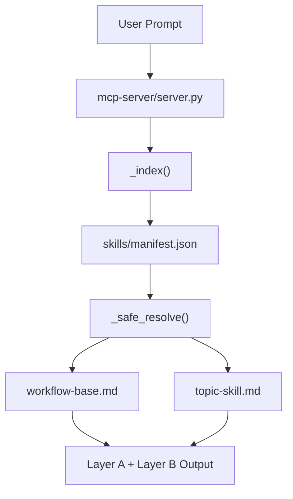
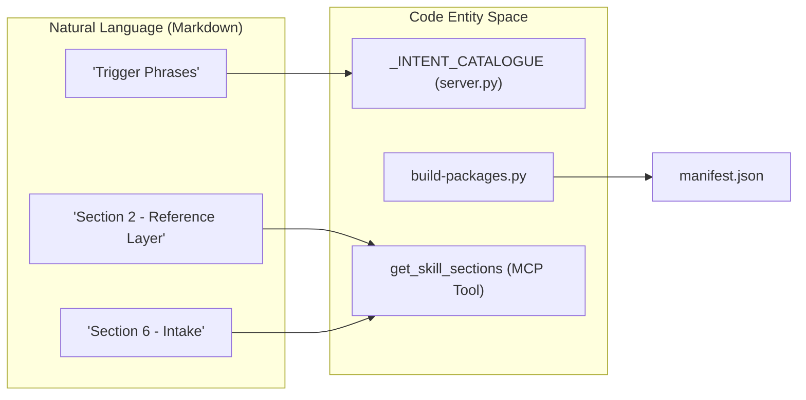

<!-- source: DeepWiki mcp.deepwiki.com · repo openaccountants/openaccountants · page 9.1 Writing a New Skill · fetched 2026-10-27 -->

# Writing a New Skill

<details>
<summary>Relevant source files</summary>

The following files were used as context for generating this wiki page:

- [.github/FUNDING.yml](.github/FUNDING.yml)
- [.github/ISSUE_TEMPLATE/bug-report.md](.github/ISSUE_TEMPLATE/bug-report.md)
- [.github/ISSUE_TEMPLATE/new-country.md](.github/ISSUE_TEMPLATE/new-country.md)
- [.github/ISSUE_TEMPLATE/rate-correction.md](.github/ISSUE_TEMPLATE/rate-correction.md)
- [.github/ISSUE_TEMPLATE/vendor-pattern.md](.github/ISSUE_TEMPLATE/vendor-pattern.md)
- [.github/PULL_REQUEST_TEMPLATE.md](.github/PULL_REQUEST_TEMPLATE.md)
- [cookbook-contribution/README.md](cookbook-contribution/README.md)
- [cookbook-contribution/custom_skills/classifying-tax-transactions/SKILL.md](cookbook-contribution/custom_skills/classifying-tax-transactions/SKILL.md)
- [cookbook-contribution/custom_skills/tax-workflow-base/SKILL.md](cookbook-contribution/custom_skills/tax-workflow-base/SKILL.md)
- [docs/ARCHITECTURE-OPTIONS.md](docs/ARCHITECTURE-OPTIONS.md)
- [docs/skill-template.md](docs/skill-template.md)
- [skills/financial-reporting/business-combinations/ifrs3-business-combinations.md](skills/financial-reporting/business-combinations/ifrs3-business-combinations.md)
- [skills/financial-reporting/business-combinations/us-gaap-asc805-business-combinations.md](skills/financial-reporting/business-combinations/us-gaap-asc805-business-combinations.md)
- [skills/financial-reporting/debt-vs-equity/ias32-debt-vs-equity.md](skills/financial-reporting/debt-vs-equity/ias32-debt-vs-equity.md)
- [skills/financial-reporting/debt-vs-equity/us-gaap-debt-vs-equity.md](skills/financial-reporting/debt-vs-equity/us-gaap-debt-vs-equity.md)
- [skills/financial-reporting/financial-reporting-workflow-base.md](skills/financial-reporting/financial-reporting-workflow-base.md)
- [skills/financial-reporting/leases/ifrs16-leases.md](skills/financial-reporting/leases/ifrs16-leases.md)
- [skills/financial-reporting/leases/us-gaap-asc842-leases.md](skills/financial-reporting/leases/us-gaap-asc842-leases.md)
- [skills/financial-reporting/revenue-recognition/ifrs15-revenue.md](skills/financial-reporting/revenue-recognition/ifrs15-revenue.md)
- [skills/financial-reporting/revenue-recognition/us-gaap-asc606-revenue.md](skills/financial-reporting/revenue-recognition/us-gaap-asc606-revenue.md)
- [skills/international/kazakhstan/kz-simplified-regime.md](skills/international/kazakhstan/kz-simplified-regime.md)
- [skills/manifest.json](skills/manifest.json)

</details>


This guide provides a step-by-step technical walkthrough for creating a new skill in the OpenAccountants repository. Skills are the core logic units of the system, written in Markdown with YAML frontmatter, designed to be interpreted by LLMs within a structured workflow.

## 1. Directory Selection

The repository organizes skills by jurisdiction and type. You must place your new `.md` file in the correct subdirectory within `skills/` to ensure the build pipeline correctly categorizes it.

| Directory Path | Content Type |
|:---|:---|
| `skills/international/[country]/` | Country-specific tax/accounting skills (VAT, Income Tax). |
| `skills/federal/` | US/Canada Federal level skills (e.g., Form 1040, T1). |
| `skills/us-states/[state-code]/` | US State-specific sales and income tax skills. |
| `skills/bookkeeping/` | Platform-agnostic bookkeeping and reconciliation patterns. |
| `skills/integrations/` | Logic for parsing exports from Xero, QuickBooks, Stripe, etc. |
| `skills/verticals/` | Industry-specific logic (e.g., SaaS, Real Estate). |

**Sources:** [skills/manifest.json:47-270](), [skills/international/kazakhstan/kz-simplified-regime.md:22-24]()

## 2. YAML Frontmatter Standard

Every skill must begin with a YAML block. This metadata is used by `scripts/build-packages.py` to resolve dependencies and by the MCP server to index capabilities.

```yaml
---
name: [unique-id]
description: >
  A detailed description of triggers and purpose.
version: 0.1
jurisdiction: [ISO-Code or GLOBAL]
category: [international|federal|state|integration|etc]
tax_year: "2025"
quality: research-verified
depends_on:
  - [workflow-base-id]
---
```

### Key Fields
- `name`: Must match the filename (without extension).
- `depends_on`: Most skills **must** load a workflow base (e.g., `vat-workflow-base`, `income-tax-workflow-base`, or `financial-reporting-workflow-base`) to inherit the output contract.
- `quality`: Defaults to `research-verified`. Only the core maintainers promote skills to `accountant-verified`.

**Sources:** [skills/financial-reporting/revenue-recognition/ifrs15-revenue.md:1-23](), [skills/financial-reporting/financial-reporting-workflow-base.md:1-19]()

## 3. Standard Section Order

To maintain consistency across 700+ skills, follow this section sequence:

1.  **Skill Metadata & Header**: Title and version.
2.  **Step 0 Onboarding/Intake**: Define the "Classified/Assumed/Needs Input" state. List specific questions the AI must ask if data is missing.
3.  **Classification Logic**: Rules for tax residency, entity type, or transaction nature.
4.  **Box Assignment / Mapping**: Map transactions to specific form boxes (e.g., "Box 1 on Form 910").
5.  **Reverse Charge / Taxability**: Specific rules for B2B vs B2C.
6.  **Deductibility Rules**: What expenses are allowed/disallowed.
7.  **Calculations**: Formulas for rates, surcharges, and credits.
8.  **Thresholds & Deadlines**: Registration limits and filing dates.
9.  **PROHIBITIONS**: Hard constraints (e.g., "DO NOT apply this to VAT-exempt entities").
10. **Edge Case Registry**: Handling of rare scenarios.
11. **Test Suite / Worked Examples**: Sample inputs and expected outputs.

**Sources:** [skills/international/kazakhstan/kz-simplified-regime.md:56-105](), [skills/financial-reporting/financial-reporting-workflow-base.md:37-116]()

## 4. Implementation Logic

### The Two-Layer Contract
Most content skills implement a "Two-Layer" approach defined in the workflow bases:
- **Layer A (Reference)**: Citation-anchored rules (e.g., `IFRS 15.31`).
- **Layer B (Executable)**: Step-by-step computation using specific facts.

### Data Flow Diagram: Skill Invocation
This diagram shows how a user prompt moves from the MCP server into the skill logic.

Title: Skill Execution Flow

**Sources:** [skills/manifest.json:1-46](), [skills/financial-reporting/financial-reporting-workflow-base.md:37-58]()

### Logic Association: Natural Language to Code
This diagram bridges the Markdown instructions to the system entities that process them.

Title: Entity Mapping

**Sources:** [skills/manifest.json:47-58](), [skills/financial-reporting/revenue-recognition/ifrs15-revenue.md:54-56]()

## 5. Build and Validation

After writing the skill, you must run the build scripts to update the distribution packages and the global manifest.

1.  **Validate YAML**: Ensure no syntax errors in the frontmatter.
2.  **Generate Packages**:
    ```bash
    python3 scripts/build-packages.py
    ```
    This script compiles the raw skill and its dependencies into the `packages/` directory.
3.  **Update Manifest**:
    ```bash
    python3 scripts/build-skills-manifest.py
    ```
    This updates `skills/manifest.json`, which the MCP server uses for searching and indexing.

### PR Checklist
Before submitting a Pull Request, verify:
- [ ] File is in `skills/` (not only `packages/`).
- [ ] Rates and thresholds cite a primary source (statute or tax authority).
- [ ] A disclaimer is present at the end of the file.
- [ ] `python3 scripts/build-packages.py` was executed.

**Sources:** [.github/PULL_REQUEST_TEMPLATE.md:17-33](), [skills/manifest.json:1-8]()

---

