# Page: OpenAccountants Overview

# OpenAccountants Overview

<details>
<summary>Relevant source files</summary>

The following files were used as context for generating this wiki page:

- [CHANGELOG.md](CHANGELOG.md)
- [CLAUDE.md](CLAUDE.md)
- [README.md](README.md)
- [START-HERE.md](START-HERE.md)
- [docs/INTELLIGENCE-ROADMAP.md](docs/INTELLIGENCE-ROADMAP.md)
- [docs/PROMOTION-PLAYBOOK.md](docs/PROMOTION-PLAYBOOK.md)
- [docs/QUALITY-TIERS.md](docs/QUALITY-TIERS.md)
- [docs/USER-JOURNEY-ANALYSIS.md](docs/USER-JOURNEY-ANALYSIS.md)
- [docs/growth-drafts.md](docs/growth-drafts.md)
- [glama.json](glama.json)
- [llms.txt](llms.txt)
- [packages/indonesia/README.md](packages/indonesia/README.md)
- [packages/nepal/README.md](packages/nepal/README.md)
- [packages/portugal/README.md](packages/portugal/README.md)
- [packages/saudi-arabia/README.md](packages/saudi-arabia/README.md)

</details>


OpenAccountants is the open-source tax and accounting layer for AI agents. It provides a library of over 1,000 "skills"—standardized markdown files containing tax rules, computation logic, and filing workflows—covering 190+ jurisdictions [README.md:3-7](). 

The system is designed to transform raw financial data, such as bank statements or bookkeeping exports, into structured accounting working papers that are ready for professional review [START-HERE.md:11-13]().

## System Concept: Natural Language to Code
OpenAccountants bridges the gap between a user's natural language tax questions and the specific tax statutes and computation logic required to answer them.

### Mapping User Intent to Code Entities
The following diagram illustrates how a user's natural language request is routed through the system's core entities.

**Diagram: Intent-to-Skill Mapping**
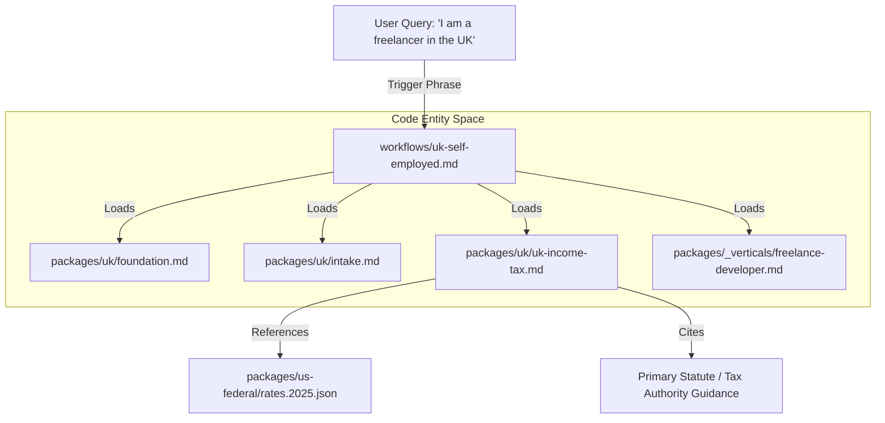
**Sources:** [README.md:17-50](), [llms.txt:75-103](), [CLAUDE.md:42-43]()

## Core Components

### 1. Skills and Packages
The repository is organized into two primary layers:
*   **`skills/`**: The source layer containing modular building blocks for workflows, domain logic, and patterns [CLAUDE.md:7-10]().
*   **`packages/`**: The distribution layer where skills are compiled into self-contained, jurisdiction-specific folders (e.g., `packages/malta/`, `packages/uk/`) [README.md:81-94](). These are generated via `scripts/build-packages.py` [README.md:98-99]().

### 2. Quality Tiers
OpenAccountants operates on a two-tier quality system to ensure reliability:
*   **Tier 1: Accountant-verified**: Reviewed and signed off by a named, licensed practitioner (CPA/CA/EA). These are served via the MCP server and official website [llms.txt:15-16]().
*   **Tier 2: Research-verified**: Drafted from primary legislation and authoritative sources. These live in the public repository as high-quality drafts awaiting sign-off [docs/QUALITY-TIERS.md:9-14]().

For details on the promotion process, see [Quality Tiers and Verification Lifecycle](#1.2).

### 3. MCP Server
The `openaccountants-mcp` package (located in `mcp/`) allows AI clients like Claude Desktop, Cursor, and Windsurf to dynamically search and load skills without manual file uploads [README.md:65-72]().

**Diagram: MCP Architecture**
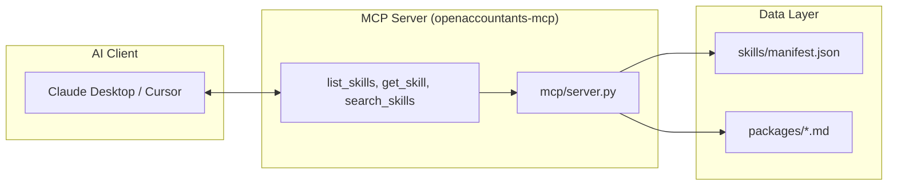
**Sources:** [README.md:65-72](), [llms.txt:54-55](), [CLAUDE.md:8-10]()

## Access Patterns

| Access Method | Mechanism | Target Audience |
| :--- | :--- | :--- |
| **MCP Connector** | `pip install openaccountants-mcp` | Power users, developers, and agents (Claude, Cursor) |
| **Bundle API** | `GET /api/bundle/<CODE>` | Programmatic access for web integrations |
| **Manual Upload** | Drag & drop `.md` files | One-off users of Claude.ai or ChatGPT |

For setup instructions, see [Getting Started](#1.1).

## Jurisdiction and Domain Coverage
OpenAccountants provides broad coverage across multiple tax regimes:
*   **International**: 134+ countries with varying levels of depth [README.md:7]().
*   **US/Canada**: Full federal coverage plus 51 US state packages and 13 Canadian provincial packages [README.md:88-93]().
*   **Cross-Border**: Specialized skills for residency, EU VAT, and Pillar Two minimum tax [CHANGELOG.md:9-20]().
*   **Verticals**: Industry-specific logic for e-commerce, SaaS, real estate, and more [START-HERE.md:21-40]().

## Repository Structure

| Directory | Purpose |
| :--- | :--- |
| `packages/` | Compiled jurisdiction-specific skill bundles [CLAUDE.md:7]() |
| `skills/` | Source skills, foundation bases, and shared patterns [llms.txt:68]() |
| `workflows/` | Definitions for the 6-phase advisor lifecycle [llms.txt:69]() |
| `mcp/` | Python source for the Model Context Protocol server [CLAUDE.md:8]() |
| `scripts/` | Build tools and maintenance utilities [CLAUDE.md:10]() |
| `docs/` | Quality standards and contributor guides [CLAUDE.md:9]() |

**Sources:** [README.md:81-94](), [llms.txt:58-71](), [CLAUDE.md:5-14]()

---
*Next Steps:*
*   To begin using the skills, see [Getting Started](#1.1).
*   To understand the verification process, see [Quality Tiers and Verification Lifecycle](#1.2).
*   For legal and licensing information, see [Licensing and Legal](#1.3).

---

# Page: Getting Started

# Getting Started

<details>
<summary>Relevant source files</summary>

The following files were used as context for generating this wiki page:

- [.claude-plugin/marketplace.json](.claude-plugin/marketplace.json)
- [CHANGELOG.md](CHANGELOG.md)
- [README.md](README.md)
- [START-HERE.md](START-HERE.md)
- [docs/INTELLIGENCE-ROADMAP.md](docs/INTELLIGENCE-ROADMAP.md)
- [docs/PROMOTION-PLAYBOOK.md](docs/PROMOTION-PLAYBOOK.md)
- [docs/QUALITY-TIERS.md](docs/QUALITY-TIERS.md)
- [docs/USER-JOURNEY-ANALYSIS.md](docs/USER-JOURNEY-ANALYSIS.md)
- [docs/growth-drafts.md](docs/growth-drafts.md)
- [llms.txt](llms.txt)
- [packages/indonesia/README.md](packages/indonesia/README.md)
- [packages/nepal/README.md](packages/nepal/README.md)
- [packages/portugal/README.md](packages/portugal/README.md)
- [packages/saudi-arabia/README.md](packages/saudi-arabia/README.md)
- [plugins/openaccountants/.claude-plugin/plugin.json](plugins/openaccountants/.claude-plugin/plugin.json)
- [plugins/openaccountants/commands/openaccountants.md](plugins/openaccountants/commands/openaccountants.md)

</details>


OpenAccountants provides a library of research-verified and accountant-verified tax computation skills for AI agents. This page covers the primary methods for accessing these skills, from manual file uploads to automated MCP integration.

## Purpose and Scope

OpenAccountants bridges the gap between raw financial data and professional tax preparation. It is designed to produce a **Working Paper** that a qualified professional can review and sign off on, rather than providing direct tax advice [START-HERE.md:9-13](). 

The system operates across two primary access patterns:
1.  **The MCP Path (Canonical):** Real-time, tool-based access to the latest accountant-verified (Tier 1) skills [README.md:72]().
2.  **The Manual Path:** Direct interaction with markdown files for auditing, local development, or one-off LLM sessions [README.md:69]().

---

## Access Pattern 1: MCP Server (Recommended)

The Model Context Protocol (MCP) server is the primary way to use OpenAccountants. It provides structured tools that allow an LLM (like Claude Desktop, Cursor, or ChatGPT Business) to discover and fetch skills dynamically [README.md:65-72]().

### 1. Installation
The MCP server is available via PyPI and can be installed using the following command:
```bash
pip install openaccountants-mcp
```
[docs/growth-drafts.md:21]()

### 2. Connection
The server can be connected to any MCP-aware client using the following endpoint:
`https://www.openaccountants.com/api/mcp`
[llms.txt:54]()

### 3. Tool Interaction Flow
When a user asks a tax question, the AI follows a specific sequence of tool calls to ensure compliance with the OpenAccountants framework:

Title: MCP Skill Retrieval Flow
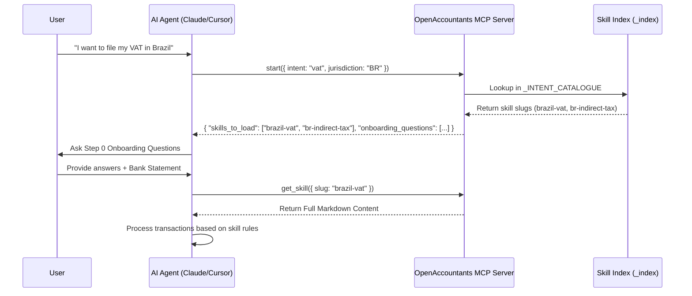
Sources: [plugins/openaccountants/commands/openaccountants.md:6-11](), [llms.txt:54](), [README.md:17-27]()

---

## Access Pattern 2: Manual File Upload

For users who prefer not to use MCP, or for developers auditing the research-verified (Tier 2) drafts, the repository provides pre-compiled **Packages**.

### 1. Locating Packages
Packages are self-contained folders located in `packages/`. Each folder contains everything an LLM needs to handle a specific jurisdiction [README.md:78-94]():
*   `foundation.md`: Core logic, conservative defaults, and output specifications [README.md:147]().
*   `intake.md`: Step 0 onboarding questions and refusal logic [README.md:148]().
*   `[jurisdiction]-*.md`: Specific domain skills (VAT, Income Tax, etc.) [README.md:149-152]().

### 2. Execution Steps
1.  **Identify Scenario:** Match your situation to a scenario in [START-HERE.md:21-40]().
2.  **Upload:** Drag all `.md` files from the relevant `packages/<jurisdiction>/` folder into your LLM's knowledge base (e.g., Claude Projects or Custom GPTs) [README.md:100-104]().
3.  **Prompt:** Initiate the session with a specific trigger phrase like: *"Help me with my 2025 taxes. Here is my bank statement."* [START-HERE.md:23]()

---

## The Bundle API

For developers building custom integrations without a full MCP client, OpenAccountants provides a **Bundle API**. This allows fetching all relevant markdown skills for a jurisdiction in a single GET request [llms.txt:40-43]().

| Jurisdiction | ISO Code | API Endpoint Example |
| :--- | :--- | :--- |
| United Kingdom | `GB` | `https://www.openaccountants.com/api/bundle/GB` |
| United States (California) | `US-CA` | `https://www.openaccountants.com/api/bundle/US-CA` |
| South Africa | `ZA` | `https://www.openaccountants.com/api/bundle/ZA` |
| Ontario (Canada) | `CA-ON` | `https://www.openaccountants.com/api/bundle/CA-ON` |

Sources: [llms.txt:41-50]()

---

## Data Flow: From Natural Language to Code Entities

The following diagram illustrates how a natural language request is mapped to the internal file structure and code-based "skills" within the repository.

Title: Natural Language to Code Entity Mapping
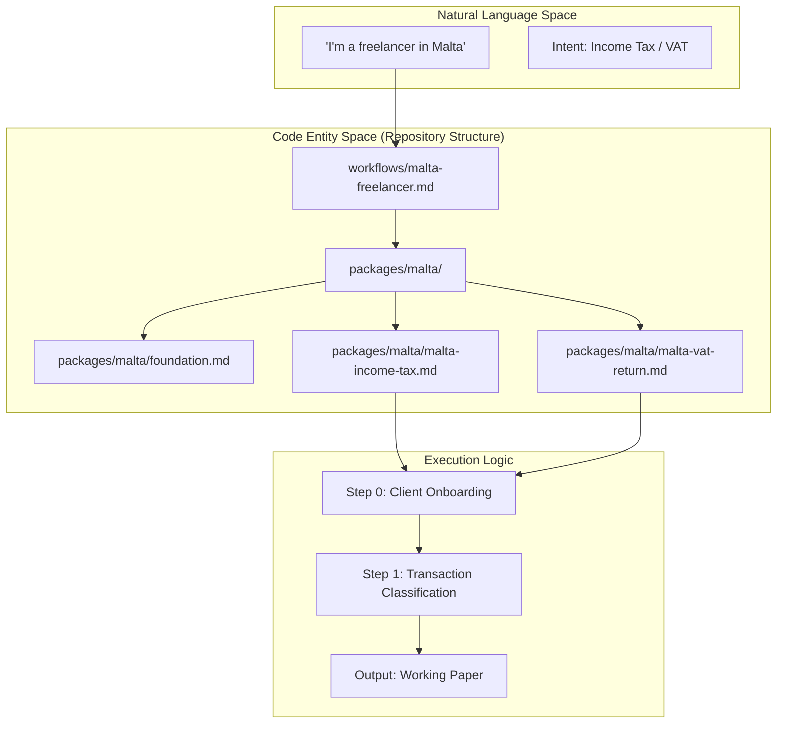
Sources: [llms.txt:58-71](), [START-HERE.md:46-53](), [docs/QUALITY-TIERS.md:41-61]()

---

## Quick Start Summary

| Task | Action | Reference |
| :--- | :--- | :--- |
| **Use via Claude** | Connect the Claude Plugin or MCP server. | [README.md:54](), [.claude-plugin/marketplace.json:7-14]() |
| **Manual Use** | Download a folder from `packages/` and upload to LLM. | [README.md:78-94]() |
| **Verify Accuracy** | Check the `verified_by` field in the file frontmatter. | [docs/QUALITY-TIERS.md:94]() |
| **Build Packages** | Run `python3 scripts/build-packages.py` for latest bundles. | [README.md:98]() |

Sources: [README.md:54-104](), [docs/QUALITY-TIERS.md:94](), [START-HERE.md:21-40]()

---

# Page: Quality Tiers and Verification Lifecycle

# Quality Tiers and Verification Lifecycle

<details>
<summary>Relevant source files</summary>

The following files were used as context for generating this wiki page:

- [.github/FUNDING.yml](.github/FUNDING.yml)
- [.github/ISSUE_TEMPLATE/bug-report.md](.github/ISSUE_TEMPLATE/bug-report.md)
- [.github/ISSUE_TEMPLATE/new-country.md](.github/ISSUE_TEMPLATE/new-country.md)
- [.github/ISSUE_TEMPLATE/rate-correction.md](.github/ISSUE_TEMPLATE/rate-correction.md)
- [.github/ISSUE_TEMPLATE/vendor-pattern.md](.github/ISSUE_TEMPLATE/vendor-pattern.md)
- [.github/PULL_REQUEST_TEMPLATE.md](.github/PULL_REQUEST_TEMPLATE.md)
- [CHANGELOG.md](CHANGELOG.md)
- [CLA.md](CLA.md)
- [COMMERCIAL_LICENSE.md](COMMERCIAL_LICENSE.md)
- [CONTRIBUTING.md](CONTRIBUTING.md)
- [LICENSE](LICENSE)
- [START-HERE.md](START-HERE.md)
- [docs/ARCHITECTURE-OPTIONS.md](docs/ARCHITECTURE-OPTIONS.md)
- [docs/INTELLIGENCE-ROADMAP.md](docs/INTELLIGENCE-ROADMAP.md)
- [docs/PROMOTION-PLAYBOOK.md](docs/PROMOTION-PLAYBOOK.md)
- [docs/QUALITY-TIERS.md](docs/QUALITY-TIERS.md)
- [docs/USER-JOURNEY-ANALYSIS.md](docs/USER-JOURNEY-ANALYSIS.md)
- [docs/growth-drafts.md](docs/growth-drafts.md)
- [docs/skill-template.md](docs/skill-template.md)
- [skills/foundation/workflow-base.md](skills/foundation/workflow-base.md)

</details>


OpenAccountants employs a rigorous two-tier quality system to manage the reliability of AI-driven tax and accounting workflows. Because tax law is a high-stakes domain, the system prioritizes radical transparency over perceived completeness. Every skill in the repository is explicitly labeled as either **Research-verified** or **Accountant-verified** [docs/QUALITY-TIERS.md:5-16]().

## The Two-Tier System

The quality tier is defined in the YAML frontmatter of every skill file and determines the level of trust a user or practitioner can place in the output [docs/QUALITY-TIERS.md:11-15]().

| Tier | Definition | Guarantees |
| :--- | :--- | :--- |
| **Accountant-verified** | Reviewed and signed off by a licensed practitioner (CPA, EA, CA, etc.) [docs/QUALITY-TIERS.md:13](). | Tested against real client data; current with latest tax-year rates; carries reviewer's name and license [docs/QUALITY-TIERS.md:22-28](). |
| **Research-verified** | Drafted from authoritative statutes and tax authority publications [docs/QUALITY-TIERS.md:14](). | Follows standard `workflow-base.md` structure; every figure carries a primary-source citation [docs/QUALITY-TIERS.md:29-35](). |

### Verification Lifecycle Data Flow

The following diagram illustrates how a skill moves from initial research to practitioner sign-off, involving specific scripts and metadata fields.

**Verification Promotion Logic**
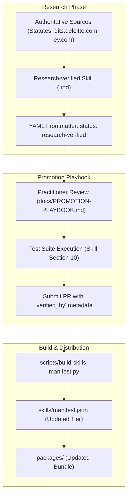
**Sources:** [docs/QUALITY-TIERS.md:127-134](), [docs/PROMOTION-PLAYBOOK.md](), [scripts/build-skills-manifest.py:35-36]()

---

## Implementation Detail: The Verification Contract

All skills, regardless of tier, must implement the **Conservative Defaults Principle** defined in the `workflow-base.md` [skills/foundation/workflow-base.md:28-30](). This ensures that even "Research-verified" skills fail safely by assuming more tax liability rather than less when data is ambiguous.

### Data States in Verification
Every transaction processed by a skill must be assigned one of three outcomes based on document evidence [skills/foundation/workflow-base.md:32-44]():

1.  **Classified:** Facts are clear; rule applied with citation.
2.  **Assumed:** Facts missing; **Conservative Default** applied (e.g., standard rate assumed for unknown supply) [skills/foundation/workflow-base.md:52-59]().
3.  **Needs Input:** Cannot proceed; requires user or reviewer intervention.

### Verification Metadata (YAML)
The build pipeline uses specific YAML fields to categorize skills.
*   `status`: `research-verified` or `accountant-verified`.
*   `verified_by`: Name and license number of the practitioner.
*   `last_updated`: Date of the last legislative check.
*   `sources`: List of primary statutes or tax authority URLs [docs/QUALITY-TIERS.md:118-120]().

**Sources:** [skills/foundation/workflow-base.md:28-59](), [docs/QUALITY-TIERS.md:94-98]()

---

## The Promotion Playbook

The process of moving a skill from "Research-verified" to "Accountant-verified" is governed by the `docs/PROMOTION-PLAYBOOK.md`. This involves a three-step verification of the "Code Entity Space" (the Markdown rules) against "Natural Language Space" (the actual law).

### 1. Statutory Cross-Check
The practitioner verifies every rate, threshold, and deadline in the skill against current law (e.g., IRC for US, VAT Act for Malta) [docs/QUALITY-TIERS.md:130]().

### 2. Representative Data Testing
The skill must be run against representative or anonymized real client data to ensure the `Box/Line Assignment` (Step 2) and `Derived Calculations` (Step 5) produce correct tax returns [docs/QUALITY-TIERS.md:131](), [docs/QUALITY-TIERS.md:48-51]().

### 3. Manifest Update
The `scripts/build-skills-manifest.py` script crawls the `skills/` directory and updates the central `manifest.json`. This manifest is used by the MCP server and the website to display the quality badge [docs/QUALITY-TIERS.md:94]().

**Code-to-Quality Mapping**
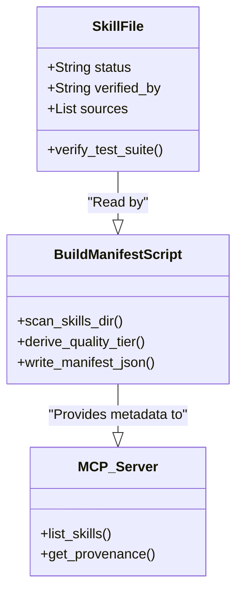
**Sources:** [docs/QUALITY-TIERS.md:127-134](), [scripts/build-skills-manifest.py:35-36](), [docs/QUALITY-TIERS.md:94]()

---

## Current Inventory and Verification Status

As of the current release, the following jurisdictions have achieved **Accountant-verified** status for their core modules:

| Jurisdiction | Verified Skills | Reviewer |
| :--- | :--- | :--- |
| **Malta** | VAT, Income Tax, SSC, Optimization [docs/QUALITY-TIERS.md:80-84]() | Michael Cutajar, CPA |
| **South Africa** | VAT, Income Tax, Provisional Tax [docs/QUALITY-TIERS.md:86-89]() | Michael Cutajar, CPA |
| **US Federal** | Sole Prop Bookkeeping, Schedule C [docs/QUALITY-TIERS.md:90-91]() | Practitioner Registry Pending |
| **Germany** | VAT Return [docs/QUALITY-TIERS.md:85]() | Practitioner Registry Pending |

All other 700+ skills (including 51 US States and 134+ countries) remain in the **Research-verified** tier [docs/QUALITY-TIERS.md:97-98]().

**Sources:** [docs/QUALITY-TIERS.md:76-98](), [CHANGELOG.md:82-85]()

---

# Page: Licensing and Legal

# Licensing and Legal

<details>
<summary>Relevant source files</summary>

The following files were used as context for generating this wiki page:

- [CLA.md](CLA.md)
- [COMMERCIAL_LICENSE.md](COMMERCIAL_LICENSE.md)
- [CONTRIBUTING.md](CONTRIBUTING.md)
- [LICENSE](LICENSE)
- [LICENSE-ADDITIONAL.md](LICENSE-ADDITIONAL.md)
- [skills/foundation/workflow-base.md](skills/foundation/workflow-base.md)

</details>


OpenAccountants operates under a dual-license model designed to balance the needs of the open-source community with the requirements of commercial software vendors. This page details the legal framework governing the use, modification, and contribution of skills within the repository.

## Dual-License Model

The codebase is primarily licensed under the **GNU Affero General Public License v3.0 (AGPL-3.0)** [LICENSE:1-2](). To accommodate users who cannot comply with the "copyleft" requirements of the AGPL, a **Commercial License** option is provided by Glimpse Ltd [LICENSE-ADDITIONAL.md:13-15]().

### 1. Open Source: AGPL-3.0
The AGPL-3.0 is a strong copyleft license specifically designed for network server software [LICENSE:10-12](). 

*   **Key Requirement:** If you run a modified version of OpenAccountants on a server and let the public access it, you must make the Corresponding Source code of that modified version available to those users [LICENSE:42-48]().
*   **Scope:** This applies to any "covered work," which includes unmodified versions of the program or works based on the program [LICENSE:77-79]().

### 2. Commercial License
The commercial license is intended for businesses and products that incorporate OpenAccountants skills but do not wish to release their proprietary source code under the AGPL-3.0 [COMMERCIAL_LICENSE.md:9-14]().

| Use Case | License Required |
| :--- | :--- |
| Personal tax preparation in an LLM | **AGPL-3.0** (No fee) |
| Accountants using skills as a reference tool | **AGPL-3.0** (No fee) |
| Open-source projects (AGPL-compatible) | **AGPL-3.0** (No fee) |
| **Proprietary SaaS / API products** | **Commercial** |
| **Proprietary LLM agents/chatbots** | **Commercial** |

**Sources:** [LICENSE:1-50](), [COMMERCIAL_LICENSE.md:18-39](), [LICENSE-ADDITIONAL.md:1-16]()

---

## Attribution and Additional Terms

Under Section 7 of the AGPL-3.0, OpenAccountants exercises the right to require specific attribution [LICENSE-ADDITIONAL.md:5-7]().

*   **Requirement:** Users must retain all copyright notices, the "Open Accountants" name, and links to `openaccountants.com` [LICENSE-ADDITIONAL.md:9-11]().
*   **Visibility:** This attribution must be present in any modified versions, derivative works, and user-facing output that references the skills [LICENSE-ADDITIONAL.md:11-12]().

### Legal Entity
All licensing (both commercial and the CLA) is managed by:
**Glimpse Ltd**
Malta
Contact: `info@openaccountants.com`

**Sources:** [LICENSE-ADDITIONAL.md:1-16](), [COMMERCIAL_LICENSE.md:72-79](), [CLA.md:60-67]()

---

## Contributor License Agreement (CLA)

To maintain the dual-license model, all contributors must agree to the OpenAccountants CLA. This ensures that Glimpse Ltd has the legal authority to distribute contributions under both the AGPL and commercial tracks [CLA.md:7-9]().

### Rights and Permissions
*   **Ownership:** The contributor retains full copyright ownership of their work [CLA.md:11-12]().
*   **Grant:** The contributor grants Glimpse Ltd a perpetual, worldwide, non-exclusive, royalty-free, irrevocable license to use, modify, and sublicense the contribution under any license [CLA.md:19-22]().
*   **Patents:** The contributor grants a patent license for any claims necessarily infringed by their contribution [CLA.md:23-26]().

### Implementation: The "Checkbox" Flow
The CLA is integrated into the GitHub contribution workflow via the pull request template.

**Natural Language to Code Entity: Contribution Flow**
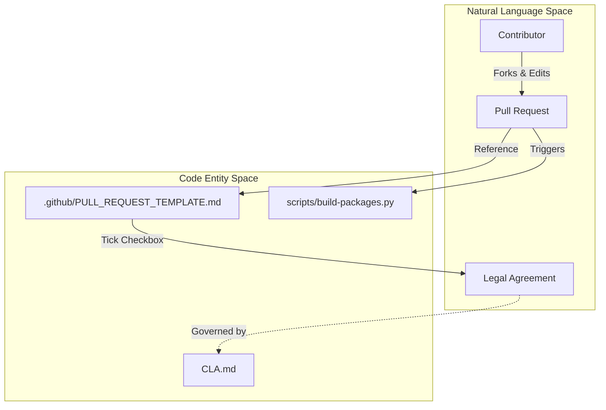

**Sources:** [CLA.md:1-46](), [CONTRIBUTING.md:18-25]()

---

## Technical Enforcement of Disclaimers

The licensing model is reinforced by automated scripts that inject legal disclaimers and metadata into the generated packages.

### Automated Disclaimer Injection
The build pipeline uses scripts to ensure that every skill carries the necessary legal protections before it is distributed.

1.  **Workflow Base Requirement:** Every skill must be loaded with `workflow-base.md`, which contains the "Reviewer Assumption" and "Conservative Defaults" legal frameworks [skills/foundation/workflow-base.md:2-23]().
2.  **Disclaimer Suffix:** Skills are appended with a mandatory disclaimer stating they are "not tax advice" [CONTRIBUTING.md:50-50]().
3.  **Build Pipeline Integration:** The `scripts/build-packages.py` script aggregates source skills into the `packages/` directory, ensuring the `foundation.md` (which includes legal warnings) is bundled automatically [CONTRIBUTING.md:23-26](), [CONTRIBUTING.md:79-89]().

**Data Flow: Legal Metadata Injection**
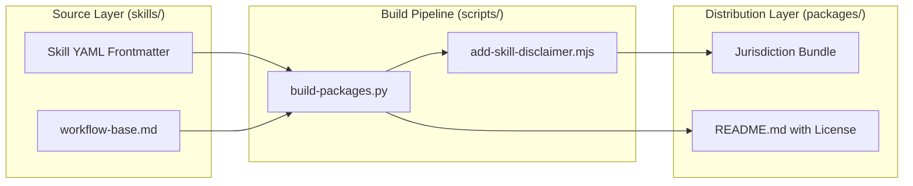

**Sources:** [CONTRIBUTING.md:23-26](), [CONTRIBUTING.md:79-89](), [skills/foundation/workflow-base.md:1-23]()

---

# Page: Core Architecture

# Core Architecture

<details>
<summary>Relevant source files</summary>

The following files were used as context for generating this wiki page:

- [CHANGELOG.md](CHANGELOG.md)
- [README.md](README.md)
- [START-HERE.md](START-HERE.md)
- [docs/INTELLIGENCE-ROADMAP.md](docs/INTELLIGENCE-ROADMAP.md)
- [docs/PROMOTION-PLAYBOOK.md](docs/PROMOTION-PLAYBOOK.md)
- [docs/QUALITY-TIERS.md](docs/QUALITY-TIERS.md)
- [docs/USER-JOURNEY-ANALYSIS.md](docs/USER-JOURNEY-ANALYSIS.md)
- [docs/growth-drafts.md](docs/growth-drafts.md)
- [llms.txt](llms.txt)
- [packages/indonesia/README.md](packages/indonesia/README.md)
- [packages/nepal/README.md](packages/nepal/README.md)
- [packages/portugal/README.md](packages/portugal/README.md)
- [packages/saudi-arabia/README.md](packages/saudi-arabia/README.md)
- [skills/financial-reporting/business-combinations/ifrs3-business-combinations.md](skills/financial-reporting/business-combinations/ifrs3-business-combinations.md)
- [skills/financial-reporting/business-combinations/us-gaap-asc805-business-combinations.md](skills/financial-reporting/business-combinations/us-gaap-asc805-business-combinations.md)
- [skills/financial-reporting/debt-vs-equity/ias32-debt-vs-equity.md](skills/financial-reporting/debt-vs-equity/ias32-debt-vs-equity.md)
- [skills/financial-reporting/debt-vs-equity/us-gaap-debt-vs-equity.md](skills/financial-reporting/debt-vs-equity/us-gaap-debt-vs-equity.md)
- [skills/financial-reporting/financial-reporting-workflow-base.md](skills/financial-reporting/financial-reporting-workflow-base.md)
- [skills/financial-reporting/leases/ifrs16-leases.md](skills/financial-reporting/leases/ifrs16-leases.md)
- [skills/financial-reporting/leases/us-gaap-asc842-leases.md](skills/financial-reporting/leases/us-gaap-asc842-leases.md)
- [skills/financial-reporting/revenue-recognition/ifrs15-revenue.md](skills/financial-reporting/revenue-recognition/ifrs15-revenue.md)
- [skills/financial-reporting/revenue-recognition/us-gaap-asc606-revenue.md](skills/financial-reporting/revenue-recognition/us-gaap-asc606-revenue.md)
- [skills/international/kazakhstan/kz-simplified-regime.md](skills/international/kazakhstan/kz-simplified-regime.md)
- [skills/manifest.json](skills/manifest.json)

</details>


The OpenAccountants system is built on a decoupled, two-layer architecture designed to separate the **authoritative source of truth** (the skills layer) from the **consumable delivery format** (the packages layer). This structure ensures that tax rules remain modular and maintainable while providing AI agents with self-contained, context-rich bundles for specific jurisdictions.

### High-Level System Overview

The following diagram illustrates how raw skills are transformed into jurisdiction-specific packages and ultimately consumed by AI clients via the MCP server or manual upload.

**System Data Flow**
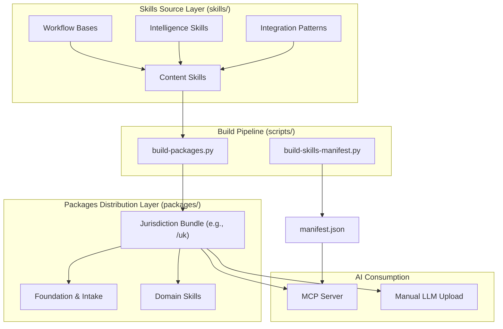
**Sources:** [README.md:15-27](), [README.md:76-94](), [llms.txt:56-71]()

---

### 1. Skills Source Layer
The `skills/` directory is the "source code" of the repository. It contains granular, atomic markdown files that define tax treatments, calculation logic, and reporting thresholds. These files are categorized by domain (e.g., `international/`, `us-states/`, `federal/`) and are designed to be composed together.

*   **Workflow Bases:** Provide the "contract" for how an AI should behave (e.g., `financial-reporting-workflow-base.md`).
*   **Content Skills:** The specific rules for a tax obligation (e.g., `ifrs15-revenue.md`).
*   **Intelligence & Patterns:** Reusable logic for deadlines, thresholds, and vendor-specific transaction classification.

For a deep dive into how skills are structured and the YAML frontmatter standard, see [Skills Source Layer](#2.1).

**Sources:** [llms.txt:68-69](), [skills/financial-reporting/revenue-recognition/ifrs15-revenue.md:29-32](), [docs/QUALITY-TIERS.md:39-61]()

---

### 2. Packages Distribution Layer
The `packages/` directory contains the "compiled" output of the system. Each folder in this directory represents a complete, self-contained environment for an AI agent to handle a specific jurisdiction (e.g., `packages/malta/`, `packages/ca-on/`).

*   **Self-Contained:** Every package includes its own `foundation.md` and `intake.md` to ensure the AI follows the correct onboarding and conservative default protocols.
*   **Domain Specific:** Packages aggregate all relevant skills for that region, including income tax, VAT, and local social contributions.
*   **Immutable:** Files in `packages/` should never be edited directly; they are overwritten during the build process.

For details on the structure of a jurisdiction bundle, see [Packages Distribution Layer](#2.2).

**Sources:** [README.md:80-94](), [README.md:143-154](), [llms.txt:59-64]()

---

### 3. Build Pipeline and Manifest
The bridge between the source skills and the distributed packages is the `scripts/` directory. This pipeline automates the assembly of bundles and the generation of system metadata.

*   **`build-packages.py`**: The primary compiler that maps source skills into the `packages/` folder structure.
*   **`build-skills-manifest.py`**: Generates `skills/manifest.json`, which acts as the index for the MCP server and the website. It tracks versioning, quality tiers, and jurisdiction coverage.
*   **Quality Enforcement**: The pipeline ensures that every skill is tagged as either `accountant-verified` or `research-verified` before distribution.

For documentation on the build scripts and the manifest schema, see [Build Pipeline and Scripts](#2.3).

**Sources:** [README.md:98-99](), [skills/manifest.json:1-8](), [docs/QUALITY-TIERS.md:93-95]()

---

### Architectural Mapping: Code to Logic
The following diagram maps high-level system concepts to specific file entities within the repository.

**Code Entity Mapping**
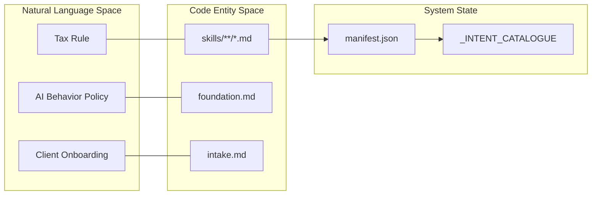
**Sources:** [llms.txt:7-11](), [docs/QUALITY-TIERS.md:41-61](), [skills/manifest.json:47-58]()

---

### Key Design Principles

| Principle | Implementation in Code |
| :--- | :--- |
| **Conservative Defaults** | `foundation.md` instructs the AI to assume more tax, never less, when uncertain. |
| **Atomic Skills** | Each `.md` file in `skills/` focuses on one specific obligation (e.g., `nepal-vat.md`). |
| **Deterministic Output** | Rules use lookup tables and classification matrices instead of narrative text. |
| **Transparency** | The `quality` field in `manifest.json` and file frontmatter explicitly states the verification tier. |

**Sources:** [START-HERE.md:54-55](), [docs/QUALITY-TIERS.md:65-70](), [packages/nepal/README.md:13-17]()

---

# Page: Skills Source Layer

# Skills Source Layer

<details>
<summary>Relevant source files</summary>

The following files were used as context for generating this wiki page:

- [CHANGELOG.md](CHANGELOG.md)
- [CLA.md](CLA.md)
- [COMMERCIAL_LICENSE.md](COMMERCIAL_LICENSE.md)
- [CONTRIBUTING.md](CONTRIBUTING.md)
- [LICENSE](LICENSE)
- [START-HERE.md](START-HERE.md)
- [docs/INTELLIGENCE-ROADMAP.md](docs/INTELLIGENCE-ROADMAP.md)
- [docs/PROMOTION-PLAYBOOK.md](docs/PROMOTION-PLAYBOOK.md)
- [docs/QUALITY-TIERS.md](docs/QUALITY-TIERS.md)
- [docs/USER-JOURNEY-ANALYSIS.md](docs/USER-JOURNEY-ANALYSIS.md)
- [docs/growth-drafts.md](docs/growth-drafts.md)
- [skills/cross-border/eu-oss-digital.md](skills/cross-border/eu-oss-digital.md)
- [skills/cross-border/eu-reverse-charge.md](skills/cross-border/eu-reverse-charge.md)
- [skills/cross-border/non-eu-export-services.md](skills/cross-border/non-eu-export-services.md)
- [skills/cross-border/permanent-establishment-risk.md](skills/cross-border/permanent-establishment-risk.md)
- [skills/cross-border/withholding-tax-matrix.md](skills/cross-border/withholding-tax-matrix.md)
- [skills/financial-reporting/business-combinations/ifrs3-business-combinations.md](skills/financial-reporting/business-combinations/ifrs3-business-combinations.md)
- [skills/financial-reporting/business-combinations/us-gaap-asc805-business-combinations.md](skills/financial-reporting/business-combinations/us-gaap-asc805-business-combinations.md)
- [skills/financial-reporting/debt-vs-equity/ias32-debt-vs-equity.md](skills/financial-reporting/debt-vs-equity/ias32-debt-vs-equity.md)
- [skills/financial-reporting/debt-vs-equity/us-gaap-debt-vs-equity.md](skills/financial-reporting/debt-vs-equity/us-gaap-debt-vs-equity.md)
- [skills/financial-reporting/financial-reporting-workflow-base.md](skills/financial-reporting/financial-reporting-workflow-base.md)
- [skills/financial-reporting/leases/ifrs16-leases.md](skills/financial-reporting/leases/ifrs16-leases.md)
- [skills/financial-reporting/leases/us-gaap-asc842-leases.md](skills/financial-reporting/leases/us-gaap-asc842-leases.md)
- [skills/financial-reporting/revenue-recognition/ifrs15-revenue.md](skills/financial-reporting/revenue-recognition/ifrs15-revenue.md)
- [skills/financial-reporting/revenue-recognition/us-gaap-asc606-revenue.md](skills/financial-reporting/revenue-recognition/us-gaap-asc606-revenue.md)
- [skills/foundation/workflow-base.md](skills/foundation/workflow-base.md)
- [skills/intelligence/deadline-engine.md](skills/intelligence/deadline-engine.md)
- [skills/intelligence/optimisation-advisor.md](skills/intelligence/optimisation-advisor.md)
- [skills/intelligence/threshold-alerts.md](skills/intelligence/threshold-alerts.md)
- [skills/international/kazakhstan/kz-simplified-regime.md](skills/international/kazakhstan/kz-simplified-regime.md)
- [skills/manifest.json](skills/manifest.json)
- [skills/patterns/global-home-office.md](skills/patterns/global-home-office.md)
- [skills/patterns/global-payment-processors.md](skills/patterns/global-payment-processors.md)
- [skills/patterns/global-saas-vendors.md](skills/patterns/global-saas-vendors.md)

</details>


The **Skills Source Layer** is the foundation of the OpenAccountants ecosystem. It consists of a library of machine-executable tax and accounting logic stored as Markdown files in the `skills/` directory. These files are designed to be consumed by Large Language Models (LLMs) to transform raw financial data into structured accounting working papers.

## Directory Structure and Organization

The `skills/` directory is organized by jurisdiction and domain to allow for modular loading and targeted updates.

| Directory | Content Type | Example Entity |
|-----------|--------------|----------------|
| `skills/foundation/` | Domain-specific workflow bases | `payroll-workflow-base.md` |
| `skills/international/` | Non-US country-specific skills | `skills/international/malta/mt-vat-return.md` |
| `skills/federal/` | US Federal tax skills | `skills/federal/us-crypto-tax.md` |
| `skills/us-states/` | US State-specific tax skills | `skills/us-states/ny/ny-income-tax.md` |
| `skills/cross-border/` | Multi-jurisdiction logic | `pillar-two-globe-minimum-tax.md` |
| `skills/verticals/` | Industry-specific patterns | `freelance-developer.md` |
| `skills/integrations/` | Platform export mappings | `stripe-integration.md` |
| `skills/intelligence/` | Advisory and engine logic | `deadline-engine.md` |

**Sources:** [CONTRIBUTING.md:109-125](), [CHANGELOG.md:9-30]()

## Skill Composition Pattern

OpenAccountants uses a **composition pattern** where specific content skills are layered on top of a foundation. This ensures consistent behavior (Step 0 onboarding, conservative defaults) across all domains.

### Workflow Bases
Every domain has a `workflow-base.md` that defines the "contract" between the AI and the user. It enforces the three-state classification outcome:
1.  **Classified**: Sufficient data exists.
2.  **Assumed**: A conservative default was applied (flagged for review).
3.  **Needs Input**: A specific question is required from the user.

For details on the universal and domain-specific bases, see **[Workflow Bases and Foundation Skills](#2.1.1)**.

### Content Skills
Content skills (e.g., `at-income-tax.md`) provide the specific rates, thresholds, and statutory citations. They do not repeat the workflow logic but focus on the "Reference Layer" (Layer A) and "Computation Layer" (Layer B).

**Sources:** [docs/QUALITY-TIERS.md:39-61](), [START-HERE.md:44-55](), [CONTRIBUTING.md:74-90]()

## YAML Frontmatter Standard

Every skill file must contain a YAML frontmatter block. This metadata is used by the build pipeline to generate the `manifest.json` and by the MCP server to index capabilities.

```yaml
---
id: malta-vat-return
jurisdiction: MT
obligation: CT
quality: accountant-verified
category: international
tax_year: 2025
verified_by: "Michael Cutajar, CPA"
depends_on:
  - foundation.md
  - intake.md
---
```

For a full reference of categories and the manifest schema, see **[Skill Taxonomy and Categories](#2.1.2)**.

**Sources:** [skills/manifest.json:47-58](), [CONTRIBUTING.md:41-70]()

## Intelligence and Platform Layers

Beyond standard tax computation, the source layer includes specialized skills for advisory and data ingestion:

*   **Intelligence Skills**: Engines like the `deadline-engine.md` or `optimisation-advisor.md` that provide cross-domain insights.
*   **Pattern Libraries**: Global libraries for SaaS vendors or home office deductions that provide instant classification for common transactions.
*   **Integrations**: Mappings for platform exports (Xero, Stripe, Shopify) to translate raw CSV columns into the OpenAccountants classification standard.

For details on these advanced layers, see **[Intelligence Skills, Patterns, and Integrations](#2.1.3)**.

**Sources:** [CHANGELOG.md:28-30](), [CHANGELOG.md:68-68](), [CONTRIBUTING.md:69-69]()

## Relationship Diagram: Skill Layering

The following diagram illustrates how different entities in the `skills/` directory interact to form a complete "Package" for the AI.

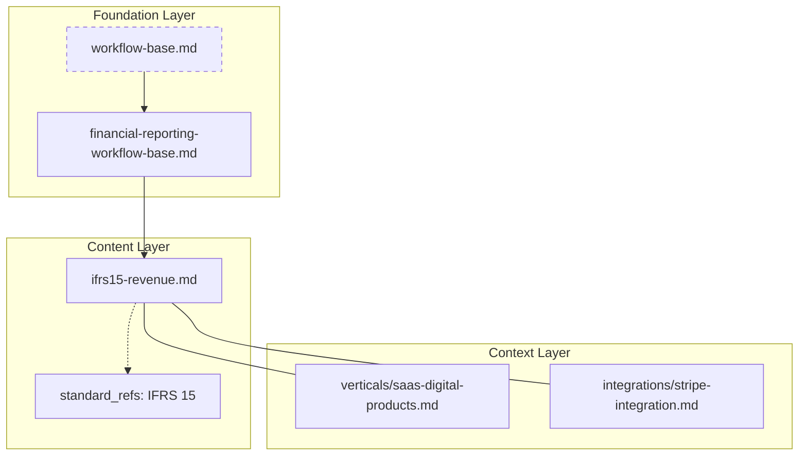
**Sources:** [skills/financial-reporting/revenue-recognition/ifrs15-revenue.md:1-23](), [CONTRIBUTING.md:74-90]()

## Code Entity Mapping: From Source to Manifest

This diagram shows how the build script `build-skills-manifest.py` processes source files into the system's central index.

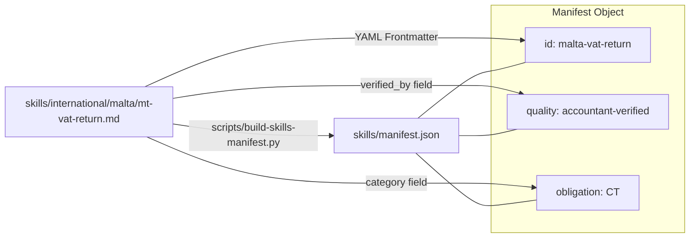
**Sources:** [skills/manifest.json:1-46](), [docs/QUALITY-TIERS.md:94-94](), [CONTRIBUTING.md:23-23]()

---

# Page: Workflow Bases and Foundation Skills

# Workflow Bases and Foundation Skills

<details>
<summary>Relevant source files</summary>

The following files were used as context for generating this wiki page:

- [CHANGELOG.md](CHANGELOG.md)
- [CLA.md](CLA.md)
- [COMMERCIAL_LICENSE.md](COMMERCIAL_LICENSE.md)
- [CONTRIBUTING.md](CONTRIBUTING.md)
- [LICENSE](LICENSE)
- [START-HERE.md](START-HERE.md)
- [docs/INTELLIGENCE-ROADMAP.md](docs/INTELLIGENCE-ROADMAP.md)
- [docs/PROMOTION-PLAYBOOK.md](docs/PROMOTION-PLAYBOOK.md)
- [docs/QUALITY-TIERS.md](docs/QUALITY-TIERS.md)
- [docs/USER-JOURNEY-ANALYSIS.md](docs/USER-JOURNEY-ANALYSIS.md)
- [docs/growth-drafts.md](docs/growth-drafts.md)
- [skills/financial-reporting/business-combinations/ifrs3-business-combinations.md](skills/financial-reporting/business-combinations/ifrs3-business-combinations.md)
- [skills/financial-reporting/business-combinations/us-gaap-asc805-business-combinations.md](skills/financial-reporting/business-combinations/us-gaap-asc805-business-combinations.md)
- [skills/financial-reporting/debt-vs-equity/ias32-debt-vs-equity.md](skills/financial-reporting/debt-vs-equity/ias32-debt-vs-equity.md)
- [skills/financial-reporting/debt-vs-equity/us-gaap-debt-vs-equity.md](skills/financial-reporting/debt-vs-equity/us-gaap-debt-vs-equity.md)
- [skills/financial-reporting/financial-reporting-workflow-base.md](skills/financial-reporting/financial-reporting-workflow-base.md)
- [skills/financial-reporting/leases/ifrs16-leases.md](skills/financial-reporting/leases/ifrs16-leases.md)
- [skills/financial-reporting/leases/us-gaap-asc842-leases.md](skills/financial-reporting/leases/us-gaap-asc842-leases.md)
- [skills/financial-reporting/revenue-recognition/ifrs15-revenue.md](skills/financial-reporting/revenue-recognition/ifrs15-revenue.md)
- [skills/financial-reporting/revenue-recognition/us-gaap-asc606-revenue.md](skills/financial-reporting/revenue-recognition/us-gaap-asc606-revenue.md)
- [skills/foundation/workflow-base.md](skills/foundation/workflow-base.md)
- [skills/international/kazakhstan/kz-simplified-regime.md](skills/international/kazakhstan/kz-simplified-regime.md)
- [skills/manifest.json](skills/manifest.json)

</details>


This page documents the structural foundation of the OpenAccountants skill library. It explains the universal `workflow-base.md`, the domain-specific foundation skills (VAT, payroll, bookkeeping, etc.), and the standardized "three-state contract" that governs all AI-driven tax classifications.

## The Universal Workflow Base

The `workflow-base.md` file serves as the root configuration for the entire system. It defines the operational logic that every LLM must follow regardless of the specific tax jurisdiction or domain. This base establishes the "Conservative Defaults Principle": when data is ambiguous, the AI must assume the position that results in **more tax liability**, never less [START-HERE.md:55-56]().

### The Three-State Contract
Every transaction processed by an OpenAccountants skill must be assigned exactly one of three states [START-HERE.md:49-53]():

1.  **Classified**: Sufficient information exists in the provided documents (e.g., bank statements, invoices) to determine the tax treatment with high confidence.
2.  **Assumed**: Information is missing or ambiguous. A conservative default is applied (e.g., assuming a supply is standard-rated rather than exempt), and the position is explicitly flagged for the human reviewer.
3.  **Needs Input**: The AI identifies a specific missing piece of data that cannot be safely assumed and asks the user a targeted question.

### Output Specification
The universal base mandates that every session produces four standardized artifacts [START-HERE.md:77-82]():
*   **Working Paper**: Detailed transaction-by-transaction classification.
*   **Reviewer Brief**: High-level summary of key positions, assumptions, and risk registers for the accountant.
*   **Action List**: Clear next steps for the taxpayer (e.g., "Pay €400 by June 15th").
*   **Review Checklist**: A targeted list of items for the professional to verify before signing.

**Sources:** [START-HERE.md:44-56](), [START-HERE.md:75-84](), [skills/foundation/workflow-base.md]()

---

## Domain-Specific Foundation Skills

While the universal base handles the "how," domain-specific foundation skills (found in `skills/foundation/`) provide the "what" for different accounting disciplines. These files are automatically bundled into packages by the build pipeline [CONTRIBUTING.md:79-90]().

| Foundation Skill | Purpose |
| :--- | :--- |
| `us-tax-workflow-base.md` | Root for all US Federal and State tax logic [CONTRIBUTING.md:79-79](). |
| `bookkeeping-workflow-base.md` | Handles Chart of Accounts, P&L, and Balance Sheet logic [CONTRIBUTING.md:81-81](). |
| `payroll-workflow-base.md` | Manages withholding, social security, and payslip logic [CONTRIBUTING.md:83-83](). |
| `financial-statements-workflow-base.md` | Governs annual accounts and statutory audit reporting [CONTRIBUTING.md:85-85](). |
| `cross-border-workflow-base.md` | Coordinates multi-jurisdiction treaties and withholding tax [CONTRIBUTING.md:89-89](). |

### Implementation Flow: Natural Language to Code Entity
The following diagram illustrates how a user's natural language request is routed through the foundation skills to the specific code entities in the repository.

**Diagram: Request Routing to Foundation Entities**
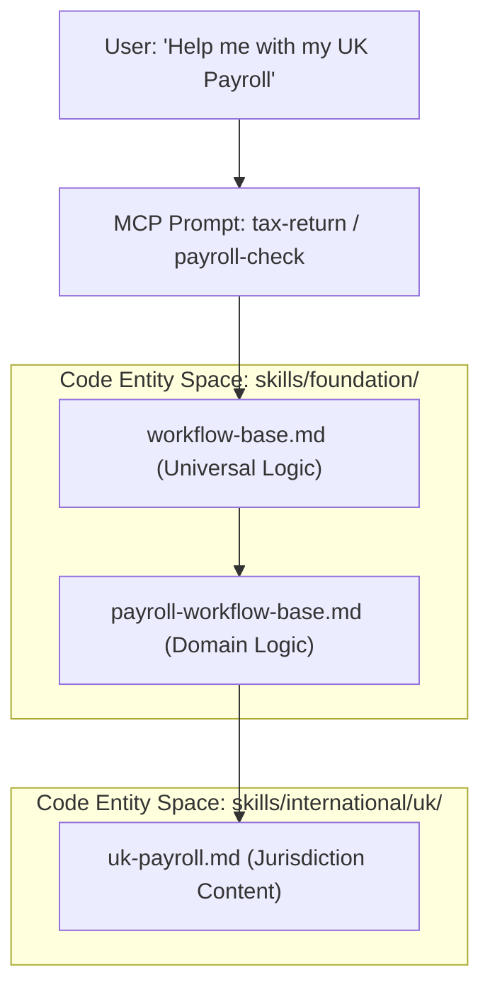
**Sources:** [CONTRIBUTING.md:52-72](), [CONTRIBUTING.md:79-90](), [CHANGELOG.md:22-23]()

---

## The Prohibition Framework

A critical component of the foundation layer is the **Prohibition Framework**. This is a hard-coded set of "No-Go" zones defined in the `PROHIBITIONS` section of every skill [docs/QUALITY-TIERS.md:55-55]().

### Logic Gates and Hard Stops
1.  **Scope Gating**: Before processing numbers, the AI executes "Step 0: Client Onboarding" [docs/QUALITY-TIERS.md:46-46](). If the user's scenario falls under a prohibited category (e.g., "This skill does not support public companies"), the AI must stop and refer the user to a specialist.
2.  **Hallucination Prevention**: Skills include a `Edge Case Registry` (numbered EC1, EC2, etc.) [docs/QUALITY-TIERS.md:56-56](). The AI is prohibited from inventing new tax treatments; it must map to an existing registry item or flag as `Needs Input`.
3.  **Deterministic Lookups**: Box and line assignments must use deterministic tables rather than narrative text to prevent the LLM from "guessing" where a value belongs on a tax form [docs/QUALITY-TIERS.md:66-67]().

**Sources:** [docs/QUALITY-TIERS.md:39-61](), [docs/QUALITY-TIERS.md:63-71]()

---

## Data Flow: From Source to Package

The foundation skills are the "glue" used by the build pipeline to create the distribution-ready packages.

**Diagram: Build Pipeline Data Flow**
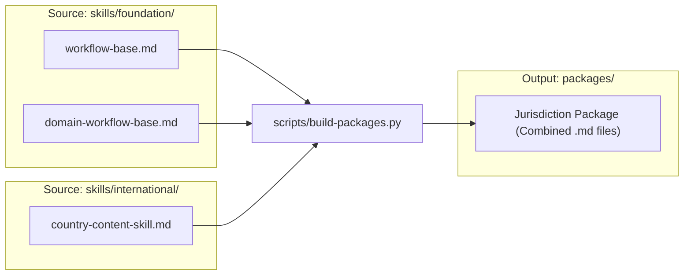

### Build Pipeline Logic
The `build-packages.py` script identifies the `category` in the YAML frontmatter of a content skill (e.g., `category: payroll`) and automatically prepends the corresponding `payroll-workflow-base.md` to the output package [CONTRIBUTING.md:72-73](). This ensures that the AI always has the necessary operational instructions alongside the tax rates.

**Sources:** [CONTRIBUTING.md:26-26](), [CONTRIBUTING.md:52-73](), [CONTRIBUTING.md:79-90]()

---

# Page: Skill Taxonomy and Categories

# Skill Taxonomy and Categories

<details>
<summary>Relevant source files</summary>

The following files were used as context for generating this wiki page:

- [.github/FUNDING.yml](.github/FUNDING.yml)
- [.github/ISSUE_TEMPLATE/bug-report.md](.github/ISSUE_TEMPLATE/bug-report.md)
- [.github/ISSUE_TEMPLATE/new-country.md](.github/ISSUE_TEMPLATE/new-country.md)
- [.github/ISSUE_TEMPLATE/rate-correction.md](.github/ISSUE_TEMPLATE/rate-correction.md)
- [.github/ISSUE_TEMPLATE/vendor-pattern.md](.github/ISSUE_TEMPLATE/vendor-pattern.md)
- [.github/PULL_REQUEST_TEMPLATE.md](.github/PULL_REQUEST_TEMPLATE.md)
- [cookbook-contribution/README.md](cookbook-contribution/README.md)
- [cookbook-contribution/custom_skills/classifying-tax-transactions/SKILL.md](cookbook-contribution/custom_skills/classifying-tax-transactions/SKILL.md)
- [cookbook-contribution/custom_skills/tax-workflow-base/SKILL.md](cookbook-contribution/custom_skills/tax-workflow-base/SKILL.md)
- [docs/ARCHITECTURE-OPTIONS.md](docs/ARCHITECTURE-OPTIONS.md)
- [docs/skill-template.md](docs/skill-template.md)
- [skills/financial-reporting/business-combinations/ifrs3-business-combinations.md](skills/financial-reporting/business-combinations/ifrs3-business-combinations.md)
- [skills/financial-reporting/business-combinations/us-gaap-asc805-business-combinations.md](skills/financial-reporting/business-combinations/us-gaap-asc805-business-combinations.md)
- [skills/financial-reporting/debt-vs-equity/ias32-debt-vs-equity.md](skills/financial-reporting/debt-vs-equity/ias32-debt-vs-equity.md)
- [skills/financial-reporting/debt-vs-equity/us-gaap-debt-vs-equity.md](skills/financial-reporting/debt-vs-equity/us-gaap-debt-vs-equity.md)
- [skills/financial-reporting/financial-reporting-workflow-base.md](skills/financial-reporting/financial-reporting-workflow-base.md)
- [skills/financial-reporting/leases/ifrs16-leases.md](skills/financial-reporting/leases/ifrs16-leases.md)
- [skills/financial-reporting/leases/us-gaap-asc842-leases.md](skills/financial-reporting/leases/us-gaap-asc842-leases.md)
- [skills/financial-reporting/revenue-recognition/ifrs15-revenue.md](skills/financial-reporting/revenue-recognition/ifrs15-revenue.md)
- [skills/financial-reporting/revenue-recognition/us-gaap-asc606-revenue.md](skills/financial-reporting/revenue-recognition/us-gaap-asc606-revenue.md)
- [skills/international/kazakhstan/kz-simplified-regime.md](skills/international/kazakhstan/kz-simplified-regime.md)
- [skills/manifest.json](skills/manifest.json)

</details>


This page provides a technical reference for the classification, structure, and metadata of skills within the OpenAccountants repository. It defines the categories used to organize the 781+ skills, the YAML frontmatter schema that governs skill behavior, and the structure of the `manifest.json` used by the MCP server and build pipeline.

## 1. Skill Categories and Taxonomy

Skills are organized into logical categories that dictate their placement in the directory structure and their role in the accounting workflow.

| Category | Description | Directory |
| :--- | :--- | :--- |
| `international` | Jurisdiction-specific skills for countries outside the US/Canada. | `skills/international/` |
| `federal` | US Federal tax skills (e.g., Form 1040, Schedule C). | `skills/federal/` |
| `state` | US State-specific tax and sales tax skills. | `skills/us-states/` |
| `bookkeeping` | General ledger, classification, and reconciliation logic. | `skills/bookkeeping/` |
| `payroll` | Calculation of social contributions, withholdings, and net pay. | `skills/payroll/` |
| `formation` | Entity setup, registration, and local compliance requirements. | `skills/formation/` |
| `cross-border` | Multi-jurisdiction residency, treaty, and corridor logic. | `skills/cross-border/` |
| `vertical` | Industry-specific logic (e.g., SaaS, E-commerce, Medical). | `skills/verticals/` |
| `integration` | Data mapping for platforms like Xero, Stripe, or Amazon. | `skills/integrations/` |
| `orchestrator` | Routers that sequence other skills based on user intent. | `skills/workflows/` |
| `financial-reporting` | Accounting standards compliance (IFRS vs. US GAAP). | `skills/financial-reporting/` |

**Sources:** [skills/manifest.json:47-300](), [skills/international/kazakhstan/kz-simplified-regime.md:24-24](), [skills/financial-reporting/revenue-recognition/ifrs15-revenue.md:17-17]()

---

## 2. YAML Frontmatter Schema

Every skill file must begin with a YAML frontmatter block. This metadata is used by the `build-skills-manifest.py` script to populate the system index and by the MCP server to resolve dependencies.

### Schema Fields
*   `name`: Unique identifier for the skill (kebab-case).
*   `description`: High-level summary used for tool discovery.
*   `version`: Semantic version of the skill content.
*   `jurisdiction`: ISO country code (e.g., `MT`, `US`, `GLOBAL`).
*   `tax_year`: The specific legislative year the skill covers.
*   `category`: One of the categories defined in Section 1.
*   `standard_family`: (Financial Reporting only) `ifrs` or `us-gaap`.
*   `depends_on`: List of skill IDs that must be loaded into the LLM context alongside this skill.

### Example Implementation
```yaml
---
name: ifrs15-revenue
description: IFRS revenue recognition under IFRS 15...
version: 0.1
jurisdiction: GLOBAL
category: financial-reporting
standard_family: ifrs
depends_on:
  - financial-reporting-workflow-base
---
```
**Sources:** [skills/financial-reporting/revenue-recognition/ifrs15-revenue.md:1-23](), [skills/international/kazakhstan/kz-simplified-regime.md:1-27]()

---

## 3. The Skill Template (Standard Sections)

To ensure consistency across the 781 skills, every `.md` file follows a strict section hierarchy. This structure allows the LLM to differentiate between "Reference" (Layer A) and "Execution" (Layer B).

### Structural Requirements
1.  **Metadata Block:** YAML frontmatter.
2.  **Skill Header:** H1 with name and version.
3.  **General Disclaimer:** Mandatory legal warning block.
4.  **Section 1 — Scope:** Definition of what the skill covers and excludes.
5.  **Section 2 — Reference Layer (Layer A):** Citation-anchored rules (e.g., `ASC 606-10-25-1`).
6.  **Section 3 — Executable Layer (Layer B):** Step-by-step computation logic.
7.  **Audit Flash Points:** Markers for high-judgment areas (using `⚑ AUDIT FLASH POINT`).
8.  **Test Suite:** Sample inputs and expected outputs.

**Sources:** [skills/financial-reporting/financial-reporting-workflow-base.md:37-111](), [.github/PULL_REQUEST_TEMPLATE.md:25-33]()

---

## 4. Manifest Structure (`manifest.json`)

The `manifest.json` is the central registry of the codebase. It is generated by the build pipeline and provides a queryable index for the MCP server's `list_skills` and `search_skills` tools.

### Manifest Schema
The manifest contains a `quality_breakdown`, an `obligation_breakdown` (categorized by tax type like IT, CT, VAT), and a `skills` array.

```json
{
  "version": "2.2",
  "total_skills": 781,
  "quality_breakdown": {
    "research-verified": 768,
    "accountant-verified": 13
  },
  "skills": [
    {
      "id": "ab-individual-return",
      "jurisdiction": "CA",
      "obligation": "IT",
      "quality": "research-verified",
      "category": "international",
      "tax_year": "2025",
      "path": "international/canada/alberta/ab-individual-return.md"
    }
  ]
}
```
**Sources:** [skills/manifest.json:1-58]()

---

## 5. System Data Flow Diagrams

### Diagram 1: From Skill Source to MCP Tool
This diagram shows how a raw Markdown file in the `skills/` directory is transformed into a searchable entity in the MCP server.

Title: Skill Indexing and Discovery Flow
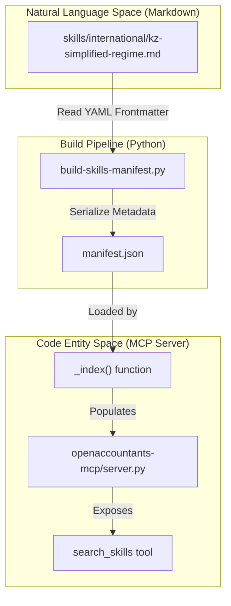
**Sources:** [skills/manifest.json:1-10](), [skills/international/kazakhstan/kz-simplified-regime.md:1-27]()

---

### Diagram 2: Skill Execution Architecture
This diagram illustrates the relationship between Workflow Bases and Content Skills during an active LLM session.

Title: Skill Composition and Execution
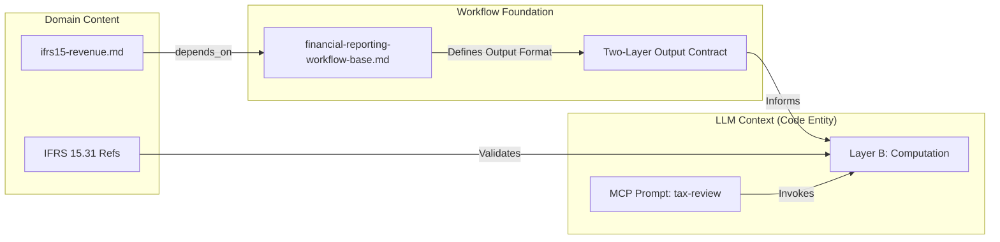
**Sources:** [skills/financial-reporting/financial-reporting-workflow-base.md:37-57](), [skills/financial-reporting/revenue-recognition/ifrs15-revenue.md:1-23]()

---

# Page: Intelligence Skills, Patterns, and Integrations

# Intelligence Skills, Patterns, and Integrations

<details>
<summary>Relevant source files</summary>

The following files were used as context for generating this wiki page:

- [skills/cross-border/eu-oss-digital.md](skills/cross-border/eu-oss-digital.md)
- [skills/cross-border/eu-reverse-charge.md](skills/cross-border/eu-reverse-charge.md)
- [skills/cross-border/non-eu-export-services.md](skills/cross-border/non-eu-export-services.md)
- [skills/cross-border/permanent-establishment-risk.md](skills/cross-border/permanent-establishment-risk.md)
- [skills/cross-border/withholding-tax-matrix.md](skills/cross-border/withholding-tax-matrix.md)
- [skills/financial-reporting/business-combinations/ifrs3-business-combinations.md](skills/financial-reporting/business-combinations/ifrs3-business-combinations.md)
- [skills/financial-reporting/business-combinations/us-gaap-asc805-business-combinations.md](skills/financial-reporting/business-combinations/us-gaap-asc805-business-combinations.md)
- [skills/financial-reporting/debt-vs-equity/ias32-debt-vs-equity.md](skills/financial-reporting/debt-vs-equity/ias32-debt-vs-equity.md)
- [skills/financial-reporting/debt-vs-equity/us-gaap-debt-vs-equity.md](skills/financial-reporting/debt-vs-equity/us-gaap-debt-vs-equity.md)
- [skills/financial-reporting/financial-reporting-workflow-base.md](skills/financial-reporting/financial-reporting-workflow-base.md)
- [skills/financial-reporting/leases/ifrs16-leases.md](skills/financial-reporting/leases/ifrs16-leases.md)
- [skills/financial-reporting/leases/us-gaap-asc842-leases.md](skills/financial-reporting/leases/us-gaap-asc842-leases.md)
- [skills/financial-reporting/revenue-recognition/ifrs15-revenue.md](skills/financial-reporting/revenue-recognition/ifrs15-revenue.md)
- [skills/financial-reporting/revenue-recognition/us-gaap-asc606-revenue.md](skills/financial-reporting/revenue-recognition/us-gaap-asc606-revenue.md)
- [skills/intelligence/deadline-engine.md](skills/intelligence/deadline-engine.md)
- [skills/intelligence/optimisation-advisor.md](skills/intelligence/optimisation-advisor.md)
- [skills/intelligence/threshold-alerts.md](skills/intelligence/threshold-alerts.md)
- [skills/international/kazakhstan/kz-simplified-regime.md](skills/international/kazakhstan/kz-simplified-regime.md)
- [skills/manifest.json](skills/manifest.json)
- [skills/patterns/global-home-office.md](skills/patterns/global-home-office.md)
- [skills/patterns/global-payment-processors.md](skills/patterns/global-payment-processors.md)
- [skills/patterns/global-saas-vendors.md](skills/patterns/global-saas-vendors.md)

</details>


This page documents the intelligence layer, global pattern libraries, and platform integration skills of the OpenAccountants system. These components provide cross-cutting logic that operates above individual jurisdiction rules, enabling automated deadline tracking, tax optimization, and data ingestion from external financial platforms.

## 1. Intelligence Layer

The intelligence layer consists of skills categorized as `INTEL` in the [skills/manifest.json:28-28](). These skills do not compute specific tax obligations but instead provide meta-analysis, orchestration, and advisory logic across a user's entire profile.

### 1.1 Deadline Engine
The `deadline-engine` generates personalized filing calendars by matching a user's obligation profile against a master table of statutory dates [skills/intelligence/deadline-engine.md:28-30]().

**Key Functions:**
*   **Calendar Generation:** Computes the next 12 months of deadlines based on jurisdiction (e.g., US, UK, MT) and obligation type (VAT, Income Tax, SSC) [skills/intelligence/deadline-engine.md:70-80]().
*   **Urgency Logic:** Flags deadlines as "Approaching" (8-30 days) or "Urgent" (0-7 days) [skills/intelligence/deadline-engine.md:89-95]().
*   **Penalty Estimation:** Calculates estimated late-filing fees when a deadline is past due [skills/intelligence/deadline-engine.md:99-102]().

### 1.2 Optimisation Advisor
The `optimisation-advisor` analyzes financial data to identify tax-saving opportunities. It operates on the "Conservative-default principle," ensuring that aggressive tax positions are flagged for professional review [skills/financial-reporting/financial-reporting-workflow-base.md:103-106]().

### 1.3 Threshold Alerts
Monitors turnover and income levels against statutory limits (e.g., VAT registration thresholds or small business regime ceilings). For example, it tracks the 600,000 MCI ceiling for the Kazakhstan simplified regime [skills/international/kazakhstan/kz-simplified-regime.md:98-99]().

**Intelligence Layer Data Flow**

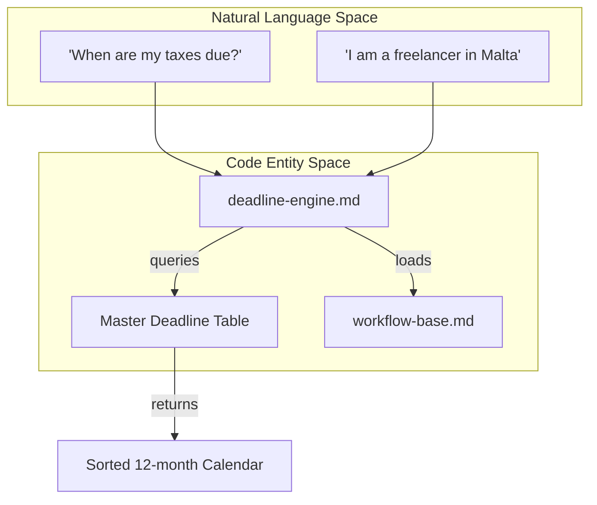
Sources: [skills/intelligence/deadline-engine.md:1-18](), [skills/intelligence/deadline-engine.md:55-84](), [skills/financial-reporting/financial-reporting-workflow-base.md:1-19]()

---

## 2. Global Pattern Libraries

Pattern libraries (categorized as `PAT` in the [skills/manifest.json:33-33]()) provide standardized logic for recurring accounting scenarios that transcend borders, such as SaaS expenses or home office deductions.

### 2.1 SaaS and Payment Processor Patterns
The `global-saas-vendors` and `global-payment-processors` libraries contain classification rules for common digital platforms (Stripe, AWS, Adobe). These patterns assist in:
*   **VAT/GST Treatment:** Identifying if a vendor provides B2B services subject to reverse charge [skills/cross-border/eu-reverse-charge.md:1-10]().
*   **Deductibility:** Pre-classifying software subscriptions as business expenses.

### 2.2 Global Home Office
The `global-home-office` skill provides a framework for calculating business-use-of-home deductions, supporting both simplified "safe harbor" rates and actual expense methods (apportionment by area or room count).

| Pattern ID | Scope | Key Logic |
| :--- | :--- | :--- |
| `saas-vendors` | Global | VAT ID verification, B2B vs B2C classification |
| `payment-processors` | Global | Fee extraction (Stripe/PayPal), gross-to-net reconciliation |
| `home-office` | Global | Area-based apportionment, utility allocation |

Sources: [skills/manifest.json:33-33](), [skills/cross-border/eu-reverse-charge.md:1-10](), [skills/patterns/global-saas-vendors.md:1-5]()

---

## 3. Platform Integrations

Integration skills (categorized as `INT` in [skills/manifest.json:13-13]()) define how the system parses data from external accounting and e-commerce platforms.

### 3.1 Data Ingestion Flow
Integration skills act as translators between raw platform exports (CSV/JSON) and the internal `workflow-base` structures. For instance, the `amazon-seller-integration` [skills/manifest.json:126-135]() maps Amazon Settlement Reports to tax boxes.

### 3.2 Supported Platforms
*   **Accounting:** Xero, QuickBooks, Sage, FreeAgent.
*   **Payment/Fintech:** Stripe, PayPal, Wise, Revolut Business.
*   **E-commerce:** Amazon Seller, Shopify.

**Integration to Tax Calculation Bridge**

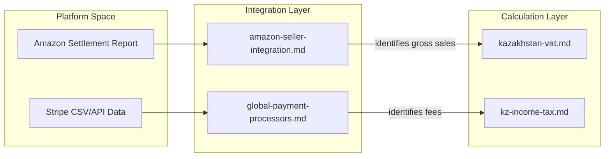
Sources: [skills/manifest.json:126-135](), [skills/international/kazakhstan/kz-simplified-regime.md:18-20](), [skills/integrations/amazon-seller-integration.md:1-10]()

---

## 4. Financial Reporting Integration

Intelligence and patterns are heavily utilized in the `financial-reporting` domain to ensure compliance with IFRS and US GAAP.

### 4.1 Dual-Standard Execution
When a user's facts touch both frameworks, the system loads the `financial-reporting-workflow-base` [skills/financial-reporting/financial-reporting-workflow-base.md:1-19]() and executes both standard-specific skills (e.g., `ifrs15-revenue` and `us-gaap-asc606-revenue`) to highlight divergences [skills/financial-reporting/financial-reporting-workflow-base.md:60-67]().

### 4.2 Audit Flash Points
Intelligence skills are programmed to surface **AUDIT FLASH POINTS**—specific judgements that are frequently challenged by regulators or auditors, such as the "reasonably certain" assessment in lease terms [skills/financial-reporting/leases/ifrs16-leases.md:71-72]() or collectibility gates in revenue recognition [skills/financial-reporting/revenue-recognition/us-gaap-asc606-revenue.md:71-72]().

| Standard | Topic | Key Code Entity |
| :--- | :--- | :--- |
| IFRS | Revenue | `ifrs15-revenue.md` |
| US GAAP | Revenue | `us-gaap-asc606-revenue.md` |
| IFRS | Leases | `ifrs16-leases.md` |
| US GAAP | Leases | `us-gaap-asc842-leases.md` |
| IFRS | Business Combinations | `ifrs3-business-combinations.md` |
| US GAAP | Business Combinations | `us-gaap-asc805-business-combinations.md` |

Sources: [skills/financial-reporting/financial-reporting-workflow-base.md:37-56](), [skills/financial-reporting/leases/ifrs16-leases.md:1-24](), [skills/financial-reporting/revenue-recognition/us-gaap-asc606-revenue.md:1-24]()

---

# Page: Packages Distribution Layer

# Packages Distribution Layer

<details>
<summary>Relevant source files</summary>

The following files were used as context for generating this wiki page:

- [CHANGELOG.md](CHANGELOG.md)
- [README.md](README.md)
- [START-HERE.md](START-HERE.md)
- [docs/INTELLIGENCE-ROADMAP.md](docs/INTELLIGENCE-ROADMAP.md)
- [docs/PROMOTION-PLAYBOOK.md](docs/PROMOTION-PLAYBOOK.md)
- [docs/QUALITY-TIERS.md](docs/QUALITY-TIERS.md)
- [docs/USER-JOURNEY-ANALYSIS.md](docs/USER-JOURNEY-ANALYSIS.md)
- [docs/growth-drafts.md](docs/growth-drafts.md)
- [llms.txt](llms.txt)
- [packages/australia/README.md](packages/australia/README.md)
- [packages/brazil/README.md](packages/brazil/README.md)
- [packages/canada/README.md](packages/canada/README.md)
- [packages/germany/README.md](packages/germany/README.md)
- [packages/india/README.md](packages/india/README.md)
- [packages/indonesia/README.md](packages/indonesia/README.md)
- [packages/malta/README.md](packages/malta/README.md)
- [packages/nepal/README.md](packages/nepal/README.md)
- [packages/portugal/README.md](packages/portugal/README.md)
- [packages/saudi-arabia/README.md](packages/saudi-arabia/README.md)
- [packages/south-africa/README.md](packages/south-africa/README.md)
- [packages/uk/README.md](packages/uk/README.md)
- [workflows/README.md](workflows/README.md)

</details>


The `packages/` directory serves as the distribution-ready output of the OpenAccountants build pipeline. While the `skills/` directory contains the modular source code, the `packages/` directory contains flattened, jurisdiction-specific bundles designed for direct consumption by AI agents and end-users [README.md:81-94]().

## Purpose and Distribution Logic

The distribution layer is designed to solve the "context fragmentation" problem. In the source layer, a tax rule might depend on a global workflow base, a domain-specific pattern, and a platform integration. The distribution layer compiles these dependencies into a single, cohesive folder per jurisdiction [README.md:143-154]().

### Key Characteristics
*   **Flattened Structure:** Every file required for a jurisdiction to function (e.g., Brazil or UK) is co-located in its respective folder [packages/brazil/README.md:13-33]().
*   **User-Facing:** This is the primary entry point for users who do not use the MCP server but instead upload files manually to LLMs like Claude or ChatGPT [START-HERE.md:88-92]().
*   **Immutable Output:** Files in `packages/` are generated. Any manual edits will be overwritten the next time `scripts/build-packages.py` is executed [README.md:98-99]().

### Sources:
* [README.md:81-94]()
* [README.md:143-154]()
* [packages/brazil/README.md:13-33]()
* [START-HERE.md:88-92]()

## Anatomy of a Jurisdiction Bundle

Each folder within `packages/` (e.g., `packages/uk/` or `packages/malta/`) follows a standardized composition to ensure the AI agent receives a complete operational context [README.md:143-154]().

| File | Role | Technical Content |
| :--- | :--- | :--- |
| `foundation.md` | **System Prompt** | Sets conservative defaults, output specifications, and the three-state classification contract [README.md:147](). |
| `intake.md` | **Orchestrator** | Contains the "Step 0" onboarding questions and refusal logic [README.md:148](). |
| `[domain]-tax.md` | **Domain Skill** | Specific logic for Income Tax, VAT, Payroll, etc., derived from the `skills/` directory [README.md:149-151](). |
| `README.md` | **User Guide** | Jurisdiction-specific instructions, verifier attribution, and local tax authority references [packages/uk/README.md:1-48](). |
| `*-workflow-base.md`| **Logic Shared** | Injected workflow bases (e.g., `payroll-workflow-base.md`) that define the state machine for that domain [packages/india/README.md:31-36](). |

### Data Flow: From Source to Package
The following diagram illustrates how the `build-packages.py` script assembles these bundles.

**Title: Build Pipeline Data Flow**
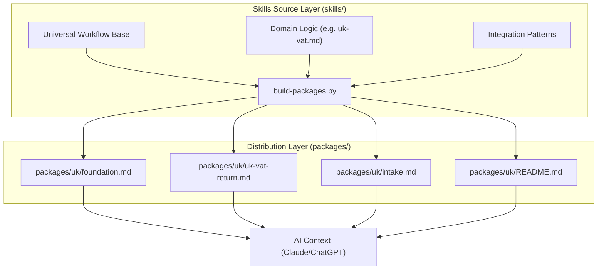

### Sources:
* [README.md:143-154]()
* [packages/uk/README.md:1-48]()
* [packages/india/README.md:31-36]()

## Skills vs. Packages: The "No-Edit" Rule

A critical distinction exists between the `skills/` directory and the `packages/` directory.

1.  **Skills (`skills/`):** The "Source Code." This is where developers and accountants fix bugs, update tax rates, or add new jurisdictions.
2.  **Packages (`packages/`):** The "Compiled Binaries." These are generated by `scripts/build-packages.py`.

**Why `packages/` should never be edited directly:**
*   **Sync Integrity:** Edits in `packages/` do not propagate back to the source.
*   **Build Overwrite:** The build pipeline clears and regenerates these folders to ensure they match the `manifest.json` and source files [README.md:98-99]().
*   **Verification Alignment:** Tier 1 (Accountant-verified) status is tracked at the source level. Manual edits to packages break the provenance chain required for the MCP server [llms.txt:13-18]().

### Sources:
* [README.md:98-99]()
* [llms.txt:13-18]()
* [packages/south-africa/README.md:55-69]()

## Jurisdiction Types and Structure

The distribution layer handles different types of jurisdictions with varying file counts depending on their coverage tier.

### 1. Accountant-Verified Bundles
Bundles like `packages/malta/` or `packages/brazil/` include a `README.md` that explicitly names the verifier (e.g., Michael Cutajar or Ariane Marrocos) and includes a "Verified rates & thresholds" block [packages/malta/README.md:6-11](), [packages/brazil/README.md:6-11]().

### 2. Multi-Level Bundles (US and Canada)
For jurisdictions with federal and sub-national tax layers, the package includes both:
*   **US:** `packages/us-ca/` contains Federal Schedule C logic plus California-specific adjustments [README.md:88-89]().
*   **Canada:** `packages/ca-on/` bundles Federal T1/T2125 with Ontario provincial rules [README.md:91-93]().

### 3. Vertical and Integration Injection
When a package is built for a specific user scenario, it may include files from `_verticals/` (e.g., `freelance-developer.md`) or `_integrations/` (e.g., `stripe.md`) to provide the AI with industry-specific classification logic [START-HERE.md:21-40]().

**Title: Package Entity Mapping**
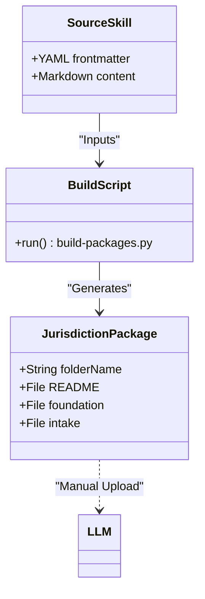

### Sources:
* [packages/malta/README.md:6-11]()
* [packages/brazil/README.md:6-11]()
* [README.md:88-93]()
* [START-HERE.md:21-40]()

---

# Page: Build Pipeline and Scripts

# Build Pipeline and Scripts

<details>
<summary>Relevant source files</summary>

The following files were used as context for generating this wiki page:

- [.github/workflows/sync-mcp.yml](.github/workflows/sync-mcp.yml)
- [CHANGELOG.md](CHANGELOG.md)
- [START-HERE.md](START-HERE.md)
- [docs/INTELLIGENCE-ROADMAP.md](docs/INTELLIGENCE-ROADMAP.md)
- [docs/PROMOTION-PLAYBOOK.md](docs/PROMOTION-PLAYBOOK.md)
- [docs/QUALITY-TIERS.md](docs/QUALITY-TIERS.md)
- [docs/USER-JOURNEY-ANALYSIS.md](docs/USER-JOURNEY-ANALYSIS.md)
- [docs/growth-drafts.md](docs/growth-drafts.md)
- [scripts/build-verification-workbook.py](scripts/build-verification-workbook.py)

</details>


The OpenAccountants build pipeline is a collection of Python and Node.js scripts located in the `scripts/` directory. These scripts transform raw, modular tax skills into distributable packages, generate the system manifest, and facilitate the practitioner verification process.

## Pipeline Overview

The build pipeline serves as the bridge between the **Skills Source Layer** (where contributors edit individual markdown files) and the **Packages Distribution Layer** (where end-users consume bundled skills) [START-HERE.md:44-46](). The pipeline ensures that dependencies are resolved, metadata is indexed, and quality tiers are accurately reflected across the ecosystem [CHANGELOG.md:34-36]().

### Build Order and Logic

1.  **`build-packages.py`**: Compiles individual skills into jurisdiction-specific bundles in the `packages/` directory.
2.  **`build-skills-manifest.py`**: Scans the repository to generate `skills/manifest.json`, which acts as the central registry for all skills.
3.  **`add-skill-disclaimer.mjs`**: Injects mandatory legal notices and attribution into generated packages.
4.  **`patch-global-sync.mjs`**: Ensures consistency between local files and the web-based distribution platforms.

### Data Flow: Source to Distribution

The following diagram illustrates how raw skill data flows through the build scripts to become a final package used by an LLM.

**Build Pipeline Data Flow**
```mermaid
graph TD
    subgraph "Natural Language Space (Source)"
        A["skills/international/malta/*.md"]
        B["skills/foundation/workflow-base.md"]
        C["skills/orchestrator/mt-intake.md"]
    end

    subgraph "Build Pipeline (Scripts)"
        D["build-packages.py"]
        E["add-skill-disclaimer.mjs"]
        F["build-skills-manifest.py"]
    end

    subgraph "Code Entity Space (Distribution)"
        G["packages/malta/"]
        H["skills/manifest.json"]
    end

    A --> D
    B --> D
    C --> D
    D --> E
    E --> G
    A & B & C --> F
    F --> H
```
Sources: [START-HERE.md:21-35](), [docs/USER-JOURNEY-ANALYSIS.md:49-53](), [CHANGELOG.md:74-80]()

---

## Key Scripts Reference

### build-packages.py
This script is the primary compiler for the repository. It identifies dependencies defined in skill frontmatter and aggregates them into the `packages/` directory. For example, it handles the complex bundling of Canadian federal skills with provincial-specific skills [CHANGELOG.md:31-33]().

*   **Input**: `skills/` directory.
*   **Output**: `packages/` directory, organized by jurisdiction (e.g., `packages/ca-on/` for Ontario, Canada).
*   **When to run**: After adding a new country, state, or province skill, or after modifying the `workflow-base.md`.

### build-skills-manifest.py
Generates the `skills/manifest.json` file. This script is responsible for auto-deriving the quality tier of a skill (Accountant-verified vs Research-verified) by parsing the `verified_by` field in the YAML frontmatter [docs/QUALITY-TIERS.md:94-96]().

*   **Implementation**: It iterates through all 700+ skills, extracts metadata, and builds a JSON index used by the MCP server and the website [CHANGELOG.md:34-36]().
*   **Key Logic**: If `verified_by` contains a name and license, the skill is promoted to `accountant-verified` in the manifest [docs/QUALITY-TIERS.md:13-14]().

### build-verification-workbook.py
A utility for the "Promotion Playbook" that converts markdown skills into Excel workbooks for offline review by licensed practitioners [scripts/build-verification-workbook.py:2-8]().

*   **Key Functions**:
    *   `fetch_skills()`: Retrieves skill content from the Supabase backend [scripts/build-verification-workbook.py:74-82]().
    *   `parse_sections()`: Splits markdown into logical chunks (headings and body) to create a structured review experience [scripts/build-verification-workbook.py:108-113]().
*   **Data Validation**: Injects Excel data validation (drop-downs) for statuses like `correct`, `wrong`, or `needs-correction` [scripts/build-verification-workbook.py:146-151]().

**Verification Workflow Mapping**
```mermaid
graph LR
    subgraph "Practitioner Interface"
        XLSX["Excel Workbook (.xlsx)"]
        VAL["DataValidation [STATUS_DV]"]
    end

    subgraph "Logic Entities"
        S1["fetch_skills()"]
        S2["parse_sections()"]
        S3["strip_frontmatter()"]
    end

    subgraph "Data Storage"
        DB[("Supabase (skills table)")]
    end

    DB --> S1
    S1 --> S2
    S2 --> S3
    S3 --> XLSX
    VAL -.-> XLSX
```
Sources: [scripts/build-verification-workbook.py:68-71](), [scripts/build-verification-workbook.py:103-105](), [scripts/build-verification-workbook.py:147-151]()

---

## Automation and Syncing

### GitHub Actions: sync-mcp.yml
The build pipeline is integrated into GitHub Actions to keep the `openaccountants-mcp` package in sync with the main repository.

*   **Trigger**: Every push to the `main` branch that modifies the `packages/` directory [ .github/workflows/sync-mcp.yml:13-17]().
*   **Mechanism**: Uses `rsync --delete` to mirror the `packages/` directory from the core repo to the MCP repo, ensuring `pip install openaccountants-mcp` always contains the latest verified skills [ .github/workflows/sync-mcp.yml:44-46]().

### Disclaimer Injection
The `add-skill-disclaimer.mjs` script ensures that every generated output includes the mandatory legal notice: *"This is for informational purposes only and does not constitute tax advice"* [docs/growth-drafts.md:52-54](). This script runs as a post-processing step after `build-packages.py`.

## Summary Table of Scripts

| Script | Language | Purpose | Frequency |
| :--- | :--- | :--- | :--- |
| `build-packages.py` | Python | Bundles skills into jurisdiction packages | Every new skill/update |
| `build-skills-manifest.py` | Python | Updates `manifest.json` and quality tiers | Every change to frontmatter |
| `build-verification-workbook.py` | Python | Generates Excel for accountant review | When initiating a new audit |
| `add-skill-disclaimer.mjs` | Node.js | Injects legal notices into packages | Automated in build pipeline |
| `patch-global-sync.mjs` | Node.js | Syncs local state with web distribution | Post-build |

Sources: [CHANGELOG.md:34-36](), [scripts/build-verification-workbook.py:1-8](), [docs/QUALITY-TIERS.md:94-96](), [ .github/workflows/sync-mcp.yml:1-6]()

---

# Page: MCP Server

# MCP Server

<details>
<summary>Relevant source files</summary>

The following files were used as context for generating this wiki page:

- [.dockerignore](.dockerignore)
- [Dockerfile](Dockerfile)
- [mcp/.gitignore](mcp/.gitignore)
- [mcp/README.md](mcp/README.md)
- [mcp/openaccountants_mcp/__init__.py](mcp/openaccountants_mcp/__init__.py)
- [mcp/openaccountants_mcp/__main__.py](mcp/openaccountants_mcp/__main__.py)
- [mcp/openaccountants_mcp/server.py](mcp/openaccountants_mcp/server.py)
- [mcp/pyproject.toml](mcp/pyproject.toml)
- [mcp/server.json](mcp/server.json)
- [mcp/smoke_test.py](mcp/smoke_test.py)

</details>


The `openaccountants-mcp` Python package provides a read-only [Model Context Protocol](https://modelcontextprotocol.io/) server. It enables AI assistants (such as Claude Desktop or Cursor) to programmatically discover, search, and retrieve accounting skills from the `packages/` directory without requiring manual file uploads [mcp/README.md:1-5]().

While the repository contains the source code for skills, the MCP server acts as the bridge that allows an LLM to "know" which tax rules apply to a specific jurisdiction and "fetch" them on-demand during a conversation [mcp/README.md:9-23]().

### System Architecture

The server is built using the `FastMCP` framework [mcp/openaccountants_mcp/server.py:48](). It indexes the local `packages/` tree to serve markdown content as structured tools and prompts [mcp/openaccountants_mcp/server.py:4-17]().

**From Natural Language to Skill Entities**
The following diagram illustrates how a user's natural language request is resolved into specific code entities and file paths by the MCP server.

**Natural Language Resolution Flow**
```mermaid
graph TD
    User["User Request: 'Help with Malta VAT'"] -- "1. Intent & JX" --> Start["start(intent='VAT', jurisdiction='MT')"]
    Start -- "2. Lookup" --> Catalog["_INTENT_CATALOGUE"]
    Catalog -- "3. Resolve Slugs" --> Index["_index()"]
    Index -- "4. Path Safety" --> SafeResolve["_safe_resolve(PACKAGES_DIR, 'malta', 'malta-vat-return.md')"]
    SafeResolve -- "5. Return Content" --> Tool["get_skill('malta-vat-return')"]
    Tool -- "6. Final Output" --> LLM["LLM Context Window"]

    subgraph "Code Entity Space"
        Start
        Catalog
        Index
        SafeResolve
    end
```
Sources: [mcp/openaccountants_mcp/server.py:55-83](), [mcp/README.md:59-79]()

---

### Capabilities

The MCP server exposes two primary interfaces to AI clients:

1.  **Tools**: Atomic functions the LLM can call to browse the library, search for specific tax sections, or retrieve full skill text [mcp/README.md:48-55]().
2.  **Prompts**: Pre-defined, high-level workflows that guide the LLM through complex tasks like performing a full tax return or comparing two jurisdictions [mcp/README.md:85-92]().

| Feature | Description |
| :--- | :--- |
| **Discovery** | The `start` tool acts as a "front door" to determine the user's intent and required jurisdiction [mcp/README.md:50](). |
| **Indexing** | The `_index()` function scans `packages/` and extracts metadata from YAML frontmatter [mcp/openaccountants_mcp/server.py:180-190](). |
| **Path Safety** | All file access is restricted to the `packages/` directory via `_safe_resolve` to prevent directory traversal [mcp/openaccountants_mcp/server.py:76-83](). |
| **Provenance** | Every skill returned includes an attribution footer and quality tier (Accountant-verified vs Research-verified) [mcp/openaccountants_mcp/server.py:127-129](). |

For a complete list of parameters and usage examples, see **[MCP Tools and Prompts Reference](#3.1)**.

---

### Internal Logic and Orchestration

The server manages a state machine via the `start()` tool to guide the AI assistant through the onboarding process [mcp/README.md:59-79](). It uses an internal `_INTENT_CATALOGUE` to map common user goals (e.g., "taxes", "formation") to specific skill sequences [mcp/smoke_test.py:108-125]().

**Internal Processing Pipeline**
```mermaid
graph LR
    File["Skill Markdown (.md)"] --> FM["_parse_frontmatter()"]
    FM --> Tier["_quality_tier()"]
    FM --> Sections["_split_sections()"]
    
    Tier --> Metadata["Skill Metadata Object"]
    Sections --> Metadata
    
    Metadata --> FastMCP["FastMCP Server Instance"]
    FastMCP --> Client["Claude / Cursor / Client"]
```
Sources: [mcp/openaccountants_mcp/server.py:94-152](), [mcp/openaccountants_mcp/server.py:180-190]()

For a deep dive into the indexer, intent mapping, and transport layers, see **[MCP Server Internals](#3.2)**.

---

### Deployment and Connectivity

The server can be deployed in multiple environments depending on the use case:

*   **Local Development**: Installed via `pip` or `uv` and run over `stdio` for use with Claude Desktop or Cursor [mcp/README.md:98-112]().
*   **Containerized**: A `Dockerfile` is provided to run the server over `streamable-http`, allowing remote clients to connect via a reverse proxy [Dockerfile:1-19]().
*   **Hosted**: A production version exists at `openaccountants.com/api/mcp` which includes additional features like real-time tax rates and human-accountant handoffs [mcp/README.md:7]().

For configuration details and setup guides, see **[MCP Deployment](#3.3)**.

---
**Child Pages:**
*   [MCP Tools and Prompts Reference](#3.1)
*   [MCP Server Internals](#3.2)
*   [MCP Deployment](#3.3)

---

# Page: MCP Tools and Prompts Reference

# MCP Tools and Prompts Reference

<details>
<summary>Relevant source files</summary>

The following files were used as context for generating this wiki page:

- [.dockerignore](.dockerignore)
- [Dockerfile](Dockerfile)
- [mcp/.gitignore](mcp/.gitignore)
- [mcp/README.md](mcp/README.md)
- [mcp/openaccountants_mcp/__init__.py](mcp/openaccountants_mcp/__init__.py)
- [mcp/openaccountants_mcp/__main__.py](mcp/openaccountants_mcp/__main__.py)
- [mcp/openaccountants_mcp/server.py](mcp/openaccountants_mcp/server.py)
- [mcp/pyproject.toml](mcp/pyproject.toml)
- [mcp/server.json](mcp/server.json)
- [mcp/smoke_test.py](mcp/smoke_test.py)

</details>


This page provides a complete technical reference for the tools and prompts exposed by the OpenAccountants Model Context Protocol (MCP) server. The server, implemented in `openaccountants-mcp`, acts as a bridge between LLM clients (like Claude or Cursor) and the structured accounting skills stored in the `packages/` directory [mcp/openaccountants_mcp/server.py:1-17]().

## MCP Tools Reference

The self-hosted MCP server exposes six read-only tools designed to facilitate the discovery, retrieval, and application of accounting skills [mcp/README.md:48-55](). All skill access is path-sandboxed to the `packages/` directory for security [mcp/README.md:57-57]().

### 1. `start`
The primary entry point for any session. It functions as an intent orchestrator that maps user requests to specific skill-loading plans [mcp/README.md:50-50]().

*   **Parameters:**
    *   `intent` (optional string): Free text describing the goal (e.g., "VAT return", "company setup").
    *   `jurisdiction` (optional string): ISO country code or sub-national code (e.g., "MT", "US-CA").
*   **Returns:** A JSON object with a `status` ("ready", "needs_input", or "needs_clarification").
    *   If "ready": Includes `skills_to_load`, `expectations`, `next_action`, and `guardrails` [mcp/README.md:50-50]().
    *   If "needs_input": Includes lists of `available_intents` or `available_jurisdictions` [mcp/smoke_test.py:87-106]().

### 2. `list_skills`
Returns a catalog of available skills, filtered by jurisdiction or category [mcp/README.md:51-51]().

*   **Parameters:**
    *   `jurisdiction` (optional string): Filter by ISO code.
    *   `category` (optional string): Filter by skill category (e.g., "tax", "formation").
*   **Return Fields:** `slug`, `title`, `jurisdiction`, `category`, `quality_tier`, `verified_by`, `last_updated` [mcp/smoke_test.py:65-68]().

### 3. `get_skill`
Fetches the full content of a specific skill [mcp/README.md:52-52]().

*   **Parameters:**
    *   `slug` (string): The unique identifier for the skill (e.g., "malta-income-tax").
*   **Returns:** Full markdown content appended with a provenance/attribution footer generated by the server [mcp/smoke_test.py:72-74]().

### 4. `get_skill_sections`
Parses a skill into discrete logical blocks for step-by-step processing [mcp/README.md:53-53]().

*   **Parameters:**
    *   `slug` (string): The skill identifier.
*   **Returns:** A list of sections, each containing `heading`, `content`, and `level` (header depth) [mcp/openaccountants_mcp/server.py:132-152]().

### 5. `search_skills`
Performs a keyword search across the markdown content of all indexed skills [mcp/README.md:54-54]().

*   **Parameters:**
    *   `query` (string): Search terms.
    *   `jurisdiction` (optional string): Scope search to a specific region.
*   **Returns:** Matched section headings and snippets, limited to 25 results [mcp/openaccountants_mcp/server.py:60-60]().

### 6. `submit_feedback`
Constructs a GitHub issue URL for reporting errors or requesting features [mcp/README.md:55-55]().

*   **Parameters:** `summary`, `skill_slug` (optional), `jurisdiction` (optional), `rating` (optional).
*   **Returns:** `github_url`, `title`, `body`, and `labels` [mcp/README.md:55-55]().

**Sources:** [mcp/README.md:44-57](), [mcp/openaccountants_mcp/server.py:51-152](), [mcp/smoke_test.py:51-159]()

---

## MCP Prompts Reference

Prompts provide high-level guided workflows that instruct the LLM on how to use the tools and skills effectively as a "tax engine" [mcp/README.md:81-83]().

| Prompt | Arguments | Purpose |
| :--- | :--- | :--- |
| `tax-return` | `country`, `tax_year`, `entity_type` | Orchestrates intake, transaction classification, and working paper generation [mcp/README.md:87-87](). |
| `vat-check` | `country`, `period` | Guides the user through VAT/GST classification for a specific period [mcp/README.md:88-88](). |
| `find-deductions` | `country`, `entity_type` | Specifically reviews expenses against deductibility rules in the loaded skills [mcp/README.md:89-89](). |
| `compare-jurisdictions`| `countries`, `income`, `entity_type` | Performs side-by-side tax liability comparison for cross-border planning [mcp/README.md:90-90](). |
| `skill-feedback` | `skill_slug`, `country` | Collects structured feedback after a specific skill application [mcp/README.md:91-91](). |
| `skill-review` | `skillSlug`, `scenario` | Loads a skill's sections and applies them sequentially to a user scenario [mcp/README.md:92-92](). |

**Sources:** [mcp/README.md:81-93](), [mcp/openaccountants_mcp/server.py:12-13]()

---

## Implementation Architecture

The server logic bridges the natural language intent of the user to the physical files on disk.

### Natural Language to Code Entity Mapping
The following diagram illustrates how user requests are routed through the server's internal functions to reach the skill content.

**Title: Intent Resolution and Skill Retrieval Flow**
```mermaid
graph TD
    User["User Natural Language"] -- "start(intent, jurisdiction)" --> Server["server.py"]
    Server -- "calls" --> _index["_index()"]
    _index -- "scans" --> PACKAGES_DIR["PACKAGES_DIR (packages/)"]
    
    Server -- "matches intent via" --> _INTENT_CATALOGUE["_INTENT_CATALOGUE"]
    _INTENT_CATALOGUE -- "returns" --> Plan["Execution Plan"]
    
    Plan -- "get_skill(slug)" --> _safe_resolve["_safe_resolve()"]
    _safe_resolve -- "validates path" --> MD_File["Skill Markdown (.md)"]
    MD_File -- "parsed by" --> _parse_frontmatter["_parse_frontmatter()"]
    _parse_frontmatter -- "extracts" --> Meta["YAML Metadata"]
    _parse_frontmatter -- "extracts" --> Body["Markdown Body"]
```
**Sources:** [mcp/openaccountants_mcp/server.py:55-57](), [mcp/openaccountants_mcp/server.py:76-83](), [mcp/openaccountants_mcp/server.py:94-106](), [mcp/openaccountants_mcp/server.py:179-190]()

### Data Flow: Skill Indexing
The server builds a lazy-loaded index of all skills. Because many skills lack explicit jurisdiction fields in their YAML frontmatter, the server implements an inheritance logic.

**Title: Jurisdiction Inheritance Logic**
```mermaid
graph TD
    File["Skill File (.md)"] --> HasJX{Has jurisdiction in frontmatter?}
    HasJX -- "Yes" --> UseFM["Use Frontmatter Code"]
    HasJX -- "No" --> IsSubDir{In us-XX or ca-XX dir?}
    
    IsSubDir -- "Yes" --> DirCode["Use Dir Name (e.g. US-CA)"]
    IsSubDir -- "No" --> Siblings["Check Sibling Files"]
    Siblings -- "Inherit" --> MostCommon["Use Most Common Sibling JX"]
    
    UseFM --> FinalJX["Final Jurisdiction Code"]
    DirCode --> FinalJX
    MostCommon --> FinalJX
```
**Sources:** [mcp/openaccountants_mcp/server.py:165-176](), [mcp/openaccountants_mcp/server.py:179-200]()

### Key Functions and Classes

*   **`_safe_resolve(packages_dir, *segments)`**: Prevents directory traversal attacks by ensuring resolved paths remain within the `packages/` root [mcp/openaccountants_mcp/server.py:76-83]().
*   **`_parse_frontmatter(text)`**: Uses `PyYAML` to separate the skill's configuration from its logic/content [mcp/openaccountants_mcp/server.py:94-106]().
*   **`_quality_tier(meta)`**: Determines if a skill is `accountant-verified` or `research-verified` based on the presence of a non-pending `verified_by` field [mcp/openaccountants_mcp/server.py:116-129]().
*   **`_index()`**: A cached function that maps every skill slug to its metadata, including quality tier and inherited jurisdiction [mcp/openaccountants_mcp/server.py:179-200]().

**Sources:** [mcp/openaccountants_mcp/server.py:35-200](), [mcp/pyproject.toml:8-8]()

---

# Page: MCP Server Internals

# MCP Server Internals

<details>
<summary>Relevant source files</summary>

The following files were used as context for generating this wiki page:

- [.dockerignore](.dockerignore)
- [Dockerfile](Dockerfile)
- [mcp/.gitignore](mcp/.gitignore)
- [mcp/README.md](mcp/README.md)
- [mcp/openaccountants_mcp/__init__.py](mcp/openaccountants_mcp/__init__.py)
- [mcp/openaccountants_mcp/__main__.py](mcp/openaccountants_mcp/__main__.py)
- [mcp/openaccountants_mcp/server.py](mcp/openaccountants_mcp/server.py)
- [mcp/pyproject.toml](mcp/pyproject.toml)
- [mcp/server.json](mcp/server.json)
- [mcp/smoke_test.py](mcp/smoke_test.py)

</details>


The OpenAccountants MCP server is a Python-based implementation of the Model Context Protocol that provides a read-only interface to the repository's library of accounting skills. It acts as a bridge between the static Markdown content in the `packages/` directory and AI assistants like Claude or Cursor.

### Purpose and Scope
The server's primary responsibility is to index local skill files, resolve user intent into executable plans, and provide secure access to content through standardized tools and prompts [mcp/openaccountants_mcp/server.py:1-34](). It uses the `FastMCP` framework to handle the transport layer and tool registration [mcp/openaccountants_mcp/server.py:48]().

---

### Core Components and Data Flow

The server operates by indexing the filesystem at startup and then serving requests through a set of registered tools.

#### Natural Language to Code Entity Mapping
The following diagram illustrates how natural language requests from a user are translated into specific code entities and filesystem operations within the server.

**Intent to Entity Resolution**
```mermaid
graph TD
    User["User: 'Help with Malta taxes'"] --> Tool["start(intent='taxes', jurisdiction='MT')"]
    Tool --> Orchestrator["_INTENT_CATALOGUE"]
    Orchestrator --> Index["_index()"]
    Index --> FS["packages/malta/*.md"]
    
    subgraph "Code Entity Space"
        Tool
        Orchestrator
        Index
    end
    
    subgraph "Filesystem Space"
        FS
    end
```
**Sources:** [mcp/openaccountants_mcp/server.py:180-210](), [mcp/openaccountants_mcp/server.py:534-560]()

---

### Skill Indexer (`_index`)

The `_index()` function is the heart of the server's discovery mechanism. It is lazily initialized and cached using `@lru_cache(maxsize=1)` [mcp/openaccountants_mcp/server.py:179-180]().

- **Discovery:** It recursively scans the `packages/` directory for `.md` files [mcp/openaccountants_mcp/server.py:192-195]().
- **Validation:** A file is only indexed if its YAML frontmatter contains a `name` field [mcp/openaccountants_mcp/server.py:183-184]().
- **Jurisdiction Inheritance:** Since many skill files lack an explicit `jurisdiction` field, the indexer uses `_dir_jurisdiction()` to infer it from the parent directory name (e.g., `us-ca`) or the most frequent code declared by sibling files [mcp/openaccountants_mcp/server.py:165-177]().
- **Quality Tiering:** The indexer determines the `quality_tier` by checking for a valid `verified_by` name. If the field is missing or set to "pending", it defaults to "research-verified" [mcp/openaccountants_mcp/server.py:116-130]().

**Sources:** [mcp/openaccountants_mcp/server.py:156-235]()

---

### Intent Orchestrator (`_INTENT_CATALOGUE`)

The `start()` tool implements a state machine logic to guide the LLM through the "front door" of the library [mcp/README.md:59-80](). It relies on the `_INTENT_CATALOGUE`, which maps high-level goals (like "taxes" or "formation") to specific skill categories and templates [mcp/openaccountants_mcp/server.py:534-560]().

| State | Condition | Return Data |
| :--- | :--- | :--- |
| `needs_input` | Missing `intent` or `jurisdiction` | List of `available_intents` or `available_jurisdictions` [mcp/openaccountants_mcp/server.py:643-660]() |
| `needs_clarification` | Unrecognized `intent` | Guidance for the user to select a valid intent [mcp/openaccountants_mcp/server.py:633-640]() |
| `ready` | Both valid `intent` and `jurisdiction` provided | A structured plan including `skills_to_load`, `expectations`, and `guardrails` [mcp/openaccountants_mcp/server.py:612-631]() |

**Sources:** [mcp/openaccountants_mcp/server.py:534-663](), [mcp/README.md:48-55]()

---

### Path Safety and Provenance

#### Path Safety (`_safe_resolve`)
To prevent directory traversal attacks, the server uses `_safe_resolve()`. This function joins segments to the `packages/` root and calls `.resolve()`, then verifies that the resulting path is still a child of the root [mcp/openaccountants_mcp/server.py:76-83]().

#### Provenance Engine
When a skill is fetched via `get_skill`, the server appends a "Provenance & attribution" footer. This footer includes:
- The skill's quality tier [mcp/openaccountants_mcp/server.py:339]().
- The named verifier (if any) [mcp/openaccountants_mcp/server.py:340]().
- A timestamp of the last update [mcp/openaccountants_mcp/server.py:341]().
- A permanent link to the source on the OpenAccountants website [mcp/openaccountants_mcp/server.py:342]().

**Sources:** [mcp/openaccountants_mcp/server.py:71-84](), [mcp/openaccountants_mcp/server.py:328-350]()

---

### Feedback Builder

The `submit_feedback` tool does not perform server-side writes. Instead, it constructs a GitHub "New Issue" URL with pre-filled parameters [mcp/openaccountants_mcp/server.py:488-531]().

- **URL Construction:** It uses `urlencode` to package the title, body, and labels [mcp/openaccountants_mcp/server.py:521-527]().
- **Safety Caps:** The body is capped at 6,000 bytes to ensure the final URL does not exceed browser limits (approx. 8 KB) [mcp/openaccountants_mcp/server.py:65-69]().

**Sources:** [mcp/openaccountants_mcp/server.py:488-531]()

---

### Transport Layer and Lifecycle

The server supports three transport modes, configurable via the `MCP_TRANSPORT` environment variable [mcp/openaccountants_mcp/server.py:24-34]().

1.  **stdio:** Default. Communication occurs over standard input/output, typically used for local IDE integrations like Claude Desktop [mcp/openaccountants_mcp/server.py:843]().
2.  **streamable-http:** Used for remote connections, often fronted by a reverse proxy. This is the default in the provided `Dockerfile` [Dockerfile:33-35]().
3.  **sse:** Server-Sent Events transport.

#### Server Startup Sequence
The `main()` function serves as the entry point [mcp/openaccountants_mcp/server.py:829]().

**Start Machine Logic**
```mermaid
graph TD
    Start["main()"] --> Env["Read Env: OPENACCOUNTANTS_ROOT, MCP_PORT, etc."]
    Env --> TransportCheck{"Check MCP_TRANSPORT"}
    
    TransportCheck -- "stdio" --> RunStdio["mcp.run_stdio()"]
    TransportCheck -- "streamable-http" --> RunHTTP["mcp.run_streamable_http()"]
    TransportCheck -- "sse" --> RunSSE["mcp.run_sse()"]
    
    subgraph "Initialization"
        Env
        TransportCheck
    end
```

**Sources:** [mcp/openaccountants_mcp/server.py:829-860](), [Dockerfile:32-39]()

---

# Page: MCP Deployment

# MCP Deployment

<details>
<summary>Relevant source files</summary>

The following files were used as context for generating this wiki page:

- [.claude-plugin/marketplace.json](.claude-plugin/marketplace.json)
- [.dockerignore](.dockerignore)
- [Dockerfile](Dockerfile)
- [mcp/.gitignore](mcp/.gitignore)
- [mcp/README.md](mcp/README.md)
- [mcp/openaccountants_mcp/__init__.py](mcp/openaccountants_mcp/__init__.py)
- [mcp/openaccountants_mcp/__main__.py](mcp/openaccountants_mcp/__main__.py)
- [mcp/openaccountants_mcp/server.py](mcp/openaccountants_mcp/server.py)
- [mcp/pyproject.toml](mcp/pyproject.toml)
- [mcp/server.json](mcp/server.json)
- [mcp/smoke_test.py](mcp/smoke_test.py)
- [plugins/openaccountants/.claude-plugin/plugin.json](plugins/openaccountants/.claude-plugin/plugin.json)
- [plugins/openaccountants/commands/openaccountants.md](plugins/openaccountants/commands/openaccountants.md)

</details>


The OpenAccountants MCP (Model Context Protocol) server provides a standardized interface for AI assistants to discover and consume tax and accounting skills directly from the `packages/` directory. It can be deployed as a local process via `stdio` or as a networked service using `streamable-http` or `SSE`.

## Deployment Overview

The server is implemented using the `FastMCP` framework [mcp/openaccountants_mcp/server.py:48-48](). It operates in a read-only mode, sandboxing all file access to the `packages/` directory to ensure path safety [mcp/openaccountants_mcp/server.py:76-83]().

### Deployment Modes
| Mode | Transport | Use Case |
|------|-----------|----------|
| **Local CLI** | `stdio` | Personal use with Claude Desktop or Cursor. |
| **Docker** | `streamable-http` | Self-hosting for teams or connecting remote agents. |
| **Python Package** | `stdio` | Integration into custom Python-based AI workflows. |

Sources: [mcp/README.md:48-57](), [mcp/openaccountants_mcp/server.py:24-34]()

---

## Local Installation (pip/uv)

The MCP server is a standard Python package located in the `mcp/` directory. It requires Python 3.10+ and the `mcp` and `pyyaml` dependencies [mcp/pyproject.toml:6-8]().

### 1. Installation
```bash
git clone https://github.com/openaccountants/openaccountants.git
cd openaccountants
pip install ./mcp
```

### 2. Post-Installation (Canadian Jurisdictions)
Canadian provincial packages (`ca-on`, `ca-qc`, etc.) are generated at build time and are not checked into the repository. You must run the build script to make them available to the MCP server [mcp/README.md:96-97]().
```bash
python3 scripts/build-packages.py
```

Sources: [mcp/README.md:98-109](), [mcp/pyproject.toml:29-30]()

---

## Docker Deployment

The `Dockerfile` provides a containerized environment that defaults to the `streamable-http` transport, allowing remote clients to connect via HTTP [Dockerfile:1-5]().

### Container Architecture
The container copies the `mcp/` source and the `packages/` content into the image, setting the `OPENACCOUNTANTS_ROOT` environment variable to `/app` [Dockerfile:26-35]().

### Build and Run
```bash
docker build -t openaccountants-mcp .
docker run --rm -p 8000:8000 openaccountants-mcp
```
The server will be available at `http://localhost:8000/mcp`.

### Environment Configuration
The server behavior can be tuned via environment variables [mcp/openaccountants_mcp/server.py:21-34]():
- `MCP_TRANSPORT`: `stdio`, `streamable-http`, or `sse`.
- `MCP_PORT`: Defaults to `8000`.
- `MCP_STREAMABLE_HTTP_PATH`: Defaults to `/mcp`.

### System Data Flow (Docker/HTTP)
This diagram maps the network flow to the internal server components.

"MCP Network Data Flow"
```mermaid
graph TD
    subgraph "Client Space"
        "Claude_Desktop"["Claude Desktop / Cursor"]
    end

    subgraph "Container Space (Code Entity Space)"
        "FastMCP_Instance"["FastMCP (server.py)"]
        "Transport_Layer"["streamable-http (mcp-sdk)"]
        "Path_Resolver"["_safe_resolve()"]
        "Package_Storage"["/app/packages/*.md"]
    end

    "Claude_Desktop" -- "HTTP POST /mcp" --> "Transport_Layer"
    "Transport_Layer" -- "Request" --> "FastMCP_Instance"
    "FastMCP_Instance" -- "Validate Path" --> "Path_Resolver"
    "Path_Resolver" -- "Read" --> "Package_Storage"
    "Package_Storage" -- "Markdown Content" --> "FastMCP_Instance"
    "FastMCP_Instance" -- "JSON-RPC Response" --> "Claude_Desktop"
```
Sources: [Dockerfile:12-20](), [mcp/openaccountants_mcp/server.py:24-34](), [mcp/openaccountants_mcp/server.py:76-83]()

---

## Client Configuration

### Claude Desktop
To integrate with Claude Desktop, add the following to your `claude_desktop_config.json`:

```json
{
  "mcpServers": {
    "openaccountants": {
      "command": "python",
      "args": ["-m", "openaccountants_mcp"],
      "env": {
        "OPENACCOUNTANTS_ROOT": "/path/to/your/openaccountants"
      }
    }
  }
}
```

### Cursor Integration
In Cursor, navigate to **Settings > Models > MCP** and add a new server:
- **Type**: `command`
- **Command**: `python -m openaccountants_mcp`
- **Environment Variable**: `OPENACCOUNTANTS_ROOT` set to your local clone path.

Sources: [mcp/README.md:120-135]()

---

## The server.json Configuration

The `mcp/server.json` file follows the MCP configuration schema to describe the server's capabilities and entry points for automated installers [mcp/server.json:1-3]().

### Key Attributes
- **Identifier**: `io.github.openaccountants/openaccountants-mcp` [mcp/server.json:3-3]()
- **Runtime**: Python [mcp/server.json:16-16]()
- **Transport**: `stdio` [mcp/server.json:18-18]()

Sources: [mcp/server.json:1-22]()

---

## Implementation Details: From Request to Code

The following diagram illustrates how a natural language request from a user is translated into specific function calls within `server.py`.

"Natural Language to Code Mapping"
```mermaid
graph TD
    subgraph "Natural Language Space"
        "User_Query"["'Help me with Malta VAT'"]
    end

    subgraph "Code Entity Space (server.py)"
        "start_tool"["@mcp.tool() start(intent, jurisdiction)"]
        "list_skills_tool"["@mcp.tool() list_skills(jurisdiction)"]
        "get_skill_tool"["@mcp.tool() get_skill(slug)"]
        "indexer"["_index()"]
        "fm_parser"["_parse_frontmatter()"]
    end

    "User_Query" -- "1. Scoping" --> "start_tool"
    "start_tool" -- "Lookup" --> "indexer"
    "indexer" -- "Parse MD" --> "fm_parser"
    "User_Query" -- "2. Discovery" --> "list_skills_tool"
    "User_Query" -- "3. Retrieval" --> "get_skill_tool"
```
Sources: [mcp/openaccountants_mcp/server.py:180-187](), [mcp/openaccountants_mcp/server.py:94-105](), [mcp/README.md:13-21]()

### Key Functions
- `_index()`: Lazily builds a map of skill slugs to metadata by scanning the `packages/` directory [mcp/openaccountants_mcp/server.py:180-190]().
- `_safe_resolve()`: Ensures that any requested file path resides within the `PACKAGES_DIR` to prevent directory traversal attacks [mcp/openaccountants_mcp/server.py:76-83]().
- `_parse_frontmatter()`: Extracts YAML metadata (like `jurisdiction` and `verified_by`) from the top of skill markdown files [mcp/openaccountants_mcp/server.py:94-105]().

Sources: [mcp/openaccountants_mcp/server.py:55-83](), [mcp/openaccountants_mcp/server.py:180-190]()

---

# Page: Jurisdiction Coverage

# Jurisdiction Coverage

<details>
<summary>Relevant source files</summary>

The following files were used as context for generating this wiki page:

- [README.md](README.md)
- [llms.txt](llms.txt)
- [packages/australia/README.md](packages/australia/README.md)
- [packages/brazil/README.md](packages/brazil/README.md)
- [packages/canada/README.md](packages/canada/README.md)
- [packages/germany/README.md](packages/germany/README.md)
- [packages/india/README.md](packages/india/README.md)
- [packages/indonesia/README.md](packages/indonesia/README.md)
- [packages/malta/README.md](packages/malta/README.md)
- [packages/nepal/README.md](packages/nepal/README.md)
- [packages/portugal/README.md](packages/portugal/README.md)
- [packages/saudi-arabia/README.md](packages/saudi-arabia/README.md)
- [packages/south-africa/README.md](packages/south-africa/README.md)
- [packages/uk/README.md](packages/uk/README.md)
- [skills/financial-reporting/business-combinations/ifrs3-business-combinations.md](skills/financial-reporting/business-combinations/ifrs3-business-combinations.md)
- [skills/financial-reporting/business-combinations/us-gaap-asc805-business-combinations.md](skills/financial-reporting/business-combinations/us-gaap-asc805-business-combinations.md)
- [skills/financial-reporting/debt-vs-equity/ias32-debt-vs-equity.md](skills/financial-reporting/debt-vs-equity/ias32-debt-vs-equity.md)
- [skills/financial-reporting/debt-vs-equity/us-gaap-debt-vs-equity.md](skills/financial-reporting/debt-vs-equity/us-gaap-debt-vs-equity.md)
- [skills/financial-reporting/financial-reporting-workflow-base.md](skills/financial-reporting/financial-reporting-workflow-base.md)
- [skills/financial-reporting/leases/ifrs16-leases.md](skills/financial-reporting/leases/ifrs16-leases.md)
- [skills/financial-reporting/leases/us-gaap-asc842-leases.md](skills/financial-reporting/leases/us-gaap-asc842-leases.md)
- [skills/financial-reporting/revenue-recognition/ifrs15-revenue.md](skills/financial-reporting/revenue-recognition/ifrs15-revenue.md)
- [skills/financial-reporting/revenue-recognition/us-gaap-asc606-revenue.md](skills/financial-reporting/revenue-recognition/us-gaap-asc606-revenue.md)
- [skills/international/kazakhstan/kz-simplified-regime.md](skills/international/kazakhstan/kz-simplified-regime.md)
- [skills/manifest.json](skills/manifest.json)
- [workflows/README.md](workflows/README.md)

</details>


OpenAccountants provides a comprehensive library of tax and accounting "skills" covering **134+ countries**, **51 US states/territories**, and **13 Canadian provinces/territories** [README.md:87-93](). These skills are distributed as pre-compiled bundles in the `packages/` directory, allowing AI agents to load the relevant legal and financial context for a specific region [README.md:81-94]().

### Global Coverage Overview

The repository tracks 781 total skills as of the latest manifest [skills/manifest.json:4](). Coverage is categorized by the type of tax obligation (e.g., IT for Income Tax, CT for Consumption/VAT, PAY for Payroll) and the quality of the content (Accountant-verified vs. Research-verified) [skills/manifest.json:9-46]().

| Region | Coverage Type | Key Entities |
| :--- | :--- | :--- |
| **International** | 134+ Countries | `packages/[country]/` |
| **United States** | Federal + 51 States | `packages/us-[state]/` |
| **Canada** | Federal + 13 Provinces | `packages/ca-[province]/` |

### Coverage Tiers

Jurisdictions are classified into three functional tiers based on the depth of the available skill files:

1.  **Full Guided Experience (Tier 1):** Jurisdictions like Malta, UK, and Brazil include specialized `guided-intake.md` and `return-assembly.md` files [packages/malta/README.md:36-37](), [packages/uk/README.md:40-41](). These provide a structured end-to-end workflow from data collection to final working paper.
2.  **Multi-Skill Packages:** Most major economies include a suite of skills covering Income Tax, VAT/GST, Payroll, and Social Contributions (e.g., South Africa [packages/south-africa/README.md:15-21]()).
3.  **VAT/Single-Obligation:** Developing or smaller jurisdictions may currently only feature a VAT or simplified regime skill (e.g., Nepal [packages/nepal/README.md:17](), Kazakhstan [skills/international/kazakhstan/kz-simplified-regime.md]()).

### Mapping Jurisdictions to Code Entities

The following diagram illustrates how user requests for specific jurisdictions are mapped to the physical file structure in the `packages/` and `skills/` directories.

**Jurisdiction Resolution Diagram**
```mermaid
graph TD
    User["User Request: 'I am in Brazil'"] --> Router["MCP / Intent Orchestrator"]
    Router --> Pkg["packages/brazil/"]
    
    subgraph "Package Contents (packages/brazil/)"
        F["foundation.md"]
        I["intake.md"]
        IT["br-income-tax.md"]
        VAT["brazil-vat.md"]
    end

    Pkg --> Manifest["skills/manifest.json"]
    Manifest --> Source["skills/international/brazil/"]
    
    style User stroke-dasharray: 5 5
```
**Sources:** [README.md:18-27](), [packages/brazil/README.md:13-34](), [skills/manifest.json:1-8]()

---

## Regional Coverage Details

### International Jurisdictions
This covers all non-US and non-Canadian countries. The repository distinguishes between **Accountant-verified** packages (signed off by named practitioners like Werner Britz CA(SA) or James Power) and **Research-verified** drafts [llms.txt:13-17](), [README.md:58-60]().

For details on specific countries and verification status, see [International Jurisdictions](#4.1).

### US Federal and State Coverage
The US architecture uses a "Bundle" approach where state-specific packages (e.g., `us-ca`) include both the Federal `us-tax-workflow-base` and state-specific income/sales tax skills [README.md:88-90](). Coverage includes Form 1040, Schedule C, and state-level nexus rules [llms.txt:85-88]().

For details on the federal+state architecture, see [US Federal and State Coverage](#4.2).

### Canadian Federal and Provincial Coverage
Similar to the US model, Canadian packages (e.g., `ca-on` for Ontario) bundle Federal T1/T2125 skills with provincial-specific tax credits and forms [README.md:91-93](). These are generated via the build pipeline [README.md:98]().

For details on provincial tax logic, see [Canadian Federal and Provincial Coverage](#4.3).

---

### Code-to-Jurisdiction Mapping

The system uses ISO 3166-1 alpha-2 codes (for countries) and ISO 3166-2 codes (for states/provinces) to index skills within the `manifest.json`.

**Code Entity Association**
```mermaid
graph LR
    subgraph "Code Entity Space"
        ID["id: 'ab-individual-return'"]
        JUR["jurisdiction: 'CA'"]
        CAT["category: 'international'"]
        PATH["path: 'international/canada/alberta/...'"]
    end

    subgraph "Natural Language Space"
        Input["'Help me with Alberta taxes'"]
    end

    Input --> Search["search_skills()"]
    Search --> ID
    ID --> PATH
```
**Sources:** [skills/manifest.json:48-58](), [llms.txt:54-56]()

**Sources:**
- [README.md:1-140]()
- [skills/manifest.json:1-102]()
- [llms.txt:1-110]()
- [packages/brazil/README.md:1-87]()
- [packages/south-africa/README.md:1-76]()
- [packages/uk/README.md:1-95]()

---

# Page: International Jurisdictions

# International Jurisdictions

<details>
<summary>Relevant source files</summary>

The following files were used as context for generating this wiki page:

- [cookbook-contribution/notebook_cells.json](cookbook-contribution/notebook_cells.json)
- [packages/australia/README.md](packages/australia/README.md)
- [packages/brazil/README.md](packages/brazil/README.md)
- [packages/brazil/br-estimated-tax.md](packages/brazil/br-estimated-tax.md)
- [packages/brazil/br-income-tax.md](packages/brazil/br-income-tax.md)
- [packages/brazil/br-inss.md](packages/brazil/br-inss.md)
- [packages/brazil/br-simples-nacional.md](packages/brazil/br-simples-nacional.md)
- [packages/brazil/brazil-crypto-tax.md](packages/brazil/brazil-crypto-tax.md)
- [packages/brazil/brazil-einvoice.md](packages/brazil/brazil-einvoice.md)
- [packages/brazil/brazil-payroll.md](packages/brazil/brazil-payroll.md)
- [packages/brazil/brazil-transfer-pricing.md](packages/brazil/brazil-transfer-pricing.md)
- [packages/brazil/brazil-vat.md](packages/brazil/brazil-vat.md)
- [packages/canada/README.md](packages/canada/README.md)
- [packages/china/cn-corporate-tax.md](packages/china/cn-corporate-tax.md)
- [packages/china/cn-fapiao-einvoice.md](packages/china/cn-fapiao-einvoice.md)
- [packages/china/cn-formation.md](packages/china/cn-formation.md)
- [packages/china/cn-freelance-intake.md](packages/china/cn-freelance-intake.md)
- [packages/china/cn-iit.md](packages/china/cn-iit.md)
- [packages/china/cn-return-assembly.md](packages/china/cn-return-assembly.md)
- [packages/china/cn-social-insurance.md](packages/china/cn-social-insurance.md)
- [packages/china/cn-stamp-tax.md](packages/china/cn-stamp-tax.md)
- [packages/china/cn-vat.md](packages/china/cn-vat.md)
- [packages/cyprus/cyprus-vat-return.md](packages/cyprus/cyprus-vat-return.md)
- [packages/germany/README.md](packages/germany/README.md)
- [packages/india/README.md](packages/india/README.md)
- [packages/indonesia/id-bookkeeping.md](packages/indonesia/id-bookkeeping.md)
- [packages/indonesia/id-corporate-tax.md](packages/indonesia/id-corporate-tax.md)
- [packages/indonesia/id-einvoice-coretax.md](packages/indonesia/id-einvoice-coretax.md)
- [packages/indonesia/id-formation.md](packages/indonesia/id-formation.md)
- [packages/indonesia/id-payroll-pph21.md](packages/indonesia/id-payroll-pph21.md)
- [packages/indonesia/id-pph-final-umkm.md](packages/indonesia/id-pph-final-umkm.md)
- [packages/indonesia/id-tax-optimization.md](packages/indonesia/id-tax-optimization.md)
- [packages/indonesia/id-withholding.md](packages/indonesia/id-withholding.md)
- [packages/indonesia/indonesia-vat.md](packages/indonesia/indonesia-vat.md)
- [packages/malta/README.md](packages/malta/README.md)
- [packages/malta/malta-income-tax.md](packages/malta/malta-income-tax.md)
- [packages/malta/malta-ssc.md](packages/malta/malta-ssc.md)
- [packages/malta/malta-tax-optimization.md](packages/malta/malta-tax-optimization.md)
- [packages/malta/malta-vat-return.md](packages/malta/malta-vat-return.md)
- [packages/malta/mt-estimated-tax.md](packages/malta/mt-estimated-tax.md)
- [packages/nepal/nepal-corporate-tax.md](packages/nepal/nepal-corporate-tax.md)
- [packages/nepal/nepal-income-tax.md](packages/nepal/nepal-income-tax.md)
- [packages/nepal/nepal-payroll.md](packages/nepal/nepal-payroll.md)
- [packages/nepal/nepal-tds.md](packages/nepal/nepal-tds.md)
- [packages/nepal/nepal-vat.md](packages/nepal/nepal-vat.md)
- [packages/nigeria/ng-cgt.md](packages/nigeria/ng-cgt.md)
- [packages/nigeria/ng-cit.md](packages/nigeria/ng-cit.md)
- [packages/nigeria/ng-formation.md](packages/nigeria/ng-formation.md)
- [packages/nigeria/ng-freelance-intake.md](packages/nigeria/ng-freelance-intake.md)
- [packages/nigeria/ng-paye.md](packages/nigeria/ng-paye.md)
- [packages/nigeria/ng-payroll.md](packages/nigeria/ng-payroll.md)
- [packages/nigeria/ng-personal-income-tax.md](packages/nigeria/ng-personal-income-tax.md)
- [packages/nigeria/ng-return-assembly.md](packages/nigeria/ng-return-assembly.md)
- [packages/nigeria/ng-statutory-deductions.md](packages/nigeria/ng-statutory-deductions.md)
- [packages/nigeria/ng-vat.md](packages/nigeria/ng-vat.md)
- [packages/portugal/portugal-crypto-tax.md](packages/portugal/portugal-crypto-tax.md)
- [packages/portugal/portugal-einvoice.md](packages/portugal/portugal-einvoice.md)
- [packages/portugal/portugal-financial-statements.md](packages/portugal/portugal-financial-statements.md)
- [packages/portugal/portugal-formation.md](packages/portugal/portugal-formation.md)
- [packages/portugal/portugal-payroll.md](packages/portugal/portugal-payroll.md)
- [packages/portugal/portugal-tax-optimization.md](packages/portugal/portugal-tax-optimization.md)
- [packages/portugal/portugal-vat-return.md](packages/portugal/portugal-vat-return.md)
- [packages/portugal/pt-income-tax.md](packages/portugal/pt-income-tax.md)
- [packages/portugal/pt-social-contributions.md](packages/portugal/pt-social-contributions.md)
- [packages/saudi-arabia/sa-corporate-tax.md](packages/saudi-arabia/sa-corporate-tax.md)
- [packages/saudi-arabia/sa-excise-tax.md](packages/saudi-arabia/sa-excise-tax.md)
- [packages/saudi-arabia/sa-formation.md](packages/saudi-arabia/sa-formation.md)
- [packages/saudi-arabia/sa-gosi-saudization.md](packages/saudi-arabia/sa-gosi-saudization.md)
- [packages/saudi-arabia/sa-rett.md](packages/saudi-arabia/sa-rett.md)
- [packages/saudi-arabia/sa-withholding-tax.md](packages/saudi-arabia/sa-withholding-tax.md)
- [packages/saudi-arabia/sa-zakat.md](packages/saudi-arabia/sa-zakat.md)
- [packages/saudi-arabia/saudi-arabia-vat.md](packages/saudi-arabia/saudi-arabia-vat.md)
- [packages/saudi-arabia/saudi-einvoice.md](packages/saudi-arabia/saudi-einvoice.md)
- [packages/south-africa/README.md](packages/south-africa/README.md)
- [packages/south-africa/south-africa-vat.md](packages/south-africa/south-africa-vat.md)
- [packages/south-africa/za-income-tax.md](packages/south-africa/za-income-tax.md)
- [packages/south-africa/za-provisional-tax.md](packages/south-africa/za-provisional-tax.md)
- [packages/south-africa/za-vat-return.md](packages/south-africa/za-vat-return.md)
- [packages/sri-lanka/sri-lanka-corporate-tax.md](packages/sri-lanka/sri-lanka-corporate-tax.md)
- [packages/sri-lanka/sri-lanka-income-tax.md](packages/sri-lanka/sri-lanka-income-tax.md)
- [packages/sri-lanka/sri-lanka-payroll.md](packages/sri-lanka/sri-lanka-payroll.md)
- [packages/sri-lanka/sri-lanka-sscl.md](packages/sri-lanka/sri-lanka-sscl.md)
- [packages/sri-lanka/sri-lanka-vat.md](packages/sri-lanka/sri-lanka-vat.md)
- [packages/sri-lanka/sri-lanka-withholding-tax.md](packages/sri-lanka/sri-lanka-withholding-tax.md)
- [packages/uk/README.md](packages/uk/README.md)
- [skills/international/brazil/br-income-tax.md](skills/international/brazil/br-income-tax.md)
- [skills/international/france/fr-income-tax.md](skills/international/france/fr-income-tax.md)
- [skills/international/india/in-income-tax.md](skills/international/india/in-income-tax.md)
- [skills/international/italy/it-income-tax.md](skills/international/italy/it-income-tax.md)
- [skills/international/japan/jp-income-tax.md](skills/international/japan/jp-income-tax.md)
- [skills/international/malta/malta-income-tax.md](skills/international/malta/malta-income-tax.md)
- [skills/international/malta/malta-ssc.md](skills/international/malta/malta-ssc.md)
- [skills/international/malta/malta-vat-return.md](skills/international/malta/malta-vat-return.md)
- [skills/international/malta/mt-estimated-tax.md](skills/international/malta/mt-estimated-tax.md)
- [skills/international/mexico/mx-income-tax.md](skills/international/mexico/mx-income-tax.md)
- [skills/international/netherlands/nl-income-tax.md](skills/international/netherlands/nl-income-tax.md)
- [skills/international/new-zealand/nz-income-tax-ir3.md](skills/international/new-zealand/nz-income-tax-ir3.md)
- [skills/international/portugal/pt-income-tax.md](skills/international/portugal/pt-income-tax.md)
- [skills/international/singapore/sg-income-tax.md](skills/international/singapore/sg-income-tax.md)
- [skills/international/south-africa/south-africa-vat.md](skills/international/south-africa/south-africa-vat.md)
- [skills/international/south-africa/za-income-tax.md](skills/international/south-africa/za-income-tax.md)
- [skills/international/south-africa/za-provisional-tax.md](skills/international/south-africa/za-provisional-tax.md)
- [skills/international/south-africa/za-vat-return.md](skills/international/south-africa/za-vat-return.md)
- [skills/international/south-korea/kr-income-tax.md](skills/international/south-korea/kr-income-tax.md)
- [tools/workbooks/data/lk.json](tools/workbooks/data/lk.json)
- [tools/workbooks/data/np.json](tools/workbooks/data/np.json)
- [tools/workbooks/data/pk.json](tools/workbooks/data/pk.json)
- [tools/workbooks/data/us-fl.json](tools/workbooks/data/us-fl.json)
- [tools/workbooks/generate_workbook.py](tools/workbooks/generate_workbook.py)
- [tools/workbooks/out/LK_Tax_Skills_Verification.xlsx](tools/workbooks/out/LK_Tax_Skills_Verification.xlsx)
- [tools/workbooks/out/NP_Tax_Skills_Verification.xlsx](tools/workbooks/out/NP_Tax_Skills_Verification.xlsx)
- [workflows/README.md](workflows/README.md)

</details>


OpenAccountants provides coverage for over 134 countries, structured into distinct quality tiers based on the level of professional verification. This page serves as a high-level index for international (non-US/Canada) jurisdictions, detailing the available skill types and the verification status of major packages.

## Verification Tiers

The codebase distinguishes between two primary levels of reliability:
1.  **Accountant-Verified:** These packages have undergone rigorous review by local qualified professionals (CPAs, CAs, or Warranted Accountants). Every rate, threshold, and form reference is validated [packages/malta/README.md:8-11]().
2.  **Research-Verified:** These packages are "tier 2" or "research-grade." They are based on primary statutes and reputable firm publications but have not yet been signed off by a lead verifier in the OpenAccountants network [packages/nepal/nepal-income-tax.md:16-16]().

## Accountant-Verified Jurisdictions

The following jurisdictions are fully accountant-verified. They include a comprehensive suite of skills covering the full business lifecycle from formation to annual return assembly.

| Jurisdiction | Lead Verifier | Key Skill Types |
| :--- | :--- | :--- |
| **Malta** | Michael Cutajar, CPA | VAT (Art. 10/11), Income Tax (TA24/22), SSC (Class 2), Estimated Tax, Optimization [packages/malta/README.md:8-37]() |
| **United Kingdom** | James Power | SA100, SA103, VAT, Payroll, National Insurance, Formation, Corporation Tax [packages/uk/README.md:8-41]() |
| **South Africa** | Werner Britz, CA(SA) | VAT201, ITR12, IRP6 (Provisional Tax), Transfer Pricing [packages/south-africa/README.md:8-22]() |
| **Brazil** | Ariane Marrocos, CRC/SP | Simples Nacional, IRPF/IRPJ, INSS, e-Invoice (Nota Fiscal), Carnê-Leão [packages/brazil/README.md:8-33]() |
| **India** | Mayur Deokar | GST, TDS, Income Tax (ITR-3/4), Advance Tax, PF/ESI [packages/india/README.md:8-38]() |
| **Portugal** | *Pending* | IVA, IRS, Social Contributions, e-Invoice, Financial Statements |

For deep technical details on these specific implementations, see [Accountant-Verified Jurisdiction Deep Dives](#4.1.1).

### Mapping: Natural Language to Code Entities (Verified)

This diagram illustrates how user requests are mapped to specific code entities within the accountant-verified packages.

```mermaid
graph TD
    User["User Request: 'Help with Malta VAT'"] --> Router["MCP Intent Orchestrator"]
    Router --> Package["packages/malta/"]
    Package --> Skill1["malta-vat-return.md"]
    Package --> Workflow["vat-workflow-base.md"]
    Skill1 --> Logic["Box Assignment (e.g., Box 18: Local Sales)"]
    
    subgraph "Code Entity Space"
        Skill1
        Workflow
        Logic
    end
    
    subgraph "Natural Language Space"
        User
    end
```
Sources: [skills/international/malta/malta-vat-return.md:2-3](), [packages/malta/README.md:13-37]()

## Research-Verified Jurisdictions

Research-verified packages provide a baseline of computational logic and statutory references. These are often used as the foundation for future promotion to the Accountant-Verified tier.

*   **Europe:** Germany, France, Netherlands [skills/international/netherlands/nl-income-tax.md](), etc.
*   **Asia-Pacific:** Australia [packages/australia/README.md](), Nepal [packages/nepal/nepal-vat.md](), etc.
*   **Middle East:** Saudi Arabia (VAT, Zakat, RETT, e-Invoice) [packages/saudi-arabia/saudi-arabia-vat.md]().

### Example: Nepal (Tier 2)
The Nepal package exemplifies the Research-Verified tier, citing specific statutes like the `Income Tax Act 2058` and `Finance Act 2082` [packages/nepal/nepal-income-tax.md:4-4](). It includes:
*   **VAT:** 13% standard rate logic [packages/nepal/nepal-vat.md:23-23]().
*   **TDS:** Withholding rates for rent (10%) and dividends (5%) [packages/nepal/nepal-tds.md:28-29]().
*   **Income Tax:** Progressive slabs (1% to 39%) [packages/nepal/nepal-income-tax.md:70-75]().

### Mapping: Statutory References to Code Constants

```mermaid
graph LR
    Law["Income Tax Act 2058 (Nepal)"] -- "Section 88" --> TDS["nepal-tds.md"]
    Law -- "Schedule 1" --> PIT["nepal-income-tax.md"]
    
    TDS -- "Constant" --> R1["Rent: 10%"]
    TDS -- "Constant" --> R2["Dividend: 5%"]
    
    PIT -- "Constant" --> S1["SST: 1%"]
    PIT -- "Constant" --> S2["Top Slab: 39%"]

    subgraph "Code Entity Space"
        TDS
        PIT
        R1
        R2
        S1
        S2
    end
```
Sources: [packages/nepal/nepal-tds.md:28-33](), [packages/nepal/nepal-income-tax.md:68-75]()

## Skill Types per Country

While coverage varies by jurisdiction, the system aims for a standard "Full Stack" of accounting skills for every major country:

1.  **Indirect Tax (VAT/GST/IVA):** Transaction classification, box assignment, and return preparation [skills/international/malta/malta-vat-return.md:36-80]().
2.  **Income Tax:** Personal (Self-Employed) and Corporate tax calculations, including progressive bands and allowable deductions [skills/international/malta/malta-income-tax.md:39-68]().
3.  **Social Contributions:** Calculation of social security, insurance, or pension levies (e.g., Malta Class 2 SSC or Brazil INSS) [skills/international/malta/malta-ssc.md:42-47]().
4.  **Payroll:** Calculation of gross-to-net, employer burdens, and statutory filings [packages/india/README.md:27-27]().
5.  **Formation & Compliance:** Guidance on company setup, e-invoicing (Nota Fiscal/Factura), and annual financial statements [packages/brazil/README.md:23-30]().

Sources: [packages/malta/README.md:13-37](), [packages/brazil/README.md:13-33](), [packages/india/README.md:13-38](), [packages/uk/README.md:13-41]()

---

# Page: Accountant-Verified Jurisdiction Deep Dives

# Accountant-Verified Jurisdiction Deep Dives

<details>
<summary>Relevant source files</summary>

The following files were used as context for generating this wiki page:

- [cookbook-contribution/notebook_cells.json](cookbook-contribution/notebook_cells.json)
- [packages/brazil/br-estimated-tax.md](packages/brazil/br-estimated-tax.md)
- [packages/brazil/br-income-tax.md](packages/brazil/br-income-tax.md)
- [packages/brazil/br-inss.md](packages/brazil/br-inss.md)
- [packages/brazil/br-simples-nacional.md](packages/brazil/br-simples-nacional.md)
- [packages/brazil/brazil-crypto-tax.md](packages/brazil/brazil-crypto-tax.md)
- [packages/brazil/brazil-einvoice.md](packages/brazil/brazil-einvoice.md)
- [packages/brazil/brazil-payroll.md](packages/brazil/brazil-payroll.md)
- [packages/brazil/brazil-transfer-pricing.md](packages/brazil/brazil-transfer-pricing.md)
- [packages/brazil/brazil-vat.md](packages/brazil/brazil-vat.md)
- [packages/cyprus/cyprus-vat-return.md](packages/cyprus/cyprus-vat-return.md)
- [packages/malta/malta-income-tax.md](packages/malta/malta-income-tax.md)
- [packages/malta/malta-ssc.md](packages/malta/malta-ssc.md)
- [packages/malta/malta-tax-optimization.md](packages/malta/malta-tax-optimization.md)
- [packages/malta/malta-vat-return.md](packages/malta/malta-vat-return.md)
- [packages/malta/mt-estimated-tax.md](packages/malta/mt-estimated-tax.md)
- [packages/portugal/portugal-bookkeeping.md](packages/portugal/portugal-bookkeeping.md)
- [packages/portugal/portugal-crypto-tax.md](packages/portugal/portugal-crypto-tax.md)
- [packages/portugal/portugal-einvoice.md](packages/portugal/portugal-einvoice.md)
- [packages/portugal/portugal-financial-statements.md](packages/portugal/portugal-financial-statements.md)
- [packages/portugal/portugal-formation.md](packages/portugal/portugal-formation.md)
- [packages/portugal/portugal-guided-intake.md](packages/portugal/portugal-guided-intake.md)
- [packages/portugal/portugal-payroll.md](packages/portugal/portugal-payroll.md)
- [packages/portugal/portugal-tax-optimization.md](packages/portugal/portugal-tax-optimization.md)
- [packages/portugal/portugal-vat-return.md](packages/portugal/portugal-vat-return.md)
- [packages/portugal/pt-corporate-tax.md](packages/portugal/pt-corporate-tax.md)
- [packages/portugal/pt-foreign-source-treaties.md](packages/portugal/pt-foreign-source-treaties.md)
- [packages/portugal/pt-income-tax.md](packages/portugal/pt-income-tax.md)
- [packages/portugal/pt-return-assembly.md](packages/portugal/pt-return-assembly.md)
- [packages/portugal/pt-social-contributions.md](packages/portugal/pt-social-contributions.md)
- [packages/south-africa/south-africa-vat.md](packages/south-africa/south-africa-vat.md)
- [packages/south-africa/za-income-tax.md](packages/south-africa/za-income-tax.md)
- [packages/south-africa/za-provisional-tax.md](packages/south-africa/za-provisional-tax.md)
- [packages/south-africa/za-vat-return.md](packages/south-africa/za-vat-return.md)
- [packages/uk/uk-capital-gains-sa108.md](packages/uk/uk-capital-gains-sa108.md)
- [packages/uk/uk-crypto-tax.md](packages/uk/uk-crypto-tax.md)
- [packages/uk/uk-dividends.md](packages/uk/uk-dividends.md)
- [packages/uk/uk-financial-statements.md](packages/uk/uk-financial-statements.md)
- [packages/uk/uk-formation.md](packages/uk/uk-formation.md)
- [packages/uk/uk-income-tax-sa100.md](packages/uk/uk-income-tax-sa100.md)
- [packages/uk/uk-national-insurance.md](packages/uk/uk-national-insurance.md)
- [packages/uk/uk-payments-on-account.md](packages/uk/uk-payments-on-account.md)
- [packages/uk/uk-payroll.md](packages/uk/uk-payroll.md)
- [packages/uk/uk-rental-sa105.md](packages/uk/uk-rental-sa105.md)
- [packages/uk/uk-self-employment-sa103.md](packages/uk/uk-self-employment-sa103.md)
- [packages/uk/uk-student-loan-repayment.md](packages/uk/uk-student-loan-repayment.md)
- [packages/uk/uk-transfer-pricing.md](packages/uk/uk-transfer-pricing.md)
- [packages/uk/uk-vat-return.md](packages/uk/uk-vat-return.md)
- [skills/international/malta/malta-income-tax.md](skills/international/malta/malta-income-tax.md)
- [skills/international/malta/malta-ssc.md](skills/international/malta/malta-ssc.md)
- [skills/international/malta/malta-vat-return.md](skills/international/malta/malta-vat-return.md)
- [skills/international/malta/mt-estimated-tax.md](skills/international/malta/mt-estimated-tax.md)
- [skills/international/south-africa/south-africa-vat.md](skills/international/south-africa/south-africa-vat.md)
- [skills/international/south-africa/za-income-tax.md](skills/international/south-africa/za-income-tax.md)
- [skills/international/south-africa/za-provisional-tax.md](skills/international/south-africa/za-provisional-tax.md)
- [skills/international/south-africa/za-vat-return.md](skills/international/south-africa/za-vat-return.md)

</details>


This section provides technical documentation for the "Accountant-Verified" tier of jurisdictions. Unlike research-verified content, these packages have undergone rigorous line-by-line review by qualified local professionals (CPAs, CAs, or warranted accountants) to ensure accuracy in rates, box assignments, and local tax logic.

## Malta (MT)

The Malta package is optimized for Article 10 (Standard) and Article 11 (Small Enterprise) registrants. It integrates VAT, Income Tax (TA24/TA22), and Social Security (SSC) into a unified compliance workflow.

### Technical Implementation: Malta VAT
The Malta VAT skill [skills/international/malta/malta-vat-return.md:2-5]() is architected to depend on the `vat-workflow-base` and `eu-vat-directive`. It implements a 45-box mapping system for the CFR (Commissioner for Revenue) portal.

**Key Data Flow:**
1. **Intake:** Processes bank statements from local (BOV, HSBC MT) or fintech (Revolut, Wise) sources [skills/international/malta/malta-vat-return.md:111-115]().
2. **Classification:** Maps transactions to specific boxes, such as Box 1 (Intra-EU B2B Services) or Box 18 (Local 18% Sales) [skills/international/malta/malta-vat-return.md:36-63]().
3. **Validation:** Applies conservative defaults, such as assuming 18% VAT if the rate is unknown [skills/international/malta/malta-vat-return.md:84-93]().

### Social Security (SSC) and Income Tax
Malta SSC is computed based on Class 2 (Self-Employed) rates, which are deterministic based on the contributor's birth year (pre-1962 vs. post-1962) [skills/international/malta/malta-ssc.md:30-32]().

| Feature | Entity/Logic |
| --- | --- |
| **SSC Calculation** | 15% of prior year net income, clamped to min/max caps [skills/international/malta/malta-ssc.md:29-32]() |
| **Income Tax Brackets** | Supports Single, Married, and Parent rate tables [skills/international/malta/malta-income-tax.md:39-68]() |
| **Deduction Logic** | Implements "Wholly and Exclusively" test for Box 2 [skills/international/malta/malta-income-tax.md:78-115]() |

**Sources:** [skills/international/malta/malta-vat-return.md:1-117](), [skills/international/malta/malta-ssc.md:1-107](), [skills/international/malta/malta-income-tax.md:1-139]().

---

## South Africa (ZA)

The South Africa package, verified by Werner Britz, CA(SA), covers the full "Tax Season" lifecycle, including VAT201, ITR12, and IRP6 provisional tax.

### System Mapping: South Africa Compliance
The following diagram maps the relationship between SARS forms and the underlying skill entities.

**Diagram: SARS Form to Code Entity Mapping**
```mermaid
graph TD
    subgraph "SARS_Portal"
        VAT201["Form VAT201 (VAT)"]
        ITR12["Form ITR12 (Income Tax)"]
        IRP6["Form IRP6 (Provisional)"]
    end

    subgraph "Code_Entity_Space"
        VAT_Skill["south-africa-vat.md"]
        IT_Skill["za-income-tax.md"]
        Prov_Skill["za-provisional-tax.md"]
    end

    VAT201 -->|maps_to| VAT_Skill
    ITR12 -->|maps_to| IT_Skill
    IRP6 -->|maps_to| Prov_Skill

    VAT_Skill -->|uses| Field_13["Total Output (Field 13)"]
    VAT_Skill -->|uses| Field_19["Total Input (Field 19)"]
    IT_Skill -->|uses| s11_a["General Deduction (s11(a))"]
    Prov_Skill -->|logic| Safe_Harbour["Basic Amount Rule (Para 19)"]
```
**Sources:** [packages/south-africa/south-africa-vat.md:1-70](), [packages/south-africa/za-income-tax.md:1-70](), [packages/south-africa/za-provisional-tax.md:1-55]().

### Technical Highlights:
*   **VAT Apportionment:** Implements the Standard Turnover-based Method (STM) for mixed-use supplies [packages/south-africa/south-africa-vat.md:70]().
*   **Provisional Tax Safe Harbour:** Automates the calculation of the "Basic Amount" (most recent assessment + 8% uplift if >14 months old) [packages/south-africa/za-provisional-tax.md:36]().
*   **Retirement Fund Caps:** Hard-coded logic for the R430,000 / 27.5% deduction cap [packages/south-africa/za-income-tax.md:31]().

---

## Portugal (PT)

The Portugal package handles the complexity of "Recibos Verdes" (Green Receipts) and the transition to mandatory e-invoicing.

### Technical Implementation: E-Invoicing & ATCUD
Portugal requires a highly structured invoicing chain. The `portugal-einvoice` skill [packages/portugal/portugal-einvoice.md:4-11]() documents the mandatory inclusion of:
1.  **QR Codes:** Required on all fiscal documents since Jan 2022 [packages/portugal/portugal-einvoice.md:26]().
2.  **ATCUD:** A unique document validation code obtained from the AT [packages/portugal/portugal-einvoice.md:100-104]().
3.  **SAF-T(PT):** Monthly XML communication of the billing file to the AT [packages/portugal/portugal-einvoice.md:92-96]().

### Income Tax (IRS) and Payroll
The IRS skill [packages/portugal/pt-income-tax.md:4-9]() manages the "Regime Simplificado" where taxable income is derived via coefficients (e.g., 0.35 for general services) rather than real expenses [packages/portugal/pt-income-tax.md:80-86]().

**Diagram: Portugal Payroll Logic Flow**
```mermaid
graph LR
    subgraph "Input_Data"
        Gross["Gross Salary"]
        Meal["Meal Allowance"]
    end

    subgraph "Processing_Functions"
        TSU_Calc["TSU Calculation (11% Emp / 23.75% ER)"]
        IRS_Ret["IRS Withholding (Formula-based)"]
        Meal_Exempt["Meal Allowance Exemption Check"]
    end

    subgraph "Output_Entities"
        DMR["Declaração Mensal de Remunerações"]
        Net["Net Pay"]
    end

    Gross --> TSU_Calc
    Gross --> IRS_Ret
    Meal --> Meal_Exempt
    TSU_Calc --> DMR
    IRS_Ret --> DMR
    Meal_Exempt --> Net
```
**Sources:** [packages/portugal/portugal-payroll.md:1-145](), [packages/portugal/pt-income-tax.md:1-118]().

---

## Brazil (BR)

The Brazil package focuses on the "Simples Nacional" regime and the specific requirements for individual taxpayers (IRPF).

### Technical Highlights:
*   **IRPF Brackets:** Implements the 2025 progressive table with rates from 7.5% to 27.5% [packages/brazil/br-income-tax.md:22-26]().
*   **Carnê-Leão:** Manages the monthly estimated tax payments for individuals receiving income from other individuals or foreign sources [packages/brazil/br-income-tax.md:86-96]().
*   **MEI Limits:** Hard-coded threshold of R$ 81,000 for Microentrepreneurs [packages/brazil/br-income-tax.md:27]().
*   **Deduction Logic:** Supports both the "Desconto Simplificado" (20% flat deduction) and "Livro Caixa" (real documented expenses) [packages/brazil/br-income-tax.md:64-74]().

**Sources:** [packages/brazil/br-income-tax.md:1-101]().

---

## India (IN) & United Kingdom (UK)

### United Kingdom
The UK package is built around the Self-Assessment (SA100) and Self-Employment (SA103) forms.
*   **Class 2/4 NI:** Integrated calculation of National Insurance contributions.
*   **VAT MTD:** Logic for Making Tax Digital (MTD) compliance.
*   **Deduction Patterns:** Includes the "Supplier Pattern Library" for common UK vendors (HMRC, Companies House, etc.).

### India
The India package covers:
*   **GST:** Mapping transactions to GSTR-1 (Outward) and GSTR-3B (Summary) returns.
*   **TDS:** Logic for Tax Deducted at Source on professional services.
*   **Payroll:** Compliance with EPF (Provident Fund) and ESI (Insurance) contributions.

**Sources:** [packages/uk/uk-income-tax-sa100.md](), [packages/uk/uk-self-employment-sa103.md](), [packages/uk/uk-vat-return.md]().

---

# Page: US Federal and State Coverage

# US Federal and State Coverage

<details>
<summary>Relevant source files</summary>

The following files were used as context for generating this wiki page:

- [packages/us-az/az-transaction-privilege-tax.md](packages/us-az/az-transaction-privilege-tax.md)
- [packages/us-ca/ca-llc-fee-and-tax.md](packages/us-ca/ca-llc-fee-and-tax.md)
- [packages/us-ca/ca-pte-elective-tax.md](packages/us-ca/ca-pte-elective-tax.md)
- [packages/us-co/co-retail-delivery-and-suts.md](packages/us-co/co-retail-delivery-and-suts.md)
- [packages/us-de/de-franchise-tax-and-llc.md](packages/us-de/de-franchise-tax-and-llc.md)
- [packages/us-federal/ANNUAL-UPDATE-RUNBOOK.md](packages/us-federal/ANNUAL-UPDATE-RUNBOOK.md)
- [packages/us-federal/rates.2025.json](packages/us-federal/rates.2025.json)
- [packages/us-federal/rates.2026.json](packages/us-federal/rates.2026.json)
- [packages/us-federal/us-1099-k-and-payment-processors.md](packages/us-federal/us-1099-k-and-payment-processors.md)
- [packages/us-federal/us-education-credits-8863.md](packages/us-federal/us-education-credits-8863.md)
- [packages/us-federal/us-estate-gift-706-709.md](packages/us-federal/us-estate-gift-706-709.md)
- [packages/us-federal/us-fbar-and-fatca-8938.md](packages/us-federal/us-fbar-and-fatca-8938.md)
- [packages/us-federal/us-foreign-earned-income-2555.md](packages/us-federal/us-foreign-earned-income-2555.md)
- [packages/us-federal/us-foreign-tax-credit-1116.md](packages/us-federal/us-foreign-tax-credit-1116.md)
- [packages/us-federal/us-form-1040-individual-return.md](packages/us-federal/us-form-1040-individual-return.md)
- [packages/us-federal/us-form-1041-trust-and-estate-income.md](packages/us-federal/us-form-1041-trust-and-estate-income.md)
- [packages/us-federal/us-form-1065-partnership.md](packages/us-federal/us-form-1065-partnership.md)
- [packages/us-federal/us-form-1120-c-corp.md](packages/us-federal/us-form-1120-c-corp.md)
- [packages/us-federal/us-form-5471-cfc-information.md](packages/us-federal/us-form-5471-cfc-information.md)
- [packages/us-federal/us-form-5472-foreign-owned-us.md](packages/us-federal/us-form-5472-foreign-owned-us.md)
- [packages/us-federal/us-form-941-940-payroll.md](packages/us-federal/us-form-941-940-payroll.md)
- [packages/us-federal/us-gilti-fdii-beat.md](packages/us-federal/us-gilti-fdii-beat.md)
- [packages/us-federal/us-irs-collections-and-controversy.md](packages/us-federal/us-irs-collections-and-controversy.md)
- [packages/us-federal/us-pte-state-matrix.md](packages/us-federal/us-pte-state-matrix.md)
- [packages/us-federal/us-r-and-d-section-174-and-41.md](packages/us-federal/us-r-and-d-section-174-and-41.md)
- [packages/us-fl/fl-corporate-income-tax.md](packages/us-fl/fl-corporate-income-tax.md)
- [packages/us-ga/ga-estimated-tax-depth.md](packages/us-ga/ga-estimated-tax-depth.md)
- [packages/us-ga/ga-income-tax.md](packages/us-ga/ga-income-tax.md)
- [packages/us-ga/ga-net-worth-tax.md](packages/us-ga/ga-net-worth-tax.md)
- [packages/us-ga/ga-payroll.md](packages/us-ga/ga-payroll.md)
- [packages/us-id/id-income-tax.md](packages/us-id/id-income-tax.md)
- [packages/us-il/il-estimated-tax.md](packages/us-il/il-estimated-tax.md)
- [packages/us-il/il-income-tax.md](packages/us-il/il-income-tax.md)
- [packages/us-il/il-payroll.md](packages/us-il/il-payroll.md)
- [packages/us-il/il-personal-property-replacement-tax.md](packages/us-il/il-personal-property-replacement-tax.md)
- [packages/us-il/il-sales-tax.md](packages/us-il/il-sales-tax.md)
- [packages/us-mi/mi-corporate-income-tax.md](packages/us-mi/mi-corporate-income-tax.md)
- [packages/us-mi/mi-detroit-individual-return.md](packages/us-mi/mi-detroit-individual-return.md)
- [packages/us-mi/mi-estimated-tax.md](packages/us-mi/mi-estimated-tax.md)
- [packages/us-mi/mi-homestead-credit.md](packages/us-mi/mi-homestead-credit.md)
- [packages/us-mi/mi-pension-retirement-subtraction.md](packages/us-mi/mi-pension-retirement-subtraction.md)
- [packages/us-mi/mi-return-assembly.md](packages/us-mi/mi-return-assembly.md)
- [packages/us-nc/nc-bailey-settlement-retirement.md](packages/us-nc/nc-bailey-settlement-retirement.md)
- [packages/us-nc/nc-corporate-tax.md](packages/us-nc/nc-corporate-tax.md)
- [packages/us-nc/nc-estimated-tax.md](packages/us-nc/nc-estimated-tax.md)
- [packages/us-nc/nc-return-assembly.md](packages/us-nc/nc-return-assembly.md)
- [packages/us-nd/nd-corporate-tax.md](packages/us-nd/nd-corporate-tax.md)
- [packages/us-nd/nd-estimated-tax.md](packages/us-nd/nd-estimated-tax.md)
- [packages/us-nd/nd-payroll.md](packages/us-nd/nd-payroll.md)
- [packages/us-nd/nd-return-assembly.md](packages/us-nd/nd-return-assembly.md)
- [packages/us-nh/nh-bpt-bet.md](packages/us-nh/nh-bpt-bet.md)
- [packages/us-ny/ny-corporate-franchise-article-9a.md](packages/us-ny/ny-corporate-franchise-article-9a.md)
- [packages/us-ny/ny-mctmt.md](packages/us-ny/ny-mctmt.md)
- [packages/us-ny/ny-pte-tax-ptet.md](packages/us-ny/ny-pte-tax-ptet.md)
- [packages/us-wy/no-sales-tax-states.md](packages/us-wy/no-sales-tax-states.md)
- [packages/us-wy/us-crypto-tax.md](packages/us-wy/us-crypto-tax.md)
- [skills/cross-border/eu-social-security-coordination.md](skills/cross-border/eu-social-security-coordination.md)
- [skills/federal/us-1099-nec-issuance.md](skills/federal/us-1099-nec-issuance.md)
- [skills/federal/us-qbi-deduction.md](skills/federal/us-qbi-deduction.md)
- [skills/federal/us-quarterly-estimated-tax.md](skills/federal/us-quarterly-estimated-tax.md)
- [skills/federal/us-s-corp-election-decision.md](skills/federal/us-s-corp-election-decision.md)
- [skills/federal/us-self-employed-health-insurance.md](skills/federal/us-self-employed-health-insurance.md)
- [skills/federal/us-self-employed-retirement.md](skills/federal/us-self-employed-retirement.md)
- [skills/us-states/ga/ga-income-tax.md](skills/us-states/ga/ga-income-tax.md)
- [skills/us-states/ny/nyc-ubt.md](skills/us-states/ny/nyc-ubt.md)

</details>


This page provides an overview of the OpenAccountants' coverage for US federal and state taxation. It details the federal tax skills available, the architecture supporting all 51 state tax packages, and the role of the `us-tax-workflow-base`. The goal is to provide a comprehensive, technically detailed explanation of how OpenAccountants handles the complexities of US tax compliance.

## Federal Tax Skills

OpenAccountants offers a robust set of federal tax skills designed to cover common individual and business tax scenarios. These skills are modular and can be orchestrated to build complete federal tax returns or provide specific tax advice.

### Core Federal Skills

The following table summarizes key federal tax skills:

| Skill Name | Description | File Path Example |
|---|---|---|
| Form 1040 Individual Return | Covers the primary individual income tax return, including income, deductions, and credits. | [packages/us-federal/us-form-1040-individual-return.md]() |
| Schedule C (Profit or Loss from Business) | Handles self-employment income and expenses for sole proprietors and single-member LLCs. | [skills/federal/us-schedule-c-and-se-computation.md]() |
| Form 941/940 Payroll | Addresses federal employer payroll taxes, including quarterly Form 941 and annual Form 940. | [packages/us-federal/us-form-941-940-payroll.md]() |
| FBAR/FATCA | Covers foreign bank account reporting (FBAR) and Foreign Account Tax Compliance Act (FATCA) requirements. | [packages/us-federal/us-fbar-and-fatca-8938.md]() |
| CFC/GILTI | Deals with Controlled Foreign Corporations (CFC) and Global Intangible Low-Taxed Income (GILTI) reporting. | [packages/us-federal/us-form-5471-cfc-information.md]() |
| Qualified Business Income (QBI) | Computes the Section 199A deduction for qualified business income. | [skills/federal/us-qbi-deduction.md]() |
| S-Corp Election Decision | Provides analysis and guidance for S-corporation elections. | [packages/us-il/il-personal-property-replacement-tax.md:77-79]() |
| Estimated Tax | Computes federal quarterly estimated tax payments. | [skills/federal/us-quarterly-estimated-tax.md]() |
| Foreign Earned Income Exclusion | Handles the exclusion for foreign earned income (Form 2555). | [packages/us-federal/us-foreign-earned-income-2555.md]() |
| Foreign Tax Credit | Computes the foreign tax credit (Form 1116). | [packages/us-federal/us-foreign-tax-credit-1116.md]() |
| Partnership (Form 1065) | Covers federal partnership income tax returns. | [packages/us-federal/us-form-1065-partnership.md]() |
| C-Corp (Form 1120) | Covers federal C-corporation income tax returns. | [packages/us-federal/us-form-1120-c-corp.md]() |
| Trust and Estate (Form 1041) | Handles federal income tax for trusts and estates. | [packages/us-federal/us-form-1041-trust-and-estate-income.md]() |

Sources:
- [packages/us-federal/us-form-1040-individual-return.md]()
- [skills/federal/us-schedule-c-and-se-computation.md]()
- [packages/us-federal/us-form-941-940-payroll.md]()
- [packages/us-federal/us-fbar-and-fatca-8938.md]()
- [packages/us-federal/us-form-5471-cfc-information.md]()
- [skills/federal/us-qbi-deduction.md]()
- [packages/us-il/il-personal-property-replacement-tax.md:77-79]()
- [skills/federal/us-quarterly-estimated-tax.md]()
- [packages/us-federal/us-foreign-earned-income-2555.md]()
- [packages/us-federal/us-foreign-tax-credit-1116.md]()
- [packages/us-federal/us-form-1065-partnership.md]()
- [packages/us-federal/us-form-1120-c-corp.md]()
- [packages/us-federal/us-form-1041-trust-and-estate-income.md]()

## State Tax Coverage

OpenAccountants aims to provide coverage for all 51 US states (including Washington D.C.). Each state's tax package is designed to integrate seamlessly with the federal skills, leveraging the `us-tax-workflow-base` for foundational logic.

### State Package Architecture

Each state package resides in its own directory under `packages/us-<state_code>/`. For example, Georgia's tax skills are found in `packages/us-ga/` and Illinois's in `packages/us-il/`.

A typical state package includes:
*   **Income Tax Skill**: Handles individual income tax returns (e.g., `ga-income-tax.md`, `il-income-tax.md`). These skills often start with federal AGI and apply state-specific modifications, deductions, and credits.
*   **Payroll Skill**: Covers state-specific employer payroll compliance, including withholding, unemployment insurance, and new-hire reporting (e.g., `ga-payroll.md`, `il-payroll.md`).
*   **Estimated Tax Skill**: Computes state quarterly estimated tax payments (e.g., `ga-estimated-tax-depth.md`, `il-estimated-tax.md`).
*   **Sales Tax Skill**: Addresses state sales and use tax obligations (e.g., `il-sales-tax.md`).
*   **Return Assembly Skill**: An orchestrator skill that combines outputs from various federal and state content skills to produce a complete filing package (e.g., `nd-return-assembly.md`). This skill runs last and ensures consistency across all generated forms and worksheets.

Each skill within a state package includes:
*   **Metadata**: `name`, `description`, `jurisdiction`, `category`, `tier`, `verified_by`, `last_updated`, `version`, and `depends_on` fields. The `depends_on` field is crucial for defining the skill loading order and ensuring the `us-tax-workflow-base` is loaded first.
*   **Scope Statement**: Clearly defines what is in scope and explicitly out of scope for the skill.
*   **Verified Rates & Thresholds**: A section, often accountant-reviewed, listing key tax rates, deductions, exemptions, and thresholds for the specified tax year.
*   **Computation Rules**: Detailed steps for calculating tax liabilities, often referencing specific state statutes or forms.
*   **Form Mapping**: Links state-specific forms to their federal equivalents or related forms.

Sources:
- [packages/us-ga/ga-income-tax.md]()
- [packages/us-il/il-income-tax.md]()
- [packages/us-ga/ga-payroll.md]()
- [packages/us-il/il-payroll.md]()
- [packages/us-ga/ga-estimated-tax-depth.md]()
- [packages/us-il/il-estimated-tax.md]()
- [packages/us-il/il-sales-tax.md]()
- [packages/us-nd/nd-return-assembly.md]()

### Example: Georgia (US-GA)

The Georgia package (`packages/us-ga/`) includes skills like:
*   `ga-income-tax.md`: Covers individual income tax (Form 500) for sole proprietors, starting from federal AGI and applying Georgia's flat 5.19% rate (for 2025), standard deduction, and dependent exemption. It also details additions and subtractions like bonus depreciation add-back and Social Security exclusion. [packages/us-ga/ga-income-tax.md:1-14]()
*   `ga-payroll.md`: Addresses employer payroll compliance for 2025, including PIT withholding at 5.19%, Form G-4, G-7, GA-V, G-1003, and Georgia Unemployment Insurance (UI) rules. [packages/us-ga/ga-payroll.md:1-10]()
*   `ga-estimated-tax-depth.md`: Provides detailed computation for estimated tax payments.

Sources:
- [packages/us-ga/ga-income-tax.md:1-14]()
- [packages/us-ga/ga-payroll.md:1-10]()
- [packages/us-ga/ga-estimated-tax-depth.md]()

### Example: Illinois (US-IL)

The Illinois package (`packages/us-il/`) includes skills like:
*   `il-income-tax.md`: Covers individual income tax (Form IL-1040) for sole proprietors, with a flat 4.95% rate, starting from federal AGI, and detailing Schedule M modifications, property tax credit, and earned income credit. [packages/us-il/il-income-tax.md:1-14]()
*   `il-payroll.md`: Covers employer payroll compliance for 2025, including the 4.95% flat PIT, IL-941, IL UI, Secure Choice Savings Program, and local ordinances like Cook County paid sick leave. [packages/us-il/il-payroll.md:1-10]()
*   `il-estimated-tax.md`: Computes quarterly estimated income tax payments for self-employed individuals, including safe harbor rules and underpayment penalties. [packages/us-il/il-estimated-tax.md:1-14]()
*   `il-sales-tax.md`: Details Illinois Sales Tax (Form ST-1), covering the four occupation and use taxes, state and local rates, and vendor discounts. [packages/us-il/il-sales-tax.md:1-14]()
*   `il-personal-property-replacement-tax.md`: Explains the Illinois Personal Property Replacement Tax (PPRT) for corporations, partnerships, and S-corporations, including rates and interaction with the PTE tax election. [packages/us-il/il-personal-property-replacement-tax.md:1-14]()

Sources:
- [packages/us-il/il-income-tax.md:1-14]()
- [packages/us-il/il-payroll.md:1-10]()
- [packages/us-il/il-estimated-tax.md:1-14]()
- [packages/us-il/il-sales-tax.md:1-14]()
- [packages/us-il/il-personal-property-replacement-tax.md:1-14]()

### Example: North Dakota (US-ND)

The North Dakota package (`packages/us-nd/`) includes skills like:
*   `nd-payroll.md`: Covers employer payroll compliance, including state income tax withholding, Form 306, SUTA, new-hire reporting, and Workforce Safety & Insurance (WSI). [packages/us-nd/nd-payroll.md:1-10]()
*   `nd-estimated-tax.md`: Details individual quarterly estimated income tax, Form ND-1ES, and Schedule ND-1UT. [packages/us-nd/nd-estimated-tax.md:1-10]()
*   `nd-corporate-tax.md`: Covers corporate income tax, apportionment, and estimated payment rules. [packages/us-nd/nd-corporate-tax.md:1-12]()
*   `nd-return-assembly.md`: A capstone orchestrator that assembles the complete federal + North Dakota filing package, consuming outputs from all upstream federal and state content skills. [packages/us-nd/nd-return-assembly.md:1-22]()

Sources:
- [packages/us-nd/nd-payroll.md:1-10]()
- [packages/us-nd/nd-estimated-tax.md:1-10]()
- [packages/us-nd/nd-corporate-tax.md:1-12]()
- [packages/us-nd/nd-return-assembly.md:1-22]()

## The `us-tax-workflow-base`

The `us-tax-workflow-base` is a foundational skill that provides common logic, data structures, and orchestration patterns for all US federal and state tax skills. It acts as a central hub, ensuring consistency and interoperability across the diverse US tax landscape. All federal and state skills `depends_on` this workflow base.

The `us-tax-workflow-base` defines:
*   **Standardized Data Models**: Common representations for income, deductions, credits, taxpayer information, and entity types.
*   **Workflow Stages**: A sequence of operations that tax preparation typically follows, from intake to final review.
*   **Error Handling and Validation**: Mechanisms for identifying and reporting inconsistencies or missing data.
*   **Integration Points**: How federal and state calculations interact, especially concerning federal AGI as a starting point for many state returns.

### `us-tax-workflow-base` Integration Diagram

```mermaid
graph TD
    subgraph "Federal Skills"
        F1[("us-form-1040-individual-return")]
        F2[("us-schedule-c-and-se-computation")]
        F3[("us-form-941-940-payroll")]
        F4[("us-fbar-and-fatca-8938")]
        F5[("us-quarterly-estimated-tax")]
    end

    subgraph "State Skills (Example: US-GA)"
        GA1[("ga-income-tax")]
        GA2[("ga-payroll")]
        GA3[("ga-estimated-tax-depth")]
    end

    subgraph "State Skills (Example: US-IL)"
        IL1[("il-income-tax")]
        IL2[("il-payroll")]
        IL3[("il-estimated-tax")]
        IL4[("il-sales-tax")]
        IL5[("il-personal-property-replacement-tax")]
    end

    subgraph "State Skills (Example: US-ND)"
        ND1[("nd-payroll")]
        ND2[("nd-estimated-tax")]
        ND3[("nd-corporate-tax")]
        ND4[("nd-return-assembly")]
    end

    WB[("us-tax-workflow-base")]

    F1 --> WB
    F2 --> WB
    F3 --> WB
    F4 --> WB
    F5 --> WB

    GA1 --> WB
    GA2 --> WB
    GA3 --> WB

    IL1 --> WB
    IL2 --> WB
    IL3 --> WB
    IL4 --> WB
    IL5 --> WB

    ND1 --> WB
    ND2 --> WB
    ND3 --> WB
    ND4 --> WB

    style WB fill:#f9f,stroke:#333,stroke-width:2px
```
Title: `us-tax-workflow-base` as the Central Hub for US Tax Skills

This diagram illustrates how all federal and state-specific tax skills depend on the `us-tax-workflow-base`. This central dependency ensures that all US tax computations adhere to a common framework, facilitating data exchange and consistent processing. For instance, state income tax skills like `ga-income-tax` and `il-income-tax` typically begin their calculations using the federal Adjusted Gross Income (AGI) provided by federal skills, which is mediated through the `us-tax-workflow-base`.

Sources:
- [packages/us-ga/ga-income-tax.md]()
- [packages/us-il/il-income-tax.md]()
- [packages/us-nd/nd-return-assembly.md:28]()

## Federal + State Bundle Architecture

The federal and state skills are designed to work together in a "bundle" architecture. When a user requests a tax return for a specific state, the system loads the relevant federal skills along with the requested state's package. The `us-tax-workflow-base` orchestrates the data flow and computation order.

For example, to prepare a North Dakota individual income tax return, the `nd-return-assembly` skill is invoked. This orchestrator explicitly `depends_on` a comprehensive set of federal and North Dakota-specific skills:
*   `us-tax-workflow-base`
*   `us-sole-prop-bookkeeping`
*   `us-schedule-c-and-se-computation`
*   `us-qbi-deduction`
*   `us-self-employed-health-insurance`
*   `us-self-employed-retirement`
*   `us-quarterly-estimated-tax`
*   `us-federal-return-assembly`
*   `us-1099-nec-issuance`
*   `nd-income-tax`
*   `nd-estimated-tax`
*   `nd-payroll`
*   `nd-corporate-tax` (for routing checks)
*   `nd-sales-tax` (for closing out indirect tax year)

This dependency chain ensures that all necessary federal calculations are performed first, and their outputs are then fed into the state-specific calculations. The `nd-return-assembly` skill then consolidates all results into a unified reviewer package. [packages/us-nd/nd-return-assembly.md:28-41]()

### Federal and State Workflow Diagram

```mermaid
graph TD
    A[("User Request: Prepare US-ND Individual Return")] --> B{{"Load Orchestrator: nd-return-assembly"}}

    subgraph "Federal Layer"
        F_WB[("us-tax-workflow-base")]
        F_Bookkeeping[("us-sole-prop-bookkeeping")]
        F_SchC[("us-schedule-c-and-se-computation")]
        F_QBI[("us-qbi-deduction")]
        F_SEHealth[("us-self-employed-health-insurance")]
        F_SERetirement[("us-self-employed-retirement")]
        F_EstTax[("us-quarterly-estimated-tax")]
        F_Assembly[("us-federal-return-assembly")]
        F_1099NEC[("us-1099-nec-issuance")]
    end

    subgraph "North Dakota State Layer"
        ND_IncomeTax[("nd-income-tax")]
        ND_EstTax[("nd-estimated-tax")]
        ND_Payroll[("nd-payroll")]
        ND_CorpTax[("nd-corporate-tax")]
        ND_SalesTax[("nd-sales-tax")]
    end

    B --> F_WB
    B --> F_Bookkeeping
    B --> F_SchC
    B --> F_QBI
    B --> F_SEHealth
    B --> F_SERetirement
    B --> F_EstTax
    B --> F_Assembly
    B --> F_1099NEC

    B --> ND_IncomeTax
    B --> ND_EstTax
    B --> ND_Payroll
    B --> ND_CorpTax
    B --> ND_SalesTax

    F_Bookkeeping --> F_SchC
    F_SchC --> F_QBI
    F_QBI --> F_EstTax
    F_Assembly --> F_EstTax
    F_Assembly --> F_1099NEC

    F_Assembly --> ND_IncomeTax
    ND_IncomeTax --> ND_EstTax
    ND_EstTax --> ND_Payroll
    ND_Payroll --> ND_CorpTax
    ND_CorpTax --> ND_SalesTax

    ND_IncomeTax -- "Federal AGI" --> ND_EstTax
    ND_EstTax -- "Federal Estimated Tax" --> F_EstTax

    ND_Assembly[("nd-return-assembly")]
    F_Assembly --> ND_Assembly
    ND_IncomeTax --> ND_Assembly
    ND_EstTax --> ND_Assembly
    ND_Payroll --> ND_Assembly
    ND_CorpTax --> ND_Assembly
    ND_SalesTax --> ND_Assembly

    ND_Assembly --> C[("Complete Reviewer Package")]

    style F_WB fill:#f9f,stroke:#333,stroke-width:2px
    style ND_Assembly fill:#f9f,stroke:#333,stroke-width:2px
```
Title: Federal and State Tax Return Assembly Workflow

This diagram illustrates the orchestration of federal and state skills for a North Dakota individual tax return. The `nd-return-assembly` skill acts as the capstone orchestrator, loading and coordinating all necessary federal and state content skills. Data flows from federal computations (e.g., Schedule C, QBI) into state-specific calculations (e.g., ND income tax, estimated tax), ultimately culminating in a comprehensive reviewer package. The `us-tax-workflow-base` underpins this entire process, providing the common framework.

Sources:
- [packages/us-nd/nd-return-assembly.md:28-41]()
- [skills/federal/us-sole-prop-bookkeeping.md]()
- [skills/federal/us-schedule-c-and-se-computation.md]()
- [skills/federal/us-qbi-deduction.md]()
- [skills/federal/us-self-employed-health-insurance.md]()
- [skills/federal/us-self-employed-retirement.md]()
- [skills/federal/us-quarterly-estimated-tax.md]()
- [packages/us-federal/us-federal-return-assembly.md]()
- [packages/us-federal/us-1099-nec-issuance.md]()
- [packages/us-nd/nd-income-tax.md]()
- [packages/us-nd/nd-estimated-tax.md]()
- [packages/us-nd/nd-payroll.md]()
- [packages/us-nd/nd-corporate-tax.md]()
- [packages/us-nd/nd-sales-tax.md]()

---

# Page: Canadian Federal and Provincial Coverage

# Canadian Federal and Provincial Coverage

<details>
<summary>Relevant source files</summary>

The following files were used as context for generating this wiki page:

- [packages/canada/alberta/ab-corporate-tax.md](packages/canada/alberta/ab-corporate-tax.md)
- [packages/canada/british-columbia/bc-eht.md](packages/canada/british-columbia/bc-eht.md)
- [packages/canada/british-columbia/bc-pst.md](packages/canada/british-columbia/bc-pst.md)
- [packages/canada/british-columbia/bc-speculation-vacancy-tax.md](packages/canada/british-columbia/bc-speculation-vacancy-tax.md)
- [packages/canada/manitoba/mb-rst.md](packages/canada/manitoba/mb-rst.md)
- [packages/canada/new-brunswick/nb-tax-credits.md](packages/canada/new-brunswick/nb-tax-credits.md)
- [packages/canada/newfoundland/nl-tax-credits.md](packages/canada/newfoundland/nl-tax-credits.md)
- [packages/canada/northwest-territories/nt-payroll-tax.md](packages/canada/northwest-territories/nt-payroll-tax.md)
- [packages/canada/nova-scotia/ns-tax-credits.md](packages/canada/nova-scotia/ns-tax-credits.md)
- [packages/canada/nunavut/nu-tax-credits.md](packages/canada/nunavut/nu-tax-credits.md)
- [packages/canada/ontario/on-eht.md](packages/canada/ontario/on-eht.md)
- [packages/canada/ontario/on-tax-credits.md](packages/canada/ontario/on-tax-credits.md)
- [packages/canada/pei/pe-tax-credits.md](packages/canada/pei/pe-tax-credits.md)
- [packages/canada/quebec/qc-corporate-tax-co17.md](packages/canada/quebec/qc-corporate-tax-co17.md)
- [packages/canada/quebec/qc-employer-contributions.md](packages/canada/quebec/qc-employer-contributions.md)
- [packages/canada/saskatchewan/sk-pst.md](packages/canada/saskatchewan/sk-pst.md)
- [packages/canada/yukon/yt-tax-credits.md](packages/canada/yukon/yt-tax-credits.md)
- [skills/international/australia/au-capital-gains.md](skills/international/australia/au-capital-gains.md)
- [skills/international/australia/au-individual-return.md](skills/international/australia/au-individual-return.md)
- [skills/international/australia/au-medicare-levy.md](skills/international/australia/au-medicare-levy.md)
- [skills/international/australia/au-nonresident-cgt.md](skills/international/australia/au-nonresident-cgt.md)
- [skills/international/australia/au-super-guarantee.md](skills/international/australia/au-super-guarantee.md)
- [skills/international/australia/au-tax-residency.md](skills/international/australia/au-tax-residency.md)
- [skills/international/belgium/be-capital-gains.md](skills/international/belgium/be-capital-gains.md)
- [skills/international/canada/ca-capital-gains.md](skills/international/canada/ca-capital-gains.md)
- [skills/international/canada/ca-fed-cpp-ei.md](skills/international/canada/ca-fed-cpp-ei.md)
- [skills/international/canada/ca-fed-instalments.md](skills/international/canada/ca-fed-instalments.md)
- [skills/international/canada/ca-fed-t1-return.md](skills/international/canada/ca-fed-t1-return.md)
- [skills/international/canada/ca-fed-t1135.md](skills/international/canada/ca-fed-t1135.md)
- [skills/international/canada/ca-fed-t2125.md](skills/international/canada/ca-fed-t2125.md)
- [skills/international/canada/ca-nonresident-cgt.md](skills/international/canada/ca-nonresident-cgt.md)
- [skills/international/canada/ca-tax-residency.md](skills/international/canada/ca-tax-residency.md)
- [skills/international/cyprus/cy-non-dom.md](skills/international/cyprus/cy-non-dom.md)
- [skills/international/denmark/dk-capital-gains.md](skills/international/denmark/dk-capital-gains.md)
- [skills/international/france/fr-social-contributions.md](skills/international/france/fr-social-contributions.md)
- [skills/international/germany/de-capital-gains.md](skills/international/germany/de-capital-gains.md)
- [skills/international/germany/de-income-tax.md](skills/international/germany/de-income-tax.md)
- [skills/international/germany/de-social-contributions.md](skills/international/germany/de-social-contributions.md)
- [skills/international/india/in-advance-tax.md](skills/international/india/in-advance-tax.md)
- [skills/international/india/in-tax-residency.md](skills/international/india/in-tax-residency.md)
- [skills/international/italy/it-inps-contributions.md](skills/international/italy/it-inps-contributions.md)
- [skills/international/netherlands/nl-zzp-deductions.md](skills/international/netherlands/nl-zzp-deductions.md)
- [skills/international/portugal/portugal-vat-return.md](skills/international/portugal/portugal-vat-return.md)
- [skills/international/singapore/sg-cpf-medisave.md](skills/international/singapore/sg-cpf-medisave.md)
- [skills/international/south-korea/kr-social-insurance.md](skills/international/south-korea/kr-social-insurance.md)
- [skills/international/spain/es-income-tax.md](skills/international/spain/es-income-tax.md)
- [skills/international/spain/es-social-contributions.md](skills/international/spain/es-social-contributions.md)
- [skills/international/uk/uk-income-tax-sa100.md](skills/international/uk/uk-income-tax-sa100.md)
- [skills/international/uk/uk-national-insurance.md](skills/international/uk/uk-national-insurance.md)
- [skills/international/uk/uk-self-employment-sa103.md](skills/international/uk/uk-self-employment-sa103.md)
- [skills/international/uk/uk-student-loan-repayment.md](skills/international/uk/uk-student-loan-repayment.md)
- [skills/us-states/ak/README.md](skills/us-states/ak/README.md)
- [skills/us-states/ak/ak-sales-tax.md](skills/us-states/ak/ak-sales-tax.md)

</details>


This page provides a technical overview of the Canadian tax coverage within OpenAccountants. The Canadian architecture follows a **Federal + Provincial/Territorial** bundle model, where federal skills handle the core income tax, business activity, and social contribution logic, while 13 sub-national packages provide the specific tax brackets, credits, and indirect tax overlays (PST/RST/QST).

## Federal Architecture and Core Skills

The Canadian federal layer is built on the `income-tax-workflow-base` and `social-contributions-workflow-base` [skills/international/canada/ca-fed-t1-return.md:9-10](). It handles the deterministic logic for the T1 General return, self-employment (T2125), and foreign asset reporting (T1135).

### Key Federal Components

| Skill Name | Purpose | Key Logic |
|---|---|---|
| `ca-fed-t1-return` | Main T1 General orchestrator | Federal brackets (15% to 33%), Basic Personal Amount (BPA) clawbacks, and tax instalment requirements [skills/international/canada/ca-fed-t1-return.md:38-56](). |
| `ca-fed-t2125` | Business & Professional Activities | CCA classes, home office, motor vehicle logs, and GST/HST registration thresholds ($30k) [skills/international/canada/ca-fed-t2125:57-75](). |
| `ca-fed-cpp-ei` | Social Contributions | CPP1 (5.95%), CPP2 (4% on YAMPE), and voluntary EI opt-in for self-employed [skills/international/canada/ca-fed-cpp-ei:37-64](). |
| `ca-fed-t1135` | Foreign Asset Reporting | Cost-basis threshold testing ($100k CAD) and Simplified vs. Detailed reporting boundaries ($250k) [skills/international/canada/ca-fed-t1135:52-59](). |
| `ca-tax-residency` | Residency Determination | Factual vs. Deemed residency, 183-day rule, and "sojourner" status. |
| `ca-capital-gains` | Capital Gains & Losses | 50% inclusion rate logic and Principal Residence Exemption (PRE). |

**Sources:** [skills/international/canada/ca-fed-t1-return.md](), [skills/international/canada/ca-fed-t2125.md](), [skills/international/canada/ca-fed-cpp-ei.md](), [skills/international/canada/ca-fed-t1135.md]()

### Data Flow: T1 Computation
The system uses a sequential data flow where business-level outputs from `ca-fed-t2125` feed into the broader T1 return.

```mermaid
graph TD
    subgraph "Input Space"
        BS["Bank Statements"]
        TS["T-Slips (T4, T5)"]
    end

    subgraph "ca-fed-t2125 (Business Layer)"
        T2125["Form T2125"]
        CCA["CCA Schedule"]
        NET["Net Business Income"]
    end

    subgraph "ca-fed-cpp-ei (Social Layer)"
        S8["Schedule 8"]
        CPP["CPP/CPP2 Calculation"]
    end

    subgraph "ca-fed-t1-return (Federal Orchestrator)"
        T1["T1 General Jacket"]
        BPA["BPA Reduction Logic"]
        FT["Federal Tax Brackets"]
    end

    BS --> T2125
    T2125 --> CCA
    CCA --> NET
    NET --> S8
    S8 --> CPP
    NET --> T1
    CPP --> T1
    TS --> T1
    T1 --> BPA
    BPA --> FT
```
**Sources:** [skills/international/canada/ca-fed-t1-return.md:105-107](), [skills/international/canada/ca-fed-t2125.md:117-120](), [skills/international/canada/ca-fed-cpp-ei.md:131-139]()

---

## Provincial and Territorial Packages

OpenAccountants provides coverage for all 13 provinces and territories. These are distributed as packages that layer on top of the federal skills to calculate total tax liability.

### Provincial Credit & Indirect Tax Matrix

| Jurisdiction | Key Skill/Package | Notable Coverage |
|---|---|---|
| **Ontario** | `on-tax-credits` | Ontario Trillium Benefit (OTB), CARE credit, and LIFT credit [packages/canada/ontario/on-tax-credits.md:24-32](). |
| **Quebec** | `qc-employer-contributions` | QPP (replaces CPP), QPIP (RQAP), and HSF (Health Services Fund) [packages/canada/quebec/qc-employer-contributions.md:22-30](). |
| **BC / SK / MB** | `bc-pst`, `sk-pst`, `mb-rst` | Provincial sales tax and retail sales tax logic. |
| **Atlantic** | `nb-tax-credits`, `ns-tax-credits`, `pe-tax-credits`, `nl-tax-credits` | Angel investor credits (e.g., NB SBITC 50%, PEI ETC 35%) and NL's 15% Insurance Premium Tax [packages/canada/newfoundland/nl-tax-credits.md:47](). |
| **Territories** | `nu-tax-credits`, `yt-tax-credits`, `nt-payroll-tax` | Nunavut Risk Capital (45%) and Yukon First Nations Tax Credit (FNTC) [packages/canada/yukon/yt-tax-credits.md:26](). |

**Sources:** [packages/canada/ontario/on-tax-credits.md](), [packages/canada/quebec/qc-employer-contributions.md](), [packages/canada/newfoundland/nl-tax-credits.md](), [packages/canada/yukon/yt-tax-credits.md]()

---

## Implementation Detail: Quebec Specifics

Quebec is handled as a unique architectural exception because it does not participate in the federal-provincial tax collection agreement for many items.

*   **QPP vs. CPP:** Quebec employees and employers remit to the Quebec Pension Plan (QPP) instead of CPP [packages/canada/quebec/qc-employer-contributions.md:77]().
*   **Employer Contributions:** Includes the Health Services Fund (HSF) with rates sliding from 1.65% to 4.26% based on total payroll [packages/canada/quebec/qc-employer-contributions.md:28]().
*   **QPIP:** The Quebec Parental Insurance Plan (RQAP) is a separate premium from Employment Insurance (EI) [packages/canada/quebec/qc-employer-contributions.md:27]().

```mermaid
graph LR
    subgraph "Standard Province (e.g., Ontario)"
        FED_S["Federal Skills"] --> ON_C["Ontario Credits (ON479/ON-BEN)"]
        FED_S --> CRA_P["CRA Payment Processing"]
    end

    subgraph "Quebec (Unique)"
        FED_Q["Federal Skills"] --> RQ_P["Revenu Québec Remittance"]
        RQ_P --> QPP["QPP (vs CPP)"]
        RQ_P --> HSF["HSF (Employer Only)"]
        RQ_P --> QPIP["QPIP (RQAP)"]
    end
```
**Sources:** [packages/canada/quebec/qc-employer-contributions.md:14-16](), [packages/canada/quebec/qc-employer-contributions.md:22-30]()

---

## Technical Logic: Thresholds and Prohibitions

The Canadian skills enforce strict "Conservative Defaults" and "Refusal Catalogues" to prevent incorrect tax filings in complex scenarios.

### Threshold Enforcement
*   **T1135:** Threshold testing is strictly based on **Cost Amount**, not Fair Market Value (FMV). If cost basis is unavailable, the skill triggers `R-CA-T1135-4` and stops [skills/international/canada/ca-fed-t1135:57, 129]().
*   **CPP/EI:** Mandatory age range is 18-70. Outside this range, the skill defaults to exempt status [skills/international/canada/ca-fed-cpp-ei:139-141]().

### Prohibitions (Hard Stops)
*   **Non-Residents:** The `ca-fed-t1-return` skill triggers `R-CA-T1-1` for non-resident returns, as they require a different legal framework [skills/international/canada/ca-fed-t1-return.md:95]().
*   **Ambiguous Residency:** If immigration or emigration dates are unclear, `ca-fed-t1135` triggers `R-CA-T1135-2` [skills/international/canada/ca-fed-t1135:125]().
*   **Corporations:** The `ca-fed-t2125` skill triggers `R-CA-1` if a corporation is detected, as corporations must file T2 returns instead of T1 [skills/international/canada/ca-fed-t2125:105]().

**Sources:** [skills/international/canada/ca-fed-t1-return.md](), [skills/international/canada/ca-fed-t2125.md](), [skills/international/canada/ca-fed-t1135.md]()

---

# Page: Cross-Border and International Tax

# Cross-Border and International Tax

<details>
<summary>Relevant source files</summary>

The following files were used as context for generating this wiki page:

- [skills/cross-border/cross-border-tax-router.md](skills/cross-border/cross-border-tax-router.md)
- [skills/cross-border/cross-border-tax-workflow-base.md](skills/cross-border/cross-border-tax-workflow-base.md)
- [skills/cross-border/eu-oss-digital.md](skills/cross-border/eu-oss-digital.md)
- [skills/cross-border/eu-reverse-charge.md](skills/cross-border/eu-reverse-charge.md)
- [skills/cross-border/non-eu-export-services.md](skills/cross-border/non-eu-export-services.md)
- [skills/cross-border/permanent-establishment-risk.md](skills/cross-border/permanent-establishment-risk.md)
- [skills/cross-border/us-expat/us-cfc-gilti.md](skills/cross-border/us-expat/us-cfc-gilti.md)
- [skills/cross-border/us-expat/us-expatriation-exit-tax.md](skills/cross-border/us-expat/us-expatriation-exit-tax.md)
- [skills/cross-border/us-expat/us-fbar-fatca-reporting.md](skills/cross-border/us-expat/us-fbar-fatca-reporting.md)
- [skills/cross-border/us-expat/us-feie-ftc.md](skills/cross-border/us-expat/us-feie-ftc.md)
- [skills/cross-border/us-expat/us-foreign-trust-reporting.md](skills/cross-border/us-expat/us-foreign-trust-reporting.md)
- [skills/cross-border/withholding-tax-matrix.md](skills/cross-border/withholding-tax-matrix.md)
- [skills/intelligence/deadline-engine.md](skills/intelligence/deadline-engine.md)
- [skills/intelligence/optimisation-advisor.md](skills/intelligence/optimisation-advisor.md)
- [skills/intelligence/threshold-alerts.md](skills/intelligence/threshold-alerts.md)
- [skills/patterns/global-home-office.md](skills/patterns/global-home-office.md)
- [skills/patterns/global-payment-processors.md](skills/patterns/global-payment-processors.md)
- [skills/patterns/global-saas-vendors.md](skills/patterns/global-saas-vendors.md)
- [workflows/cross-border-intake.md](workflows/cross-border-intake.md)

</details>


This section documents the cross-border and international tax layer of OpenAccountants. This layer acts as a specialized orchestrator for scenarios where a taxpayer's facts engage more than one jurisdiction—such as US expats, digital nomads, or EU businesses selling across borders.

The cross-border system is designed to prevent "single-country tunnel vision" by forcing the AI to map residency, citizenship, and domicile before applying domestic tax logic.

## The Cross-Border Router

The entry point for all multi-jurisdiction scenarios is the `cross-border-tax-router`. This skill does not compute tax; instead, it performs residency mapping, corridor identification, and sequencing [skills/cross-border/cross-border-tax-router.md:9-16]().

### Natural Language to Code Entity Mapping: Routing
The following diagram shows how the system moves from a user's natural language input to the specific code entities that handle international tax logic.

```mermaid
graph TD
    subgraph "Natural Language Space"
        Input["'I am a US citizen moving to Portugal'"]
    end

    subgraph "Code Entity Space"
        Router["cross-border-tax-router.md"]
        WorkflowBase["cross-border-tax-workflow-base.md"]
        TopicSkill["us-feie-ftc.md"]
        CountrySkill["portugal-personal-income.md"]
    end

    Input -->|"Triggers"| Router
    Router -->|"Initializes Map"| WorkflowBase
    Router -->|"Loads"| TopicSkill
    Router -->|"Loads"| CountrySkill
```
**Sources:** [skills/cross-border/cross-border-tax-router.md:1-22](), [workflows/cross-border-intake.md:1-15]()

## Core Principles and Workflow

The international layer operates under a specific "sequenced-plan" contract. Unlike domestic skills, a cross-border response must be an ordered set of steps because the sequence of events (e.g., selling an asset before vs. after a move) changes the tax outcome [skills/cross-border/cross-border-tax-workflow-base.md:48-52]().

*   **Conservative Default Principle:** When facts are incomplete, the system assumes the broader taxing right and the reporting obligation (e.g., filing an FBAR or Form 3520) rather than assuming an exemption [skills/cross-border/cross-border-tax-workflow-base.md:126-137]().
*   **The Treaty Bridge:** Every cross-border output must explicitly identify which country has the primary taxing right and which provides relief (via credit, exemption, or re-sourcing) [skills/cross-border/cross-border-tax-workflow-base.md:83-98]().
*   **Audit Flash Points:** High-risk positions, such as treaty-residence tie-breakers or grantor trust characterization, are marked with `⚑ AUDIT FLASH POINT` for human reviewer attention [skills/cross-border/cross-border-tax-workflow-base.md:106-116]().

**Sources:** [skills/cross-border/cross-border-tax-workflow-base.md:1-147]()

## International Scenarios

The cross-border layer is divided into two primary sub-domains: US Outbound/Expat reporting and EU Cross-Border VAT.

### US Expat and International Reporting
This sub-domain covers the complex reporting requirements for "US Persons" (citizens and residents) living abroad or holding foreign assets.

| Topic | Code Entity / Skill | Key Provisions Covered |
| :--- | :--- | :--- |
| **Expat Relief** | `us-feie-ftc` | IRC §911 (Exclusion), §901/§904 (Credits) |
| **Account Reporting** | `us-fbar-fatca-reporting` | FinCEN 114 (FBAR), Form 8938 (FATCA) |
| **Foreign Corps** | `us-cfc-gilti` | IRC §957 (CFC), §951A (GILTI), §962 Election |
| **Foreign Trusts** | `us-foreign-trust-reporting` | IRC §679 (Grantor), §665-668 (Throwback) |
| **Exit Tax** | `us-expatriation-exit-tax` | IRC §877A (Mark-to-Market), Form 8854 |

For details, see [US Expat and International Reporting](#5.2).

**Sources:** [skills/cross-border/us-expat/us-feie-ftc.md:1-10](), [skills/cross-border/us-expat/us-fbar-fatca-reporting.md:1-17](), [skills/cross-border/us-expat/us-cfc-gilti.md:1-16](), [skills/cross-border/us-expat/us-foreign-trust-reporting.md:1-16](), [skills/cross-border/us-expat/us-expatriation-exit-tax.md:1-17]()

### EU VAT and Cross-Border Services
This sub-domain handles the movement of goods and services within the EU and between the EU and non-EU countries. It manages the complexity of the "place of supply" rules.

*   **EU OSS (One Stop Shop):** Managing the €10,000 threshold for digital B2C sales [skills/intelligence/threshold-alerts.md:107-118]().
*   **Reverse Charge:** Handling B2B service supplies where the recipient accounts for VAT.
*   **Withholding Tax:** Managing cross-border payments of dividends, interest, and royalties.

For details, see [EU VAT Cross-Border Rules](#5.3).

**Sources:** [skills/intelligence/threshold-alerts.md:107-118]()

## Cross-Border Intake Workflow

The system uses a 6-phase structure to handle multi-country intakes, ensuring that the critical path (hard deadlines like departure dates) is identified immediately.

### Workflow Logic: Phase-to-Skill Mapping

```mermaid
graph TD
    subgraph "Phase 1: Scope"
        P1["Phase 1: 5 Key Questions"]
    end

    subgraph "Phase 2: Issue Map"
        P2["Phase 2: Per-Country Rules"]
    end

    subgraph "Phase 3: Scenarios"
        P3["Phase 3: Event-Ordering (Sell before vs after move)"]
    end

    subgraph "Intelligence Layer"
        DE["deadline-engine.md"]
        TA["threshold-alerts.md"]
    end

    P1 --> DE
    P2 --> TA
    P3 -->|"Output"| Brief["Advisor Brief / Working Paper"]
```
**Sources:** [workflows/cross-border-intake.md:36-61](), [skills/intelligence/deadline-engine.md:1-16](), [skills/intelligence/threshold-alerts.md:1-17]()

## Child Pages
- [Cross-Border Tax Router and Workflow Base](#5.1) — Detailed mechanics of the `cross-border-tax-router.md` and the foundational `cross-border-tax-workflow-base.md`.
- [US Expat and International Reporting](#5.2) — Deep dive into US-specific international skills (FEIE, FBAR, CFC, Trusts, Exit Tax).
- [EU VAT Cross-Border Rules](#5.3) — Technical coverage of EU-specific cross-border VAT, OSS, and reverse charge mechanisms.

---

# Page: Cross-Border Tax Router and Workflow Base

# Cross-Border Tax Router and Workflow Base

<details>
<summary>Relevant source files</summary>

The following files were used as context for generating this wiki page:

- [skills/cross-border/cross-border-tax-router.md](skills/cross-border/cross-border-tax-router.md)
- [skills/cross-border/cross-border-tax-workflow-base.md](skills/cross-border/cross-border-tax-workflow-base.md)
- [skills/cross-border/us-expat/us-cfc-gilti.md](skills/cross-border/us-expat/us-cfc-gilti.md)
- [skills/cross-border/us-expat/us-expatriation-exit-tax.md](skills/cross-border/us-expat/us-expatriation-exit-tax.md)
- [skills/cross-border/us-expat/us-fbar-fatca-reporting.md](skills/cross-border/us-expat/us-fbar-fatca-reporting.md)
- [skills/cross-border/us-expat/us-feie-ftc.md](skills/cross-border/us-expat/us-feie-ftc.md)
- [skills/cross-border/us-expat/us-foreign-trust-reporting.md](skills/cross-border/us-expat/us-foreign-trust-reporting.md)
- [workflows/cross-border-intake.md](workflows/cross-border-intake.md)

</details>


This page documents the technical architecture and logic of the OpenAccountants cross-border tax system. It focuses on the entry point for multi-jurisdiction scenarios, the residency/citizenship mapping logic, and the foundational workflow base that coordinates international topic skills.

## Purpose and Scope

The cross-border system is designed to handle tax scenarios involving more than one country (e.g., relocation, US expats, foreign trust ownership). It operates on a "Router-Base-Topic" pattern:
1.  **The Router (`cross-border-tax-router.md`)**: Silently performs triage, maps residency, and identifies the correct skills to load [skills/cross-border/cross-border-tax-router.md:9-16]().
2.  **The Workflow Base (`cross-border-tax-workflow-base.md`)**: Provides the shared contract for output structure, conservative defaults, and the "sequenced-plan" requirement [skills/cross-border/cross-border-tax-workflow-base.md:3-9]().
3.  **The Topic Skills**: Specialized logic for specific international regimes like `us-cfc-gilti` or `us-feie-ftc` [skills/cross-border/cross-border-tax-router.md:91-98]().

---

## 1. The Cross-Border Tax Router

The router is the mandatory entry point for any fact pattern touching multiple countries [skills/cross-border/cross-border-tax-router.md:4-8](). It does not perform tax calculations; its role is purely orchestration and sequencing [skills/cross-border/cross-border-tax-router.md:40-43]().

### Logic Flow: Natural Language to Code Entity Mapping
This diagram shows how user input triggers the router and how the router selects internal code entities (skills and bundles).

**Router Orchestration Flow**
```mermaid
graph TD
    subgraph "Natural Language Space"
        Input["User: 'I'm a US citizen moving to Malta'"]
        Trigger["Trigger Phrases: 'moving to', 'relocating from', 'US citizen living in'"]
    end

    subgraph "Code Entity Space (Router Logic)"
        Router["cross-border-tax-router.md"]
        Step0["Step 0: Build Residency Map"]
        Step1["Step 1: Identify Corridors"]
        Step3["Step 3: Sequence Events"]
    end

    subgraph "Skill & Bundle Layer"
        Base["cross-border-tax-workflow-base.md"]
        US_Bundle["Bundle: US"]
        MT_Bundle["Bundle: Malta"]
        TopicSkill["Topic: us-feie-ftc.md"]
    end

    Input --> Trigger
    Trigger --> Router
    Router --> Step0
    Step0 --> Step1
    Step1 --> US_Bundle
    Step1 --> MT_Bundle
    Step1 --> TopicSkill
    TopicSkill --> Base
    Step3 --> Base
```
**Sources:** [skills/cross-border/cross-border-tax-router.md:30-38](), [workflows/cross-border-intake.md:8-14](), [skills/cross-border/us-expat/us-feie-ftc.md:25-34]().

### Key Router Steps
1.  **Step 0: The Map**: Captures citizenship, tax residence, domicile, and the specific event timing [skills/cross-border/cross-border-tax-router.md:55-78]().
2.  **Step 1: Topic Identification**: Matches facts to specific international skills (e.g., `us-cfc-gilti` for foreign company owners) [skills/cross-border/cross-border-tax-router.md:85-98]().
3.  **Step 2: Scope Gating**: Explicitly identifies items not covered, such as PFIC (Form 8621) or specific social security totalization [skills/cross-border/cross-border-tax-router.md:110-123]().
4.  **Step 3: Sequencing**: Determines the order of operations (e.g., "sever residency *before* selling asset") [skills/cross-border/cross-border-tax-router.md:125-132]().

---

## 2. Cross-Border Tax Workflow Base

The `cross-border-tax-workflow-base.md` defines the structural requirements for all international outputs. It ensures that regardless of the country, the AI provides a "Sequenced Plan" rather than a disconnected list of rules [skills/cross-border/cross-border-tax-workflow-base.md:48-52]().

### The Output Contract
Every cross-border response must adhere to a two-layer structure:
*   **Layer A (Reference Layer)**: Citation-anchored decision trees explaining the rules [skills/cross-border/cross-border-tax-workflow-base.md:53-59]().
*   **Layer B (Executable Layer)**: A step-by-step ordered procedure detailing what happens, which country taxes it, and how double tax is relieved [skills/cross-border/cross-border-tax-workflow-base.md:61-75]().

### Data Flow and Dependency Structure
The following diagram illustrates how the base workflow interacts with specific topic skills and the mandatory human review step.

**Cross-Border Dependency and Data Flow**
```mermaid
flowchart LR
    subgraph "Foundation"
        CB_Base["cross-border-tax-workflow-base.md"]
    end

    subgraph "Topic Skills (Depends On Base)"
        CFC["us-cfc-gilti.md"]
        Trusts["us-foreign-trust-reporting.md"]
        Expat["us-expatriation-exit-tax.md"]
    end

    subgraph "Execution Contract"
        A["Layer A: Reference Trees"]
        B["Layer B: Sequenced Plan"]
        FP["⚑ AUDIT FLASH POINTS"]
    end

    subgraph "Final Handoff"
        Review["request_accountant_review"]
    end

    CFC & Trusts & Expat --> CB_Base
    CB_Base --> A
    CB_Base --> B
    B --> FP
    FP --> Review
```
**Sources:** [skills/cross-border/cross-border-tax-workflow-base.md:1-19](), [skills/cross-border/us-expat/us-cfc-gilti.md:14-16](), [skills/cross-border/us-expat/us-foreign-trust-reporting.md:7-9](), [skills/cross-border/cross-border-tax-workflow-base.md:106-115]().

---

## 3. Core Principles and Conventions

### Conservative Defaults
In cross-border scenarios, the system follows a specific "Cross-Border Edition" of the conservative-default principle:
*   **Broader Taxing Right**: If residence is unclear, assume the system with the broader reach (e.g., US worldwide taxation) [skills/cross-border/cross-border-tax-workflow-base.md:133-134]().
*   **Reporting Obligation**: Always default to filing (FBAR, Form 8938, etc.) because the cost of a missed information return is significantly higher than an unnecessary one [skills/cross-border/cross-border-tax-workflow-base.md:135-137]().

### The Treaty Bridge
A critical requirement of the base is the "Treaty Bridge." The system must explicitly state:
*   Which country has the **primary** taxing right [skills/cross-border/cross-border-tax-workflow-base.md:90-93]().
*   The **mechanism** for relief (e.g., §901 Foreign Tax Credit) [skills/cross-border/cross-border-tax-workflow-base.md:91-93]().
*   The **saving clause caveat**: Checking if the US-person status overrides the treaty benefit [skills/cross-border/cross-border-tax-workflow-base.md:99-102]().

### Audit Flash Points
Common flash points tracked in cross-border workflows include:
*   **Residency Tie-Breakers**: Fact-specific treaty interpretations [skills/cross-border/cross-border-tax-workflow-base.md:118-120]().
*   **Constructive Ownership**: §958 attribution chains for CFC status [skills/cross-border/us-cfc-gilti.md:49-50]().
*   **Bona-Fide Residence**: Facts-and-circumstances for §911 FEIE [skills/cross-border/us-expat/us-feie-ftc.md:80-88]().

---

## 4. Implementation Example: US-Expat Workflow
When a user triggers the `cross-border-intake` prompt, the following logic is executed:

| Phase | Action | Code Reference |
| :--- | :--- | :--- |
| **1. Scope** | Ask the 5 key questions (Countries, Trigger, Timing, Entities, Concern) | [workflows/cross-border-intake.md:38-47]() |
| **2. Issue Map** | Run country-specific residency and exit rules | [workflows/cross-border-intake.md:48-50]() |
| **3. Scenarios** | Model event-ordering (e.g., "sell before move" vs "sell after move") | [workflows/cross-border-intake.md:51-53]() |
| **4. Briefing** | Generate a structured brief for the practitioner | [workflows/cross-border-intake.md:54-56]() |
| **5. Handoff** | Route to professional review via `openaccountants.com` | [workflows/cross-border-intake.md:60-62]() |

**Sources:**
* `skills/cross-border/cross-border-tax-router.md`
* `skills/cross-border/cross-border-tax-workflow-base.md`
* `workflows/cross-border-intake.md`
* `skills/cross-border/us-expat/us-cfc-gilti.md`
* `skills/cross-border/us-expat/us-feie-ftc.md`
* `skills/cross-border/us-expat/us-foreign-trust-reporting.md`
* `skills/cross-border/us-expat/us-expatriation-exit-tax.md`
* `skills/cross-border/us-expat/us-fbar-fatca-reporting.md`

---

# Page: US Expat and International Reporting

# 5.2 US Expat and International Reporting

<details>
<summary>Relevant source files</summary>

The following files were used as context for generating this wiki page:

- [packages/us-az/az-transaction-privilege-tax.md](packages/us-az/az-transaction-privilege-tax.md)
- [packages/us-co/co-retail-delivery-and-suts.md](packages/us-co/co-retail-delivery-and-suts.md)
- [packages/us-federal/ANNUAL-UPDATE-RUNBOOK.md](packages/us-federal/ANNUAL-UPDATE-RUNBOOK.md)
- [packages/us-federal/rates.2025.json](packages/us-federal/rates.2025.json)
- [packages/us-federal/rates.2026.json](packages/us-federal/rates.2026.json)
- [packages/us-federal/us-1099-k-and-payment-processors.md](packages/us-federal/us-1099-k-and-payment-processors.md)
- [packages/us-federal/us-education-credits-8863.md](packages/us-federal/us-education-credits-8863.md)
- [packages/us-federal/us-estate-gift-706-709.md](packages/us-federal/us-estate-gift-706-709.md)
- [packages/us-federal/us-fbar-and-fatca-8938.md](packages/us-federal/us-fbar-and-fatca-8938.md)
- [packages/us-federal/us-foreign-earned-income-2555.md](packages/us-federal/us-foreign-earned-income-2555.md)
- [packages/us-federal/us-foreign-tax-credit-1116.md](packages/us-federal/us-foreign-tax-credit-1116.md)
- [packages/us-federal/us-form-1040-individual-return.md](packages/us-federal/us-form-1040-individual-return.md)
- [packages/us-federal/us-form-1041-trust-and-estate-income.md](packages/us-federal/us-form-1041-trust-and-estate-income.md)
- [packages/us-federal/us-form-1065-partnership.md](packages/us-federal/us-form-1065-partnership.md)
- [packages/us-federal/us-form-1120-c-corp.md](packages/us-federal/us-form-1120-c-corp.md)
- [packages/us-federal/us-form-5471-cfc-information.md](packages/us-federal/us-form-5471-cfc-information.md)
- [packages/us-federal/us-form-5472-foreign-owned-us.md](packages/us-federal/us-form-5472-foreign-owned-us.md)
- [packages/us-federal/us-form-941-940-payroll.md](packages/us-federal/us-form-941-940-payroll.md)
- [packages/us-federal/us-gilti-fdii-beat.md](packages/us-federal/us-gilti-fdii-beat.md)
- [packages/us-federal/us-irs-collections-and-controversy.md](packages/us-federal/us-irs-collections-and-controversy.md)
- [packages/us-federal/us-pte-state-matrix.md](packages/us-federal/us-pte-state-matrix.md)
- [packages/us-federal/us-r-and-d-section-174-and-41.md](packages/us-federal/us-r-and-d-section-174-and-41.md)
- [skills/cross-border/cross-border-tax-router.md](skills/cross-border/cross-border-tax-router.md)
- [skills/cross-border/cross-border-tax-workflow-base.md](skills/cross-border/cross-border-tax-workflow-base.md)
- [skills/cross-border/us-expat/us-cfc-gilti.md](skills/cross-border/us-expat/us-cfc-gilti.md)
- [skills/cross-border/us-expat/us-expatriation-exit-tax.md](skills/cross-border/us-expat/us-expatriation-exit-tax.md)
- [skills/cross-border/us-expat/us-fbar-fatca-reporting.md](skills/cross-border/us-expat/us-fbar-fatca-reporting.md)
- [skills/cross-border/us-expat/us-feie-ftc.md](skills/cross-border/us-expat/us-feie-ftc.md)
- [skills/cross-border/us-expat/us-foreign-trust-reporting.md](skills/cross-border/us-expat/us-foreign-trust-reporting.md)

</details>


The US Expat and International Reporting module provides technical logic for US persons (citizens, green-card holders, and resident aliens) with cross-border financial interests. It covers anti-deferral regimes (CFC/GILTI), information reporting (FBAR/FATCA), trust taxation, and the exit tax regime for expatriating individuals.

## Purpose and Scope

This library addresses the "US-outbound" spine of international taxation. It is designed to function as a **topic content skill** layer that sits above the `cross-border-tax-workflow-base` [skills/cross-border/cross-border-tax-workflow-base.md:1-19](). It produces technical working papers and reviewer briefs for licensed accountants, rather than filed returns, due to the high penalty exposure associated with international non-compliance [skills/cross-border/us-expat/us-fbar-fatca-reporting.md:31-34]().

**Key Reporting Areas:**
*   **Foreign Earned Income:** FEIE (Form 2555) vs. FTC (Form 1116) [skills/cross-border/us-expat/us-feie-ftc.md:4-10]().
*   **Account Disclosure:** FBAR (FinCEN 114) and FATCA (Form 8938) [skills/cross-border/us-expat/us-fbar-fatca-reporting.md:4-8]().
*   **Anti-Deferral:** Controlled Foreign Corporations (CFC), Subpart F, and GILTI (Form 5471) [skills/cross-border/us-expat/us-cfc-gilti.md:4-7]().
*   **Fiduciary Reporting:** Foreign Trusts (Forms 3520/3520-A) [skills/cross-border/us-expat/us-foreign-trust-reporting.md:3-8]().
*   **Expatriation:** Exit Tax and Covered Expatriate status (Form 8854) [skills/cross-border/us-expat/us-expatriation-exit-tax.md:3-9]().

Sources: [skills/cross-border/us-expat/us-cfc-gilti.md:1-16](), [skills/cross-border/us-expat/us-feie-ftc.md:1-17](), [skills/cross-border/us-expat/us-fbar-fatca-reporting.md:1-17]()

## Data Flow and Router Interaction

All US Expat skills require the `cross-border-tax-router` to execute first. The router establishes the "Residency Map" which settles the taxpayer's status (Citizenship, Residence, Domicile) across all involved jurisdictions [skills/cross-border/cross-border-tax-router.md:55-81]().

### The Sequencing Logic
In cross-border scenarios, the order of operations is critical. The router sequences events (e.g., selling an asset before vs. after severing residency) because the sequence changes the tax outcome [skills/cross-border/cross-border-tax-router.md:45-51]().

**Expat Skill Loading Sequence:**
1.  **`cross-border-tax-router`**: Determines if the user is a "US Person" with foreign ties [skills/cross-border/cross-border-tax-router.md:9-16]().
2.  **`cross-border-tax-workflow-base`**: Provides the "Sequenced-Plan" output contract [skills/cross-border/cross-border-tax-workflow-base.md:48-51]().
3.  **Topic Skills**: (e.g., `us-cfc-gilti`, `us-feie-ftc`) are loaded to perform specific calculations and categorization [skills/cross-border/us-expat/us-cfc-gilti.md:22-31]().

### Diagram: International Reporting Data Flow
Title: US Expat Skill Interaction and Data Flow
```mermaid
graph TD
    User["User Natural Language Input"] --> Router["cross-border-tax-router"]
    
    subgraph "Logic Layer"
        Router --> Map["Residency/Citizenship Map"]
        Map --> Base["cross-border-tax-workflow-base"]
        Base --> TopicSkills["Topic Content Skills"]
    end

    subgraph "Topic Content Skills"
        TopicSkills --> FBAR["us-fbar-fatca-reporting"]
        TopicSkills --> CFC["us-cfc-gilti"]
        TopicSkills --> Trust["us-foreign-trust-reporting"]
        TopicSkills --> Exit["us-expatriation-exit-tax"]
    end

    FBAR --> WP["Working Paper & Reviewer Brief"]
    CFC --> WP
    Trust --> WP
    Exit --> WP
```
Sources: [skills/cross-border/cross-border-tax-router.md:5-16](), [skills/cross-border/cross-border-tax-workflow-base.md:1-13](), [skills/cross-border/us-expat/us-cfc-gilti.md:22-31]()

## Key Implementation Details

### FBAR and FATCA (FinCEN 114 / Form 8938)
The system distinguishes between these two overlapping regimes. FBAR is governed by Title 31 (Bank Secrecy Act), while FATCA is Title 26 (IRC §6038D) [skills/cross-border/us-expat/us-fbar-fatca-reporting.md:38-43]().

*   **FBAR Threshold:** $10,000 aggregate maximum value at any point in the year [skills/cross-border/us-expat/us-fbar-fatca-reporting.md:69-73]().
*   **FATCA Thresholds:** Variable based on filing status and residency (e.g., $200k/$400k for expats) [skills/cross-border/us-expat/us-fbar-fatca-reporting.md:88-96]().
*   **Normalization:** The `Procedure` section in the executable layer handles currency conversion using Treasury year-end exchange rates [skills/cross-border/us-expat/us-fbar-fatca-reporting.md:118-120]().

### CFC, Subpart F, and GILTI
The `us-cfc-gilti` skill implements the complex anti-deferral logic required for foreign corporations owned by US persons.

*   **CFC Determination:** Uses §957 (>50% ownership) and §951(b) (10% "United States shareholder" status) [skills/cross-border/us-expat/us-cfc-gilti.md:43-47]().
*   **Ownership Measurement:** Separates §958(a) (direct/indirect for inclusions) from §958(b) (constructive for status) [skills/cross-border/us-expat/us-cfc-gilti.md:51-55]().
*   **Inclusion Hierarchy:** Subpart F income is computed and removed first, followed by GILTI (§951A) [skills/cross-border/us-expat/us-cfc-gilti.md:61-69]().
*   **§962 Election:** Logic for individuals to be taxed at corporate rates to access §250 deductions and §960 credits [skills/cross-border/us-expat/us-cfc-gilti.md:82-85]().

### Foreign Trust Reporting
The `us-foreign-trust-reporting` skill prioritizes characterization before consequence [skills/cross-border/us-expat/us-foreign-trust-reporting.md:30-37]().

*   **Tests:** Implements the "Court Test" and "Control Test" to determine if a trust is foreign [skills/cross-border/us-expat/us-foreign-trust-reporting.md:52-70]().
*   **Grantor Status:** Evaluates §679 (foreign trust with US beneficiary) to determine ownership [skills/cross-border/us-expat/us-foreign-trust-reporting.md:94-103]().
*   **Throwback Regime:** Computes §665–668 interest charges and taxes on undistributed net income (UNI) for non-grantor trusts [skills/cross-border/us-expat/us-foreign-trust-reporting.md:115-134]().

### Expatriation and Exit Tax
The `us-expatriation-exit-tax` skill handles the "severing" of the US tax net [skills/cross-border/us-expat/us-expatriation-exit-tax.md:27-33]().

*   **Covered Expatriate Tests:** Net-worth ($2M), Net-income-tax (indexed), and Certification tests [skills/cross-border/us-expat/us-expatriation-exit-tax.md:67-91]().
*   **Mark-to-Market:** Deemed sale of worldwide property on the day before expatriation [skills/cross-border/us-expat/us-expatriation-exit-tax.md:93-97]().

Sources: [skills/cross-border/us-expat/us-fbar-fatca-reporting.md:35-101](), [skills/cross-border/us-expat/us-cfc-gilti.md:35-85](), [skills/cross-border/us-expat/us-foreign-trust-reporting.md:50-134](), [skills/cross-border/us-expat/us-expatriation-exit-tax.md:58-131]()

## Audit Flash Points and Prohibitions

A core architectural feature of the expat library is the use of `AUDIT FLASH POINT` markers to highlight high-risk judgments [skills/cross-border/cross-border-tax-workflow-base.md:106-115]().

| Topic | Flash Point Detail |
| :--- | :--- |
| **Residency** | Bona-fide residence test (§911(d)(1)(A)) is a facts-and-circumstances judgment frequently challenged by the IRS [skills/cross-border/us-expat/us-feie-ftc.md:80-87](). |
| **CFC** | Downward attribution rules under §958 can trigger CFC status even when a client has no direct control [skills/cross-border/us-expat/us-cfc-gilti.md:49](). |
| **GILTI** | The "Individual GILTI Trap": without a §962 election, individuals face high rates with no §250 deduction [skills/cross-border/us-expat/us-cfc-gilti.md:76-77](). |
| **FBAR** | The $10,000 threshold is an **aggregate** test across all accounts, not per-account [skills/cross-border/us-expat/us-fbar-fatca-reporting.md:71-73](). |

### Diagram: Code Entities and Statutory Logic
Title: Mapping Statutory Logic to Code Entities
```mermaid
graph LR
    subgraph "Natural Language Concepts"
        DoubleTax["Double Tax Relief"]
        Ownership["Ownership Status"]
        Exit["Leaving the US"]
    end

    subgraph "Code Entities (Skills)"
        FEIE["us-feie-ftc.md"]
        CFC["us-cfc-gilti.md"]
        EXIT_SKILL["us-expatriation-exit-tax.md"]
    end

    subgraph "Statutory Logic (IRC)"
        IRC911["IRC §911 (Exclusion)"]
        IRC901["IRC §901 (Credit)"]
        IRC957["IRC §957 (CFC Status)"]
        IRC951A["IRC §951A (GILTI)"]
        IRC877A["IRC §877A (Exit Tax)"]
    end

    DoubleTax --> FEIE
    FEIE --> IRC911
    FEIE --> IRC901

    Ownership --> CFC
    CFC --> IRC957
    CFC --> IRC951A

    Exit --> EXIT_SKILL
    EXIT_SKILL --> IRC877A
```
Sources: [skills/cross-border/us-expat/us-feie-ftc.md:4-10](), [skills/cross-border/us-expat/us-cfc-gilti.md:4-7](), [skills/cross-border/us-expat/us-expatriation-exit-tax.md:3-9]()

## Summary of Tier 2 Package Integration

While the `skills/` directory contains the source logic, the `packages/us-federal/` directory contains compiled versions for distribution.

*   **`us-fbar-and-fatca-8938.md`**: Implements the Bittner 2023 non-willful penalty logic (per-form vs per-account) [packages/us-federal/us-fbar-and-fatca-8938.md:3-9]().
*   **`us-form-5471-cfc-information.md`**: Covers the five filing categories (Cat 1-5) and the §958(b)(4) repeal expanding the CFC universe [packages/us-federal/us-form-5471-cfc-information.md:3-9]().
*   **`us-form-5472-foreign-owned-us.md`**: Addresses the 2017 expansion treating foreign-owned US SMLLCs as reporting corporations [packages/us-federal/us-form-5472-foreign-owned-us.md:3-9]().

Sources: [packages/us-federal/us-fbar-and-fatca-8938.md:1-10](), [packages/us-federal/us-form-5471-cfc-information.md:1-10](), [packages/us-federal/us-form-5472-foreign-owned-us.md:1-10]()

---

# Page: EU VAT Cross-Border Rules

# EU VAT Cross-Border Rules

<details>
<summary>Relevant source files</summary>

The following files were used as context for generating this wiki page:

- [skills/cross-border/eu-oss-digital.md](skills/cross-border/eu-oss-digital.md)
- [skills/cross-border/eu-reverse-charge.md](skills/cross-border/eu-reverse-charge.md)
- [skills/cross-border/eu-social-security-coordination.md](skills/cross-border/eu-social-security-coordination.md)
- [skills/cross-border/non-eu-export-services.md](skills/cross-border/non-eu-export-services.md)
- [skills/cross-border/permanent-establishment-risk.md](skills/cross-border/permanent-establishment-risk.md)
- [skills/cross-border/withholding-tax-matrix.md](skills/cross-border/withholding-tax-matrix.md)
- [skills/federal/us-quarterly-estimated-tax.md](skills/federal/us-quarterly-estimated-tax.md)
- [skills/federal/us-sole-prop-bookkeeping.md](skills/federal/us-sole-prop-bookkeeping.md)
- [skills/intelligence/deadline-engine.md](skills/intelligence/deadline-engine.md)
- [skills/intelligence/optimisation-advisor.md](skills/intelligence/optimisation-advisor.md)
- [skills/intelligence/threshold-alerts.md](skills/intelligence/threshold-alerts.md)
- [skills/international/australia/australia-gst.md](skills/international/australia/australia-gst.md)
- [skills/international/germany/de-trade-tax.md](skills/international/germany/de-trade-tax.md)
- [skills/international/germany/germany-vat-return.md](skills/international/germany/germany-vat-return.md)
- [skills/international/india/india-gst.md](skills/international/india/india-gst.md)
- [skills/international/uk/uk-payments-on-account.md](skills/international/uk/uk-payments-on-account.md)
- [skills/international/uk/uk-vat-return.md](skills/international/uk/uk-vat-return.md)
- [skills/patterns/global-home-office.md](skills/patterns/global-home-office.md)
- [skills/patterns/global-payment-processors.md](skills/patterns/global-payment-processors.md)
- [skills/patterns/global-saas-vendors.md](skills/patterns/global-saas-vendors.md)
- [skills/us-states/ny/nyc-ubt.md](skills/us-states/ny/nyc-ubt.md)

</details>


This page details the OpenAccountants skills designed to handle EU-specific cross-border VAT scenarios. It covers the implementation, data flow, and key functions for reverse charge mechanisms, One Stop Shop (OSS) for digital B2C sales, intra-community goods movements, non-EU export/import services, withholding tax considerations, and permanent establishment risk assessment.

## 1. EU VAT Reverse Charge (B2B Services)

The EU VAT reverse charge mechanism shifts the liability for VAT from the supplier to the recipient in certain B2B transactions, particularly for services where the place of supply is the recipient's country. This prevents the supplier from having to register for VAT in multiple EU member states.

### 1.1 Implementation Details

The core logic for EU reverse charge is encapsulated within the `eu-reverse-charge` skill [skills/cross-border/eu-reverse-charge.md](). This skill is designed to be loaded alongside country-specific VAT skills (e.g., `germany-vat-return` [skills/international/germany/germany-vat-return.md]() or `uk-vat-return` [skills/international/uk/uk-vat-return.md]()) and the `vat-workflow-base` skill.

The `eu-reverse-charge` skill defines:
*   **Trigger conditions**: Phrases like "reverse charge", "B2B services EU", "place of supply rules", or "VAT due by recipient" [skills/cross-border/eu-reverse-charge.md:3-6]().
*   **Scope**: B2B services where the recipient is VAT-registered in another EU member state [skills/cross-border/eu-reverse-charge.md:39-40]().
*   **Refusal Catalogue**: Specific scenarios where the skill will refuse to process, such as B2C services, goods, or domestic reverse charge schemes (which are handled by country-specific skills) [skills/cross-border/eu-reverse-charge.md:79-90]().
*   **Place of Supply Rules**: Implements the general rule (Article 44 of Directive 2006/112/EC) that the place of supply for B2B services is where the recipient is established [skills/cross-border/eu-reverse-charge.md:100-104]().
*   **VAT Treatment**:
    *   **Supplier (EU to EU B2B service)**: Zero-rated (or exempt with right to deduct) in the supplier's country. The supplier must obtain and validate the recipient's VAT ID and report the transaction on a recapitulative statement (VIES).
    *   **Recipient (EU to EU B2B service)**: Self-assesses output VAT and simultaneously claims input VAT, resulting in a nil net effect on the VAT return (Box 1 and Box 4 in UK, Kz 46/47 and Kz 67 in Germany) [skills/cross-border/eu-reverse-charge.md:130-138]().

### 1.2 Data Flow and Key Functions

The `eu-reverse-charge` skill interacts with the `vat-workflow-base` and country-specific VAT skills.

**Data Flow:**
1.  **Input**: A transaction (e.g., an invoice for a service) is provided to the system.
2.  **Initial Classification**: The `vat-workflow-base` attempts to classify the transaction.
3.  **Cross-Border Detection**: If the transaction involves an EU supplier and an EU recipient, and is a service, the `eu-reverse-charge` skill is invoked.
4.  **VAT ID Validation**: The skill prompts for the recipient's VAT ID and assumes it's valid for processing. In a real-world scenario, this would involve a VIES lookup.
5.  **Place of Supply Determination**: Based on the B2B nature and service type, the place of supply is determined to be the recipient's country.
6.  **VAT Treatment Application**:
    *   For the **supplier**, the transaction is marked as zero-rated for VAT purposes, and a note is added about VIES reporting.
    *   For the **recipient**, the transaction is marked for reverse charge, requiring both output and input VAT entries on their local VAT return.
7.  **Output**: The classified transaction is passed back to the country-specific VAT skill for inclusion in the appropriate boxes of the VAT return.

**Key Functions/Logic:**
*   `determine_place_of_supply(transaction)`: Evaluates the nature of the supply (goods/services), the status of the parties (B2B/B2C), and their locations to determine the place of supply [skills/cross-border/eu-reverse-charge.md:100-104]().
*   `apply_reverse_charge_treatment(transaction, role)`: Applies the correct VAT treatment based on whether the entity is the supplier or the recipient [skills/cross-border/eu-reverse-charge.md:130-138]().
*   `validate_vat_id(vat_id)`: (Conceptual, not explicitly coded in markdown) A placeholder for a VIES validation check. The skill currently assumes validity [skills/cross-border/eu-reverse-charge.md:115-116]().

```mermaid
graph TD
    A[User Input: Transaction Data] --> B{vat-workflow-base: Initial Classification};
    B --> C{Is it an EU Cross-Border B2B Service?};
    C -- Yes --> D[eu-reverse-charge: Determine Place of Supply];
    D --> E[eu-reverse-charge: Validate VAT ID (Assumed Valid)];
    E --> F{Role: Supplier or Recipient?};
    F -- Supplier --> G[Apply Zero-Rate + VIES Note];
    F -- Recipient --> H[Apply Reverse Charge (Output VAT + Input VAT)];
    G --> I[Country-Specific VAT Skill: Update VAT Return];
    H --> I;
    C -- No --> J[Proceed with other VAT rules];

    style A fill:#ECECFF,stroke:#9370DB,stroke-width:2px;
    style B fill:#D4EDDA,stroke:#28A745,stroke-width:2px;
    style D fill:#D4EDDA,stroke:#28A745,stroke-width:2px;
    style E fill:#D4EDDA,stroke:#28A745,stroke-width:2px;
    style G fill:#D4EDDA,stroke:#28A745,stroke-width:2px;
    style H fill:#D4EDDA,stroke:#28A745,stroke-width:2px;
    style I fill:#D4EDDA,stroke:#28A745,stroke-width:2px;
    style J fill:#F8D7DA,stroke:#DC3545,stroke-width:2px;
```
**Diagram: EU VAT Reverse Charge Data Flow**

Sources:
*   [skills/cross-border/eu-reverse-charge.md]()
*   [skills/international/germany/germany-vat-return.md]()
*   [skills/international/uk/uk-vat-return.md]()

## 2. EU One Stop Shop (OSS) for Digital B2C Sales

The One Stop Shop (OSS) scheme simplifies VAT obligations for businesses selling services (especially digital services) and goods to consumers (B2C) in other EU member states. Instead of registering for VAT in each country where they have customers, businesses can declare and pay all their EU VAT through a single portal in their home member state.

### 2.1 Implementation Details

The `eu-oss-digital` skill [skills/cross-border/eu-oss-digital.md]() handles the logic for the OSS scheme. It is triggered when a user asks about VAT for digital services, distance sales, or the OSS scheme itself [skills/cross-border/eu-oss-digital.md:3-6]().

Key aspects covered:
*   **Scope**: B2C supplies of services (especially digital, telecommunications, broadcasting) and distance sales of goods within the EU [skills/cross-border/eu-oss-digital.md:39-40]().
*   **Threshold**: The EUR 10,000 annual threshold for cross-border B2C sales to other EU member states. Below this, the home country's VAT rate applies; above it, destination country VAT rates apply, necessitating OSS registration [skills/cross-border/eu-oss-digital.md:41-42](). This threshold is also monitored by the `threshold-alerts` intelligence skill [skills/intelligence/threshold-alerts.md:107-119]().
*   **Place of Supply**: For B2C services and distance sales of goods, the place of supply is generally where the customer is established/located, once the EUR 10,000 threshold is exceeded [skills/cross-border/eu-oss-digital.md:100-104]().
*   **VAT Rates**: Requires applying the VAT rate of the customer's member state [skills/cross-border/eu-oss-digital.md:115-116]().
*   **Reporting**: Explains that all VAT is declared via a single OSS return in the home member state, rather than individual country returns [skills/cross-border/eu-oss-digital.md:125-126]().
*   **Refusal Catalogue**: Excludes B2B supplies, domestic sales, and sales of goods stored in other EU countries (which might require local VAT registration) [skills/cross-border/eu-oss-digital.md:79-90]().

### 2.2 Data Flow and Key Functions

The `eu-oss-digital` skill integrates with the `vat-workflow-base` and potentially the `threshold-alerts` skill.

**Data Flow:**
1.  **Input**: Transaction data for B2C sales, including customer location and type of supply (digital service/goods).
2.  **Threshold Check**: The `threshold-alerts` skill (or direct logic in `eu-oss-digital`) checks if the EUR 10,000 threshold for cross-border B2C sales has been exceeded [skills/intelligence/threshold-alerts.md:107-119]().
3.  **Place of Supply Determination**: If the threshold is exceeded, the place of supply is the customer's location.
4.  **VAT Rate Application**: The skill determines the correct VAT rate based on the customer's EU member state.
5.  **OSS Reporting**: The transaction is flagged for inclusion in the OSS return, with the VAT allocated to the respective member state.
6.  **Output**: Classified transactions ready for OSS reporting.

**Key Functions/Logic:**
*   `check_oss_threshold(sales_data)`: Aggregates cross-border B2C sales to determine if the EUR 10,000 threshold is met or exceeded [skills/cross-border/eu-oss-digital.md:41-42]().
*   `get_destination_vat_rate(customer_country, supply_type)`: Retrieves the applicable VAT rate for the customer's country and the specific type of supply [skills/cross-border/eu-oss-digital.md:115-116]().
*   `prepare_oss_entry(transaction, vat_rate)`: Formats the transaction data for inclusion in an OSS return, specifying the member state of consumption and the VAT amount.

```mermaid
graph TD
    A[User Input: B2C Sales Transaction] --> B{eu-oss-digital: Check OSS Threshold};
    B -- Below EUR 10k --> C[Apply Home Country VAT Rate];
    B -- Above EUR 10k --> D[eu-oss-digital: Determine Place of Supply (Customer's MS)];
    D --> E[eu-oss-digital: Get Destination VAT Rate];
    E --> F[eu-oss-digital: Prepare Transaction for OSS Return];
    C --> G[Output: Classified Transaction];
    F --> G;

    style A fill:#ECECFF,stroke:#9370DB,stroke-width:2px;
    style B fill:#D4EDDA,stroke:#28A745,stroke-width:2px;
    style C fill:#D4EDDA,stroke:#28A745,stroke-width:2px;
    style D fill:#D4EDDA,stroke:#28A745,stroke-width:2px;
    style E fill:#D4EDDA,stroke:#28A745,stroke-width:2px;
    style F fill:#D4EDDA,stroke:#28A745,stroke-width:2px;
    style G fill:#D4EDDA,stroke:#28A745,stroke-width:2px;
```
**Diagram: EU OSS Data Flow**

Sources:
*   [skills/cross-border/eu-oss-digital.md]()
*   [skills/intelligence/threshold-alerts.md]()

## 3. Intra-Community Goods Movements

Intra-Community movements of goods refer to the supply of goods between VAT-registered businesses in different EU member states. These are generally zero-rated in the dispatching member state, provided certain conditions are met, and are subject to acquisition VAT in the receiving member state.

### 3.1 Implementation Details

The `eu-intra-community-goods` skill [skills/cross-border/eu-intra-community-goods.md]() manages the VAT treatment for these movements. It is invoked for scenarios involving "intra-community supply", "intra-community acquisition", "dispatch of goods", or "arrival of goods" within the EU [skills/cross-border/eu-intra-community-goods.md:3-6]().

Key features:
*   **Scope**: B2B supplies and acquisitions of goods between EU member states [skills/cross-border/eu-intra-community-goods.md:39-40]().
*   **Conditions for Zero-Rating (Supply)**: Requires the customer's valid VAT ID in another EU member state, proof of transport, and the goods physically moving from one EU country to another [skills/cross-border/eu-intra-community-goods.md:100-104]().
*   **Acquisition VAT (Acquisition)**: The recipient self-assesses VAT on the acquisition in their member state, typically with a simultaneous input VAT deduction, leading to a nil net effect [skills/cross-border/eu-intra-community-goods.md:120-124]().
*   **Reporting**: Emphasizes the need for VIES reporting for supplies and Intrastat declarations for significant movements [skills/cross-border/eu-intra-community-goods.md:135-136]().
*   **Refusal Catalogue**: Excludes B2C distance sales (handled by OSS), domestic sales, and goods imported from/exported to non-EU countries [skills/cross-border/eu-intra-community-goods.md:79-90]().

### 3.2 Data Flow and Key Functions

The `eu-intra-community-goods` skill works in conjunction with the `vat-workflow-base` and country-specific VAT skills.

**Data Flow:**
1.  **Input**: Transaction data for goods movement, including supplier/recipient VAT IDs, origin/destination countries, and proof of transport.
2.  **Cross-Border Goods Detection**: The system identifies the transaction as an intra-Community movement of goods.
3.  **Role Determination**: The skill determines if the entity is the supplier or the acquirer.
4.  **Supplier Side (Intra-Community Supply)**:
    *   Validates recipient's VAT ID and proof of transport.
    *   Applies zero-rating.
    *   Flags for VIES and potentially Intrastat reporting.
5.  **Acquirer Side (Intra-Community Acquisition)**:
    *   Self-assesses acquisition VAT (output VAT).
    *   Simultaneously claims input VAT.
    *   Flags for Intrastat reporting.
6.  **Output**: Classified transactions for inclusion in the relevant boxes of the country-specific VAT return.

**Key Functions/Logic:**
*   `check_zero_rating_conditions(transaction)`: Verifies VAT ID and proof of transport for supplies [skills/cross-border/eu-intra-community-goods.md:100-104]().
*   `apply_acquisition_vat(transaction)`: Calculates and applies acquisition VAT for the recipient [skills/cross-border/eu-intra-community-goods.md:120-124]().
*   `flag_for_reporting(transaction, type)`: Marks transactions for VIES or Intrastat reporting.

Sources:
*   [skills/cross-border/eu-intra-community-goods.md]()

## 4. Non-EU Export/Import Services

This section covers the VAT treatment of services supplied to or received from businesses or consumers outside the European Union. The rules differ significantly from intra-EU transactions.

### 4.1 Implementation Details

The `non-eu-export-services` skill [skills/cross-border/non-eu-export-services.md]() is responsible for determining the VAT implications of services crossing the EU border. It triggers on phrases like "export services", "import services", "non-EU client", "non-EU supplier", or "place of supply outside EU" [skills/cross-border/non-eu-export-services.md:3-6]().

Key aspects:
*   **Scope**: Services supplied by an EU business to a non-EU customer, or services received by an EU business from a non-EU supplier [skills/cross-border/non-eu-export-services.md:39-40]().
*   **Place of Supply (Exports)**: For B2B services, the place of supply is generally where the non-EU customer is established (outside the EU), meaning no EU VAT is charged [skills/cross-border/non-eu-export-services.md:100-104](). For B2C services, the general rule is the supplier's location, but exceptions exist (e.g., digital services to non-EU consumers are often outside EU VAT scope) [skills/cross-border/non-eu-export-services.md:105-109]().
*   **Place of Supply (Imports)**: For B2B services received from a non-EU supplier, the place of supply is generally where the EU recipient is established, leading to a reverse charge mechanism [skills/cross-border/non-eu-export-services.md:120-124](). For B2C services received by an EU consumer from a non-EU supplier, the non-EU supplier may need to register for VAT in the EU (e.g., via non-Union OSS) [skills/cross-border/non-eu-export-services.md:125-129]().
*   **VAT Treatment**:
    *   **EU Supplier to Non-EU Customer (B2B)**: Zero-rated (outside the scope of EU VAT).
    *   **EU Supplier to Non-EU Customer (B2C)**: Generally subject to EU VAT at the supplier's rate, unless specific exceptions apply (e.g., digital services to non-EU consumers are often outside EU VAT).
    *   **Non-EU Supplier to EU Customer (B2B)**: Reverse charge applies in the EU customer's member state.
    *   **Non-EU Supplier to EU Customer (B2C)**: Non-EU supplier may need to register for VAT in the EU (e.g., via non-Union OSS).
*   **Refusal Catalogue**: Excludes goods, intra-EU services, and domestic services [skills/cross-border/non-eu-export-services.md:79-90]().

### 4.2 Data Flow and Key Functions

The `non-eu-export-services` skill integrates with the `vat-workflow-base` and country-specific VAT skills.

**Data Flow:**
1.  **Input**: Transaction data for services, including supplier/recipient locations (EU vs. non-EU) and B2B/B2C status.
2.  **Non-EU Service Detection**: The system identifies the transaction as a service involving a non-EU party.
3.  **Place of Supply Determination**: Based on the parties' locations and B2B/B2C status, the skill determines if the place of supply is inside or outside the EU.
4.  **VAT Treatment Application**:
    *   If place of supply is outside EU (e.g., EU B2B export): Mark as outside scope/zero-rated.
    *   If place of supply is inside EU (e.g., non-EU B2B import): Apply reverse charge.
    *   If EU B2C export: Apply EU VAT (unless exception).
    *   If non-EU B2C import: Note potential non-Union OSS requirement for supplier.
5.  **Output**: Classified transactions for VAT return purposes.

**Key Functions/Logic:**
*   `determine_place_of_supply_non_eu(transaction)`: Determines the place of supply for services involving non-EU parties [skills/cross-border/non-eu-export-services.md:100-109]().
*   `apply_non_eu_vat_treatment(transaction, role)`: Applies the appropriate VAT treatment based on the determined place of supply and the role of the EU entity [skills/cross-border/non-eu-export-services.md:140-148]().

Sources:
*   [skills/cross-border/non-eu-export-services.md]()

## 5. Withholding Tax Matrix

Withholding tax (WHT) is a tax withheld by the payer of income (e.g., dividends, interest, royalties, certain service fees) on behalf of the tax authority of the country where the income originates. Cross-border payments often involve WHT, which can be reduced or eliminated by double taxation treaties (DTTs).

### 5.1 Implementation Details

The `withholding-tax-matrix` skill [skills/cross-border/withholding-tax-matrix.md]() provides a structured approach to determining applicable WHT rates. It is triggered by queries about "withholding tax", "DTT rates", "cross-border payments", or "tax on dividends/interest/royalties to foreign entities" [skills/cross-border/withholding-tax-matrix.md:3-6]().

Key features:
*   **Scope**: Cross-border payments of dividends, interest, royalties, and certain service fees between specified jurisdictions [skills/cross-border/withholding-tax-matrix.md:39-40]().
*   **Jurisdiction Coverage**: The skill contains a matrix of WHT rates for payments between a set of common jurisdictions (e.g., US, UK, DE, FR, NL, ES, MT, IN, AU, CA) [skills/cross-border/withholding-tax-matrix.md:100-104]().
*   **Income Types**: Differentiates WHT rates by income type (dividends, interest, royalties, services) [skills/cross-border/withholding-tax-matrix.md:100-104]().
*   **Treaty Benefits**: Explains how DTTs can reduce or eliminate domestic WHT rates, requiring a Certificate of Residency from the recipient [skills/cross-border/withholding-tax-matrix.md:120-124]().
*   **Refusal Catalogue**: Excludes complex scenarios like beneficial ownership tests, anti-treaty shopping rules, or specific domestic exemptions not covered in the matrix [skills/cross-border/withholding-tax-matrix.md:79-90]().

### 5.2 Data Flow and Key Functions

The `withholding-tax-matrix` skill acts as a lookup and guidance tool.

**Data Flow:**
1.  **Input**: User specifies payer country, recipient country, type of income, and whether a DTT applies.
2.  **Matrix Lookup**: The skill queries its internal matrix to find the domestic WHT rate for the payer country and the treaty rate (if applicable) between the two countries for the specified income type [skills/cross-border/withholding-tax-matrix.md:100-104]().
3.  **Rate Determination**: It determines the lower of the domestic rate and the treaty rate, if a DTT is invoked.
4.  **Guidance**: Provides instructions on how to apply the reduced rate (e.g., obtaining a Certificate of Residency).
5.  **Output**: The applicable WHT rate and relevant procedural notes.

**Key Functions/Logic:**
*   `lookup_domestic_wht_rate(payer_country, income_type)`: Retrieves the statutory WHT rate for a given country and income type.
*   `lookup_treaty_wht_rate(payer_country, recipient_country, income_type)`: Retrieves the DTT-reduced WHT rate between two countries for a given income type.
*   `determine_applicable_wht(domestic_rate, treaty_rate, has_cor)`: Compares rates and applies the lower one if treaty conditions are met.

Sources:
*   [skills/cross-border/withholding-tax-matrix.md]()

## 6. Permanent Establishment (PE) Risk

A Permanent Establishment (PE) is a fixed place of business through which the business of an enterprise is wholly or partly carried on. The existence of a PE in a foreign country triggers corporate income tax obligations in that country, even if the company is not formally registered there. Assessing PE risk is crucial for cross-border operations.

### 6.1 Implementation Details

The `permanent-establishment-risk` skill [skills/cross-border/permanent-establishment-risk.md]() helps assess the risk of creating a PE. It is triggered by questions like "permanent establishment", "PE risk", "doing business abroad", "tax residency for company", or "foreign tax obligations" [skills/cross-border/permanent-establishment-risk.md:3-6]().

Key features:
*   **Scope**: Assessment of PE risk under Article 5 of the OECD Model Tax Convention for various business activities [skills/cross-border/permanent-establishment-risk.md:39-40]().
*   **Types of PE**: Covers fixed place PE (office, factory, branch), construction PE (project duration), and agency PE (dependent agent concluding contracts) [skills/cross-border/permanent-establishment-risk.md:100-104]().
*   **Exempt Activities**: Lists activities that typically do not constitute a PE (e.g., storage, display of goods, purchasing, collecting information) [skills/cross-border/permanent-establishment-risk.md:115-119]().
*   **Risk Factors**: Identifies common triggers for PE, such as having employees in a foreign country, significant sales activities, or long-term projects [skills/cross-border/permanent-establishment-risk.md:130-134]().
*   **Consequences**: Explains the implications of having a PE, including corporate income tax, local VAT registration, and potential social security obligations [skills/cross-border/permanent-establishment-risk.md:145-149]().
*   **Refusal Catalogue**: Excludes complex BEPS Action 7 (anti-fragmentation, commissionaire arrangements) or specific DTT interpretations [skills/cross-border/permanent-establishment-risk.md:79-90]().

### 6.2 Data Flow and Key Functions

The `permanent-establishment-risk` skill functions as a diagnostic tool.

**Data Flow:**
1.  **Input**: User provides details about their cross-border activities (e.g., presence of employees, duration of projects, nature of sales activities, physical locations).
2.  **PE Type Assessment**: The skill evaluates the input against the definitions of fixed place, construction, and agency PE.
3.  **Exempt Activity Check**: It checks if the activities fall under the list of preparatory or auxiliary activities that are typically exempt.
4.  **Risk Factor Analysis**: The skill identifies and flags specific activities that increase PE risk.
5.  **Risk Level Determination**: Based on the assessment, it provides a qualitative risk level (low, medium, high) and explains the reasoning.
6.  **Output**: A PE risk assessment report with identified risks, potential consequences, and recommendations for further professional advice.

**Key Functions/Logic:**
*   `assess_fixed_place_pe(activity_details)`: Checks for criteria of a fixed place of business.
*   `assess_construction_pe(project_duration)`: Evaluates if construction/installation projects exceed the time threshold.
*   `assess_agency_pe(agent_activities)`: Determines if a dependent agent creates a PE.
*   `check_exempt_activities(activity_list)`: Filters out preparatory/auxiliary activities.
*   `generate_risk_report(pe_findings)`: Compiles the assessment into a user-friendly report.

Sources:
*   [skills/cross-border/permanent-establishment-risk.md]()

---

# Page: Financial Reporting Skills

# Financial Reporting Skills

<details>
<summary>Relevant source files</summary>

The following files were used as context for generating this wiki page:

- [skills/financial-reporting/business-combinations/ifrs3-business-combinations.md](skills/financial-reporting/business-combinations/ifrs3-business-combinations.md)
- [skills/financial-reporting/business-combinations/us-gaap-asc805-business-combinations.md](skills/financial-reporting/business-combinations/us-gaap-asc805-business-combinations.md)
- [skills/financial-reporting/debt-vs-equity/ias32-debt-vs-equity.md](skills/financial-reporting/debt-vs-equity/ias32-debt-vs-equity.md)
- [skills/financial-reporting/debt-vs-equity/us-gaap-debt-vs-equity.md](skills/financial-reporting/debt-vs-equity/us-gaap-debt-vs-equity.md)
- [skills/financial-reporting/financial-reporting-router.md](skills/financial-reporting/financial-reporting-router.md)
- [skills/financial-reporting/financial-reporting-workflow-base.md](skills/financial-reporting/financial-reporting-workflow-base.md)
- [skills/financial-reporting/leases/ifrs16-leases.md](skills/financial-reporting/leases/ifrs16-leases.md)
- [skills/financial-reporting/leases/us-gaap-asc842-leases.md](skills/financial-reporting/leases/us-gaap-asc842-leases.md)
- [skills/financial-reporting/revenue-recognition/ifrs15-revenue.md](skills/financial-reporting/revenue-recognition/ifrs15-revenue.md)
- [skills/financial-reporting/revenue-recognition/us-gaap-asc606-revenue.md](skills/financial-reporting/revenue-recognition/us-gaap-asc606-revenue.md)
- [skills/international/kazakhstan/kz-simplified-regime.md](skills/international/kazakhstan/kz-simplified-regime.md)
- [skills/manifest.json](skills/manifest.json)

</details>


This page provides an overview of the `financial-reporting/` skill domain within the OpenAccountants framework. This domain provides a dual-standard library covering **US GAAP (ASC)** and **IFRS**, enabling automated accounting research, transaction measurement, and journal entry generation for complex financial reporting topics.

## Domain Architecture

The financial reporting library is structured around a central router and a shared workflow base that standardizes how accounting conclusions are reached and presented.

### The Router and Workflow Base
- **`financial-reporting-router.md`**: The mandatory entry point for all financial reporting queries. It establishes the reporting framework (US GAAP vs. IFRS), identifies the applicable standards, and sequences topic skills [skills/financial-reporting/financial-reporting-router.md:1-21]().
- **`financial-reporting-workflow-base.md`**: The foundation for all content skills. It enforces a **Two-Layer Output Contract**:
    - **Layer A (Reference Layer)**: Citation-anchored rules and decision trees [skills/financial-reporting/financial-reporting-workflow-base.md:41-43]().
    - **Layer B (Executable Layer)**: Step-by-step computation resulting in journal entries and reviewer briefs [skills/financial-reporting/financial-reporting-workflow-base.md:45-56]().

### Dual-Standard Coverage
Every reporting topic is implemented in two distinct files—one for US GAAP and one for IFRS—to account for divergence in citations and treatments [skills/financial-reporting/financial-reporting-workflow-base.md:60-68]().

| Feature | US GAAP (ASC) | IFRS |
| :--- | :--- | :--- |
| **Revenue** | `us-gaap-asc606-revenue` | `ifrs15-revenue` |
| **Leases** | `us-gaap-asc842-leases` | `ifrs16-leases` |
| **Business Combinations** | `us-gaap-asc805-business-combinations` | `ifrs3-business-combinations` |
| **Debt vs. Equity** | `us-gaap-debt-vs-equity` | `ias32-debt-vs-equity` |

**Sources:**
- [skills/financial-reporting/financial-reporting-router.md:1-40]()
- [skills/financial-reporting/financial-reporting-workflow-base.md:1-112]()

## Code Entity Mapping: Routing and Workflow

The following diagram illustrates how the system transitions from a natural language request to specific code entities within the financial reporting domain.

### Financial Reporting Execution Flow
```mermaid
graph TD
    User["User Request (e.g., 'How do I book this lease?')"] --> Router["financial-reporting-router.md"]
    
    subgraph "Routing Logic"
        Router --> Framework{"Determine Framework"}
        Framework -- "SEC/US" --> GAAP["Standard Family: US-GAAP"]
        Framework -- "International" --> IFRS["Standard Family: IFRS"]
    end

    GAAP --> Base["financial-reporting-workflow-base.md"]
    IFRS --> Base
    
    Base --> Content["Topic Content Skill (e.g., us-gaap-asc842-leases.md)"]
    
    subgraph "Output Contract"
        Content --> LayerA["Layer A: Reference Decision Trees"]
        Content --> LayerB["Layer B: Executable Computation"]
        LayerB --> JEs["Standardized Journal Entries"]
        LayerB --> AF["AUDIT FLASH POINT Markers"]
    end
```
**Sources:**
- [skills/financial-reporting/financial-reporting-router.md:44-89]()
- [skills/financial-reporting/financial-reporting-workflow-base.md:37-101]()

## Core Reporting Topics

### Revenue Recognition (ASC 606 / IFRS 15)
Covers the five-step revenue model for contracts with customers. The library handles variable consideration, principal-vs-agent (gross vs. net) assessments, and contract modifications.
- **Key Difference**: US GAAP and IFRS have different "probable" thresholds for contract existence in Step 1 [skills/financial-reporting/revenue-recognition/ifrs15-revenue.md:58-71]().
- For details, see **[Revenue Recognition (ASC 606 / IFRS 15)](#6.1)**.

### Leases (ASC 842 / IFRS 16)
Covers the identification and measurement of Right-of-Use (ROU) assets and lease liabilities.
- **Key Difference**: US GAAP uses a **dual model** (Finance vs. Operating) for lessees [skills/financial-reporting/leases/us-gaap-asc842-leases:4-12](), whereas IFRS uses a **single model** where all leases are effectively treated as finance leases [skills/financial-reporting/leases/ifrs16-leases:4-15]().
- For details, see **[Leases, Business Combinations, and Debt vs. Equity](#6.2)**.

### Business Combinations (ASC 805 / IFRS 3)
Guides the acquisition method, including identifying the accounting acquirer (addressing reverse acquisitions), measuring fair value of assets/liabilities, and calculating goodwill.
- **Key Difference**: IFRS 3 allows a per-transaction choice between "Full Goodwill" and "Partial Goodwill" (NCI's proportionate share) [skills/financial-reporting/business-combinations/ifrs3-business-combinations:86-89]().
- For details, see **[Leases, Business Combinations, and Debt vs. Equity](#6.2)**.

### Debt vs. Equity (ASC 480 / IAS 32)
Determines whether a financial instrument should be classified as a liability, equity, or a compound (split) instrument.
- **Key Concept**: IFRS utilizes the **"Fixed-for-Fixed" test** for equity classification [skills/financial-reporting/debt-vs-equity/ias32-debt-vs-equity:79-89]().
- For details, see **[Leases, Business Combinations, and Debt vs. Equity](#6.2)**.

**Sources:**
- [skills/financial-reporting/revenue-recognition/us-gaap-asc606-revenue.md:1-97]()
- [skills/financial-reporting/leases/us-gaap-asc842-leases.md:1-87]()
- [skills/financial-reporting/business-combinations/us-gaap-asc805-business-combinations.md:1-85]()
- [skills/financial-reporting/debt-vs-equity/us-gaap-debt-vs-equity.md:1-85]()

## Standard Implementation Logic

The content skills follow a strict internal structure to ensure the AI applies standards consistently.

### Content Skill Structure
```mermaid
graph TD
    subgraph "Skill File Structure"
        YAML["YAML Frontmatter (name, jurisdiction, standard_family)"]
        S1["Section 1: Scope Statement (Inclusions/Exclusions)"]
        S2["Section 2: Reference Layer (Layer A - The Rules)"]
        S3["Section 3: Executable Layer (Layer B - The Steps)"]
        S4["Section 4: Divergence (GAAP vs IFRS differences)"]
    end

    S2 --> DecisionTree["Decision Trees with Paragraph Citations"]
    S3 --> JEs["Journal Entry Generation (Dr/Cr format)"]
    S3 --> FlashPoints["⚑ AUDIT FLASH POINT Identification"]
```
**Sources:**
- [skills/financial-reporting/financial-reporting-workflow-base.md:37-97]()
- [skills/financial-reporting/revenue-recognition/ifrs15-revenue.md:1-54]()

## Scope Gating
The library explicitly identifies standards not yet covered (e.g., Impairment, Income Taxes, Share-based Payments) and provides a template for communicating these limitations to the user [skills/financial-reporting/financial-reporting-router.md:93-118]().

**Sources:**
- [skills/financial-reporting/financial-reporting-router.md:93-122]()

---

# Page: Revenue Recognition (ASC 606 / IFRS 15)

# Revenue Recognition (ASC 606 / IFRS 15)

<details>
<summary>Relevant source files</summary>

The following files were used as context for generating this wiki page:

- [skills/financial-reporting/business-combinations/ifrs3-business-combinations.md](skills/financial-reporting/business-combinations/ifrs3-business-combinations.md)
- [skills/financial-reporting/business-combinations/us-gaap-asc805-business-combinations.md](skills/financial-reporting/business-combinations/us-gaap-asc805-business-combinations.md)
- [skills/financial-reporting/debt-vs-equity/ias32-debt-vs-equity.md](skills/financial-reporting/debt-vs-equity/ias32-debt-vs-equity.md)
- [skills/financial-reporting/debt-vs-equity/us-gaap-debt-vs-equity.md](skills/financial-reporting/debt-vs-equity/us-gaap-debt-vs-equity.md)
- [skills/financial-reporting/financial-reporting-workflow-base.md](skills/financial-reporting/financial-reporting-workflow-base.md)
- [skills/financial-reporting/leases/ifrs16-leases.md](skills/financial-reporting/leases/ifrs16-leases.md)
- [skills/financial-reporting/leases/us-gaap-asc842-leases.md](skills/financial-reporting/leases/us-gaap-asc842-leases.md)
- [skills/financial-reporting/revenue-recognition/ifrs15-revenue.md](skills/financial-reporting/revenue-recognition/ifrs15-revenue.md)
- [skills/financial-reporting/revenue-recognition/us-gaap-asc606-revenue.md](skills/financial-reporting/revenue-recognition/us-gaap-asc606-revenue.md)
- [skills/international/kazakhstan/kz-simplified-regime.md](skills/international/kazakhstan/kz-simplified-regime.md)
- [skills/manifest.json](skills/manifest.json)

</details>


This page documents the implementation of the converged revenue recognition standard (ASC 606 and IFRS 15) within the OpenAccountants framework. It covers the core five-step model, the dual-standard logic, and the technical orchestration between the financial reporting workflow base and specific standard content skills.

## Purpose and Scope

The Revenue Recognition skills provide a structured mechanism for an AI agent to analyze contracts with customers, determine the timing and measurement of revenue, and generate compliant journal entries. 

**Scope includes:**
* The five-step model (Contract ID, PO ID, Price, Allocation, Recognition) [skills/financial-reporting/revenue-recognition/ifrs15-revenue.md:41-45]().
* Variable consideration and the "Highly Probable" (IFRS) vs "Probable" (US GAAP) constraint [skills/financial-reporting/revenue-recognition/ifrs15-revenue.md:85-85](), [skills/financial-reporting/revenue-recognition/us-gaap-asc606-revenue.md:90-90]().
* Principal vs. Agent (Gross vs. Net) assessments [skills/financial-reporting/revenue-recognition/us-gaap-asc606-revenue.md:46-46]().
* Contract costs (Incremental costs to obtain/fulfill) [skills/financial-reporting/revenue-recognition/ifrs15-revenue.md:48-48]().

## System Architecture: Content vs. Base

Revenue recognition is implemented using a "Layered Skill" pattern. The logic is split between a standard-agnostic workflow base and standard-specific content skills.

### Data Flow: Natural Language to Code Entity
The following diagram illustrates how a user request for revenue advice is routed through the system entities.

**Revenue Recognition Routing Logic**
```mermaid
graph TD
    User["User Request: 'How do I recognize SaaS revenue under IFRS?'"] --> Orchestrator["MCP Server: server.py"]
    Orchestrator --> Base["financial-reporting-workflow-base.md"]
    Base --> Router["Financial Reporting Router"]
    Router --> Content["ifrs15-revenue.md"]
    
    subgraph "Code Entity Space"
        Base
        Content
    end
    
    Content --> LayerA["Layer A: Reference Layer (IFRS 15.31)"]
    Content --> LayerB["Layer B: Executable Layer (Journal Entries)"]
```
**Sources:** [skills/financial-reporting/financial-reporting-workflow-base.md:5-13](), [skills/financial-reporting/revenue-recognition/ifrs15-revenue.md:31-31]()

## The Five-Step Model Implementation

Both `us-gaap-asc606-revenue` and `ifrs15-revenue` implement the five-step model as a series of logic gates and computation steps.

| Step | IFRS 15 Reference | ASC 606 Reference | Key Technical Constraint |
| :--- | :--- | :--- | :--- |
| **1. Identify Contract** | `IFRS 15.9` | `ASC 606-10-25-1` | Collectibility threshold: "Probable" (IFRS: >50%) vs "Probable" (US GAAP: ~75-80%) [skills/financial-reporting/revenue-recognition/ifrs15-revenue.md:64-64](). |
| **2. Identify POs** | `IFRS 15.22` | `ASC 606-10-25-14` | Distinctiveness test (Capable of being distinct + Distinct in context) [skills/financial-reporting/revenue-recognition/us-gaap-asc606-revenue.md:77-79](). |
| **3. Transaction Price** | `IFRS 15.46` | `ASC 606-10-32-2` | Variable consideration constraint [skills/financial-reporting/revenue-recognition/ifrs15-revenue.md:85-85](). |
| **4. Allocation** | `IFRS 15.73` | `ASC 606-10-32-28` | Relative Standalone Selling Price (SSP) allocation [skills/financial-reporting/revenue-recognition/ifrs15-revenue.md:92-94](). |
| **5. Recognition** | `IFRS 15.31` | `ASC 606-10-25-24` | Control transfer (Point in Time vs Over Time) [skills/financial-reporting/revenue-recognition/ifrs15-revenue.md:98-103](). |

**Sources:** [skills/financial-reporting/revenue-recognition/ifrs15-revenue.md:56-107](), [skills/financial-reporting/revenue-recognition/us-gaap-asc606-revenue.md:57-97]()

## Technical Output Contract

The system enforces a two-layer output for all revenue queries, defined in the `financial-reporting-workflow-base`.

### Layer A: Reference Layer
Produces a citation-anchored statement of the rules. For example, when assessing Step 5 (Recognition), the system must cite `IFRS 15.35` or `ASC 606-10-25-27` to justify "Over Time" recognition [skills/financial-reporting/financial-reporting-workflow-base.md:41-43]().

### Layer B: Executable Layer
Produces the specific accounting artifacts for the transaction.

**Artifact: Journal Entry Format**
The system uses a strict debit/credit format for revenue recognition events.

```text
[Date] — Revenue Recognition — driving rule: ASC 606-10-25-24
  Dr  Accounts Receivable / Contract Asset         <amount>
      Cr  Revenue                                        <amount>
  (memo: Allocation based on relative SSP per Step 4)
```
**Sources:** [skills/financial-reporting/financial-reporting-workflow-base.md:45-56](), [skills/financial-reporting/financial-reporting-workflow-base.md:70-81]()

## Divergence Points (IFRS vs US GAAP)

The skills specifically flag "Audit Flash Points" where the two standards diverge, which is critical for dual-reporters.

**Standard Divergence and Code Entities**
```mermaid
graph LR
    subgraph "Divergence Logic"
        Threshold["Collectibility Threshold"]
        NonCash["Non-cash Consideration"]
        Licenses["IP Licenses"]
    end

    Threshold --> IFRS_Low["IFRS 15: 'More likely than not'"]
    Threshold --> GAAP_High["ASC 606: 'Likely to occur'"]
    
    NonCash --> IFRS_FV["IFRS: Measured at FV"]
    NonCash --> GAAP_Inception["ASC 606: FV at Contract Inception"]

    style IFRS_Low stroke-dasharray: 5 5
    style IFRS_FV stroke-dasharray: 5 5
```
**Sources:** [skills/financial-reporting/revenue-recognition/ifrs15-revenue.md:70-70](), [skills/financial-reporting/revenue-recognition/ifrs15-revenue.md:90-90](), [skills/financial-reporting/revenue-recognition/us-gaap-asc606-revenue.md:65-65]()

## Implementation Details: Audit Flash Points

Every revenue skill contains `⚑ AUDIT FLASH POINT` markers. These are used by the AI to surface high-judgment areas to the human reviewer.

* **Collectibility Gate:** Misusing Step 1 to defer revenue for credit-risky customers instead of treating it as a price concession [skills/financial-reporting/revenue-recognition/us-gaap-asc606-revenue.md:71-71]().
* **Bundling/Unbundling:** Whether setup/customization is a separate PO, which significantly impacts the timing of revenue [skills/financial-reporting/revenue-recognition/us-gaap-asc606-revenue.md:83-84]().
* **Non-cash Measurement:** Differences in measurement dates between IFRS and US GAAP [skills/financial-reporting/revenue-recognition/ifrs15-revenue.md:90-90]().

**Sources:** [skills/financial-reporting/financial-reporting-workflow-base.md:91-97](), [skills/financial-reporting/revenue-recognition/us-gaap-asc606-revenue.md:71-71]()

---

# Page: Leases, Business Combinations, and Debt vs. Equity

# Leases, Business Combinations, and Debt vs. Equity

<details>
<summary>Relevant source files</summary>

The following files were used as context for generating this wiki page:

- [skills/financial-reporting/business-combinations/ifrs3-business-combinations.md](skills/financial-reporting/business-combinations/ifrs3-business-combinations.md)
- [skills/financial-reporting/business-combinations/us-gaap-asc805-business-combinations.md](skills/financial-reporting/business-combinations/us-gaap-asc805-business-combinations.md)
- [skills/financial-reporting/debt-vs-equity/ias32-debt-vs-equity.md](skills/financial-reporting/debt-vs-equity/ias32-debt-vs-equity.md)
- [skills/financial-reporting/debt-vs-equity/us-gaap-debt-vs-equity.md](skills/financial-reporting/debt-vs-equity/us-gaap-debt-vs-equity.md)
- [skills/financial-reporting/financial-reporting-workflow-base.md](skills/financial-reporting/financial-reporting-workflow-base.md)
- [skills/financial-reporting/leases/ifrs16-leases.md](skills/financial-reporting/leases/ifrs16-leases.md)
- [skills/financial-reporting/leases/us-gaap-asc842-leases.md](skills/financial-reporting/leases/us-gaap-asc842-leases.md)
- [skills/financial-reporting/revenue-recognition/ifrs15-revenue.md](skills/financial-reporting/revenue-recognition/ifrs15-revenue.md)
- [skills/financial-reporting/revenue-recognition/us-gaap-asc606-revenue.md](skills/financial-reporting/revenue-recognition/us-gaap-asc606-revenue.md)
- [skills/international/kazakhstan/kz-simplified-regime.md](skills/international/kazakhstan/kz-simplified-regime.md)
- [skills/manifest.json](skills/manifest.json)

</details>


This page provides a detailed technical overview of the OpenAccountants skills related to complex financial reporting topics: Leases (ASC 842 / IFRS 16), Business Combinations (ASC 805 / IFRS 3), and Debt vs. Equity classification (ASC 470 / IAS 32). It explains the implementation of these standards within the codebase, highlighting key concepts, dual-standard approaches, and the structure of the associated content skills.

## Leases (ASC 842 / IFRS 16)

The OpenAccountants platform implements lease accounting under both US GAAP (ASC 842) and IFRS (IFRS 16). These standards fundamentally changed how leases are recognized on the balance sheet, moving most leases from off-balance-sheet financing to on-balance-sheet assets and liabilities.

### Implementation Details

The lease accounting logic is encapsulated in two distinct content skills:
*   `us-gaap-asc842-leases` [skills/financial-reporting/leases/us-gaap-asc842-leases.md]() for US GAAP.
*   `ifrs16-leases` [skills/financial-reporting/leases/ifrs16-leases.md]() for IFRS.

Both skills depend on the `financial-reporting-workflow-base` [skills/financial-reporting/financial-reporting-workflow-base.md]() which provides the common structure, output contract (Layer A: Reference Layer, Layer B: Executable Layer), and journal entry format.

#### Lessee Dual Model (ASC 842) vs. Single Model (IFRS 16)

A core divergence between the two standards lies in the lessee accounting model:

*   **ASC 842 (US GAAP) - Dual Model**:
    *   Requires all leases (except short-term) to recognize a Right-of-Use (ROU) asset and a lease liability on the balance sheet [skills/financial-reporting/leases/us-gaap-asc842-leases.md:85-87]().
    *   Classifies leases as either **finance leases** or **operating leases** based on five criteria [skills/financial-reporting/leases/us-gaap-asc842-leases.md:74-81]().
    *   **Finance leases** result in front-loaded expense recognition (interest expense on the liability + straight-line amortization of the ROU asset) [skills/financial-reporting/leases/us-gaap-asc842-leases.md:85-87]().
    *   **Operating leases** result in a single straight-line lease expense over the lease term, with the ROU asset and lease liability amortized to achieve this P&L pattern [skills/financial-reporting/leases/us-gaap-asc842-leases.md:85-87]().
    *   Key criteria for classification include transfer of ownership, purchase option certainty, major part of economic life, present value of payments covering substantially all of fair value, and specialized asset nature [skills/financial-reporting/leases/us-gaap-asc842-leases.md:77-81](). The skill notes that "major part" and "substantially all" no longer have bright lines but 75%/90% are often used as a reasonable approach [skills/financial-reporting/leases/us-gaap-asc842-leases.md:83-84]().

*   **IFRS 16 (IFRS) - Single Model**:
    *   Requires all leases (except for short-term and low-value exemptions) to recognize an ROU asset and a lease liability on the balance sheet [skills/financial-reporting/leases/ifrs16-leases.md:73-75]().
    *   **Abolishes the finance-versus-operating classification for lessees** [skills/financial-reporting/leases/ifrs16-leases.md:75]().
    *   All recognized leases are measured and expensed on the **same front-loaded basis** (depreciation of ROU asset + interest on lease liability) [skills/financial-reporting/leases/ifrs16-leases.md:77-81](). This increases EBITDA but also finance costs [skills/financial-reporting/leases/ifrs16-leases.md:81]().
    *   Provides two recognition exemptions: **short-term leases** (term ≤ 12 months with no purchase option) and **low-value asset leases** (assets of low value when new, e.g., ~USD 5,000) [skills/financial-reporting/leases/ifrs16-leases.md:90-92](). These are expensed straight-line [skills/financial-reporting/leases/ifrs16-leases.md:94]().

#### Common Lease Concepts

Both standards share common steps and considerations:
1.  **Identifying a Lease**: A contract conveys the right to control the use of an identified asset for a period in exchange for consideration. Control requires both the right to obtain substantially all economic benefits and the right to direct the use of the asset [skills/financial-reporting/leases/us-gaap-asc842-leases.md:58-63](), [skills/financial-reporting/leases/ifrs16-leases.md:58-63]().
2.  **Determining Lease Term**: Includes non-cancellable period plus periods covered by extension options reasonably certain to be exercised, and termination options reasonably certain not to be exercised [skills/financial-reporting/leases/us-gaap-asc842-leases.md:67-69](), [skills/financial-reporting/leases/ifrs16-leases.md:67-69](). This is a critical audit flash point [skills/financial-reporting/leases/us-gaap-asc842-leases.md:71-72](), [skills/financial-reporting/leases/ifrs16-leases.md:71-72]().
3.  **Initial Measurement**: Lease liability is the present value of lease payments discounted at the rate implicit in the lease or the lessee's incremental borrowing rate (IBR) [skills/financial-reporting/leases/us-gaap-asc842-leases.md:95-96](), [skills/financial-reporting/leases/ifrs16-leases.md:100-101](). ROU asset is measured based on the lease liability plus initial direct costs, prepayments, etc. [skills/financial-reporting/leases/us-gaap-asc842-leases.md:97-98](), [skills/financial-reporting/leases/ifrs16-leases.md:102-103]().
4.  **Lessor Accounting**: Both standards retain a dual model for lessors, classifying leases as sales-type/finance or operating [skills/financial-reporting/leases/us-gaap-asc842-leases.md:49](), [skills/financial-reporting/leases/ifrs16-leases.md:50]().

#### Lease Accounting Workflow
The following diagram illustrates the high-level workflow for lease accounting within OpenAccountants, showing the interaction between the base workflow and the specific standard skills.

```mermaid
graph TD
    A[User Input: Lease Transaction Details] --> B{Load financial-reporting-workflow-base};
    B --> C{Select Standard: US GAAP or IFRS};
    C -- US GAAP --> D[Load us-gaap-asc842-leases];
    C -- IFRS --> E[Load ifrs16-leases];
    D --> F{Step 0: Is there a lease?};
    E --> F;
    F -- Yes --> G{Step 1: Determine Lease Term};
    G --> H{Step 2: Classify Lease (ASC 842) / Apply Single Model (IFRS 16)};
    H -- ASC 842 --> I{Finance Lease?};
    H -- IFRS 16 --> J[Lessee Single Model: ROU Asset & Lease Liability];
    I -- Yes --> K[Finance Lease Accounting];
    I -- No --> L[Operating Lease Accounting];
    K --> M[Initial & Subsequent Measurement];
    L --> M;
    J --> M;
    M --> N[Generate Journal Entries];
    N --> O[Produce Reviewer Brief];
    O --> P[Output: Recognition Conclusions, Journal Entries, Reviewer Brief];
    F -- No --> Q[Output: Not a Lease, Service Contract];

    style A fill:#ace,stroke:#333,stroke-width:2px
    style B fill:#f9f,stroke:#333,stroke-width:2px
    style C fill:#f9f,stroke:#333,stroke-width:2px
    style D fill:#bbf,stroke:#333,stroke-width:2px
    style E fill:#bbf,stroke:#333,stroke-width:2px
    style P fill:#afa,stroke:#333,stroke-width:2px
    style Q fill:#afa,stroke:#333,stroke-width:2px
```
**Diagram: Lease Accounting Workflow**
Sources: [skills/financial-reporting/leases/us-gaap-asc842-leases.md](), [skills/financial-reporting/leases/ifrs16-leases.md](), [skills/financial-reporting/financial-reporting-workflow-base.md]()

Sources:
*   [skills/financial-reporting/leases/us-gaap-asc842-leases.md]()
*   [skills/financial-reporting/leases/ifrs16-leases.md]()
*   [skills/financial-reporting/financial-reporting-workflow-base.md]()

## Business Combinations (ASC 805 / IFRS 3)

The OpenAccountants platform provides skills for accounting for business combinations under both US GAAP (ASC 805) and IFRS (IFRS 3). Both standards mandate the acquisition method, but there are subtle differences in application, particularly regarding the definition of a business and goodwill impairment.

### Implementation Details

The business combination logic is handled by:
*   `us-gaap-asc805-business-combinations` [skills/financial-reporting/business-combinations/us-gaap-asc805-business-combinations.md]() for US GAAP.
*   `ifrs3-business-combinations` [skills/financial-reporting/business-combinations/ifrs3-business-combinations.md]() for IFRS.

Both skills integrate with `financial-reporting-workflow-base` [skills/financial-reporting/financial-reporting-workflow-base.md]() for consistent output and structure.

#### The Acquisition Method

Both ASC 805 and IFRS 3 require the **acquisition method** for all business combinations [skills/financial-reporting/business-combinations/us-gaap-asc805-business-combinations.md:63](), [skills/financial-reporting/business-combinations/ifrs3-business-combinations.md:63](). This method involves four steps:
1.  **Identify the Acquirer**: The entity that obtains control of the acquiree [skills/financial-reporting/business-combinations/us-gaap-asc805-business-combinations.md:65-66](), [skills/financial-reporting/business-combinations/ifrs3-business-combinations.md:66-67](). Control is assessed under ASC 810 for US GAAP [skills/financial-reporting/business-combinations/us-gaap-asc805-business-combinations.md:66](), and IFRS 10 for IFRS [skills/financial-reporting/business-combinations/ifrs3-business-combinations.md:67](). Special attention is given to **reverse acquisitions** where the legal acquiree is the accounting acquirer [skills/financial-reporting/business-combinations/us-gaap-asc805-business-combinations.md:71](), [skills/financial-reporting/business-combinations/ifrs3-business-combinations.md:72]().
2.  **Determine the Acquisition Date**: The date the acquirer obtains control, typically the closing date [skills/financial-reporting/business-combinations/us-gaap-asc805-business-combinations.md:73-74](), [skills/financial-reporting/business-combinations/ifrs3-business-combinations.md:75-76]().
3.  **Recognize and Measure Identifiable Assets, Liabilities, and NCI**: Identifiable assets acquired and liabilities assumed are recognized separately from goodwill at their **acquisition-date fair values** [skills/financial-reporting/business-combinations/us-gaap-asc805-business-combinations.md:81-85](), [skills/financial-reporting/business-combinations/ifrs3-business-combinations.md:79-84]().
    *   **Non-controlling interest (NCI)** measurement differs:
        *   **ASC 805**: NCI is measured at fair value [skills/financial-reporting/business-combinations/us-gaap-asc805-business-combinations.md:87]().
        *   **IFRS 3**: Offers a per-transaction choice to measure NCI at either fair value (full goodwill method) or the NCI's proportionate share of the acquiree's identifiable net assets (partial goodwill method) [skills/financial-reporting/business-combinations/ifrs3-business-combinations.md:86-89]().
4.  **Recognize Goodwill or a Bargain Purchase Gain**: Goodwill is the excess of consideration transferred plus NCI over the fair value of identifiable net assets [skills/financial-reporting/business-combinations/us-gaap-asc805-business-combinations.md:90-91](), [skills/financial-reporting/business-combinations/ifrs3-business-combinations.md:91-92](). A bargain purchase gain arises if the net identifiable assets exceed the consideration [skills/financial-reporting/business-combinations/us-gaap-asc805-business-combinations.md:92](), [skills/financial-reporting/business-combinations/ifrs3-business-combinations.md:93]().

#### Definition of a Business and Concentration Test

A key distinction lies in the definition of a business and the optional concentration test:
*   **ASC 805**: Incorporates ASU 2017-01, clarifying the definition of a business and introducing a **screen test** [skills/financial-reporting/business-combinations/us-gaap-asc805-business-combinations.md:36](). If substantially all of the fair value of the gross assets acquired is concentrated in a single identifiable asset or group of similar identifiable assets, the set is not a business (it's an asset acquisition) [skills/financial-reporting/business-combinations/us-gaap-asc805-business-combinations.md:95-96]().
*   **IFRS 3**: Includes amendments effective 2020, which added an optional **concentration test** [skills/financial-reporting/business-combinations/ifrs3-business-combinations.md:36](). This test is similar to ASC 805's screen test, allowing for a simplified assessment of whether an acquired set of activities and assets is a business or an asset acquisition [skills/financial-reporting/business-combinations/ifrs3-business-combinations.md:54]().

#### Subsequent Goodwill Impairment

*   **ASC 805/ASC 350**: Goodwill is subject to an impairment-only model under ASC 350 [skills/financial-reporting/business-combinations/us-gaap-asc805-business-combinations.md:55](). ASU 2017-04 simplified the impairment test by eliminating Step 2 [skills/financial-reporting/business-combinations/us-gaap-asc805-business-combinations.md:36](). Private companies and NFPs have an amortization alternative [skills/financial-reporting/business-combinations/us-gaap-asc805-business-combinations.md:36]().
*   **IFRS 3/IAS 36**: Goodwill is subject to impairment testing at the **cash-generating-unit (CGU)** level under IAS 36 [skills/financial-reporting/business-combinations/ifrs3-business-combinations.md:56]().

#### Business Combinations Workflow
```mermaid
graph TD
    A[User Input: Business Combination Details] --> B{Load financial-reporting-workflow-base};
    B --> C{Select Standard: US GAAP or IFRS};
    C -- US GAAP --> D[Load us-gaap-asc805-business-combinations];
    C -- IFRS --> E[Load ifrs3-business-combinations];
    D --> F{Step 1: Identify Acquirer (ASC 810)};
    E --> G{Step 1: Identify Acquirer (IFRS 10)};
    F --> H{Step 2: Determine Acquisition Date};
    G --> H;
    H --> I{Step 3: Recognize & Measure Assets, Liabilities, NCI};
    I -- NCI Measurement (IFRS 3) --> J{Choice: Fair Value or Proportionate Share?};
    I -- NCI Measurement (ASC 805) --> K[NCI at Fair Value];
    J --> L[Calculate Goodwill];
    K --> L;
    L --> M{Step 4: Recognize Goodwill or Bargain Purchase Gain};
    M --> N{Definition of Business: Screen Test (ASC 805) / Concentration Test (IFRS 3)};
    N -- Is it a Business? --> O[Subsequent Goodwill Impairment (ASC 350 / IAS 36)];
    O --> P[Generate Journal Entries];
    P --> Q[Produce Reviewer Brief];
    Q --> R[Output: Recognition Conclusions, Journal Entries, Reviewer Brief];
    N -- No --> S[Output: Asset Acquisition, No Goodwill];

    style A fill:#ace,stroke:#333,stroke-width:2px
    style B fill:#f9f,stroke:#333,stroke-width:2px
    style C fill:#f9f,stroke:#333,stroke-width:2px
    style D fill:#bbf,stroke:#333,stroke-width:2px
    style E fill:#bbf,stroke:#333,stroke-width:2px
    style R fill:#afa,stroke:#333,stroke-width:2px
    style S fill:#afa,stroke:#333,stroke-width:2px
```
**Diagram: Business Combinations Workflow**
Sources: [skills/financial-reporting/business-combinations/us-gaap-asc805-business-combinations.md](), [skills/financial-reporting/business-combinations/ifrs3-business-combinations.md](), [skills/financial-reporting/financial-reporting-workflow-base.md]()

Sources:
*   [skills/financial-reporting/business-combinations/ifrs3-business-combinations.md]()
*   [skills/financial-reporting/business-combinations/us-gaap-asc805-business-combinations.md]()
*   [skills/financial-reporting/financial-reporting-workflow-base.md]()

## Debt vs. Equity (ASC 470 / IAS 32)

The OpenAccountants platform addresses the complex classification of financial instruments as debt or equity under US GAAP (ASC 480, ASC 470-20, ASC 815-40, ASC 505) and IFRS (IAS 32). This area is critical as it impacts financial ratios, earnings per share, and the presentation of financial statements.

### Implementation Details

The debt vs. equity classification logic is implemented in:
*   `us-gaap-debt-vs-equity` [skills/financial-reporting/debt-vs-equity/us-gaap-debt-vs-equity.md]() for US GAAP.
*   `ias32-debt-vs-equity` [skills/financial-reporting/debt-vs-equity/ias32-debt-vs-equity.md]() for IFRS.

Both skills rely on `financial-reporting-workflow-base` [skills/financial-reporting/financial-reporting-workflow-base.md]() for their foundational structure.

#### Core Principles

*   **US GAAP**: Follows a sequential analysis for freestanding instruments:
    1.  Is it a **liability** under ASC 480? [skills/financial-reporting/debt-vs-equity/us-gaap-debt-vs-equity.md:62]().
    2.  For SEC registrants, is it **temporary (mezzanine) equity**? [skills/financial-reporting/debt-vs-equity/us-gaap-debt-vs-equity.md:62]().
    3.  Does it meet **ASC 815-40** conditions for contracts in own equity? [skills/financial-reporting/debt-vs-equity/us-gaap-debt-vs-equity.md:62]().
    4.  Convertible debt is analyzed under **ASC 470-20** (post-ASU 2020-06) [skills/financial-reporting/debt-vs-equity/us-gaap-debt-vs-equity.md:63]().

*   **IFRS**: Emphasizes **substance over legal form** [skills/financial-reporting/debt-vs-equity/ias32-debt-vs-equity.md:61-63]().
    *   A financial liability exists if there's a **contractual obligation** to deliver cash/financial assets or exchange under potentially unfavorable conditions [skills/financial-reporting/debt-vs-equity/ias32-debt-vs-equity.md:65-67]().
    *   Or, if it will or may be settled in the entity's own equity instruments and fails the **fixed-for-fixed test** [skills/financial-reporting/debt-vs-equity/ias32-debt-vs-equity.md:68-70]().
    *   An instrument is equity only if it meets neither of the above conditions [skills/financial-reporting/debt-vs-equity/ias32-debt-vs-equity.md:72-75]().

#### Key Divergences and Concepts

1.  **Fixed-for-Fixed Test**:
    *   **US GAAP (ASC 815-40)**: Determines if a contract indexed to an entity's own stock should be classified as equity. If it is "indexed to own stock" and meets certain "equity classification conditions," it is equity; otherwise, it's a derivative or liability [skills/financial-reporting/debt-vs-equity/us-gaap-debt-vs-equity.md:48]().
    *   **IFRS (IAS 32)**: A contract settled in own equity is equity **only** if it exchanges a **fixed amount of cash** for a **fixed number of the entity's own shares** [skills/financial-reporting/debt-vs-equity/ias32-debt-vs-equity.md:80-81](). Failure of this test (e.g., variable shares, variable cash) results in liability/derivative classification [skills/financial-reporting/debt-vs-equity/ias32-debt-vs-equity.md:82-86]().

2.  **Convertible Debt**:
    *   **US GAAP (ASC 470-20)**: Post-ASU 2020-06, the default is a **single liability model** for most convertible debt, eliminating most separation models (cash-conversion, beneficial-conversion-feature) [skills/financial-reporting/debt-vs-equity/us-gaap-debt-vs-equity.md:79-80](). Separation is only required in narrow cases like substantial premium or embedded derivatives requiring bifurcation [skills/financial-reporting/debt-vs-equity/us-gaap-debt-vs-equity.md:82-84]().
    *   **IFRS (IAS 32)**: Requires **split accounting** for compound financial instruments (like convertible bonds). The liability component is measured at fair value (present value of future cash flows), and the residual amount is allocated to the equity component [skills/financial-reporting/debt-vs-equity/ias32-debt-vs-equity.md:51](), [skills/financial-reporting/debt-vs-equity/ias32-debt-vs-equity.md:100-102]().

3.  **Mezzanine Equity (US GAAP only)**: For SEC registrants, certain redeemable financial instruments (e.g., mandatorily redeemable preferred stock) are classified as **temporary (mezzanine) equity** outside permanent equity, even if legally equity [skills/financial-reporting/debt-vs-equity/us-gaap-debt-vs-equity.md:49](), [skills/financial-reporting/debt-vs-equity/us-gaap-debt-vs-equity.md:62](). IFRS does not have a direct equivalent, classifying such instruments as financial liabilities if they meet the contractual obligation test [skills/financial-reporting/debt-vs-equity/ias32-debt-vs-equity.md:77]().

4.  **Mandatorily Redeemable Instruments**:
    *   **US GAAP (ASC 480)**: Mandatorily redeemable financial instruments are classified as **liabilities** [skills/financial-reporting/debt-vs-equity/us-gaap-debt-vs-equity.md:66](). Their "dividends" are recognized as interest expense [skills/financial-reporting/debt-vs-equity/us-gaap-debt-vs-equity.md:75]().
    *   **IFRS (IAS 32)**: Similarly, if preference shares are mandatorily redeemable for cash, they are **financial liabilities**, and their "dividends" are interest expense [skills/financial-reporting/debt-vs-equity/ias32-debt-vs-equity.md:77]().

#### Debt vs. Equity Classification Workflow
```mermaid
graph TD
    A[User Input: Financial Instrument Details] --> B{Load financial-reporting-workflow-base};
    B --> C{Select Standard: US GAAP or IFRS};
    C -- US GAAP --> D[Load us-gaap-debt-vs-equity];
    C -- IFRS --> E[Load ias32-debt-vs-equity];

    D --> F{ASC 480: Is it a Liability?};
    E --> G{IAS 32: Contractual Obligation to Deliver Cash/Financial Asset?};

    F -- Yes --> H[Classify as Liability (ASC 480)];
    G -- Yes --> I[Classify as Financial Liability (IAS 32)];

    F -- No --> J{SEC Registrant?};
    J -- Yes --> K{ASC 480-10-S99-3A: Redeemable?};
    K -- Yes --> L[Classify as Mezzanine Equity];
    K -- No --> M{ASC 815-40: Indexed to Own Stock & Equity Conditions?};
    J -- No --> M;

    G -- No --> N{IAS 32: Settled in Own Equity?};
    N -- Yes --> O{IAS 32: Fixed-for-Fixed Test?};
    O -- Yes --> P[Classify as Equity];
    O -- No --> Q[Classify as Financial Liability/Derivative];
    N -- No --> P;

    M -- Yes --> P;
    M -- No --> R[Classify as Derivative/Liability];

    P --> S[Generate Journal Entries];
    Q --> S;
    R --> S;
    H --> S;
    I --> S;
    L --> S;

    S --> T[Produce Reviewer Brief];
    T --> U[Output: Classification, Journal Entries, Reviewer Brief];

    style A fill:#ace,stroke:#333,stroke-width:2px
    style B fill:#f9f,stroke:#333,stroke-width:2px
    style C fill:#f9f,stroke:#333,stroke-width:2px
    style D fill:#bbf,stroke:#333,stroke-width:2px
    style E fill:#bbf,stroke:#333,stroke-width:2px
    style U fill:#afa,stroke:#333,stroke-width:2px
```
**Diagram: Debt vs. Equity Classification Workflow**
Sources: [skills/financial-reporting/debt-vs-equity/us-gaap-debt-vs-equity.md](), [skills/financial-reporting/debt-vs-equity/ias32-debt-vs-equity.md](), [skills/financial-reporting/financial-reporting-workflow-base.md]()

Sources:
*   [skills/financial-reporting/debt-vs-equity/us-gaap-debt-vs-equity.md]()
*   [skills/financial-reporting/debt-vs-equity/ias32-debt-vs-equity.md]()
*   [skills/financial-reporting/financial-reporting-workflow-base.md]()

---

# Page: Workflows

# Workflows

<details>
<summary>Relevant source files</summary>

The following files were used as context for generating this wiki page:

- [packages/australia/README.md](packages/australia/README.md)
- [packages/brazil/README.md](packages/brazil/README.md)
- [packages/canada/README.md](packages/canada/README.md)
- [packages/germany/README.md](packages/germany/README.md)
- [packages/india/README.md](packages/india/README.md)
- [packages/malta/README.md](packages/malta/README.md)
- [packages/south-africa/README.md](packages/south-africa/README.md)
- [packages/uk/README.md](packages/uk/README.md)
- [workflows/README.md](workflows/README.md)
- [workflows/cross-border-intake.md](workflows/cross-border-intake.md)
- [workflows/uk-self-employed.md](workflows/uk-self-employed.md)

</details>


Workflows are high-level orchestration documents located in the `workflows/` directory. While **skills** provide the domain logic for specific tax forms or accounting rules, **workflows** define a structured, 6-phase advisor experience. They act as the "glue" that determines which skills to load, which questions to ask, and how to sequence the user's journey from initial intake to professional handoff.

## Workflows vs. Skills

In the OpenAccountants architecture, workflows sit above the skills layer. They do not contain tax rates or calculation logic themselves; instead, they reference skills and define the interaction pattern.

| Feature | Skills (`skills/`) | Workflows (`workflows/`) |
| :--- | :--- | :--- |
| **Focus** | Specific compliance tasks (e.g., SA103, VAT201). | End-to-end user experience and lifecycle. |
| **Logic** | Calculation formulas, thresholds, and form boxes. | Phased sequencing and trigger detection. |
| **Context** | Stateless domain knowledge. | Stateful guidance through a multi-step process. |
| **Entry Point** | Loaded by an orchestrator or user request. | Triggered by specific "Trigger Phrases." |

Sources: [workflows/README.md:1-15](), [workflows/uk-self-employed.md:26-34]()

## The 6-Phase Advisor Lifecycle

All workflows follow a standardized 6-phase structure to ensure consistency across different jurisdictions and tax scenarios. This lifecycle is designed to mimic the professional engagement process of a human accountant.

```mermaid
graph TD
    subgraph "Natural Language Space"
        A["User Input / Trigger Phrase"]
    end

    subgraph "Code Entity Space (Workflow Phases)"
        B["Phase 1: Intake / Scope"]
        C["Phase 2: Analysis / Issue Mapping"]
        D["Phase 3: Computation / Scenario Modeling"]
        E["Phase 4: Output / Advisor Brief"]
        F["Phase 5: Practitioner Extras"]
        G["Phase 6: Professional Handoff"]
    end

    A -->|"Trigger Match"| B
    B -->|"Questions/Data"| C
    C -->|"Apply Skills"| D
    D -->|"Working Papers"| E
    E -->|"Optional"| F
    F --> G
    G -->|"External Link"| H["OpenAccountants Network"]

    style B stroke-width:2px
    style G stroke-width:2px
```

1.  **Phase 1: Intake & Scope:** Confirms the user's situation, key dates, and entity types.
2.  **Phase 2: Analysis / Issue Mapping:** Identifies specific tax obligations (e.g., residency, VAT thresholds).
3.  **Phase 3: Computation:** Applies domain skills to user numbers to produce draft results.
4.  **Phase 4: Advisor Brief:** Summarizes facts, issues, and recommended next steps.
5.  **Phase 5: Practitioner Extras:** Provides advanced tools like client email drafts or document checklists for accountants.
6.  **Phase 6: Handoff:** Directs the user to a qualified professional for final review.

Sources: [workflows/cross-border-intake.md:36-62](), [workflows/uk-self-employed.md:35-54]()

## Execution Model: Natural Language to Code Entities

When a user interacts with an OpenAccountants-enabled AI, the system maps natural language triggers to specific workflow files and bundle APIs.

```mermaid
sequenceDiagram
    participant U as User
    participant AI as AI Assistant
    participant MCP as MCP Server / API

    U->>AI: "I'm a sole trader in the UK"
    Note over AI: Detects Trigger: "sole trader UK"
    AI->>MCP: get_prompt(name="uk-self-employed")
    MCP-->>AI: Returns workflow [workflows/uk-self-employed.md]
    AI->>MCP: get_bundle(code="GB")
    Note over MCP: Fetches uk-income-tax, uk-nic, etc.
    AI->>U: Phase 1: "What was your gross trading income?"
```

Sources: [workflows/README.md:17-27](), [workflows/uk-self-employed.md:6-15]()

## Core Workflows

The repository currently maintains several primary workflows that serve as the entry points for the most common accounting scenarios.

### Jurisdiction-Specific Workflows
These workflows are tailored to the specific forms and deadlines of a single country. They coordinate multiple skills within a single jurisdiction bundle.
*   **UK Self-Employed:** Triggers on phrases like "SA103" or "UK freelancer" and coordinates `uk-income-tax`, `uk-nic`, and `uk-vat`.
*   **South Africa Income Tax:** Handles ITR12/SARS scenarios for sole proprietors.
*   **Malta Freelancer:** Manages self-employed and part-time tax obligations.
*   **US Schedule C:** Orchestrates federal 1040 Schedule C reporting for gig workers.

For details, see [Jurisdiction-Specific Workflows](#7.1).

### Cross-Border Intake Workflow
The `cross-border-intake.md` workflow is unique as it triggers on multi-country scenarios (e.g., "moving from A to B"). It is responsible for loading multiple jurisdiction bundles and performing corridor detection and treaty analysis.

For details, see [Cross-Border Intake Workflow](#7.2).

Sources: [workflows/README.md:7-15](), [workflows/cross-border-intake.md:1-20]()

---

# Page: Jurisdiction-Specific Workflows

# Jurisdiction-Specific Workflows

<details>
<summary>Relevant source files</summary>

The following files were used as context for generating this wiki page:

- [skills/orchestrator/uk-freelance-intake.md](skills/orchestrator/uk-freelance-intake.md)
- [skills/orchestrator/uk-return-assembly.md](skills/orchestrator/uk-return-assembly.md)
- [workflows/malta-freelancer.md](workflows/malta-freelancer.md)
- [workflows/portugal-self-employed.md](workflows/portugal-self-employed.md)
- [workflows/south-africa-income-tax.md](workflows/south-africa-income-tax.md)
- [workflows/uk-capital-gains.md](workflows/uk-capital-gains.md)
- [workflows/uk-self-employed.md](workflows/uk-self-employed.md)
- [workflows/us-schedule-c.md](workflows/us-schedule-c.md)

</details>


This page documents the specialized workflows designed for specific tax jurisdictions and filing scenarios. These workflows serve as the high-level orchestrators that bridge natural language intent (user queries) to the execution of specific technical tax skills. Each workflow defines the trigger phrases, the sequence of skills to be loaded from a jurisdiction bundle, and the 6-phase advisor lifecycle ending in a professional review handoff.

## Workflow Architecture and Data Flow

Workflows are defined as markdown files within the `workflows/` directory. They function as the "intent layer" for the system, guiding the LLM through a structured sequence of intake, computation, and reporting.

### Natural Language to Code Entity Mapping

The following diagram illustrates how a user's natural language request is mapped to specific code entities and bundles within the OpenAccountants ecosystem.

**Intent Orchestration Diagram**
```mermaid
graph TD
    User["User Query: 'freelancer in Portugal'"] -- "Trigger Phrase Match" --> WF["portugal-self-employed.md"]
    WF -- "MCP Prompt Name" --> MCP["MCP Prompt: portugal-self-employed"]
    WF -- "Bundle API Call" --> API["GET /api/bundle/PT"]
    API -- "Loads" --> S1["pt-income-tax"]
    API -- "Loads" --> S2["pt-social-security"]
    API -- "Loads" --> S3["pt-vat"]
    S1 & S2 & S3 -- "Feeds" --> Final["IRS Modelo 3 / Anexo B Working Paper"]
```
Sources: [workflows/portugal-self-employed.md:1-33](), [workflows/malta-freelancer.md:1-32]()

## Standard 6-Phase Lifecycle

Every jurisdiction-specific workflow follows a standardized 6-phase structure to ensure consistency and safety:

1.  **Intake:** Data collection via document parsing and structured questions (e.g., `ask_user_input_v0`).
2.  **Classification/Decision:** Determining the applicable regime (e.g., Simplified vs. Organized accounts in Portugal).
3.  **Primary Computation:** Calculating gross income and applying jurisdiction-specific tax tables.
4.  **Secondary Obligations:** Calculating social contributions, VAT positions, or student loan repayments.
5.  **Forward Planning:** Generating provisional tax schedules or "payments on account."
6.  **Handoff:** Routing the user to a qualified professional (CPA/CA/CTA) for final sign-off.

Sources: [workflows/uk-self-employed.md:35-53](), [workflows/south-africa-income-tax.md:35-53]()

## UK Workflows

### UK Self-Employed (SA103)
This workflow handles the standard UK Self Assessment for sole traders. It is triggered by phrases like "sole trader UK" or "SA103" [workflows/uk-self-employed.md:8-10]().

*   **Key Skills:** `uk-income-tax`, `uk-self-employed`, `uk-nic`, `uk-payments-on-account`, `uk-vat` [workflows/uk-self-employed.md:28-33]().
*   **Orchestration:** Uses `uk-freelance-intake` for document-first data gathering [skills/orchestrator/uk-freelance-intake.md:1-16]() and `uk-return-assembly` for final package construction [skills/orchestrator/uk-return-assembly.md:1-6]().

### UK Capital Gains (SA108)
Focuses on asset disposals including shares, crypto, and residential property [workflows/uk-capital-gains:8-19]().

*   **Identification Rules:** Implements the Same-day rule, 30-day (bed and breakfast) rule, and Section 104 pool reconstruction [workflows/uk-capital-gains.md:41-45]().
*   **Reporting:** Flags the 60-day residential property reporting obligation [workflows/uk-capital-gains.md:53-55]().

Sources: [workflows/uk-self-employed.md:1-58](), [workflows/uk-capital-gains.md:1-62](), [skills/orchestrator/uk-return-assembly.md:1-91]()

## US Workflows

### US Schedule C (1099/Gig Worker)
Designed for US-based freelancers and sole proprietors. It loads the `US` or state-specific bundles (e.g., `US-CA`) [workflows/us-schedule-c.md:3-4]().

*   **Key Computations:** Schedule C expenses, Schedule SE (self-employment tax), and §199A QBI deduction analysis [workflows/us-schedule-c.md:20-22]().
*   **Safe Harbors:** Calculates quarterly estimated tax payments (Form 1040-ES) based on prior-year AGI [workflows/us-schedule-c.md:50-51]().

Sources: [workflows/us-schedule-c.md:1-55]()

## International Accountant-Verified Workflows

### South Africa Income Tax (ITR12)
Covers the SARS tax year (March 1 – February 28/29) [workflows/south-africa-income-tax.md:38]().

*   **Specifics:** Retirement Annuity (RA) deductions (capped at R350,000), Medical Tax Credits (MSFTC), and IRP6 provisional tax payments [workflows/south-africa-income-tax.md:20-25]().
*   **Verifier:** Werner Britz CA(SA) [workflows/south-africa-income-tax.md:55-57]().

### Malta Freelancer
Handles the unique "Part-time flat-rate (15%)" vs. progressive rate comparison [workflows/malta-freelancer.md:20]().

*   **Key Skills:** `malta-ssc` (Class 2 contributions) and `mt-estimated-tax` (FS5 provisional tax) [workflows/malta-freelancer.md:29-32]().
*   **Verifier:** Michael Cutajar CPA (Malta) [workflows/malta-freelancer.md:54-56]().

### Portugal Self-Employed
Manages the "Simplified Regime" vs. "Organized Accounts" and NHR/IFICI special tax regimes [workflows/portugal-self-employed.md:21-25]().

*   **Logic:** Applies coefficients to gross income (e.g., 0.75 for services) to determine net taxable income [workflows/portugal-self-employed.md:43-44]().

Sources: [workflows/south-africa-income-tax.md:1-60](), [workflows/malta-freelancer.md:1-59](), [workflows/portugal-self-employed.md:1-54]()

## Technical Implementation: Skill Loading Sequence

The system uses a dependency-aware loading sequence to ensure that data flows correctly between calculations.

**Execution Order Diagram (UK Example)**
```mermaid
sequenceDiagram
    participant O as uk-return-assembly
    participant V as uk-vat-return
    participant S as uk-self-employment-sa103
    participant I as uk-income-tax-sa100
    participant N as uk-national-insurance

    O->>V: 1. Calculate VAT Turnover
    V-->>S: Pass ex-VAT Turnover
    O->>S: 2. Calculate Trading Profit
    S-->>I: Pass Net Profit (Box 31)
    S-->>N: Pass Profit for Class 4 NIC
    O->>I: 3. Compute Personal Tax
    O->>N: 4. Compute NIC Liability
```
Sources: [skills/orchestrator/uk-return-assembly.md:50-78]()

## Professional Review Handoff

Every workflow concludes with Phase 6: Handoff. This is a mandatory step where the system explicitly states that the generated working papers are for reference only and must be reviewed by a qualified professional in the relevant jurisdiction.

| Jurisdiction | Required Professional | Handoff Destination |
| :--- | :--- | :--- |
| **UK** | ACA / ACCA / CIOT | `openaccountants.com` |
| **US** | CPA / Enrolled Agent (EA) | `openaccountants.com` |
| **South Africa** | SAICA / SAIPA Member | `openaccountants.com` |
| **Malta** | Warranted Accountant / CPA | `openaccountants.com` |
| **Portugal** | Técnico Oficial de Contas (TOC) | `openaccountants.com` |

Sources: [workflows/uk-self-employed.md:52-53](), [workflows/us-schedule-c.md:53-54](), [workflows/south-africa-income-tax.md:52-53](), [workflows/malta-freelancer.md:51-52](), [workflows/portugal-self-employed.md:52-53]()

---

# Page: Cross-Border Intake Workflow

# Cross-Border Intake Workflow

<details>
<summary>Relevant source files</summary>

The following files were used as context for generating this wiki page:

- [skills/cross-border/cross-border-tax-router.md](skills/cross-border/cross-border-tax-router.md)
- [skills/cross-border/cross-border-tax-workflow-base.md](skills/cross-border/cross-border-tax-workflow-base.md)
- [skills/cross-border/us-expat/us-cfc-gilti.md](skills/cross-border/us-expat/us-cfc-gilti.md)
- [skills/cross-border/us-expat/us-expatriation-exit-tax.md](skills/cross-border/us-expat/us-expatriation-exit-tax.md)
- [skills/cross-border/us-expat/us-fbar-fatca-reporting.md](skills/cross-border/us-expat/us-fbar-fatca-reporting.md)
- [skills/cross-border/us-expat/us-feie-ftc.md](skills/cross-border/us-expat/us-feie-ftc.md)
- [skills/cross-border/us-expat/us-foreign-trust-reporting.md](skills/cross-border/us-expat/us-foreign-trust-reporting.md)
- [workflows/cross-border-intake.md](workflows/cross-border-intake.md)

</details>


The **Cross-Border Intake Workflow** is the specialized entry point for any tax scenario involving more than one jurisdiction. It is implemented via the `cross-border-intake.md` workflow and the `cross-border-tax-router.md` skill. Unlike single-country workflows, this system focuses on **sequencing** (the order of events) and **residency mapping** to prevent the "single-country trap" where an answer is technically correct for one nation but triggers catastrophic tax consequences in another.

## Workflow Triggers and Scope

The workflow is triggered by the MCP prompt `cross-border-intake` [workflows/cross-border-intake.md:3](). It is designed to activate when a user mentions multi-country situations such as relocation, dual citizenship, or foreign entity ownership [workflows/cross-border-intake.md:8-14]().

### Core Responsibilities
1.  **Residency/Citizenship/Domicile Mapping:** Determining the taxpayer's status in each involved country [skills/cross-border/cross-border-tax-router.md:9-10]().
2.  **Corridor Detection:** Identifying which international topic skills (e.g., US Expat, EU VAT) are engaged [skills/cross-border/cross-border-tax-router.md:10-11]().
3.  **Event Sequencing:** Establishing the chronological order of moves or sales, as this often changes the tax outcome (e.g., selling an asset before vs. after a move) [skills/cross-border/cross-border-tax-router.md:12-13]().
4.  **Handoff:** Loading the `cross-border-tax-workflow-base.md` and handing off to specific jurisdiction bundles [workflows/cross-border-intake.md:30-34]().

**Sources:** [workflows/cross-border-intake.md:1-15](), [skills/cross-border/cross-border-tax-router.md:1-16]()

## Implementation: The Routing Process

The routing process is governed by the `cross-border-tax-router.md`. It follows a 5-step logic to transition from a natural language description to a structured tax plan.

### Step 0: The Residency Map
The router first captures the basis of taxation for every country involved. This includes:
*   **Citizenship:** Primarily for US persons [skills/cross-border/cross-border-tax-router.md:62]().
*   **Tax Residence:** Based on days present or center of vital interests [skills/cross-border/cross-border-tax-router.md:63]().
*   **Domicile/Remittance:** For jurisdictions like Malta, Ireland, or the UK [skills/cross-border/cross-border-tax-router.md:64]().
*   **Source:** Income arising within a specific country [skills/cross-border/cross-border-tax-router.md:65]().

### Step 1: Corridor Identification
The system matches the residency map against the international topic library:

| Fact Signal | Loaded Topic Skill |
| :--- | :--- |
| US Citizen living abroad | `us-feie-ftc` |
| Foreign bank accounts > $10k | `us-fbar-fatca-reporting` |
| Ownership of foreign corp | `us-cfc-gilti` |
| Foreign trust beneficiary | `us-foreign-trust-reporting` |
| Renouncing US citizenship | `us-expatriation-exit-tax` |

### Step 2: Sequencing and Handoff
The router determines the "Critical Path"—the specific order of actions. For example, it flags the risk of selling property before establishing residency in a destination country, which can produce different Capital Gains Tax (CGT) outcomes [workflows/cross-border-intake.md:66-67]().

**Sources:** [skills/cross-border/cross-border-tax-router.md:55-103](), [workflows/cross-border-intake.md:38-47]()

## Data Flow: Intake to Handoff

The following diagram illustrates how user input is processed through the router and workflow base into a sequenced plan.

### Cross-Border Logic Flow
```mermaid
graph TD
    User["User Input: 'I am a US citizen moving to Malta'"] --> Intake["workflows/cross-border-intake.md"]
    Intake --> Router["skills/cross-border/cross-border-tax-router.md"]
    
    subgraph "Step 0: Residency Mapping"
        Router --> Map["Generate Residency/Citizenship Map"]
    end
    
    subgraph "Step 1: Corridor Detection"
        Map --> Topics["Identify Topic Skills (e.g., us-feie-ftc)"]
        Map --> Bundles["Identify Country Bundles (US, Malta)"]
    end
    
    subgraph "Step 2: Sequencing"
        Topics --> Seq["Determine Event Order (Exit vs. Entry)"]
    end
    
    Seq --> Base["skills/cross-border/cross-border-tax-workflow-base.md"]
    Base --> Output["Sequenced Plan (Layer B)"]
```
**Sources:** [skills/cross-border/cross-border-tax-router.md:55-106](), [skills/cross-border/cross-border-tax-workflow-base.md:61-73]()

## Technical Entity Mapping

This diagram maps the conceptual workflow phases to the specific files and code-level definitions that execute them.

### Workflow to Code Entity Mapping
```mermaid
graph LR
    subgraph "Workflow Definition"
        Prompt["Prompt: 'cross-border-intake'"] -- defined in --> WF_File["workflows/cross-border-intake.md"]
    end

    subgraph "Orchestration Layer"
        WF_File -- triggers --> Router_Skill["skills/cross-border/cross-border-tax-router.md"]
        Router_Skill -- depends_on --> Base_Skill["skills/cross-border/cross-border-tax-workflow-base.md"]
    end

    subgraph "Specialized Topic Skills"
        Base_Skill -- loads --> FEIE["skills/cross-border/us-expat/us-feie-ftc.md"]
        Base_Skill -- loads --> FBAR["skills/cross-border/us-expat/us-fbar-fatca-reporting.md"]
        Base_Skill -- loads --> CFC["skills/cross-border/us-expat/us-cfc-gilti.md"]
    end

    subgraph "Output Artifacts"
        Base_Skill -- produces --> LayerA["Layer A: Reference Layer"]
        Base_Skill -- produces --> LayerB["Layer B: Executable Sequenced Plan"]
    end
```
**Sources:** [skills/cross-border/cross-border-tax-workflow-base.md:53-73](), [skills/cross-border/us-expat/us-feie-ftc.md:1-16](), [skills/cross-border/us-expat/us-fbar-fatca-reporting.md:1-16]()

## Key Principles and Conventions

### Conservative-Default Principle
In cross-border scenarios, the system follows a strict conservative-default principle [skills/cross-border/cross-border-tax-workflow-base.md:126-127]():
*   **Broader Taxing Right:** Assume the more expansive jurisdiction taxes the item if facts are unclear [skills/cross-border/cross-border-tax-workflow-base.md:133-134]().
*   **Reporting Obligation:** Default to filing (FBAR, 8938, 3520) because the cost of an unnecessary return is lower than the penalty for a missed one [skills/cross-border/cross-border-tax-workflow-base.md:135-137]().
*   **Higher-Tax Characterization:** Assume the least favorable tax treatment for entities until proven otherwise [skills/cross-border/cross-border-tax-workflow-base.md:138-139]().

### The Treaty Bridge
Every cross-border output must include a "Bridge" section that explains how double taxation is relieved [skills/cross-border/cross-border-tax-workflow-base.md:83-85](). This includes:
*   Identifying which country has the **primary** taxing right [skills/cross-border/cross-border-tax-workflow-base.md:90]().
*   Naming the mechanism (e.g., **Foreign Tax Credit** under §901/§904) [skills/cross-border/cross-border-tax-workflow-base.md:91-93]().
*   Citing the specific **Treaty Article** and the required **Form** (e.g., Form 8833) [skills/cross-border/cross-border-tax-workflow-base.md:94-95]().

### Audit Flash Points
The workflow uses the `⚑ AUDIT FLASH POINT` convention to mark high-risk judgments [skills/cross-border/cross-border-tax-workflow-base.md:106-112](). Common flash points include:
*   **Bona-fide residence test** under §911(d)(1) [skills/cross-border/us-expat/us-feie-ftc.md:80-88]().
*   **Constructive ownership** under §958 for CFC status [skills/cross-border/us-expat/us-cfc-gilti.md:49-50]().
*   **Grantor vs. Non-Grantor** trust characterization [skills/cross-border/us-expat/us-foreign-trust-reporting.md:30-37]().

**Sources:** [skills/cross-border/cross-border-tax-workflow-base.md:83-144](), [skills/cross-border/us-expat/us-feie-ftc.md:80-88](), [skills/cross-border/us-expat/us-cfc-gilti.md:49-50]()

---

# Page: Vertical and Industry Skills

# Vertical and Industry Skills

<details>
<summary>Relevant source files</summary>

The following files were used as context for generating this wiki page:

- [CHANGELOG.md](CHANGELOG.md)
- [README.md](README.md)
- [START-HERE.md](START-HERE.md)
- [docs/INTELLIGENCE-ROADMAP.md](docs/INTELLIGENCE-ROADMAP.md)
- [docs/PROMOTION-PLAYBOOK.md](docs/PROMOTION-PLAYBOOK.md)
- [docs/QUALITY-TIERS.md](docs/QUALITY-TIERS.md)
- [docs/USER-JOURNEY-ANALYSIS.md](docs/USER-JOURNEY-ANALYSIS.md)
- [docs/growth-drafts.md](docs/growth-drafts.md)
- [llms.txt](llms.txt)
- [packages/indonesia/README.md](packages/indonesia/README.md)
- [packages/nepal/README.md](packages/nepal/README.md)
- [packages/portugal/README.md](packages/portugal/README.md)
- [packages/saudi-arabia/README.md](packages/saudi-arabia/README.md)
- [skills/financial-reporting/business-combinations/ifrs3-business-combinations.md](skills/financial-reporting/business-combinations/ifrs3-business-combinations.md)
- [skills/financial-reporting/business-combinations/us-gaap-asc805-business-combinations.md](skills/financial-reporting/business-combinations/us-gaap-asc805-business-combinations.md)
- [skills/financial-reporting/debt-vs-equity/ias32-debt-vs-equity.md](skills/financial-reporting/debt-vs-equity/ias32-debt-vs-equity.md)
- [skills/financial-reporting/debt-vs-equity/us-gaap-debt-vs-equity.md](skills/financial-reporting/debt-vs-equity/us-gaap-debt-vs-equity.md)
- [skills/financial-reporting/financial-reporting-workflow-base.md](skills/financial-reporting/financial-reporting-workflow-base.md)
- [skills/financial-reporting/leases/ifrs16-leases.md](skills/financial-reporting/leases/ifrs16-leases.md)
- [skills/financial-reporting/leases/us-gaap-asc842-leases.md](skills/financial-reporting/leases/us-gaap-asc842-leases.md)
- [skills/financial-reporting/revenue-recognition/ifrs15-revenue.md](skills/financial-reporting/revenue-recognition/ifrs15-revenue.md)
- [skills/financial-reporting/revenue-recognition/us-gaap-asc606-revenue.md](skills/financial-reporting/revenue-recognition/us-gaap-asc606-revenue.md)
- [skills/international/kazakhstan/kz-simplified-regime.md](skills/international/kazakhstan/kz-simplified-regime.md)
- [skills/manifest.json](skills/manifest.json)

</details>


Vertical skills represent the industry-specific layer of the OpenAccountants architecture. While jurisdiction skills (e.g., `uk-vat-return.md`) handle the "where," vertical skills handle the "what." They provide the AI with the specialized vocabulary, common expense patterns, and regulatory nuances unique to specific sectors, such as e-commerce, SaaS, or medical practices.

## Overview of Vertical Skills

The `skills/verticals/` directory contains 14 industry-specific skill files designed to be loaded alongside base jurisdiction skills [llms.txt:66-66](). These skills refine the transaction classification process by providing industry-standard "Supplier Pattern Libraries"—pre-defined mappings of common vendors to tax categories.

For example, when a user identifies as a **Freelance Developer**, the system loads `freelance-developer.md` on top of the country package. This allows the AI to immediately recognize that a charge from "GitHub" or "AWS" is a deductible software expense, rather than asking the user to classify it manually [START-HERE.md:26-26]().

### Vertical Skill Taxonomy
| Industry | Primary File | Key Features |
|:---|:---|:---|
| **Digital Economy** | `freelance-developer.md`, `saas-digital-products.md`, `content-creator.md` | Focus on global software subscriptions, ad revenue (AdSense/Twitch), and digital services tax [START-HERE.md:26-33](). |
| **Professional Services** | `consultant-professional.md`, `medical-professional.md` | Specialized deductibility rules for private practice and professional indemnity [START-HERE.md:29-30](). |
| **Physical Goods** | `ecommerce-seller.md`, `construction-sector.md` | Inventory accounting, shipping logistics, and subcontractor tax schemes [START-HERE.md:27-27](). |
| **Finance & Property** | `property-investor.md`, `banking-sector.md`, `insurance-sector.md`, `investment-funds-reits.md` | Rental income schedules, regulatory reporting, and fund accounting [START-HERE.md:29-29](). |
| **Heavy Industry** | `oil-gas-extractives.md`, `shipping-aviation-tonnage-tax.md` | Specialized depletion allowances and tonnage tax regimes [CHANGELOG.md:25-26](). |
| **Non-Profit** | `charity-nonprofit.md` | Tax-exempt status verification and restricted fund reporting [CHANGELOG.md:25-26](). |

**Sources:** [llms.txt:66-66](), [START-HERE.md:21-40](), [CHANGELOG.md:25-26]().

---

## Layering Architecture

Vertical skills do not operate in isolation. They are designed to be "mixed in" to a session. This layering allows the AI to resolve conflicts between general rules and industry specificities.

### Vertical Integration Diagram
This diagram illustrates how a user's industry selection triggers the loading of specific code entities.

```mermaid
graph TD
    User["User Scenario"] --> Intent["Intent Orchestrator"]
    Intent -->|"Freelancer in UK"| UK_Pkg["packages/uk/"]
    Intent -->|"Sells on Shopify"| Vert["skills/verticals/ecommerce-seller.md"]
    Intent -->|"Uses Stripe"| Integ["skills/integrations/stripe-integration.md"]
    
    subgraph "Code Entity Space"
        UK_Pkg --> F["foundation.md"]
        UK_Pkg --> IT["uk-income-tax.md"]
        Vert --> SPL["Supplier Pattern Library"]
        Integ --> Parser["CSV/API Parser"]
    end
    
    F & IT & SPL & Parser --> Output["Accountant Working Paper"]
```
**Sources:** [START-HERE.md:21-30](), [llms.txt:58-71]().

---

## Industry-Specific Reference

For detailed technical specifications of each industry skill, including their unique Step 0 onboarding questions and classification matrices, see the child pages:

### [Vertical Skill Reference](#8.1)
Covers the 14 core industry files. Each vertical skill includes:
*   **Step 0 Onboarding:** Industry-specific questions (e.g., "Do you hold physical inventory?" for e-commerce).
*   **Deductibility Check:** Blocked or restricted categories unique to the sector.
*   **Edge Case Registry:** Common industry pitfalls (e.g., "Personal use of developer hardware").

### [Platform Integration Skills](#8.2)
Documents the `skills/integrations/` directory. These skills provide the "glue" between external data sources and the vertical skills [llms.txt:67-67]().
*   **Parsers:** Logic for reading exports from **Xero**, **QuickBooks**, **Stripe**, **Shopify**, and **Amazon Seller** [skills/manifest.json:126-135]().
*   **Pattern Mapping:** How integration skills feed into the vertical-specific Supplier Pattern Libraries to automate classification.

**Sources:** [QUALITY-TIERS.md:41-61](), [START-HERE.md:27-27](), [skills/manifest.json:126-135]().

---

## Technical Mapping: Industry to Code

This diagram maps natural language industry terms to the specific markdown files that the system loads to handle them.

```mermaid
graph LR
    subgraph "Natural Language Space"
        A["'I sell on Amazon'"]
        B["'I am a YouTuber'"]
        C["'I have rental property'"]
        D["'I am a Doctor'"]
    end

    subgraph "Code Entity Space (skills/verticals/)"
        A --> V1["ecommerce-seller.md"]
        B --> V2["content-creator.md"]
        C --> V3["property-investor.md"]
        D --> V4["medical-professional.md"]
    end

    subgraph "Supporting Integrations (skills/integrations/)"
        V1 --> I1["amazon-seller-integration.md"]
        V1 --> I2["shopify-integration.md"]
    end
```
**Sources:** [START-HERE.md:27-30](), [skills/manifest.json:126-135]().

---

# Page: Vertical Skill Reference

# Vertical Skill Reference

<details>
<summary>Relevant source files</summary>

The following files were used as context for generating this wiki page:

- [README.md](README.md)
- [llms.txt](llms.txt)
- [packages/indonesia/README.md](packages/indonesia/README.md)
- [packages/nepal/README.md](packages/nepal/README.md)
- [packages/portugal/README.md](packages/portugal/README.md)
- [packages/saudi-arabia/README.md](packages/saudi-arabia/README.md)
- [skills/financial-reporting/business-combinations/ifrs3-business-combinations.md](skills/financial-reporting/business-combinations/ifrs3-business-combinations.md)
- [skills/financial-reporting/business-combinations/us-gaap-asc805-business-combinations.md](skills/financial-reporting/business-combinations/us-gaap-asc805-business-combinations.md)
- [skills/financial-reporting/debt-vs-equity/ias32-debt-vs-equity.md](skills/financial-reporting/debt-vs-equity/ias32-debt-vs-equity.md)
- [skills/financial-reporting/debt-vs-equity/us-gaap-debt-vs-equity.md](skills/financial-reporting/debt-vs-equity/us-gaap-debt-vs-equity.md)
- [skills/financial-reporting/financial-reporting-workflow-base.md](skills/financial-reporting/financial-reporting-workflow-base.md)
- [skills/financial-reporting/leases/ifrs16-leases.md](skills/financial-reporting/leases/ifrs16-leases.md)
- [skills/financial-reporting/leases/us-gaap-asc842-leases.md](skills/financial-reporting/leases/us-gaap-asc842-leases.md)
- [skills/financial-reporting/revenue-recognition/ifrs15-revenue.md](skills/financial-reporting/revenue-recognition/ifrs15-revenue.md)
- [skills/financial-reporting/revenue-recognition/us-gaap-asc606-revenue.md](skills/financial-reporting/revenue-recognition/us-gaap-asc606-revenue.md)
- [skills/international/kazakhstan/kz-simplified-regime.md](skills/international/kazakhstan/kz-simplified-regime.md)
- [skills/manifest.json](skills/manifest.json)

</details>


Vertical skills in OpenAccountants provide industry-specific logic that layers on top of base jurisdiction skills (like income tax or VAT). While a jurisdiction skill handles the "how" of a tax return (e.g., which box a figure goes in), a vertical skill handles the "what" (e.g., whether a specific expense for a medical professional is deductible).

## Architecture and Data Flow

Vertical skills are stored in the `skills/verticals/` directory and are designed to be composed with jurisdiction-specific packages during the intake process [README.md:66-66](). When an AI agent identifies a user's industry, it pulls the relevant vertical skill to modify the classification logic of the base jurisdiction.

### Vertical Integration Logic
The following diagram illustrates how vertical industry logic interacts with the standard jurisdiction foundation.

**Industry-to-Code Mapping**
```mermaid
graph TD
    User["User Input: 'I am a SaaS founder in the UK'"] --> Orchestrator["MCP Orchestrator /workflows/uk-self-employed.md"]
    Orchestrator --> Base["packages/uk/foundation.md"]
    Orchestrator --> Vertical["skills/verticals/saas-digital-products.md"]
    
    subgraph "Code Entity Space"
        Base -- "Defines Tax Boxes" --> Engine["LLM Reasoning Context"]
        Vertical -- "Supplies Industry Deductions" --> Engine
    end
    
    Engine --> Output["SA103 Working Paper with SaaS-specific R&D credits"]
```
Sources: [README.md:17-27](), [README.md:81-83]()

---

## Core Vertical Skillset

The repository contains 14 specialized vertical skills. Each skill defines industry-specific onboarding questions, common income streams, and specialized deduction logic.

### 1. Freelance & Creative
*   **freelance-developer**: Focuses on hardware depreciation (laptops, servers), software subscriptions, and home office apportioning.
*   **content-creator**: Covers equipment (cameras, lighting), platform fees (YouTube/Twitch), and "image rights" vs. royalty income classification.
*   **consultant-professional**: Addresses professional indemnity insurance, travel for client meetings, and professional body memberships.

### 2. Digital Economy
*   **ecommerce-seller**: Integrates with `amazon-seller-integration.md` [skills/manifest.json:126-135](). Handles COGS (Cost of Goods Sold), shipping logistics, and cross-border VAT/GST thresholds for physical goods.
*   **saas-digital-products**: Focuses on server costs (AWS/Azure), API fees, and global digital service tax (DST) compliance [skills/manifest.json:29-29]().

### 3. Professional & Regulated Sectors
*   **medical-professional**: Covers specialized insurance (malpractice), continuing education (CPD), and VAT-exempt healthcare service logic.
*   **construction-sector**: Handles subcontractor payments, CIS (in the UK), and equipment leasing vs. purchase.
*   **property-investor**: Manages rental income, mortgage interest relief restrictions, and capital vs. revenue expenditure for repairs.

### 4. Specialized Industries
*   **banking-sector** & **insurance-sector**: Focus on regulatory reporting and specific financial transaction taxes.
*   **investment-funds-reits**: Covers distribution requirements and pass-through entity logic.
*   **oil-gas-extractives**: Includes depletion allowances and environmental compliance costs.
*   **charity-nonprofit**: Focuses on tax-exempt status maintenance and donor reporting.
*   **shipping-aviation-tonnage-tax**: Covers specialized tonnage tax regimes and international water/airspace jurisdictional rules.

Sources: [skills/manifest.json:24-24](), [README.md:66-66]()

---

## Financial Reporting Verticals (Global)

Unlike jurisdiction-specific tax skills, the financial reporting vertical provides a dual-standard framework for US GAAP and IFRS. This layer is critical for entities requiring audited financial statements.

### Revenue Recognition (ASC 606 / IFRS 15)
The system implements the five-step revenue model. It identifies divergence points where US GAAP and IFRS differ, such as the "collectibility gate" [skills/financial-reporting/revenue-recognition/us-gaap-asc606-revenue.md:65-71]().

| Step | Code Implementation (US GAAP) | Code Implementation (IFRS) | Key Divergence |
| :--- | :--- | :--- | :--- |
| **1. Identify Contract** | `ASC 606-10-25-1` | `IFRS 15.9` | "Probable" threshold (Likely vs. More likely than not) |
| **2. Identify POs** | `ASC 606-10-25-14` | `IFRS 15.22` | Bundling/Unbundling logic for SaaS |
| **3. Transaction Price** | `ASC 606-10-32-2` | `IFRS 15.46` | Measurement date for non-cash consideration |
| **4. Allocation** | `ASC 606-10-32-28` | `IFRS 15.73` | Standalone Selling Price (SSP) estimation |
| **5. Recognition** | `ASC 606-10-25-23` | `IFRS 15.31` | Control transfer vs. Risk/Reward (legacy) |

Sources: [skills/financial-reporting/revenue-recognition/us-gaap-asc606-revenue.md:57-107](), [skills/financial-reporting/revenue-recognition/ifrs15-revenue.md:56-107]()

### Lease Accounting (ASC 842 / IFRS 16)
The vertical skills for leases automate the classification of Finance vs. Operating leases.
*   **US GAAP (ASC 842)**: Uses a dual model where operating leases still result in a Right-of-Use (ROU) asset and Lease Liability [skills/financial-reporting/leases/us-gaap-asc842-leases.md:4-7]().
*   **IFRS (IFRS 16)**: Generally uses a single model (all leases treated as finance-style).

### Business Combinations (IFRS 3 / ASC 805)
This vertical handles the "Acquisition Method," including the identification of the acquirer and the "Concentration Test" to determine if a transaction is a business combination or an asset acquisition [skills/financial-reporting/business-combinations/ifrs3-business-combinations.md:6-13]().

**Consolidation Data Flow**
```mermaid
graph LR
    subgraph "Input Layer"
        SPA["Purchase Agreement"]
        TrialBalance["Acquiree TB"]
    end

    subgraph "Vertical Skill: ifrs3-business-combinations.md"
        Step1["Identify Acquirer (IFRS 10)"]
        Step2["Determine Date (IFRS 3.8)"]
        Step3["Measure Assets/Liabilities (IFRS 13)"]
        Step4["Calculate Goodwill/Bargain Purchase"]
    end

    SPA --> Step1
    TrialBalance --> Step3
    Step1 --> Step2
    Step2 --> Step3
    Step3 --> Step4
    Step4 --> Journal["Consolidation Journal Entries"]
```
Sources: [skills/financial-reporting/business-combinations/ifrs3-business-combinations.md:62-95]()

---

## Technical Implementation: The Vertical Layer

Vertical skills are "content skills" that MUST load alongside a `workflow-base` [skills/financial-reporting/revenue-recognition/ifrs15-revenue.md:13-14](). They do not function as standalone entities but provide the "Reference Layer (Layer A)" for the LLM to use when interpreting financial data.

### Key Classifications
Verticals use specific tags in their YAML frontmatter to signal the orchestrator:
*   `category: vertical`: For industry-specific tax logic.
*   `category: financial-reporting`: For accounting standards (GAAP/IFRS) [skills/financial-reporting/revenue-recognition/us-gaap-asc606-revenue.md:17-17]().
*   `standard_family`: Identifies if the skill belongs to `us-gaap` or `ifrs` [skills/financial-reporting/revenue-recognition/us-gaap-asc606-revenue.md:18-18]().

Sources: [skills/manifest.json:24-24](), [skills/financial-reporting/revenue-recognition/us-gaap-asc606-revenue.md:1-23]()

---

# Page: Platform Integration Skills

# Platform Integration Skills

<details>
<summary>Relevant source files</summary>

The following files were used as context for generating this wiki page:

- [skills/cross-border/eu-oss-digital.md](skills/cross-border/eu-oss-digital.md)
- [skills/cross-border/eu-reverse-charge.md](skills/cross-border/eu-reverse-charge.md)
- [skills/cross-border/non-eu-export-services.md](skills/cross-border/non-eu-export-services.md)
- [skills/cross-border/permanent-establishment-risk.md](skills/cross-border/permanent-establishment-risk.md)
- [skills/cross-border/withholding-tax-matrix.md](skills/cross-border/withholding-tax-matrix.md)
- [skills/financial-reporting/business-combinations/ifrs3-business-combinations.md](skills/financial-reporting/business-combinations/ifrs3-business-combinations.md)
- [skills/financial-reporting/business-combinations/us-gaap-asc805-business-combinations.md](skills/financial-reporting/business-combinations/us-gaap-asc805-business-combinations.md)
- [skills/financial-reporting/debt-vs-equity/ias32-debt-vs-equity.md](skills/financial-reporting/debt-vs-equity/ias32-debt-vs-equity.md)
- [skills/financial-reporting/debt-vs-equity/us-gaap-debt-vs-equity.md](skills/financial-reporting/debt-vs-equity/us-gaap-debt-vs-equity.md)
- [skills/financial-reporting/financial-reporting-workflow-base.md](skills/financial-reporting/financial-reporting-workflow-base.md)
- [skills/financial-reporting/leases/ifrs16-leases.md](skills/financial-reporting/leases/ifrs16-leases.md)
- [skills/financial-reporting/leases/us-gaap-asc842-leases.md](skills/financial-reporting/leases/us-gaap-asc842-leases.md)
- [skills/financial-reporting/revenue-recognition/ifrs15-revenue.md](skills/financial-reporting/revenue-recognition/ifrs15-revenue.md)
- [skills/financial-reporting/revenue-recognition/us-gaap-asc606-revenue.md](skills/financial-reporting/revenue-recognition/us-gaap-asc606-revenue.md)
- [skills/intelligence/deadline-engine.md](skills/intelligence/deadline-engine.md)
- [skills/intelligence/optimisation-advisor.md](skills/intelligence/optimisation-advisor.md)
- [skills/intelligence/threshold-alerts.md](skills/intelligence/threshold-alerts.md)
- [skills/international/kazakhstan/kz-simplified-regime.md](skills/international/kazakhstan/kz-simplified-regime.md)
- [skills/manifest.json](skills/manifest.json)
- [skills/patterns/global-home-office.md](skills/patterns/global-home-office.md)
- [skills/patterns/global-payment-processors.md](skills/patterns/global-payment-processors.md)
- [skills/patterns/global-saas-vendors.md](skills/patterns/global-saas-vendors.md)

</details>


Platform Integration Skills represent the ingestion layer of the OpenAccountants system. These skills provide the logic required to parse, classify, and map raw data exports from major financial platforms (Xero, QuickBooks, Stripe, PayPal, Wise, Revolut Business, Sage, FreeAgent, Amazon Seller, and Shopify) into the structured formats required by jurisdiction-specific tax and financial reporting skills.

## Overview of Integration Architecture

Integration skills function as "translation layers" that bridge the gap between platform-specific data schemas and the universal data structures used by the OpenAccountants intelligence and content layers. They utilize the **Supplier Pattern Library** to automate the classification of recurring transactions based on vendor metadata.

### Data Flow: Platform to Tax Return

The following diagram illustrates how raw platform data is transformed into a tax-ready state.

**Platform Data Transformation Pipeline**
```mermaid
graph TD
    subgraph "Natural Language Space"
        User["User Uploads CSV/Export"]
        Intent["'I need to file my VAT using Xero data'"]
    end

    subgraph "Code Entity Space"
        IntegrationSkill["integrations/xero-integration.md"]
        PatternLibrary["patterns/global-saas-vendors.md"]
        WorkflowBase["workflow-base.md"]
        TaxSkill["international/uk/uk-vat.md"]
    end

    User --> IntegrationSkill
    Intent --> WorkflowBase
    IntegrationSkill -->|Extracts| TxData["Structured Transaction Object"]
    PatternLibrary -->|Matches| VendorID["Vendor Classification"]
    TxData & VendorID --> TaxSkill
    TaxSkill -->|Produces| TaxReturn["Box Assignment / Return Output"]
```
Sources: [skills/manifest.json:126-135](), [skills/intelligence/deadline-engine.md:55-67]()

---

## Supported Platform Integrations

The system includes dedicated integration logic for the following platforms, identified in the manifest as the `INT` (Integration) obligation category.

| Platform | Manifest ID | Primary Function |
| :--- | :--- | :--- |
| **Amazon Seller** | `amazon-seller-integration` | Parses settlement reports, distinguishes between sales, FBA fees, and refunds. |
| **Xero / QuickBooks** | `xero-integration` | Maps Chart of Accounts and bank reconciliation data. |
| **Stripe / PayPal** | `stripe-integration` | Extracts gross sales, processing fees, and dispute reserves. |
| **Wise / Revolut** | `wise-integration` | Handles multi-currency conversion and inter-account transfers (FX). |
| **Shopify** | `shopify-integration` | Syncs order data with tax collection settings (e.g., VAT/GST). |

Sources: [skills/manifest.json:126-135](), [skills/manifest.json:46-47]()

---

## The Supplier Pattern Library

The Supplier Pattern Library is a global utility used by integration skills to automatically classify transactions. It reduces the need for manual user input by identifying common SaaS vendors, payment processors, and utilities.

### Key Pattern Components

1.  **Vendor Identification**: Matching transaction strings (e.g., "AWS *12345") to known entities.
2.  **Tax Treatment**: Defaulting the VAT/GST treatment (e.g., "Reverse Charge" for cross-border B2B SaaS).
3.  **Deductibility**: Assigning default business expense categories (e.g., "Software & Subscriptions").

**Pattern Matching Logic**
```mermaid
graph LR
    subgraph "Code Entities"
        RawRow["Raw Transaction Row"]
        Processor["Pattern Matcher"]
        SaaSPatterns["patterns/global-saas-vendors.md"]
        PayPatterns["patterns/global-payment-processors.md"]
    end

    RawRow --> Processor
    Processor --> SaaSPatterns
    Processor --> PayPatterns
    SaaSPatterns -->|Return| Cat["Category: IT/Software"]
    PayPatterns -->|Return| Fee["Category: Finance/Fees"]
```
Sources: [skills/cross-border/eu-reverse-charge.md:1-10](), [skills/manifest.json:33-33]()

---

## Integration with Financial Reporting

Integration skills feed directly into the **Financial Reporting Workflow Base**. This allows platform data to be converted into compliant journal entries under either US GAAP or IFRS standards.

### Data Mapping to Standards

When an integration skill parses an export, it tags data for the `Layer B` (Executable Layer) of financial reporting skills.

*   **Revenue Recognition**: Data from Shopify or Amazon Seller is mapped to `ifrs15-revenue` or `us-gaap-asc606-revenue` to determine if revenue is recognized at the point of sale or upon delivery.
*   **Lease Data**: Payments to equipment providers identified via patterns are flagged for review under `ifrs16-leases` or `us-gaap-asc842-leases`.
*   **Debt vs. Equity**: Interest payments found in bank exports (Wise/Revolut) are screened against `ias32-debt-vs-equity` to distinguish between interest expense and equity distributions.

Sources: [skills/financial-reporting/financial-reporting-workflow-base.md:37-57](), [skills/financial-reporting/revenue-recognition/ifrs15-revenue.md:54-107](), [skills/financial-reporting/leases/ifrs16-leases.md:73-82]()

---

## Technical Implementation: The Integration Workflow

All integration skills follow a standard parsing and classification lifecycle:

1.  **Schema Alignment**: Normalizing platform-specific headers (e.g., "Net Amount" vs "Amount") into the system's `universal-transaction-schema`.
2.  **Currency Normalization**: Utilizing FX rates for multi-currency platforms (Wise/Stripe) to convert transactions to the reporting currency of the target jurisdiction.
3.  **Cross-Border Routing**: If a transaction involves a non-resident vendor, the integration skill triggers the `cross-border-tax-router.md` to check for withholding tax or reverse charge obligations.
4.  **Tax Box Assignment**: The final step where structured data is passed to a jurisdiction skill (e.g., `uk-vat.md`) for assignment to specific tax return boxes.

Sources: [skills/intelligence/deadline-engine.md:55-67](), [skills/cross-border/eu-reverse-charge.md:1-15]()

---

# Page: Contributing to OpenAccountants

# Contributing to OpenAccountants

<details>
<summary>Relevant source files</summary>

The following files were used as context for generating this wiki page:

- [.github/FUNDING.yml](.github/FUNDING.yml)
- [.github/ISSUE_TEMPLATE/bug-report.md](.github/ISSUE_TEMPLATE/bug-report.md)
- [.github/ISSUE_TEMPLATE/new-country.md](.github/ISSUE_TEMPLATE/new-country.md)
- [.github/ISSUE_TEMPLATE/rate-correction.md](.github/ISSUE_TEMPLATE/rate-correction.md)
- [.github/ISSUE_TEMPLATE/vendor-pattern.md](.github/ISSUE_TEMPLATE/vendor-pattern.md)
- [.github/PULL_REQUEST_TEMPLATE.md](.github/PULL_REQUEST_TEMPLATE.md)
- [CLA.md](CLA.md)
- [COMMERCIAL_LICENSE.md](COMMERCIAL_LICENSE.md)
- [CONTRIBUTING.md](CONTRIBUTING.md)
- [LICENSE](LICENSE)
- [LICENSE-ADDITIONAL.md](LICENSE-ADDITIONAL.md)
- [docs/ARCHITECTURE-OPTIONS.md](docs/ARCHITECTURE-OPTIONS.md)
- [docs/skill-template.md](docs/skill-template.md)
- [skills/foundation/workflow-base.md](skills/foundation/workflow-base.md)

</details>


This page provides a high-level guide for contributors looking to expand the OpenAccountants library. OpenAccountants is a community-driven project where anyone can contribute tax, accounting, or compliance skills. While you do not need to be a credentialed accountant to contribute, all skills undergo a verification lifecycle where professionals review the logic against official statutes.

### The Contributor Lifecycle

The contribution process is designed to ensure that every rate, threshold, and computation logic is traceable to a primary legal source.

1.  **Drafting**: Use the standard template to write a skill in the `skills/` directory.
2.  **Legal Clearance**: Agree to the Contributor License Agreement (CLA) to allow dual-licensing.
3.  **Build & Test**: Run local scripts to verify the skill bundles correctly and test with an LLM.
4.  **Submission**: Open a Pull Request (PR) or use the website submission form.
5.  **Verification**: Accountants review the skill using generated verification workbooks.

---

### Skill Development Overview

Skills are written in Markdown with YAML frontmatter. They must be placed in the correct source directory to be properly indexed and bundled into packages.

| Directory | Purpose | Example |
| :--- | :--- | :--- |
| `skills/international/[country]/` | Country-specific tax, payroll, and bookkeeping. | [skills/international/malta/mt-crypto-tax.md:1-13]() |
| `skills/federal/` | US Federal tax skills (1040, 941, etc.). | [CONTRIBUTING.md:100-100]() |
| `skills/us-states/[code]/` | US State-specific tax and compliance. | [CONTRIBUTING.md:101-101]() |
| `skills/verticals/` | Industry-specific accounting patterns. | [CONTRIBUTING.md:103-103]() |
| `skills/integrations/` | Platform-specific export mappings (Stripe, Xero). | [CONTRIBUTING.md:104-104]() |

For a step-by-step guide on writing content, see [Writing a New Skill](#9.1).

**Sources:** [CONTRIBUTING.md:9-26](), [CONTRIBUTING.md:97-105](), [docs/skill-template.md:1-13]()

---

### Technical Contribution Workflow

The repository uses a **Source + Packages** architecture. Contributors edit the "Source" (`skills/`), and automation generates the "Distribution" (`packages/`).

**Code Entity Mapping: Source to Package Pipeline**

```mermaid
graph LR
    subgraph "Natural Language Space (Source)"
        A["skills/international/malta/mt-vat.md"]
        B["skills/foundation/workflow-base.md"]
    end

    subgraph "Code Entity Space (Scripts)"
        C["scripts/build-packages.py"]
        D["scripts/build-skills-manifest.py"]
    end

    subgraph "Distribution Space (Packages)"
        E["packages/malta/foundation.md"]
        F["packages/malta/vat-return.md"]
        G["packages/manifest.json"]
    end

    A --> C
    B --> C
    C --> E
    C --> F
    D --> G
```
**Sources:** [docs/ARCHITECTURE-OPTIONS.md:62-83](), [CONTRIBUTING.md:21-26]()

#### The PR Checklist
When submitting a Pull Request, you must ensure:
*   **Jurisdiction**: The `jurisdiction:` field is present in the YAML frontmatter [docs/skill-template.md:7-7]().
*   **Citations**: Every rate and threshold cites a primary source (statute or tax authority) [CONTRIBUTING.md:76-77]().
*   **Build**: You have run `python3 scripts/build-packages.py` to update the distribution files [CONTRIBUTING.md:23-23]().
*   **CLA**: You have checked the CLA box in the PR template [.github/PULL_REQUEST_TEMPLATE.md:13-13]().

---

### Issue Templates and Feedback

Contributors can also help by reporting bugs or updating outdated tax data using specific GitHub Issue templates:

*   **Bug Report**: For logic errors in LLM output [.github/ISSUE_TEMPLATE/bug-report.md:1-28]().
*   **Rate Correction**: To update expired tax rates or thresholds [.github/ISSUE_TEMPLATE/rate-correction.md:1-23]().
*   **Vendor Pattern**: To add new bank statement classification patterns [.github/ISSUE_TEMPLATE/vendor-pattern.md:1-23]().
*   **New Country**: To request or signal intent to build a new jurisdiction.

---

### Licensing and the CLA

OpenAccountants is dual-licensed under **AGPL-3.0** and a **Commercial License** [LICENSE-ADDITIONAL.md:5-15](). 

To maintain this model, all contributors must agree to the **Contributor License Agreement (CLA)**. By checking the box in the PR template, you grant Glimpse Ltd a license to distribute your contribution under both tracks while **retaining your own copyright** [CLA.md:11-21]().

**Sources:** [LICENSE:1-50](), [CLA.md:1-46](), [COMMERCIAL_LICENSE.md:9-14]()

---

### Detailed Contribution Guides

*   **[Writing a New Skill](#9.1)**: Deep dive into the skill structure, frontmatter schema, and the `workflow-base.md` contract.
*   **[Verification Workbooks and Tooling](#9.2)**: How to use `scripts/` to generate Excel workbooks for professional review.
*   **[CI/CD and GitHub Automation](#9.3)**: Details on the website sync rules and GitHub Action workflows.

**Sources:** [CONTRIBUTING.md:28-37](), [skills/foundation/workflow-base.md:20-22]()

---

# Page: Writing a New Skill

# Writing a New Skill

<details>
<summary>Relevant source files</summary>

The following files were used as context for generating this wiki page:

- [.github/FUNDING.yml](.github/FUNDING.yml)
- [.github/ISSUE_TEMPLATE/bug-report.md](.github/ISSUE_TEMPLATE/bug-report.md)
- [.github/ISSUE_TEMPLATE/new-country.md](.github/ISSUE_TEMPLATE/new-country.md)
- [.github/ISSUE_TEMPLATE/rate-correction.md](.github/ISSUE_TEMPLATE/rate-correction.md)
- [.github/ISSUE_TEMPLATE/vendor-pattern.md](.github/ISSUE_TEMPLATE/vendor-pattern.md)
- [.github/PULL_REQUEST_TEMPLATE.md](.github/PULL_REQUEST_TEMPLATE.md)
- [cookbook-contribution/README.md](cookbook-contribution/README.md)
- [cookbook-contribution/custom_skills/classifying-tax-transactions/SKILL.md](cookbook-contribution/custom_skills/classifying-tax-transactions/SKILL.md)
- [cookbook-contribution/custom_skills/tax-workflow-base/SKILL.md](cookbook-contribution/custom_skills/tax-workflow-base/SKILL.md)
- [docs/ARCHITECTURE-OPTIONS.md](docs/ARCHITECTURE-OPTIONS.md)
- [docs/skill-template.md](docs/skill-template.md)
- [skills/financial-reporting/business-combinations/ifrs3-business-combinations.md](skills/financial-reporting/business-combinations/ifrs3-business-combinations.md)
- [skills/financial-reporting/business-combinations/us-gaap-asc805-business-combinations.md](skills/financial-reporting/business-combinations/us-gaap-asc805-business-combinations.md)
- [skills/financial-reporting/debt-vs-equity/ias32-debt-vs-equity.md](skills/financial-reporting/debt-vs-equity/ias32-debt-vs-equity.md)
- [skills/financial-reporting/debt-vs-equity/us-gaap-debt-vs-equity.md](skills/financial-reporting/debt-vs-equity/us-gaap-debt-vs-equity.md)
- [skills/financial-reporting/financial-reporting-workflow-base.md](skills/financial-reporting/financial-reporting-workflow-base.md)
- [skills/financial-reporting/leases/ifrs16-leases.md](skills/financial-reporting/leases/ifrs16-leases.md)
- [skills/financial-reporting/leases/us-gaap-asc842-leases.md](skills/financial-reporting/leases/us-gaap-asc842-leases.md)
- [skills/financial-reporting/revenue-recognition/ifrs15-revenue.md](skills/financial-reporting/revenue-recognition/ifrs15-revenue.md)
- [skills/financial-reporting/revenue-recognition/us-gaap-asc606-revenue.md](skills/financial-reporting/revenue-recognition/us-gaap-asc606-revenue.md)
- [skills/international/kazakhstan/kz-simplified-regime.md](skills/international/kazakhstan/kz-simplified-regime.md)
- [skills/manifest.json](skills/manifest.json)

</details>


This guide provides a step-by-step technical walkthrough for creating a new skill in the OpenAccountants repository. Skills are the core logic units of the system, written in Markdown with YAML frontmatter, designed to be interpreted by LLMs within a structured workflow.

## 1. Directory Selection

The repository organizes skills by jurisdiction and type. You must place your new `.md` file in the correct subdirectory within `skills/` to ensure the build pipeline correctly categorizes it.

| Directory Path | Content Type |
|:---|:---|
| `skills/international/[country]/` | Country-specific tax/accounting skills (VAT, Income Tax). |
| `skills/federal/` | US/Canada Federal level skills (e.g., Form 1040, T1). |
| `skills/us-states/[state-code]/` | US State-specific sales and income tax skills. |
| `skills/bookkeeping/` | Platform-agnostic bookkeeping and reconciliation patterns. |
| `skills/integrations/` | Logic for parsing exports from Xero, QuickBooks, Stripe, etc. |
| `skills/verticals/` | Industry-specific logic (e.g., SaaS, Real Estate). |

**Sources:** [skills/manifest.json:47-270](), [skills/international/kazakhstan/kz-simplified-regime.md:22-24]()

## 2. YAML Frontmatter Standard

Every skill must begin with a YAML block. This metadata is used by `scripts/build-packages.py` to resolve dependencies and by the MCP server to index capabilities.

```yaml
---
name: [unique-id]
description: >
  A detailed description of triggers and purpose.
version: 0.1
jurisdiction: [ISO-Code or GLOBAL]
category: [international|federal|state|integration|etc]
tax_year: "2025"
quality: research-verified
depends_on:
  - [workflow-base-id]
---
```

### Key Fields
- `name`: Must match the filename (without extension).
- `depends_on`: Most skills **must** load a workflow base (e.g., `vat-workflow-base`, `income-tax-workflow-base`, or `financial-reporting-workflow-base`) to inherit the output contract.
- `quality`: Defaults to `research-verified`. Only the core maintainers promote skills to `accountant-verified`.

**Sources:** [skills/financial-reporting/revenue-recognition/ifrs15-revenue.md:1-23](), [skills/financial-reporting/financial-reporting-workflow-base.md:1-19]()

## 3. Standard Section Order

To maintain consistency across 700+ skills, follow this section sequence:

1.  **Skill Metadata & Header**: Title and version.
2.  **Step 0 Onboarding/Intake**: Define the "Classified/Assumed/Needs Input" state. List specific questions the AI must ask if data is missing.
3.  **Classification Logic**: Rules for tax residency, entity type, or transaction nature.
4.  **Box Assignment / Mapping**: Map transactions to specific form boxes (e.g., "Box 1 on Form 910").
5.  **Reverse Charge / Taxability**: Specific rules for B2B vs B2C.
6.  **Deductibility Rules**: What expenses are allowed/disallowed.
7.  **Calculations**: Formulas for rates, surcharges, and credits.
8.  **Thresholds & Deadlines**: Registration limits and filing dates.
9.  **PROHIBITIONS**: Hard constraints (e.g., "DO NOT apply this to VAT-exempt entities").
10. **Edge Case Registry**: Handling of rare scenarios.
11. **Test Suite / Worked Examples**: Sample inputs and expected outputs.

**Sources:** [skills/international/kazakhstan/kz-simplified-regime.md:56-105](), [skills/financial-reporting/financial-reporting-workflow-base.md:37-116]()

## 4. Implementation Logic

### The Two-Layer Contract
Most content skills implement a "Two-Layer" approach defined in the workflow bases:
- **Layer A (Reference)**: Citation-anchored rules (e.g., `IFRS 15.31`).
- **Layer B (Executable)**: Step-by-step computation using specific facts.

### Data Flow Diagram: Skill Invocation
This diagram shows how a user prompt moves from the MCP server into the skill logic.

Title: Skill Execution Flow
```mermaid
graph TD
    User["User Prompt"] --> Server["mcp-server/server.py"]
    Server --> Indexer["_index()"]
    Indexer --> Manifest["skills/manifest.json"]
    Manifest --> Resolver["_safe_resolve()"]
    Resolver --> Base["workflow-base.md"]
    Resolver --> Content["topic-skill.md"]
    Base --> Output["Layer A + Layer B Output"]
    Content --> Output
```
**Sources:** [skills/manifest.json:1-46](), [skills/financial-reporting/financial-reporting-workflow-base.md:37-58]()

### Logic Association: Natural Language to Code
This diagram bridges the Markdown instructions to the system entities that process them.

Title: Entity Mapping
```mermaid
graph LR
    subgraph "Natural Language (Markdown)"
        Trigger["'Trigger Phrases'"]
        Rules["'Section 2 - Reference Layer'"]
        Checklist["'Section 6 - Intake'"]
    end

    subgraph "Code Entity Space"
        Intent["_INTENT_CATALOGUE (server.py)"]
        Build["build-packages.py"]
        Tool["get_skill_sections (MCP Tool)"]
    end

    Trigger --> Intent
    Rules --> Tool
    Checklist --> Tool
    Build --> Manifest["manifest.json"]
```
**Sources:** [skills/manifest.json:47-58](), [skills/financial-reporting/revenue-recognition/ifrs15-revenue.md:54-56]()

## 5. Build and Validation

After writing the skill, you must run the build scripts to update the distribution packages and the global manifest.

1.  **Validate YAML**: Ensure no syntax errors in the frontmatter.
2.  **Generate Packages**:
    ```bash
    python3 scripts/build-packages.py
    ```
    This script compiles the raw skill and its dependencies into the `packages/` directory.
3.  **Update Manifest**:
    ```bash
    python3 scripts/build-skills-manifest.py
    ```
    This updates `skills/manifest.json`, which the MCP server uses for searching and indexing.

### PR Checklist
Before submitting a Pull Request, verify:
- [ ] File is in `skills/` (not only `packages/`).
- [ ] Rates and thresholds cite a primary source (statute or tax authority).
- [ ] A disclaimer is present at the end of the file.
- [ ] `python3 scripts/build-packages.py` was executed.

**Sources:** [.github/PULL_REQUEST_TEMPLATE.md:17-33](), [skills/manifest.json:1-8]()

---

# Page: Verification Workbooks and Tooling

# Verification Workbooks and Tooling

<details>
<summary>Relevant source files</summary>

The following files were used as context for generating this wiki page:

- [packages/nepal/nepal-corporate-tax.md](packages/nepal/nepal-corporate-tax.md)
- [packages/nepal/nepal-income-tax.md](packages/nepal/nepal-income-tax.md)
- [packages/nepal/nepal-payroll.md](packages/nepal/nepal-payroll.md)
- [packages/nepal/nepal-tds.md](packages/nepal/nepal-tds.md)
- [packages/nepal/nepal-vat.md](packages/nepal/nepal-vat.md)
- [packages/sri-lanka/sri-lanka-corporate-tax.md](packages/sri-lanka/sri-lanka-corporate-tax.md)
- [packages/sri-lanka/sri-lanka-income-tax.md](packages/sri-lanka/sri-lanka-income-tax.md)
- [packages/sri-lanka/sri-lanka-payroll.md](packages/sri-lanka/sri-lanka-payroll.md)
- [packages/sri-lanka/sri-lanka-sscl.md](packages/sri-lanka/sri-lanka-sscl.md)
- [packages/sri-lanka/sri-lanka-vat.md](packages/sri-lanka/sri-lanka-vat.md)
- [packages/sri-lanka/sri-lanka-withholding-tax.md](packages/sri-lanka/sri-lanka-withholding-tax.md)
- [scripts/build-verification-workbook.py](scripts/build-verification-workbook.py)
- [tools/workbooks/data/lk.json](tools/workbooks/data/lk.json)
- [tools/workbooks/data/np.json](tools/workbooks/data/np.json)
- [tools/workbooks/data/pk.json](tools/workbooks/data/pk.json)
- [tools/workbooks/data/us-fl.json](tools/workbooks/data/us-fl.json)
- [tools/workbooks/generate_workbook.py](tools/workbooks/generate_workbook.py)
- [tools/workbooks/out/LK_Tax_Skills_Verification.xlsx](tools/workbooks/out/LK_Tax_Skills_Verification.xlsx)
- [tools/workbooks/out/NP_Tax_Skills_Verification.xlsx](tools/workbooks/out/NP_Tax_Skills_Verification.xlsx)
- [tools/workbooks/out/PK_Tax_Skills_Verification.xlsx](tools/workbooks/out/PK_Tax_Skills_Verification.xlsx)
- [tools/workbooks/out/US-FL_Tax_Skills_Verification.xlsx](tools/workbooks/out/US-FL_Tax_Skills_Verification.xlsx)

</details>


The `tools/` directory contains the infrastructure required to bridge the gap between automated tax skills and human professional review. This is primarily achieved through the generation of Excel-based **Verification Workbooks**, which allow credentialed accountants to perform offline audits of skill logic, rates, and thresholds.

### Overview and Data Flow

The verification process follows a "flag-only-what's-wrong" philosophy. Instead of requiring accountants to rewrite entire skills, the tooling presents the skill content in a structured format where they can validate individual sections and provide targeted corrections.

#### Data Flow Diagram: Workbook Generation
The following diagram illustrates how the system converts Markdown skills and JSON rate databases into a verifier-friendly Excel file.

```mermaid
graph TD
    subgraph "Natural Language Space (Input)"
        MD["Markdown Skills (packages/*/*.md)"]
        JDB["Jurisdiction JSON (tools/workbooks/data/*.json)"]
    end

    subgraph "Code Entity Space (Processing)"
        VB["scripts/build-verification-workbook.py"]
        GW["tools/workbooks/generate_workbook.py"]
        SUPA["Supabase REST API"]
    end

    subgraph "Output Space"
        XLSX["out/*.xlsx (Excel Workbook)"]
    end

    MD -->|Fetch via API| VB
    VB -->|Parse Sections| VB
    JDB -->|Static Rates| GW
    VB -->|Call| GW
    GW -->|Generate| XLSX
```
**Sources:** [scripts/build-verification-workbook.py:1-26](), [tools/workbooks/generate_workbook.py:1-10]()

---

### Key Components

#### 1. Jurisdiction Rate Databases (`data/*.json`)
These files act as the "source of truth" for structured data that is difficult to parse reliably from raw Markdown. They contain jurisdiction-specific codes, labels, and hierarchical rate tables.

*   **Structure**: Each file defines a `jurisdiction_code`, `tax_year`, and a list of `skills` mapped to `tabs`.
*   **Sections**: Each skill is broken into `sections`, which contain `rows` with an `item`, `value`, and a `ref` (legal reference).

**Example: Nepal Rate Database**
| File Path | Purpose |
| :--- | :--- |
| `tools/workbooks/data/np.json` | Contains income tax slabs (1% to 39%), corporate rates (25%/30%), and SSF contributions (31%). |
| `tools/workbooks/data/lk.json` | Contains Sri Lanka APIT tables and VAT standard rates (18%). |

**Sources:** [tools/workbooks/data/np.json:1-40](), [tools/workbooks/data/lk.json:1-20]()

#### 2. Workbook Builder (`scripts/build-verification-workbook.py`)
This script is the primary entry point for generating workbooks from the central database. It fetches the latest published versions of skills from Supabase and converts them into a structured format.

*   **`fetch_skills()`**: Retrieves skill metadata and the current `markdown_content` from the `skills` and `skill_versions` tables [scripts/build-verification-workbook.py:74-96]().
*   **`parse_sections(md)`**: Uses regex to split Markdown content on ATX headings (`##` or `###`). Content before the first heading is categorized as a "Preamble" [scripts/build-verification-workbook.py:108-127]().
*   **`sheet_name(slug)`**: Sanitizes skill slugs to fit Excel's 31-character sheet name limit, often stripping prefixes like `us-gaap-` or `financial-reporting-` [scripts/build-verification-workbook.py:153-167]().

**Sources:** [scripts/build-verification-workbook.py:74-167]()

#### 3. Excel Generator Logic
The tooling utilizes `openpyxl` to create interactive workbooks. Key features include:
*   **Data Validation**: Cells in the "Status" column are restricted to a dropdown: `correct`, `needs-correction`, `wrong`, `needs-context`, or `skip` [scripts/build-verification-workbook.py:146-151]().
*   **Sign-off Rows**: Every skill sheet includes a dedicated row for the verifier to provide their name and credentials, acting as a digital audit trail [scripts/build-verification-workbook.py:50-51]().

---

### Review Format: "Flag-Only-What's-Wrong"

The output workbooks (`out/*.xlsx`) are designed for speed. Accountants are instructed to:
1.  **Open** the workbook and navigate to the relevant jurisdiction tab (e.g., `nepal-vat`).
2.  **Review** the "Proposed Logic/Rate" column.
3.  **Status**: Select a status from the dropdown.
4.  **Corrections**: If `needs-correction` or `wrong` is selected, the accountant writes the correct value or legal citation in the adjacent "Accountant Correction" column.

#### System Entity Mapping
The following diagram maps the logical verification steps to the code functions and files that handle them.

```mermaid
graph LR
    subgraph "Verification Step"
        S1["1. Load Content"]
        S2["2. Parse Markdown"]
        S3["3. Style Excel"]
        S4["4. Apply Validation"]
    end

    subgraph "Code Implementation"
        F1["fetch_skills()"]
        F2["parse_sections()"]
        F3["HEADER_FILL / THICK"]
        F4["STATUS_DV (DataValidation)"]
    end

    S1 -->|Implemented in| F1
    S2 -->|Implemented in| F2
    S3 -->|Styles defined in| F3
    S4 -->|Rules defined in| F4

    F1 -.->|File| B1["scripts/build-verification-workbook.py"]
    F2 -.->|File| B1
    F3 -.->|File| B1
    F4 -.->|File| B1
```
**Sources:** [scripts/build-verification-workbook.py:74-151]()

---

### Output Files (`out/*.xlsx`)
The generated workbooks are stored in the `out/` directory. These are the artifacts sent to professional partners.

| File | Jurisdiction | Coverage |
| :--- | :--- | :--- |
| `NP_Tax_Skills_Verification.xlsx` | Nepal | VAT, Income Tax, Corporate Tax, TDS, Payroll [tools/workbooks/out/NP_Tax_Skills_Verification.xlsx]() |
| `LK_Tax_Skills_Verification.xlsx` | Sri Lanka | VAT, APIT, EPF/ETF, WHT, SSCL [tools/workbooks/out/LK_Tax_Skills_Verification.xlsx]() |
| `US-FL_Tax_Skills_Verification.xlsx`| US-Florida | Sales Tax, Corporate Tax, Reemployment Tax |

**Sources:** [tools/workbooks/out/NP_Tax_Skills_Verification.xlsx:1-10](), [tools/workbooks/out/LK_Tax_Skills_Verification.xlsx:1-10]()

---

# Page: CI/CD and GitHub Automation

# CI/CD and GitHub Automation

<details>
<summary>Relevant source files</summary>

The following files were used as context for generating this wiki page:

- [.github/FUNDING.yml](.github/FUNDING.yml)
- [.github/ISSUE_TEMPLATE/bug-report.md](.github/ISSUE_TEMPLATE/bug-report.md)
- [.github/ISSUE_TEMPLATE/new-country.md](.github/ISSUE_TEMPLATE/new-country.md)
- [.github/ISSUE_TEMPLATE/rate-correction.md](.github/ISSUE_TEMPLATE/rate-correction.md)
- [.github/ISSUE_TEMPLATE/vendor-pattern.md](.github/ISSUE_TEMPLATE/vendor-pattern.md)
- [.github/PULL_REQUEST_TEMPLATE.md](.github/PULL_REQUEST_TEMPLATE.md)
- [.github/workflows/sync-mcp.yml](.github/workflows/sync-mcp.yml)
- [docs/ARCHITECTURE-OPTIONS.md](docs/ARCHITECTURE-OPTIONS.md)
- [docs/skill-template.md](docs/skill-template.md)

</details>


This page documents the automation, contribution standards, and synchronization workflows located in the `.github/` directory. These systems ensure that the repository remains a high-quality source of truth for accounting skills and that the generated distribution packages are synchronized across the OpenAccountants ecosystem.

## Contribution and Issue Lifecycle

The repository utilizes standardized templates to maintain the structural integrity of skills and ensure that all legal requirements (specifically the CLA) are met before code is merged.

### Pull Request Standards
All contributions must follow the `PULL_REQUEST_TEMPLATE.md`. This template enforces a dual-license agreement (AGPL-3.0 + commercial) and provides a quality checklist `[.github/PULL_REQUEST_TEMPLATE.md:9-33]()`. Key requirements include:
*   **CLA Agreement:** Explicit opt-in to the Contributor License Agreement `[.github/PULL_REQUEST_TEMPLATE.md:13-13]()`.
*   **Source vs. Package:** Verification that changes are made in `skills/` and that `scripts/build-packages.py` has been executed to update the `packages/` directory `[.github/PULL_REQUEST_TEMPLATE.md:21-23]()`.
*   **Citations:** Requirement for primary source citations (statutes or tax authority websites) for all rates and thresholds `[.github/PULL_REQUEST_TEMPLATE.md:27-27]()`.

### Issue Templates
The repository provides four specialized issue templates to categorize community feedback:

| Template | Purpose | Key Fields |
| :--- | :--- | :--- |
| **Bug Report** | Logical errors in LLM output. | LLM used, country package, steps to reproduce `[.github/ISSUE_TEMPLATE/bug-report.md:9-24]()`. |
| **Rate Correction** | Outdated or incorrect tax data. | Skill file, incorrect value, correct value, primary source link `[.github/ISSUE_TEMPLATE/rate-correction.md:9-22]()`. |
| **New Country** | Requests for expanded coverage. | Country, obligation type (VAT, IT, etc.), contributor availability `[.github/ISSUE_TEMPLATE/new-country.md:9-18]()`. |
| **Vendor Pattern** | Improving bank statement parsing. | Bank statement text, vendor name, correct tax classification `[.github/ISSUE_TEMPLATE/vendor-pattern.md:9-19]()`. |

**Sources:** `[.github/PULL_REQUEST_TEMPLATE.md:1-33]()`, `[.github/ISSUE_TEMPLATE/bug-report.md:1-28]()`, `[.github/ISSUE_TEMPLATE/rate-correction.md:1-23]()`, `[.github/ISSUE_TEMPLATE/new-country.md:1-22]()`, `[.github/ISSUE_TEMPLATE/vendor-pattern.md:1-23]()`.

## MCP Synchronization Workflow

The `sync-mcp.yml` GitHub Action is the primary bridge between the core skills repository and the distribution layer used by the Model Context Protocol (MCP) server.

### Workflow Logic
The workflow is triggered on every push to the `main` branch that modifies the `packages/**` directory `[.github/workflows/sync-mcp.yml:13-17]()`. It performs a one-way mirror from the `openaccountants/openaccountants` repository to the `openaccountants/openaccountants-mcp` repository.

**Data Flow: Skills to MCP Distribution**
The following diagram illustrates how natural language skills are processed into the code entities used by the MCP server.

```mermaid
graph TD
    subgraph "Natural Language Space (Source)"
        [SKILLS_DIR] --> |"Human Edit"| [MD_SKILL_FILE]
        [MD_SKILL_FILE] --> |"Frontmatter"| [YAML_METADATA]
    end

    subgraph "Automation & Build (Code Entity Space)"
        [SCRIPTS_DIR] --> [BUILD_PACKAGES_PY]
        [BUILD_PACKAGES_PY] --> |"Resolves Dependencies"| [PACKAGES_DIR]
        [SYNC_MCP_YML] --> |"Triggers on main push"| [RSYNC_ACTION]
    end

    subgraph "Distribution (MCP Repo)"
        [RSYNC_ACTION] --> |"Mirror --delete"| [MCP_VENDORED_PACKAGES]
        [MCP_VENDORED_PACKAGES] --> |"pip install"| [OPENACCOUNTANTS_MCP_SERVER]
    end

    [YAML_METADATA] -.-> [BUILD_PACKAGES_PY]
```

### Implementation Details
1.  **Authentication:** Uses a deploy key stored in `MCP_SYNC_DEPLOY_KEY` to gain write access to the destination repository `[.github/workflows/sync-mcp.yml:40-40]()`.
2.  **Mirroring Mechanism:** Employs `rsync -a --delete` to ensure the `packages/` directory in the MCP repo is an exact replica of the source, removing any files that were deleted in the main repo `[.github/workflows/sync-mcp.yml:46-46]()`.
3.  **Commit Logic:** If changes are detected via `git status --porcelain`, it commits the changes using a sync bot identity and pushes to the destination `main` branch `[.github/workflows/sync-mcp.yml:51-60]()`.

**Sources:** `[.github/workflows/sync-mcp.yml:1-61]()`, `[docs/ARCHITECTURE-OPTIONS.md:62-83]()`.

## Skill Structural Validation

The automation relies on a strict template format defined in `docs/skill-template.md`. This template bridges the gap between human-readable tax law and machine-executable logic.

### Frontmatter Schema
Every skill must contain specific YAML metadata to be correctly indexed by the build scripts and the MCP server.

| Field | Requirement | Role in Automation |
| :--- | :--- | :--- |
| `jurisdiction` | Required | Used by `build-packages.py` to route the skill to the correct folder `[docs/skill-template.md:7-7]()`. |
| `category` | Required | Defines the taxonomy (e.g., `international`, `federal`, `vertical`) `[docs/skill-template.md:9-9]()`. |
| `depends_on` | Optional | List of parent skills (usually a `workflow-base`) required for the skill to function `[docs/skill-template.md:10-12]()`. |

### Logic Execution Flow
The automation assumes that skills are written such that an LLM can execute them "mechanically" `[docs/skill-template.md:68-68]()`.

```mermaid
graph LR
    subgraph "Input Processing"
        [USER_PROMPT] --> [MCP_SEARCH_SKILLS]
        [MCP_SEARCH_SKILLS] --> [SKILL_YAML_FRONTMATTER]
    end

    subgraph "Skill Execution (The MD Template)"
        [SKILL_YAML_FRONTMATTER] --> [SECTION_1_SCOPE]
        [SECTION_1_SCOPE] --> [SECTION_3_RATES]
        [SECTION_3_RATES] --> [SECTION_4_COMPUTATION]
        [SECTION_4_COMPUTATION] --> [SECTION_7_DISCLAIMER]
    end

    subgraph "Output Verification"
        [SECTION_7_DISCLAIMER] --> [SECTION_6_SELF_CHECKS]
        [SECTION_6_SELF_CHECKS] --> [FINAL_ADVICE_OBJECT]
    end
```

**Sources:** `[docs/skill-template.md:1-104]()`, `[docs/ARCHITECTURE-OPTIONS.md:105-126]()`.

## Project Metadata
*   **CODEOWNERS:** Directs PR reviews to the `openaccountants` team to ensure quality control.
*   **FUNDING.yml:** Points to the official website for project support `[.github/FUNDING.yml:1-3]()`.

**Sources:** `[.github/FUNDING.yml:1-3]()`.

---

# Page: Glossary

# Glossary

<details>
<summary>Relevant source files</summary>

The following files were used as context for generating this wiki page:

- [.dockerignore](.dockerignore)
- [CHANGELOG.md](CHANGELOG.md)
- [CLA.md](CLA.md)
- [COMMERCIAL_LICENSE.md](COMMERCIAL_LICENSE.md)
- [CONTRIBUTING.md](CONTRIBUTING.md)
- [Dockerfile](Dockerfile)
- [LICENSE](LICENSE)
- [README.md](README.md)
- [START-HERE.md](START-HERE.md)
- [cookbook-contribution/notebook_cells.json](cookbook-contribution/notebook_cells.json)
- [docs/INTELLIGENCE-ROADMAP.md](docs/INTELLIGENCE-ROADMAP.md)
- [docs/PROMOTION-PLAYBOOK.md](docs/PROMOTION-PLAYBOOK.md)
- [docs/QUALITY-TIERS.md](docs/QUALITY-TIERS.md)
- [docs/USER-JOURNEY-ANALYSIS.md](docs/USER-JOURNEY-ANALYSIS.md)
- [docs/growth-drafts.md](docs/growth-drafts.md)
- [llms.txt](llms.txt)
- [mcp/.gitignore](mcp/.gitignore)
- [mcp/README.md](mcp/README.md)
- [mcp/openaccountants_mcp/__init__.py](mcp/openaccountants_mcp/__init__.py)
- [mcp/openaccountants_mcp/__main__.py](mcp/openaccountants_mcp/__main__.py)
- [mcp/openaccountants_mcp/server.py](mcp/openaccountants_mcp/server.py)
- [mcp/pyproject.toml](mcp/pyproject.toml)
- [mcp/server.json](mcp/server.json)
- [mcp/smoke_test.py](mcp/smoke_test.py)
- [packages/indonesia/README.md](packages/indonesia/README.md)
- [packages/malta/malta-income-tax.md](packages/malta/malta-income-tax.md)
- [packages/malta/malta-ssc.md](packages/malta/malta-ssc.md)
- [packages/malta/malta-tax-optimization.md](packages/malta/malta-tax-optimization.md)
- [packages/malta/malta-vat-return.md](packages/malta/malta-vat-return.md)
- [packages/malta/mt-estimated-tax.md](packages/malta/mt-estimated-tax.md)
- [packages/nepal/README.md](packages/nepal/README.md)
- [packages/nepal/nepal-corporate-tax.md](packages/nepal/nepal-corporate-tax.md)
- [packages/nepal/nepal-income-tax.md](packages/nepal/nepal-income-tax.md)
- [packages/nepal/nepal-payroll.md](packages/nepal/nepal-payroll.md)
- [packages/nepal/nepal-tds.md](packages/nepal/nepal-tds.md)
- [packages/nepal/nepal-vat.md](packages/nepal/nepal-vat.md)
- [packages/portugal/README.md](packages/portugal/README.md)
- [packages/saudi-arabia/README.md](packages/saudi-arabia/README.md)
- [packages/south-africa/south-africa-vat.md](packages/south-africa/south-africa-vat.md)
- [packages/south-africa/za-income-tax.md](packages/south-africa/za-income-tax.md)
- [packages/south-africa/za-provisional-tax.md](packages/south-africa/za-provisional-tax.md)
- [packages/south-africa/za-vat-return.md](packages/south-africa/za-vat-return.md)
- [packages/us-ga/ga-estimated-tax-depth.md](packages/us-ga/ga-estimated-tax-depth.md)
- [packages/us-ga/ga-income-tax.md](packages/us-ga/ga-income-tax.md)
- [packages/us-ga/ga-net-worth-tax.md](packages/us-ga/ga-net-worth-tax.md)
- [packages/us-ga/ga-payroll.md](packages/us-ga/ga-payroll.md)
- [skills/cross-border/cross-border-tax-router.md](skills/cross-border/cross-border-tax-router.md)
- [skills/cross-border/cross-border-tax-workflow-base.md](skills/cross-border/cross-border-tax-workflow-base.md)
- [skills/cross-border/us-expat/us-cfc-gilti.md](skills/cross-border/us-expat/us-cfc-gilti.md)
- [skills/cross-border/us-expat/us-expatriation-exit-tax.md](skills/cross-border/us-expat/us-expatriation-exit-tax.md)
- [skills/cross-border/us-expat/us-fbar-fatca-reporting.md](skills/cross-border/us-expat/us-fbar-fatca-reporting.md)
- [skills/cross-border/us-expat/us-feie-ftc.md](skills/cross-border/us-expat/us-feie-ftc.md)
- [skills/cross-border/us-expat/us-foreign-trust-reporting.md](skills/cross-border/us-expat/us-foreign-trust-reporting.md)
- [skills/financial-reporting/business-combinations/ifrs3-business-combinations.md](skills/financial-reporting/business-combinations/ifrs3-business-combinations.md)
- [skills/financial-reporting/business-combinations/us-gaap-asc805-business-combinations.md](skills/financial-reporting/business-combinations/us-gaap-asc805-business-combinations.md)
- [skills/financial-reporting/debt-vs-equity/ias32-debt-vs-equity.md](skills/financial-reporting/debt-vs-equity/ias32-debt-vs-equity.md)
- [skills/financial-reporting/debt-vs-equity/us-gaap-debt-vs-equity.md](skills/financial-reporting/debt-vs-equity/us-gaap-debt-vs-equity.md)
- [skills/financial-reporting/financial-reporting-workflow-base.md](skills/financial-reporting/financial-reporting-workflow-base.md)
- [skills/financial-reporting/leases/ifrs16-leases.md](skills/financial-reporting/leases/ifrs16-leases.md)
- [skills/financial-reporting/leases/us-gaap-asc842-leases.md](skills/financial-reporting/leases/us-gaap-asc842-leases.md)
- [skills/financial-reporting/revenue-recognition/ifrs15-revenue.md](skills/financial-reporting/revenue-recognition/ifrs15-revenue.md)
- [skills/financial-reporting/revenue-recognition/us-gaap-asc606-revenue.md](skills/financial-reporting/revenue-recognition/us-gaap-asc606-revenue.md)
- [skills/foundation/workflow-base.md](skills/foundation/workflow-base.md)
- [skills/international/kazakhstan/kz-simplified-regime.md](skills/international/kazakhstan/kz-simplified-regime.md)
- [skills/international/malta/malta-income-tax.md](skills/international/malta/malta-income-tax.md)
- [skills/international/malta/malta-ssc.md](skills/international/malta/malta-ssc.md)
- [skills/international/malta/malta-vat-return.md](skills/international/malta/malta-vat-return.md)
- [skills/international/malta/mt-estimated-tax.md](skills/international/malta/mt-estimated-tax.md)
- [skills/international/south-africa/south-africa-vat.md](skills/international/south-africa/south-africa-vat.md)
- [skills/international/south-africa/za-income-tax.md](skills/international/south-africa/za-income-tax.md)
- [skills/international/south-africa/za-provisional-tax.md](skills/international/south-africa/za-provisional-tax.md)
- [skills/international/south-africa/za-vat-return.md](skills/international/south-africa/za-vat-return.md)
- [skills/manifest.json](skills/manifest.json)
- [skills/us-states/ga/ga-income-tax.md](skills/us-states/ga/ga-income-tax.md)
- [tools/workbooks/data/np.json](tools/workbooks/data/np.json)
- [tools/workbooks/out/NP_Tax_Skills_Verification.xlsx](tools/workbooks/out/NP_Tax_Skills_Verification.xlsx)

</details>


This page defines key terms, jargon, abbreviations, and domain concepts used within the OpenAccountants codebase. It aims to provide an onboarding engineer or contributor with a comprehensive understanding of the project's terminology, including implementation details, data flow, and relevant code pointers.

## Accountant-Verified Skill (Tier 1)

A skill that has been reviewed and signed off by a named, licensed practitioner (CPA, CA, EA, Steuerberater, or local equivalent) [README.md:15-16](). These skills are considered the highest quality tier and are primarily served via the hosted MCP server [README.md:67]() at `https://www.openaccountants.com/api/mcp` [mcp/README.md:7](). They include the verifier's attribution on every output and support the `request_accountant_review` handoff [mcp/README.md:7]().

Sources:
* [README.md:15-16]()
* [README.md:67]()
* [mcp/README.md:7]()

## AGPL-3.0

The GNU Affero General Public License, Version 3. This is one of the dual licenses under which the OpenAccountants codebase is released [LICENSE:1-7](). It is a copyleft license designed to ensure that modified versions of network server software remain open source [LICENSE:39-49]().

Sources:
* [LICENSE:1-7]()
* [LICENSE:39-49]()

## AI Agent

A software entity, such as Claude, ChatGPT, or Cursor, that can interact with OpenAccountants skills to provide tax and accounting assistance [README.md:5-7](). AI agents can use skills either by manual file upload or by connecting to an MCP server [README.md:65-71]().

Sources:
* [README.md:5-7]()
* [README.md:65-71]()

## Build Pipeline

The automated process that compiles skills from the `skills/` directory into jurisdiction-specific packages in the `packages/` directory [README.md:59-60](). This process is managed by scripts in the `scripts/` directory, such as `build-packages.py` [README.md:98]().

Sources:
* [README.md:98]()

## Bundle API

A RESTful API endpoint (`https://www.openaccountants.com/api/bundle/<CODE>`) that allows fetching all skills for a specific jurisdiction in a single call [llms.txt:40-50](). This is a recommended way to access skills for AI agents [llms.txt:40]().

Sources:
* [llms.txt:40-50]()

## CLA (Contributor License Agreement)

A legal agreement that contributors must sign before their contributions can be accepted into the OpenAccountants project. This ensures the project maintains clear intellectual property rights.

## Content Skill

A markdown file (`.md`) that contains specific tax or accounting rules, rates, thresholds, and procedures for a given jurisdiction or domain. Examples include `malta-vat-return.md` [skills/international/malta/malta-vat-return.md:1-5]() or `ga-payroll.md` [packages/us-ga/ga-payroll.md:1-9](). These files often include YAML frontmatter for metadata [skills/international/malta/malta-vat-return.md:1-5]().

Sources:
* [skills/international/malta/malta-vat-return.md:1-5]()
* [packages/us-ga/ga-payroll.md:1-9]()

## Cross-Border Skill

Skills designed to handle multi-jurisdiction scenarios, such as residency, domicile, foreign reporting, and international tax treaties. These are typically found in the `skills/cross-border/` directory [llms.txt:65](). An example is `cross-border-tax-router.md` [skills/cross-border/cross-border-tax-router.md:1-5]().

Sources:
* [llms.txt:65]()
* [skills/cross-border/cross-border-tax-router.md:1-5]()

## `foundation.md`

A core skill file included in every jurisdiction package that defines how the AI should operate, including conservative defaults, output format, and classification rules [README.md:147]().

Sources:
* [README.md:147]()

## `intake.md`

A core skill file included in every jurisdiction package that handles initial onboarding questions, refusal checks, and document inference from the user [README.md:148]().

Sources:
* [README.md:148]()

## Jurisdiction Bundle

A collection of skill files for a specific country, US state, or Canadian province, located within the `packages/` directory. Each bundle typically includes `foundation.md`, `intake.md`, and various domain-specific skills (e.g., `malta-income-tax.md`, `malta-vat-return.md`) [README.md:143-150]().

Sources:
* [README.md:143-150]()

## Manifest (`skills/manifest.json`)

A JSON file that provides an index of all skills in the codebase, including their `id`, `jurisdiction`, `obligation`, `quality` tier, `category`, `tax_year`, `path`, `size_kb`, and `lines` [skills/manifest.json:47-58](). It also includes a `quality_breakdown` and `obligation_breakdown` [skills/manifest.json:5-10](). This file is generated by `build-skills-manifest.py`.

Sources:
* [skills/manifest.json:5-10]()
* [skills/manifest.json:47-58]()

## MCP (Model Context Protocol)

A protocol that allows AI clients (like Claude, Cursor) to discover, search, and read tax skill content from the OpenAccountants codebase on demand [mcp/README.md:3-5](). The `openaccountants-mcp` Python package implements an MCP server [mcp/README.md:1]().

### MCP Server

The `openaccountants-mcp` Python package, specifically `mcp/openaccountants_mcp/server.py` [mcp/openaccountants_mcp/server.py:1-2](), which exposes a set of read-only tools and guided-workflow prompts to MCP clients. It can be self-hosted or accessed via a hosted server [mcp/README.md:7]().

#### MCP Server Internals

The `server.py` file contains the core logic for the MCP server.

**1. Path Safety (`_safe_resolve`)**
The `_safe_resolve` function [mcp/openaccountants_mcp/server.py:76-82]() ensures that all file paths accessed by the MCP server are contained within the `packages/` directory, preventing directory traversal attacks.

**2. Frontmatter and Markdown Parsing**
The server parses markdown files to extract YAML frontmatter and body content.
*   `_parse_frontmatter(text: str)`: Extracts YAML metadata and the main markdown body [mcp/openaccountants_mcp/server.py:94-105]().
*   `_first_h1(body: str)`: Finds the first H1 heading in the markdown body [mcp/openaccountants_mcp/server.py:108-113]().
*   `_real_verifier(meta: dict[str, Any])`: Determines if a skill has a named verifier, indicating an accountant-verified status [mcp/openaccountants_mcp/server.py:116-124]().
*   `_quality_tier(meta: dict[str, Any])`: Assigns "accountant-verified" or "research-verified" based on the presence of a real verifier [mcp/openaccountants_mcp/server.py:127-129]().
*   `_split_sections(body: str)`: Divides the markdown body into sections based on ATX headings [mcp/openaccountants_mcp/server.py:132-152]().

**3. Skill Indexing (`_index`)**
The `_index()` function [mcp/openaccountants_mcp/server.py:180-181]() builds a cached map of skill slugs to their metadata records. This index is built once per process and is crucial for efficient skill lookup. It determines the jurisdiction of a skill, especially for sub-national packages like `us-ca` [mcp/openaccountants_mcp/server.py:165-177]().

**4. Tools**
The MCP server exposes several tools for clients to interact with the skill library [mcp/README.md:48-55]():
*   `start`: The primary entry point for initiating a tax/accounting workflow. It takes an `intent` and `jurisdiction` and returns a plan, clarification questions, or available options [mcp/README.md:50]().
*   `list_skills`: Lists available skills, with optional `jurisdiction` and `category` filters [mcp/README.md:51]().
*   `get_skill`: Retrieves the full markdown content of a skill given its `slug` [mcp/README.md:52]().
*   `get_skill_sections`: Returns a skill parsed into its constituent sections [mcp/README.md:53]().
*   `search_skills`: Performs a keyword search across skill markdown [mcp/README.md:54]().
*   `submit_feedback`: Constructs a GitHub issue URL for users to submit feedback [mcp/README.md:55]().

**5. Prompts**
The MCP server also provides guided workflows, referred to as "prompts," that turn skills into a tax engine [mcp/README.md:82-92]():
*   `tax-return`: For intake, transaction classification, and working paper generation.
*   `vat-check`: For classifying transactions for VAT/GST.
*   `find-deductions`: To review expenses and identify deductions.
*   `compare-jurisdictions`: For side-by-side tax comparisons.
*   `skill-feedback`: To collect structured feedback on a skill.
*   `skill-review`: To apply a skill's sections to a specific scenario.

```mermaid
graph TD
    A[MCP Client] -->|Calls start(intent, jurisdiction)| B{MCP Server (server.py)}
    B -->|If needs_input| C[Clarification Questions]
    B -->|If ready| D[Workflow Plan]
    D -->|skills_to_load| E[list_skills()]
    D -->|skills_to_load| F[get_skill(slug)]
    F --> G[Markdown Content]
    F --> H[get_skill_sections(slug)]
    H --> I[Structured Sections]
    B -->|User feedback| J[submit_feedback(summary)]
    J --> K[GitHub New Issue URL]

    subgraph Skill Indexing
        L[PACKAGES_DIR] --> M[_index()]
        M --> N[Skill Metadata Cache]
        N --> O[Skill Slug -> Metadata]
        O --> P[Jurisdiction Resolution]
    end

    subgraph Markdown Parsing
        Q[Markdown File Content] --> R[_parse_frontmatter()]
        R --> S[YAML Frontmatter]
        R --> T[Markdown Body]
        T --> U[_split_sections()]
        U --> V[Sections (Heading, Content, Level)]
        S --> W[_quality_tier()]
        S --> X[_real_verifier()]
    end

    B -- "Uses" --> N
    B -- "Uses" --> R
```
Sources:
* [mcp/openaccountants_mcp/server.py:1-2]()
* [mcp/openaccountants_mcp/server.py:76-82]()
* [mcp/openaccountants_mcp/server.py:94-105]()
* [mcp/openaccountants_mcp/server.py:108-113]()
* [mcp/openaccountants_mcp/server.py:116-124]()
* [mcp/openaccountants_mcp/server.py:127-129]()
* [mcp/openaccountants_mcp/server.py:132-152]()
* [mcp/openaccountants_mcp/server.py:180-181]()
* [mcp/openaccountants_mcp/server.py:165-177]()
* [mcp/README.md:3-5]()
* [mcp/README.md:7]()
* [mcp/README.md:48-55]()
* [mcp/README.md:50]()
* [mcp/README.md:51]()
* [mcp/README.md:52]()
* [mcp/README.md:53]()
* [mcp/README.md:54]()
* [mcp/README.md:55]()
* [mcp/README.md:82-92]()

## `packages/` Directory

The directory containing the generated jurisdiction bundles. These files are the output of the build pipeline and should generally not be edited directly [llms.txt:59](). It includes country-specific folders (e.g., `malta/`), sub-national folders (e.g., `us-ca/`), and special packages like `_cross-border/`, `_verticals/`, and `_integrations/` [llms.txt:59-67]().

Sources:
* [llms.txt:59]()
* [llms.txt:59-67]()

## Quality Tiers

OpenAccountants uses a two-tier quality system for its skills [llms.txt:13-17]():
*   **Accountant-Verified (Tier 1):** Skills reviewed and signed off by a named, licensed practitioner. These are primarily available via the hosted MCP server [llms.txt:15-16]().
*   **Research-Verified (Tier 2):** Drafts created from primary legislation and official tax authority publications. These reside in the GitHub repository and are awaiting credentialed verification [llms.txt:16]().

```mermaid
graph TD
    A[Skill] --> B{Has named, licensed verifier?}
    B -- Yes --> C[Accountant-Verified (Tier 1)]
    C --> D[Served via Hosted MCP Server]
    C --> E[Verifier Attribution on Output]
    C --> F[Supports request_accountant_review]
    B -- No --> G[Research-Verified (Tier 2)]
    G --> H[Lives in GitHub Repo]
    G --> I[Drafted from Primary Sources]
    G --> J[Awaiting Credentialed Verification]
```
Sources:
* [llms.txt:13-17]()
* [llms.txt:15-16]()
* [llms.txt:16]()

## Research-Verified Skill (Tier 2)

A skill drafted from primary legislation and official tax authority publications, residing in the GitHub repository. These skills are awaiting credentialed verification by a licensed accountant [llms.txt:16](). They are available for manual upload from the repository [README.md:67]().

Sources:
* [llms.txt:16]()
* [README.md:67]()

## `scripts/` Directory

Contains Python scripts used for building and managing the OpenAccountants codebase, such as `build-packages.py` (to compile skills into packages) and `build-skills-manifest.py` (to generate `manifest.json`).

## Skill

A markdown file (`.md`) containing tax or accounting rules for a specific jurisdiction or domain. Skills are the fundamental units of knowledge in OpenAccountants. Each skill has YAML frontmatter defining its metadata, such as `name`, `description`, `jurisdiction`, `category`, `tier`, `verified_by`, and `last_updated` [packages/us-ga/ga-payroll.md:1-9]().

Sources:
* [packages/us-ga/ga-payroll.md:1-9]()

## `skills/` Directory

The source layer for all skills. This directory contains the raw markdown files that are then compiled into jurisdiction-specific packages in the `packages/` directory. It includes various categories like `international/`, `federal/`, `us-states/`, `cross-border/`, `verticals/`, and `integrations/` [llms.txt:68-69]().

Sources:
* [llms.txt:68-69]()

## Workflow

A structured, multi-phase process that guides an AI agent through a specific tax or accounting task. Workflows differ from individual skills by orchestrating the application of multiple skills in a defined sequence. Workflow definitions are found in the `workflows/` directory [llms.txt:70](). Examples include `cross-border-intake.md` and `uk-self-employed.md` [llms.txt:75-83]().

Sources:
* [llms.txt:70]()
* [llms.txt:75-83]()

## Working Paper

An output generated by the AI agent after processing financial data using OpenAccountants skills. It provides a detailed, transaction-by-transaction classification with reasoning, intended for review by a qualified accountant [START-HERE.md:79]().

Sources:
* [START-HERE.md:79]()

## YAML Frontmatter

A block of YAML metadata at the beginning of each markdown skill file, enclosed by `---` delimiters [packages/us-ga/ga-payroll.md:1-9](). It defines key attributes of the skill, such as `name`, `description`, `jurisdiction`, `category`, `tier`, `verified_by`, and `last_updated` [packages/us-ga/ga-payroll.md:1-9]().

Sources:
* [packages/us-ga/ga-payroll.md:1-9]()