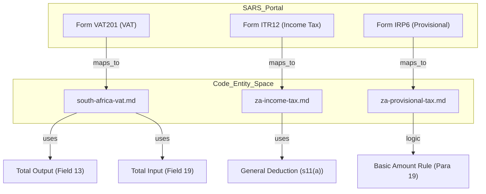
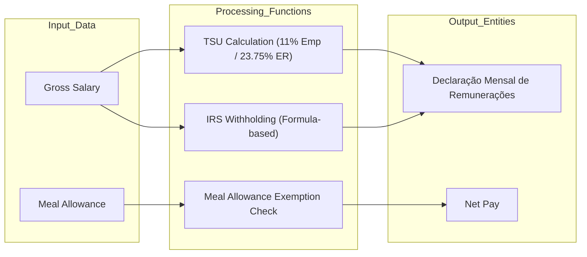

<!-- source: DeepWiki mcp.deepwiki.com · repo openaccountants/openaccountants · extra page Accountant-Verified Jurisdiction Deep Dives · fetched 2026-10-27 -->

# Accountant-Verified Jurisdiction Deep Dives

Relevant source files

The following files were used as context for generating this wiki page:

- [cookbook-contribution/notebook_cells.json](cookbook-contribution/notebook_cells.json)
- [packages/brazil/br-estimated-tax.md](packages/brazil/br-estimated-tax.md)
- [packages/brazil/br-income-tax.md](packages/brazil/br-income-tax.md)
- [packages/brazil/br-inss.md](packages/brazil/br-inss.md)
- [packages/brazil/br-simples-nacional.md](packages/brazil/br-simples-nacional.md)
- [packages/brazil/brazil-crypto-tax.md](packages/brazil/brazil-crypto-tax.md)
- [packages/brazil/brazil-einvoice.md](packages/brazil/brazil-einvoice.md)
- [packages/brazil/brazil-payroll.md](packages/brazil/brazil-payroll.md)
- [packages/brazil/brazil-transfer-pricing.md](packages/brazil/brazil-transfer-pricing.md)
- [packages/brazil/brazil-vat.md](packages/brazil/brazil-vat.md)
- [packages/cyprus/cyprus-vat-return.md](packages/cyprus/cyprus-vat-return.md)
- [packages/malta/malta-income-tax.md](packages/malta/malta-income-tax.md)
- [packages/malta/malta-ssc.md](packages/malta/malta-ssc.md)
- [packages/malta/malta-tax-optimization.md](packages/malta/malta-tax-optimization.md)
- [packages/malta/malta-vat-return.md](packages/malta/malta-vat-return.md)
- [packages/malta/mt-estimated-tax.md](packages/malta/mt-estimated-tax.md)
- [packages/portugal/portugal-bookkeeping.md](packages/portugal/portugal-bookkeeping.md)
- [packages/portugal/portugal-crypto-tax.md](packages/portugal/portugal-crypto-tax.md)
- [packages/portugal/portugal-einvoice.md](packages/portugal/portugal-einvoice.md)
- [packages/portugal/portugal-financial-statements.md](packages/portugal/portugal-financial-statements.md)
- [packages/portugal/portugal-formation.md](packages/portugal/portugal-formation.md)
- [packages/portugal/portugal-guided-intake.md](packages/portugal/portugal-guided-intake.md)
- [packages/portugal/portugal-payroll.md](packages/portugal/portugal-payroll.md)
- [packages/portugal/portugal-tax-optimization.md](packages/portugal/portugal-tax-optimization.md)
- [packages/portugal/portugal-vat-return.md](packages/portugal/portugal-vat-return.md)
- [packages/portugal/pt-corporate-tax.md](packages/portugal/pt-corporate-tax.md)
- [packages/portugal/pt-foreign-source-treaties.md](packages/portugal/pt-foreign-source-treaties.md)
- [packages/portugal/pt-income-tax.md](packages/portugal/pt-income-tax.md)
- [packages/portugal/pt-return-assembly.md](packages/portugal/pt-return-assembly.md)
- [packages/portugal/pt-social-contributions.md](packages/portugal/pt-social-contributions.md)
- [packages/south-africa/south-africa-vat.md](packages/south-africa/south-africa-vat.md)
- [packages/south-africa/za-income-tax.md](packages/south-africa/za-income-tax.md)
- [packages/south-africa/za-provisional-tax.md](packages/south-africa/za-provisional-tax.md)
- [packages/south-africa/za-vat-return.md](packages/south-africa/za-vat-return.md)
- [packages/uk/uk-capital-gains-sa108.md](packages/uk/uk-capital-gains-sa108.md)
- [packages/uk/uk-crypto-tax.md](packages/uk/uk-crypto-tax.md)
- [packages/uk/uk-dividends.md](packages/uk/uk-dividends.md)
- [packages/uk/uk-financial-statements.md](packages/uk/uk-financial-statements.md)
- [packages/uk/uk-formation.md](packages/uk/uk-formation.md)
- [packages/uk/uk-income-tax-sa100.md](packages/uk/uk-income-tax-sa100.md)
- [packages/uk/uk-national-insurance.md](packages/uk/uk-national-insurance.md)
- [packages/uk/uk-payments-on-account.md](packages/uk/uk-payments-on-account.md)
- [packages/uk/uk-payroll.md](packages/uk/uk-payroll.md)
- [packages/uk/uk-rental-sa105.md](packages/uk/uk-rental-sa105.md)
- [packages/uk/uk-self-employment-sa103.md](packages/uk/uk-self-employment-sa103.md)
- [packages/uk/uk-student-loan-repayment.md](packages/uk/uk-student-loan-repayment.md)
- [packages/uk/uk-transfer-pricing.md](packages/uk/uk-transfer-pricing.md)
- [packages/uk/uk-vat-return.md](packages/uk/uk-vat-return.md)
- [skills/international/malta/malta-income-tax.md](skills/international/malta/malta-income-tax.md)
- [skills/international/malta/malta-ssc.md](skills/international/malta/malta-ssc.md)
- [skills/international/malta/malta-vat-return.md](skills/international/malta/malta-vat-return.md)
- [skills/international/malta/mt-estimated-tax.md](skills/international/malta/mt-estimated-tax.md)
- [skills/international/south-africa/south-africa-vat.md](skills/international/south-africa/south-africa-vat.md)
- [skills/international/south-africa/za-income-tax.md](skills/international/south-africa/za-income-tax.md)
- [skills/international/south-africa/za-provisional-tax.md](skills/international/south-africa/za-provisional-tax.md)
- [skills/international/south-africa/za-vat-return.md](skills/international/south-africa/za-vat-return.md)

This section provides technical documentation for the "Accountant-Verified" tier of jurisdictions. Unlike research-verified content, these packages have undergone rigorous line-by-line review by qualified local professionals (CPAs, CAs, or warranted accountants) to ensure accuracy in rates, box assignments, and local tax logic.

## Malta (MT)

The Malta package is optimized for Article 10 (Standard) and Article 11 (Small Enterprise) registrants. It integrates VAT, Income Tax (TA24/TA22), and Social Security (SSC) into a unified compliance workflow.

### Technical Implementation: Malta VAT
The Malta VAT skill [skills/international/malta/malta-vat-return.md:2-5]() is architected to depend on the `vat-workflow-base` and `eu-vat-directive`. It implements a 45-box mapping system for the CFR (Commissioner for Revenue) portal.

**Key Data Flow:**
1. **Intake:** Processes bank statements from local (BOV, HSBC MT) or fintech (Revolut, Wise) sources [skills/international/malta/malta-vat-return.md:111-115]().
2. **Classification:** Maps transactions to specific boxes, such as Box 1 (Intra-EU B2B Services) or Box 18 (Local 18% Sales) [skills/international/malta/malta-vat-return.md:36-63]().
3. **Validation:** Applies conservative defaults, such as assuming 18% VAT if the rate is unknown [skills/international/malta/malta-vat-return.md:84-93]().

### Social Security (SSC) and Income Tax
Malta SSC is computed based on Class 2 (Self-Employed) rates, which are deterministic based on the contributor's birth year (pre-1962 vs. post-1962) [skills/international/malta/malta-ssc.md:30-32]().

| Feature | Entity/Logic |
| --- | --- |
| **SSC Calculation** | 15% of prior year net income, clamped to min/max caps [skills/international/malta/malta-ssc.md:29-32]() |
| **Income Tax Brackets** | Supports Single, Married, and Parent rate tables [skills/international/malta/malta-income-tax.md:39-68]() |
| **Deduction Logic** | Implements "Wholly and Exclusively" test for Box 2 [skills/international/malta/malta-income-tax.md:78-115]() |

**Sources:** [skills/international/malta/malta-vat-return.md:1-117](), [skills/international/malta/malta-ssc.md:1-107](), [skills/international/malta/malta-income-tax.md:1-139]().

---

## South Africa (ZA)

The South Africa package, verified by Werner Britz, CA(SA), covers the full "Tax Season" lifecycle, including VAT201, ITR12, and IRP6 provisional tax.

### System Mapping: South Africa Compliance
The following diagram maps the relationship between SARS forms and the underlying skill entities.

**Diagram: SARS Form to Code Entity Mapping**

**Sources:** [packages/south-africa/south-africa-vat.md:1-70](), [packages/south-africa/za-income-tax.md:1-70](), [packages/south-africa/za-provisional-tax.md:1-55]().

### Technical Highlights:
*   **VAT Apportionment:** Implements the Standard Turnover-based Method (STM) for mixed-use supplies [packages/south-africa/south-africa-vat.md:70]().
*   **Provisional Tax Safe Harbour:** Automates the calculation of the "Basic Amount" (most recent assessment + 8% uplift if >14 months old) [packages/south-africa/za-provisional-tax.md:36]().
*   **Retirement Fund Caps:** Hard-coded logic for the R430,000 / 27.5% deduction cap [packages/south-africa/za-income-tax.md:31]().

---

## Portugal (PT)

The Portugal package handles the complexity of "Recibos Verdes" (Green Receipts) and the transition to mandatory e-invoicing.

### Technical Implementation: E-Invoicing & ATCUD
Portugal requires a highly structured invoicing chain. The `portugal-einvoice` skill [packages/portugal/portugal-einvoice.md:4-11]() documents the mandatory inclusion of:
1.  **QR Codes:** Required on all fiscal documents since Jan 2022 [packages/portugal/portugal-einvoice.md:26]().
2.  **ATCUD:** A unique document validation code obtained from the AT [packages/portugal/portugal-einvoice.md:100-104]().
3.  **SAF-T(PT):** Monthly XML communication of the billing file to the AT [packages/portugal/portugal-einvoice.md:92-96]().

### Income Tax (IRS) and Payroll
The IRS skill [packages/portugal/pt-income-tax.md:4-9]() manages the "Regime Simplificado" where taxable income is derived via coefficients (e.g., 0.35 for general services) rather than real expenses [packages/portugal/pt-income-tax.md:80-86]().

**Diagram: Portugal Payroll Logic Flow**

**Sources:** [packages/portugal/portugal-payroll.md:1-145](), [packages/portugal/pt-income-tax.md:1-118]().

---

## Brazil (BR)

The Brazil package focuses on the "Simples Nacional" regime and the specific requirements for individual taxpayers (IRPF).

### Technical Highlights:
*   **IRPF Brackets:** Implements the 2025 progressive table with rates from 7.5% to 27.5% [packages/brazil/br-income-tax.md:22-26]().
*   **Carnê-Leão:** Manages the monthly estimated tax payments for individuals receiving income from other individuals or foreign sources [packages/brazil/br-income-tax.md:86-96]().
*   **MEI Limits:** Hard-coded threshold of R$ 81,000 for Microentrepreneurs [packages/brazil/br-income-tax.md:27]().
*   **Deduction Logic:** Supports both the "Desconto Simplificado" (20% flat deduction) and "Livro Caixa" (real documented expenses) [packages/brazil/br-income-tax.md:64-74]().

**Sources:** [packages/brazil/br-income-tax.md:1-101]().

---

## India (IN) & United Kingdom (UK)

### United Kingdom
The UK package is built around the Self-Assessment (SA100) and Self-Employment (SA103) forms.
*   **Class 2/4 NI:** Integrated calculation of National Insurance contributions.
*   **VAT MTD:** Logic for Making Tax Digital (MTD) compliance.
*   **Deduction Patterns:** Includes the "Supplier Pattern Library" for common UK vendors (HMRC, Companies House, etc.).

### India
The India package covers:
*   **GST:** Mapping transactions to GSTR-1 (Outward) and GSTR-3B (Summary) returns.
*   **TDS:** Logic for Tax Deducted at Source on professional services.
*   **Payroll:** Compliance with EPF (Provident Fund) and ESI (Insurance) contributions.

**Sources:** [packages/uk/uk-income-tax-sa100.md](), [packages/uk/uk-self-employment-sa103.md](), [packages/uk/uk-vat-return.md]().

---

