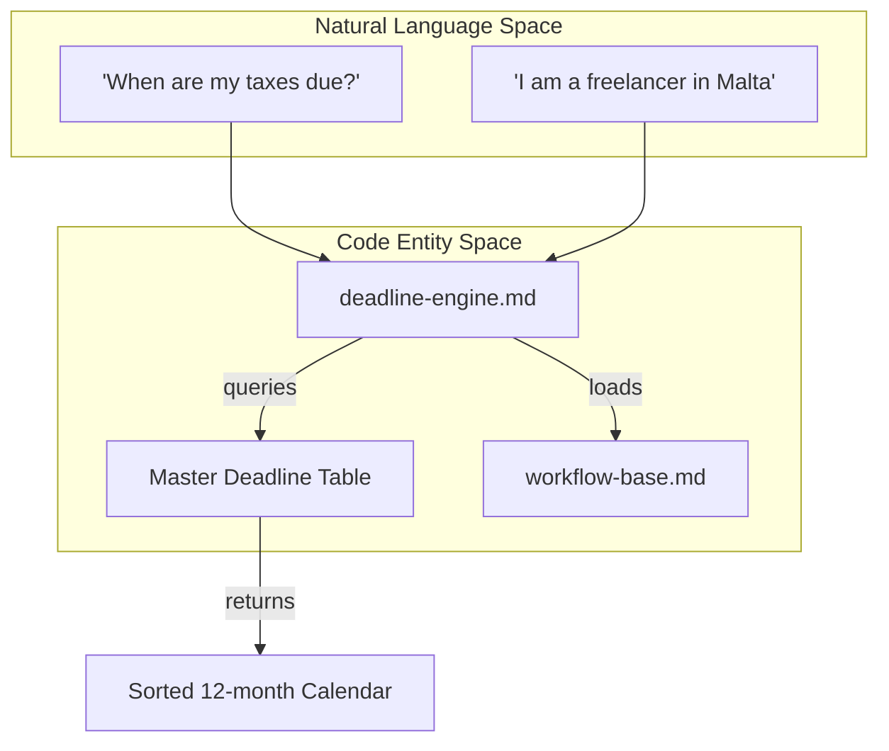
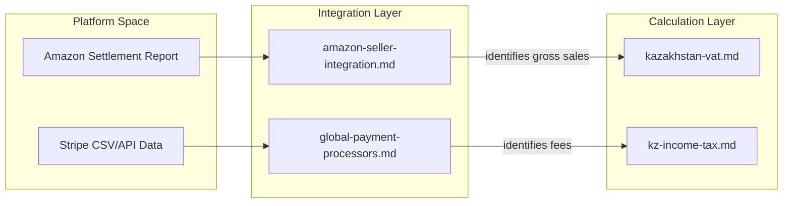

<!-- source: DeepWiki mcp.deepwiki.com · repo openaccountants/openaccountants · extra page Intelligence Skills, Patterns, and Integrations · fetched 2026-10-27 -->

# Intelligence Skills, Patterns, and Integrations

Relevant source files

The following files were used as context for generating this wiki page:

- [skills/cross-border/eu-oss-digital.md](skills/cross-border/eu-oss-digital.md)
- [skills/cross-border/eu-reverse-charge.md](skills/cross-border/eu-reverse-charge.md)
- [skills/cross-border/non-eu-export-services.md](skills/cross-border/non-eu-export-services.md)
- [skills/cross-border/permanent-establishment-risk.md](skills/cross-border/permanent-establishment-risk.md)
- [skills/cross-border/withholding-tax-matrix.md](skills/cross-border/withholding-tax-matrix.md)
- [skills/financial-reporting/business-combinations/ifrs3-business-combinations.md](skills/financial-reporting/business-combinations/ifrs3-business-combinations.md)
- [skills/financial-reporting/business-combinations/us-gaap-asc805-business-combinations.md](skills/financial-reporting/business-combinations/us-gaap-asc805-business-combinations.md)
- [skills/financial-reporting/debt-vs-equity/ias32-debt-vs-equity.md](skills/financial-reporting/debt-vs-equity/ias32-debt-vs-equity.md)
- [skills/financial-reporting/debt-vs-equity/us-gaap-debt-vs-equity.md](skills/financial-reporting/debt-vs-equity/us-gaap-debt-vs-equity.md)
- [skills/financial-reporting/financial-reporting-workflow-base.md](skills/financial-reporting/financial-reporting-workflow-base.md)
- [skills/financial-reporting/leases/ifrs16-leases.md](skills/financial-reporting/leases/ifrs16-leases.md)
- [skills/financial-reporting/leases/us-gaap-asc842-leases.md](skills/financial-reporting/leases/us-gaap-asc842-leases.md)
- [skills/financial-reporting/revenue-recognition/ifrs15-revenue.md](skills/financial-reporting/revenue-recognition/ifrs15-revenue.md)
- [skills/financial-reporting/revenue-recognition/us-gaap-asc606-revenue.md](skills/financial-reporting/revenue-recognition/us-gaap-asc606-revenue.md)
- [skills/intelligence/deadline-engine.md](skills/intelligence/deadline-engine.md)
- [skills/intelligence/optimisation-advisor.md](skills/intelligence/optimisation-advisor.md)
- [skills/intelligence/threshold-alerts.md](skills/intelligence/threshold-alerts.md)
- [skills/international/kazakhstan/kz-simplified-regime.md](skills/international/kazakhstan/kz-simplified-regime.md)
- [skills/manifest.json](skills/manifest.json)
- [skills/patterns/global-home-office.md](skills/patterns/global-home-office.md)
- [skills/patterns/global-payment-processors.md](skills/patterns/global-payment-processors.md)
- [skills/patterns/global-saas-vendors.md](skills/patterns/global-saas-vendors.md)

This page documents the intelligence layer, global pattern libraries, and platform integration skills of the OpenAccountants system. These components provide cross-cutting logic that operates above individual jurisdiction rules, enabling automated deadline tracking, tax optimization, and data ingestion from external financial platforms.

## 1. Intelligence Layer

The intelligence layer consists of skills categorized as `INTEL` in the [skills/manifest.json:28-28](). These skills do not compute specific tax obligations but instead provide meta-analysis, orchestration, and advisory logic across a user's entire profile.

### 1.1 Deadline Engine
The `deadline-engine` generates personalized filing calendars by matching a user's obligation profile against a master table of statutory dates [skills/intelligence/deadline-engine.md:28-30]().

**Key Functions:**
*   **Calendar Generation:** Computes the next 12 months of deadlines based on jurisdiction (e.g., US, UK, MT) and obligation type (VAT, Income Tax, SSC) [skills/intelligence/deadline-engine.md:70-80]().
*   **Urgency Logic:** Flags deadlines as "Approaching" (8-30 days) or "Urgent" (0-7 days) [skills/intelligence/deadline-engine.md:89-95]().
*   **Penalty Estimation:** Calculates estimated late-filing fees when a deadline is past due [skills/intelligence/deadline-engine.md:99-102]().

### 1.2 Optimisation Advisor
The `optimisation-advisor` analyzes financial data to identify tax-saving opportunities. It operates on the "Conservative-default principle," ensuring that aggressive tax positions are flagged for professional review [skills/financial-reporting/financial-reporting-workflow-base.md:103-106]().

### 1.3 Threshold Alerts
Monitors turnover and income levels against statutory limits (e.g., VAT registration thresholds or small business regime ceilings). For example, it tracks the 600,000 MCI ceiling for the Kazakhstan simplified regime [skills/international/kazakhstan/kz-simplified-regime.md:98-99]().

**Intelligence Layer Data Flow**

Sources: [skills/intelligence/deadline-engine.md:1-18](), [skills/intelligence/deadline-engine.md:55-84](), [skills/financial-reporting/financial-reporting-workflow-base.md:1-19]()

---

## 2. Global Pattern Libraries

Pattern libraries (categorized as `PAT` in the [skills/manifest.json:33-33]()) provide standardized logic for recurring accounting scenarios that transcend borders, such as SaaS expenses or home office deductions.

### 2.1 SaaS and Payment Processor Patterns
The `global-saas-vendors` and `global-payment-processors` libraries contain classification rules for common digital platforms (Stripe, AWS, Adobe). These patterns assist in:
*   **VAT/GST Treatment:** Identifying if a vendor provides B2B services subject to reverse charge [skills/cross-border/eu-reverse-charge.md:1-10]().
*   **Deductibility:** Pre-classifying software subscriptions as business expenses.

### 2.2 Global Home Office
The `global-home-office` skill provides a framework for calculating business-use-of-home deductions, supporting both simplified "safe harbor" rates and actual expense methods (apportionment by area or room count).

| Pattern ID | Scope | Key Logic |
| :--- | :--- | :--- |
| `saas-vendors` | Global | VAT ID verification, B2B vs B2C classification |
| `payment-processors` | Global | Fee extraction (Stripe/PayPal), gross-to-net reconciliation |
| `home-office` | Global | Area-based apportionment, utility allocation |

Sources: [skills/manifest.json:33-33](), [skills/cross-border/eu-reverse-charge.md:1-10](), [skills/patterns/global-saas-vendors.md:1-5]()

---

## 3. Platform Integrations

Integration skills (categorized as `INT` in [skills/manifest.json:13-13]()) define how the system parses data from external accounting and e-commerce platforms.

### 3.1 Data Ingestion Flow
Integration skills act as translators between raw platform exports (CSV/JSON) and the internal `workflow-base` structures. For instance, the `amazon-seller-integration` [skills/manifest.json:126-135]() maps Amazon Settlement Reports to tax boxes.

### 3.2 Supported Platforms
*   **Accounting:** Xero, QuickBooks, Sage, FreeAgent.
*   **Payment/Fintech:** Stripe, PayPal, Wise, Revolut Business.
*   **E-commerce:** Amazon Seller, Shopify.

**Integration to Tax Calculation Bridge**

Sources: [skills/manifest.json:126-135](), [skills/international/kazakhstan/kz-simplified-regime.md:18-20](), [skills/integrations/amazon-seller-integration.md:1-10]()

---

## 4. Financial Reporting Integration

Intelligence and patterns are heavily utilized in the `financial-reporting` domain to ensure compliance with IFRS and US GAAP.

### 4.1 Dual-Standard Execution
When a user's facts touch both frameworks, the system loads the `financial-reporting-workflow-base` [skills/financial-reporting/financial-reporting-workflow-base.md:1-19]() and executes both standard-specific skills (e.g., `ifrs15-revenue` and `us-gaap-asc606-revenue`) to highlight divergences [skills/financial-reporting/financial-reporting-workflow-base.md:60-67]().

### 4.2 Audit Flash Points
Intelligence skills are programmed to surface **AUDIT FLASH POINTS**—specific judgements that are frequently challenged by regulators or auditors, such as the "reasonably certain" assessment in lease terms [skills/financial-reporting/leases/ifrs16-leases.md:71-72]() or collectibility gates in revenue recognition [skills/financial-reporting/revenue-recognition/us-gaap-asc606-revenue.md:71-72]().

| Standard | Topic | Key Code Entity |
| :--- | :--- | :--- |
| IFRS | Revenue | `ifrs15-revenue.md` |
| US GAAP | Revenue | `us-gaap-asc606-revenue.md` |
| IFRS | Leases | `ifrs16-leases.md` |
| US GAAP | Leases | `us-gaap-asc842-leases.md` |
| IFRS | Business Combinations | `ifrs3-business-combinations.md` |
| US GAAP | Business Combinations | `us-gaap-asc805-business-combinations.md` |

Sources: [skills/financial-reporting/financial-reporting-workflow-base.md:37-56](), [skills/financial-reporting/leases/ifrs16-leases.md:1-24](), [skills/financial-reporting/revenue-recognition/us-gaap-asc606-revenue.md:1-24]()

---

