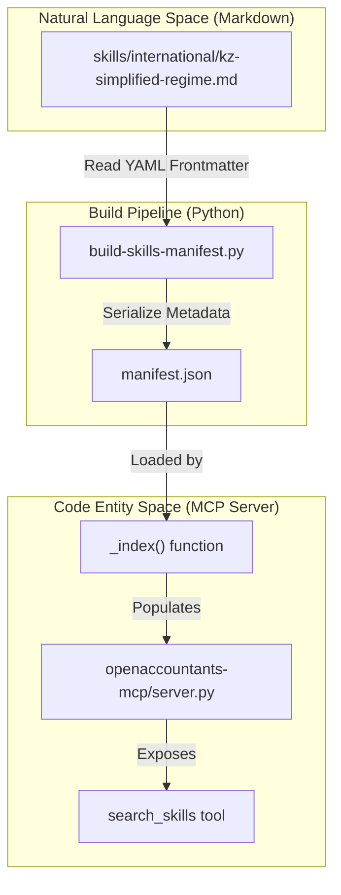
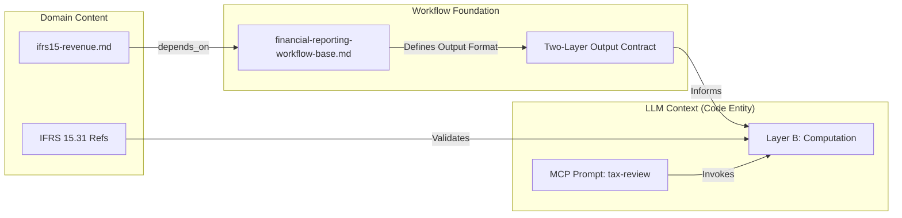

<!-- source: DeepWiki mcp.deepwiki.com · repo openaccountants/openaccountants · extra page Skill Taxonomy and Categories · fetched 2026-10-27 -->

# Skill Taxonomy and Categories

<details>
<summary>Relevant source files</summary>

The following files were used as context for generating this wiki page:

- [.github/FUNDING.yml](.github/FUNDING.yml)
- [.github/ISSUE_TEMPLATE/bug-report.md](.github/ISSUE_TEMPLATE/bug-report.md)
- [.github/ISSUE_TEMPLATE/new-country.md](.github/ISSUE_TEMPLATE/new-country.md)
- [.github/ISSUE_TEMPLATE/rate-correction.md](.github/ISSUE_TEMPLATE/rate-correction.md)
- [.github/ISSUE_TEMPLATE/vendor-pattern.md](.github/ISSUE_TEMPLATE/vendor-pattern.md)
- [.github/PULL_REQUEST_TEMPLATE.md](.github/PULL_REQUEST_TEMPLATE.md)
- [cookbook-contribution/README.md](cookbook-contribution/README.md)
- [cookbook-contribution/custom_skills/classifying-tax-transactions/SKILL.md](cookbook-contribution/custom_skills/classifying-tax-transactions/SKILL.md)
- [cookbook-contribution/custom_skills/tax-workflow-base/SKILL.md](cookbook-contribution/custom_skills/tax-workflow-base/SKILL.md)
- [docs/ARCHITECTURE-OPTIONS.md](docs/ARCHITECTURE-OPTIONS.md)
- [docs/skill-template.md](docs/skill-template.md)
- [skills/financial-reporting/business-combinations/ifrs3-business-combinations.md](skills/financial-reporting/business-combinations/ifrs3-business-combinations.md)
- [skills/financial-reporting/business-combinations/us-gaap-asc805-business-combinations.md](skills/financial-reporting/business-combinations/us-gaap-asc805-business-combinations.md)
- [skills/financial-reporting/debt-vs-equity/ias32-debt-vs-equity.md](skills/financial-reporting/debt-vs-equity/ias32-debt-vs-equity.md)
- [skills/financial-reporting/debt-vs-equity/us-gaap-debt-vs-equity.md](skills/financial-reporting/debt-vs-equity/us-gaap-debt-vs-equity.md)
- [skills/financial-reporting/financial-reporting-workflow-base.md](skills/financial-reporting/financial-reporting-workflow-base.md)
- [skills/financial-reporting/leases/ifrs16-leases.md](skills/financial-reporting/leases/ifrs16-leases.md)
- [skills/financial-reporting/leases/us-gaap-asc842-leases.md](skills/financial-reporting/leases/us-gaap-asc842-leases.md)
- [skills/financial-reporting/revenue-recognition/ifrs15-revenue.md](skills/financial-reporting/revenue-recognition/ifrs15-revenue.md)
- [skills/financial-reporting/revenue-recognition/us-gaap-asc606-revenue.md](skills/financial-reporting/revenue-recognition/us-gaap-asc606-revenue.md)
- [skills/international/kazakhstan/kz-simplified-regime.md](skills/international/kazakhstan/kz-simplified-regime.md)
- [skills/manifest.json](skills/manifest.json)

</details>


This page provides a technical reference for the classification, structure, and metadata of skills within the OpenAccountants repository. It defines the categories used to organize the 781+ skills, the YAML frontmatter schema that governs skill behavior, and the structure of the `manifest.json` used by the MCP server and build pipeline.

## 1. Skill Categories and Taxonomy

Skills are organized into logical categories that dictate their placement in the directory structure and their role in the accounting workflow.

| Category | Description | Directory |
| :--- | :--- | :--- |
| `international` | Jurisdiction-specific skills for countries outside the US/Canada. | `skills/international/` |
| `federal` | US Federal tax skills (e.g., Form 1040, Schedule C). | `skills/federal/` |
| `state` | US State-specific tax and sales tax skills. | `skills/us-states/` |
| `bookkeeping` | General ledger, classification, and reconciliation logic. | `skills/bookkeeping/` |
| `payroll` | Calculation of social contributions, withholdings, and net pay. | `skills/payroll/` |
| `formation` | Entity setup, registration, and local compliance requirements. | `skills/formation/` |
| `cross-border` | Multi-jurisdiction residency, treaty, and corridor logic. | `skills/cross-border/` |
| `vertical` | Industry-specific logic (e.g., SaaS, E-commerce, Medical). | `skills/verticals/` |
| `integration` | Data mapping for platforms like Xero, Stripe, or Amazon. | `skills/integrations/` |
| `orchestrator` | Routers that sequence other skills based on user intent. | `skills/workflows/` |
| `financial-reporting` | Accounting standards compliance (IFRS vs. US GAAP). | `skills/financial-reporting/` |

**Sources:** [skills/manifest.json:47-300](), [skills/international/kazakhstan/kz-simplified-regime.md:24-24](), [skills/financial-reporting/revenue-recognition/ifrs15-revenue.md:17-17]()

---

## 2. YAML Frontmatter Schema

Every skill file must begin with a YAML frontmatter block. This metadata is used by the `build-skills-manifest.py` script to populate the system index and by the MCP server to resolve dependencies.

### Schema Fields
*   `name`: Unique identifier for the skill (kebab-case).
*   `description`: High-level summary used for tool discovery.
*   `version`: Semantic version of the skill content.
*   `jurisdiction`: ISO country code (e.g., `MT`, `US`, `GLOBAL`).
*   `tax_year`: The specific legislative year the skill covers.
*   `category`: One of the categories defined in Section 1.
*   `standard_family`: (Financial Reporting only) `ifrs` or `us-gaap`.
*   `depends_on`: List of skill IDs that must be loaded into the LLM context alongside this skill.

### Example Implementation
```yaml
---
name: ifrs15-revenue
description: IFRS revenue recognition under IFRS 15...
version: 0.1
jurisdiction: GLOBAL
category: financial-reporting
standard_family: ifrs
depends_on:
  - financial-reporting-workflow-base
---
```
**Sources:** [skills/financial-reporting/revenue-recognition/ifrs15-revenue.md:1-23](), [skills/international/kazakhstan/kz-simplified-regime.md:1-27]()

---

## 3. The Skill Template (Standard Sections)

To ensure consistency across the 781 skills, every `.md` file follows a strict section hierarchy. This structure allows the LLM to differentiate between "Reference" (Layer A) and "Execution" (Layer B).

### Structural Requirements
1.  **Metadata Block:** YAML frontmatter.
2.  **Skill Header:** H1 with name and version.
3.  **General Disclaimer:** Mandatory legal warning block.
4.  **Section 1 — Scope:** Definition of what the skill covers and excludes.
5.  **Section 2 — Reference Layer (Layer A):** Citation-anchored rules (e.g., `ASC 606-10-25-1`).
6.  **Section 3 — Executable Layer (Layer B):** Step-by-step computation logic.
7.  **Audit Flash Points:** Markers for high-judgment areas (using `⚑ AUDIT FLASH POINT`).
8.  **Test Suite:** Sample inputs and expected outputs.

**Sources:** [skills/financial-reporting/financial-reporting-workflow-base.md:37-111](), [.github/PULL_REQUEST_TEMPLATE.md:25-33]()

---

## 4. Manifest Structure (`manifest.json`)

The `manifest.json` is the central registry of the codebase. It is generated by the build pipeline and provides a queryable index for the MCP server's `list_skills` and `search_skills` tools.

### Manifest Schema
The manifest contains a `quality_breakdown`, an `obligation_breakdown` (categorized by tax type like IT, CT, VAT), and a `skills` array.

```json
{
  "version": "2.2",
  "total_skills": 781,
  "quality_breakdown": {
    "research-verified": 768,
    "accountant-verified": 13
  },
  "skills": [
    {
      "id": "ab-individual-return",
      "jurisdiction": "CA",
      "obligation": "IT",
      "quality": "research-verified",
      "category": "international",
      "tax_year": "2025",
      "path": "international/canada/alberta/ab-individual-return.md"
    }
  ]
}
```
**Sources:** [skills/manifest.json:1-58]()

---

## 5. System Data Flow Diagrams

### Diagram 1: From Skill Source to MCP Tool
This diagram shows how a raw Markdown file in the `skills/` directory is transformed into a searchable entity in the MCP server.

Title: Skill Indexing and Discovery Flow

**Sources:** [skills/manifest.json:1-10](), [skills/international/kazakhstan/kz-simplified-regime.md:1-27]()

---

### Diagram 2: Skill Execution Architecture
This diagram illustrates the relationship between Workflow Bases and Content Skills during an active LLM session.

Title: Skill Composition and Execution

**Sources:** [skills/financial-reporting/financial-reporting-workflow-base.md:37-57](), [skills/financial-reporting/revenue-recognition/ifrs15-revenue.md:1-23]()

---

