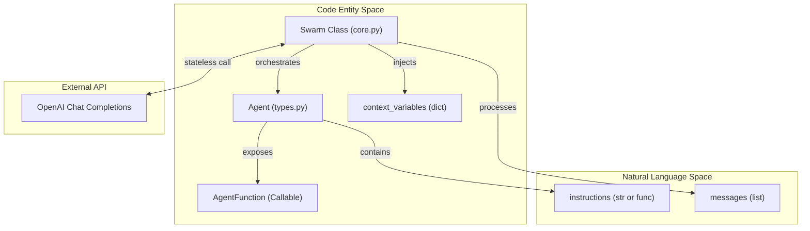
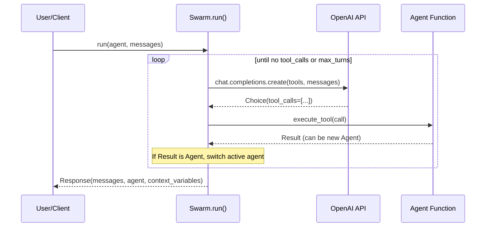
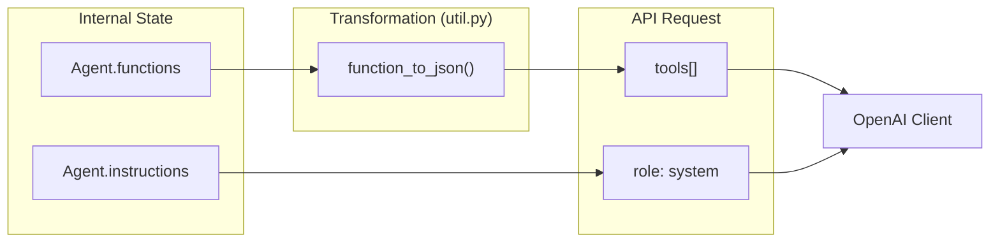

<!-- source: DeepWiki mcp.deepwiki.com · repo openai/swarm · page 1 Overview · fetched 2026-10-27 -->

# Overview

Relevant source files

The following files were used as context for generating this wiki page:

- [LICENSE](LICENSE)
- [README.md](README.md)
- [SECURITY.md](SECURITY.md)
- [assets/diagram.png](assets/diagram.png)
- [assets/logo.png](assets/logo.png)
- [assets/swarm_diagram.png](assets/swarm_diagram.png)

The OpenAI Swarm framework is an experimental, educational tool designed to make agent **coordination** and **execution** lightweight, highly controllable, and easily testable. It focuses on exploring patterns for managing multiple independent capabilities and instructions that are difficult to encode into a single prompt.

## Purpose and Scope

This document introduces the Swarm repository, its core primitives, and high-level architecture. It serves as the entry point for understanding how Swarm orchestrates multi-agent systems using the Chat Completions API.

- For details on the core implementation, see **Core Implementation** (Page 2).
- For information about the tool system, see **Tool System** (Page 3).
- For the airline and triage examples, see **Examples** (Page 4).
- For testing infrastructure, see **Testing** (Page 5).

## Core Primitives

Swarm is built on two primary abstractions: `Agent`s and **handoffs**.

1.  **Agents**: An `Agent` encompasses `instructions` and `tools` [README.md:76-77]().
2.  **Handoffs**: An agent can choose to hand off a conversation to another agent by returning that agent from a function call [README.md:31-39]().

Unlike the Assistants API, Swarm is **stateless** between calls; it does not store threads or messages on the server [README.md:81-87]().

Sources: [README.md:72-87](), [swarm/types.py:17-25]()

## High-Level Architecture

### System Components

The architecture bridges "Natural Language Space" (instructions) and "Code Entity Space" (Python functions) through the `Swarm` client.

Sources: [swarm/core.py:26-38](), [swarm/types.py:17-25](), [README.md:104-112]()

### The Run Loop

The core of Swarm is the `Swarm.run()` method [swarm/core.py:139](). It implements a loop that continues until the agent has no more tools to call or reaches a turn limit.

| Step | Action | Code Reference |
| :--- | :--- | :--- |
| 1 | Get completion from OpenAI | `get_chat_completion` [swarm/core.py:165]() |
| 2 | Handle tool calls | `handle_tool_calls` [swarm/core.py:192]() |
| 3 | Execute Python functions | `function(*args)` [swarm/core.py:257]() |
| 4 | Process Handoffs | `isinstance(result.value, Agent)` [swarm/core.py:276]() |
| 5 | Update State | Update `context_variables` [swarm/core.py:284]() |

Sources: [swarm/core.py:139-229](), [README.md:118-125]()

## Key Concepts

### Agents and Instructions
An `Agent` [swarm/types.py:17-25]() can have instructions as a static string or a callable that returns a string. This allows instructions to be dynamic based on `context_variables` [swarm/core.py:159-161]().

### Context Variables
The `context_variables` dictionary [swarm/core.py:36]() is passed to functions that require it (detected via signature inspection in `util.function_to_json`) and can be updated by functions returning a `Result` object [swarm/types.py:11-15]().

### Tool Execution
Swarm automatically converts Python functions into JSON schemas using `function_to_json` [swarm/util.py:31-87](). It handles:
- Docstring extraction for parameter descriptions [swarm/util.py:61-75]().
- Type hint mapping (e.g., `str` to `"string"`) [swarm/util.py:14-23]().
- Execution of functions and returning the result back to the LLM [swarm/core.py:250-264]().

## Data Flow: Code to API

This diagram illustrates how internal code entities are mapped to the OpenAI API protocol.

Sources: [swarm/core.py:165-190](), [swarm/util.py:31-87]()

## Implementation Variations
While the core library resides in `swarm/`, the repository includes extensive examples in `examples/` that demonstrate different orchestration patterns:
- **Triage**: Routing users to specialized agents [examples/triage_agent/]() [README.md:94]().
- **Airline**: Complex multi-turn handoffs for flight changes and baggage [examples/airline/]() [README.md:96]().
- **Streaming**: Real-time response handling using `Swarm.run(..., stream=True)` [swarm/core.py:101-137]().

Sources: [README.md:89-99](), [swarm/core.py:101-137]()

---

