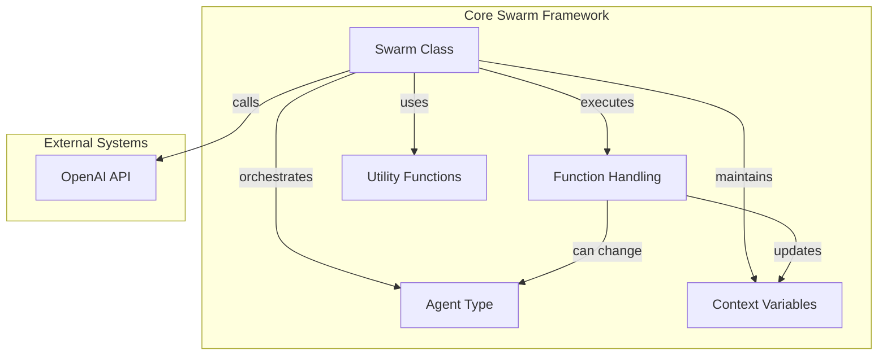
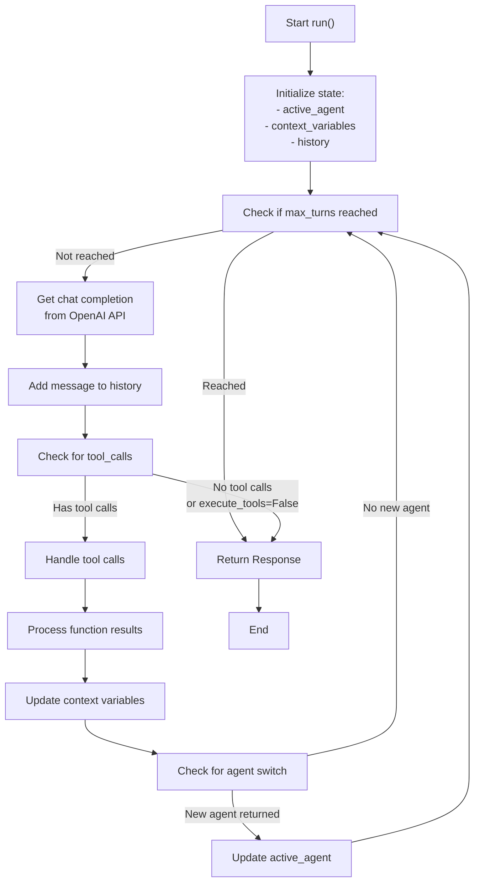
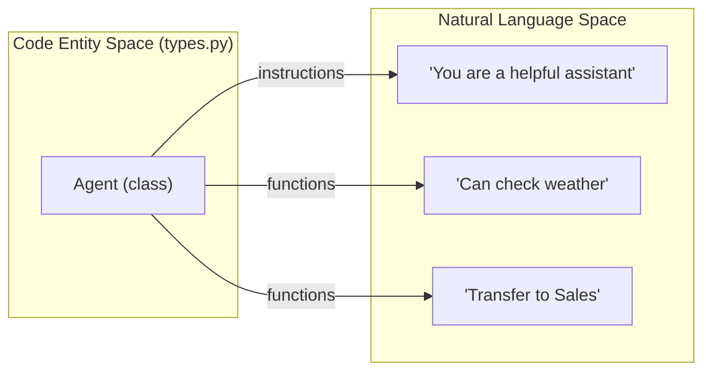
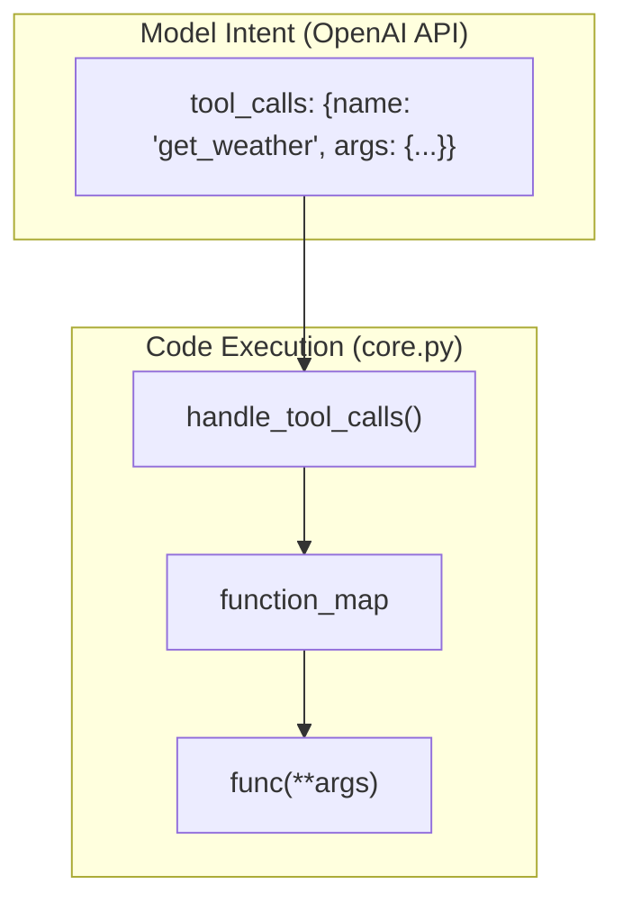
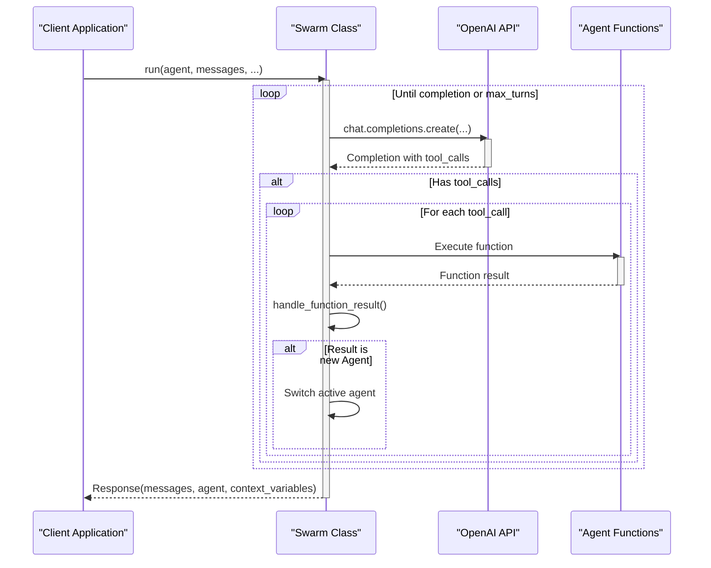

<!-- source: DeepWiki mcp.deepwiki.com · repo openai/swarm · page 2 Core Implementation · fetched 2026-10-27 -->

# Core Implementation

Relevant source files

The following files were used as context for generating this wiki page:

- [.gitignore](.gitignore)
- [.pre-commit-config.yaml](.pre-commit-config.yaml)
- [README.md](README.md)

This document describes the core implementation of the OpenAI Swarm framework, which serves as the foundation for orchestrating AI agents and executing tasks. The core implementation provides essential components for managing agent interactions with the OpenAI API, handling tool calls, and maintaining shared context between agents.

## Architecture Overview

The core implementation consists of a small set of tightly integrated components that work together to provide a flexible framework for agent-based interactions.

Sources: [swarm/core.py:26-292](), [swarm/util.py:1-87]()

## Components

The Swarm implementation is divided into several specialized modules. For detailed technical specifications, please refer to the child pages linked below.

### Swarm Class (core.py)
The `Swarm` class is the primary entry point. It instantiates an `OpenAI` client and manages the `run` loop, which handles the iterative process of getting completions, executing tools, and switching agents. 
- For details, see [Swarm Class (core.py)](#2.1).

Sources: [swarm/core.py:26-30](), [swarm/core.py:139-292]()

### Types and Data Models
Swarm uses Pydantic models to ensure type safety and consistent data structures. The primary models include `Agent`, `Response`, and `Result`.
- For details, see [Types and Data Models](#2.2).

Sources: [swarm/types.py:1-49]()

### Utility Functions
The `util.py` module contains internal helpers for transforming Python code into API-compatible formats, such as converting function signatures into JSON schemas and merging streaming chunks.
- For details, see [Utility Functions](#2.3).

Sources: [swarm/util.py:1-87]()

### REPL and Demo Loop
To facilitate testing and rapid prototyping, Swarm includes a REPL (Read-Eval-Print Loop) in `swarm/repl`. This allows developers to interact with agents in a terminal environment.
- For details, see [REPL and Demo Loop](#2.4).

Sources: [swarm/repl/repl.py:1-105]()

## Execution Flow

The core execution flow is implemented in the `run` method (and its streaming counterpart `run_and_stream`). This flow orchestrates the interaction between agents, the OpenAI API, and function calls.

Sources: [swarm/core.py:231-292](), [swarm/core.py:139-229]()

## Bridge: Natural Language to Code Entities

The following diagrams map conceptual multi-agent behaviors to specific entities in the codebase.

### Agent Definition Bridge
This diagram shows how natural language instructions and capabilities are mapped to the `Agent` class properties.

Sources: [swarm/types.py:13-21]()

### Tool Execution Bridge
This diagram shows how a model's intent to use a tool is translated into a Python function call within `core.py`.

Sources: [swarm/core.py:89-137]()

## Integration with OpenAI API

The core implementation is tightly integrated with the OpenAI API, using its chat completions and function calling capabilities:

Sources: [swarm/core.py:32-69](), [swarm/core.py:231-292]()

---

