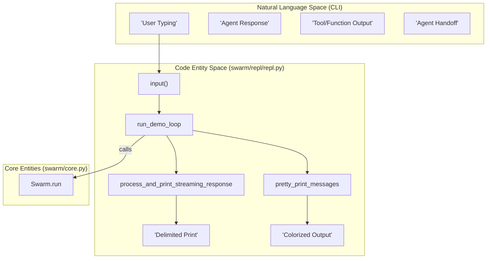
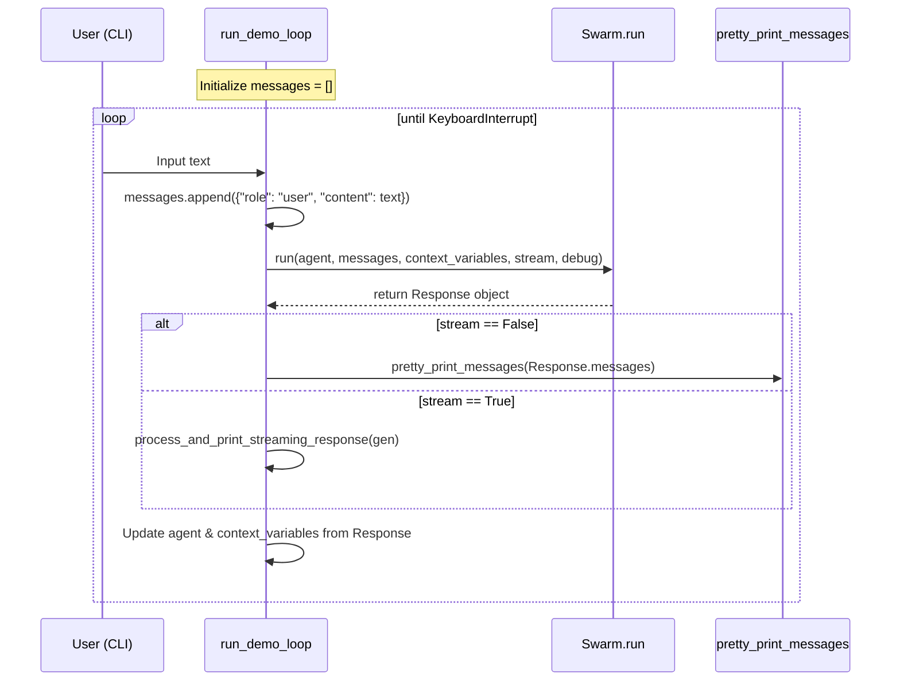

<!-- source: DeepWiki mcp.deepwiki.com · repo openai/swarm · page 2.4 REPL and Demo Loop · fetched 2026-10-27 -->

# REPL and Demo Loop

<details>
<summary>Relevant source files</summary>

The following files were used as context for generating this wiki page:

- [README.md](README.md)

</details>


The `swarm/repl` module provides a suite of utility functions designed for interactive Command Line Interface (CLI) testing of Swarm agents. It facilitates a complete execution loop, allowing developers to simulate multi-turn conversations with agents, handle streaming responses, and visualize message exchanges with clean, color-coded formatting.

### Overview of the Demo Loop

The primary entry point for interactive testing is the `run_demo_loop` function. It abstracts the complexity of maintaining conversation state, handling user input, and processing agent responses (both synchronous and streaming).

#### Key Components and Data Flow

The REPL operates by wrapping the `Swarm.run()` method in a continuous `while` loop. It maintains a local list of messages and a dictionary of context variables, which are updated after every turn and passed back into the next iteration.

**Interactive Loop Logic:**
1.  **User Input:** The loop prompts the user for input using `input()`.
2.  **Message Update:** The user's input is appended to the message history as a `user` role message.
3.  **Swarm Execution:** `client.run()` is called with the current agent, message history, and context variables.
4.  **Response Processing:**
    *   If `stream=True`, it calls `process_and_print_streaming_response`.
    *   If `stream=False`, it prints messages via `pretty_print_messages`.
5.  **State Persistence:** The `Response` object returned by Swarm updates the local `messages` and `agent` variables for the next turn.

#### Natural Language to Code Entity Mapping

The following diagram illustrates how natural language concepts in a CLI session map to specific code entities within the `swarm/repl` module.

**REPL Concept Mapping**

Sources: [swarm/repl/repl.py:1-100](), [README.md:114-143]()

---

### Key Functions

#### run_demo_loop
Defined in `swarm/repl/repl.py`, this function orchestrates the interactive session.

| Parameter | Type | Description |
| :--- | :--- | :--- |
| `starting_agent` | `Agent` | The initial agent the REPL session begins with. |
| `context_variables` | `dict` | Optional initial context variables. |
| `stream` | `bool` | Whether to use streaming mode for responses. Defaults to `False`. |
| `debug` | `bool` | If `True`, enables verbose logging from the Swarm client. |

[swarm/repl/repl.py:61-97]()

#### pretty_print_messages
This utility iterates through a list of message dictionaries and prints them to the console. It applies specific formatting based on the message `role`:
*   **Sender Identification:** If the message contains a `sender` field (common in Swarm responses), it is displayed; otherwise, the `role` is shown.
*   **Content Display:** Prints the `content` of the message.
*   **Tool Calls:** If the message includes `tool_calls`, it iterates through them and prints the function name and arguments.

[swarm/repl/repl.py:18-38]()

#### process_and_print_streaming_response
Used when `stream=True` is passed to the demo loop. It consumes the generator returned by `client.run()` and prints chunks in real-time.
*   **Content Chunks:** Prints `content` as it arrives without newlines to simulate a typing effect.
*   **Tool/Handoff Detection:** Monitors for `tool_calls`, `sender` changes, and `delim` markers to format the output correctly.
*   **Result Aggregation:** It returns a final `Response` object built from the accumulated stream chunks, ensuring the REPL state remains consistent with non-streaming runs.

[swarm/repl/repl.py:41-58]()

---

### Implementation Detail: The Run Loop

The diagram below shows the internal logic of `run_demo_loop` and its interaction with the `Swarm` client.

**REPL Execution Flow**

Sources: [swarm/repl/repl.py:61-97](), [swarm/core.py:82-120]()

### Usage Example

The REPL is typically used in example scripts to provide an immediate way to interact with defined agents.

```python
from swarm import Swarm
from swarm.repl import run_demo_loop
from my_agents import triage_agent

client = Swarm()
run_demo_loop(triage_agent, stream=True)
```

In this scenario, `run_demo_loop` handles the instantiation of the `user` role and the subsequent management of the `Response` object fields: `messages`, `agent`, and `context_variables`.

Sources: [swarm/repl/repl.py:1-97](), [README.md:139-143]()

---

