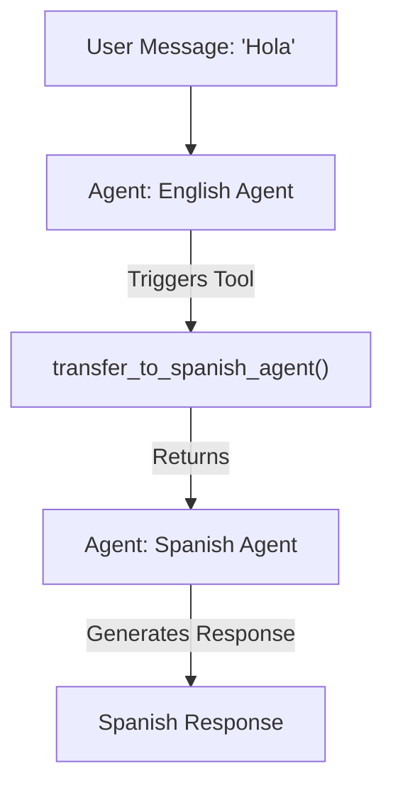
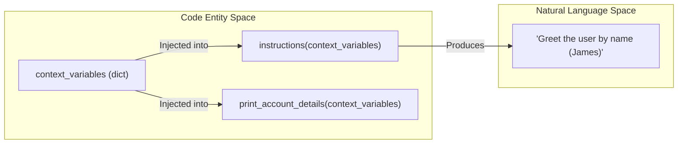

<!-- source: DeepWiki mcp.deepwiki.com · repo openai/swarm · page 4.1 Basic Examples · fetched 2026-10-27 -->

# Basic Examples

Relevant source files

The following files were used as context for generating this wiki page:

- [examples/basic/README.md](examples/basic/README.md)
- [examples/basic/agent_handoff.py](examples/basic/agent_handoff.py)
- [examples/basic/bare_minimum.py](examples/basic/bare_minimum.py)
- [examples/basic/context_variables.py](examples/basic/context_variables.py)
- [examples/basic/function_calling.py](examples/basic/function_calling.py)
- [examples/basic/simple_loop_no_helpers.py](examples/basic/simple_loop_no_helpers.py)

The `examples/basic/` directory contains foundational scripts designed to demonstrate the core capabilities of the Swarm framework. These examples focus on the simplest usage patterns, typically involving a single input message and a corresponding output, to illustrate how to initialize agents, handle handoffs, utilize context, and call functions.

Sources: [examples/basic/README.md:1-5]()

## Bare Minimum Implementation

The most basic instantiation of Swarm involves creating a `Swarm` client and an `Agent` with simple instructions. The `Swarm.run()` method serves as the entry point for the conversation.

### Data Flow: Bare Minimum
1. A `Swarm` client is instantiated.
2. An `Agent` is defined with a `name` and `instructions`.
3. A list of `messages` is passed to `client.run()`.
4. The client returns a `Response` object containing the result.

| Entity | Role | File Reference |
| :--- | :--- | :--- |
| `Swarm` | The orchestration client. | [examples/basic/bare_minimum.py:3-3]() |
| `Agent` | Defines the LLM's persona and instructions. | [examples/basic/bare_minimum.py:5-8]() |
| `client.run` | Executes the turn loop. | [examples/basic/bare_minimum.py:11-11]() |

Sources: [examples/basic/bare_minimum.py:1-13]()

## Agent Handoffs

Handoffs are achieved by defining a function that returns another `Agent` instance. When the LLM calls this function, the Swarm execution loop switches the active agent for subsequent turns.

### Logic Flow: Language Handoff
In `agent_handoff.py`, an `english_agent` is equipped with a tool to transfer to a `spanish_agent`.

Title: Agent Handoff Logic

Sources: [examples/basic/agent_handoff.py:5-24]()

## Context Variables

Context variables allow the injection of external state into agent instructions and tool execution. Instructions can be defined as a callable that accepts `context_variables`, allowing for dynamic prompt generation.

### Key Implementation Details
- **Dynamic Instructions**: The `instructions` parameter of an `Agent` can be a function that retrieves values from the `context_variables` dictionary.
- **Tool Access**: Functions provided to an agent can optionally accept a `context_variables` parameter to access stateful data (e.g., `user_id`).

Title: Context Variable Injection

Sources: [examples/basic/context_variables.py:6-30]()

## Function Calling

Agents can be assigned a list of Python functions. Swarm automatically converts these functions into JSON schemas for the LLM. When the LLM generates a tool call, Swarm executes the Python function and returns the result to the LLM to finalize the response.

### Example: Weather Tool
In `function_calling.py`, the `get_weather` function is passed directly to the `Agent.functions` list.

| Component | Implementation |
| :--- | :--- |
| **Function** | `get_weather(location)` |
| **Registration** | `Agent(functions=[get_weather])` |
| **Trigger** | User asks "What's the weather in NYC?" |

Sources: [examples/basic/function_calling.py:6-18]()

## Interactive Loop (No Helpers)

The `simple_loop_no_helpers.py` script demonstrates how to maintain a persistent conversation state manually without using the high-level `repl` utilities. It highlights the importance of updating the `messages` history and the current `agent` from the `Response` object returned by `client.run()`.

### Manual Loop Logic
1. **Input**: Capture user input via `input("> ")`.
2. **Append**: Add the user message to the local `messages` list.
3. **Run**: Call `client.run()` with the current `agent` and `messages`.
4. **Update**: 
   - Update `messages` with `response.messages` (which includes the assistant's response and tool outputs).
   - Update `agent` with `response.agent` (to handle potential handoffs).

Sources: [examples/basic/simple_loop_no_helpers.py:18-27]()

---

