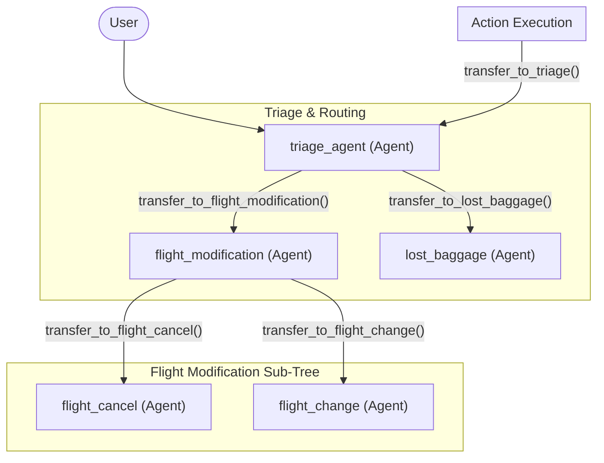
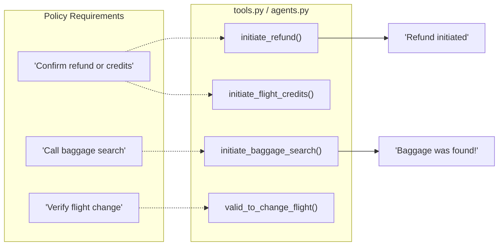

<!-- source: DeepWiki mcp.deepwiki.com · repo openai/swarm · page 4.2 Airline Customer Service Example · fetched 2026-10-27 -->

# Airline Customer Service Example

Relevant source files

The following files were used as context for generating this wiki page:

- [examples/airline/README.md](examples/airline/README.md)
- [examples/airline/__init__.py](examples/airline/__init__.py)
- [examples/airline/configs/__init__.py](examples/airline/configs/__init__.py)
- [examples/airline/configs/agents.py](examples/airline/configs/agents.py)
- [examples/airline/configs/tools.py](examples/airline/configs/tools.py)
- [examples/airline/data/routines/baggage/policies.py](examples/airline/data/routines/baggage/policies.py)
- [examples/airline/data/routines/flight_modification/policies.py](examples/airline/data/routines/flight_modification/policies.py)
- [examples/airline/data/routines/prompts.py](examples/airline/data/routines/prompts.py)
- [examples/airline/evals/eval_cases/flight_modification_cases.json](examples/airline/evals/eval_cases/flight_modification_cases.json)
- [examples/airline/evals/eval_cases/triage_cases.json](examples/airline/evals/eval_cases/triage_cases.json)
- [examples/airline/evals/eval_results/flight_modification_evals.json](examples/airline/evals/eval_results/flight_modification_evals.json)
- [examples/airline/evals/eval_results/triage_evals.json](examples/airline/evals/eval_results/triage_evals.json)
- [examples/airline/evals/eval_utils.py](examples/airline/evals/eval_utils.py)
- [examples/airline/evals/function_evals.py](examples/airline/evals/function_evals.py)
- [examples/airline/main.py](examples/airline/main.py)

The Airline Customer Service example is a comprehensive multi-agent system built on the Swarm framework. It demonstrates how to orchestrate multiple specialized agents to handle complex customer support workflows, including flight modifications, cancellations, and baggage claims `[examples/airline/README.md:1-4]()`.

## Agent Architecture and Hierarchy

The system uses a hierarchical structure where a primary agent triages requests and delegates them to specialized sub-agents. This modular approach allows for strict policy enforcement and clean separation of concerns `[examples/airline/README.md:6-12]()`.

### Agent Roles
- **Triage Agent**: The entry point for all customer interactions. It analyzes the user's intent and transfers the conversation to either the Flight Modification or Lost Baggage branches `[examples/airline/configs/agents.py:43-47]()`.
- **Flight Modification Agent**: Acts as a sub-triage layer. It clarifies whether the user wants to change or cancel a flight before handing off to the final specialized agent `[examples/airline/configs/agents.py:49-57]()`.
- **Flight Cancel Agent**: Executes the `FLIGHT_CANCELLATION_POLICY`, handling refunds and flight credits `[examples/airline/configs/agents.py:59-69]()`.
- **Flight Change Agent**: Executes the `FLIGHT_CHANGE_POLICY`, verifying eligibility and processing date/time changes `[examples/airline/configs/agents.py:71-81]()`.
- **Lost Baggage Agent**: Executes the `LOST_BAGGAGE_POLICY` to search for and arrange delivery of missing items `[examples/airline/configs/agents.py:83-92]()`.

### Agent Relationship Diagram
This diagram shows the relationship between agent entities and the handoff functions defined in `agents.py`.

**Sources:** `[examples/airline/configs/agents.py:9-30]()`, `[examples/airline/configs/agents.py:43-92]()`.

---

## Policies and Instructions

Agents are governed by structured prompts and policies. Each specialized agent combines a `STARTER_PROMPT` with a specific policy string to ensure consistent behavior `[examples/airline/configs/agents.py:61,73,85]()`.

### Policy Implementation
Policies are defined as multi-step procedures that agents must follow strictly. For example, the `LOST_BAGGAGE_POLICY` requires calling `initiate_baggage_search` before proceeding to delivery or escalation `[examples/airline/data/routines/baggage/policies.py:21-30]()`.

| Agent | Policy Variable | Key Steps |
| :--- | :--- | :--- |
| **Flight Cancel** | `FLIGHT_CANCELLATION_POLICY` | Confirm flight -> Check refund/credit preference -> `initiate_refund` or `initiate_flight_credits` `[examples/airline/data/routines/flight_modification/policies.py:20-31]()` |
| **Flight Change** | `FLIGHT_CHANGE_POLICY` | `valid_to_change_flight` -> Suggest alternative -> Check availability -> `change_flight` `[examples/airline/data/routines/flight_modification/policies.py:33-45]()` |
| **Lost Baggage** | `LOST_BAGGAGE_POLICY` | `initiate_baggage_search` -> Arrange delivery or `escalate_to_agent` `[examples/airline/data/routines/baggage/policies.py:21-30]()` |

**Sources:** `[examples/airline/data/routines/baggage/policies.py:1-30]()`, `[examples/airline/data/routines/flight_modification/policies.py:1-45]()`.

---

## Tools and Implementation

Tools are standard Python functions that return strings or new `Agent` objects for handoffs. These functions are mapped to agents in `configs/agents.py`.

### Action Tools
The following tools simulate backend operations:
- `initiate_refund()`: Returns a status string indicating refund initiation `[examples/airline/configs/tools.py:13-15]()`.
- `change_flight()`: Confirms successful flight modification `[examples/airline/configs/tools.py:9-10]()`.
- `initiate_baggage_search()`: Simulates finding baggage `[examples/airline/configs/tools.py:27-29]()`.
- `case_resolved()`: Terminates the policy flow `[examples/airline/configs/tools.py:23-24]()`.

### Data Flow Diagram
This diagram bridges the Natural Language policies to the Python functions (Tools) that execute them.

**Sources:** `[examples/airline/configs/tools.py:1-29]()`, `[examples/airline/data/routines/flight_modification/policies.py:20-45]()`.

---

## Evaluation Framework

The example includes an evaluation system to verify that agents call the correct tools based on user input.

### Evaluation Cases
Evals are stored as JSON files in `eval/eval_cases/`. Each case contains a conversation history and an `expected_function` `[examples/airline/README.md:27-36]()`.
- **Triage Evals**: Test if the `triage_agent` correctly routes to modification or baggage branches `[examples/airline/evals/eval_cases/triage_cases.json:1-26]()`.
- **Modification Evals**: Test if the `flight_modification` agent correctly identifies "change" vs "cancel" intents `[examples/airline/evals/eval_cases/flight_modification_cases.json:1-20]()`.

### Running Evaluations
The `function_evals.py` script executes these cases multiple times (defined by `n`) and outputs results to `evals/eval_results/` `[examples/airline/README.md:47-55]()`.

**Sources:** `[examples/airline/README.md:22-55]()`, `[examples/airline/evals/eval_cases/triage_cases.json:1-26]()`, `[examples/airline/evals/eval_results/triage_evals.json:1-106]()`.

---

