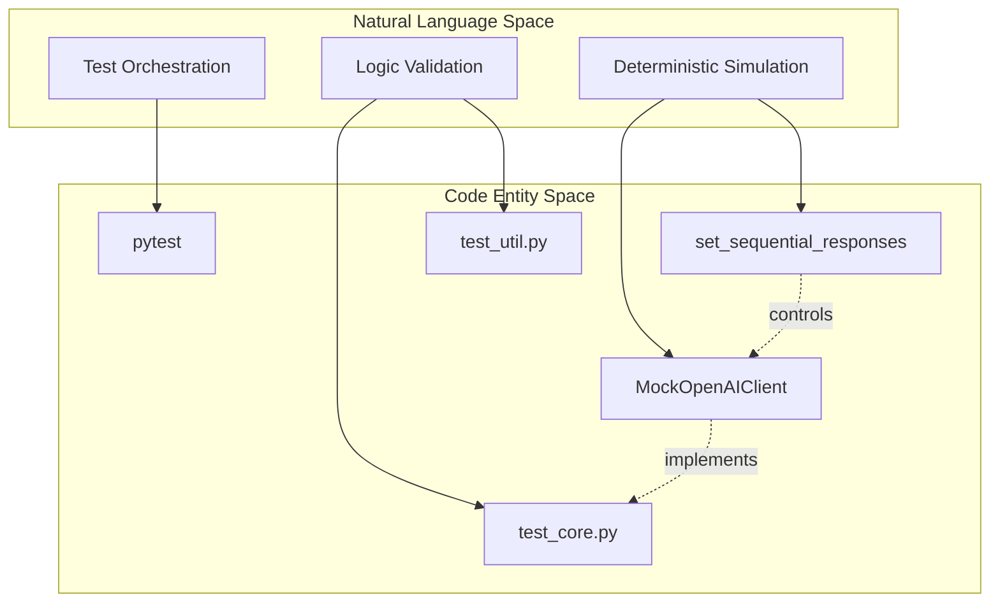
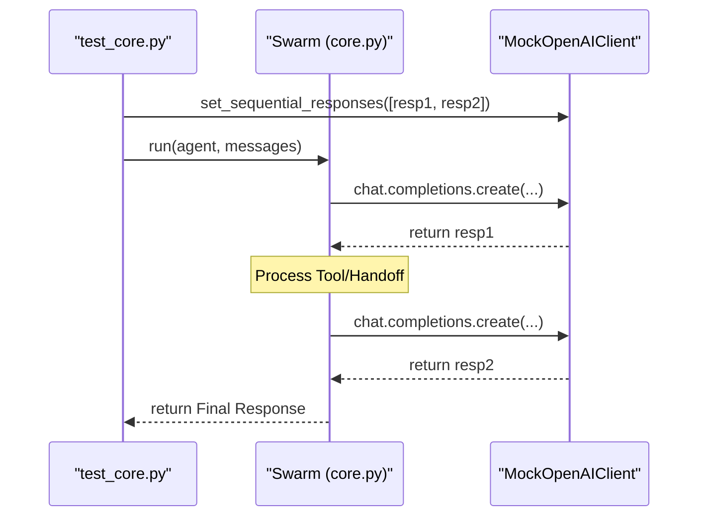

<!-- source: DeepWiki mcp.deepwiki.com · repo openai/swarm · page 5 Testing · fetched 2026-10-27 -->

# Testing

Relevant source files

The following files were used as context for generating this wiki page:

- [README.md](README.md)

Testing in Swarm is designed to ensure the reliability of multi-agent orchestrations, tool execution, and the internal run loop without necessitating live API calls to OpenAI. The framework utilizes `pytest` for its test suite and provides a specialized mock client to simulate LLM responses deterministically.

## Infrastructure Overview

The testing infrastructure is split between standard unit tests that validate the logic of the framework and a mock infrastructure that simulates the OpenAI Chat Completions API.

### Natural Language to Code Mapping: Testing Space
The following diagram illustrates how the testing infrastructure maps high-level testing concepts to specific code entities within the `tests/` directory.

**Testing Entity Map**

Sources: [tests/test_core.py:1-10](), [tests/mock_client.py:1-10]()

## Unit Tests

The core unit tests are located in `tests/test_core.py` and `tests/test_util.py`. These tests verify the behavior of the `Swarm` class and its interaction with `Agent` objects.

Key areas covered include:
*   **The Run Loop**: Validating that `Swarm.run()` correctly iterates through turns, handles tool calls, and terminates as expected [tests/test_core.py:13-35]().
*   **Tool Execution**: Ensuring that Python functions provided to an `Agent` are correctly executed and their results are appended to the message history [tests/test_core.py:38-60]().
*   **Agent Handoffs**: Verifying that when a tool returns an `Agent` instance, the `Swarm` loop correctly switches the active agent for the next turn [tests/test_core.py:63-85]().
*   **Utility Functions**: Testing the `function_to_json` utility in `util.py` to ensure Python type hints and docstrings are correctly converted into JSON Schema for the OpenAI API [tests/test_util.py:1-25]().

For details, see [Unit Tests](#5.1).

Sources: [tests/test_core.py:1-100](), [tests/test_util.py:1-30]()

## Mock Client

To facilitate fast and cost-effective testing, Swarm includes a `MockOpenAIClient`. This client intercepts calls that would normally go to the OpenAI API and returns pre-configured responses.

**Mocking Architecture**

Sources: [tests/mock_client.py:1-50](), [swarm/core.py:82-100]()

The mock infrastructure allows developers to:
*   **Simulate Multi-turn Conversations**: By using `set_sequential_responses`, tests can define exactly what the LLM "says" in each turn of a complex interaction [tests/mock_client.py:45-55]().
*   **Test Edge Cases**: Simulate API errors or unexpected tool call formats to ensure the framework handles them gracefully.
*   **Validate State**: Assert that the `context_variables` and `messages` returned in the final `Response` object match the expected state after a series of mocked turns [tests/test_core.py:110-130]().

For details, see [Mock Client](#5.2).

Sources: [tests/mock_client.py:1-62](), [tests/test_core.py:105-140]()

---

