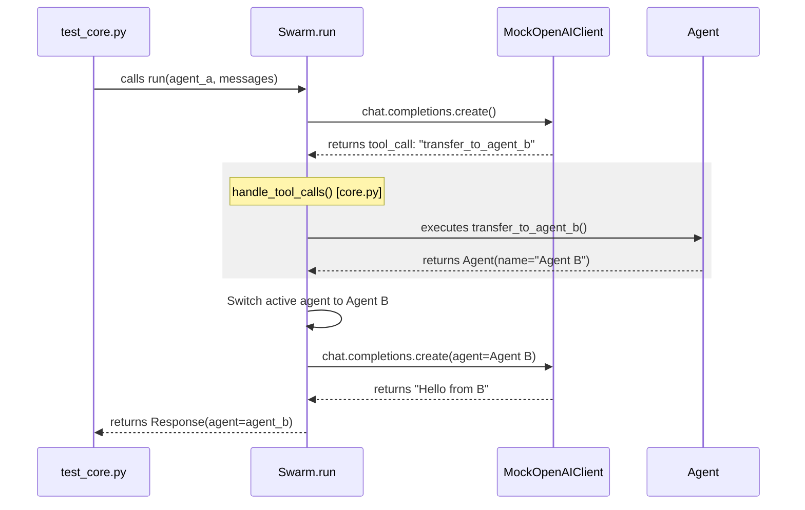
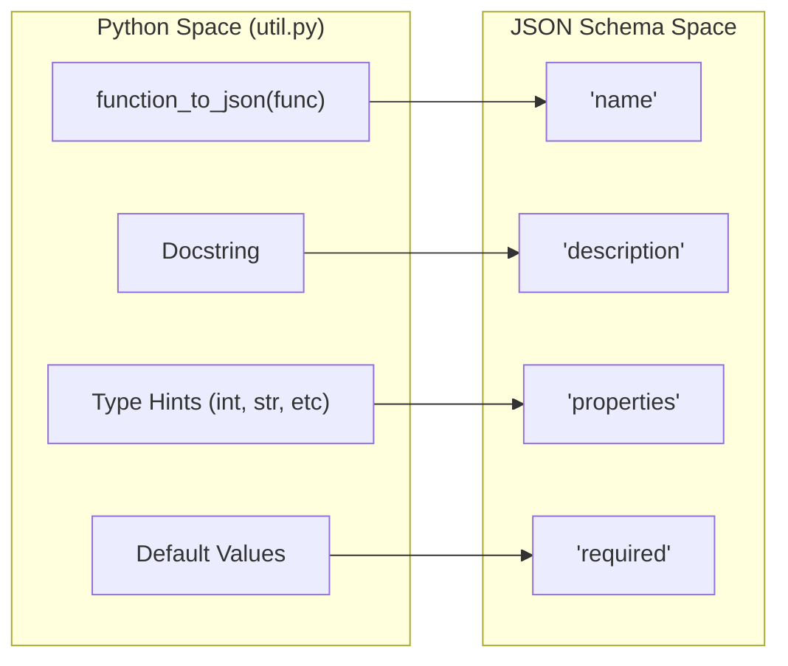

<!-- source: DeepWiki mcp.deepwiki.com · repo openai/swarm · page 5.1 Unit Tests · fetched 2026-10-27 -->

# Unit Tests

<details>
<summary>Relevant source files</summary>

The following files were used as context for generating this wiki page:

- [README.md](README.md)

</details>


The Swarm repository utilizes a suite of unit tests to validate the core orchestration logic, tool execution mechanics, and utility functions. These tests ensure that the "run loop" correctly handles multi-turn interactions, agent handoffs, and schema generation for the OpenAI Chat Completions API.

The test suite is primarily divided into two files:
- `tests/test_core.py`: Validates the `Swarm` client logic, including function execution, recursion limits, and state management.
- `tests/test_util.py`: Validates helper functions, specifically the conversion of Python functions into JSON schemas.

## Core Logic Testing (test_core.py)

The `tests/test_core.py` file contains comprehensive test cases for the `Swarm.run` loop. It relies on a `MockOpenAIClient` to simulate LLM responses without making actual network requests.

### Key Test Scenarios

| Test Case | Description |
| :--- | :--- |
| `test_run_calls_tool` | Verifies that when an LLM response contains a `tool_calls` payload, `Swarm` executes the corresponding Python function and appends the result to the message history. |
| `test_run_handoff` | Validates the "handoff" pattern where a tool returns an `Agent` instance, causing the `Swarm` loop to switch the active agent for the next turn. |
| `test_run_max_turns` | Ensures the `max_turns` parameter successfully terminates the loop to prevent infinite recursion between agents or tools. |
| `test_run_execute_tools_false` | Verifies that setting `execute_tools=False` interrupts the loop immediately after a tool is requested but before it is executed. |

### Data Flow: Tool Execution and Handoff

The following diagram illustrates how `test_core.py` validates the transition from a tool call to an agent handoff within the `Swarm.run` loop.

**Swarm Handoff Validation Flow**

**Sources:** [swarm/core.py:92-135](), [tests/test_core.py:43-67]()

## Utility Testing (test_util.py)

The `tests/test_util.py` file focuses on the `function_to_json` utility. This utility is critical because it bridges the gap between Python's type system and the JSON schema format required by the OpenAI API for tool definitions.

### Schema Generation Mapping

The tests verify that `function_to_json` correctly extracts metadata from Python functions:
- **Function Name:** Mapped to the `name` field.
- **Docstrings:** Mapped to the `description` field.
- **Type Hints:** Mapped to the `properties` types (e.g., `str` to `string`, `int` to `integer`).
- **Default Values:** Determines if a field is added to the `required` list.

**Code-to-Schema Association**

**Sources:** [swarm/util.py:11-58](), [tests/test_util.py:5-30]()

## Implementation Details

### Test Execution Loop
The tests in `test_core.py` verify the logic found in `Swarm.run`. This function maintains a `curr_agent` and a `active_messages` list. The tests specifically check that `active_messages` grows correctly as tool outputs are appended.

```python
# Example of handoff logic tested in test_core.py
def test_run_handoff():
    client = Swarm()
    agent_a = Agent(name="Agent A", functions=[transfer_to_b])
    agent_b = Agent(name="Agent B")
    
    # Logic verified: The Swarm loop should detect the Agent return 
    # and update the internal state for the next turn.
    response = client.run(agent=agent_a, messages=[{"role": "user", "content": "Transfer me"}])
    assert response.agent == agent_b
```
**Sources:** [tests/test_core.py:43-67](), [swarm/core.py:121-125]()

### Handling Context Variables
Tests also cover how `context_variables` are passed into functions. If a function signature includes `context_variables`, the `Swarm` loop is expected to inject the current state into the function call.

| Function | File | Role |
| :--- | :--- | :--- |
| `test_run_with_context_variables` | `tests/test_core.py` | Validates that tools can access and modify global context. |
| `test_function_to_json_with_no_docstring` | `tests/test_util.py` | Ensures the utility doesn't crash when docstrings are missing. |
| `test_run_recursion_limit` | `tests/test_core.py` | Validates the safety mechanism against infinite loops. |

**Sources:** [tests/test_core.py:88-112](), [tests/test_util.py:31-40](), [swarm/core.py:145-155]()

---

