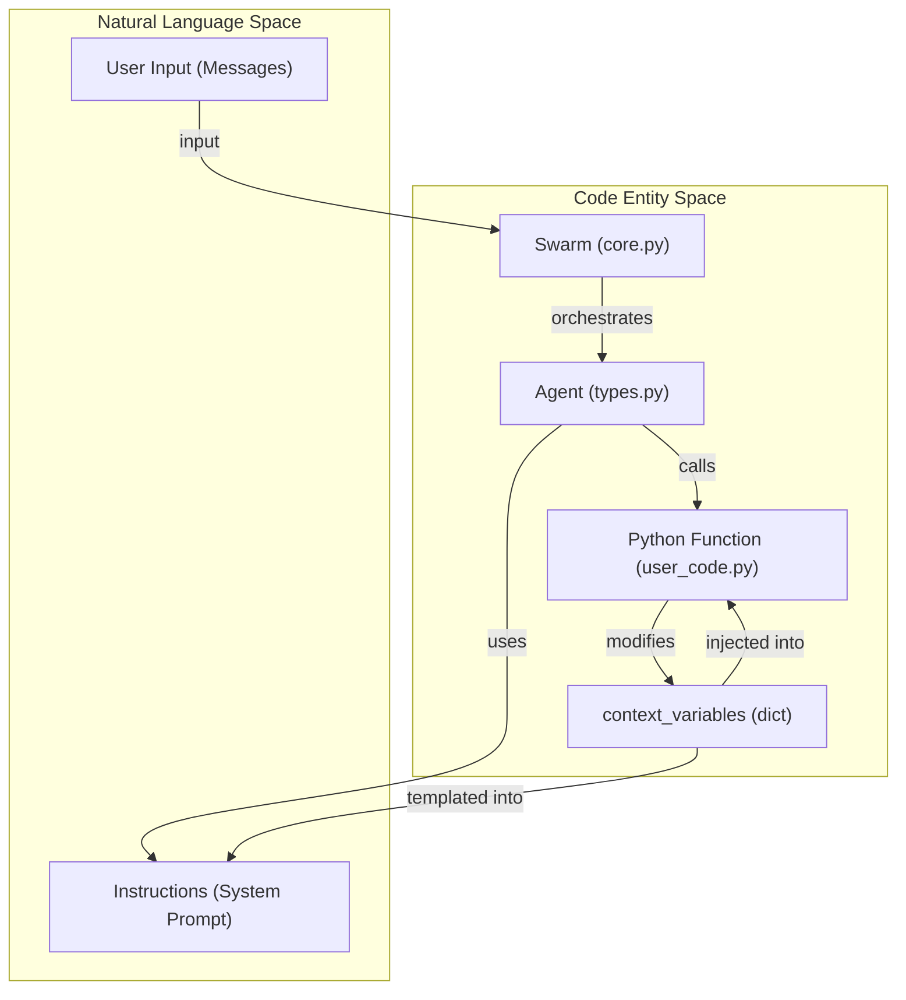
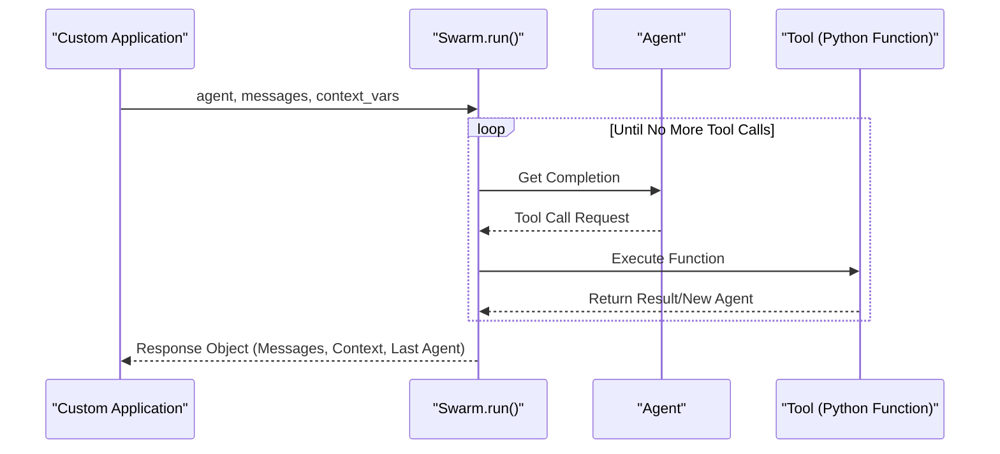

<!-- source: DeepWiki mcp.deepwiki.com · repo openai/swarm · page 6 Developer Guide · fetched 2026-10-27 -->

# Developer Guide

Relevant source files

The following files were used as context for generating this wiki page:

- [.gitignore](.gitignore)
- [.pre-commit-config.yaml](.pre-commit-config.yaml)
- [README.md](README.md)

## Purpose and Scope

The Developer Guide provides a high-level technical roadmap for building and extending applications using the Swarm framework. Swarm is designed to make agent **coordination** and **execution** lightweight and highly controllable [README.md:74-76](). This page serves as a parent directory for detailed implementation guides on agents, tools, and application architecture.

## Core Development Workflow

The development process in Swarm revolves around defining `Agent` objects and the functions (tools) they can invoke. The `Swarm` client orchestrates the interaction loop, handling function execution and state management [README.md:114-125]().

Sources: [swarm/core.py:26-30](), [swarm/types.py:11-21](), [README.md:118-125]()

## Creating Custom Agents

Agents are the primary unit of abstraction in Swarm. An `Agent` encapsulates a set of instructions and a list of functions it can call [swarm/types.py:11-21]().

- **Instructions**: Can be a static string or a callable that returns a string based on `context_variables` [swarm/core.py:41-47]().
- **Handoffs**: Agents hand off conversations by returning another `Agent` object from a function call [README.md:31-39]().
- **Model Selection**: You can specify different OpenAI models per agent or override them at runtime [swarm/core.py:134-134]().

For detailed instructions on configuration and handoff patterns, see **[Creating Custom Agents](#6.1)**.

Sources: [swarm/types.py:11-21](), [swarm/core.py:41-47](), [README.md:76-78]()

## Creating Custom Tools

In Swarm, "tools" are simply Python functions. The framework automatically converts these functions into JSON schemas for the Chat Completions API [swarm/util.py:50-56]().

- **Context Injection**: If a function defines a `context_variables` parameter, Swarm injects the current session state into it [swarm/core.py:71-74]().
- **Result Type**: Functions can return a simple string or a `Result` object to update `context_variables` or trigger an agent switch [swarm/types.py:24-28]().
- **Type Annotations**: Swarm uses Python type hints and docstrings to generate the tool definitions sent to the model [swarm/util.py:50-100]().

For details on implementing robust tools and handling complex returns, see **[Creating Custom Tools](#6.2)**.

Sources: [swarm/util.py:50-56](), [swarm/core.py:71-87](), [swarm/types.py:24-28]()

## Building Custom Applications

Building a full application involves managing the `Swarm` run loop and persisting state between calls, as Swarm itself is stateless [README.md:81-82]().

Sources: [swarm/core.py:118-125](), [README.md:139-141]()

Key considerations for applications:
- **State Management**: You must store the `messages` and `context_variables` returned in the `Response` object to continue a conversation [swarm/types.py:31-35]().
- **Streaming**: Applications can consume partial updates using the `stream=True` flag in `client.run()` [swarm/core.py:139-145]().
- **Integration**: Swarm can be integrated into CLI REPLs, web backends, or automated evaluation pipelines [swarm/repl/repl.py:1-10]().

For architectural patterns and lessons from the provided examples, see **[Building Custom Applications](#6.3)**.

Sources: [swarm/core.py:139-145](), [swarm/types.py:31-35](), [README.md:139-141]()

---

