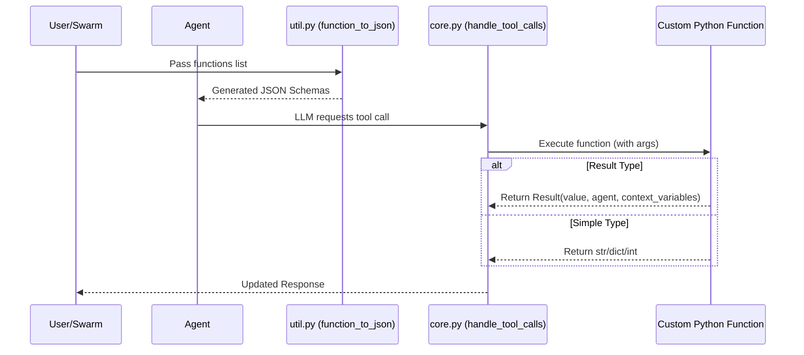
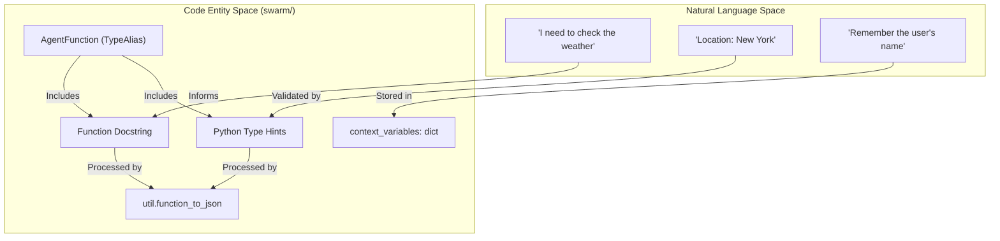

<!-- source: DeepWiki mcp.deepwiki.com · repo openai/swarm · page 6.2 Creating Custom Tools · fetched 2026-10-27 -->

# Creating Custom Tools

<details>
<summary>Relevant source files</summary>

The following files were used as context for generating this wiki page:

- [README.md](README.md)
- [examples/basic/context_variables.py](examples/basic/context_variables.py)
- [examples/basic/function_calling.py](examples/basic/function_calling.py)

</details>


This document explains how to create and implement custom tools—represented as Python functions—that can be used by agents within the Swarm framework. Swarm automatically converts Python functions into JSON schemas for the Chat Completions API, handles execution, and manages state through context variables and custom return types.

## Overview of Tool Execution

In Swarm, a "tool" is simply a Python function. When an `Agent` is initialized with a list of `functions`, Swarm processes these functions to generate the necessary tool schemas.


Sources: [swarm/core.py:273-285](), [swarm/util.py:10-44](), [swarm/types.py:46-54]()

## Defining Custom Functions

To create a tool, define a standard Python function. Swarm uses the function's signature and docstring to inform the LLM how to use it.

### Basic Function
A simple function requires type hints for its arguments and a docstring describing its purpose.

```python
def get_weather(location: str) -> str:
    """Retrieves the current weather for a given location."""
    return "{'temp': 67, 'unit': 'F'}"
```
Sources: [examples/basic/function_calling.py:6-7](), [swarm/util.py:25-35]()

### Context Variables Injection
If a function parameter is named `context_variables`, Swarm will automatically inject the current `context_variables` dictionary into the function call. This parameter is not exposed to the LLM in the JSON schema.

```python
def print_account_details(context_variables: dict):
    user_id = context_variables.get("user_id", None)
    name = context_variables.get("name", None)
    print(f"Account Details: {name} {user_id}")
    return "Success"
```
Sources: [examples/basic/context_variables.py:11-15](), [swarm/util.py:29-30]()

## The Result Return Type

While functions can return simple types (strings, dicts), returning a `Result` object allows the function to update the conversation state or trigger an agent handoff explicitly.

### Result Fields
| Field | Type | Description |
| :--- | :--- | :--- |
| `value` | `str` | The actual result content to be returned to the LLM. |
| `agent` | `Agent` | (Optional) An agent to hand off the conversation to. |
| `context_variables` | `dict` | (Optional) Updated context variables to merge into the state. |

Sources: [swarm/types.py:46-54]()

### Implementation Example
```python
from swarm.types import Result

def change_order_status(order_id: str, status: str):
    # Perform logic...
    return Result(
        value=f"Order {order_id} updated to {status}.",
        context_variables={"last_updated_order": order_id}
    )
```
Sources: [swarm/types.py:46-54](), [swarm/core.py:246-260]()

## Technical Implementation Details

### Schema Generation (`function_to_json`)
The `function_to_json` utility in `util.py` performs the following mapping:
1.  **Name**: Uses `func.__name__`.
2.  **Description**: Extracts the docstring.
3.  **Parameters**: 
    *   Inspects `func.__annotations__` for types.
    *   Maps Python types to JSON types (e.g., `str` -> `string`, `int` -> `integer`).
    *   Identifies required vs. optional parameters based on default values.
    *   **Excludes** `context_variables` from the schema.

Sources: [swarm/util.py:10-44]()

### Execution Logic (`handle_tool_calls`)
When the LLM requests a tool call, `Swarm.handle_tool_calls` performs these steps:
1.  Locates the function in the `Agent`'s `functions` list.
2.  Parses the JSON arguments provided by the LLM.
3.  If the function expects `context_variables`, it adds them to the arguments.
4.  Calls the function.
5.  Processes the return value:
    *   If a `Result` is returned, it extracts `value`, `agent`, and `context_variables`.
    *   If an `Agent` is returned, it sets the next agent.
    *   Otherwise, it converts the return value to a string.

Sources: [swarm/core.py:221-267]()

## Bridge: Natural Language to Code Entity Space

The following diagram maps the conceptual "Natural Language" requirements to the specific code entities in the Swarm framework.


Sources: [swarm/util.py:10-44](), [swarm/types.py:65-65](), [swarm/core.py:132-133]()

## Advanced Patterns

### Agent Handoffs
A function can return another `Agent` object to transfer the conversation. This is the primary mechanism for multi-agent coordination.

```python
def transfer_to_billing():
    """Transfer the user to the billing department."""
    return billing_agent
```
Sources: [README.md:31-32](), [swarm/core.py:252-254]()

### Tool Schema Mapping
The mapping between Python types and JSON Schema types is handled internally to ensure compatibility with the OpenAI API.

| Python Type | JSON Schema Type |
| :--- | :--- |
| `str` | `string` |
| `int` | `integer` |
| `float` | `number` |
| `bool` | `boolean` |
| `list` | `array` |
| `dict` | `object` |

Sources: [swarm/util.py:11-23]()

## Summary Table

| Feature | Implementation | Source |
| :--- | :--- | :--- |
| **Tool Definition** | Python Function | [swarm/types.py:65-65]() |
| **Documentation** | Function Docstring | [swarm/util.py:25-26]() |
| **Argument Types** | Python Type Hints | [swarm/util.py:11-23]() |
| **State Access** | `context_variables` param | [swarm/core.py:236-238]() |
| **Complex Returns** | `Result` object | [swarm/types.py:46-54]() |
| **Handoffs** | Return `Agent` object | [swarm/core.py:252-254]() |

---

