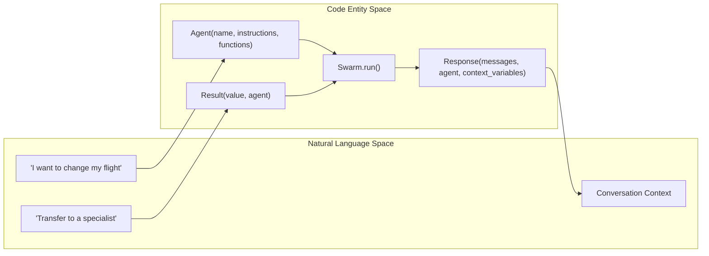
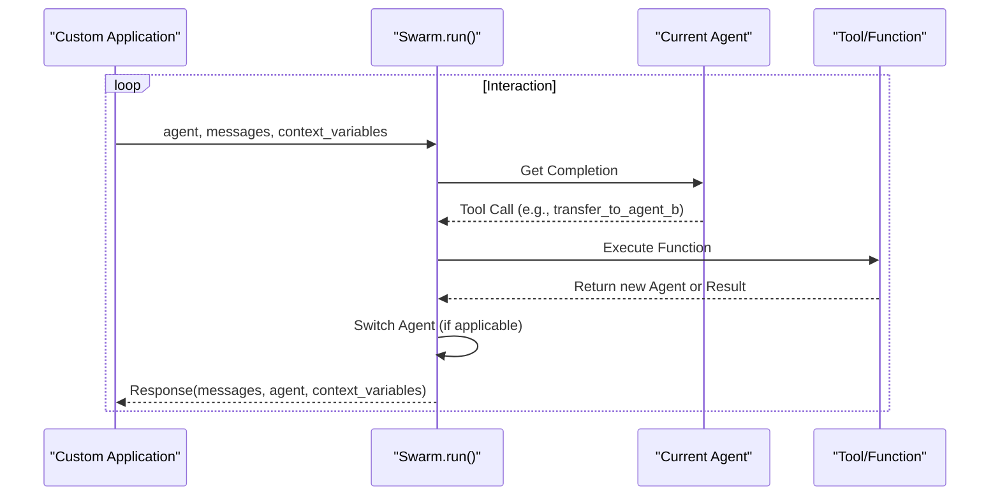
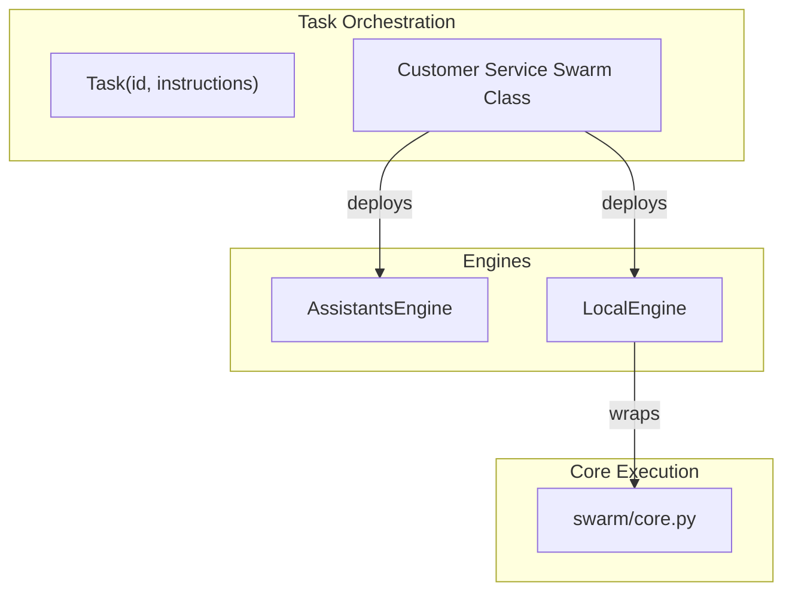

<!-- source: DeepWiki mcp.deepwiki.com · repo openai/swarm · page 6.3 Building Custom Applications · fetched 2026-10-27 -->

# Building Custom Applications

Relevant source files

The following files were used as context for generating this wiki page:

- [README.md](README.md)
- [examples/airline/README.md](examples/airline/README.md)
- [examples/basic/simple_loop_no_helpers.py](examples/basic/simple_loop_no_helpers.py)

## Purpose and Scope

This document provides a technical guide for developers building custom applications using the Swarm framework. It draws on patterns from the core implementation and various examples like the airline, customer service, and triage bots. Swarm is designed to be lightweight and stateless, focusing on the coordination of `Agent` entities through handoffs and tool execution [README.md:72-81]().

## Swarm Application Architecture

A Swarm application typically consists of a client-side loop that manages state (messages and context variables) while delegating logic to a network of Agents.

### Natural Language to Code Entity Mapping
The following diagram bridges the gap between high-level application concepts and the specific classes/functions in the Swarm codebase.

Sources: [swarm/core.py:26-31](), [swarm/types.py:12-45](), [swarm/types.py:75-81]()

## Core Implementation Patterns

### 1. The Execution Loop
The most fundamental pattern is the `while True` loop, which maintains the conversation state. Because Swarm is stateless [README.md:81](), the application developer is responsible for passing the updated `messages` and `context_variables` back into subsequent `run()` calls.

Sources: [swarm/core.py:118-158](), [examples/basic/simple_loop_no_helpers.py:18-28]()

### 2. Multi-Agent Triage and Handoffs
Applications often start with a "Triage Agent" that determines the user's intent and routes them to a specialized sub-agent. This is achieved by defining functions that return another `Agent` instance.

| Component | File Reference | Role |
| :--- | :--- | :--- |
| **Triage Agent** | [examples/airline/configs/agents.py:20-25]() | Routes to Flight or Baggage agents. |
| **Handoff Function** | [examples/airline/configs/agents.py:58-60]() | `transfer_to_flight_modification()` returns the specialized agent. |
| **Specialized Agent** | [examples/airline/configs/agents.py:34-40]() | Contains domain-specific tools (e.g., `cancel_flight`). |

Sources: [examples/airline/README.md:1-13](), [examples/airline/configs/agents.py:1-60]()

## Implementation Approaches

### 1. Direct Core Integration
This is the most flexible approach, where you use the `Swarm` class directly from `swarm/core.py`.

- **Initialization**: Instantiate `Swarm()` which sets up the internal OpenAI client [swarm/core.py:26-31]().
- **Turn Management**: Use `max_turns` to prevent infinite loops between agents [swarm/core.py:133]().
- **Control**: Set `execute_tools=False` if you want to inspect tool calls before they run [swarm/core.py:135]().

Sources: [swarm/core.py:104-137]()

### 2. Task-Based and Streaming Architectures
For more complex applications, such as the `customer_service_streaming` example, the architecture introduces "Engines" and "Tasks".

Sources: [examples/customer_service_streaming/src/swarm/swarm.py:11-46](), [examples/customer_service_streaming/src/swarm/engines.py:1-20]()

## Best Practices for Custom Applications

1. **Context Variable Injection**: Use `context_variables` to pass session-specific data (like `user_id` or `account_type`) to tools without hardcoding them into the agent's instructions [README.md:132](), [examples/basic/context_variables.py:1-20]().
2. **Result Object Usage**: When a tool needs to update the conversation state (e.g., changing `context_variables`) or trigger a handoff simultaneously, return a `Result` object instead of a raw string [swarm/types.py:75-81]().
3. **Interactive Testing**: Utilize the `run_demo_loop` utility from `swarm/repl` during development to quickly test agent handoffs in a CLI environment [swarm/repl/repl.py:1-40]().
4. **Evaluations**: Build an evaluation suite early. The airline example uses a `function_evals.py` script to verify that the Triage Agent routes users to the correct sub-agent based on specific input strings [examples/airline/evals/function_evals.py:1-20]().

## Case Study: Airline Multi-Agent System
The airline example [examples/airline/main.py]() demonstrates a complex hierarchy:
1. **Triage Agent**: The entry point.
2. **Flight Modification Agent**: A mid-level router that can further hand off to "Flight Change" or "Flight Cancel" agents.
3. **Policies**: Instructions are often loaded from external text files (e.g., `policies/withdrawal_policy.txt`) to keep the Python code clean [examples/airline/configs/agents.py:10-15]().

Sources: [examples/airline/README.md:1-13](), [examples/airline/configs/agents.py:1-60]()

---

