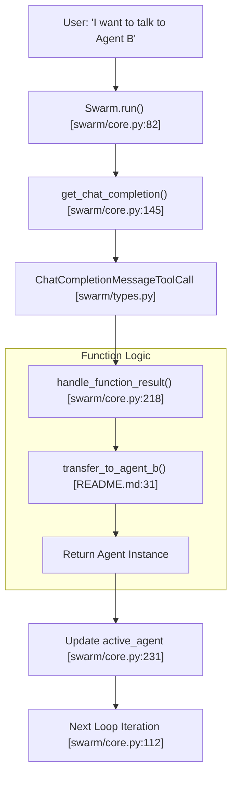
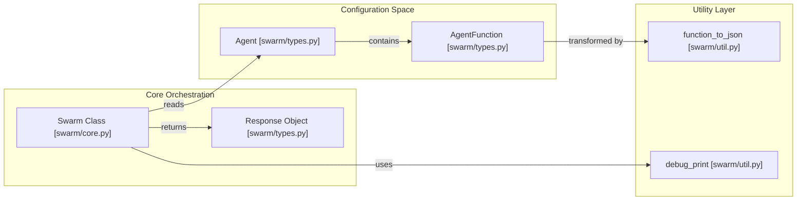

<!-- source: DeepWiki mcp.deepwiki.com · repo openai/swarm · page 7 Glossary · fetched 2026-10-27 -->

# Glossary

Relevant source files

The following files were used as context for generating this wiki page:

- [README.md](README.md)
- [examples/airline/README.md](examples/airline/README.md)
- [examples/airline/configs/agents.py](examples/airline/configs/agents.py)
- [examples/airline/configs/tools.py](examples/airline/configs/tools.py)
- [examples/basic/README.md](examples/basic/README.md)

This glossary defines codebase-specific terms, jargon, and domain concepts used throughout the Swarm framework. Swarm is an experimental framework designed to make agent coordination and execution lightweight and highly controllable through two primary primitives: **Agents** and **Handoffs** [README.md:72-78]().

## Core Concepts

### Agent
The fundamental unit of state and logic in Swarm. An `Agent` encapsulates instructions, a model preference, and a list of available tools (functions) [swarm/types.py:24-34](). Unlike the OpenAI Assistants API, Swarm agents are stateless and powered by the Chat Completions API [README.md:80-82]().
*   **Implementation**: Defined as a Pydantic model in `Agent` [swarm/types.py:24-34]().

### Handoff
The process of transferring a conversation from one `Agent` to another. This is achieved by a function returning another `Agent` object [README.md:31-32](). When the `Swarm` run loop detects an `Agent` instance in a function's return value, it updates the "active" agent for the subsequent turn [swarm/core.py:228-232]().
*   **Example**: `transfer_to_agent_b` returns `agent_b` [README.md:31-32]().

### Context Variables
A dictionary of arbitrary data passed through the `run` loop. These variables are accessible to both `Agent` instructions (if provided as a callable) and the functions called by the agent [README.md:128-133]().
*   **Implementation**: Passed as `context_variables` in `Swarm.run` [swarm/core.py:89]().

### Turn
A single iteration of the Swarm run loop. A turn begins with a request to the LLM and ends after either a text response is generated or all tool calls for that iteration have been executed [README.md:118-125](). `client.run` can encompass multiple turns if tools are called [swarm/core.py:112-114]().

---

## Technical Terms & Jargon

| Term | Definition | Code Pointer |
| :--- | :--- | :--- |
| **Tool Call** | An LLM-generated request to execute a specific Python function. | [swarm/core.py:175-180]() |
| **Function Schema** | The JSON representation of a Python function's signature, used by the OpenAI API to understand how to call it. | [swarm/util.py:10-15]() |
| **Result** | An encapsulation of a function's return value, potentially including updated `context_variables` or a new `Agent`. | [swarm/types.py:11-15]() |
| **Run Loop** | The internal `while` loop in `Swarm.run` that continues until `max_turns` is reached or no more tool calls are pending. | [swarm/core.py:112-114]() |
| **Model Override** | A temporary string that forces all agents in a specific `run` call to use a specific model regardless of their individual config. | [swarm/core.py:91]() |

---

## Data Flow: Natural Language to Code Entity

The following diagram illustrates how a user's natural language request transitions through code entities to trigger specific logic or handoffs.

**Natural Language Processing Flow**

Sources: [swarm/core.py:82-231](), [swarm/types.py:11-34](), [README.md:31-52]()

---

## Architecture: Component Interaction

This diagram shows the relationship between the `Swarm` orchestrator, the `Agent` configuration, and the utility layer that prepares data for the OpenAI API.

**System Architecture**

Sources: [swarm/core.py:20-50](), [swarm/types.py:11-50](), [swarm/util.py:10-60]()

---

## Example-Specific Terminology

### Triage Agent
A specific pattern where an initial agent's sole responsibility is to identify user intent and perform a **handoff** to a specialized sub-agent [examples/airline/configs/agents.py:43-47]().

### Routine
A set of instructions and tools that define a specific business process (e.g., "Baggage Search" or "Flight Cancellation"). In the airline example, these are often represented as policies appended to an agent's instructions [examples/airline/configs/agents.py:59-69]().

### REPL (Read-Eval-Print Loop)
A helper utility provided in `swarm/repl/repl.py` to facilitate interactive testing of agents in the command line [swarm/repl/repl.py:1-60]().

Sources: [examples/airline/configs/agents.py:1-93](), [swarm/repl/repl.py:1-60]()