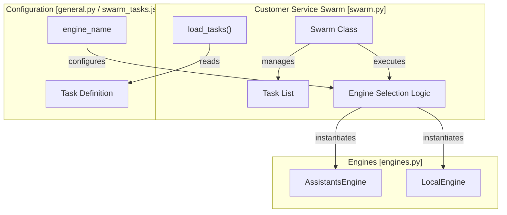
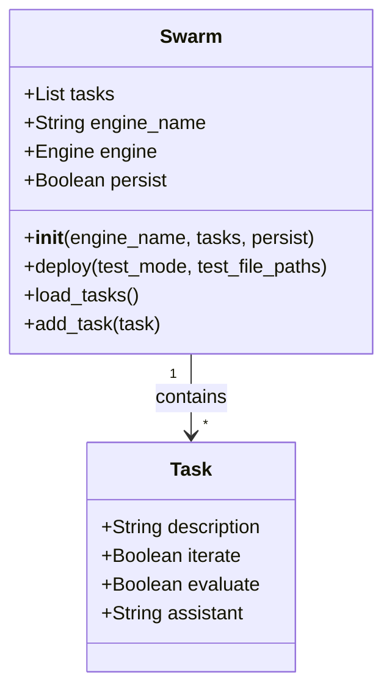
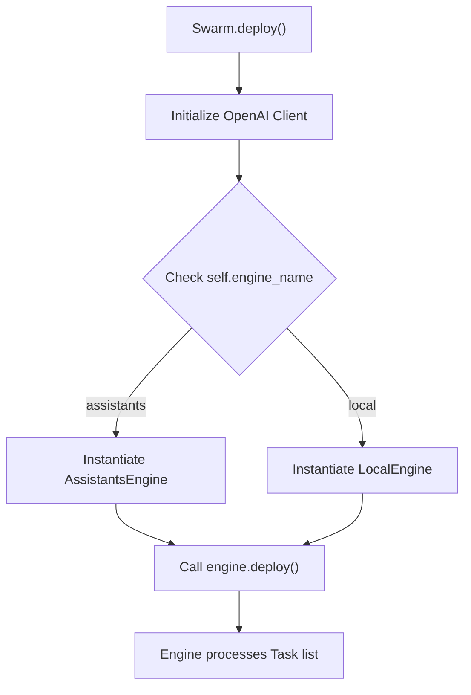

<!-- source: DeepWiki mcp.deepwiki.com · repo openai/swarm · extra page Customer Service Swarm Class · fetched 2026-10-27 -->

# Customer Service Swarm Class

<details>
<summary>Relevant source files</summary>

The following files were used as context for generating this wiki page:

- [examples/customer_service_streaming/configs/general.py](examples/customer_service_streaming/configs/general.py)
- [examples/customer_service_streaming/configs/swarm_tasks.json](examples/customer_service_streaming/configs/swarm_tasks.json)

</details>


## Purpose and Scope

This document provides a detailed explanation of the `Swarm` class within the customer service streaming example. The `Swarm` class serves as the main control unit for orchestrating tasks, selecting the execution engine, and managing the deployment lifecycle of the multi-agent system. It bridges the high-level task definitions (found in `swarm_tasks.json`) with the underlying engine implementations.

## Overview

The Customer Service Swarm class facilitates task management, engine selection, and deployment. It acts as a bridge between the client application and the underlying engine implementations (`AssistantsEngine` or `LocalEngine`), managing the flow of tasks and their execution.



**Class Structure and Relationships**

Sources: [examples/customer_service_streaming/src/swarm/swarm.py:11-17](), [examples/customer_service_streaming/configs/general.py:15-18]()

## Class Definition and Initialization

The `Swarm` class is the central orchestrator defined in the example's source directory.



**Swarm Class Structure**

Sources: [examples/customer_service_streaming/src/swarm/swarm.py:11-46]()

### Initialization

The `Swarm` class is initialized with parameters that define its behavior and the tasks it must process.

- `engine_name`: A string determining the backend (e.g., `'assistants'` or `'local'`).
- `tasks`: A list of `Task` objects.
- `persist`: A boolean flag determining if state should be persisted (relevant for the `LocalEngine`).

```python
def __init__(self, engine_name, tasks=[], persist=False):
    self.tasks = tasks
    self.engine_name = engine_name
    self.engine = None
    self.persist = persist
```

Sources: [examples/customer_service_streaming/src/swarm/swarm.py:12-16]()

## Core Functionality

### Task Deployment Lifecycle

The `deploy` method initiates the execution loop. It handles the instantiation of the chosen engine and delegates the task processing to that engine.



**Deploy Method Workflow**

The `deploy` method performs the following steps:
1. **Client Setup**: Initializes the `OpenAI` client [examples/customer_service_streaming/src/swarm/swarm.py:22]().
2. **Engine Selection**: Based on `self.engine_name`, it chooses between `AssistantsEngine` or `LocalEngine` [examples/customer_service_streaming/src/swarm/swarm.py:24-32]().
3. **Engine Execution**: Triggers the `deploy` method of the instantiated engine, passing along `test_mode` and `test_file_paths` [examples/customer_service_streaming/src/swarm/swarm.py:27]().

Sources: [examples/customer_service_streaming/src/swarm/swarm.py:18-32]()

### Task Management and Loading

The class manages a collection of `Task` objects. These can be added manually or loaded from a configuration file.

#### Loading from JSON
The `load_tasks` method reads from the path defined in `configs/general.py` (defaulting to `configs/swarm_tasks.json`).

```python
def load_tasks(self):
    self.tasks = []
    with open(tasks_path, 'r') as f:
        tasks_json = json.load(f)
        for task_json in tasks_json:
            task = Task(description=task_json['description'],
                        iterate=task_json.get('iterate', False),
                        evaluate=task_json.get('evaluate', False),
                        assistant=task_json.get('assistant', 'user_interface'))
            self.tasks.append(task)
```

The method maps JSON fields to the `Task` object, providing defaults for `iterate` (False), `evaluate` (False), and the starting `assistant` ('user_interface').

Sources: [examples/customer_service_streaming/src/swarm/swarm.py:34-43](), [examples/customer_service_streaming/configs/general.py:15]()

#### Task Schema
The tasks in `swarm_tasks.json` define the workload. For example:
- A simple query: `{"description": "What is the square root of 16?"}` [examples/customer_service_streaming/configs/swarm_tasks.json:2-4]().
- A task requiring evaluation: `{"description": "Is phone verification required...", "evaluate": true}` [examples/customer_service_streaming/configs/swarm_tasks.json:5-8]().
- A task requiring iteration (multi-step tool use): `{"description": "How many free tokens...", "iterate": true}` [examples/customer_service_streaming/configs/swarm_tasks.json:9-13]().

Sources: [examples/customer_service_streaming/configs/swarm_tasks.json:1-14]()

## Engine Instantiation Logic

The `Swarm` class uses conditional logic to swap between local and cloud-based execution.

| Engine Name | Implementation Class | Description |
| :--- | :--- | :--- |
| `assistants` | `AssistantsEngine` | Uses OpenAI's Assistants API for state and tool management. |
| `local` | `LocalEngine` | Uses the core Swarm `run` loop for local orchestration. |

When using the `local` engine, the `persist` flag from the `Swarm` constructor is passed to the engine, allowing the system to maintain or discard session state between tasks.

Sources: [examples/customer_service_streaming/src/swarm/swarm.py:24-32](), [examples/customer_service_streaming/configs/general.py:18-22]()

## System Constants and Configuration

The `Swarm` class relies on global configurations defined in `configs/general.py`.

- **Colors**: Uses the `Colors` class for formatted console output during the deployment process [examples/customer_service_streaming/configs/general.py:1-11]().
- **Paths**: `tasks_path` points the `load_tasks` method to the correct JSON definition [examples/customer_service_streaming/configs/general.py:15]().
- **Engine Selection**: The default `engine_name` is typically set to `'local'` in the config [examples/customer_service_streaming/configs/general.py:18]().

Sources: [examples/customer_service_streaming/configs/general.py:1-23]()

---

