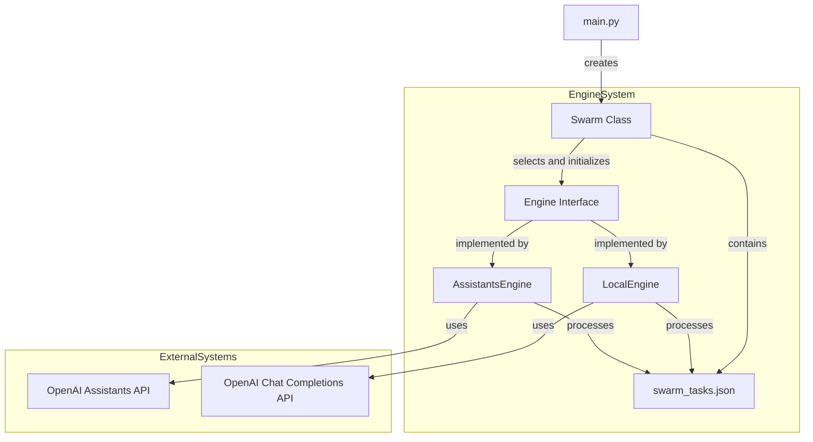
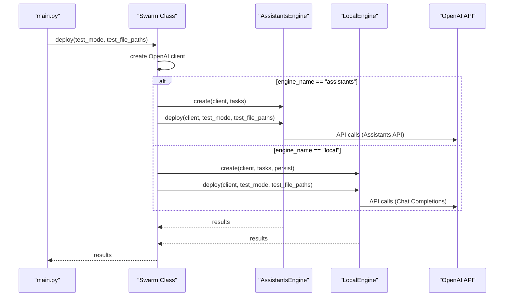
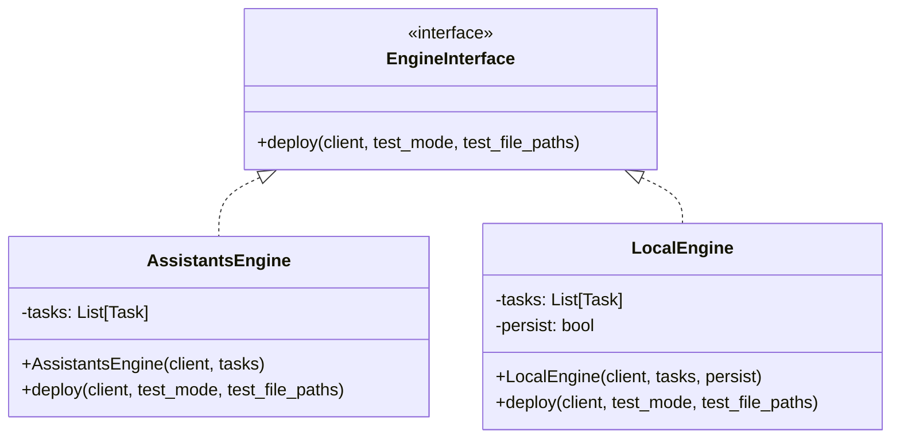

<!-- source: DeepWiki mcp.deepwiki.com · repo openai/swarm · extra page Engines · fetched 2026-10-27 -->

# Engines

<details>
<summary>Relevant source files</summary>

The following files were used as context for generating this wiki page:

- [examples/customer_service_streaming/configs/assistants/user_interface/assistant.json](examples/customer_service_streaming/configs/assistants/user_interface/assistant.json)
- [examples/customer_service_streaming/configs/general.py](examples/customer_service_streaming/configs/general.py)

</details>


## Purpose and Scope

This document covers the Engine system used in the Customer Service Example implementation of the OpenAI Swarm framework. Engines are execution environments that process tasks within the Swarm system, offering different strategies for interacting with the OpenAI API. This page specifically documents the two engine implementations: `AssistantsEngine` and `LocalEngine`, and how they're selected and used by the `Swarm` class.

For information about the overall Customer Service Example implementation, see [Customer Service Streaming Example](#4.3). For details on the Swarm class that manages these engines, see [Customer Service Swarm Class](#4.3.1).

## Engine System Overview

The Engine system in the Customer Service Example provides a pluggable architecture that allows different task execution strategies. The `Swarm` class selects an engine based on configuration and uses it to deploy and execute a series of tasks.

### Engine Architecture



Sources: [examples/customer_service_streaming/src/swarm/swarm.py:11-16](), [examples/customer_service_streaming/src/swarm/swarm.py:18-32](), [examples/customer_service_streaming/configs/general.py:15-18]()

### Engine Selection Flow



Sources: [examples/customer_service_streaming/src/swarm/swarm.py:18-32](), [examples/customer_service_streaming/configs/general.py:18-22]()

## Engine Types

The Customer Service Example implements two types of engines, each providing a different approach to task execution.

### AssistantsEngine

The `AssistantsEngine` executes tasks using the OpenAI Assistants API. This engine leverages the Assistants API's capabilities for managing assistants, threads, and runs. It is typically configured via JSON definitions like `assistant.json`.

**Key Characteristics:**
- Uses the OpenAI Assistants API for task execution [examples/customer_service_streaming/src/swarm/swarm.py:24-27]()
- Takes an OpenAI client and a list of tasks during initialization [examples/customer_service_streaming/src/swarm/swarm.py:26-26]()
- Implements a `deploy()` method for executing tasks [examples/customer_service_streaming/src/swarm/swarm.py:27-27]()
- Integrates with configurations such as `gpt-4-0125-preview` [examples/customer_service_streaming/configs/assistants/user_interface/assistant.json:3-3]()

**Initialization and Usage:**
```python
# In Swarm.deploy()
self.engine = AssistantsEngine(client, self.tasks)
self.engine.deploy(client, test_mode, test_file_paths)
```

Sources: [examples/customer_service_streaming/src/swarm/swarm.py:24-27](), [examples/customer_service_streaming/configs/assistants/user_interface/assistant.json:1-11]()

### LocalEngine

The `LocalEngine` provides an alternative execution strategy that uses direct calls to the OpenAI Chat Completions API. It includes a persistence option that controls state management between task executions.

**Key Characteristics:**
- Takes an OpenAI client, a list of tasks, and a `persist` flag during initialization [examples/customer_service_streaming/src/swarm/swarm.py:31-31]()
- Implements a `deploy()` method with the same interface as `AssistantsEngine` [examples/customer_service_streaming/src/swarm/swarm.py:32-32]()
- Supports a `persist` flag that controls whether conversation context is maintained between tasks [examples/customer_service_streaming/configs/general.py:22-22]()
- Default engine choice in `general.py` is often set to `'local'` [examples/customer_service_streaming/configs/general.py:18-18]()

**Initialization and Usage:**
```python
# In Swarm.deploy()
self.engine = LocalEngine(client, self.tasks, persist=self.persist)
self.engine.deploy(client, test_mode, test_file_paths)
```

Sources: [examples/customer_service_streaming/src/swarm/swarm.py:29-32](), [examples/customer_service_streaming/configs/general.py:18-22]()

## Engine Selection and Initialization

The `Swarm` class is responsible for selecting, initializing, and using the appropriate engine based on the provided configuration.

### Engine Selection Table

| engine_name | Engine Class | Additional Parameters | Use Case |
|-------------|--------------|------------------------|----------|
| `"assistants"` | `AssistantsEngine` | None | When using OpenAI Assistants API features |
| `"local"` | `LocalEngine` | `persist` (boolean) | When direct API calls are preferred, with optional state persistence |

Sources: [examples/customer_service_streaming/src/swarm/swarm.py:11-16](), [examples/customer_service_streaming/configs/general.py:18-22]()

### Initialization Code

When creating a `Swarm` instance, the engine type is specified using the `engine_name` parameter, which defaults to the value in `configs/general.py`:

```python
# Create a Swarm with AssistantsEngine
swarm = Swarm(engine_name="assistants", tasks=tasks_list)

# Create a Swarm with LocalEngine and persistence enabled
swarm = Swarm(engine_name="local", tasks=tasks_list, persist=True)
```

Sources: [examples/customer_service_streaming/src/swarm/swarm.py:11-16](), [examples/customer_service_streaming/configs/general.py:18-22]()

### Deployment Process

The Swarm's `deploy()` method initializes the appropriate engine based on the `engine_name` and delegates task execution to that engine:

```python
def deploy(self, test_mode=False, test_file_paths=None):
    client = OpenAI()
    if self.engine_name == 'assistants':
        print(f"{Colors.GREY}Selected engine: Assistants{Colors.ENDC}")
        self.engine = AssistantsEngine(client, self.tasks)
        self.engine.deploy(client, test_mode, test_file_paths)
    elif self.engine_name == 'local':
        print(f"{Colors.GREY}Selected engine: Local{Colors.ENDC}")
        self.engine = LocalEngine(client, self.tasks, persist=self.persist)
        self.engine.deploy(client, test_mode, test_file_paths)
```

Sources: [examples/customer_service_streaming/src/swarm/swarm.py:18-32](), [examples/customer_service_streaming/configs/general.py:1-11]()

## Engine Interface

Both engine types implement a common interface to allow the `Swarm` class to work with them interchangeably.

### Implementation Diagram



Sources: [examples/customer_service_streaming/src/swarm/swarm.py:24-27](), [examples/customer_service_streaming/src/swarm/swarm.py:29-32]()

## Summary

The Engine system in the Customer Service Example provides a flexible architecture for task execution, allowing different strategies through the `AssistantsEngine` and `LocalEngine` implementations. The `Swarm` class acts as the control point for selecting and deploying the appropriate engine based on configuration defined in `configs/general.py`.

This pluggable engine architecture enables:
1. Multiple interaction patterns with the OpenAI API (Assistants API vs. direct Chat Completions).
2. Optional state persistence between task executions via the `persist` flag.
3. Consistent interface for task deployment regardless of the underlying implementation.
4. Separation of task definition (`swarm_tasks.json`) from execution logic.

Sources: [examples/customer_service_streaming/src/swarm/swarm.py:11-32](), [examples/customer_service_streaming/configs/general.py:15-22]()

---

