# Page: Overview

# Overview

<details>
<summary>Relevant source files</summary>

The following files were used as context for generating this wiki page:

- [.agents/skills/auto-qa/SKILL.md](.agents/skills/auto-qa/SKILL.md)
- [.agents/skills/auto-qa/references/live-proof-routing.md](.agents/skills/auto-qa/references/live-proof-routing.md)
- [.agents/skills/control-ui-e2e/SKILL.md](.agents/skills/control-ui-e2e/SKILL.md)
- [.agents/skills/crabbox/SKILL.md](.agents/skills/crabbox/SKILL.md)
- [.agents/skills/openclaw-debugging/SKILL.md](.agents/skills/openclaw-debugging/SKILL.md)
- [.agents/skills/openclaw-pr-maintainer/SKILL.md](.agents/skills/openclaw-pr-maintainer/SKILL.md)
- [.agents/skills/openclaw-pr-maintainer/scripts/github-activity.sh](.agents/skills/openclaw-pr-maintainer/scripts/github-activity.sh)
- [.agents/skills/openclaw-repair-sweep/SKILL.md](.agents/skills/openclaw-repair-sweep/SKILL.md)
- [.agents/skills/openclaw-test-performance/SKILL.md](.agents/skills/openclaw-test-performance/SKILL.md)
- [.agents/skills/openclaw-testing/SKILL.md](.agents/skills/openclaw-testing/SKILL.md)
- [.agents/skills/openclaw-update/SKILL.md](.agents/skills/openclaw-update/SKILL.md)
- [.agents/skills/openclaw-update/agents/openai.yaml](.agents/skills/openclaw-update/agents/openai.yaml)
- [.agents/skills/release-openclaw-plugin-testing/SKILL.md](.agents/skills/release-openclaw-plugin-testing/SKILL.md)
- [.agents/skills/test-audit/SKILL.md](.agents/skills/test-audit/SKILL.md)
- [.agents/skills/update-team-server/SKILL.md](.agents/skills/update-team-server/SKILL.md)
- [.github/CODEOWNERS](.github/CODEOWNERS)
- [.github/labeler.yml](.github/labeler.yml)
- [AGENTS.md](AGENTS.md)
- [CHANGELOG.md](CHANGELOG.md)
- [CONTRIBUTING.md](CONTRIBUTING.md)
- [appcast.xml](appcast.xml)
- [docs/.i18n/glossary.zh-CN.json](docs/.i18n/glossary.zh-CN.json)
- [docs/.i18n/zh-Hans-navigation.json](docs/.i18n/zh-Hans-navigation.json)
- [docs/concepts/memory-architecture.md](docs/concepts/memory-architecture.md)
- [docs/docs.json](docs/docs.json)
- [docs/releases/2026.8.1.md](docs/releases/2026.8.1.md)
- [docs/releases/2026.8.2.md](docs/releases/2026.8.2.md)
- [docs/releases/2026.9.1.md](docs/releases/2026.9.1.md)
- [docs/releases/index.md](docs/releases/index.md)
- [extensions/memory-wiki/skills/wiki-maintainer/SKILL.md](extensions/memory-wiki/skills/wiki-maintainer/SKILL.md)
- [git-hooks/pre-commit](git-hooks/pre-commit)
- [scripts/README.md](scripts/README.md)
- [scripts/github/barnacle-auto-response.mjs](scripts/github/barnacle-auto-response.mjs)
- [scripts/github/dependency-guard.mjs](scripts/github/dependency-guard.mjs)
- [scripts/github/guard-shared.mjs](scripts/github/guard-shared.mjs)
- [scripts/github/security-sensitive-guard.mjs](scripts/github/security-sensitive-guard.mjs)
- [src/agents/internal-runtime-context.test.ts](src/agents/internal-runtime-context.test.ts)
- [src/agents/internal-runtime-context.ts](src/agents/internal-runtime-context.ts)
- [src/auto-reply/tokens.test.ts](src/auto-reply/tokens.test.ts)
- [src/auto-reply/tokens.ts](src/auto-reply/tokens.ts)
- [src/infra/restart-handoff.test.ts](src/infra/restart-handoff.test.ts)
- [test/scripts/barnacle-auto-response.test.ts](test/scripts/barnacle-auto-response.test.ts)
- [test/scripts/dependency-guard-script.test.ts](test/scripts/dependency-guard-script.test.ts)
- [test/scripts/dependency-guard-workflow.test.ts](test/scripts/dependency-guard-workflow.test.ts)
- [test/scripts/docs-sync-publish.test.ts](test/scripts/docs-sync-publish.test.ts)
- [test/scripts/github-activity-helper.test.ts](test/scripts/github-activity-helper.test.ts)
- [test/scripts/security-sensitive-guard-script.test.ts](test/scripts/security-sensitive-guard-script.test.ts)
- [test/scripts/security-sensitive-guard-workflow.test.ts](test/scripts/security-sensitive-guard-workflow.test.ts)

</details>


OpenClaw is a **multi-platform AI gateway** and personal assistant system that orchestrates conversations between messaging channels and AI agents [docs/docs.json:4](). It acts as a central control plane, connecting messaging platforms like WhatsApp, Telegram, Slack, and Discord to advanced AI models, providing a unified interface for AI interaction [docs/docs.json:4]().

The system is powered by the **Pi Agent Core** and includes the **Codex** app-server harness for specialized coding and tool-use workloads [CHANGELOG.md:18-19](). It is designed around a **Personal Assistant Trust Model**, assuming a single trusted operator boundary [AGENTS.md:14](). It enables agents to perform real-world tasks through a rich tool ecosystem, including browser automation, filesystem access, and media understanding [docs/releases/2026.8.1.md:19]().

For installation and first-time setup, see [Getting Started](#1.1). For fundamental mental models, see [Core Concepts](#1.2). For technical details on the build system and cross-platform clients, see [Platform Architecture](#1.3).

Sources: [docs/docs.json:4](), [CHANGELOG.md:18-19](), [AGENTS.md:14](), [docs/releases/2026.8.1.md:19]()

## Core Architecture

OpenClaw is organized as a monorepo using `pnpm` workspaces [CONTRIBUTING.md:50-53](). The Gateway is the central engine that manages the lifecycle of the assistant, configuration validation, and agent execution. The system uses a multi-package structure to separate core logic from platform-specific extensions.

### System Mapping: Natural Language to Code Entities

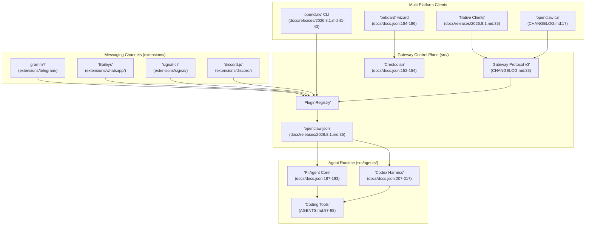
Sources: [CONTRIBUTING.md:50-53](), [CHANGELOG.md:17-33](), [docs/docs.json:152-217](), [docs/releases/2026.8.1.md:35-43](), [AGENTS.md:97-98]()

## Core Concepts

### Gateway & Agents
The **Gateway** is the always-on control plane. It manages **Agents**, which are execution contexts configured with specific models and workspace defaults. The system maintains a synchronized model catalog for discovery, including support for providers like Anthropic, OpenAI, and Google Gemini [CHANGELOG.md:18-19](). Root rules for agent behavior and repository-wide standing orders are defined in `AGENTS.md` [AGENTS.md:1-5]().

### Sessions & Channels
A **Session** represents a specific conversation thread, now stored in SQLite for continuity [docs/releases/2026.8.1.md:30-32](). **Channels** are transport layers that route messages to the Gateway. OpenClaw supports a wide array of channels including iMessage, Matrix, and Signal [docs/docs.json:4]().

### Skills & Tools
**Tools** are functional capabilities (like shell execution, web search, or browser automation) that the agent can invoke. **Skills** are modular extensions that teach agents how to use these tools for specific domains, defined via `SKILL.md` files [.agents/skills/openclaw-pr-maintainer/SKILL.md:1-4](). The system supports automated tool invocation via the Model Context Protocol (MCP) bridge [docs/docs.json:196-198]().

For a deeper dive into these primitives, see [Core Concepts](#1.2).

Sources: [AGENTS.md:1-5](), [docs/docs.json:4](), [docs/docs.json:196-198](), [docs/releases/2026.8.1.md:30-32](), [CHANGELOG.md:18-19](), [.agents/skills/openclaw-pr-maintainer/SKILL.md:1-4]()

## Multi-Platform Architecture

OpenClaw is built for high portability across desktop, server, and mobile environments. It leverages a shared TypeScript core and native UI components.

| Platform | Role | Technology |
| :--- | :--- | :--- |
| **Server / Desktop** | Core Gateway | Node.js 22.22.2+ [docs/releases/2026.8.1.md:73]() |
| **Web** | Control UI | React / Vite [CHANGELOG.md:21-31]() |
| **Native Clients** | iOS / Android / macOS / Linux | Swift / Kotlin / Tauri [CHANGELOG.md:10-22]() |
| **Container** | Deployment | Docker Multi-arch manifests [docs/releases/2026.8.1.md:51]() |

### Data Flow: Message to Tool Execution

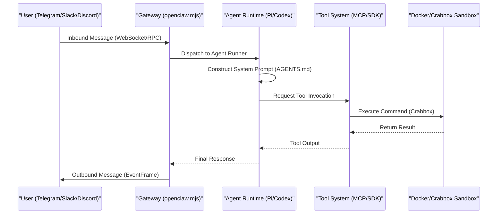
Sources: [docs/releases/2026.8.1.md:51-73](), [CHANGELOG.md:10-31](), [AGENTS.md:1-5](), [.agents/skills/crabbox/SKILL.md:1-5]()

For details on the build system and native integrations, see [Platform Architecture](#1.3).

## Security & Trust

OpenClaw operates on a **Personal Assistant Trust Model**. Because the assistant has access to sensitive local tools (like shell execution), it includes several safety boundaries:
- **Sandboxing**: Docker-based isolation or unprivileged cloud sandboxes like Crabbox [CHANGELOG.md:13]().
- **Audit System**: Diagnostic repair and security hardening via the `doctor` command, which validates configurations and connectivity [CHANGELOG.md:38-48]().
- **Dependency Guard**: Automated security gates that detect and block unauthorized dependency changes in PRs [scripts/github/dependency-guard.mjs:3-25]().

Sources: [CHANGELOG.md:13-48](), [scripts/github/dependency-guard.mjs:3-25]()

## Getting Started

The recommended way to set up OpenClaw is via the interactive onboarding wizard.

```bash
openclaw onboard
```

This command guides you through:
1. **Model Providers**: Configuring API keys for providers like Anthropic, OpenAI, or Google Gemini [CHANGELOG.md:18-19]().
2. **Messaging Channels**: Linking accounts for Telegram, WhatsApp, Discord, or Slack [docs/docs.json:4]().
3. **Workspace Setup**: Initializing the configuration (`openclaw.json`) and agent workspaces [docs/releases/2026.8.1.md:35]().

For a full walkthrough, see [Getting Started](#1.1).

Sources: [CHANGELOG.md:18-19](), [docs/docs.json:4](), [docs/releases/2026.8.1.md:35]()

---

# Page: Getting Started

# Getting Started

<details>
<summary>Relevant source files</summary>

The following files were used as context for generating this wiki page:

- [.github/workflows/install-smoke-reusable.yml](.github/workflows/install-smoke-reusable.yml)
- [.github/workflows/install-smoke.yml](.github/workflows/install-smoke.yml)
- [docs/cli/onboard.md](docs/cli/onboard.md)
- [docs/cli/setup.md](docs/cli/setup.md)
- [docs/gateway/remote.md](docs/gateway/remote.md)
- [docs/help/faq-first-run.md](docs/help/faq-first-run.md)
- [docs/install/installer.md](docs/install/installer.md)
- [docs/install/updating.md](docs/install/updating.md)
- [docs/reference/templates/BOOTSTRAP.md](docs/reference/templates/BOOTSTRAP.md)
- [docs/start/onboarding-overview.md](docs/start/onboarding-overview.md)
- [docs/start/wizard-cli-automation.md](docs/start/wizard-cli-automation.md)
- [docs/start/wizard-cli-reference.md](docs/start/wizard-cli-reference.md)
- [docs/start/wizard.md](docs/start/wizard.md)
- [packages/memory-host-sdk/src/host/session-files.test.ts](packages/memory-host-sdk/src/host/session-files.test.ts)
- [packages/memory-host-sdk/src/host/session-files.windows-ownership.test.ts](packages/memory-host-sdk/src/host/session-files.windows-ownership.test.ts)
- [scripts/docker/install-sh-nonroot/run.sh](scripts/docker/install-sh-nonroot/run.sh)
- [scripts/e2e/bun-global-install-smoke.sh](scripts/e2e/bun-global-install-smoke.sh)
- [scripts/e2e/lib/bun-global-install/assertions.mjs](scripts/e2e/lib/bun-global-install/assertions.mjs)
- [scripts/install-cli.sh](scripts/install-cli.sh)
- [scripts/install-smoke-candidate-payload.d.mts](scripts/install-smoke-candidate-payload.d.mts)
- [scripts/install-smoke-candidate-payload.mts](scripts/install-smoke-candidate-payload.mts)
- [scripts/install.ps1](scripts/install.ps1)
- [scripts/install.sh](scripts/install.sh)
- [scripts/test-install-sh-docker.sh](scripts/test-install-sh-docker.sh)
- [src/channels/plugins/setup-wizard-types.ts](src/channels/plugins/setup-wizard-types.ts)
- [src/cli/command-options.test.ts](src/cli/command-options.test.ts)
- [src/cli/command-options.ts](src/cli/command-options.ts)
- [src/cli/program/preaction-agent-owner.test.ts](src/cli/program/preaction-agent-owner.test.ts)
- [src/cli/program/register.onboard.test.ts](src/cli/program/register.onboard.test.ts)
- [src/cli/program/register.onboard.ts](src/cli/program/register.onboard.ts)
- [src/cli/program/register.setup.test.ts](src/cli/program/register.setup.test.ts)
- [src/cli/program/register.setup.ts](src/cli/program/register.setup.ts)
- [src/cli/update-cli/status.ts](src/cli/update-cli/status.ts)
- [src/cli/update-cli/update-command-triage.ts](src/cli/update-cli/update-command-triage.ts)
- [src/commands/auth-choice.apply.api-providers.test.ts](src/commands/auth-choice.apply.api-providers.test.ts)
- [src/commands/auth-choice.apply.ts](src/commands/auth-choice.apply.ts)
- [src/commands/auth-choice.apply.types.ts](src/commands/auth-choice.apply.types.ts)
- [src/commands/auth-choice.model-check.test.ts](src/commands/auth-choice.model-check.test.ts)
- [src/commands/auth-choice.model-check.ts](src/commands/auth-choice.model-check.ts)
- [src/commands/configure.wizard.default-agent.test.ts](src/commands/configure.wizard.default-agent.test.ts)
- [src/commands/configure.wizard.gateway.test.ts](src/commands/configure.wizard.gateway.test.ts)
- [src/commands/configure.wizard.persistence.test.ts](src/commands/configure.wizard.persistence.test.ts)
- [src/commands/configure.wizard.test-support.ts](src/commands/configure.wizard.test-support.ts)
- [src/commands/configure.wizard.test.ts](src/commands/configure.wizard.test.ts)
- [src/commands/configure.wizard.ts](src/commands/configure.wizard.ts)
- [src/commands/dashboard.links.test.ts](src/commands/dashboard.links.test.ts)
- [src/commands/dashboard.ts](src/commands/dashboard.ts)
- [src/commands/doctor-update.test.ts](src/commands/doctor-update.test.ts)
- [src/commands/doctor-update.ts](src/commands/doctor-update.ts)
- [src/commands/gateway-startup-timing.ts](src/commands/gateway-startup-timing.ts)
- [src/commands/onboard-agent-target.test.ts](src/commands/onboard-agent-target.test.ts)
- [src/commands/onboard-agent-target.ts](src/commands/onboard-agent-target.ts)
- [src/commands/onboard-browser-handoff.test.ts](src/commands/onboard-browser-handoff.test.ts)
- [src/commands/onboard-browser-handoff.ts](src/commands/onboard-browser-handoff.ts)
- [src/commands/onboard-custom-config.test.ts](src/commands/onboard-custom-config.test.ts)
- [src/commands/onboard-custom-config.ts](src/commands/onboard-custom-config.ts)
- [src/commands/onboard-custom.test.ts](src/commands/onboard-custom.test.ts)
- [src/commands/onboard-custom.ts](src/commands/onboard-custom.ts)
- [src/commands/onboard-guided-consent.ts](src/commands/onboard-guided-consent.ts)
- [src/commands/onboard-guided.custodian.test-support.ts](src/commands/onboard-guided.custodian.test-support.ts)
- [src/commands/onboard-guided.custom-provider.e2e.test.ts](src/commands/onboard-guided.custom-provider.e2e.test.ts)
- [src/commands/onboard-guided.quickstart.test.ts](src/commands/onboard-guided.quickstart.test.ts)
- [src/commands/onboard-helpers.remote-probe.test.ts](src/commands/onboard-helpers.remote-probe.test.ts)
- [src/commands/onboard-helpers.test.ts](src/commands/onboard-helpers.test.ts)
- [src/commands/onboard-helpers.ts](src/commands/onboard-helpers.ts)
- [src/commands/onboard-helpers.wizard-metadata.test.ts](src/commands/onboard-helpers.wizard-metadata.test.ts)
- [src/commands/onboard-non-interactive.gateway.test-mocks.ts](src/commands/onboard-non-interactive.gateway.test-mocks.ts)
- [src/commands/onboard-non-interactive.gateway.test.ts](src/commands/onboard-non-interactive.gateway.test.ts)
- [src/commands/onboard-non-interactive.ts](src/commands/onboard-non-interactive.ts)
- [src/commands/onboard-non-interactive/api-keys.test.ts](src/commands/onboard-non-interactive/api-keys.test.ts)
- [src/commands/onboard-non-interactive/api-keys.ts](src/commands/onboard-non-interactive/api-keys.ts)
- [src/commands/onboard-non-interactive/local.default-agent.test.ts](src/commands/onboard-non-interactive/local.default-agent.test.ts)
- [src/commands/onboard-non-interactive/local.test-support.ts](src/commands/onboard-non-interactive/local.test-support.ts)
- [src/commands/onboard-non-interactive/local.ts](src/commands/onboard-non-interactive/local.ts)
- [src/commands/onboard-non-interactive/local/auth-choice.test.ts](src/commands/onboard-non-interactive/local/auth-choice.test.ts)
- [src/commands/onboard-non-interactive/local/auth-choice.ts](src/commands/onboard-non-interactive/local/auth-choice.ts)
- [src/commands/onboard-non-interactive/local/daemon-install.ts](src/commands/onboard-non-interactive/local/daemon-install.ts)
- [src/commands/onboard-non-interactive/local/gateway-config.test.ts](src/commands/onboard-non-interactive/local/gateway-config.test.ts)
- [src/commands/onboard-non-interactive/local/gateway-config.ts](src/commands/onboard-non-interactive/local/gateway-config.ts)
- [src/commands/onboard-non-interactive/local/output.ts](src/commands/onboard-non-interactive/local/output.ts)
- [src/commands/onboard-non-interactive/remote.test.ts](src/commands/onboard-non-interactive/remote.test.ts)
- [src/commands/onboard-non-interactive/remote.ts](src/commands/onboard-non-interactive/remote.ts)
- [src/commands/onboard-options.ts](src/commands/onboard-options.ts)
- [src/commands/onboard-types.ts](src/commands/onboard-types.ts)
- [src/commands/onboard.test.ts](src/commands/onboard.test.ts)
- [src/commands/onboard.ts](src/commands/onboard.ts)
- [src/commands/sessions-compact.test.ts](src/commands/sessions-compact.test.ts)
- [src/commands/sessions-compact.ts](src/commands/sessions-compact.ts)
- [src/commands/status.update-channel.test.ts](src/commands/status.update-channel.test.ts)
- [src/commands/status.update.ts](src/commands/status.update.ts)
- [src/config/sessions/artifacts.test.ts](src/config/sessions/artifacts.test.ts)
- [src/config/sessions/artifacts.ts](src/config/sessions/artifacts.ts)
- [src/flows/channel-setup.status.test.ts](src/flows/channel-setup.status.test.ts)
- [src/flows/channel-setup.status.ts](src/flows/channel-setup.status.ts)
- [src/flows/channel-setup.test.ts](src/flows/channel-setup.test.ts)
- [src/flows/channel-setup.ts](src/flows/channel-setup.ts)
- [src/infra/browser-open.test.ts](src/infra/browser-open.test.ts)
- [src/infra/browser-open.ts](src/infra/browser-open.ts)
- [src/infra/package-update-steps.test.ts](src/infra/package-update-steps.test.ts)
- [src/infra/package-update-steps.ts](src/infra/package-update-steps.ts)
- [src/infra/update-channels.test.ts](src/infra/update-channels.test.ts)
- [src/infra/update-channels.ts](src/infra/update-channels.ts)
- [src/infra/update-check-status.test.ts](src/infra/update-check-status.test.ts)
- [src/infra/update-check.test.ts](src/infra/update-check.test.ts)
- [src/infra/update-check.ts](src/infra/update-check.ts)
- [src/infra/update-global.test.ts](src/infra/update-global.test.ts)
- [src/infra/update-global.ts](src/infra/update-global.ts)
- [src/infra/update-runner-git-commands.ts](src/infra/update-runner-git-commands.ts)
- [src/infra/update-runner-git-preflight.ts](src/infra/update-runner-git-preflight.ts)
- [src/infra/update-runner-git-recovery.ts](src/infra/update-runner-git-recovery.ts)
- [src/infra/update-runner-git.ts](src/infra/update-runner-git.ts)
- [src/infra/update-runner.test.ts](src/infra/update-runner.test.ts)
- [src/infra/wsl.ts](src/infra/wsl.ts)
- [src/secrets/ref-contract.ts](src/secrets/ref-contract.ts)
- [src/system-agent/setup-apply.test-harness.ts](src/system-agent/setup-apply.test-harness.ts)
- [src/system-agent/setup-apply.test.ts](src/system-agent/setup-apply.test.ts)
- [src/system-agent/setup-apply.ts](src/system-agent/setup-apply.ts)
- [src/wizard/setup.gateway-config.test.ts](src/wizard/setup.gateway-config.test.ts)
- [src/wizard/setup.gateway-config.ts](src/wizard/setup.gateway-config.ts)
- [src/wizard/setup.migration-import.test.ts](src/wizard/setup.migration-import.test.ts)
- [src/wizard/setup.migration-import.ts](src/wizard/setup.migration-import.ts)
- [src/wizard/setup.migration-promotion.ts](src/wizard/setup.migration-promotion.ts)
- [src/wizard/setup.migration-snapshot.ts](src/wizard/setup.migration-snapshot.ts)
- [src/wizard/setup.migration-stage.test.ts](src/wizard/setup.migration-stage.test.ts)
- [src/wizard/setup.migration-stage.ts](src/wizard/setup.migration-stage.ts)
- [src/wizard/setup.migration-transaction.test.ts](src/wizard/setup.migration-transaction.test.ts)
- [src/wizard/setup.model-auth.test.ts](src/wizard/setup.model-auth.test.ts)
- [src/wizard/setup.model-auth.ts](src/wizard/setup.model-auth.ts)
- [src/wizard/setup.test.ts](src/wizard/setup.test.ts)
- [src/wizard/setup.ts](src/wizard/setup.ts)
- [test/scripts/install-cli.test.ts](test/scripts/install-cli.test.ts)
- [test/scripts/install-npm-fixtures.ts](test/scripts/install-npm-fixtures.ts)
- [test/scripts/install-ps1.test.ts](test/scripts/install-ps1.test.ts)
- [test/scripts/install-sh.test.ts](test/scripts/install-sh.test.ts)
- [test/scripts/install-smoke-candidate-payload.test.ts](test/scripts/install-smoke-candidate-payload.test.ts)
- [test/scripts/install-smoke-no-push-workflow.test.ts](test/scripts/install-smoke-no-push-workflow.test.ts)
- [test/scripts/test-install-sh-docker.test.ts](test/scripts/test-install-sh-docker.test.ts)

</details>


OpenClaw is a personal AI assistant system that runs on your own hardware, serving as a multi-platform AI gateway between your messaging apps and AI agents. This page guides you through installing OpenClaw and performing your initial configuration using the onboarding wizard and diagnostic tools.

---

## Prerequisites

OpenClaw requires **Node.js 24 (recommended)** or **Node.js 22.22.3+** [scripts/install.sh:19-33](). The system is designed to run on **macOS, Linux, and Windows**. The installer verifies the environment and ensures dependencies like `tar` and `curl`/`wget` are available for bootstrapping [scripts/install.sh:109-121]().

On Linux, the installer handles various package managers and ensures the environment is set up for non-interactive repository configuration [scripts/install-cli.sh:74-84](). On Windows, the installer checks for a compatible `node.exe` and can automatically download a portable Node.js runtime if a system-wide installation is missing or outdated [scripts/install.ps1:66-110]().

**Sources:** [scripts/install.sh:19-33](), [scripts/install.sh:109-121](), [scripts/install-cli.sh:74-84](), [scripts/install.ps1:66-110]()

---

## Installation

The primary distribution method is via a shell installer (macOS/Linux) or PowerShell script (Windows). These scripts install the `openclaw` CLI, which serves as the entry point for all management tasks [scripts/install.sh:4-6]().

### macOS and Linux
```bash
# Recommended: Shell installer
curl -fsSL https://openclaw.ai/install.sh | bash
```
The `install.sh` script performs OS detection, bootstraps the `gum` UI tool for an interactive experience, and ensures a supported Node.js binary is active in the shell [scripts/install.sh:187-201](). It includes robust validation for downloaded scripts to ensure they contain a proper shebang (`#!`) before execution to prevent executing malformed responses [scripts/install.sh:154-169]().

For automated environments, `install-cli.sh` provides a non-interactive path that can emit NDJSON events for integration with other provisioning tools [scripts/install-cli.sh:101-112]().

### Windows
```powershell
# PowerShell installer
powershell -c "irm https://openclaw.ai/install.ps1 | iex"
```
The `install.ps1` script handles Windows-specific setup, including resolving a usable temporary directory for extraction while handling long path limitations [scripts/install.ps1:124-189](). It configures the environment for global installs and supports parameters for dry runs or specific release tags [scripts/install.ps1:5-15]().

**Sources:** [scripts/install.sh:4-6](), [scripts/install.sh:154-169](), [scripts/install.sh:187-201](), [scripts/install-cli.sh:101-112](), [scripts/install.ps1:5-15](), [scripts/install.ps1:124-189]()

---

## Onboarding Wizard & Configuration

The recommended setup path is the onboarding flow, which is triggered automatically if no configuration is detected or via `openclaw onboard` [src/commands/onboard.ts:2-6](). The wizard populates `openclaw.json` through the `runSetupWizard` function [src/wizard/setup.ts:58-67]().

### Guided Onboarding & Inference Discovery
The onboarding system attempts to discover existing AI access automatically. It looks for local runtimes (like Ollama or LM Studio), API keys in environment variables, and supported CLIs. The `setupWizardCommand` validates flags and routes to either `runInteractiveSetup` or `runNonInteractiveSetup` based on the `--non-interactive` flag [src/commands/onboard.ts:195-204]().

**Onboarding Logic & Inference Discovery Flow**
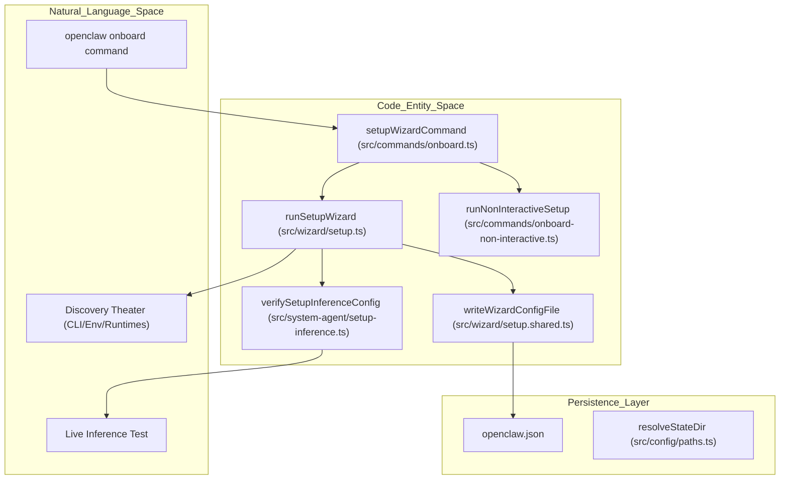

**Sources:** [src/commands/onboard.ts:2-6](), [src/wizard/setup.ts:58-67](), [src/commands/onboard.ts:195-204](), [src/config/paths.ts:10]()

---

## Workspace Setup & Gateway Health

OpenClaw configures a workspace directory (defaulting to `~/.openclaw/workspace`) to house agent memory, skills, and session data [src/commands/onboard.ts:45]().

### Gateway Health Verification
In non-interactive modes, OpenClaw performs a post-setup health check to ensure the gateway is reachable and responding with the configured authentication [src/commands/onboard-non-interactive.gateway.test.ts:48-54](). If the health check fails, the system provides specific "Fix" hints, such as suggesting `openclaw gateway restart` [src/commands/onboard-non-interactive.gateway.test.ts:141-153]().

### Update Runner & Lifecycle
The `runGatewayUpdate` function handles system updates, ensuring that the gateway service is stopped, the environment is preflighted, and the service is restarted following an install [src/infra/update-runner.ts:17-21](). It utilizes `resolveUpdateDoctorExecutionPolicy` to determine if auto-repair should be attempted during the update lifecycle [src/infra/update-runner.ts:58-66]().

**Gateway Update & Lifecycle Management**
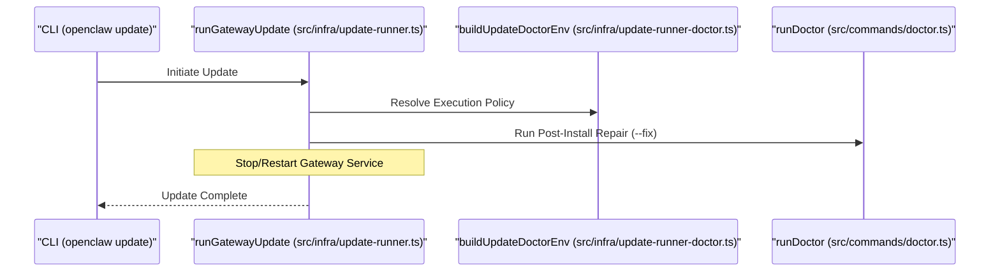

**Sources:** [src/commands/onboard-non-interactive.gateway.test.ts:48-54](), [src/commands/onboard-non-interactive.gateway.test.ts:141-153](), [src/commands/onboard.ts:45](), [src/infra/update-runner.ts:17-21](), [src/infra/update-runner.ts:58-66]()

---

## First Interaction

### 1. Verify Installation
Confirm the CLI is correctly installed and accessible:
```bash
openclaw --version
```

### 2. Start the Gateway
Run the gateway to start the central control plane.
```bash
openclaw gateway run
```

### 3. Interactive Setup
If you skipped onboarding during installation, trigger it manually to configure your first agent and model provider.
```bash
openclaw onboard
```

### 4. Testing Capabilities
Test specific AI capabilities directly from the CLI using the Terminal UI (TUI).
```bash
# Start the Terminal UI
openclaw chat
```

**Sources:** [src/commands/onboard.ts:47](), [src/cli/program/register.onboard.ts:1-10]()

---

# Page: Core Concepts

# Core Concepts

<details>
<summary>Relevant source files</summary>

The following files were used as context for generating this wiki page:

- [.agents/skills/openclaw-update/SKILL.md](.agents/skills/openclaw-update/SKILL.md)
- [.agents/skills/openclaw-update/agents/openai.yaml](.agents/skills/openclaw-update/agents/openai.yaml)
- [.agents/skills/update-team-server/SKILL.md](.agents/skills/update-team-server/SKILL.md)
- [.github/labeler.yml](.github/labeler.yml)
- [CHANGELOG.md](CHANGELOG.md)
- [appcast.xml](appcast.xml)
- [custodian-skills/add-model-provider/SKILL.md](custodian-skills/add-model-provider/SKILL.md)
- [custodian-skills/cloud-image-bake/SKILL.md](custodian-skills/cloud-image-bake/SKILL.md)
- [custodian-skills/configure-channel/SKILL.md](custodian-skills/configure-channel/SKILL.md)
- [custodian-skills/diagnose-gateway/SKILL.md](custodian-skills/diagnose-gateway/SKILL.md)
- [docs/.i18n/glossary.zh-CN.json](docs/.i18n/glossary.zh-CN.json)
- [docs/.i18n/zh-Hans-navigation.json](docs/.i18n/zh-Hans-navigation.json)
- [docs/channels/telegram.md](docs/channels/telegram.md)
- [docs/cli/channels.md](docs/cli/channels.md)
- [docs/cli/daemon.md](docs/cli/daemon.md)
- [docs/cli/dashboard.md](docs/cli/dashboard.md)
- [docs/cli/doctor.md](docs/cli/doctor.md)
- [docs/cli/gateway.md](docs/cli/gateway.md)
- [docs/concepts/memory-architecture.md](docs/concepts/memory-architecture.md)
- [docs/docs.json](docs/docs.json)
- [docs/releases/2026.8.1.md](docs/releases/2026.8.1.md)
- [docs/releases/2026.8.2.md](docs/releases/2026.8.2.md)
- [docs/releases/2026.9.1.md](docs/releases/2026.9.1.md)
- [docs/releases/index.md](docs/releases/index.md)
- [docs/tools/custodian-skills.md](docs/tools/custodian-skills.md)
- [packages/normalization-core/src/error-coercion.test.ts](packages/normalization-core/src/error-coercion.test.ts)
- [packages/normalization-core/src/error-coercion.ts](packages/normalization-core/src/error-coercion.ts)
- [scripts/github/barnacle-auto-response.mjs](scripts/github/barnacle-auto-response.mjs)
- [skills/healthcheck/SKILL.md](skills/healthcheck/SKILL.md)
- [src/agents/internal-runtime-context.test.ts](src/agents/internal-runtime-context.test.ts)
- [src/agents/internal-runtime-context.ts](src/agents/internal-runtime-context.ts)
- [src/agents/live-model-errors.test.ts](src/agents/live-model-errors.test.ts)
- [src/auto-reply/tokens.test.ts](src/auto-reply/tokens.test.ts)
- [src/auto-reply/tokens.ts](src/auto-reply/tokens.ts)
- [src/cli/daemon-cli/probe.reachability.test.ts](src/cli/daemon-cli/probe.reachability.test.ts)
- [src/cli/daemon-cli/probe.test.ts](src/cli/daemon-cli/probe.test.ts)
- [src/cli/daemon-cli/probe.ts](src/cli/daemon-cli/probe.ts)
- [src/cli/daemon-cli/register-service-commands.test.ts](src/cli/daemon-cli/register-service-commands.test.ts)
- [src/cli/daemon-cli/register-service-commands.ts](src/cli/daemon-cli/register-service-commands.ts)
- [src/cli/daemon-cli/types.ts](src/cli/daemon-cli/types.ts)
- [src/cli/dns-cli.test.ts](src/cli/dns-cli.test.ts)
- [src/cli/dns-cli.ts](src/cli/dns-cli.ts)
- [src/cli/gateway-cli.coverage.test.ts](src/cli/gateway-cli.coverage.test.ts)
- [src/cli/gateway-cli/register.option-collisions.test.ts](src/cli/gateway-cli/register.option-collisions.test.ts)
- [src/cli/gateway-cli/register.ts](src/cli/gateway-cli/register.ts)
- [src/cli/gateway-cli/suspend-cli.test.ts](src/cli/gateway-cli/suspend-cli.test.ts)
- [src/cli/gateway-cli/suspend-cli.ts](src/cli/gateway-cli/suspend-cli.ts)
- [src/cli/program/routed-command-definitions.ts](src/cli/program/routed-command-definitions.ts)
- [src/commands/gateway-health-auth-diagnostic.ts](src/commands/gateway-health-auth-diagnostic.ts)
- [src/commands/gateway-readiness.test.ts](src/commands/gateway-readiness.test.ts)
- [src/commands/gateway-readiness.ts](src/commands/gateway-readiness.ts)
- [src/commands/gateway-status.test.ts](src/commands/gateway-status.test.ts)
- [src/commands/gateway-status.ts](src/commands/gateway-status.ts)
- [src/commands/gateway-status/helpers.ts](src/commands/gateway-status/helpers.ts)
- [src/commands/gateway-status/probe-run.ts](src/commands/gateway-status/probe-run.ts)
- [src/gateway/call.test.ts](src/gateway/call.test.ts)
- [src/gateway/call.ts](src/gateway/call.ts)
- [src/gateway/client.ts](src/gateway/client.ts)
- [src/gateway/connection-details.ts](src/gateway/connection-details.ts)
- [src/gateway/probe.test.ts](src/gateway/probe.test.ts)
- [src/gateway/probe.ts](src/gateway/probe.ts)
- [src/infra/restart-handoff.test.ts](src/infra/restart-handoff.test.ts)
- [src/infra/sqlite-user-version.ts](src/infra/sqlite-user-version.ts)
- [src/infra/state-migrations.exec-approvals.test.ts](src/infra/state-migrations.exec-approvals.test.ts)
- [src/infra/state-migrations.exec-approvals.ts](src/infra/state-migrations.exec-approvals.ts)
- [src/infra/widearea-dns.boundary.test.ts](src/infra/widearea-dns.boundary.test.ts)
- [src/infra/widearea-dns.test.ts](src/infra/widearea-dns.test.ts)
- [src/infra/widearea-dns.ts](src/infra/widearea-dns.ts)
- [test/scripts/barnacle-auto-response.test.ts](test/scripts/barnacle-auto-response.test.ts)
- [test/scripts/docs-sync-publish.test.ts](test/scripts/docs-sync-publish.test.ts)
- [ui/src/components/channel-avatar.ts](ui/src/components/channel-avatar.ts)

</details>


This page explains the fundamental building blocks of OpenClaw: the Gateway, Agents, Sessions, Channels, Tools, Skills, and the personal assistant trust model. Understanding these concepts is essential for configuring and operating OpenClaw effectively.

---

## Gateway

The Gateway is OpenClaw's central control plane—a Node.js server that coordinates all communication between clients, channels, agents, and tools. It serves as the single point of entry for managing configuration, sessions, and multi-platform messaging.

### Gateway Architecture

The Gateway acts as the traffic controller, routing inbound messages from various platform adapters to the appropriate agent runtime. It is responsible for loading plugins, managing the configuration lifecycle, and maintaining the global hook runner.

Title: "Gateway Entity Mapping"
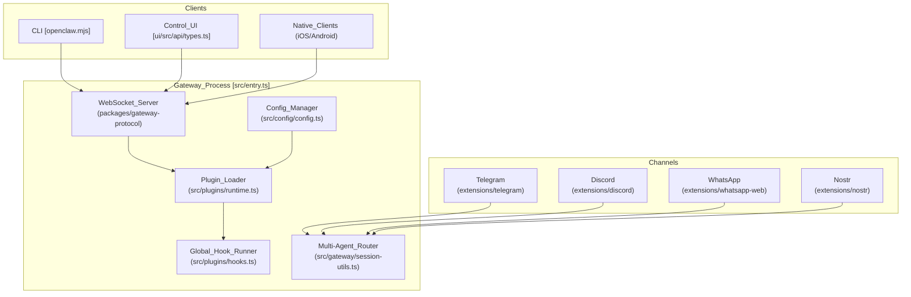

**Key Gateway responsibilities:**

| Responsibility | Implementation | File Reference |
|----------------|----------------|-------------|
| Plugin Loading | Manifest discovery and runtime registration | [src/plugins/runtime.ts:11-11]() |
| Multi-agent Routing | Mapping channel peers to specific agent instances | [src/gateway/session-utils.ts:22-22]() |
| Session Management | Loading and migrating session store keys | [src/gateway/session-utils.ts:21-21]() |
| RPC Invocation | Auth-resolved request handling via `GatewayClient` | [src/gateway/call.ts:1-65]() |
| Health Monitoring | Live `probeAccount` and `auditAccount` checks | [docs/cli/channels.md:62-64]() |

**Crestodian & Delegate Architecture**
OpenClaw handles "configless-safe" setups via the **Crestodian** helper (aliased to the `openclaw` CLI), which assists with initial pairing and repair [docs/docs.json:152-154](). For organizational deployments, the **delegate architecture** allows agents to act on behalf of humans. The **Doctor** system provides health-check and auto-repair capabilities for gateway daemons and state integrity, supporting postures like `--fix` and `--lint` [docs/cli/doctor.md:9-42]().

**Sources:** [src/gateway/session-utils.ts:1-33](), [src/gateway/call.ts:1-114](), [docs/cli/doctor.md:1-61](), [docs/cli/channels.md:33-68]()

---

## Agents

An agent is an isolated runtime context. OpenClaw supports multiple agent runtimes, primarily the high-performance **Pi (Embedded)** runtime and the **Codex** engine.

Title: "Agent Execution and ACP Flow"
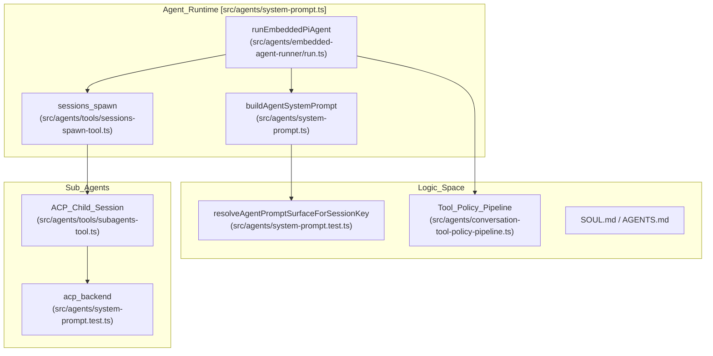

**Agent Execution Lifecycle:**
1. **Pre-flight:** The system resolves the appropriate agent ID and workspace directory.
2. **System Prompt Construction:** The `buildAgentSystemPrompt` function assembles runtime, workspace, tooling, and cache-boundary sections [src/agents/system-prompt.ts:1-5]().
3. **Execution:** The execution pipeline handles model selection, provider authentication rotation, and tool calls. Runtime switching supports models like `muse-spark-1.1` across OpenClaw and Codex engines [CHANGELOG.md:18-19]().
4. **Sub-agents:** Agents can spawn child agents for specialized tasks using the **Agent Control Protocol (ACP)** via the `sessions_spawn` tool [src/agents/system-prompt.ts:129-144]().

**Repair Doctrine:**
Agents follow a "Root-cause repair" doctrine, defined in `AGENTS.md`. This mandates that agents personally inspect source code before rendering verdicts or proposing fixes.

**Sources:** [src/agents/system-prompt.ts:1-176](), [CHANGELOG.md:18-19](), [docs/docs.json:200-222]()

---

## Sessions

A session is the conversation state boundary. OpenClaw uses a flexible session scoping model, persisting state as transcripts and metadata.

### Session Scoping
OpenClaw supports several session scoping modes:
- **`per-channel-peer`**: The default scope where each user has a private conversation.
- **`shared`**: A session shared across multiple participants in a channel.
- **`global`**: A system-wide session context.

**Session State Management:**
The configuration system manages session lifecycle and compaction.
- **SQLite Storage:** In v2026.8.1+, sessions and transcripts are stored in SQLite for improved continuity and performance [docs/releases/2026.8.1.md:30-32]().
- **Compaction:** Context window management that summarizes history to prevent token overflow.
- **Dead Letters:** Failed inbound channel events are retained in the shared state database for inspection and resubmission via `openclaw channels dead-letters` [docs/cli/channels.md:72-89]().

**Sources:** [docs/releases/2026.8.1.md:27-33](), [docs/cli/channels.md:70-98](), [src/gateway/session-utils.ts:1-33]()

---

## Channels

Channels are the messaging surfaces that connect to the Gateway. OpenClaw supports a wide array of platforms including Telegram, Discord, Slack, Signal, and WhatsApp.

**Channel Architecture:**
Channels are implemented as extensions that handle platform-specific events and route them to the Gateway. Recent updates introduced a shared plugin SDK monitor for durable admission, polling, and shutdown lifecycle management [CHANGELOG.md:16-16]().

**Message Flow:**
1. **Ingress:** Platform events (DMs, mentions) are normalized. Telegram, for example, supports both long polling and webhook modes [docs/channels/telegram.md:8-9]().
2. **Resolution:** The Gateway resolves the target agent and session key based on `dmPolicy` (e.g., `pairing`, `allowlist`, or `open`) [docs/channels/telegram.md:155-164]().
3. **Egress:** Replies are delivered back to the source channel. Slack now utilizes native assistant thread status and rotating loading messages [CHANGELOG.md:23-23]().

**Sources:** [docs/channels/telegram.md:1-165](), [CHANGELOG.md:16-23](), [docs/cli/channels.md:1-56]()

---

## Tools & Skills

**Tools:**
Tools allow agents to interact with the system.
- **Coding Tools:** Core tools provide file system access and shell execution.
- **Skill Workshop:** The `skill_workshop` tool allows agents to learn from experience, creating or updating skills based on successful interactions [src/agents/system-prompt.ts:62-64]().
- **Browser Automation:** Agents use tools for web search and fetching, including a browser audio input caret in the Control UI [CHANGELOG.md:24-24]().

**Skills:**
Skills are modular capability definitions stored in `SKILL.md` format.
- **Managed Skills:** OpenClaw includes bundled skills for gateway diagnostics, channel configuration, and model provider management [docs/tools/custodian-skills.md:1-6]().
- **Logbook:** A specialized plugin turns node screen snapshots into a private timeline for daily standups and grounded Q&A [CHANGELOG.md:27-27]().

**Sources:** [src/agents/system-prompt.ts:62-64](), [CHANGELOG.md:24-27](), [docs/tools/custodian-skills.md:1-6]()

---

## Trust Model

OpenClaw is designed as a **personal AI assistant**, operating under a "One trust boundary per gateway" model.

1. **Single Operator:** The system assumes the person running the Gateway is the authorized administrator.
2. **Conservative Defaults:** Binding beyond loopback without authentication is blocked by default [docs/cli/gateway.md:39-39]().
3. **Authorization Scopes:** Access is governed by operator scopes (e.g., `ADMIN_SCOPE`, `WRITE_SCOPE`) to enforce least privilege [src/gateway/call.ts:90-96]().
4. **Pairing:** Telegram and other channels use a pairing flow to approve new direct message interactions [docs/channels/telegram.md:53-63]().
5. **Secret Integrity:** The `SecretRef` system handles credentials, and the Doctor reports degradation when owners are cold or stale [docs/cli/doctor.md:15-15]().

**Sources:** [src/gateway/call.ts:90-186](), [docs/cli/gateway.md:33-43](), [docs/cli/doctor.md:13-17](), [docs/channels/telegram.md:53-63]()

---

# Page: Platform Architecture

# Platform Architecture

<details>
<summary>Relevant source files</summary>

The following files were used as context for generating this wiki page:

- [.github/release/vercel-cli/package-lock.json](.github/release/vercel-cli/package-lock.json)
- [.github/release/vercel-cli/package.json](.github/release/vercel-cli/package.json)
- [.github/workflows/authorized-beta-focused-validation.yml](.github/workflows/authorized-beta-focused-validation.yml)
- [.github/workflows/docker-image-refresh.yml](.github/workflows/docker-image-refresh.yml)
- [.github/workflows/docker-release.yml](.github/workflows/docker-release.yml)
- [.github/workflows/vercel-container-registry-publish.yml](.github/workflows/vercel-container-registry-publish.yml)
- [Dockerfile](Dockerfile)
- [apps/.i18n/native-source.json](apps/.i18n/native-source.json)
- [apps/android/README.md](apps/android/README.md)
- [apps/android/THIRD_PARTY_LICENSES/openclaw/licenses/AndroidX Room.txt](apps/android/THIRD_PARTY_LICENSES/openclaw/licenses/AndroidX Room.txt)
- [apps/android/THIRD_PARTY_LICENSES/openclaw/licenses/AndroidX SQLite.txt](apps/android/THIRD_PARTY_LICENSES/openclaw/licenses/AndroidX SQLite.txt)
- [apps/android/app/src/main/assets/katex/README.md](apps/android/app/src/main/assets/katex/README.md)
- [apps/android/app/src/main/assets/katex/katex.min.css](apps/android/app/src/main/assets/katex/katex.min.css)
- [apps/android/app/src/main/assets/katex/katex.min.js](apps/android/app/src/main/assets/katex/katex.min.js)
- [apps/android/app/src/main/java/ai/openclaw/app/AndroidScreenshotFixture.kt](apps/android/app/src/main/java/ai/openclaw/app/AndroidScreenshotFixture.kt)
- [apps/android/app/src/main/java/ai/openclaw/app/MainViewModel.kt](apps/android/app/src/main/java/ai/openclaw/app/MainViewModel.kt)
- [apps/android/app/src/main/java/ai/openclaw/app/NodeRuntime.kt](apps/android/app/src/main/java/ai/openclaw/app/NodeRuntime.kt)
- [apps/android/app/src/main/java/ai/openclaw/app/PermissionRequester.kt](apps/android/app/src/main/java/ai/openclaw/app/PermissionRequester.kt)
- [apps/android/app/src/main/java/ai/openclaw/app/chat/ChatCommandOutbox.kt](apps/android/app/src/main/java/ai/openclaw/app/chat/ChatCommandOutbox.kt)
- [apps/android/app/src/main/java/ai/openclaw/app/chat/ChatController.kt](apps/android/app/src/main/java/ai/openclaw/app/chat/ChatController.kt)
- [apps/android/app/src/main/java/ai/openclaw/app/chat/ChatModels.kt](apps/android/app/src/main/java/ai/openclaw/app/chat/ChatModels.kt)
- [apps/android/app/src/main/java/ai/openclaw/app/chat/ChatQuestion.kt](apps/android/app/src/main/java/ai/openclaw/app/chat/ChatQuestion.kt)
- [apps/android/app/src/main/java/ai/openclaw/app/chat/ChatTranscriptCache.kt](apps/android/app/src/main/java/ai/openclaw/app/chat/ChatTranscriptCache.kt)
- [apps/android/app/src/main/java/ai/openclaw/app/chat/ClientDatabases.kt](apps/android/app/src/main/java/ai/openclaw/app/chat/ClientDatabases.kt)
- [apps/android/app/src/main/java/ai/openclaw/app/node/ConnectionManager.kt](apps/android/app/src/main/java/ai/openclaw/app/node/ConnectionManager.kt)
- [apps/android/app/src/main/java/ai/openclaw/app/node/InvokeDispatcher.kt](apps/android/app/src/main/java/ai/openclaw/app/node/InvokeDispatcher.kt)
- [apps/android/app/src/main/java/ai/openclaw/app/node/NotificationsHandler.kt](apps/android/app/src/main/java/ai/openclaw/app/node/NotificationsHandler.kt)
- [apps/android/app/src/main/java/ai/openclaw/app/node/SystemHandler.kt](apps/android/app/src/main/java/ai/openclaw/app/node/SystemHandler.kt)
- [apps/android/app/src/main/java/ai/openclaw/app/ui/AgentPicker.kt](apps/android/app/src/main/java/ai/openclaw/app/ui/AgentPicker.kt)
- [apps/android/app/src/main/java/ai/openclaw/app/ui/OnboardingFlow.kt](apps/android/app/src/main/java/ai/openclaw/app/ui/OnboardingFlow.kt)
- [apps/android/app/src/main/java/ai/openclaw/app/ui/SessionsScreen.kt](apps/android/app/src/main/java/ai/openclaw/app/ui/SessionsScreen.kt)
- [apps/android/app/src/main/java/ai/openclaw/app/ui/SettingsScreens.kt](apps/android/app/src/main/java/ai/openclaw/app/ui/SettingsScreens.kt)
- [apps/android/app/src/main/java/ai/openclaw/app/ui/ShellNavigation.kt](apps/android/app/src/main/java/ai/openclaw/app/ui/ShellNavigation.kt)
- [apps/android/app/src/main/java/ai/openclaw/app/ui/ShellScreen.kt](apps/android/app/src/main/java/ai/openclaw/app/ui/ShellScreen.kt)
- [apps/android/app/src/main/java/ai/openclaw/app/ui/SidebarComponents.kt](apps/android/app/src/main/java/ai/openclaw/app/ui/SidebarComponents.kt)
- [apps/android/app/src/main/java/ai/openclaw/app/ui/SidebarContent.kt](apps/android/app/src/main/java/ai/openclaw/app/ui/SidebarContent.kt)
- [apps/android/app/src/main/java/ai/openclaw/app/ui/SystemAgentSettingsScreen.kt](apps/android/app/src/main/java/ai/openclaw/app/ui/SystemAgentSettingsScreen.kt)
- [apps/android/app/src/main/java/ai/openclaw/app/ui/WorkspaceFilesScreen.kt](apps/android/app/src/main/java/ai/openclaw/app/ui/WorkspaceFilesScreen.kt)
- [apps/android/app/src/main/java/ai/openclaw/app/ui/chat/ChatDictation.kt](apps/android/app/src/main/java/ai/openclaw/app/ui/chat/ChatDictation.kt)
- [apps/android/app/src/main/java/ai/openclaw/app/ui/chat/ChatMessageActions.kt](apps/android/app/src/main/java/ai/openclaw/app/ui/chat/ChatMessageActions.kt)
- [apps/android/app/src/main/java/ai/openclaw/app/ui/chat/ChatMessageDisclosure.kt](apps/android/app/src/main/java/ai/openclaw/app/ui/chat/ChatMessageDisclosure.kt)
- [apps/android/app/src/main/java/ai/openclaw/app/ui/chat/ChatQuestionCard.kt](apps/android/app/src/main/java/ai/openclaw/app/ui/chat/ChatQuestionCard.kt)
- [apps/android/app/src/main/java/ai/openclaw/app/ui/chat/ChatScreen.kt](apps/android/app/src/main/java/ai/openclaw/app/ui/chat/ChatScreen.kt)
- [apps/android/app/src/main/java/ai/openclaw/app/ui/chat/ChatSystemRows.kt](apps/android/app/src/main/java/ai/openclaw/app/ui/chat/ChatSystemRows.kt)
- [apps/android/app/src/main/java/ai/openclaw/app/ui/chat/ChatTimeline.kt](apps/android/app/src/main/java/ai/openclaw/app/ui/chat/ChatTimeline.kt)
- [apps/android/app/src/main/java/ai/openclaw/app/ui/design/ClawComponents.kt](apps/android/app/src/main/java/ai/openclaw/app/ui/design/ClawComponents.kt)
- [apps/android/app/src/main/java/ai/openclaw/app/ui/design/MascotAnimator.kt](apps/android/app/src/main/java/ai/openclaw/app/ui/design/MascotAnimator.kt)
- [apps/android/app/src/test/java/ai/openclaw/app/AndroidLicenseNoticesTest.kt](apps/android/app/src/test/java/ai/openclaw/app/AndroidLicenseNoticesTest.kt)
- [apps/android/app/src/test/java/ai/openclaw/app/AndroidScreenshotFixtureRuntimeTest.kt](apps/android/app/src/test/java/ai/openclaw/app/AndroidScreenshotFixtureRuntimeTest.kt)
- [apps/android/app/src/test/java/ai/openclaw/app/AndroidScreenshotFixtureTest.kt](apps/android/app/src/test/java/ai/openclaw/app/AndroidScreenshotFixtureTest.kt)
- [apps/android/app/src/test/java/ai/openclaw/app/AppLanguageTest.kt](apps/android/app/src/test/java/ai/openclaw/app/AppLanguageTest.kt)
- [apps/android/app/src/test/java/ai/openclaw/app/PermissionRequesterTest.kt](apps/android/app/src/test/java/ai/openclaw/app/PermissionRequesterTest.kt)
- [apps/android/app/src/test/java/ai/openclaw/app/chat/ChatControllerBranchCoordinationTest.kt](apps/android/app/src/test/java/ai/openclaw/app/chat/ChatControllerBranchCoordinationTest.kt)
- [apps/android/app/src/test/java/ai/openclaw/app/chat/ChatControllerCommandControlsTest.kt](apps/android/app/src/test/java/ai/openclaw/app/chat/ChatControllerCommandControlsTest.kt)
- [apps/android/app/src/test/java/ai/openclaw/app/chat/ChatControllerMessageIdentityTest.kt](apps/android/app/src/test/java/ai/openclaw/app/chat/ChatControllerMessageIdentityTest.kt)
- [apps/android/app/src/test/java/ai/openclaw/app/chat/ChatControllerOutboxTest.kt](apps/android/app/src/test/java/ai/openclaw/app/chat/ChatControllerOutboxTest.kt)
- [apps/android/app/src/test/java/ai/openclaw/app/chat/ChatControllerProgressCardTest.kt](apps/android/app/src/test/java/ai/openclaw/app/chat/ChatControllerProgressCardTest.kt)
- [apps/android/app/src/test/java/ai/openclaw/app/chat/ChatControllerReconnectRestoreTest.kt](apps/android/app/src/test/java/ai/openclaw/app/chat/ChatControllerReconnectRestoreTest.kt)
- [apps/android/app/src/test/java/ai/openclaw/app/chat/ChatControllerSessionActionsTest.kt](apps/android/app/src/test/java/ai/openclaw/app/chat/ChatControllerSessionActionsTest.kt)
- [apps/android/app/src/test/java/ai/openclaw/app/chat/ChatControllerTranscriptCacheTest.kt](apps/android/app/src/test/java/ai/openclaw/app/chat/ChatControllerTranscriptCacheTest.kt)
- [apps/android/app/src/test/java/ai/openclaw/app/chat/ChatMessageContentParsingTest.kt](apps/android/app/src/test/java/ai/openclaw/app/chat/ChatMessageContentParsingTest.kt)
- [apps/android/app/src/test/java/ai/openclaw/app/chat/ChatQuestionTest.kt](apps/android/app/src/test/java/ai/openclaw/app/chat/ChatQuestionTest.kt)
- [apps/android/app/src/test/java/ai/openclaw/app/chat/ChatReplayHarness.kt](apps/android/app/src/test/java/ai/openclaw/app/chat/ChatReplayHarness.kt)
- [apps/android/app/src/test/java/ai/openclaw/app/chat/ClientDatabasesTest.kt](apps/android/app/src/test/java/ai/openclaw/app/chat/ClientDatabasesTest.kt)
- [apps/android/app/src/test/java/ai/openclaw/app/chat/RoomChatCommandOutboxTest.kt](apps/android/app/src/test/java/ai/openclaw/app/chat/RoomChatCommandOutboxTest.kt)
- [apps/android/app/src/test/java/ai/openclaw/app/chat/RoomChatTranscriptCacheTest.kt](apps/android/app/src/test/java/ai/openclaw/app/chat/RoomChatTranscriptCacheTest.kt)
- [apps/android/app/src/test/java/ai/openclaw/app/node/ConnectionManagerTest.kt](apps/android/app/src/test/java/ai/openclaw/app/node/ConnectionManagerTest.kt)
- [apps/android/app/src/test/java/ai/openclaw/app/node/InvokeDispatcherTest.kt](apps/android/app/src/test/java/ai/openclaw/app/node/InvokeDispatcherTest.kt)
- [apps/android/app/src/test/java/ai/openclaw/app/node/SystemHandlerTest.kt](apps/android/app/src/test/java/ai/openclaw/app/node/SystemHandlerTest.kt)
- [apps/android/app/src/test/java/ai/openclaw/app/ui/AgentPickerTest.kt](apps/android/app/src/test/java/ai/openclaw/app/ui/AgentPickerTest.kt)
- [apps/android/app/src/test/java/ai/openclaw/app/ui/InitialOnboardingLayoutTest.kt](apps/android/app/src/test/java/ai/openclaw/app/ui/InitialOnboardingLayoutTest.kt)
- [apps/android/app/src/test/java/ai/openclaw/app/ui/OnboardingFlowLogicTest.kt](apps/android/app/src/test/java/ai/openclaw/app/ui/OnboardingFlowLogicTest.kt)
- [apps/android/app/src/test/java/ai/openclaw/app/ui/SessionsScreenDescendantSignalsTest.kt](apps/android/app/src/test/java/ai/openclaw/app/ui/SessionsScreenDescendantSignalsTest.kt)
- [apps/android/app/src/test/java/ai/openclaw/app/ui/SessionsScreenGroupingTest.kt](apps/android/app/src/test/java/ai/openclaw/app/ui/SessionsScreenGroupingTest.kt)
- [apps/android/app/src/test/java/ai/openclaw/app/ui/SettingsDetailInsetsTest.kt](apps/android/app/src/test/java/ai/openclaw/app/ui/SettingsDetailInsetsTest.kt)
- [apps/android/app/src/test/java/ai/openclaw/app/ui/ShellScreenLogicTest.kt](apps/android/app/src/test/java/ai/openclaw/app/ui/ShellScreenLogicTest.kt)
- [apps/android/app/src/test/java/ai/openclaw/app/ui/SidebarShellLogicTest.kt](apps/android/app/src/test/java/ai/openclaw/app/ui/SidebarShellLogicTest.kt)
- [apps/android/app/src/test/java/ai/openclaw/app/ui/SystemAnimationsTest.kt](apps/android/app/src/test/java/ai/openclaw/app/ui/SystemAnimationsTest.kt)
- [apps/android/app/src/test/java/ai/openclaw/app/ui/chat/ChatComposerLayoutTest.kt](apps/android/app/src/test/java/ai/openclaw/app/ui/chat/ChatComposerLayoutTest.kt)
- [apps/android/app/src/test/java/ai/openclaw/app/ui/chat/ChatContextMeterTest.kt](apps/android/app/src/test/java/ai/openclaw/app/ui/chat/ChatContextMeterTest.kt)
- [apps/android/app/src/test/java/ai/openclaw/app/ui/chat/ChatMessageViewsTest.kt](apps/android/app/src/test/java/ai/openclaw/app/ui/chat/ChatMessageViewsTest.kt)
- [apps/android/app/src/test/java/ai/openclaw/app/ui/chat/ChatQuestionDraftLayoutTest.kt](apps/android/app/src/test/java/ai/openclaw/app/ui/chat/ChatQuestionDraftLayoutTest.kt)
- [apps/android/app/src/test/java/ai/openclaw/app/ui/chat/ChatScreenTest.kt](apps/android/app/src/test/java/ai/openclaw/app/ui/chat/ChatScreenTest.kt)
- [apps/android/app/src/test/java/ai/openclaw/app/ui/chat/ChatTimelineTest.kt](apps/android/app/src/test/java/ai/openclaw/app/ui/chat/ChatTimelineTest.kt)
- [config/knip.config.ts](config/knip.config.ts)
- [config/knip.scripts-exports.config.ts](config/knip.scripts-exports.config.ts)
- [docs/gateway/security/secure-file-operations.md](docs/gateway/security/secure-file-operations.md)
- [docs/platforms/android.md](docs/platforms/android.md)
- [extensions/canvas/openclaw.plugin.json](extensions/canvas/openclaw.plugin.json)
- [extensions/canvas/src/config.test.ts](extensions/canvas/src/config.test.ts)
- [extensions/canvas/src/config.ts](extensions/canvas/src/config.ts)
- [extensions/google-meet/index.create.test.ts](extensions/google-meet/index.create.test.ts)
- [extensions/google-meet/index.test.ts](extensions/google-meet/index.test.ts)
- [extensions/google-meet/src/plugin-schema.ts](extensions/google-meet/src/plugin-schema.ts)
- [extensions/google-meet/src/runtime.owner-selection.test.ts](extensions/google-meet/src/runtime.owner-selection.test.ts)
- [extensions/google-meet/src/runtime.ts](extensions/google-meet/src/runtime.ts)
- [extensions/google-meet/src/test-support/fixtures.test-helpers.ts](extensions/google-meet/src/test-support/fixtures.test-helpers.ts)
- [extensions/google-meet/src/transports/chrome.test.ts](extensions/google-meet/src/transports/chrome.test.ts)
- [extensions/google-meet/src/transports/chrome.ts](extensions/google-meet/src/transports/chrome.ts)
- [extensions/google-meet/test-api.ts](extensions/google-meet/test-api.ts)
- [extensions/linux-node/src/config.test.ts](extensions/linux-node/src/config.test.ts)
- [extensions/linux-node/src/config.ts](extensions/linux-node/src/config.ts)
- [extensions/matrix/src/matrix/send.test.ts](extensions/matrix/src/matrix/send.test.ts)
- [extensions/matrix/src/matrix/send/client.ts](extensions/matrix/src/matrix/send/client.ts)
- [extensions/memory-lancedb/config.test.ts](extensions/memory-lancedb/config.test.ts)
- [extensions/openai/test-support/provider-catalog.contract-test-support.ts](extensions/openai/test-support/provider-catalog.contract-test-support.ts)
- [extensions/qa-lab/package.json](extensions/qa-lab/package.json)
- [extensions/synology-chat/src/test-http-utils.ts](extensions/synology-chat/src/test-http-utils.ts)
- [pnpm-lock.yaml](pnpm-lock.yaml)
- [pnpm-workspace.yaml](pnpm-workspace.yaml)
- [scripts/authorized-beta-focused-policy.json](scripts/authorized-beta-focused-policy.json)
- [scripts/docker-channel-promote.mjs](scripts/docker-channel-promote.mjs)
- [scripts/lib/docker-manifest-error.mjs](scripts/lib/docker-manifest-error.mjs)
- [scripts/lib/docker-release-policy.mjs](scripts/lib/docker-release-policy.mjs)
- [scripts/lib/state-schema-inline-plugin.mts](scripts/lib/state-schema-inline-plugin.mts)
- [scripts/lib/tsdown-declaration-generator-inputs.mts](scripts/lib/tsdown-declaration-generator-inputs.mts)
- [scripts/lib/tsdown-declaration-inputs.mts](scripts/lib/tsdown-declaration-inputs.mts)
- [scripts/lib/vitest-resource-reporter.mts](scripts/lib/vitest-resource-reporter.mts)
- [scripts/lib/windows-cmd-helpers-runtime.mts](scripts/lib/windows-cmd-helpers-runtime.mts)
- [scripts/lib/worker-deploy-build-plugin.mts](scripts/lib/worker-deploy-build-plugin.mts)
- [scripts/materialize-vercel-cli.sh](scripts/materialize-vercel-cli.sh)
- [scripts/prune-docker-plugin-dist.mjs](scripts/prune-docker-plugin-dist.mjs)
- [scripts/validate-authorized-beta-focused-evidence.d.mts](scripts/validate-authorized-beta-focused-evidence.d.mts)
- [scripts/validate-authorized-beta-focused-evidence.mts](scripts/validate-authorized-beta-focused-evidence.mts)
- [scripts/vercel-container-registry-publish.mjs](scripts/vercel-container-registry-publish.mjs)
- [scripts/verify-authorized-beta-focused-candidate.mjs](scripts/verify-authorized-beta-focused-candidate.mjs)
- [scripts/write-unified-entry-dts.ts](scripts/write-unified-entry-dts.ts)
- [src/agents/embedded-agent-runner/model-resolution.ts](src/agents/embedded-agent-runner/model-resolution.ts)
- [src/agents/embedded-agent-runner/run/model-setup.ts](src/agents/embedded-agent-runner/run/model-setup.ts)
- [src/agents/mcp-tool-metadata.test.ts](src/agents/mcp-tool-metadata.test.ts)
- [src/agents/mcp-tool-metadata.ts](src/agents/mcp-tool-metadata.ts)
- [src/agents/tools-effective-inventory.cold-provider.test.ts](src/agents/tools-effective-inventory.cold-provider.test.ts)
- [src/agents/tools-effective-inventory.runtime-model.test.ts](src/agents/tools-effective-inventory.runtime-model.test.ts)
- [src/agents/tools-effective-inventory.ts](src/agents/tools-effective-inventory.ts)
- [src/dockerfile.test.ts](src/dockerfile.test.ts)
- [src/node-host/invoke-mcp-result.test.ts](src/node-host/invoke-mcp-result.test.ts)
- [src/node-host/invoke-mcp-result.ts](src/node-host/invoke-mcp-result.ts)
- [src/node-host/invoke.test-support.ts](src/node-host/invoke.test-support.ts)
- [src/plugins/prune-docker-plugin-dist.test.ts](src/plugins/prune-docker-plugin-dist.test.ts)
- [src/shared/json-schema-defaults.test.ts](src/shared/json-schema-defaults.test.ts)
- [src/shared/json-schema-defaults.ts](src/shared/json-schema-defaults.ts)
- [test/scripts/authorized-beta-focused-evidence.test.ts](test/scripts/authorized-beta-focused-evidence.test.ts)
- [test/scripts/check-deadcode-exports.test.ts](test/scripts/check-deadcode-exports.test.ts)
- [test/scripts/declaration-stage.test.ts](test/scripts/declaration-stage.test.ts)
- [test/scripts/docker-channel-promote.test.ts](test/scripts/docker-channel-promote.test.ts)
- [test/scripts/docker-release-policy.test.ts](test/scripts/docker-release-policy.test.ts)
- [test/scripts/tsdown-config.test.ts](test/scripts/tsdown-config.test.ts)
- [test/scripts/tsdown-declaration-fixture.ts](test/scripts/tsdown-declaration-fixture.ts)
- [test/scripts/vercel-container-registry-publish.test.ts](test/scripts/vercel-container-registry-publish.test.ts)
- [test/scripts/worker-deploy-build-plugin.test.ts](test/scripts/worker-deploy-build-plugin.test.ts)
- [test/tsconfig/tsconfig.core.test.ui-e2e.json](test/tsconfig/tsconfig.core.test.ui-e2e.json)
- [test/tsconfig/tsconfig.core.test.ui-pages.json](test/tsconfig/tsconfig.core.test.ui-pages.json)
- [tsdown.config.ts](tsdown.config.ts)
- [ui/package.json](ui/package.json)

</details>


## Purpose and Scope

This document provides a high-level architectural overview of OpenClaw, explaining how the major subsystems interact to deliver a self-hosted multi-platform AI gateway. It covers the core Node.js gateway, native clients (iOS/Android/macOS/Linux), Docker-based sandboxing, and the cross-platform build system.

OpenClaw is designed as a **hub-and-spoke** system where the central Gateway coordinates agent execution, messaging channels, and native device nodes.

---

## Architectural Overview

The architecture is centered around the **Gateway Control Plane**, which manages state, routing, and communication between various clients and the agent runtime.

### System Components Diagram

The following diagram maps high-level system components to their corresponding entities in the codebase.

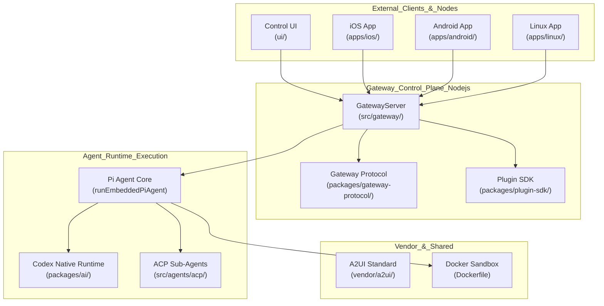

**Sources:** [pnpm-workspace.yaml:1-6](), [apps/android/app/src/main/java/ai/openclaw/app/NodeRuntime.kt:42-53](), [tsdown.config.ts:180-184]()

---

## Core Platform Subsystems

### 1. Gateway Control Plane
The Gateway is a Node.js-based server, serving as the central orchestration point.

*   **Entry Point:** The production entry point for the unified worker is managed via `tsdown` configuration, targeting `src/worker/worker-deploy-entry.ts` [tsdown.config.ts:180-184]().
*   **Protocol:** Communication is governed by a unified protocol. The `protocol-gen.ts` script generates the checked-in native protocol models from core descriptor metadata to ensure cross-platform parity [config/knip.config.ts:106-107]().
*   **Plugin SDK:** Extensibility is provided via the Plugin SDK, which defines entrypoints for public and production-grade extensions [tsdown.config.ts:13-18]().
*   **Lifecycle Management:** The system includes a dedicated `docker-healthcheck.js` to monitor the Gateway service within containerized environments [src/dockerfile.test.ts:40-44]().

**Sources:** [tsdown.config.ts:13-18](), [tsdown.config.ts:180-184](), [config/knip.config.ts:106-107](), [src/dockerfile.test.ts:40-44]()

### 2. Native Clients and Device Nodes
Native applications provide the primary user interface and local device integration. They act as "Device Nodes" that can contribute capabilities back to the gateway.

*   **Android Companion:** A Jetpack Compose application [apps/android/app/src/main/java/ai/openclaw/app/ui/chat/ChatScreen.kt:106-112](). It coordinates gateway interaction via `GatewaySession` and manages local device capabilities through handlers like `CameraHandler`, `LocationHandler`, and `SmsHandler` within the `NodeRuntime` [apps/android/app/src/main/java/ai/openclaw/app/NodeRuntime.kt:53-53](), [apps/android/app/src/main/java/ai/openclaw/app/NodeRuntime.kt:75-91]().
*   **Wear OS:** A companion that uses the paired phone's authenticated connection. It supports realtime Talk streaming microphone audio over the Wear OS Data Layer [docs/platforms/android.md:41-43]().
*   **Cross-Platform Localization:** Native apps share a common i18n pipeline. Localization strings are extracted from Kotlin and Swift sources into `apps/.i18n/native-source.json`, which tracks entries by surface and source file path [apps/.i18n/native-source.json:1-9]().

**Sources:** [apps/android/app/src/main/java/ai/openclaw/app/NodeRuntime.kt:53-53](), [apps/android/app/src/main/java/ai/openclaw/app/NodeRuntime.kt:75-91](), [apps/android/app/src/main/java/ai/openclaw/app/ui/chat/ChatScreen.kt:106-112](), [apps/.i18n/native-source.json:1-9](), [docs/platforms/android.md:41-43]()

### 3. Agent Runtime and Execution
The runtime environment supports multiple execution backends and tool execution environments.

*   **Pi Agent Core:** The primary execution pipeline. The `ChatController` on clients coordinates with the Gateway to handle session mutations like rewinding or forking [apps/android/app/src/test/java/ai/openclaw/app/chat/ChatControllerBranchCoordinationTest.kt:104-127]().
*   **Codex:** A native harness for coding tasks. The system manages specific version overrides for Codex and OpenAI SDKs to maintain stability [pnpm-lock.yaml:108-111]().
*   **Tool Execution:** Tools can interact with the physical environment. On Android, the `InvokeDispatcher` routes these requests to specific native handlers [apps/android/app/src/main/java/ai/openclaw/app/NodeRuntime.kt:72-81]().
*   **Sandboxing:** Secure execution is provided via a multi-stage Docker build. The runtime image uses `bookworm-slim` and includes `tini` as an init process to manage signal forwarding and zombie reaping [Dockerfile:10-17](), [src/dockerfile.test.ts:117-132]().

**Sources:** [pnpm-lock.yaml:108-111](), [apps/android/app/src/main/java/ai/openclaw/app/NodeRuntime.kt:72-81](), [apps/android/app/src/test/java/ai/openclaw/app/chat/ChatControllerBranchCoordinationTest.kt:104-127](), [Dockerfile:10-17](), [src/dockerfile.test.ts:117-132]()

---

## Build and Release Architecture

OpenClaw employs a cross-platform build system centered around `tsdown` for Node.js and platform-specific orchestrators for native apps.

### Build Pipeline Diagram

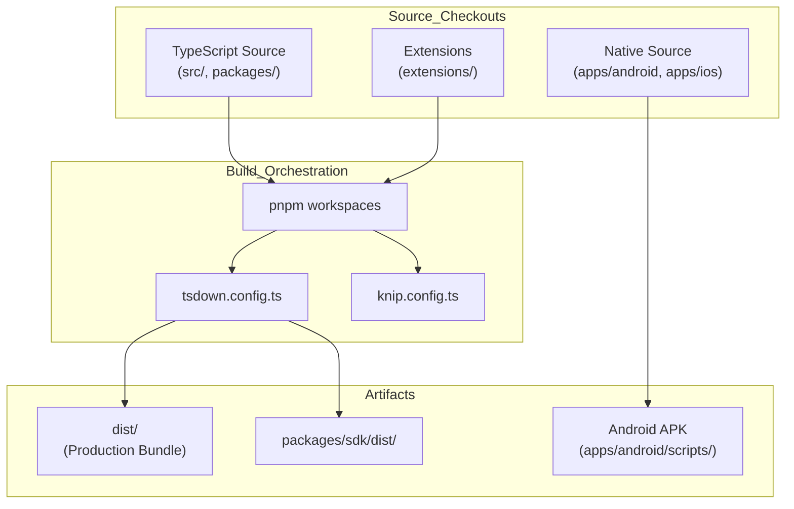

*   **Orchestration:** `pnpm workspaces` manages the monorepo dependencies and build order [pnpm-workspace.yaml:1-6]().
*   **Dependency Hygiene:** `knip` is used to audit production dependencies and ensure that repository scripts and build entries are correctly tracked [config/knip.config.ts:1-16]().
*   **Containerization:** The `Dockerfile` uses a multi-stage approach to separate dependency installation from the final build, optimizing layer caching. It supports building specific extensions via `OPENCLAW_EXTENSIONS` build arguments [Dockerfile:1-11]().
*   **Versioning:** The system uses CalVer for releases. The `worker-deploy-entry` embeds the version string directly into the build [tsdown.config.ts:62-64](), [tsdown.config.ts:187-190]().

**Sources:** [pnpm-workspace.yaml:1-6](), [config/knip.config.ts:1-16](), [tsdown.config.ts:62-64](), [tsdown.config.ts:187-190](), [Dockerfile:1-11]()

---

## Asset Management and Extensions

### Bundled Assets
*   **Vendor Components:** The system includes a script `bundle-a2ui.mts` to consume and bundle the A2UI open standard for rich UI rendering [config/knip.config.ts:22-22]().
*   **Native UI Artifacts:** Localization data for native apps is stored in `apps/.i18n/` and processed into the `native-source.json` manifest [apps/.i18n/native-source.json:1-3]().
*   **Chrome Extension:** Assets for browser integration are bundled and consumed by the Gateway's browser automation services.

### Extension Consumption
*   **Plugins:** Manifest-driven and located in `extensions/`. The build system uses `collectBundledPluginBuildEntries` to dynamically discover and build these packages [tsdown.config.ts:6-11]().
*   **Plugin Discovery:** The `docker-plugin-selection.mjs` script manages which plugins are included in a specific Docker build, allowing for modular runtime images [Dockerfile:38-39](), [Dockerfile:51-56]().
*   **QA Lab:** Scenario packs and QA assets are stored under `extensions/qa-lab/` for automated platform validation [pnpm-workspace.yaml:5-5]().

**Sources:** [tsdown.config.ts:6-11](), [config/knip.config.ts:22-22](), [apps/.i18n/native-source.json:1-3](), [Dockerfile:38-39](), [Dockerfile:51-56](), [pnpm-workspace.yaml:5-5]()

---

# Page: Gateway

# Gateway

<details>
<summary>Relevant source files</summary>

The following files were used as context for generating this wiki page:

- [docs/cli/daemon.md](docs/cli/daemon.md)
- [docs/cli/dashboard.md](docs/cli/dashboard.md)
- [docs/cli/gateway.md](docs/cli/gateway.md)
- [docs/gateway/configuration.md](docs/gateway/configuration.md)
- [extensions/codex/index.test.ts](extensions/codex/index.test.ts)
- [extensions/codex/index.ts](extensions/codex/index.ts)
- [extensions/codex/src/command-plugins-management.test.ts](extensions/codex/src/command-plugins-management.test.ts)
- [extensions/codex/src/command-plugins-management.ts](extensions/codex/src/command-plugins-management.ts)
- [packages/normalization-core/src/error-coercion.test.ts](packages/normalization-core/src/error-coercion.test.ts)
- [packages/normalization-core/src/error-coercion.ts](packages/normalization-core/src/error-coercion.ts)
- [src/agents/cli-runner/reseed-envelope.test.ts](src/agents/cli-runner/reseed-envelope.test.ts)
- [src/agents/embedded-agent-runner/run/idle-timeout-breaker.test.ts](src/agents/embedded-agent-runner/run/idle-timeout-breaker.test.ts)
- [src/agents/live-model-errors.test.ts](src/agents/live-model-errors.test.ts)
- [src/agents/mcp-connection-resolver.test.ts](src/agents/mcp-connection-resolver.test.ts)
- [src/agents/provider-local-service.env-case.test.ts](src/agents/provider-local-service.env-case.test.ts)
- [src/agents/provider-local-service.shutdown.test.ts](src/agents/provider-local-service.shutdown.test.ts)
- [src/agents/provider-local-service.test.ts](src/agents/provider-local-service.test.ts)
- [src/agents/provider-runtime-lifecycle.ts](src/agents/provider-runtime-lifecycle.ts)
- [src/agents/provider-transport-dispatcher-pool.ts](src/agents/provider-transport-dispatcher-pool.ts)
- [src/cli/daemon-cli/probe.reachability.test.ts](src/cli/daemon-cli/probe.reachability.test.ts)
- [src/cli/daemon-cli/probe.test.ts](src/cli/daemon-cli/probe.test.ts)
- [src/cli/daemon-cli/probe.ts](src/cli/daemon-cli/probe.ts)
- [src/cli/daemon-cli/register-service-commands.test.ts](src/cli/daemon-cli/register-service-commands.test.ts)
- [src/cli/daemon-cli/register-service-commands.ts](src/cli/daemon-cli/register-service-commands.ts)
- [src/cli/daemon-cli/types.ts](src/cli/daemon-cli/types.ts)
- [src/cli/dns-cli.test.ts](src/cli/dns-cli.test.ts)
- [src/cli/dns-cli.ts](src/cli/dns-cli.ts)
- [src/cli/gateway-cli.coverage.test.ts](src/cli/gateway-cli.coverage.test.ts)
- [src/cli/gateway-cli/lifecycle.runtime.ts](src/cli/gateway-cli/lifecycle.runtime.ts)
- [src/cli/gateway-cli/register.option-collisions.test.ts](src/cli/gateway-cli/register.option-collisions.test.ts)
- [src/cli/gateway-cli/register.ts](src/cli/gateway-cli/register.ts)
- [src/cli/gateway-cli/run-loop.test.ts](src/cli/gateway-cli/run-loop.test.ts)
- [src/cli/gateway-cli/run-loop.ts](src/cli/gateway-cli/run-loop.ts)
- [src/cli/gateway-cli/suspend-cli.test.ts](src/cli/gateway-cli/suspend-cli.test.ts)
- [src/cli/gateway-cli/suspend-cli.ts](src/cli/gateway-cli/suspend-cli.ts)
- [src/cli/program/routed-command-definitions.ts](src/cli/program/routed-command-definitions.ts)
- [src/cli/runtime-cleanup.ts](src/cli/runtime-cleanup.ts)
- [src/commands/gateway-health-auth-diagnostic.ts](src/commands/gateway-health-auth-diagnostic.ts)
- [src/commands/gateway-readiness.test.ts](src/commands/gateway-readiness.test.ts)
- [src/commands/gateway-readiness.ts](src/commands/gateway-readiness.ts)
- [src/commands/gateway-status.test.ts](src/commands/gateway-status.test.ts)
- [src/commands/gateway-status.ts](src/commands/gateway-status.ts)
- [src/commands/gateway-status/helpers.ts](src/commands/gateway-status/helpers.ts)
- [src/commands/gateway-status/probe-run.ts](src/commands/gateway-status/probe-run.ts)
- [src/commands/onboard-interactive.test.ts](src/commands/onboard-interactive.test.ts)
- [src/config/runtime-write-application.ts](src/config/runtime-write-application.ts)
- [src/gateway/auth-rate-limit.ts](src/gateway/auth-rate-limit.ts)
- [src/gateway/call.test.ts](src/gateway/call.test.ts)
- [src/gateway/call.ts](src/gateway/call.ts)
- [src/gateway/client.ts](src/gateway/client.ts)
- [src/gateway/config-diff.ts](src/gateway/config-diff.ts)
- [src/gateway/config-reload-plan.ts](src/gateway/config-reload-plan.ts)
- [src/gateway/config-reload.test.ts](src/gateway/config-reload.test.ts)
- [src/gateway/config-reload.ts](src/gateway/config-reload.ts)
- [src/gateway/connection-details.ts](src/gateway/connection-details.ts)
- [src/gateway/control-ui-http-utils.ts](src/gateway/control-ui-http-utils.ts)
- [src/gateway/control-ui-routing.test.ts](src/gateway/control-ui-routing.test.ts)
- [src/gateway/control-ui-routing.ts](src/gateway/control-ui-routing.ts)
- [src/gateway/gateway-http-route-contracts.ts](src/gateway/gateway-http-route-contracts.ts)
- [src/gateway/http-media-range.ts](src/gateway/http-media-range.ts)
- [src/gateway/local-request-context.test.ts](src/gateway/local-request-context.test.ts)
- [src/gateway/local-request-context.ts](src/gateway/local-request-context.ts)
- [src/gateway/probe.test.ts](src/gateway/probe.test.ts)
- [src/gateway/probe.ts](src/gateway/probe.ts)
- [src/gateway/server-close.test.ts](src/gateway/server-close.test.ts)
- [src/gateway/server-close.ts](src/gateway/server-close.ts)
- [src/gateway/server-core-runtime.ts](src/gateway/server-core-runtime.ts)
- [src/gateway/server-cron-lazy.test.ts](src/gateway/server-cron-lazy.test.ts)
- [src/gateway/server-cron-lazy.ts](src/gateway/server-cron-lazy.ts)
- [src/gateway/server-http.openai-compat.test.ts](src/gateway/server-http.openai-compat.test.ts)
- [src/gateway/server-http.probe.test.ts](src/gateway/server-http.probe.test.ts)
- [src/gateway/server-http.ts](src/gateway/server-http.ts)
- [src/gateway/server-kernel-request-runtime.ts](src/gateway/server-kernel-request-runtime.ts)
- [src/gateway/server-kernel.test.ts](src/gateway/server-kernel.test.ts)
- [src/gateway/server-kernel.ts](src/gateway/server-kernel.ts)
- [src/gateway/server-lifecycle.ts](src/gateway/server-lifecycle.ts)
- [src/gateway/server-methods/config-write-flow.ts](src/gateway/server-methods/config-write-flow.ts)
- [src/gateway/server-methods/config.test.ts](src/gateway/server-methods/config.test.ts)
- [src/gateway/server-methods/config.ts](src/gateway/server-methods/config.ts)
- [src/gateway/server-methods/models-auth-status.types.ts](src/gateway/server-methods/models-auth-status.types.ts)
- [src/gateway/server-methods/shared-types.ts](src/gateway/server-methods/shared-types.ts)
- [src/gateway/server-reload-contracts.ts](src/gateway/server-reload-contracts.ts)
- [src/gateway/server-reload-handlers.hot-reload-status.test.ts](src/gateway/server-reload-handlers.hot-reload-status.test.ts)
- [src/gateway/server-reload-handlers.test.ts](src/gateway/server-reload-handlers.test.ts)
- [src/gateway/server-reload-hot.ts](src/gateway/server-reload-hot.ts)
- [src/gateway/server-reload-managed.ts](src/gateway/server-reload-managed.ts)
- [src/gateway/server-request-context.test.ts](src/gateway/server-request-context.test.ts)
- [src/gateway/server-request-context.ts](src/gateway/server-request-context.ts)
- [src/gateway/server-runtime-config.ts](src/gateway/server-runtime-config.ts)
- [src/gateway/server-runtime-state-prepare.ts](src/gateway/server-runtime-state-prepare.ts)
- [src/gateway/server-runtime-state.ts](src/gateway/server-runtime-state.ts)
- [src/gateway/server-start.ts](src/gateway/server-start.ts)
- [src/gateway/server-startup-finish.ts](src/gateway/server-startup-finish.ts)
- [src/gateway/server-startup-post-attach.test.ts](src/gateway/server-startup-post-attach.test.ts)
- [src/gateway/server-startup-post-attach.ts](src/gateway/server-startup-post-attach.ts)
- [src/gateway/server.channels-start-outcomes.test.ts](src/gateway/server.channels-start-outcomes.test.ts)
- [src/gateway/server/public-worker-ingress-context.ts](src/gateway/server/public-worker-ingress-context.ts)
- [src/gateway/server/ws-connection-diagnostics.ts](src/gateway/server/ws-connection-diagnostics.ts)
- [src/gateway/system-ca-warmup.test.ts](src/gateway/system-ca-warmup.test.ts)
- [src/gateway/system-ca-warmup.ts](src/gateway/system-ca-warmup.ts)
- [src/infra/net/pinned-dispatcher-pool.test.ts](src/infra/net/pinned-dispatcher-pool.test.ts)
- [src/infra/net/pinned-dispatcher-pool.ts](src/infra/net/pinned-dispatcher-pool.ts)
- [src/infra/sqlite-user-version.ts](src/infra/sqlite-user-version.ts)
- [src/infra/widearea-dns.boundary.test.ts](src/infra/widearea-dns.boundary.test.ts)
- [src/infra/widearea-dns.test.ts](src/infra/widearea-dns.test.ts)
- [src/infra/widearea-dns.ts](src/infra/widearea-dns.ts)
- [src/plugins/services.replacement.test.ts](src/plugins/services.replacement.test.ts)
- [src/plugins/services.test.ts](src/plugins/services.test.ts)
- [src/plugins/services.ts](src/plugins/services.ts)
- [src/process/child-process-tree.ts](src/process/child-process-tree.ts)

</details>


The Gateway is the central control plane for OpenClaw, responsible for managing WebSocket connections, dispatching RPC methods, coordinating messaging channels, orchestrating agent runs, and maintaining system state. It runs as a single multiplexed process serving protocol clients (CLI, native apps, Control UI) and channel providers simultaneously. [src/gateway/server-runtime-state-prepare.ts:68-84]()

For details on specific Gateway subsystems, see:
- **[WebSocket Protocol & RPC](#2.1)** — Document the Gateway protocol v3, including `ConnectFrame`, `RequestFrame`, `ResponseFrame`, and `EventFrame`. Cover `TypeBox` as the schema source of truth and the steering queue for active-run message delivery. [packages/gateway-protocol/src/schema/frames.ts:9-13]()
- **[Authentication & Authorization](#2.2)** — Explain Gateway authentication modes (token/password/none), scope-based authorization (`READ`/`WRITE`/`ADMIN`/`PAIRING`/`APPROVALS`), and rate limiting. [src/gateway/server-methods/shared-types.ts:91-96](), [src/gateway/server-runtime-state-prepare.ts:46-55]()
- **[Configuration System](#2.3)** — Overview of `openclaw.json`, `models.json`, `auth-profiles.json`, configuration loading, Zod schema validation, and migrations. [src/gateway/server-runtime-state-prepare.ts:6-7](), [docs/gateway/configuration.md:10-22]()
- **[Session & State Management](#2.4)** — Document session scoping (per-channel-peer/shared/global), session storage in JSONL files, state directory organization, and session lifecycle. [src/gateway/server-startup-post-attach.ts:29-29](), [src/gateway/server-runtime-state-prepare.ts:16-17]()
- **[Multi-Agent Routing](#2.5)** — Explain agent bindings, how channels route to specific agents, isolated workspaces, and agent-specific auth profiles. [src/gateway/server-core-runtime.ts:2-6]()
- **[Service Lifecycle & Diagnostics](#2.6)** — Cover Gateway daemon management (launchd/systemd), health checks, `status` command, and `doctor` command for diagnostics and auto-repair. [src/gateway/server-startup-post-attach.ts:38-42](), [src/gateway/server-core-runtime.ts:32-36]()
- **[Control UI & WebChat](#2.7)** — Document the browser-based Control UI served by the Gateway, including the chat interface, settings panels, and session management views. [src/gateway/server-http.ts:25-36]()
- **[HTTP APIs](#2.8)** — Document the Gateway's HTTP surfaces: OpenAI-compatible endpoints, `/tools/invoke`, and the MCP bridge (`openclaw mcp serve`). [src/gateway/server-http.ts:113-120]()
- **[Client SDK](#2.9)** — Document the `@openclaw/sdk` TypeScript client package for programmatic access to the Gateway via `GatewayClientTransport`. [src/gateway/server-methods/shared-types.ts:77-89]()
- **[Terminal UI (TUI)](#2.10)** — Document the terminal-based chat interface (`openclaw tui` / `openclaw chat`), including Gateway-backed mode and session navigation. [src/gateway/server-methods/shared-types.ts:60-61]()

---

## Gateway Role in the System

The Gateway acts as the single source of truth for:
- **Protocol connections**: WebSocket clients connect to the Gateway for RPC and events using a versioned protocol. [src/gateway/call.ts:18-21](), [src/gateway/server-http.ts:133-145]()
- **Agent orchestration**: The Gateway invokes agent runs and tracks their lifecycle across restarts, handling recovery for orphaned sessions via `markStartupOrphanedMainSessionsForRecovery`. [src/gateway/server-startup-post-attach.ts:66-72]()
- **Transcript Management**: Manages session history and lifecycle persistence via session state events. [src/gateway/server-startup-post-attach.ts:29-29]()
- **Sidecar Coordination**: Orchestrates background tasks like cron, maintenance, and health monitoring. [src/gateway/server-core-runtime.ts:158-160](), [src/gateway/server-lifecycle.ts:21-23]()

### Gateway Architecture Overview

```mermaid
graph TB
    subgraph "Protocol Clients [packages/gateway-protocol]"
        [GatewayClient] --> [ConnectFrame]
        [GatewayClient] --> [RequestFrame]
    end
    
    subgraph "Gateway Kernel [src/gateway/server-runtime-state-prepare.ts]"
        [prepareGatewayKernelState] --> [GatewayMethodRegistry]
        [GatewayMethodRegistry] --> [GatewayRequestContext]
    end
    
    subgraph "Logic & Services [src/gateway/]"
        [GatewayRequestContext] --> [ChannelManager]
        [GatewayRequestContext] --> [GatewayCronServiceContract]
        [GatewayRequestContext] --> [GatewayInstanceRuntime]
    end
    
    subgraph "Recovery & Lifecycle [src/gateway/server-startup-post-attach.ts]"
        [GatewayInstanceRuntime] --> [GatewayRecoveryRuntime]
        [GatewayRecoveryRuntime] --> [markStartupOrphanedMainSessionsForRecovery]
    end
```

Sources: [src/gateway/server-methods/shared-types.ts:79-89](), [src/gateway/server-runtime-state-prepare.ts:68-84](), [src/gateway/server-startup-post-attach.ts:40-42]()

---

## Core Responsibilities

### 1. WebSocket Protocol & RPC Dispatch
The Gateway implements a versioned WebSocket protocol. It projects agent events into chat/session subscriber streams for live UI updates. [src/gateway/server-http.ts:1-2](), [src/gateway/server-lifecycle.ts:96-102]()

- **Client Transport**: The `GatewayClient` manages the binding of HTTP and WebSocket listeners. [src/gateway/call.ts:59-65]()
- **Method Resolution**: Methods are registered via `createGatewayMethodRegistry` and classified by scope (e.g., `ADMIN_SCOPE`, `WRITE_SCOPE`) to ensure least-privilege access. [src/gateway/server-core-runtime.ts:14-22](), [src/gateway/call.ts:90-96]()
- **Event Fanout**: The Gateway broadcasts events (e.g., `health`, `presence`) to connected clients based on session interest. [src/gateway/server-core-runtime.ts:32-37]()

Sources: [src/gateway/server-core-runtime.ts:14-22](), [src/gateway/server-lifecycle.ts:96-102](), [src/gateway/call.ts:59-65]()

### 2. Channel and Account Management
The Gateway manages the lifecycle of messaging channels (Telegram, Discord, etc.) and their specific accounts. [src/gateway/server-core-runtime.ts:2-6]()

- **Lifecycle Management**: The `channelManager` (from `createChannelManager`) starts, stops, and restarts plugin channel account runtimes. [src/gateway/server-lifecycle.ts:67-67](), [src/gateway/server-reload-handlers.ts:9]()
- **Account Snapshots**: Maintains `ChannelRuntimeSnapshot` state, including connectivity status and diagnostic errors. [src/gateway/server-methods/shared-types.ts:42-46]()
- **Thaw & Restart**: Handles graceful restarts of running channel accounts via `restartRunningChannelAccounts`. [src/gateway/server-core-runtime.ts:11-11]()

Sources: [src/gateway/server-core-runtime.ts:2-11](), [src/gateway/server-lifecycle.ts:67-67]()

### 3. Service Lifecycle & Maintenance
The Gateway coordinates sidecar services and manages its own maintenance lifecycle through work admission and startup tasks. [src/gateway/server-startup-post-attach.ts:1-2]()

- **Startup Sidecars**: Manages the transition from startup to a "ready" state, initializing model prewarming (`scheduleGatewayHandlerPrewarm`) and update checks. [src/gateway/server-startup-post-attach.ts:45-52]()
- **Work Admission**: Critical operations are protected by `GatewayWorkAdmission` (e.g., `tryBeginGatewayRootWorkAdmission`) to prevent race conditions during restarts or draining. [src/gateway/server-startup-post-attach.ts:25-28](), [src/gateway/server-reload-handlers.ts:9]()
- **Cron Coordination**: Manages scheduled tasks through `GatewayCronServiceContract` and reconciliation loops. [src/gateway/server-lifecycle.ts:21-22]()

Sources: [src/gateway/server-startup-post-attach.ts:1-170](), [src/gateway/server-reload-handlers.ts:9]()

---

## Gateway Boundaries and Safety

The Gateway enforces security and stability through several layers:
- **Credential Protection**: Plugin runtime claims and secrets are isolated via `GatewayPluginRuntimeClaim`. [src/gateway/server-plugin-runtime-generation.ts:27-29]()
- **Restart Sentinel**: Detects and handles orphaned sessions using a persistent sentinel file (`hasRestartSentinel`). [src/gateway/server-startup-post-attach.ts:11-15]()
- **Rate Limiting**: Throttles authentication attempts via `AuthRateLimiter` to protect against brute force, including specific loopback exemptions for non-browser clients. [src/gateway/server-runtime-state-prepare.ts:46-55]()

```mermaid
graph LR
    subgraph "Untrusted Space"
        [External_Client] -- "WebSocket / HTTP" --> [createGatewayHttpServer]
    end
    
    subgraph "Gateway Guard [src/gateway/server-runtime-state-prepare.ts]"
        [createGatewayHttpServer] --> [AuthRateLimiter]
        [AuthRateLimiter] --> [GatewayMethodRegistry]
    end
    
    subgraph "Trusted Runtime"
        [GatewayMethodRegistry] --> [ChannelManager]
        [GatewayMethodRegistry] --> [PluginRegistry]
    end
```

Sources: [src/gateway/server-runtime-state-prepare.ts:46-55](), [src/gateway/server-http.ts:150-154](), [src/gateway/server-core-runtime.ts:14-22]()

---

## Summary

The Gateway is the orchestration layer for OpenClaw. It:
- Implements the WebSocket protocol for all clients. [src/gateway/call.ts:59-65]()
- Manages the lifecycle of messaging channels and accounts. [src/gateway/server-core-runtime.ts:2-11]()
- Handles chat history, session state, and restart recovery. [src/gateway/server-startup-post-attach.ts:66-72]()
- Coordinates agent runs and schedules sidecar services like maintenance and health monitors. [src/gateway/server-lifecycle.ts:21-23]()

For operational details, see [Service Lifecycle & Diagnostics](#2.6).

---

# Page: WebSocket Protocol & RPC

# WebSocket Protocol & RPC

<details>
<summary>Relevant source files</summary>

The following files were used as context for generating this wiki page:

- [apps/android/app/src/main/java/ai/openclaw/app/gateway/GatewayProtocol.kt](apps/android/app/src/main/java/ai/openclaw/app/gateway/GatewayProtocol.kt)
- [apps/shared/OpenClawKit/Sources/OpenClawProtocol/GatewayModels.swift](apps/shared/OpenClawKit/Sources/OpenClawProtocol/GatewayModels.swift)
- [docs/gateway/operator-scopes.md](docs/gateway/operator-scopes.md)
- [docs/gateway/protocol.md](docs/gateway/protocol.md)
- [packages/ai/src/utils/deferred-event-buffer.test.ts](packages/ai/src/utils/deferred-event-buffer.test.ts)
- [packages/gateway-client/src/client.handshake.test.ts](packages/gateway-client/src/client.handshake.test.ts)
- [packages/gateway-client/src/protocol-client-contract.ts](packages/gateway-client/src/protocol-client-contract.ts)
- [packages/gateway-client/src/protocol-client.handshake.test.ts](packages/gateway-client/src/protocol-client.handshake.test.ts)
- [packages/gateway-client/src/protocol-client.socket-factory.test.ts](packages/gateway-client/src/protocol-client.socket-factory.test.ts)
- [packages/gateway-client/src/protocol-client.ts](packages/gateway-client/src/protocol-client.ts)
- [packages/gateway-protocol/src/client-info.ts](packages/gateway-protocol/src/client-info.ts)
- [packages/gateway-protocol/src/error-details.ts](packages/gateway-protocol/src/error-details.ts)
- [packages/gateway-protocol/src/gateway-error-details.ts](packages/gateway-protocol/src/gateway-error-details.ts)
- [packages/gateway-protocol/src/index.test.ts](packages/gateway-protocol/src/index.test.ts)
- [packages/gateway-protocol/src/index.ts](packages/gateway-protocol/src/index.ts)
- [packages/gateway-protocol/src/schema/error-codes.test.ts](packages/gateway-protocol/src/schema/error-codes.test.ts)
- [packages/gateway-protocol/src/schema/error-codes.ts](packages/gateway-protocol/src/schema/error-codes.ts)
- [packages/gateway-protocol/src/schema/logs-chat.test.ts](packages/gateway-protocol/src/schema/logs-chat.test.ts)
- [packages/gateway-protocol/src/schema/logs-chat.ts](packages/gateway-protocol/src/schema/logs-chat.ts)
- [packages/gateway-protocol/src/schema/protocol-schema-fragment-transport.ts](packages/gateway-protocol/src/schema/protocol-schema-fragment-transport.ts)
- [packages/gateway-protocol/src/validator-registry.ts](packages/gateway-protocol/src/validator-registry.ts)
- [packages/sdk/src/event-hub.test.ts](packages/sdk/src/event-hub.test.ts)
- [packages/sdk/src/event-hub.ts](packages/sdk/src/event-hub.ts)
- [packages/sdk/src/transport.test.ts](packages/sdk/src/transport.test.ts)
- [packages/sdk/src/transport.ts](packages/sdk/src/transport.ts)
- [packages/sdk/src/transport.websocket.test.ts](packages/sdk/src/transport.websocket.test.ts)
- [src/agents/code-mode.bridge.host-denial.test.ts](src/agents/code-mode.bridge.host-denial.test.ts)
- [src/agents/tools/message-tool-execution.test.ts](src/agents/tools/message-tool-execution.test.ts)
- [src/gateway/chat-abort.test.ts](src/gateway/chat-abort.test.ts)
- [src/gateway/chat-abort.ts](src/gateway/chat-abort.ts)
- [src/gateway/live-chat-projector.ts](src/gateway/live-chat-projector.ts)
- [src/gateway/method-scopes.test.ts](src/gateway/method-scopes.test.ts)
- [src/gateway/method-scopes.ts](src/gateway/method-scopes.ts)
- [src/gateway/methods/core-descriptors.since.test.ts](src/gateway/methods/core-descriptors.since.test.ts)
- [src/gateway/methods/core-descriptors.ts](src/gateway/methods/core-descriptors.ts)
- [src/gateway/server-methods-list.test.ts](src/gateway/server-methods-list.test.ts)
- [src/gateway/server-methods/chat-broadcast.test.ts](src/gateway/server-methods/chat-broadcast.test.ts)
- [src/gateway/server-methods/chat-broadcast.ts](src/gateway/server-methods/chat-broadcast.ts)
- [src/gateway/server-methods/chat-send-request.test.ts](src/gateway/server-methods/chat-send-request.test.ts)
- [src/gateway/server-methods/chat-send-request.ts](src/gateway/server-methods/chat-send-request.ts)
- [src/gateway/server-methods/chat-send-session.ts](src/gateway/server-methods/chat-send-session.ts)
- [src/gateway/server-methods/plugin-host-hooks.ts](src/gateway/server-methods/plugin-host-hooks.ts)
- [src/gateway/server-methods/sessions-subscriptions.ts](src/gateway/server-methods/sessions-subscriptions.ts)
- [src/gateway/server-methods/sessions-suggestions.test.ts](src/gateway/server-methods/sessions-suggestions.test.ts)
- [src/gateway/server-methods/sessions-suggestions.ts](src/gateway/server-methods/sessions-suggestions.ts)
- [src/gateway/server-methods/sessions-typing.test.ts](src/gateway/server-methods/sessions-typing.test.ts)
- [src/gateway/server.node-chat-subscriptions.test.ts](src/gateway/server.node-chat-subscriptions.test.ts)
- [src/gateway/worker-environments/live-chat.test-support.ts](src/gateway/worker-environments/live-chat.test-support.ts)
- [src/plugins/contracts/session-actions.contract.test.ts](src/plugins/contracts/session-actions.contract.test.ts)
- [ui/src/api/gateway.node.test.ts](ui/src/api/gateway.node.test.ts)
- [ui/src/api/gateway.ts](ui/src/api/gateway.ts)
- [ui/src/test-helpers/control-ui-e2e.ts](ui/src/test-helpers/control-ui-e2e.ts)

</details>


The Gateway WebSocket protocol defines how clients communicate with the Gateway server using a JSON-based RPC (Remote Procedure Call) system. This page documents protocol version 4, including frame structures, the 30+ RPC methods available, and the authorization system with multi-platform code generation.

## Protocol Architecture

The Gateway WS protocol is the single control plane and node transport for OpenClaw. It uses text frames and JSON payloads over WebSocket [docs/gateway/protocol.md:39](). All messages are validated against schemas defined using TypeBox, which are composed into a central registry [packages/gateway-protocol/src/index.ts:1-62]().

### System Architecture & Code Entities

The following diagram bridges the protocol concepts to the specific code entities implementing them, highlighting the flow from WebSocket message handling to method dispatch.

Title: Gateway Protocol Implementation Map
```mermaid
graph TB
    subgraph "Client_Space"
        [GC] -- "GatewayBrowserClient<br/>ui/src/api/gateway.ts"
        [SDK] -- "OpenClawSDK<br/>packages/sdk/"
    end
    
    subgraph "Protocol_Schema_Space"
        [PS] -- "GATEWAY_PROTOCOL_VERSION<br/>apps/shared/OpenClawKit/Sources/OpenClawProtocol/GatewayModels.swift"
        [CF] -- "ConnectParamsSchema<br/>packages/gateway-protocol/src/index.ts"
        [RF] -- "GatewayRequestFrame<br/>packages/gateway-protocol/src/index.ts"
        [RSF] -- "GatewayResponseFrame<br/>packages/gateway-protocol/src/index.ts"
        [EF] -- "GatewayEventFrame<br/>packages/gateway-protocol/src/index.ts"
    end
    
    subgraph "Server_Space"
        [GMR] -- "GatewayMethodRegistry<br/>src/gateway/methods/registry.ts"
        [CMH] -- "GatewayRequestHandler<br/>src/gateway/server-methods/types.ts"
        [CSM] -- "CORE_GATEWAY_METHOD_SPECS<br/>src/gateway/methods/core-descriptors.ts"
    end
    
    [GC] -- "sends" --> [CF]
    [SDK] -- "wraps" --> [GC]
    [CF] -- "validated_by" --> [PS]
    [GMR] -- "routes_using" --> [CSM]
    [CSM] -- "calls" --> [CMH]
    [CMH] -- "returns" --> [RSF]
    [CMH] -- "emits" --> [EF]
```
Sources: [src/gateway/methods/core-descriptors.ts:39](), [apps/shared/OpenClawKit/Sources/OpenClawProtocol/GatewayModels.swift:5](), [ui/src/api/gateway.ts:62](), [packages/gateway-protocol/src/index.ts:5-59]()

## Frame Types

The protocol defines core frame types. Frame shapes include Request (`req`), Response (`res`), and Event (`event`) [docs/gateway/protocol.md:49-53]().

### ConnectParams (Handshake)

The first frame **must** be a `connect` request [docs/gateway/protocol.md:40](). Gateway sends a `connect.challenge` event first [docs/gateway/protocol.md:110-118](), and the client replies with `connect`.

| Field | Type | Description |
|-------|------|-------------|
| `minProtocol` | `Int` | Minimum protocol version supported by client [docs/gateway/protocol.md:134](). |
| `maxProtocol` | `Int` | Maximum protocol version supported by client [docs/gateway/protocol.md:135](). |
| `client` | `Object` | Client metadata (id, version, platform, mode) [docs/gateway/protocol.md:136-141](). |
| `auth` | `Object` | Credentials: token, password, or deviceToken [docs/gateway/protocol.md:147](). |
| `role` | `String` | Requested role (operator, node) [docs/gateway/protocol.md:142](). |
| `scopes` | `[String]`| Requested permission scopes [docs/gateway/protocol.md:143](). |

Sources: [docs/gateway/protocol.md:108-160](), [apps/shared/OpenClawKit/Sources/OpenClawProtocol/GatewayModels.swift:5-7]()

### RequestFrame (RPC Call)

Clients invoke methods using the `req` type, providing a unique `id` and a `method` name [docs/gateway/protocol.md:51](). Side-effecting methods require idempotency keys as defined in the schema [docs/gateway/protocol.md:89]().

### ResponseFrame (RPC Result)

The server responds with a `res` type frame [docs/gateway/protocol.md:52](). It contains the correlation `id`, an `ok` boolean, and either a `payload` or an `error`. Response errors include structured details for handling missing scopes [docs/gateway/protocol.md:72-76]().

### EventFrame (Server Push)

Used for streaming or status updates. Frames include the `event` name, a `payload`, and optional sequence `seq` or `stateVersion` [docs/gateway/protocol.md:53]().

## RPC Methods & Implementation

The Gateway exposes core methods defined in the canonical method policy table `CORE_GATEWAY_METHOD_SPECS` [src/gateway/methods/core-descriptors.ts:39]().

### Key RPC Methods

*   **`health`**: Basic connectivity and readiness check [src/gateway/methods/core-descriptors.ts:40]().
*   **`status`**: Comprehensive gateway status including system health [src/gateway/methods/core-descriptors.ts:54]().
*   **`config.get` / `config.patch`**: Manages Gateway configuration with scope-based protection (`operator.read`/`operator.admin`) [src/gateway/methods/core-descriptors.ts:65-68]().
*   **`exec.approval.resolve`**: Resolves a pending tool execution request with a decision [src/gateway/methods/core-descriptors.ts:79]().
*   **`talk.client.create`**: Initializes a Talk session, potentially with `gateway-control-v1` capabilities [docs/gateway/protocol.md:91-98](), [src/gateway/methods/core-descriptors.ts:111]().
*   **`node.pair.approve`**: Finalizes the pairing handshake for a new device node [src/gateway/method-scopes.test.ts:128]().

### Steering Queue & Active-Run Delivery

Active agent responses are delivered via the Gateway's message pipeline. The Gateway supports real-time "steering" of active responses, allowing the operator to provide immediate feedback via `talk.session.steer` [src/gateway/methods/core-descriptors.ts:121]() or `talk.client.steer` [src/gateway/methods/core-descriptors.ts:115](). This is supported by the steering queue, which manages message delivery during active agent runs to ensure low-latency interaction.

Sources: [src/gateway/methods/core-descriptors.ts:39-124](), [docs/gateway/protocol.md:91-107]()

## TypeBox & Schema Validation

TypeBox is the source of truth for all protocol schemas, defining the machine-readable contract [docs/gateway/protocol.md:26-27](). These schemas are used to generate validators and native code [packages/gateway-protocol/src/schema/logs-chat.ts:4-5]().

Title: Schema Validation and Code Generation Flow
```mermaid
graph LR
    subgraph "Source_Truth"
        [TB] -- "TypeBox Schemas<br/>packages/gateway-protocol/src/schema/"
    end
    
    subgraph "Runtime_Validation"
        [GVAL] -- "ProtocolValidator<br/>packages/gateway-protocol/src/protocol-validator.ts"
        [SM] -- "GatewayRequestHandler<br/>src/gateway/server-methods/types.ts"
    end
    
    subgraph "Native_Clients"
        [SGEN] -- "protocol-gen-swift.ts<br/>scripts/protocol-gen-swift.ts"
        [SMOD] -- "GatewayModels.swift<br/>apps/shared/OpenClawKit/Sources/OpenClawProtocol/GatewayModels.swift"
        [KGEN] -- "protocol-gen-kotlin.ts<br/>scripts/protocol-gen-kotlin.ts"
        [KMOD] -- "GatewayProtocol.kt<br/>apps/android/app/src/main/java/ai/openclaw/app/gateway/GatewayProtocol.kt"
    end
    
    [TB] -- "defines" --> [GVAL]
    [GVAL] -- "guards" --> [SM]
    [TB] -- "ingested_by" --> [SGEN]
    [SGEN] -- "outputs" --> [SMOD]
    [TB] -- "ingested_by" --> [KGEN]
    [KGEN] -- "outputs" --> [KMOD]
```
Sources: [packages/gateway-protocol/src/index.ts:1-62](), [apps/shared/OpenClawKit/Sources/OpenClawProtocol/GatewayModels.swift:1](), [apps/android/app/src/main/java/ai/openclaw/app/gateway/GatewayProtocol.kt:1]()

## Multi-Platform Code Generation

Native clients consume the protocol via generated models to ensure type safety and version parity.

*   **Swift (iOS/macOS)**: Models are generated into `GatewayModels.swift` [apps/shared/OpenClawKit/Sources/OpenClawProtocol/GatewayModels.swift:1](). It includes `GATEWAY_PROTOCOL_VERSION` (currently 4) and shared enums like `ErrorCode`, `AuthProbeStatus`, and `SessionObserverHealth` [apps/shared/OpenClawKit/Sources/OpenClawProtocol/GatewayModels.swift:5-115]().
*   **Kotlin (Android)**: Models are generated into `GatewayProtocol.kt` [apps/android/app/src/main/java/ai/openclaw/app/gateway/GatewayProtocol.kt:1](), providing `@Serializable` data classes for frames and common results like `QuestionRecord` [apps/android/app/src/main/java/ai/openclaw/app/gateway/GatewayProtocol.kt:104-115]().

Sources: [apps/shared/OpenClawKit/Sources/OpenClawProtocol/GatewayModels.swift:1-233](), [apps/android/app/src/main/java/ai/openclaw/app/gateway/GatewayProtocol.kt:1-262]()

## Error Handling

Errors follow a standardized `ErrorCode` enum and structure [apps/shared/OpenClawKit/Sources/OpenClawProtocol/GatewayModels.swift:24]().

| Code | Description |
|------|-------------|
| `NOT_LINKED` | Client is not linked to the requested resource [apps/shared/OpenClawKit/Sources/OpenClawProtocol/GatewayModels.swift:25](). |
| `NOT_PAIRED` | Device has not completed the pairing handshake [apps/shared/OpenClawKit/Sources/OpenClawProtocol/GatewayModels.swift:26](). |
| `INVALID_REQUEST` | The request frame failed schema validation [apps/shared/OpenClawKit/Sources/OpenClawProtocol/GatewayModels.swift:28](). |
| `FORBIDDEN` | Authorization failure (e.g., missing scope) [apps/shared/OpenClawKit/Sources/OpenClawProtocol/GatewayModels.swift:29](). |
| `UNAVAILABLE` | Gateway is starting up or waiting capacity is exhausted [docs/gateway/protocol.md:66](), [apps/shared/OpenClawKit/Sources/OpenClawProtocol/GatewayModels.swift:31](). |

Sources: [apps/shared/OpenClawKit/Sources/OpenClawProtocol/GatewayModels.swift:24-32](), [docs/gateway/protocol.md:64-88]()

---

# Page: Authentication & Authorization

# Authentication & Authorization

<details>
<summary>Relevant source files</summary>

The following files were used as context for generating this wiki page:

- [apps/android/app/src/main/java/ai/openclaw/app/gateway/GatewayProtocol.kt](apps/android/app/src/main/java/ai/openclaw/app/gateway/GatewayProtocol.kt)
- [apps/android/app/src/main/java/ai/openclaw/app/gateway/GatewaySession.kt](apps/android/app/src/main/java/ai/openclaw/app/gateway/GatewaySession.kt)
- [apps/android/app/src/test/java/ai/openclaw/app/gateway/GatewaySessionInvokeTest.kt](apps/android/app/src/test/java/ai/openclaw/app/gateway/GatewaySessionInvokeTest.kt)
- [apps/android/app/src/test/java/ai/openclaw/app/gateway/GatewaySessionReconnectTest.kt](apps/android/app/src/test/java/ai/openclaw/app/gateway/GatewaySessionReconnectTest.kt)
- [apps/shared/OpenClawKit/Sources/OpenClawKit/GatewayConnectionProblem.swift](apps/shared/OpenClawKit/Sources/OpenClawKit/GatewayConnectionProblem.swift)
- [apps/shared/OpenClawKit/Sources/OpenClawKit/GatewayErrors.swift](apps/shared/OpenClawKit/Sources/OpenClawKit/GatewayErrors.swift)
- [apps/shared/OpenClawKit/Sources/OpenClawProtocol/GatewayModels.swift](apps/shared/OpenClawKit/Sources/OpenClawProtocol/GatewayModels.swift)
- [apps/shared/OpenClawKit/Tests/OpenClawKitTests/GatewayErrorsTests.swift](apps/shared/OpenClawKit/Tests/OpenClawKitTests/GatewayErrorsTests.swift)
- [docs/gateway/operator-scopes.md](docs/gateway/operator-scopes.md)
- [docs/gateway/protocol.md](docs/gateway/protocol.md)
- [docs/web/dashboard.md](docs/web/dashboard.md)
- [extensions/discord/src/monitor/thread-title.generate.test.ts](extensions/discord/src/monitor/thread-title.generate.test.ts)
- [extensions/discord/src/monitor/thread-title.ts](extensions/discord/src/monitor/thread-title.ts)
- [extensions/telegram/src/auto-topic-label-config.ts](extensions/telegram/src/auto-topic-label-config.ts)
- [extensions/telegram/src/auto-topic-label.test.ts](extensions/telegram/src/auto-topic-label.test.ts)
- [packages/gateway-client/src/reconnect-policy.test.ts](packages/gateway-client/src/reconnect-policy.test.ts)
- [packages/gateway-client/src/reconnect-policy.ts](packages/gateway-client/src/reconnect-policy.ts)
- [packages/gateway-protocol/src/connect-error-details.ts](packages/gateway-protocol/src/connect-error-details.ts)
- [packages/gateway-protocol/src/error-details.ts](packages/gateway-protocol/src/error-details.ts)
- [packages/gateway-protocol/src/gateway-error-details.ts](packages/gateway-protocol/src/gateway-error-details.ts)
- [packages/gateway-protocol/src/index.test.ts](packages/gateway-protocol/src/index.test.ts)
- [packages/gateway-protocol/src/index.ts](packages/gateway-protocol/src/index.ts)
- [packages/gateway-protocol/src/schema/devices.test.ts](packages/gateway-protocol/src/schema/devices.test.ts)
- [packages/gateway-protocol/src/schema/error-codes.test.ts](packages/gateway-protocol/src/schema/error-codes.test.ts)
- [packages/gateway-protocol/src/schema/error-codes.ts](packages/gateway-protocol/src/schema/error-codes.ts)
- [packages/gateway-protocol/src/schema/logs-chat.test.ts](packages/gateway-protocol/src/schema/logs-chat.test.ts)
- [packages/gateway-protocol/src/schema/logs-chat.ts](packages/gateway-protocol/src/schema/logs-chat.ts)
- [packages/gateway-protocol/src/schema/protocol-schema-fragment-transport.ts](packages/gateway-protocol/src/schema/protocol-schema-fragment-transport.ts)
- [packages/gateway-protocol/src/validator-registry.ts](packages/gateway-protocol/src/validator-registry.ts)
- [src/agents/code-mode.bridge.host-denial.test.ts](src/agents/code-mode.bridge.host-denial.test.ts)
- [src/agents/tools/message-tool-execution.test.ts](src/agents/tools/message-tool-execution.test.ts)
- [src/auto-reply/reply/commands-session-cost.runtime.ts](src/auto-reply/reply/commands-session-cost.runtime.ts)
- [src/auto-reply/reply/commands-session-restart.test.ts](src/auto-reply/reply/commands-session-restart.test.ts)
- [src/auto-reply/reply/commands-session.ts](src/auto-reply/reply/commands-session.ts)
- [src/auto-reply/reply/session-fork.ts](src/auto-reply/reply/session-fork.ts)
- [src/config/sessions/session-accessor.lifecycle.ts](src/config/sessions/session-accessor.lifecycle.ts)
- [src/config/sessions/session-accessor.parent-fork.test.ts](src/config/sessions/session-accessor.parent-fork.test.ts)
- [src/config/sessions/session-accessor.recovery.test.ts](src/config/sessions/session-accessor.recovery.test.ts)
- [src/config/sessions/session-accessor.sqlite-batch-projection.ts](src/config/sessions/session-accessor.sqlite-batch-projection.ts)
- [src/config/sessions/session-accessor.sqlite-parent-fork.ts](src/config/sessions/session-accessor.sqlite-parent-fork.ts)
- [src/config/sessions/session-accessor.sqlite-parent-session.ts](src/config/sessions/session-accessor.sqlite-parent-session.ts)
- [src/config/sessions/session-accessor.sqlite-recovery.ts](src/config/sessions/session-accessor.sqlite-recovery.ts)
- [src/config/sessions/session-accessor.sqlite-replacement-projection.test.ts](src/config/sessions/session-accessor.sqlite-replacement-projection.test.ts)
- [src/config/sessions/session-accessor.sqlite-replacement-projection.ts](src/config/sessions/session-accessor.sqlite-replacement-projection.ts)
- [src/gateway/chat-abort.test.ts](src/gateway/chat-abort.test.ts)
- [src/gateway/chat-abort.ts](src/gateway/chat-abort.ts)
- [src/gateway/dashboard-session-title.test.ts](src/gateway/dashboard-session-title.test.ts)
- [src/gateway/dashboard-session-title.ts](src/gateway/dashboard-session-title.ts)
- [src/gateway/live-chat-projector.ts](src/gateway/live-chat-projector.ts)
- [src/gateway/method-scopes.test.ts](src/gateway/method-scopes.test.ts)
- [src/gateway/method-scopes.ts](src/gateway/method-scopes.ts)
- [src/gateway/methods/core-descriptors.since.test.ts](src/gateway/methods/core-descriptors.since.test.ts)
- [src/gateway/methods/core-descriptors.ts](src/gateway/methods/core-descriptors.ts)
- [src/gateway/server-methods-list.test.ts](src/gateway/server-methods-list.test.ts)
- [src/gateway/server-methods.authorization.test.ts](src/gateway/server-methods.authorization.test.ts)
- [src/gateway/server-methods/chat-broadcast.test.ts](src/gateway/server-methods/chat-broadcast.test.ts)
- [src/gateway/server-methods/chat-broadcast.ts](src/gateway/server-methods/chat-broadcast.ts)
- [src/gateway/server-methods/chat-send-request.test.ts](src/gateway/server-methods/chat-send-request.test.ts)
- [src/gateway/server-methods/chat-send-request.ts](src/gateway/server-methods/chat-send-request.ts)
- [src/gateway/server-methods/chat-send-session.ts](src/gateway/server-methods/chat-send-session.ts)
- [src/gateway/server-methods/plugin-host-hooks.ts](src/gateway/server-methods/plugin-host-hooks.ts)
- [src/gateway/server-methods/session-create-root.test.ts](src/gateway/server-methods/session-create-root.test.ts)
- [src/gateway/server-methods/session-create-root.ts](src/gateway/server-methods/session-create-root.ts)
- [src/gateway/server-methods/sessions-create.ts](src/gateway/server-methods/sessions-create.ts)
- [src/gateway/server-methods/sessions-delete.ts](src/gateway/server-methods/sessions-delete.ts)
- [src/gateway/server-methods/sessions-lifecycle-drain.ts](src/gateway/server-methods/sessions-lifecycle-drain.ts)
- [src/gateway/server-methods/sessions-mutations.archive-attribution.test.ts](src/gateway/server-methods/sessions-mutations.archive-attribution.test.ts)
- [src/gateway/server-methods/sessions-mutations.owner.test.ts](src/gateway/server-methods/sessions-mutations.owner.test.ts)
- [src/gateway/server-methods/sessions-mutations.perf.test.ts](src/gateway/server-methods/sessions-mutations.perf.test.ts)
- [src/gateway/server-methods/sessions-patch-archive.ts](src/gateway/server-methods/sessions-patch-archive.ts)
- [src/gateway/server-methods/sessions-patch-engine.ts](src/gateway/server-methods/sessions-patch-engine.ts)
- [src/gateway/server-methods/sessions-recover.ts](src/gateway/server-methods/sessions-recover.ts)
- [src/gateway/server-methods/sessions-subscriptions.ts](src/gateway/server-methods/sessions-subscriptions.ts)
- [src/gateway/server-methods/sessions-suggestions.test.ts](src/gateway/server-methods/sessions-suggestions.test.ts)
- [src/gateway/server-methods/sessions-suggestions.ts](src/gateway/server-methods/sessions-suggestions.ts)
- [src/gateway/server-methods/sessions-typing.test.ts](src/gateway/server-methods/sessions-typing.test.ts)
- [src/gateway/server.node-chat-subscriptions.test.ts](src/gateway/server.node-chat-subscriptions.test.ts)
- [src/gateway/server.sessions.archive-lifecycle.test.ts](src/gateway/server.sessions.archive-lifecycle.test.ts)
- [src/gateway/server.sessions.archive-worker-placement.test.ts](src/gateway/server.sessions.archive-worker-placement.test.ts)
- [src/gateway/server.sessions.create.projects.test.ts](src/gateway/server.sessions.create.projects.test.ts)
- [src/gateway/server.sessions.create.test.ts](src/gateway/server.sessions.create.test.ts)
- [src/gateway/server.sessions.delete-lifecycle.test.ts](src/gateway/server.sessions.delete-lifecycle.test.ts)
- [src/gateway/server.sessions.delete-worktree-lifecycle.test.ts](src/gateway/server.sessions.delete-worktree-lifecycle.test.ts)
- [src/gateway/server.sessions.exec-binding-rpc.test.ts](src/gateway/server.sessions.exec-binding-rpc.test.ts)
- [src/gateway/server.sessions.permission-root.test.ts](src/gateway/server.sessions.permission-root.test.ts)
- [src/gateway/server.sessions.recover.test.ts](src/gateway/server.sessions.recover.test.ts)
- [src/gateway/server.sessions.recovery-order.test.ts](src/gateway/server.sessions.recovery-order.test.ts)
- [src/gateway/server.sessions.worker-placement-order.test.ts](src/gateway/server.sessions.worker-placement-order.test.ts)
- [src/gateway/server/ws-connection/connect-device-pairing.test.ts](src/gateway/server/ws-connection/connect-device-pairing.test.ts)
- [src/gateway/server/ws-connection/connect-device-pairing.ts](src/gateway/server/ws-connection/connect-device-pairing.ts)
- [src/gateway/server/ws-connection/connect-existing-device.ts](src/gateway/server/ws-connection/connect-existing-device.ts)
- [src/gateway/server/ws-connection/connect-pairing-approval-plan.ts](src/gateway/server/ws-connection/connect-pairing-approval-plan.ts)
- [src/gateway/session-create-service.ts](src/gateway/session-create-service.ts)
- [src/gateway/session-recovery-service.ts](src/gateway/session-recovery-service.ts)
- [src/gateway/sessions-patch.test.ts](src/gateway/sessions-patch.test.ts)
- [src/gateway/sessions-patch.ts](src/gateway/sessions-patch.ts)
- [src/gateway/test/server-sessions.test-helpers.ts](src/gateway/test/server-sessions.test-helpers.ts)
- [src/gateway/worker-environments/live-chat.test-support.ts](src/gateway/worker-environments/live-chat.test-support.ts)
- [src/gateway/worker-environments/placement-dispatch-authority.test.ts](src/gateway/worker-environments/placement-dispatch-authority.test.ts)
- [src/plugins/contracts/session-actions.contract.test.ts](src/plugins/contracts/session-actions.contract.test.ts)
- [src/tui/embedded-backend.test.ts](src/tui/embedded-backend.test.ts)
- [src/tui/embedded-backend.ts](src/tui/embedded-backend.ts)
- [src/tui/embedded-prepared-runtime.test.ts](src/tui/embedded-prepared-runtime.test.ts)
- [src/tui/embedded-prepared-runtime.ts](src/tui/embedded-prepared-runtime.ts)
- [src/tui/tui-backend.ts](src/tui/tui-backend.ts)
- [ui/src/app/app-host.gateway-lineage.test.ts](ui/src/app/app-host.gateway-lineage.test.ts)
- [ui/src/app/app-root.ts](ui/src/app/app-root.ts)
- [ui/src/app/gateway-store.auth.test.ts](ui/src/app/gateway-store.auth.test.ts)
- [ui/src/app/gateway-store.test.ts](ui/src/app/gateway-store.test.ts)
- [ui/src/app/gateway-store.ts](ui/src/app/gateway-store.ts)
- [ui/src/app/gateway.ts](ui/src/app/gateway.ts)
- [ui/src/app/overlays-access.test-support.ts](ui/src/app/overlays-access.test-support.ts)
- [ui/src/app/settings.layout.node.test.ts](ui/src/app/settings.layout.node.test.ts)
- [ui/src/app/settings.node.test.ts](ui/src/app/settings.node.test.ts)
- [ui/src/app/settings.sidebar-prefs.node.test.ts](ui/src/app/settings.sidebar-prefs.node.test.ts)
- [ui/src/app/startup-settings.ts](ui/src/app/startup-settings.ts)
- [ui/src/components/login-gate.test.ts](ui/src/components/login-gate.test.ts)
- [ui/src/components/login-gate.ts](ui/src/components/login-gate.ts)
- [ui/src/e2e/chat-outbox-payloads.e2e.test.ts](ui/src/e2e/chat-outbox-payloads.e2e.test.ts)
- [ui/src/e2e/control-ui-auth-transports.e2e.test.ts](ui/src/e2e/control-ui-auth-transports.e2e.test.ts)
- [ui/src/e2e/login-gate.e2e.test.ts](ui/src/e2e/login-gate.e2e.test.ts)
- [ui/src/e2e/mobile-pairing.e2e.test.ts](ui/src/e2e/mobile-pairing.e2e.test.ts)
- [ui/src/e2e/new-session-page.connect-machine.e2e.test.ts](ui/src/e2e/new-session-page.connect-machine.e2e.test.ts)
- [ui/src/lib/connection-hints.node.test.ts](ui/src/lib/connection-hints.node.test.ts)
- [ui/src/lib/device-pair-setup.test.ts](ui/src/lib/device-pair-setup.test.ts)
- [ui/src/lib/device-pair-setup.ts](ui/src/lib/device-pair-setup.ts)
- [ui/src/test-helpers/settings-node.ts](ui/src/test-helpers/settings-node.ts)

</details>


This page explains how the OpenClaw Gateway authenticates clients and authorizes access to RPC methods and HTTP surfaces. The system implements a multi-layered security model centered around a single trusted operator managing a personal AI assistant infrastructure.

---

## Overview

OpenClaw security guidance assumes a **personal assistant** deployment: one trusted operator boundary, potentially many agents [docs/gateway/operator-scopes.md:10-13]().

1.  **Transport Authentication**: Proving identity to the Gateway (token, password, device signature, or none) during the WebSocket handshake [docs/gateway/protocol.md:126-159]().
2.  **Protocol Handshake**: Validating client identity, protocol version, and requested scopes during the connection exchange [docs/gateway/protocol.md:108-169]().
3.  **Method Authorization**: Controlling RPC access via granular scopes (`operator.read`, `operator.write`, `operator.admin`, etc.) defined in the core method descriptors [src/gateway/methods/core-descriptors.ts:39-124]().
4.  **Rate Limiting & Admission**: Protecting the control plane via write budgets and admission control during high load or session mutations [src/gateway/server.sessions.create.test.ts:49-54]().
5.  **Sensitive Data Redaction**: Scrubbing of identifiers and secrets from logs and transport payloads, ensuring that diagnostics like oversized frame events never leak tokens or cookies [docs/gateway/protocol.md:41-47]().

Sources: [docs/gateway/operator-scopes.md:10-13](), [docs/gateway/protocol.md:12-169](), [src/gateway/methods/core-descriptors.ts:39-124](), [src/gateway/server.sessions.create.test.ts:49-54]()

---

## Authentication Modes

The Gateway supports several authentication modes resolved during the connection handshake. The negotiated role and scopes are returned in the `hello-ok` frame [docs/gateway/protocol.md:161-169]().

| Mode | Description | Implementation Detail |
| :--- | :--- | :--- |
| **Token** | Static bearer token authentication | Passed in `connect.params.auth.token` [docs/gateway/protocol.md:147-147](). |
| **Password** | Shared password authentication | Handled by the Control UI login gate [ui/src/app/app-root.ts:72-73](). |
| **Device Identity** | Public-key based identity | Uses a signed nonce and public key to track hardware [docs/gateway/protocol.md:150-156](). |
| **None** | Unauthenticated access | Typically restricted to local loopback or initial onboarding. |

### WebSocket Handshake and Device Identity

When a client connects, the Gateway sends a `connect.challenge` containing a `nonce` and `ts` [docs/gateway/protocol.md:110-118](). The client must sign this payload to prove device identity.

#### Gateway Connection Auth Flow
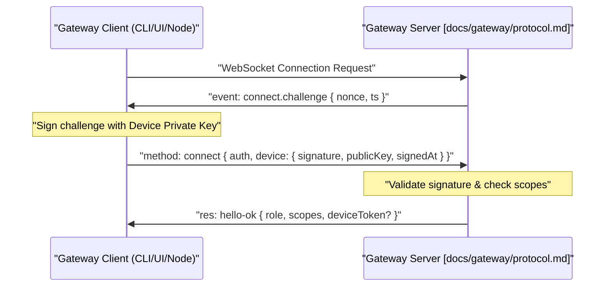
Sources: [docs/gateway/protocol.md:108-169](), [apps/android/app/src/main/java/ai/openclaw/app/gateway/GatewaySession.kt:154-162]()

---

## Authorization Scopes

OpenClaw enforces scope-based access control for Gateway RPC methods. Scopes are defined in a canonical spec table [src/gateway/methods/core-descriptors.ts:39-124]().

| Scope | Purpose | Examples |
| :--- | :--- | :--- |
| `operator.read` | Read-only status, lists, catalog, and logs [docs/gateway/operator-scopes.md:34-34](). | `health`, `config.get`, `status` |
| `operator.write` | Mutating actions: sending messages, invoking tools [docs/gateway/operator-scopes.md:35-35](). | `sessions.create`, `tts.convert` |
| `operator.admin` | Full administrative access; satisfies all `operator.*` scopes [docs/gateway/operator-scopes.md:36-36](). | `config.set`, `channels.start` |
| `operator.pairing` | Device and node pairing management [docs/gateway/operator-scopes.md:37-37](). | `devices.list`, `devices.approve` |
| `operator.approvals` | Exec and plugin approval APIs [docs/gateway/operator-scopes.md:38-38](). | `exec.approval.resolve` |
| `operator.questions` | Interactive question/answer flow [docs/gateway/operator-scopes.md:39-39](). | `question.resolve` |

### Scope Enforcement

Authorization is verified by checking the requested scopes against the `GatewayMethodScope` defined for each RPC handler [src/gateway/methods/core-descriptors.ts:15-15](). If a client lacks the required scope, the Gateway returns a `FORBIDDEN` error with `code: "MISSING_SCOPE"` [docs/gateway/protocol.md:72-76]().

#### Authorization Entity Mapping
```mermaid
classDiagram
    class "CoreGatewayMethodSpecs"["src/gateway/methods/core-descriptors.ts"] {
        +name: string
        +scope: GatewayMethodScope
        +controlPlaneWrite: boolean
    }
    class "GatewayConnectOptions"["apps/android/app/src/main/java/ai/openclaw/app/gateway/GatewaySession.kt"] {
        +role: String
        +scopes: List~String~
    }
    class "SessionMutationAuthorization"["src/gateway/server.sessions.create.test.ts"] {
        +assertCurrent()
    }
    
    "GatewayConnectOptions" ..> "CoreGatewayMethodSpecs" : "validated against"
    "CoreGatewayMethodSpecs" --> "SessionMutationAuthorization" : "triggers check for writes"
```
Sources: [src/gateway/methods/core-descriptors.ts:39-124](), [docs/gateway/operator-scopes.md:32-41](), [docs/gateway/protocol.md:72-87]()

---

## Named Operator Roles

For multi-user or team deployments, the Gateway can bind authenticated user profiles to named roles [docs/gateway/operator-scopes.md:55-57]().

- **Role Definitions**: Roles combine policies for session access (`none`, `view`, `suggest`, `write`), agent availability, and scope ceilings [docs/gateway/operator-scopes.md:62-83]().
- **Ceiling Enforcement**: Reconnecting applies the current role's scope ceiling. If roles are configured, identity-authenticated connections are rejected if they attempt to use non-bound tokens (like bootstrap tokens) [docs/gateway/operator-scopes.md:87-98]().
- **Sandbox Policy**: Roles can enforce `sandbox: "required"`, forcing host execution to be disabled for specific users regardless of agent settings [docs/gateway/operator-scopes.md:122-126]().

Sources: [docs/gateway/operator-scopes.md:55-128]()

---

## Device Pairing and Token Rotation

### Device Pairing
Nodes (iOS/Android/macOS) establish trust through a pairing flow. Identity advertised during `connect` becomes the device row that users must approve [apps/android/app/src/main/java/ai/openclaw/app/gateway/GatewaySession.kt:53-64]().

### Token Rotation
The Gateway issues a `deviceToken` upon successful pairing or connection.
- **Rotation**: Clients should store and provide the most recent `deviceToken` to maintain the session across IP changes or restarts [apps/android/app/src/main/java/ai/openclaw/app/gateway/GatewaySession.kt:176-177]().
- **Invalidation**: Revoking a device in the CLI or Control UI immediately invalidates its tokens, requiring a new pairing flow [docs/gateway/operator-scopes.md:37-37]().

Sources: [apps/android/app/src/main/java/ai/openclaw/app/gateway/GatewaySession.kt:53-64](), [docs/gateway/protocol.md:161-169]()

---

## Rate Limiting and Admission Control

The Gateway protects its control plane using several mechanisms:

- **RPC Concurrency**: Authenticated operator requests share a bounded queue. When exhausted, the Gateway returns a retryable `UNAVAILABLE` error [docs/gateway/protocol.md:65-68]().
- **Admission Control**: The `SessionWorkAdmission` system gates session lifecycle mutations (creation, archiving, etc.) to ensure state consistency during high load [src/gateway/server.sessions.create.test.ts:49-54]().
- **Write Throttling**: Methods marked with `controlPlaneWrite: true` (e.g., `config.apply`) are subject to stricter throttling to prevent configuration corruption [src/gateway/methods/core-descriptors.ts:19-19]().

Sources: [docs/gateway/protocol.md:65-69](), [src/gateway/server.sessions.create.test.ts:49-54](), [src/gateway/methods/core-descriptors.ts:67-68]()

---

## Approvals & Authorization Flow

For high-risk operations, the Gateway requires explicit operator intervention.

1.  **Request**: An agent or tool triggers an approval request (e.g., `exec.approval.request`) [src/gateway/methods/core-descriptors.ts:77-77]().
2.  **Notification**: The Gateway emits events to clients holding the `operator.approvals` scope [docs/gateway/operator-scopes.md:38-38]().
3.  **Resolution**: An authorized operator resolves the request via `exec.approval.resolve` [src/gateway/methods/core-descriptors.ts:79-79]().
4.  **Session Mutation Guard**: Mutating session state (like changing models or archiving) requires a `sessionMutationAuthorization` check [src/gateway/server-methods/sessions-create.ts:109-110]().

#### Approval System Entity Mapping
```mermaid
classDiagram
    class "GatewayRequestHandlers"["src/gateway/server-methods/sessions-create.ts"] {
        +sessionMutationAuthorization
        +sessionMutationCommitGuard
    }
    class "OperatorScopes"["docs/gateway/operator-scopes.md"] {
        +operator.approvals
        +operator.questions
    }
    class "ExecApprovalHandlers"["src/gateway/methods/core-descriptors.ts"] {
        +exec.approval.request
        +exec.approval.resolve
    }
    
    "GatewayRequestHandlers" ..> "OperatorScopes" : "requires for resolution"
    "ExecApprovalHandlers" --> "GatewayRequestHandlers" : "implements handlers"
```

Sources: [src/gateway/server-methods/sessions-create.ts:101-142](), [src/gateway/methods/core-descriptors.ts:71-90](), [docs/gateway/operator-scopes.md:38-39]()

---

# Page: Configuration System

# Configuration System

<details>
<summary>Relevant source files</summary>

The following files were used as context for generating this wiki page:

- [docs/.generated/config-baseline.counts.json](docs/.generated/config-baseline.counts.json)
- [docs/.generated/config-baseline.sha256](docs/.generated/config-baseline.sha256)
- [docs/cli/config.md](docs/cli/config.md)
- [docs/gateway/config-agents.md](docs/gateway/config-agents.md)
- [docs/gateway/config-tools.md](docs/gateway/config-tools.md)
- [docs/gateway/configuration-reference.md](docs/gateway/configuration-reference.md)
- [docs/gateway/configuration.md](docs/gateway/configuration.md)
- [docs/help/environment.md](docs/help/environment.md)
- [docs/reference/session-management-compaction.md](docs/reference/session-management-compaction.md)
- [docs/security/network-proxy.md](docs/security/network-proxy.md)
- [extensions/codex/index.test.ts](extensions/codex/index.test.ts)
- [extensions/codex/index.ts](extensions/codex/index.ts)
- [extensions/codex/src/command-plugins-management.test.ts](extensions/codex/src/command-plugins-management.test.ts)
- [extensions/codex/src/command-plugins-management.ts](extensions/codex/src/command-plugins-management.ts)
- [extensions/qa-lab/src/hook-agent-account-routing.e2e.test.ts](extensions/qa-lab/src/hook-agent-account-routing.e2e.test.ts)
- [extensions/qa-lab/src/live-transports/matrix/substrate/harness.runtime-internals.ts](extensions/qa-lab/src/live-transports/matrix/substrate/harness.runtime-internals.ts)
- [extensions/qa-lab/src/live-transports/matrix/substrate/harness.runtime.test.ts](extensions/qa-lab/src/live-transports/matrix/substrate/harness.runtime.test.ts)
- [src/agents/code-mode.config.test.ts](src/agents/code-mode.config.test.ts)
- [src/cli/config-cli-input.test.ts](src/cli/config-cli-input.test.ts)
- [src/cli/config-cli-input.ts](src/cli/config-cli-input.ts)
- [src/cli/config-cli-path.test.ts](src/cli/config-cli-path.test.ts)
- [src/cli/config-cli-path.ts](src/cli/config-cli-path.ts)
- [src/cli/config-cli-runner.ts](src/cli/config-cli-runner.ts)
- [src/cli/config-cli-validation.ts](src/cli/config-cli-validation.ts)
- [src/cli/config-cli.integration.test-harness.ts](src/cli/config-cli.integration.test-harness.ts)
- [src/cli/config-cli.integration.test.ts](src/cli/config-cli.integration.test.ts)
- [src/cli/config-cli.roster.integration.test.ts](src/cli/config-cli.roster.integration.test.ts)
- [src/cli/config-cli.secrets.integration.test.ts](src/cli/config-cli.secrets.integration.test.ts)
- [src/cli/config-cli.test.ts](src/cli/config-cli.test.ts)
- [src/cli/config-cli.ts](src/cli/config-cli.ts)
- [src/cli/config-model-validation.runtime.test.ts](src/cli/config-model-validation.runtime.test.ts)
- [src/cli/config-model-validation.ts](src/cli/config-model-validation.ts)
- [src/cli/config-set-dryrun.ts](src/cli/config-set-dryrun.ts)
- [src/cli/config-set-input.test.ts](src/cli/config-set-input.test.ts)
- [src/cli/config-set-input.ts](src/cli/config-set-input.ts)
- [src/cli/gateway-cli/pre-bootstrap.ts](src/cli/gateway-cli/pre-bootstrap.ts)
- [src/commands/doctor-startup-migration-refusal.ts](src/commands/doctor-startup-migration-refusal.ts)
- [src/commands/onboard-interactive.test.ts](src/commands/onboard-interactive.test.ts)
- [src/config/__snapshots__/schema.help.quality.test.ts.snap](src/config/__snapshots__/schema.help.quality.test.ts.snap)
- [src/config/bundled-channel-config-metadata.generated.ts](src/config/bundled-channel-config-metadata.generated.ts)
- [src/config/io.read-helpers.ts](src/config/io.read-helpers.ts)
- [src/config/io.write-topology.ts](src/config/io.write-topology.ts)
- [src/config/io.write.ts](src/config/io.write.ts)
- [src/config/legacy.roster.ts](src/config/legacy.roster.ts)
- [src/config/runtime-write-application.ts](src/config/runtime-write-application.ts)
- [src/config/schema.help.agents.ts](src/config/schema.help.agents.ts)
- [src/config/schema.help.automation.ts](src/config/schema.help.automation.ts)
- [src/config/schema.help.core.ts](src/config/schema.help.core.ts)
- [src/config/schema.help.quality.test-fixtures.ts](src/config/schema.help.quality.test-fixtures.ts)
- [src/config/schema.help.runtime.ts](src/config/schema.help.runtime.ts)
- [src/config/schema.hints.test.ts](src/config/schema.hints.test.ts)
- [src/config/schema.hints.ts](src/config/schema.hints.ts)
- [src/config/schema.labels.ts](src/config/schema.labels.ts)
- [src/config/schema.tiers.ts](src/config/schema.tiers.ts)
- [src/config/types.agent-defaults.ts](src/config/types.agent-defaults.ts)
- [src/config/types.base.ts](src/config/types.base.ts)
- [src/config/types.gateway.ts](src/config/types.gateway.ts)
- [src/config/types.openclaw.ts](src/config/types.openclaw.ts)
- [src/config/types.secrets.test.ts](src/config/types.secrets.test.ts)
- [src/config/types.tools.ts](src/config/types.tools.ts)
- [src/config/zod-schema.agent-defaults.test.ts](src/config/zod-schema.agent-defaults.test.ts)
- [src/config/zod-schema.agent-defaults.ts](src/config/zod-schema.agent-defaults.ts)
- [src/config/zod-schema.gateway-auth.test.ts](src/config/zod-schema.gateway-auth.test.ts)
- [src/config/zod-schema.gateway.ts](src/config/zod-schema.gateway.ts)
- [src/config/zod-schema.root-shape.ts](src/config/zod-schema.root-shape.ts)
- [src/daemon/service-managed-env.ts](src/daemon/service-managed-env.ts)
- [src/gateway/auth-rate-limit.ts](src/gateway/auth-rate-limit.ts)
- [src/gateway/config-diff.ts](src/gateway/config-diff.ts)
- [src/gateway/config-reload-plan.ts](src/gateway/config-reload-plan.ts)
- [src/gateway/config-reload.test.ts](src/gateway/config-reload.test.ts)
- [src/gateway/config-reload.ts](src/gateway/config-reload.ts)
- [src/gateway/control-ui-http-utils.ts](src/gateway/control-ui-http-utils.ts)
- [src/gateway/control-ui-routing.test.ts](src/gateway/control-ui-routing.test.ts)
- [src/gateway/control-ui-routing.ts](src/gateway/control-ui-routing.ts)
- [src/gateway/gateway-http-route-contracts.ts](src/gateway/gateway-http-route-contracts.ts)
- [src/gateway/http-media-range.ts](src/gateway/http-media-range.ts)
- [src/gateway/server-http.openai-compat.test.ts](src/gateway/server-http.openai-compat.test.ts)
- [src/gateway/server-http.probe.test.ts](src/gateway/server-http.probe.test.ts)
- [src/gateway/server-http.ts](src/gateway/server-http.ts)
- [src/gateway/server-kernel.test.ts](src/gateway/server-kernel.test.ts)
- [src/gateway/server-methods/config-write-flow.ts](src/gateway/server-methods/config-write-flow.ts)
- [src/gateway/server-methods/config.test.ts](src/gateway/server-methods/config.test.ts)
- [src/gateway/server-methods/config.ts](src/gateway/server-methods/config.ts)
- [src/gateway/server-methods/models-auth-status.types.ts](src/gateway/server-methods/models-auth-status.types.ts)
- [src/gateway/server-runtime-config.ts](src/gateway/server-runtime-config.ts)
- [src/gateway/server-runtime-state-prepare.ts](src/gateway/server-runtime-state-prepare.ts)
- [src/gateway/server-runtime-state.ts](src/gateway/server-runtime-state.ts)
- [src/gateway/server-start.ts](src/gateway/server-start.ts)
- [src/gateway/server.channels-start-outcomes.test.ts](src/gateway/server.channels-start-outcomes.test.ts)
- [src/gateway/server/public-worker-ingress-context.ts](src/gateway/server/public-worker-ingress-context.ts)
- [src/gateway/server/ws-connection-diagnostics.ts](src/gateway/server/ws-connection-diagnostics.ts)
- [src/gateway/system-ca-warmup.test.ts](src/gateway/system-ca-warmup.test.ts)
- [src/gateway/system-ca-warmup.ts](src/gateway/system-ca-warmup.ts)
- [src/infra/dotenv-global.ts](src/infra/dotenv-global.ts)
- [src/infra/shell-env.test.ts](src/infra/shell-env.test.ts)
- [src/infra/shell-env.ts](src/infra/shell-env.ts)
- [ui/src/pages/labs/labs-registry.ts](ui/src/pages/labs/labs-registry.ts)

</details>


The Configuration System provides runtime configuration loading, validation, hot-reload, and management for the OpenClaw gateway and all its subsystems (channels, agents, tools, models, etc.). It reads configuration from `~/.openclaw/openclaw.json` in **JSON5** format [docs/gateway/configuration-reference.md:9-12](), validates it against a strict **Zod schema** [src/config/zod-schema.root-shape.ts:1-50](), resolves secrets, and exposes a runtime snapshot to all gateway components. The system supports programmatic updates via transactional mutations [src/gateway/server-methods/config-write-flow.ts:64-64]() and automatic migration from legacy formats through the `doctor` utility.

For channel-specific configuration patterns, see [Messaging Channels](#4). For agent and model configuration, see [Agent Runtime](#3). For the complete field reference, see [Configuration Reference](#2.3.1).

---

## Architecture Overview

The configuration system operates as a multi-stage pipeline that transforms raw JSON5 files into a validated, resolved runtime snapshot. It integrates core configuration with plugin-provided schemas to create a unified state.

### Configuration Pipeline

Title: Configuration Pipeline
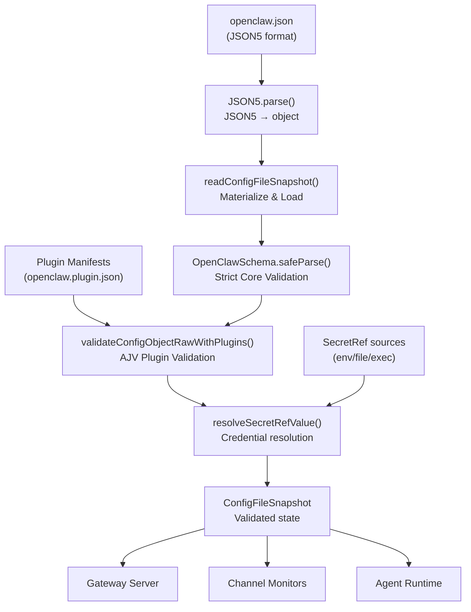
Sources: [docs/gateway/configuration.md:10-12](), [docs/gateway/configuration-reference.md:12-19](), [src/gateway/config-reload.ts:60-63]()

---

## Core Configuration Modules

### Config I/O and Validation

The primary validation engine ensures that every field in the configuration file matches the expected structure. The system uses a hierarchical schema approach where `OpenClawSchema` composes shapes for specific domains like `agents`, `bindings`, and `mcp` [src/cli/config-cli.test.ts:133-172]().

Validation includes strict checks for model catalog behavior, provider definitions, and MCP server configurations [docs/gateway/configuration-reference.md:79-112](). Programmatic mutations via `openclaw config set` or `patch` trigger a `buildGatewayReloadPlan` to determine if a hot-reload or full restart is required [src/gateway/config-reload-plan.ts:51-57]().

### Config Schema Entity Mapping

Title: Config Schema Entity Mapping
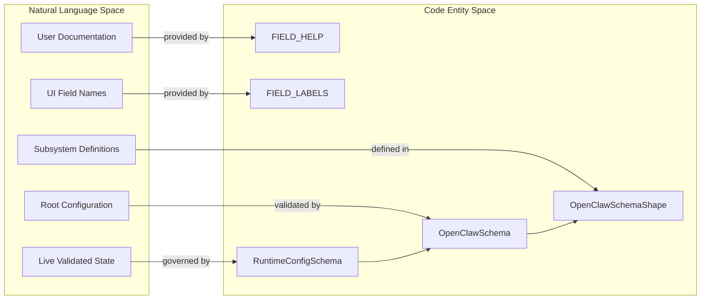

| Function / Variable | Purpose | Location |
|----------|---------|-------------------|
| `OpenClawSchema` | Root Zod schema for the entire core system | [src/cli/config-cli.test.ts:133-134]() |
| `FIELD_HELP` | Composed user-facing help text from subsystem help modules | [src/config/schema.help.runtime.ts:1-10]() |
| `FIELD_LABELS` | User-friendly display names for config keys | [src/config/schema.labels.ts:8-14]() |
| `readConfigFileSnapshotForRuntimeTransaction` | Reads a snapshot of the config file for atomic updates | [src/config/io.ts:21-21]() |
| `buildGatewayReloadPlan` | Analyzes changed paths to determine reload impact | [src/gateway/config-reload-plan.ts:51-53]() |
| `diffConfigPaths` | Compares two config objects to find modified paths | [src/gateway/config-diff.ts:1-20]() |

Sources: [src/config/schema.help.runtime.ts:1-10](), [src/config/schema.labels.ts:1-14](), [src/gateway/config-reload-plan.ts:51-57](), [src/cli/config-cli.test.ts:133-172]()

---

## Configuration Health and Migrations

The configuration system is tightly integrated with the `doctor` subsystem to handle legacy state and environment readiness.

*   **State Migration**: The system automatically migrates legacy formats, such as converting `agent:main:*` session history to named agents during onboarding [docs/gateway/config-agents.md:14-21]().
*   **Session Maintenance**: The system enforces disk budgets (`maxDiskBytes`) and prunes stale session entries based on `pruneAfter` or `maxEntries` limits [docs/reference/session-management-compaction.md:47-56]().
*   **Catalog Refresh**: The `catalogRefresh` utility ensures that model metadata and pricing are kept up-to-date from hosted catalogs [docs/gateway/configuration-reference.md:83-89]().
*   **Secret Auditing**: The system tracks secret references (`SecretRef`) and validates provider/source compatibility during `config validate` [src/cli/config-cli.md:123-128]().

For details on all available config keys, see [Configuration Reference](#2.3.1).

Sources: [docs/gateway/config-agents.md:14-29](), [docs/reference/session-management-compaction.md:45-66](), [docs/gateway/configuration-reference.md:83-106](), [src/cli/config-cli.md:123-128]()

---

## Plugin Configuration Integration

OpenClaw allows plugins to extend the configuration schema. During validation, the system merges core schemas with plugin-provided schemas and metadata.

*   **UI Integration**: Field metadata such as `uiHints` [docs/gateway/configuration-reference.md:20-25]() and presentation tiers [docs/gateway/configuration.md:91-96]() are used by the Control UI to generate dynamic settings forms.
*   **Dynamic Schema Lookup**: The gateway provides `config.schema.lookup` RPC methods for clients to fetch path-scoped schema nodes plus child summaries [docs/gateway/configuration.md:63-65]().
*   **Baseline Validation**: Documentation accuracy is tracked using generated SHA256 baselines of core, channel, and plugin schemas [docs/.generated/config-baseline.sha256:1-4]().

For details on how plugin schemas are built and used by the Control UI, see [Schema Generation & UI Integration](#2.3.2).

Sources: [docs/gateway/configuration-reference.md:16-25](), [docs/gateway/configuration.md:61-72](), [docs/gateway/configuration.md:91-96](), [docs/.generated/config-baseline.sha256:1-4]()

---

## Key Configuration Files

| File | Purpose |
|------|---------|
| `openclaw.json` | Main system configuration (Gateway, Agents, Channels) [docs/gateway/configuration-reference.md:10-10]() |
| `models.json` | Provider definitions and global model-catalog behavior [docs/gateway/configuration-reference.md:75-77]() |
| `auth-profiles.json` | Storage for provider authentication and credentials [docs/gateway/configuration-reference.md:67-67]() |
| `config-baseline.sha256` | Checksum baseline for validating schema surface documentation [docs/.generated/config-baseline.sha256:1-4]() |

Sources: [docs/gateway/configuration-reference.md:9-112](), [docs/.generated/config-baseline.sha256:1-4]()

---

# Page: Configuration Reference

# Configuration Reference

<details>
<summary>Relevant source files</summary>

The following files were used as context for generating this wiki page:

- [docs/.generated/config-baseline.counts.json](docs/.generated/config-baseline.counts.json)
- [docs/.generated/config-baseline.sha256](docs/.generated/config-baseline.sha256)
- [docs/cli/config.md](docs/cli/config.md)
- [docs/gateway/config-agents.md](docs/gateway/config-agents.md)
- [docs/gateway/config-tools.md](docs/gateway/config-tools.md)
- [docs/gateway/configuration-reference.md](docs/gateway/configuration-reference.md)
- [docs/help/environment.md](docs/help/environment.md)
- [docs/reference/session-management-compaction.md](docs/reference/session-management-compaction.md)
- [docs/security/network-proxy.md](docs/security/network-proxy.md)
- [extensions/qa-lab/src/hook-agent-account-routing.e2e.test.ts](extensions/qa-lab/src/hook-agent-account-routing.e2e.test.ts)
- [extensions/qa-lab/src/live-transports/matrix/substrate/harness.runtime-internals.ts](extensions/qa-lab/src/live-transports/matrix/substrate/harness.runtime-internals.ts)
- [extensions/qa-lab/src/live-transports/matrix/substrate/harness.runtime.test.ts](extensions/qa-lab/src/live-transports/matrix/substrate/harness.runtime.test.ts)
- [src/agents/code-mode.config.test.ts](src/agents/code-mode.config.test.ts)
- [src/cli/config-cli-input.test.ts](src/cli/config-cli-input.test.ts)
- [src/cli/config-cli-input.ts](src/cli/config-cli-input.ts)
- [src/cli/config-cli-path.test.ts](src/cli/config-cli-path.test.ts)
- [src/cli/config-cli-path.ts](src/cli/config-cli-path.ts)
- [src/cli/config-cli-runner.ts](src/cli/config-cli-runner.ts)
- [src/cli/config-cli-validation.ts](src/cli/config-cli-validation.ts)
- [src/cli/config-cli.integration.test-harness.ts](src/cli/config-cli.integration.test-harness.ts)
- [src/cli/config-cli.integration.test.ts](src/cli/config-cli.integration.test.ts)
- [src/cli/config-cli.roster.integration.test.ts](src/cli/config-cli.roster.integration.test.ts)
- [src/cli/config-cli.secrets.integration.test.ts](src/cli/config-cli.secrets.integration.test.ts)
- [src/cli/config-cli.test.ts](src/cli/config-cli.test.ts)
- [src/cli/config-cli.ts](src/cli/config-cli.ts)
- [src/cli/config-model-validation.runtime.test.ts](src/cli/config-model-validation.runtime.test.ts)
- [src/cli/config-model-validation.ts](src/cli/config-model-validation.ts)
- [src/cli/config-set-dryrun.ts](src/cli/config-set-dryrun.ts)
- [src/cli/config-set-input.test.ts](src/cli/config-set-input.test.ts)
- [src/cli/config-set-input.ts](src/cli/config-set-input.ts)
- [src/cli/gateway-cli/pre-bootstrap.ts](src/cli/gateway-cli/pre-bootstrap.ts)
- [src/commands/doctor-startup-migration-refusal.ts](src/commands/doctor-startup-migration-refusal.ts)
- [src/config/__snapshots__/schema.help.quality.test.ts.snap](src/config/__snapshots__/schema.help.quality.test.ts.snap)
- [src/config/bundled-channel-config-metadata.generated.ts](src/config/bundled-channel-config-metadata.generated.ts)
- [src/config/io.read-helpers.ts](src/config/io.read-helpers.ts)
- [src/config/io.write-topology.ts](src/config/io.write-topology.ts)
- [src/config/io.write.ts](src/config/io.write.ts)
- [src/config/legacy.roster.ts](src/config/legacy.roster.ts)
- [src/config/schema.help.agents.ts](src/config/schema.help.agents.ts)
- [src/config/schema.help.automation.ts](src/config/schema.help.automation.ts)
- [src/config/schema.help.core.ts](src/config/schema.help.core.ts)
- [src/config/schema.help.quality.test-fixtures.ts](src/config/schema.help.quality.test-fixtures.ts)
- [src/config/schema.help.runtime.ts](src/config/schema.help.runtime.ts)
- [src/config/schema.hints.test.ts](src/config/schema.hints.test.ts)
- [src/config/schema.hints.ts](src/config/schema.hints.ts)
- [src/config/schema.labels.ts](src/config/schema.labels.ts)
- [src/config/schema.tiers.ts](src/config/schema.tiers.ts)
- [src/config/types.agent-defaults.ts](src/config/types.agent-defaults.ts)
- [src/config/types.base.ts](src/config/types.base.ts)
- [src/config/types.gateway.ts](src/config/types.gateway.ts)
- [src/config/types.openclaw.ts](src/config/types.openclaw.ts)
- [src/config/types.secrets.test.ts](src/config/types.secrets.test.ts)
- [src/config/types.tools.ts](src/config/types.tools.ts)
- [src/config/zod-schema.agent-defaults.test.ts](src/config/zod-schema.agent-defaults.test.ts)
- [src/config/zod-schema.agent-defaults.ts](src/config/zod-schema.agent-defaults.ts)
- [src/config/zod-schema.gateway-auth.test.ts](src/config/zod-schema.gateway-auth.test.ts)
- [src/config/zod-schema.gateway.ts](src/config/zod-schema.gateway.ts)
- [src/config/zod-schema.root-shape.ts](src/config/zod-schema.root-shape.ts)
- [src/daemon/service-managed-env.ts](src/daemon/service-managed-env.ts)
- [src/infra/dotenv-global.ts](src/infra/dotenv-global.ts)
- [src/infra/shell-env.test.ts](src/infra/shell-env.test.ts)
- [src/infra/shell-env.ts](src/infra/shell-env.ts)
- [ui/src/pages/labs/labs-registry.ts](ui/src/pages/labs/labs-registry.ts)

</details>


This document provides a comprehensive technical reference for all configuration keys available in `~/.openclaw/openclaw.json`. It covers types, defaults, validation rules, and subsystem effects.

OpenClaw uses a centralized configuration system built on **JSON5** and **Zod**, providing strict type safety while allowing comments and trailing commas in the configuration file [docs/gateway/configuration-reference.md:10-12]().

## Configuration Architecture

The configuration system is organized into a hierarchical structure that separates infrastructure, runtime, and agent-specific settings.

### Top-Level Organization

Title: "OpenClaw Configuration Subsystems"
```mermaid
graph TB
    subgraph Root["Root OpenClawConfig [src/config/types.openclaw.ts]"]
        [ConfigObject]["OpenClawConfig Object"]
    end
    
    subgraph Infrastructure["Core Infrastructure"]
        [Meta]["meta: Version & History"]
        [Env]["env: Shell & Var Injection"]
        [Logging]["logging: Severity & Redaction"]
        [Diagnostics]["diagnostics: OTEL & Tracing"]
        [Update]["update: Auto-update Channels"]
    end
    
    subgraph GatewayIdentity["Gateway & Identity"]
        [Gateway]["gateway: Port, Bind, Mode"]
        [Auth]["auth: Auth Profiles"]
        [Models]["models: Provider Catalog"]
    end
    
    subgraph AgentRuntime["Agent & Tool Runtime"]
        [Agents]["agents: Workspace & Defaults"]
        [Tools]["tools: Policy & Security"]
        [Memory]["memory: Vector & QMD Knobs"]
        [Session]["session: Lifecycle & Maintenance"]
        [CloudWorkers]["cloudWorkers: Ephemeral Runtimes"]
    end
    
    subgraph Messaging["Messaging & Protocol"]
        [Channels]["channels: Platform Config"]
        [Commands]["commands: Slash Commands"]
    end
    
    subgraph Automation["Automation & ACP"]
        [Cron]["cron: Scheduled Jobs"]
        [ACP]["acp: Agent Control Protocol"]
        [MCP]["mcp: Model Context Protocol"]
    end
    
    [ConfigObject] --> Infrastructure
    [ConfigObject] --> GatewayIdentity
    [ConfigObject] --> AgentRuntime
    [ConfigObject] --> Messaging
    [ConfigObject] --> Automation
```
**Sources:** [src/config/schema.labels.ts:8-135](), [docs/gateway/configuration-reference.md:34-140]()

## Schema Validation System

OpenClaw employs a strict validation pipeline. Configuration is validated against a base schema defined in `OpenClawSchemaShape`. The system ensures cross-field integrity, such as ensuring `bindings` refer to valid agent IDs defined in `agents.entries` [src/cli/config-cli.ts:130-140]().

### Zod Schema Pipeline

The configuration loading process handles filesystem state and persistence. During runtime initialization, the system merges defaults and validates cross-field constraints. The `buildRuntimeConfigSchemaFromRegistry` function aggregates these definitions into a live JSON Schema for the Control UI [src/cli/config-cli.ts:137-140]().

Title: "Configuration Loading and Validation Flow"
```mermaid
graph LR
    subgraph Sources["Input Sources"]
        [JSON5]["openclaw.json [JSON5]"]
        [ENV]["Process Env [env.vars]"]
    end
    
    subgraph Logic["Logic [src/config/runtime-schema.ts]"]
        [Zod]["Zod Validation Pipeline"]
        [CoreSchema]["buildRuntimeConfigSchemaFromRegistry"]
    end
    
    subgraph Validation["Subsystem Schemas"]
        [AgentSchema]["AgentDefaultsSchema"]
        [CloudSchema]["CloudWorkerSchema"]
    end
    
    subgraph Output["Output"]
        [Config]["OpenClawConfig Object"]
    end
    
    [JSON5] --> [Zod]
    [ENV] --> [Zod]
    [Zod] --> [CoreSchema]
    [CoreSchema] --> [AgentSchema]
    [CoreSchema] --> [CloudSchema]
    [AgentSchema] --> [Config]
    [CloudSchema] --> [Config]
```
**Sources:** [src/cli/config-cli.ts:130-140](), [src/config/runtime-schema.ts:47]()

### Field Metadata and UI Hints

The system maps internal configuration paths to human-readable labels and help text.

| Metadata Entity | Code Reference | Purpose |
| :--- | :--- | :--- |
| `FIELD_HELP` | [src/config/schema.help.runtime.ts:1-10]() | Aggregated mapping of config paths to descriptive help strings. |
| `FIELD_LABELS` | [src/config/schema.labels.ts:8-130]() | Mapping of config paths to human-readable labels in the Control UI. |
| `BundledChannelConfigMetadata` | [src/config/bundled-channel-config-metadata.generated.ts:3-15]() | Type definition for auto-generated channel configuration metadata. |

## Subsystem Reference

### Agent Defaults & Workspace

The `agents.defaults` section defines the baseline behavior for all agents unless overridden in `agents.entries` [src/config/schema.labels.ts:96-100]().

| Key | Type | Default | Effect |
| :--- | :--- | :--- | :--- |
| `agents.defaults.workspace` | `string` | `~/.openclaw/workspace` | Base directory for agent files [docs/gateway/config-agents.md:32-34](). |
| `agents.defaults.contextInjection` | `enum` | `"always"` | Controls injection of bootstrap files (`always`, `continuation-skip`, `never`) [docs/gateway/config-agents.md:125-130](). |
| `agents.defaults.bootstrapMaxChars` | `number` | `20000` | Max characters per workspace bootstrap file [docs/gateway/config-agents.md:141-143](). |
| `agents.defaults.fastModeDefault` | `boolean` | `false` | Default setting for fast-mode inference [src/config/schema.labels.ts:90-90](). |
| `agents.defaults.cwd` | `string` | `undefined` | Optional working directory for agent reply runs [docs/gateway/config-agents.md:44-48](). |

**Sources:** [docs/gateway/config-agents.md:30-176](), [src/config/schema.labels.ts:76-113]()

### Session & Maintenance

The `session.maintenance` section controls automatic cleanup of SQLite session and transcript rows [docs/reference/session-management-compaction.md:43-46]().

| Key | Type | Default | Effect |
| :--- | :--- | :--- | :--- |
| `session.maintenance.mode` | `enum` | `"enforce"` | Operation mode: `"enforce"` (mutate) or `"warn"` (report only) [docs/reference/session-management-compaction.md:49-49](). |
| `session.maintenance.pruneAfter` | `duration` | `"30d"` | Cutoff age for stale session entries [docs/reference/session-management-compaction.md:50-50](). |
| `session.maintenance.maxDiskBytes` | `bytes` | `10gb` | Per-agent disk budget for sessions [docs/reference/session-management-compaction.md:54-54](). |
| `session.maintenance.highWaterBytes` | `bytes` | 80% | Target usage after cleanup [docs/reference/session-management-compaction.md:55-55](). |

**Sources:** [docs/reference/session-management-compaction.md:43-66]()

### Model Context Protocol (MCP)

Configuration for MCP servers managed by the Gateway [docs/gateway/configuration-reference.md:112-114]().

| Key | Type | Default | Effect |
| :--- | :--- | :--- | :--- |
| `mcp.servers.<name>.command` | `string` | `undefined` | Stdio transport command [docs/gateway/configuration-reference.md:124-124](). |
| `mcp.servers.<name>.url` | `string` | `undefined` | Remote endpoint URL for HTTP-based MCP [docs/gateway/configuration-reference.md:128-128](). |
| `mcp.servers.<name>.transport` | `enum` | `undefined` | Remote protocol: `"streamable-http"` or `"sse"` [docs/gateway/configuration-reference.md:129-129](). |
| `mcp.servers.<name>.auth` | `enum` | `"shared"` | Identity mode: `"shared"` or `"per-requester"` [docs/gateway/configuration-reference.md:136-138](). |

**Sources:** [docs/gateway/configuration-reference.md:112-140]()

### Messaging & Channels

OpenClaw supports multi-platform messaging via a normalized channel architecture. Per-channel config keys live under `channels.*` [docs/gateway/configuration-reference.md:34-36]().

Title: "Channel Configuration to Code Mapping"
```mermaid
graph TD
    subgraph Config["openclaw.json"]
        [ChanCfg]["channels.* [src/config/bundled-channel-config-metadata.generated.ts]"]
    end
    
    subgraph Metadata["Metadata [src/config/bundled-channel-config-metadata.generated.ts]"]
        [DiscordMeta]["Discord: token, accounts[]"]
        [SlackMeta]["Slack: appToken, botToken"]
        [TelegramMeta]["Telegram: botToken"]
    end
    
    subgraph Logic["CLI Runtime [src/cli/config-cli.test.ts]"]
        [SecretReg]["secretTargetRegistryEntries"]
        [Contract]["loadChannelSecretContractApi"]
    end
    
    [ChanCfg] --> [DiscordMeta]
    [ChanCfg] --> [SlackMeta]
    [ChanCfg] --> [TelegramMeta]
    [DiscordMeta] --> [Contract]
    [SlackMeta] --> [Contract]
    [Contract] --> [SecretReg]
```
**Sources:** [src/config/bundled-channel-config-metadata.generated.ts:1-17](), [src/cli/config-cli.test.ts:50-92]()

### Tools & Policy

The `tools.*` section configures global and per-agent tool access [docs/gateway/config-tools.md:11-13]().

| Key | Type | Default | Effect |
| :--- | :--- | :--- | :--- |
| `tools.profile` | `enum` | `undefined` | Base allowlist: `minimal`, `coding`, `messaging`, `full` [docs/gateway/config-tools.md:17-28](). |
| `worktreeRoot` | `string` | `<state>/worktrees` | Global root for managed worktree checkouts [docs/gateway/configuration-reference.md:53-55](). |

**Sources:** [docs/gateway/config-tools.md:15-50](), [docs/gateway/configuration-reference.md:53-63]()

### Infrastructure & Environment

| Key | Type | Default | Effect |
| :--- | :--- | :--- | :--- |
| `env.shellEnv.enabled` | `boolean` | `false` | Import secrets from login shell [src/config/schema.labels.ts:18-19](). |
| `env.vars` | `object` | `{}` | Inline environment variable overrides [src/config/schema.labels.ts:21-21](). |
| `logging.level` | `enum` | `undefined` | Primary log level threshold [src/config/schema.labels.ts:45-45](). |
| `diagnostics.otel.enabled` | `boolean` | `false` | Enables OpenTelemetry tracing [src/config/schema.labels.ts:60-60](). |

**Sources:** [src/config/schema.labels.ts:12-75]()

---

# Page: Schema Generation & UI Integration

# Schema Generation & UI Integration

<details>
<summary>Relevant source files</summary>

The following files were used as context for generating this wiki page:

- [docs/.generated/config-baseline.counts.json](docs/.generated/config-baseline.counts.json)
- [docs/.generated/config-baseline.sha256](docs/.generated/config-baseline.sha256)
- [docs/gateway/config-agents.md](docs/gateway/config-agents.md)
- [docs/gateway/config-tools.md](docs/gateway/config-tools.md)
- [docs/gateway/configuration-reference.md](docs/gateway/configuration-reference.md)
- [docs/gateway/configuration.md](docs/gateway/configuration.md)
- [docs/help/environment.md](docs/help/environment.md)
- [docs/reference/session-management-compaction.md](docs/reference/session-management-compaction.md)
- [docs/security/network-proxy.md](docs/security/network-proxy.md)
- [extensions/codex/index.test.ts](extensions/codex/index.test.ts)
- [extensions/codex/index.ts](extensions/codex/index.ts)
- [extensions/codex/src/command-plugins-management.test.ts](extensions/codex/src/command-plugins-management.test.ts)
- [extensions/codex/src/command-plugins-management.ts](extensions/codex/src/command-plugins-management.ts)
- [extensions/qa-lab/src/hook-agent-account-routing.e2e.test.ts](extensions/qa-lab/src/hook-agent-account-routing.e2e.test.ts)
- [extensions/qa-lab/src/live-transports/matrix/substrate/harness.runtime-internals.ts](extensions/qa-lab/src/live-transports/matrix/substrate/harness.runtime-internals.ts)
- [extensions/qa-lab/src/live-transports/matrix/substrate/harness.runtime.test.ts](extensions/qa-lab/src/live-transports/matrix/substrate/harness.runtime.test.ts)
- [src/agents/code-mode.config.test.ts](src/agents/code-mode.config.test.ts)
- [src/cli/gateway-cli/pre-bootstrap.ts](src/cli/gateway-cli/pre-bootstrap.ts)
- [src/commands/doctor-startup-migration-refusal.ts](src/commands/doctor-startup-migration-refusal.ts)
- [src/commands/onboard-interactive.test.ts](src/commands/onboard-interactive.test.ts)
- [src/config/__snapshots__/schema.help.quality.test.ts.snap](src/config/__snapshots__/schema.help.quality.test.ts.snap)
- [src/config/bundled-channel-config-metadata.generated.ts](src/config/bundled-channel-config-metadata.generated.ts)
- [src/config/runtime-write-application.ts](src/config/runtime-write-application.ts)
- [src/config/schema.help.agents.ts](src/config/schema.help.agents.ts)
- [src/config/schema.help.automation.ts](src/config/schema.help.automation.ts)
- [src/config/schema.help.core.ts](src/config/schema.help.core.ts)
- [src/config/schema.help.quality.test-fixtures.ts](src/config/schema.help.quality.test-fixtures.ts)
- [src/config/schema.help.runtime.ts](src/config/schema.help.runtime.ts)
- [src/config/schema.hints.test.ts](src/config/schema.hints.test.ts)
- [src/config/schema.hints.ts](src/config/schema.hints.ts)
- [src/config/schema.labels.ts](src/config/schema.labels.ts)
- [src/config/schema.tiers.ts](src/config/schema.tiers.ts)
- [src/config/types.agent-defaults.ts](src/config/types.agent-defaults.ts)
- [src/config/types.base.ts](src/config/types.base.ts)
- [src/config/types.gateway.ts](src/config/types.gateway.ts)
- [src/config/types.openclaw.ts](src/config/types.openclaw.ts)
- [src/config/types.secrets.test.ts](src/config/types.secrets.test.ts)
- [src/config/types.tools.ts](src/config/types.tools.ts)
- [src/config/zod-schema.agent-defaults.test.ts](src/config/zod-schema.agent-defaults.test.ts)
- [src/config/zod-schema.agent-defaults.ts](src/config/zod-schema.agent-defaults.ts)
- [src/config/zod-schema.gateway-auth.test.ts](src/config/zod-schema.gateway-auth.test.ts)
- [src/config/zod-schema.gateway.ts](src/config/zod-schema.gateway.ts)
- [src/config/zod-schema.root-shape.ts](src/config/zod-schema.root-shape.ts)
- [src/daemon/service-managed-env.ts](src/daemon/service-managed-env.ts)
- [src/gateway/auth-rate-limit.ts](src/gateway/auth-rate-limit.ts)
- [src/gateway/config-diff.ts](src/gateway/config-diff.ts)
- [src/gateway/config-reload-plan.ts](src/gateway/config-reload-plan.ts)
- [src/gateway/config-reload.test.ts](src/gateway/config-reload.test.ts)
- [src/gateway/config-reload.ts](src/gateway/config-reload.ts)
- [src/gateway/control-ui-http-utils.ts](src/gateway/control-ui-http-utils.ts)
- [src/gateway/control-ui-routing.test.ts](src/gateway/control-ui-routing.test.ts)
- [src/gateway/control-ui-routing.ts](src/gateway/control-ui-routing.ts)
- [src/gateway/gateway-http-route-contracts.ts](src/gateway/gateway-http-route-contracts.ts)
- [src/gateway/http-media-range.ts](src/gateway/http-media-range.ts)
- [src/gateway/server-http.openai-compat.test.ts](src/gateway/server-http.openai-compat.test.ts)
- [src/gateway/server-http.probe.test.ts](src/gateway/server-http.probe.test.ts)
- [src/gateway/server-http.ts](src/gateway/server-http.ts)
- [src/gateway/server-kernel.test.ts](src/gateway/server-kernel.test.ts)
- [src/gateway/server-methods/config-write-flow.ts](src/gateway/server-methods/config-write-flow.ts)
- [src/gateway/server-methods/config.test.ts](src/gateway/server-methods/config.test.ts)
- [src/gateway/server-methods/config.ts](src/gateway/server-methods/config.ts)
- [src/gateway/server-methods/models-auth-status.types.ts](src/gateway/server-methods/models-auth-status.types.ts)
- [src/gateway/server-methods/optional-model-catalog.ts](src/gateway/server-methods/optional-model-catalog.ts)
- [src/gateway/server-methods/sessions-read.test.ts](src/gateway/server-methods/sessions-read.test.ts)
- [src/gateway/server-runtime-config.ts](src/gateway/server-runtime-config.ts)
- [src/gateway/server-runtime-state-prepare.ts](src/gateway/server-runtime-state-prepare.ts)
- [src/gateway/server-runtime-state.ts](src/gateway/server-runtime-state.ts)
- [src/gateway/server-start.ts](src/gateway/server-start.ts)
- [src/gateway/server.channels-start-outcomes.test.ts](src/gateway/server.channels-start-outcomes.test.ts)
- [src/gateway/server/public-worker-ingress-context.ts](src/gateway/server/public-worker-ingress-context.ts)
- [src/gateway/server/ws-connection-diagnostics.ts](src/gateway/server/ws-connection-diagnostics.ts)
- [src/gateway/system-ca-warmup.test.ts](src/gateway/system-ca-warmup.test.ts)
- [src/gateway/system-ca-warmup.ts](src/gateway/system-ca-warmup.ts)
- [src/infra/dotenv-global.ts](src/infra/dotenv-global.ts)
- [src/infra/shell-env.test.ts](src/infra/shell-env.test.ts)
- [src/infra/shell-env.ts](src/infra/shell-env.ts)
- [ui/src/app/settings.preferences.node.test.ts](ui/src/app/settings.preferences.node.test.ts)
- [ui/src/app/settings.ts](ui/src/app/settings.ts)
- [ui/src/components/settings-ui.ts](ui/src/components/settings-ui.ts)
- [ui/src/e2e/appearance-settings-defaults.e2e.test.ts](ui/src/e2e/appearance-settings-defaults.e2e.test.ts)
- [ui/src/e2e/chat-only-model.e2e.test.ts](ui/src/e2e/chat-only-model.e2e.test.ts)
- [ui/src/e2e/model-providers-progressive.e2e.test.ts](ui/src/e2e/model-providers-progressive.e2e.test.ts)
- [ui/src/e2e/model-providers.e2e.test.ts](ui/src/e2e/model-providers.e2e.test.ts)
- [ui/src/i18n/.i18n/raw-copy-baseline.json](ui/src/i18n/.i18n/raw-copy-baseline.json)
- [ui/src/lib/model-catalog-store.test.ts](ui/src/lib/model-catalog-store.test.ts)
- [ui/src/lib/model-catalog-store.ts](ui/src/lib/model-catalog-store.ts)
- [ui/src/pages/config/config-page.test.ts](ui/src/pages/config/config-page.test.ts)
- [ui/src/pages/config/config-page.ts](ui/src/pages/config/config-page.ts)
- [ui/src/pages/config/config-sections.ts](ui/src/pages/config/config-sections.ts)
- [ui/src/pages/config/settings-search.test.ts](ui/src/pages/config/settings-search.test.ts)
- [ui/src/pages/config/settings-search.ts](ui/src/pages/config/settings-search.ts)
- [ui/src/pages/config/settings-targets.test.ts](ui/src/pages/config/settings-targets.test.ts)
- [ui/src/pages/config/settings-targets.ts](ui/src/pages/config/settings-targets.ts)
- [ui/src/pages/config/setup-schema.ts](ui/src/pages/config/setup-schema.ts)
- [ui/src/pages/config/setup.ts](ui/src/pages/config/setup.ts)
- [ui/src/pages/config/view-appearance-preferences.ts](ui/src/pages/config/view-appearance-preferences.ts)
- [ui/src/pages/config/view-navigation.ts](ui/src/pages/config/view-navigation.ts)
- [ui/src/pages/config/view-types.ts](ui/src/pages/config/view-types.ts)
- [ui/src/pages/config/view.browser.test.ts](ui/src/pages/config/view.browser.test.ts)
- [ui/src/pages/config/view.ts](ui/src/pages/config/view.ts)
- [ui/src/pages/labs/labs-registry.ts](ui/src/pages/labs/labs-registry.ts)
- [ui/src/pages/model-providers/default-models-view.ts](ui/src/pages/model-providers/default-models-view.ts)
- [ui/src/pages/model-providers/load.test.ts](ui/src/pages/model-providers/load.test.ts)
- [ui/src/pages/model-providers/load.ts](ui/src/pages/model-providers/load.ts)
- [ui/src/pages/model-providers/model-providers-page.test-support.ts](ui/src/pages/model-providers/model-providers-page.test-support.ts)
- [ui/src/pages/model-providers/model-providers-page.test.ts](ui/src/pages/model-providers/model-providers-page.test.ts)
- [ui/src/pages/model-providers/model-providers-page.ts](ui/src/pages/model-providers/model-providers-page.ts)
- [ui/src/pages/model-providers/model-providers-page.usage.test.ts](ui/src/pages/model-providers/model-providers-page.usage.test.ts)
- [ui/src/pages/model-providers/probe-results.ts](ui/src/pages/model-providers/probe-results.ts)
- [ui/src/pages/model-providers/route.test.ts](ui/src/pages/model-providers/route.test.ts)
- [ui/src/pages/model-providers/route.ts](ui/src/pages/model-providers/route.ts)
- [ui/src/pages/model-providers/supplemental-load.ts](ui/src/pages/model-providers/supplemental-load.ts)
- [ui/src/pages/model-providers/view.test.ts](ui/src/pages/model-providers/view.test.ts)
- [ui/src/pages/model-providers/view.ts](ui/src/pages/model-providers/view.ts)
- [ui/src/styles/channels.css](ui/src/styles/channels.css)
- [ui/src/styles/model-providers.css](ui/src/styles/model-providers.css)
- [ui/src/styles/settings.css](ui/src/styles/settings.css)

</details>


This page explains how OpenClaw builds, caches, and merges configuration schemas with plugin extensions to drive dynamic forms in the Control UI. The system transforms static **Zod** definitions and **TypeBox** schemas into interactive forms with rich metadata for validation and visual rendering.

---

## Schema Generation Pipeline

OpenClaw uses a multi-stage pipeline to convert runtime schemas into structured metadata. This pipeline bridges the gap between static code definitions and the dynamic JSON-based configuration required by the frontend.

### Architecture Overview

The pipeline transforms core configuration definitions (Zod) and plugin-provided schemas into serialized metadata.

```mermaid
graph TD
    subgraph "DefinitionSpace [Code Entities]"
        OpenClawSchema["OpenClawConfig<br/>(src/config/types.openclaw.ts)"]
        FieldHelp["FIELD_HELP<br/>(src/config/schema.help.runtime.ts)"]
        FieldLabels["FIELD_LABELS<br/>(src/config/schema.labels.ts)"]
        FieldHints["UI_HINTS<br/>(src/config/schema.hints.ts)"]
    end

    subgraph "ProcessingSpace [Logic]"
        BundledMetadata["RAW_BUNDLED_CHANNEL_CONFIG_METADATA<br/>(src/config/bundled-channel-config-metadata.generated.ts)"]
        ConfigViewState["ConfigViewState<br/>(ui/src/pages/config/view.ts)"]
        ConfigLookup["config.schema.lookup<br/>(src/gateway/server-methods/config.ts)"]
    end

    subgraph "OutputSpace [UI Integration]"
        ConfigPage["ConfigPage<br/>(ui/src/pages/config/config-page.ts)"]
        ConfigForm["renderConfigForm<br/>(ui/src/components/config-form.ts)"]
        ServerPrefs["resolveServerUiPrefState<br/>(ui/src/app/server-prefs.ts)"]
    end

    OpenClawSchema --> ConfigPage
    FieldHelp --> ConfigPage
    FieldLabels --> ConfigPage
    FieldHints --> ConfigPage
    
    BundledMetadata --> ConfigPage
    ConfigPage --> ConfigViewState
    ConfigViewState --> ConfigForm
    ConfigPage --> ServerPrefs
    ConfigLookup --> ConfigPage
```

**Sources:** [src/config/types.openclaw.ts:1-20](), [src/config/schema.help.runtime.ts:1-15](), [src/config/schema.labels.ts:6-10](), [src/config/schema.hints.ts:1-10](), [ui/src/pages/config/config-page.ts:87-91](), [ui/src/pages/config/view.ts:83-110](), [ui/src/app/server-prefs.ts:23-25](), [src/config/bundled-channel-config-metadata.generated.ts:17-20](), [src/gateway/server-methods/config.ts:1-20]()

---

## JSON Schema & Validation

The core configuration is defined using Zod for runtime validation and strict object enforcement. To ensure performance and cross-platform compatibility, OpenClaw utilizes generated baselines and a unified help registry.

### Base Schema & Field Metadata
The root configuration structure is defined in `src/config/types.openclaw.ts` and validated against the Zod schema [src/config/zod-schema.root-shape.ts:1-10]().

- **Help Text**: The `FIELD_HELP` registry maps configuration paths to user-facing descriptions. Subsystems like `AGENT_FIELD_HELP` and `MODEL_FIELD_HELP` are merged into this runtime registry [src/config/schema.help.runtime.ts:1-15]().
- **Field Labels**: `FIELD_LABELS` provides human-readable titles for configuration keys, ensuring that technical keys like `gateway.port` are presented as "Gateway Port" in the UI [src/config/schema.labels.ts:6-10]().
- **Baselines**: The system maintains SHA-256 hashes of configuration baselines (`core`, `channel`, and `plugin`) in `docs/.generated/config-baseline.sha256` to detect drifts between code and documentation [docs/.generated/config-baseline.sha256:1-4]().
- **Bundled Metadata**: Channel-specific schemas and UI hints are pre-generated into `RAW_BUNDLED_CHANNEL_CONFIG_METADATA` to allow the UI to render forms for offline or non-activated plugins [src/config/bundled-channel-config-metadata.generated.ts:12-17]().

### UI State Management
The Control UI manages configuration state through `ConfigViewState` and the `ConfigPage` controller.
- **View State**: `ConfigViewState` tracks UI-specific metadata like which sensitive paths are revealed, whether the raw JSON view is open, and schema analysis caches [ui/src/pages/config/view.ts:83-91]().
- **Server Preferences**: User-specific UI settings (theme, locale, chat shortcuts) are synchronized via the `ui.prefs` config block. The `resolveServerUiPrefState` function reconciles server-side snapshots with local state [ui/src/app/server-prefs.ts:23-25]().
- **Settings Design**: The UI follows a strict structural pattern: `.settings-page > .settings-section > .settings-group > .settings-row` [ui/src/styles/settings.css:4-10]().

**Sources:** [src/config/schema.help.runtime.ts:1-15](), [src/config/schema.labels.ts:6-10](), [ui/src/pages/config/view.ts:83-91](), [ui/src/app/server-prefs.ts:23-25](), [docs/.generated/config-baseline.sha256:1-4](), [src/config/bundled-channel-config-metadata.generated.ts:12-17](), [ui/src/styles/settings.css:4-10]()

---

## Plugin & UI Integration

Plugins and channels extend the global configuration by providing their own schemas. These are merged into the master schema during the Gateway's startup and reload cycles.

### Advanced Fields & UI Hints
Schema `uiHints` carry a resolved `advanced` boolean for every path [docs/gateway/configuration-reference.md:20-25](). The Control UI uses this to show common fields first and collapse advanced fields per section.
- **UI Control**: The `showAdvancedSettings` property in `UiSettings` toggles the visibility of these fields globally in the interface [ui/src/pages/config/config-page.ts:98-105]().
- **Tier Inheritance**: A path with no declared ancestor is advanced by default [docs/gateway/configuration-reference.md:23-25]().
- **Channel Specifics**: Metadata for bundled channels includes specific `uiHints` and order-based sorting [src/config/bundled-channel-config-metadata.generated.ts:12-15]().

### Dynamic Form Rendering
The Control UI uses a tiered rendering approach:
1. **Specialized Sections**: Pages like `Talk` [ui/src/pages/config/config-page.ts:83-83](), `Memory` [ui/src/pages/config/config-page.ts:75-76](), and `Security` [ui/src/pages/config/config-page.ts:78-78]() use custom renderers for complex interactions.
2. **Config Form**: General configuration is handled by `renderConfigForm`, which builds input controls based on the JSON Schema types [ui/src/pages/config/view.browser.test.ts:6-6]().
3. **Raw Mode**: A JSON5 editor allows direct text-based editing. The UI warms the JSON5 parser via `warmJson5` on page load to ensure responsiveness [ui/src/pages/config/view.browser.test.ts:14-16]().

**Sources:** [docs/gateway/configuration-reference.md:20-25](), [ui/src/pages/config/config-page.ts:75-83](), [ui/src/pages/config/view.browser.test.ts:6-16](), [src/config/bundled-channel-config-metadata.generated.ts:12-15]()

---

## Navigation & Routing

The configuration interface is organized into logical pages defined by `ConfigPageId` [ui/src/pages/config/config-sections.ts:70-70]().

### Section Organization
- **Page Mapping**: `configSectionKeysForPage` maps high-level routes (like `communications` or `infrastructure`) to specific configuration blocks [ui/src/pages/config/config-sections.ts:68-71]().
- **Redirection**: The system handles legacy routes via `MOVED_SECTION_ROUTES`, ensuring old bookmarks for sections like `ai-agents:memory` land on the new `memory` page [ui/src/pages/config/config-page.ts:115-124]().
- **Default Selection**: The `defaultConfigSelection` function ensures that navigating to a top-level settings page activates a sensible default subsection (e.g., `communications` defaults to `messages`) [ui/src/pages/config/config-page.ts:129-149]().

```mermaid
sequenceDiagram
    participant UI as "ConfigPage (ui/src/pages/config/config-page.ts)"
    participant SDK as "GatewayBrowserClient (ui/src/api/gateway.ts)"
    participant GW as "Gateway Server (src/gateway/server-methods/config.ts)"
    participant SCHEMA as "OpenClawSchema (src/config/zod-schema.root-shape.ts)"
    
    UI->>SDK: "RPC: config.schema.lookup({path: 'agents.defaults'})"
    SDK->>GW: "RequestFrame"
    GW->>SCHEMA: "Resolve Zod shape for path"
    SCHEMA-->>GW: "JSON Schema + Metadata"
    GW-->>SDK: "ResponseFrame: Schema Object"
    SDK-->>UI: "Schema Data"
    UI->>UI: "renderConfigForm(schema)"
```

**Sources:** [ui/src/pages/config/config-page.ts:115-149](), [ui/src/pages/config/config-sections.ts:68-71](), [src/gateway/server-methods/config.ts:10-20](), [docs/gateway/configuration-reference.md:16-17]()

---

## Summary of Key Entities

| Entity | Role | Location |
| :--- | :--- | :--- |
| `OpenClawConfig` | Type definition for the entire configuration structure | [src/config/types.openclaw.ts:7]() |
| `FIELD_HELP` | Aggregated registry of user-facing config descriptions | [src/config/schema.help.runtime.ts:8]() |
| `FIELD_LABELS` | Registry of human-readable titles for config keys | [src/config/schema.labels.ts:6]() |
| `ConfigViewState` | UI-side state for tracking form interactions and visibility | [ui/src/pages/config/view.ts:89]() |
| `MOVED_SECTION_ROUTES` | Mapping for handling restructured settings navigation | [ui/src/pages/config/config-page.ts:115]() |
| `configSectionKeysForPage` | Utility to map UI pages to specific config sections | [ui/src/pages/config/config-sections.ts:68]() |
| `RAW_BUNDLED_CHANNEL_CONFIG_METADATA` | Generated JSON schemas for all built-in channel plugins | [src/config/bundled-channel-config-metadata.generated.ts:17]() |

**Sources:** [src/config/types.openclaw.ts:7](), [src/config/schema.help.runtime.ts:8](), [src/config/schema.labels.ts:6](), [ui/src/pages/config/view.ts:89](), [ui/src/pages/config/config-page.ts:115](), [ui/src/pages/config/config-sections.ts:68](), [src/config/bundled-channel-config-metadata.generated.ts:17]()

---

# Page: Session & State Management

# Session & State Management

<details>
<summary>Relevant source files</summary>

The following files were used as context for generating this wiki page:

- [docs/concepts/session.md](docs/concepts/session.md)
- [docs/reference/database-schemas.md](docs/reference/database-schemas.md)
- [extensions/voice-call/doctor-contract-api.ts](extensions/voice-call/doctor-contract-api.ts)
- [packages/gateway-protocol/src/schema/agents-models-skills.test.ts](packages/gateway-protocol/src/schema/agents-models-skills.test.ts)
- [packages/gateway-protocol/src/schema/agents-models-skills.ts](packages/gateway-protocol/src/schema/agents-models-skills.ts)
- [packages/gateway-protocol/src/schema/sessions-row.test.ts](packages/gateway-protocol/src/schema/sessions-row.test.ts)
- [packages/gateway-protocol/src/schema/sessions-row.ts](packages/gateway-protocol/src/schema/sessions-row.ts)
- [packages/memory-host-sdk/src/host/session-files-reset-revision.test.ts](packages/memory-host-sdk/src/host/session-files-reset-revision.test.ts)
- [packages/memory-host-sdk/src/host/session-files.ts](packages/memory-host-sdk/src/host/session-files.ts)
- [src/agents/embedded-agent-runner/transcript-rewrite.test.ts](src/agents/embedded-agent-runner/transcript-rewrite.test.ts)
- [src/auto-reply/reply/session-fork.test.ts](src/auto-reply/reply/session-fork.test.ts)
- [src/auto-reply/reply/session.init-conflict-retry.test.ts](src/auto-reply/reply/session.init-conflict-retry.test.ts)
- [src/commands/doctor-session-delivery-state.test.ts](src/commands/doctor-session-delivery-state.test.ts)
- [src/commands/doctor-session-delivery-state.ts](src/commands/doctor-session-delivery-state.ts)
- [src/commands/doctor-session-incognito-key-repair.test.ts](src/commands/doctor-session-incognito-key-repair.test.ts)
- [src/commands/doctor-session-incognito-key-repair.ts](src/commands/doctor-session-incognito-key-repair.ts)
- [src/commands/doctor-session-sqlite-artifact.ts](src/commands/doctor-session-sqlite-artifact.ts)
- [src/commands/doctor-session-sqlite-migration-run.ts](src/commands/doctor-session-sqlite-migration-run.ts)
- [src/commands/doctor-session-sqlite-readers.ts](src/commands/doctor-session-sqlite-readers.ts)
- [src/commands/doctor-session-sqlite-recover-report.ts](src/commands/doctor-session-sqlite-recover-report.ts)
- [src/commands/doctor-session-sqlite-restore-report.ts](src/commands/doctor-session-sqlite-restore-report.ts)
- [src/commands/doctor-session-sqlite-restore.ts](src/commands/doctor-session-sqlite-restore.ts)
- [src/commands/doctor-session-sqlite-retirement.ts](src/commands/doctor-session-sqlite-retirement.ts)
- [src/commands/doctor-session-sqlite-transcript-readers.test.ts](src/commands/doctor-session-sqlite-transcript-readers.test.ts)
- [src/commands/doctor-session-sqlite-transcript-readers.ts](src/commands/doctor-session-sqlite-transcript-readers.ts)
- [src/commands/doctor-session-sqlite-types.ts](src/commands/doctor-session-sqlite-types.ts)
- [src/commands/doctor-session-sqlite.memory.test.ts](src/commands/doctor-session-sqlite.memory.test.ts)
- [src/commands/doctor-session-sqlite.test.ts](src/commands/doctor-session-sqlite.test.ts)
- [src/commands/doctor-session-sqlite.ts](src/commands/doctor-session-sqlite.ts)
- [src/commands/doctor-session-transcript-headers.test.ts](src/commands/doctor-session-transcript-headers.test.ts)
- [src/commands/doctor-session-transcript-headers.ts](src/commands/doctor-session-transcript-headers.ts)
- [src/commands/doctor-session-transcript-health.memory.test-support.ts](src/commands/doctor-session-transcript-health.memory.test-support.ts)
- [src/commands/doctor-session-transcript-labels.test.ts](src/commands/doctor-session-transcript-labels.test.ts)
- [src/commands/doctor-session-transcript-labels.ts](src/commands/doctor-session-transcript-labels.ts)
- [src/commands/doctor-session-transcripts.test.ts](src/commands/doctor-session-transcripts.test.ts)
- [src/commands/doctor-session-transcripts.ts](src/commands/doctor-session-transcripts.ts)
- [src/commands/doctor-sqlite-maintenance-lock.ts](src/commands/doctor-sqlite-maintenance-lock.ts)
- [src/commands/doctor-state-migrations.test.ts](src/commands/doctor-state-migrations.test.ts)
- [src/commands/doctor.ts](src/commands/doctor.ts)
- [src/config/io.health-state.test.ts](src/config/io.health-state.test.ts)
- [src/config/io.health-state.ts](src/config/io.health-state.ts)
- [src/config/sessions/cleanup-service.ts](src/config/sessions/cleanup-service.ts)
- [src/config/sessions/disk-budget.test.ts](src/config/sessions/disk-budget.test.ts)
- [src/config/sessions/incognito-session-transcript.test.ts](src/config/sessions/incognito-session-transcript.test.ts)
- [src/config/sessions/legacy-main-session-migration-operations.ts](src/config/sessions/legacy-main-session-migration-operations.ts)
- [src/config/sessions/legacy-main-session-migration.contract.ts](src/config/sessions/legacy-main-session-migration.contract.ts)
- [src/config/sessions/legacy-main-session-migration.ledger.test.ts](src/config/sessions/legacy-main-session-migration.ledger.test.ts)
- [src/config/sessions/legacy-main-session-migration.race.test.ts](src/config/sessions/legacy-main-session-migration.race.test.ts)
- [src/config/sessions/legacy-main-session-migration.startup.test.ts](src/config/sessions/legacy-main-session-migration.startup.test.ts)
- [src/config/sessions/legacy-main-session-migration.test.ts](src/config/sessions/legacy-main-session-migration.test.ts)
- [src/config/sessions/legacy-main-session-migration.ts](src/config/sessions/legacy-main-session-migration.ts)
- [src/config/sessions/paths.ts](src/config/sessions/paths.ts)
- [src/config/sessions/session-accessor.conformance.test.ts](src/config/sessions/session-accessor.conformance.test.ts)
- [src/config/sessions/session-accessor.entry-mutation.ts](src/config/sessions/session-accessor.entry-mutation.ts)
- [src/config/sessions/session-accessor.lifecycle-types.ts](src/config/sessions/session-accessor.lifecycle-types.ts)
- [src/config/sessions/session-accessor.reset-boundary-race.test.ts](src/config/sessions/session-accessor.reset-boundary-race.test.ts)
- [src/config/sessions/session-accessor.reset.ts](src/config/sessions/session-accessor.reset.ts)
- [src/config/sessions/session-accessor.sqlite-canonical-repair.ts](src/config/sessions/session-accessor.sqlite-canonical-repair.ts)
- [src/config/sessions/session-accessor.sqlite-cleanup-race.test.ts](src/config/sessions/session-accessor.sqlite-cleanup-race.test.ts)
- [src/config/sessions/session-accessor.sqlite-doctor-rewrite.ts](src/config/sessions/session-accessor.sqlite-doctor-rewrite.ts)
- [src/config/sessions/session-accessor.sqlite-handle-lifecycle.test.ts](src/config/sessions/session-accessor.sqlite-handle-lifecycle.test.ts)
- [src/config/sessions/session-accessor.sqlite-import-stage.ts](src/config/sessions/session-accessor.sqlite-import-stage.ts)
- [src/config/sessions/session-accessor.sqlite-import.test.ts](src/config/sessions/session-accessor.sqlite-import.test.ts)
- [src/config/sessions/session-accessor.sqlite-import.ts](src/config/sessions/session-accessor.sqlite-import.ts)
- [src/config/sessions/session-accessor.sqlite-lifecycle-state.ts](src/config/sessions/session-accessor.sqlite-lifecycle-state.ts)
- [src/config/sessions/session-accessor.sqlite-lifecycle-types.ts](src/config/sessions/session-accessor.sqlite-lifecycle-types.ts)
- [src/config/sessions/session-accessor.sqlite-lifecycle.ts](src/config/sessions/session-accessor.sqlite-lifecycle.ts)
- [src/config/sessions/session-accessor.sqlite-maintenance-candidates.ts](src/config/sessions/session-accessor.sqlite-maintenance-candidates.ts)
- [src/config/sessions/session-accessor.sqlite-maintenance-kick.ts](src/config/sessions/session-accessor.sqlite-maintenance-kick.ts)
- [src/config/sessions/session-accessor.sqlite-maintenance-writer.test.ts](src/config/sessions/session-accessor.sqlite-maintenance-writer.test.ts)
- [src/config/sessions/session-accessor.sqlite-maintenance.ts](src/config/sessions/session-accessor.sqlite-maintenance.ts)
- [src/config/sessions/session-accessor.sqlite-projection.ts](src/config/sessions/session-accessor.sqlite-projection.ts)
- [src/config/sessions/session-accessor.sqlite-read.ts](src/config/sessions/session-accessor.sqlite-read.ts)
- [src/config/sessions/session-accessor.sqlite-scope.ts](src/config/sessions/session-accessor.sqlite-scope.ts)
- [src/config/sessions/session-accessor.sqlite-session-row.ts](src/config/sessions/session-accessor.sqlite-session-row.ts)
- [src/config/sessions/session-accessor.sqlite-title-probes.ts](src/config/sessions/session-accessor.sqlite-title-probes.ts)
- [src/config/sessions/session-accessor.sqlite-transcript-message-append.ts](src/config/sessions/session-accessor.sqlite-transcript-message-append.ts)
- [src/config/sessions/session-accessor.sqlite-transcript-sequences.ts](src/config/sessions/session-accessor.sqlite-transcript-sequences.ts)
- [src/config/sessions/session-accessor.sqlite-transcript-state.ts](src/config/sessions/session-accessor.sqlite-transcript-state.ts)
- [src/config/sessions/session-accessor.sqlite-transcript-store.ts](src/config/sessions/session-accessor.sqlite-transcript-store.ts)
- [src/config/sessions/session-accessor.sqlite-transcript-watermark.ts](src/config/sessions/session-accessor.sqlite-transcript-watermark.ts)
- [src/config/sessions/session-reset-boundary-event.test.ts](src/config/sessions/session-reset-boundary-event.test.ts)
- [src/config/sessions/session-reset-boundary-event.ts](src/config/sessions/session-reset-boundary-event.ts)
- [src/config/sessions/session-sharing-store.test.ts](src/config/sessions/session-sharing-store.test.ts)
- [src/config/sessions/session-sharing-store.ts](src/config/sessions/session-sharing-store.ts)
- [src/config/sessions/session-transcript-context-eligibility.test.ts](src/config/sessions/session-transcript-context-eligibility.test.ts)
- [src/config/sessions/session-transcript-index.ts](src/config/sessions/session-transcript-index.ts)
- [src/config/sessions/session-transcript-reconcile.ts](src/config/sessions/session-transcript-reconcile.ts)
- [src/config/sessions/session-transcript-search.test.ts](src/config/sessions/session-transcript-search.test.ts)
- [src/config/sessions/session-transcript-search.ts](src/config/sessions/session-transcript-search.ts)
- [src/config/sessions/sessions.test.ts](src/config/sessions/sessions.test.ts)
- [src/config/sessions/store-entry-shape.ts](src/config/sessions/store-entry-shape.ts)
- [src/config/sessions/store-maintenance-operations.ts](src/config/sessions/store-maintenance-operations.ts)
- [src/config/sessions/store-maintenance-recent-preservation.test.ts](src/config/sessions/store-maintenance-recent-preservation.test.ts)
- [src/config/sessions/store-maintenance-warning-parity.test.ts](src/config/sessions/store-maintenance-warning-parity.test.ts)
- [src/config/sessions/store-maintenance.ts](src/config/sessions/store-maintenance.ts)
- [src/config/sessions/store.pruning.test.ts](src/config/sessions/store.pruning.test.ts)
- [src/gateway/server-methods/sessions-list-cache.ts](src/gateway/server-methods/sessions-list-cache.ts)
- [src/gateway/server-methods/sessions-read-cache.test.ts](src/gateway/server-methods/sessions-read-cache.test.ts)
- [src/gateway/server-methods/sessions-read.ts](src/gateway/server-methods/sessions-read.ts)
- [src/gateway/server-methods/sessions.dispatch.abandonment.test.ts](src/gateway/server-methods/sessions.dispatch.abandonment.test.ts)
- [src/gateway/server-worker-placement-change-events.ts](src/gateway/server-worker-placement-change-events.ts)
- [src/gateway/server-worker-placement-reconcile-guard.test.ts](src/gateway/server-worker-placement-reconcile-guard.test.ts)
- [src/gateway/server-worker-placement-reconcile-guard.ts](src/gateway/server-worker-placement-reconcile-guard.ts)
- [src/gateway/server-worker-placement-recovery-events.test.ts](src/gateway/server-worker-placement-recovery-events.test.ts)
- [src/gateway/server-worker-placement-startup-cleanup.test.ts](src/gateway/server-worker-placement-startup-cleanup.test.ts)
- [src/gateway/server-worker-placement-startup-maintenance.test.ts](src/gateway/server-worker-placement-startup-maintenance.test.ts)
- [src/gateway/session-automation-index.ts](src/gateway/session-automation-index.ts)
- [src/gateway/session-lifecycle-state.ts](src/gateway/session-lifecycle-state.ts)
- [src/gateway/session-utils-core.ts](src/gateway/session-utils-core.ts)
- [src/gateway/session-utils-list.ts](src/gateway/session-utils-list.ts)
- [src/gateway/session-utils-model.ts](src/gateway/session-utils-model.ts)
- [src/gateway/session-utils-owners.test.ts](src/gateway/session-utils-owners.test.ts)
- [src/gateway/session-utils-projection.ts](src/gateway/session-utils-projection.ts)
- [src/gateway/session-utils-row.ts](src/gateway/session-utils-row.ts)
- [src/gateway/session-utils-search.ts](src/gateway/session-utils-search.ts)
- [src/gateway/session-utils.child-cache-retention.test-support.ts](src/gateway/session-utils.child-cache-retention.test-support.ts)
- [src/gateway/session-utils.child-cache-retention.test.ts](src/gateway/session-utils.child-cache-retention.test.ts)
- [src/gateway/session-utils.perf.test.ts](src/gateway/session-utils.perf.test.ts)
- [src/gateway/session-utils.telegram-recreate.test.ts](src/gateway/session-utils.telegram-recreate.test.ts)
- [src/gateway/session-utils.test.ts](src/gateway/session-utils.test.ts)
- [src/gateway/session-utils.ts](src/gateway/session-utils.ts)
- [src/gateway/session-utils.types.ts](src/gateway/session-utils.types.ts)
- [src/gateway/sessions-resolve.test.ts](src/gateway/sessions-resolve.test.ts)
- [src/gateway/sessions-resolve.ts](src/gateway/sessions-resolve.ts)
- [src/infra/sqlite-schema-contract.test.ts](src/infra/sqlite-schema-contract.test.ts)
- [src/infra/sqlite-schema-contract.ts](src/infra/sqlite-schema-contract.ts)
- [src/infra/sqlite-schema-sql.ts](src/infra/sqlite-schema-sql.ts)
- [src/infra/state-migrations.doctor.ts](src/infra/state-migrations.doctor.ts)
- [src/infra/state-migrations.state-dir.test.ts](src/infra/state-migrations.state-dir.test.ts)
- [src/infra/state-migrations.state-dir.ts](src/infra/state-migrations.state-dir.ts)
- [src/infra/state-migrations.test.ts](src/infra/state-migrations.test.ts)
- [src/node-host/node-worker-launch-store.test.ts](src/node-host/node-worker-launch-store.test.ts)
- [src/plugin-sdk/session-store-runtime.test.ts](src/plugin-sdk/session-store-runtime.test.ts)
- [src/plugin-state/plugin-state-store.schema.test.ts](src/plugin-state/plugin-state-store.schema.test.ts)
- [src/sessions/session-lifecycle-events.test.ts](src/sessions/session-lifecycle-events.test.ts)
- [src/sessions/session-lifecycle-events.ts](src/sessions/session-lifecycle-events.ts)
- [src/shared/session-types.ts](src/shared/session-types.ts)
- [src/state/openclaw-database-maintenance.test.ts](src/state/openclaw-database-maintenance.test.ts)
- [src/state/openclaw-database-preflight.test.ts](src/state/openclaw-database-preflight.test.ts)
- [src/state/openclaw-database-preflight.ts](src/state/openclaw-database-preflight.ts)
- [src/state/openclaw-state-db-additive-columns.ts](src/state/openclaw-state-db-additive-columns.ts)
- [src/state/openclaw-state-db-contract.ts](src/state/openclaw-state-db-contract.ts)
- [src/state/openclaw-state-db-first-use-column-strict-migration.test.ts](src/state/openclaw-state-db-first-use-column-strict-migration.test.ts)
- [src/state/openclaw-state-db-maintenance.ts](src/state/openclaw-state-db-maintenance.ts)
- [src/state/openclaw-state-db-schema-additive.ts](src/state/openclaw-state-db-schema-additive.ts)
- [src/state/openclaw-state-db-schema-repair.ts](src/state/openclaw-state-db-schema-repair.ts)
- [src/state/openclaw-state-db.generated.d.ts](src/state/openclaw-state-db.generated.d.ts)
- [src/state/openclaw-state-db.paths.ts](src/state/openclaw-state-db.paths.ts)
- [src/state/openclaw-state-db.test.ts](src/state/openclaw-state-db.test.ts)
- [src/state/openclaw-state-db.ts](src/state/openclaw-state-db.ts)
- [src/state/openclaw-state-schema-compatibility.ts](src/state/openclaw-state-schema-compatibility.ts)
- [src/state/openclaw-state-schema.sql](src/state/openclaw-state-schema.sql)
- [src/state/user-profile-events.ts](src/state/user-profile-events.ts)
- [test/scripts/doctor-config-preflight-plugin-index.built-cli.e2e.test.ts](test/scripts/doctor-config-preflight-plugin-index.built-cli.e2e.test.ts)

</details>


OpenClaw implements a multi-layered state management system designed for agent isolation, conversation continuity, and structural durability. It manages state across shared global databases, agent-specific databases, and session-specific transcript files.

---

## Session Scoping Models

OpenClaw supports multiple session scoping strategies to control conversation isolation. The scoping model determines whether conversations are shared across channels or isolated per sender.

### Scoping Modes

| Mode | Behavior | Use Case |
|------|----------|----------|
| `main` | Single shared session across all channels and peers | Single-user, personal assistant |
| `per-sender` | One session per sender, shared across channels | Multi-user, channel-agnostic identity |
| `global` | Shared session across a specific boundary | Organizational shared state |
| `subagent` | Isolated session for sub-agent task execution | Autonomous agent task isolation |

The system identifies sessions using a `sessionKey`. The Gateway distinguishes between persistent user sessions and synthetic runtime sessions like `cron`, `subagent`, or `acp` (Agent Control Protocol). Keys are parsed and categorized using utility functions like `resolveSessionStoreKey` and `resolveSessionStoreAgentId` [src/gateway/session-store-key.ts:3-38]().

### Session Key Resolution
The system resolves a unique `sessionKey` for every inbound message. This key typically follows patterns such as `agent:<agentId>:<id>` or `cron:<agentId>:<jobId>`.

**Code Entity Space: Session Key Resolution**
```mermaid
graph TD
    subgraph "NaturalLanguageSpace"
        Msg["Inbound Message"]
    end

    subgraph "CodeEntitySpace"
        resolveSessionKey["resolveSessionStoreKey({cfg, sessionKey})"]
        normalizeAgentId["normalizeAgentId(id)"]
        resolveAgentId["resolveSessionStoreAgentId(key)"]
        parseKey["parseAgentSessionKey(key)"]
        
        Msg --> resolveSessionKey
        resolveSessionKey --> normalizeAgentId
        normalizeAgentId --> resolveAgentId
        Msg --> parseKey
    end
    
    subgraph "Logic"
        ResolveOwner["Resolve Owner Agent"]
        CheckLegacy["Check Legacy Auth Compatibility"]
    end

    resolveSessionKey --- ResolveOwner
    resolveAgentId --- CheckLegacy
```
Sources: [src/gateway/session-store-key.ts:3-38](), [src/routing/session-key.ts:33-34](), [src/gateway/session-utils.test.ts:77-89]()

---

## Session Storage

OpenClaw persists sessions in two distinct layers: a transcript-based file store and a SQLite-based state database.

### 1. Transcript Storage (JSONL & SQLite)
OpenClaw historically stored conversation history in `.jsonl` files but has transitioned to a SQLite-backed transcript system for improved performance and indexing.
- **Metadata Store:** Maps `sessionKey` to a `SessionEntry` containing UUIDs and timestamps [src/gateway/session-utils.test.ts:108-119]().
- **Transcript Events:** conversation history, tool calls, and metadata are stored in the `transcript_events` table within agent-specific databases [src/config/sessions/session-accessor.sqlite-transcript-store.ts:67-80]().
- **Access API:** The `session-accessor.ts` barrel provides a storage-neutral API to interact with these records, including functions like `loadSessionEntry` and `appendTranscriptEvent` [src/config/sessions/session-accessor.conformance.test.ts:28-53]().

### 2. SQLite State Databases
OpenClaw utilizes SQLite for shared and agent-scoped state, managed via `node:sqlite` [src/state/openclaw-state-db.ts:10-12]().
- **Global State (`openclaw.sqlite`):** Manages shared state like `mcp_oauth_stores`, `audit_events`, and `skill_usage` [src/state/openclaw-state-schema.sql:3-183](). It uses a `STRICT` schema for durability [src/state/openclaw-state-db.ts:31-31]().
- **Agent State (`agent.sqlite`):** Each agent has a private SQLite database for agent-scoped runtime state, memory indexes, and session metadata [src/state/openclaw-agent-db.ts:33-37]().
- **Migrations:** Both databases include automated schema migration systems [src/state/openclaw-state-db.ts:59-91](), [src/state/openclaw-agent-db.ts:44-59]().

Sources: [src/config/sessions/session-accessor.sqlite-transcript-store.ts:67-80](), [src/state/openclaw-state-db.ts:1-56](), [src/state/openclaw-state-schema.sql:1-213](), [src/state/openclaw-agent-db.ts:1-96]()

---

## State Directory Organization

OpenClaw organizes state to ensure agent isolation and path predictability.

```text
~/.openclaw/
├── state/
│   └── openclaw.sqlite     # Shared state database [src/state/openclaw-state-db.ts:65-65]()
└── agents/
    └── {agentId}/          # Agent-specific isolation
        ├── agent.sqlite    # Agent-scoped database [src/state/openclaw-agent-db.ts:36-36]()
        └── sessions/       # Session storage directory
            └── {id}.jsonl  # Legacy transcript (if not yet migrated) [src/commands/doctor-session-sqlite-readers.ts:66-77]()
```

Sources: [src/state/openclaw-state-db.ts:65-65](), [src/state/openclaw-agent-db.ts:36-36](), [src/commands/doctor-session-sqlite-readers.ts:66-77]()

---

## Session Lifecycle & Maintenance

### Accessor Boundary & Migration
OpenClaw enforces a strict boundary for session access via `session-accessor.ts`. This allows the system to transition from legacy JSONL files to SQLite without breaking callers.
- **SQLite Projection:** The system uses `applySessionStoreProjection` to apply whole-store changes under a SQLite writer lock [src/config/sessions/session-accessor.sqlite-projection.ts:118-129]().
- **Doctor & Repair:** The `runDoctorSessionSqlite` command handles the complex process of importing legacy `.jsonl` transcripts into the new SQLite schema [src/commands/doctor-session-sqlite.ts:115-151]().

### Initialization & Transactions
When a session is accessed or updated, the system uses specific transaction wrappers to ensure atomicity:
- **State Transactions:** `runOpenClawStateWriteTransaction` handles writes to the shared database [src/state/openclaw-state-db.ts:62-62]().
- **Transcript Appends:** `appendTranscriptEventInTransaction` ensures conversation updates are atomic within the agent database [src/config/sessions/session-accessor.sqlite-transcript-store.ts:108-115]().

**Code Entity Space: Lifecycle Implementation**
```mermaid
sequenceDiagram
    participant C as "Gateway/Runtime"
    participant SA as "session-accessor.ts"
    participant STS as "session-accessor.sqlite-transcript-store.ts"
    participant ADB as "openclaw-agent-db.ts"
    participant SQ as "SQLite (DatabaseSync)"

    C->>SA: "appendTranscriptEvent(scope, event)"
    SA->>STS: "appendTranscriptEventInTransaction(db, scope, event)"
    STS->>ADB: "openOpenClawAgentDatabase(options)"
    ADB->>SQ: "PRAGMA busy_timeout"
    STS->>SQ: "INSERT INTO transcript_events"
    SQ-->>C: "Success"
```
Sources: [src/config/sessions/session-accessor.conformance.test.ts:113-113](), [src/config/sessions/session-accessor.sqlite-transcript-store.ts:108-115](), [src/state/openclaw-state-db.ts:51-54](), [src/config/sessions/session-accessor.sqlite-transcript-store.ts:67-79]()

### Maintenance & Health
- **Integrity Checks:** The system performs SQLite integrity scans via `confirmOpenClawStateDatabaseIntegrity` [src/state/openclaw-state-db.ts:124-130]().
- **List Caching:** To maintain performance, session lists are cached and invalidated using a "fence" mechanism that tracks database generations and mutation versions [src/gateway/server-methods/sessions-list-cache.ts:24-40]().
- **Migration Recovery:** The `recoverDoctorSessionSqliteTargets` function identifies and repairs failed migration attempts, ensuring no data is lost during the transition to SQLite [src/commands/doctor-session-sqlite.ts:138-145]().

Sources: [src/state/openclaw-state-db.ts:124-130](), [src/gateway/server-methods/sessions-list-cache.ts:24-40](), [src/commands/doctor-session-sqlite.ts:138-145]()

---

# Page: Multi-Agent Routing

# Multi-Agent Routing

<details>
<summary>Relevant source files</summary>

The following files were used as context for generating this wiki page:

- [docs/concepts/multi-agent.md](docs/concepts/multi-agent.md)
- [docs/gateway/doctor.md](docs/gateway/doctor.md)
- [extensions/discord/src/monitor/thread-title.generate.test.ts](extensions/discord/src/monitor/thread-title.generate.test.ts)
- [extensions/discord/src/monitor/thread-title.ts](extensions/discord/src/monitor/thread-title.ts)
- [extensions/telegram/src/account-selection.ts](extensions/telegram/src/account-selection.ts)
- [extensions/telegram/src/accounts.test.ts](extensions/telegram/src/accounts.test.ts)
- [extensions/telegram/src/auto-topic-label-config.ts](extensions/telegram/src/auto-topic-label-config.ts)
- [extensions/telegram/src/auto-topic-label.test.ts](extensions/telegram/src/auto-topic-label.test.ts)
- [extensions/telegram/src/conversation-route.ts](extensions/telegram/src/conversation-route.ts)
- [packages/gateway-protocol/src/schema/agents-models-skills.test.ts](packages/gateway-protocol/src/schema/agents-models-skills.test.ts)
- [packages/gateway-protocol/src/schema/agents-models-skills.ts](packages/gateway-protocol/src/schema/agents-models-skills.ts)
- [packages/gateway-protocol/src/schema/sessions-row.test.ts](packages/gateway-protocol/src/schema/sessions-row.test.ts)
- [packages/gateway-protocol/src/schema/sessions-row.ts](packages/gateway-protocol/src/schema/sessions-row.ts)
- [src/auto-reply/reply/commands-session-cost.runtime.ts](src/auto-reply/reply/commands-session-cost.runtime.ts)
- [src/auto-reply/reply/commands-session-restart.test.ts](src/auto-reply/reply/commands-session-restart.test.ts)
- [src/auto-reply/reply/commands-session.ts](src/auto-reply/reply/commands-session.ts)
- [src/auto-reply/reply/session-fork.ts](src/auto-reply/reply/session-fork.ts)
- [src/commands/doctor-config-flow.canvas-migration.test.ts](src/commands/doctor-config-flow.canvas-migration.test.ts)
- [src/commands/doctor-config-flow.gateway-bind-persistence.test.ts](src/commands/doctor-config-flow.gateway-bind-persistence.test.ts)
- [src/commands/doctor-config-flow.legacy-composition.test.ts](src/commands/doctor-config-flow.legacy-composition.test.ts)
- [src/commands/doctor-config-flow.missing-default-account-bindings.integration.test.ts](src/commands/doctor-config-flow.missing-default-account-bindings.integration.test.ts)
- [src/commands/doctor-config-flow.test-support.ts](src/commands/doctor-config-flow.test-support.ts)
- [src/commands/doctor-config-flow.test.ts](src/commands/doctor-config-flow.test.ts)
- [src/commands/doctor-config-flow.ts](src/commands/doctor-config-flow.ts)
- [src/commands/doctor-config-flow.validation-refusal.test.ts](src/commands/doctor-config-flow.validation-refusal.test.ts)
- [src/commands/doctor-config-flow.workspace-persistence.test.ts](src/commands/doctor-config-flow.workspace-persistence.test.ts)
- [src/commands/doctor-model-metadata-corruption.persistence.test.ts](src/commands/doctor-model-metadata-corruption.persistence.test.ts)
- [src/commands/doctor/shared/config-flow-steps.test.ts](src/commands/doctor/shared/config-flow-steps.test.ts)
- [src/commands/doctor/shared/config-flow-steps.ts](src/commands/doctor/shared/config-flow-steps.ts)
- [src/commands/doctor/shared/legacy-config-binding-repair.ts](src/commands/doctor/shared/legacy-config-binding-repair.ts)
- [src/commands/doctor/shared/legacy-config-migrations.runtime.models.catalog.ts](src/commands/doctor/shared/legacy-config-migrations.runtime.models.catalog.ts)
- [src/commands/doctor/shared/model-metadata-corruption-repair.test.ts](src/commands/doctor/shared/model-metadata-corruption-repair.test.ts)
- [src/commands/doctor/shared/model-metadata-corruption-repair.ts](src/commands/doctor/shared/model-metadata-corruption-repair.ts)
- [src/config/io.audit.test.ts](src/config/io.audit.test.ts)
- [src/config/io.audit.ts](src/config/io.audit.ts)
- [src/config/io.meta.test.ts](src/config/io.meta.test.ts)
- [src/config/io.meta.ts](src/config/io.meta.ts)
- [src/config/io.types.ts](src/config/io.types.ts)
- [src/config/redact-argv.ts](src/config/redact-argv.ts)
- [src/config/sessions/session-accessor.lifecycle.ts](src/config/sessions/session-accessor.lifecycle.ts)
- [src/config/sessions/session-accessor.parent-fork.test.ts](src/config/sessions/session-accessor.parent-fork.test.ts)
- [src/config/sessions/session-accessor.recovery.test.ts](src/config/sessions/session-accessor.recovery.test.ts)
- [src/config/sessions/session-accessor.sqlite-batch-projection.ts](src/config/sessions/session-accessor.sqlite-batch-projection.ts)
- [src/config/sessions/session-accessor.sqlite-parent-fork.ts](src/config/sessions/session-accessor.sqlite-parent-fork.ts)
- [src/config/sessions/session-accessor.sqlite-parent-session.ts](src/config/sessions/session-accessor.sqlite-parent-session.ts)
- [src/config/sessions/session-accessor.sqlite-recovery.ts](src/config/sessions/session-accessor.sqlite-recovery.ts)
- [src/config/sessions/session-accessor.sqlite-replacement-projection.test.ts](src/config/sessions/session-accessor.sqlite-replacement-projection.test.ts)
- [src/config/sessions/session-accessor.sqlite-replacement-projection.ts](src/config/sessions/session-accessor.sqlite-replacement-projection.ts)
- [src/gateway/dashboard-session-title.test.ts](src/gateway/dashboard-session-title.test.ts)
- [src/gateway/dashboard-session-title.ts](src/gateway/dashboard-session-title.ts)
- [src/gateway/server-methods.authorization.test.ts](src/gateway/server-methods.authorization.test.ts)
- [src/gateway/server-methods/session-create-root.test.ts](src/gateway/server-methods/session-create-root.test.ts)
- [src/gateway/server-methods/session-create-root.ts](src/gateway/server-methods/session-create-root.ts)
- [src/gateway/server-methods/sessions-create.ts](src/gateway/server-methods/sessions-create.ts)
- [src/gateway/server-methods/sessions-delete.ts](src/gateway/server-methods/sessions-delete.ts)
- [src/gateway/server-methods/sessions-lifecycle-drain.ts](src/gateway/server-methods/sessions-lifecycle-drain.ts)
- [src/gateway/server-methods/sessions-list-cache.ts](src/gateway/server-methods/sessions-list-cache.ts)
- [src/gateway/server-methods/sessions-mutations.archive-attribution.test.ts](src/gateway/server-methods/sessions-mutations.archive-attribution.test.ts)
- [src/gateway/server-methods/sessions-mutations.owner.test.ts](src/gateway/server-methods/sessions-mutations.owner.test.ts)
- [src/gateway/server-methods/sessions-mutations.perf.test.ts](src/gateway/server-methods/sessions-mutations.perf.test.ts)
- [src/gateway/server-methods/sessions-patch-archive.ts](src/gateway/server-methods/sessions-patch-archive.ts)
- [src/gateway/server-methods/sessions-patch-engine.ts](src/gateway/server-methods/sessions-patch-engine.ts)
- [src/gateway/server-methods/sessions-read-cache.test.ts](src/gateway/server-methods/sessions-read-cache.test.ts)
- [src/gateway/server-methods/sessions-read.ts](src/gateway/server-methods/sessions-read.ts)
- [src/gateway/server-methods/sessions-recover.ts](src/gateway/server-methods/sessions-recover.ts)
- [src/gateway/server.sessions.archive-lifecycle.test.ts](src/gateway/server.sessions.archive-lifecycle.test.ts)
- [src/gateway/server.sessions.archive-worker-placement.test.ts](src/gateway/server.sessions.archive-worker-placement.test.ts)
- [src/gateway/server.sessions.create.projects.test.ts](src/gateway/server.sessions.create.projects.test.ts)
- [src/gateway/server.sessions.create.test.ts](src/gateway/server.sessions.create.test.ts)
- [src/gateway/server.sessions.delete-lifecycle.test.ts](src/gateway/server.sessions.delete-lifecycle.test.ts)
- [src/gateway/server.sessions.delete-worktree-lifecycle.test.ts](src/gateway/server.sessions.delete-worktree-lifecycle.test.ts)
- [src/gateway/server.sessions.exec-binding-rpc.test.ts](src/gateway/server.sessions.exec-binding-rpc.test.ts)
- [src/gateway/server.sessions.permission-root.test.ts](src/gateway/server.sessions.permission-root.test.ts)
- [src/gateway/server.sessions.recover.test.ts](src/gateway/server.sessions.recover.test.ts)
- [src/gateway/server.sessions.recovery-order.test.ts](src/gateway/server.sessions.recovery-order.test.ts)
- [src/gateway/server.sessions.worker-placement-order.test.ts](src/gateway/server.sessions.worker-placement-order.test.ts)
- [src/gateway/session-automation-index.ts](src/gateway/session-automation-index.ts)
- [src/gateway/session-create-service.ts](src/gateway/session-create-service.ts)
- [src/gateway/session-lifecycle-state.ts](src/gateway/session-lifecycle-state.ts)
- [src/gateway/session-recovery-service.ts](src/gateway/session-recovery-service.ts)
- [src/gateway/session-utils-core.ts](src/gateway/session-utils-core.ts)
- [src/gateway/session-utils-list.ts](src/gateway/session-utils-list.ts)
- [src/gateway/session-utils-model.ts](src/gateway/session-utils-model.ts)
- [src/gateway/session-utils-owners.test.ts](src/gateway/session-utils-owners.test.ts)
- [src/gateway/session-utils-projection.ts](src/gateway/session-utils-projection.ts)
- [src/gateway/session-utils-row.ts](src/gateway/session-utils-row.ts)
- [src/gateway/session-utils-search.ts](src/gateway/session-utils-search.ts)
- [src/gateway/session-utils.child-cache-retention.test-support.ts](src/gateway/session-utils.child-cache-retention.test-support.ts)
- [src/gateway/session-utils.child-cache-retention.test.ts](src/gateway/session-utils.child-cache-retention.test.ts)
- [src/gateway/session-utils.perf.test.ts](src/gateway/session-utils.perf.test.ts)
- [src/gateway/session-utils.telegram-recreate.test.ts](src/gateway/session-utils.telegram-recreate.test.ts)
- [src/gateway/session-utils.test.ts](src/gateway/session-utils.test.ts)
- [src/gateway/session-utils.ts](src/gateway/session-utils.ts)
- [src/gateway/session-utils.types.ts](src/gateway/session-utils.types.ts)
- [src/gateway/sessions-patch.test.ts](src/gateway/sessions-patch.test.ts)
- [src/gateway/sessions-patch.ts](src/gateway/sessions-patch.ts)
- [src/gateway/sessions-resolve.test.ts](src/gateway/sessions-resolve.test.ts)
- [src/gateway/sessions-resolve.ts](src/gateway/sessions-resolve.ts)
- [src/gateway/test/server-sessions.test-helpers.ts](src/gateway/test/server-sessions.test-helpers.ts)
- [src/gateway/worker-environments/placement-dispatch-authority.test.ts](src/gateway/worker-environments/placement-dispatch-authority.test.ts)
- [src/routing/resolve-route.test.ts](src/routing/resolve-route.test.ts)
- [src/routing/resolve-route.ts](src/routing/resolve-route.ts)
- [src/routing/session-key.ts](src/routing/session-key.ts)
- [src/security/audit-channel-dm-policy.test.ts](src/security/audit-channel-dm-policy.test.ts)
- [src/security/audit-channel.ts](src/security/audit-channel.ts)
- [src/sessions/session-lifecycle-events.test.ts](src/sessions/session-lifecycle-events.test.ts)
- [src/sessions/session-lifecycle-events.ts](src/sessions/session-lifecycle-events.ts)
- [src/shared/session-types.ts](src/shared/session-types.ts)
- [src/state/user-profile-events.ts](src/state/user-profile-events.ts)
- [src/tui/embedded-backend.test.ts](src/tui/embedded-backend.test.ts)
- [src/tui/embedded-backend.ts](src/tui/embedded-backend.ts)
- [src/tui/embedded-prepared-runtime.test.ts](src/tui/embedded-prepared-runtime.test.ts)
- [src/tui/embedded-prepared-runtime.ts](src/tui/embedded-prepared-runtime.ts)
- [src/tui/tui-backend.ts](src/tui/tui-backend.ts)

</details>


## Purpose and Scope

This document explains the OpenClaw Gateway's multi-agent routing system, which allows a single process to host multiple isolated AI assistants. Each agent operates within its own isolated workspace, maintains independent session history, and utilizes its own set of authentication profiles and model configurations [src/gateway/session-create-service:17-32](). Routing is handled by a deterministic mechanism that maps inbound messages from messaging channels to the appropriate agent based on configurable bindings and session keys [src/routing/session-key:61-71]().

---

## Agent Isolation Model

Each agent in the Gateway is a distinct logical entity with its own filesystem resources. Isolation ensures that tools, memory, and credentials used by one agent do not leak into another.

| Resource | Path Pattern | Purpose |
|----------|-------------|---------|
| **Workspace** | `<state-dir>/workspace/<agentId>` | Filesystem context for tools and local skills. Resolved via `resolveAgentWorkspaceDir` [src/gateway/server-methods/sessions-create:12-12](). |
| **Agent State** | `<state-dir>/agents/<agentId>/` | Agent-specific configuration including `auth-profiles.json` and `models.json`. Resolved via `resolveAgentDir` [src/gateway/session-create-service:18-18](). |
| **Session Store** | `.../agent/openclaw-agent.sqlite` | Per-agent SQLite database containing session metadata and transcript events [src/gateway/server.sessions.create.test:58-62](). |
| **Incognito Store** | `.../incognito/openclaw-agent.sqlite` | Ephemeral or temporary session storage resolved via `resolveIncognitoOpenClawAgentSqlitePath` [src/gateway/server.sessions.create.test:61-61](). |

### Agent Resource Mapping
The diagram below shows how the Gateway maps logical Agent IDs to physical filesystem entities and runtime state via the session creation and routing services.

Title: Agent Isolation and Resource Mapping
```mermaid
graph TB
    subgraph "Gateway_Core[Gateway Runtime]"
        Ingress["sessionCreateHandlers<br/>(src/gateway/server-methods/sessions-create.ts)"]
        Router["resolveGatewaySessionStoreTarget<br/>(src/gateway/session-utils-store-lookup.ts)"]
    end
    
    subgraph "Agent_Fleet[Multi-Agent Fleet]"
        subgraph "Agent_Main[Agent: 'main']"
            Workspace1["resolveAgentWorkspaceDir<br/>(src/agents/agent-scope.ts)"]
            DB1["openclaw-agent.sqlite<br/>(src/state/openclaw-agent-db.ts)"]
            Sessions1["SessionEntry<br/>(src/config/sessions.ts)"]
        end
        
        subgraph "Agent_Work[Agent: 'work']"
            Workspace2["resolveAgentWorkspaceDir<br/>(src/agents/agent-scope.ts)"]
            DB2["openclaw-agent.sqlite<br/>(src/state/openclaw-agent-db.ts)"]
            Sessions2["SessionEntry<br/>(src/config/sessions.ts)"]
        end
    end
    
    Ingress -- "parseAgentSessionKey" --> Router
    Router -- "agentId: main" --> Agent_Main
    Router -- "agentId: work" --> Agent_Work
```

**Sources:**
- [src/gateway/server-methods/sessions-create.ts:12-25]()
- [src/gateway/session-create-service.ts:18-43]()
- [src/gateway/session-utils-store-lookup.ts:48-52]()
- [src/state/openclaw-agent-db.ts:58-62]()

---

## Session Key and Routing Logic

Routing information is encoded into session keys. The Gateway uses these keys to track active runs and ensure only one agent is active per session slot.

### Session Key Structure
The system uses a colon-delimited format to encode routing metadata [src/routing/session-key.js:61-74]().

| Format | Example | Purpose |
|--------|---------|---------|
| **Main Agent** | `agent:main:telegram:direct:123` | Default routing for the primary agent on a specific channel [src/gateway/session-utils.test:103-103](). |
| **Named Agent** | `agent:writer:slack:channel:C1` | Routes to the 'writer' agent workspace [src/gateway/session-create-service.ts:70-71](). |
| **Sub-agent** | `agent:main:subagent:child-uuid` | Isolated lane for delegated tasks spawned via ACP [src/gateway/session-create-service.ts:66-66](). |
| **Incognito** | `incognito:main:uuid` | Ephemeral session with isolated state [src/gateway/session-create-service.ts:65-65](). |

### The Creation and List Pipeline
The `sessions.create` handler and the session listing cache manage how agents are accessed [src/gateway/server-methods/sessions-create:101-115]().

1.  **Key Parsing**: `parseAgentSessionKey` extracts the `agentId` from the requested key or defaults to the primary agent [src/gateway/server-methods/sessions-create:25-25]().
2.  **Store Resolution**: `resolveGatewaySessionStoreTarget` determines which SQLite file or JSONL store holds the agent's data [src/gateway/session-utils:38-38]().
3.  **Caching**: `SessionListFence` ensures that list results are invalidated if the agent database or run index changes [src/gateway/server-methods/sessions-list-cache:24-40]().

**Sources:**
- [src/gateway/server-methods/sessions-create.ts:101-159]()
- [src/gateway/server-methods/sessions-list-cache.ts:87-111]()
- [src/routing/session-key.ts:61-71]()

---

## Execution Registry and Concurrency

To prevent transcript corruption and overlapping tool executions, the Gateway maintains strict concurrency controls.

### Lane Management
The system manages concurrency to ensure session stability:
- **Work Admission**: `beginSessionWorkAdmission` ensures that only one process can mutate a session's lifecycle at a time [src/gateway/server.sessions.create.test:49-54]().
- **Exclusive Mutation**: `runExclusiveSessionLifecycleMutation` gates access to session resources during creation or patching [src/gateway/session-create-service:81-82]().
- **Cache Fencing**: The `SessionListFence` tracks `sessionsMutationVersion` and `agentRunIndexVersion` to ensure the Gateway UI reflects current agent activity [src/gateway/server-methods/sessions-list-cache:91-101]().

### Execution Flow
Title: Session Creation and Admission Lifecycle
```mermaid
sequenceDiagram
    participant API as sessions.create (src/gateway/server-methods/sessions-create.ts)
    participant Admiss as Admission (src/sessions/session-lifecycle-admission.js)
    participant Service as createGatewaySession (src/gateway/session-create-service.ts)
    participant DB as session-accessor (src/config/sessions/session-accessor.js)

    API->>Admiss: beginSessionWorkAdmission
    API->>Service: createGatewaySession
    Service->>Admiss: runExclusiveSessionLifecycleMutation
    Service->>DB: upsertSessionEntryCore
    Note over Service: Provision Workspace / Worktree
    API->>Admiss: getSessionWorkAdmissionRelease
```

**Sources:**
- [src/gateway/server.sessions.create.test:49-54]()
- [src/gateway/session-create-service.ts:79-83]()
- [src/gateway/server-methods/sessions-list-cache.ts:91-111]()

---

## Delegate Architecture (Sub-Agents)

OpenClaw implements a delegate architecture where a primary agent acts on behalf of a human by spawning sub-agents. This is managed through the Agent Control Protocol (ACP) and session key isolation.

### Sub-Agent Routing
Sub-agents operate in isolated sessions but maintain a lineage link to their parent [src/gateway/server-methods/sessions-create:16-16]().

- **Isolation**: Sub-agents use distinct session keys (e.g., `isSubagentSessionKey`) to ensure their transcripts do not mix with the user's main conversation [src/gateway/session-create-service:66-66]().
- **Lineage**: The `sessionEntryForkedFromParent` function establishes the connection between the human-facing session and the delegated agent task [src/gateway/server-methods/sessions-create:16-16]().
- **Tool Policy Inheritance**: Sub-agents can inherit tool allowlists/denylists from their parent via `normalizeInheritedToolAllowlist` [src/gateway/session-create-service:22-24]().

**Sources:**
- [src/routing/session-key.ts:63-66]()
- [src/gateway/session-create-service.ts:21-36]()
- [src/gateway/server-methods/sessions-create.ts:63-99]()

---

## Model and Auth Profile Resolution

During routing, the system resolves the specific model and authentication profile to use for the turn based on a resolution hierarchy.

### Resolution Hierarchy
1.  **Explicit Request**: Overrides provided during `sessions.create` params [src/gateway/server-methods/sessions-create:134-134]().
2.  **Session Entry**: Persistent overrides stored in the `SessionEntry` (e.g., `model`, `provider`, `profile`) [src/gateway/sessions-patch:98-120]().
3.  **Agent Defaults**: Fallback values defined in `agents.defaults` resolved via `resolveDefaultModelForAgent` [src/gateway/session-create-service:29-31]().

### Isolated Auth Profiles
Each agent can have specific auth profiles. When creating or patching a session, `resolveSessionPatchModelSelection` determines if a profile override is required based on the agent's configured defaults and the requested model [src/gateway/sessions-patch:89-121]().

**Sources:**
- [src/gateway/server-methods/sessions-create.ts:134-159]()
- [src/gateway/session-create-service.ts:90-97]()
- [src/gateway/sessions-patch.ts:89-121]()

---

# Page: Service Lifecycle & Diagnostics

# Service Lifecycle & Diagnostics

<details>
<summary>Relevant source files</summary>

The following files were used as context for generating this wiki page:

- [.github/workflows/update-migration.yml](.github/workflows/update-migration.yml)
- [custodian-skills/add-model-provider/SKILL.md](custodian-skills/add-model-provider/SKILL.md)
- [custodian-skills/cloud-image-bake/SKILL.md](custodian-skills/cloud-image-bake/SKILL.md)
- [custodian-skills/configure-channel/SKILL.md](custodian-skills/configure-channel/SKILL.md)
- [custodian-skills/diagnose-gateway/SKILL.md](custodian-skills/diagnose-gateway/SKILL.md)
- [docs/channels/telegram.md](docs/channels/telegram.md)
- [docs/cli/channels.md](docs/cli/channels.md)
- [docs/cli/doctor.md](docs/cli/doctor.md)
- [docs/concepts/multi-agent.md](docs/concepts/multi-agent.md)
- [docs/gateway/doctor.md](docs/gateway/doctor.md)
- [docs/help/testing-updates-plugins.md](docs/help/testing-updates-plugins.md)
- [docs/help/testing.md](docs/help/testing.md)
- [docs/tools/custodian-skills.md](docs/tools/custodian-skills.md)
- [extensions/telegram/src/account-selection.ts](extensions/telegram/src/account-selection.ts)
- [extensions/telegram/src/accounts.test.ts](extensions/telegram/src/accounts.test.ts)
- [extensions/telegram/src/conversation-route.ts](extensions/telegram/src/conversation-route.ts)
- [scripts/e2e/lib/upgrade-survivor/sqlite-volume.mjs](scripts/e2e/lib/upgrade-survivor/sqlite-volume.mjs)
- [skills/healthcheck/SKILL.md](skills/healthcheck/SKILL.md)
- [src/agents/embedded-agent-runner/effective-tool-policy.ts](src/agents/embedded-agent-runner/effective-tool-policy.ts)
- [src/cli/daemon-cli/lifecycle-safe-restart.test.ts](src/cli/daemon-cli/lifecycle-safe-restart.test.ts)
- [src/cli/daemon-cli/lifecycle-safe-restart.ts](src/cli/daemon-cli/lifecycle-safe-restart.ts)
- [src/cli/daemon-cli/lifecycle.external-supervision.test.ts](src/cli/daemon-cli/lifecycle.external-supervision.test.ts)
- [src/cli/daemon-cli/lifecycle.test.ts](src/cli/daemon-cli/lifecycle.test.ts)
- [src/cli/daemon-cli/status.gather.test.ts](src/cli/daemon-cli/status.gather.test.ts)
- [src/cli/daemon-cli/status.gather.ts](src/cli/daemon-cli/status.gather.ts)
- [src/cli/daemon-cli/status.print.test.ts](src/cli/daemon-cli/status.print.test.ts)
- [src/cli/daemon-cli/status.print.ts](src/cli/daemon-cli/status.print.ts)
- [src/cli/update-cli/update-command-execution.ts](src/cli/update-cli/update-command-execution.ts)
- [src/cli/update-cli/update-command-handoff.ts](src/cli/update-cli/update-command-handoff.ts)
- [src/cli/update-cli/update-command-service-maintenance.test.ts](src/cli/update-cli/update-command-service-maintenance.test.ts)
- [src/cli/update-cli/update-command-service-maintenance.ts](src/cli/update-cli/update-command-service-maintenance.ts)
- [src/commands/doctor-config-flow.canvas-migration.test.ts](src/commands/doctor-config-flow.canvas-migration.test.ts)
- [src/commands/doctor-config-flow.gateway-bind-persistence.test.ts](src/commands/doctor-config-flow.gateway-bind-persistence.test.ts)
- [src/commands/doctor-config-flow.legacy-composition.test.ts](src/commands/doctor-config-flow.legacy-composition.test.ts)
- [src/commands/doctor-config-flow.missing-default-account-bindings.integration.test.ts](src/commands/doctor-config-flow.missing-default-account-bindings.integration.test.ts)
- [src/commands/doctor-config-flow.test-support.ts](src/commands/doctor-config-flow.test-support.ts)
- [src/commands/doctor-config-flow.test.ts](src/commands/doctor-config-flow.test.ts)
- [src/commands/doctor-config-flow.ts](src/commands/doctor-config-flow.ts)
- [src/commands/doctor-config-flow.validation-refusal.test.ts](src/commands/doctor-config-flow.validation-refusal.test.ts)
- [src/commands/doctor-config-flow.workspace-persistence.test.ts](src/commands/doctor-config-flow.workspace-persistence.test.ts)
- [src/commands/doctor-device-pairing.test.ts](src/commands/doctor-device-pairing.test.ts)
- [src/commands/doctor-device-pairing.ts](src/commands/doctor-device-pairing.ts)
- [src/commands/doctor-format.test.ts](src/commands/doctor-format.test.ts)
- [src/commands/doctor-format.ts](src/commands/doctor-format.ts)
- [src/commands/doctor-gateway-daemon-flow.test.ts](src/commands/doctor-gateway-daemon-flow.test.ts)
- [src/commands/doctor-gateway-daemon-flow.ts](src/commands/doctor-gateway-daemon-flow.ts)
- [src/commands/doctor-gateway-services.test.ts](src/commands/doctor-gateway-services.test.ts)
- [src/commands/doctor-gateway-services.ts](src/commands/doctor-gateway-services.ts)
- [src/commands/doctor-lint.state-isolation.test.ts](src/commands/doctor-lint.state-isolation.test.ts)
- [src/commands/doctor-maintenance.ts](src/commands/doctor-maintenance.ts)
- [src/commands/doctor-model-metadata-corruption.persistence.test.ts](src/commands/doctor-model-metadata-corruption.persistence.test.ts)
- [src/commands/doctor-service-repair-policy.ts](src/commands/doctor-service-repair-policy.ts)
- [src/commands/doctor-web-fetch-proxy.ts](src/commands/doctor-web-fetch-proxy.ts)
- [src/commands/doctor-workspace-status.plugin-version-drift.test.ts](src/commands/doctor-workspace-status.plugin-version-drift.test.ts)
- [src/commands/doctor-workspace-status.test.ts](src/commands/doctor-workspace-status.test.ts)
- [src/commands/doctor-workspace-status.ts](src/commands/doctor-workspace-status.ts)
- [src/commands/doctor.refuses-newer-database-schemas.e2e.test.ts](src/commands/doctor.refuses-newer-database-schemas.e2e.test.ts)
- [src/commands/doctor/shared/active-tool-schema-warnings.test.ts](src/commands/doctor/shared/active-tool-schema-warnings.test.ts)
- [src/commands/doctor/shared/active-tool-schema-warnings.ts](src/commands/doctor/shared/active-tool-schema-warnings.ts)
- [src/commands/doctor/shared/codex-route-warnings.ts](src/commands/doctor/shared/codex-route-warnings.ts)
- [src/commands/doctor/shared/config-flow-steps.test.ts](src/commands/doctor/shared/config-flow-steps.test.ts)
- [src/commands/doctor/shared/config-flow-steps.ts](src/commands/doctor/shared/config-flow-steps.ts)
- [src/commands/doctor/shared/legacy-config-binding-repair.ts](src/commands/doctor/shared/legacy-config-binding-repair.ts)
- [src/commands/doctor/shared/legacy-config-migrations.runtime.models.catalog.ts](src/commands/doctor/shared/legacy-config-migrations.runtime.models.catalog.ts)
- [src/commands/doctor/shared/model-metadata-corruption-repair.test.ts](src/commands/doctor/shared/model-metadata-corruption-repair.test.ts)
- [src/commands/doctor/shared/model-metadata-corruption-repair.ts](src/commands/doctor/shared/model-metadata-corruption-repair.ts)
- [src/commands/status.daemon.ts](src/commands/status.daemon.ts)
- [src/config/io.audit.test.ts](src/config/io.audit.test.ts)
- [src/config/io.audit.ts](src/config/io.audit.ts)
- [src/config/io.eacces.test.ts](src/config/io.eacces.test.ts)
- [src/config/io.meta.test.ts](src/config/io.meta.test.ts)
- [src/config/io.meta.ts](src/config/io.meta.ts)
- [src/config/io.types.ts](src/config/io.types.ts)
- [src/config/io.write-prepare.test.ts](src/config/io.write-prepare.test.ts)
- [src/config/io.write-prepare.ts](src/config/io.write-prepare.ts)
- [src/config/redact-argv.ts](src/config/redact-argv.ts)
- [src/daemon/exec-file.ts](src/daemon/exec-file.ts)
- [src/daemon/launchd-exec.ts](src/daemon/launchd-exec.ts)
- [src/daemon/launchd-install.ts](src/daemon/launchd-install.ts)
- [src/daemon/launchd-lifecycle.ts](src/daemon/launchd-lifecycle.ts)
- [src/daemon/launchd-restart-handoff.test.ts](src/daemon/launchd-restart-handoff.test.ts)
- [src/daemon/launchd-runtime.ts](src/daemon/launchd-runtime.ts)
- [src/daemon/launchd-service-files.ts](src/daemon/launchd-service-files.ts)
- [src/daemon/launchd-stop.ts](src/daemon/launchd-stop.ts)
- [src/daemon/launchd-system.test.ts](src/daemon/launchd-system.test.ts)
- [src/daemon/launchd-system.ts](src/daemon/launchd-system.ts)
- [src/daemon/launchd-update-jobs.ts](src/daemon/launchd-update-jobs.ts)
- [src/daemon/launchd.integration.e2e.test.ts](src/daemon/launchd.integration.e2e.test.ts)
- [src/daemon/launchd.test.ts](src/daemon/launchd.test.ts)
- [src/daemon/launchd.ts](src/daemon/launchd.ts)
- [src/daemon/runtime-format.test.ts](src/daemon/runtime-format.test.ts)
- [src/daemon/service-audit.test.ts](src/daemon/service-audit.test.ts)
- [src/daemon/service-audit.ts](src/daemon/service-audit.ts)
- [src/daemon/service-path-policy.ts](src/daemon/service-path-policy.ts)
- [src/daemon/systemd-definition-mutation.test.ts](src/daemon/systemd-definition-mutation.test.ts)
- [src/daemon/systemd-definition-mutation.ts](src/daemon/systemd-definition-mutation.ts)
- [src/daemon/systemd-exec.ts](src/daemon/systemd-exec.ts)
- [src/daemon/systemd-install.ts](src/daemon/systemd-install.ts)
- [src/daemon/systemd-lifecycle.ts](src/daemon/systemd-lifecycle.ts)
- [src/daemon/systemd-runtime.ts](src/daemon/systemd-runtime.ts)
- [src/daemon/systemd-scope.ts](src/daemon/systemd-scope.ts)
- [src/daemon/systemd-service-files.ts](src/daemon/systemd-service-files.ts)
- [src/daemon/systemd-system.test.ts](src/daemon/systemd-system.test.ts)
- [src/daemon/systemd-system.ts](src/daemon/systemd-system.ts)
- [src/daemon/systemd-unavailable.test.ts](src/daemon/systemd-unavailable.test.ts)
- [src/daemon/systemd-unit.ts](src/daemon/systemd-unit.ts)
- [src/daemon/systemd.test.ts](src/daemon/systemd.test.ts)
- [src/daemon/systemd.ts](src/daemon/systemd.ts)
- [src/flows/doctor-core-checks.runtime.test.ts](src/flows/doctor-core-checks.runtime.test.ts)
- [src/flows/doctor-core-checks.runtime.ts](src/flows/doctor-core-checks.runtime.ts)
- [src/flows/doctor-core-checks.test.ts](src/flows/doctor-core-checks.test.ts)
- [src/flows/doctor-core-checks.ts](src/flows/doctor-core-checks.ts)
- [src/flows/doctor-health-contribution-core.ts](src/flows/doctor-health-contribution-core.ts)
- [src/flows/doctor-health-contribution-runners.config.ts](src/flows/doctor-health-contribution-runners.config.ts)
- [src/flows/doctor-health-contribution-runners.gateway.ts](src/flows/doctor-health-contribution-runners.gateway.ts)
- [src/flows/doctor-health-contribution-runners.workspace.ts](src/flows/doctor-health-contribution-runners.workspace.ts)
- [src/flows/doctor-health-contribution-types.ts](src/flows/doctor-health-contribution-types.ts)
- [src/flows/doctor-health-contribution-utils.ts](src/flows/doctor-health-contribution-utils.ts)
- [src/flows/doctor-health-contribution.ts](src/flows/doctor-health-contribution.ts)
- [src/flows/doctor-health-contributions-final.ts](src/flows/doctor-health-contributions-final.ts)
- [src/flows/doctor-health-contributions.test-support.ts](src/flows/doctor-health-contributions.test-support.ts)
- [src/flows/doctor-health-contributions.test.ts](src/flows/doctor-health-contributions.test.ts)
- [src/flows/doctor-health-contributions.ts](src/flows/doctor-health-contributions.ts)
- [src/flows/doctor-health.test-support.ts](src/flows/doctor-health.test-support.ts)
- [src/flows/doctor-health.test.ts](src/flows/doctor-health.test.ts)
- [src/flows/doctor-health.ts](src/flows/doctor-health.ts)
- [src/infra/runtime-status.ts](src/infra/runtime-status.ts)
- [src/infra/state-migrations.exec-approvals.test.ts](src/infra/state-migrations.exec-approvals.test.ts)
- [src/infra/state-migrations.exec-approvals.ts](src/infra/state-migrations.exec-approvals.ts)
- [src/infra/update-managed-service-handoff-command.test.ts](src/infra/update-managed-service-handoff-command.test.ts)
- [src/infra/update-managed-service-handoff-cross-process.test.ts](src/infra/update-managed-service-handoff-cross-process.test.ts)
- [src/infra/update-managed-service-handoff-lifecycle.test-support.ts](src/infra/update-managed-service-handoff-lifecycle.test-support.ts)
- [src/infra/update-managed-service-handoff-lifecycle.test.ts](src/infra/update-managed-service-handoff-lifecycle.test.ts)
- [src/infra/update-managed-service-handoff-ownership.test.ts](src/infra/update-managed-service-handoff-ownership.test.ts)
- [src/infra/update-managed-service-handoff-single-flight.test.ts](src/infra/update-managed-service-handoff-single-flight.test.ts)
- [src/infra/update-managed-service-handoff.ts](src/infra/update-managed-service-handoff.ts)
- [src/plugins/plugin-version-drift.test.ts](src/plugins/plugin-version-drift.test.ts)
- [src/plugins/plugin-version-drift.ts](src/plugins/plugin-version-drift.ts)
- [src/routing/resolve-route.test.ts](src/routing/resolve-route.test.ts)
- [src/routing/resolve-route.ts](src/routing/resolve-route.ts)
- [src/routing/session-key.ts](src/routing/session-key.ts)
- [src/security/audit-channel-dm-policy.test.ts](src/security/audit-channel-dm-policy.test.ts)
- [src/security/audit-channel.ts](src/security/audit-channel.ts)
- [test/e2e/qa-lab/runtime/docker-e2e-lane.fixture.test.ts](test/e2e/qa-lab/runtime/docker-e2e-lane.fixture.test.ts)
- [ui/src/components/channel-avatar.ts](ui/src/components/channel-avatar.ts)

</details>


This page details the OpenClaw Gateway’s process lifecycle management, daemon supervision integration, health checks, diagnostic tooling, and automated repair capabilities. It covers Gateway daemon management on macOS (`launchd`), Linux (`systemd`), and Windows (`schtasks`), the real-time status command, and the extensive `doctor` command used for diagnostics and auto-repair.

---

## Gateway Startup & Lifecycle

The Gateway process is designed to run as a long-lived daemon. Lifecycle management ensures that sidecar services, state databases, and plugin runtimes are initialized in sequence and that process handoffs during updates occur safely.

### Daemon Management
OpenClaw integrates with platform-native service supervisors to ensure high availability:

| Platform | Service Manager | Key Features |
| :--- | :--- | :--- |
| **macOS** | `launchd` | Plist generation, environment wrappers, and stale update job cleanup [src/daemon/launchd.test.ts:1-34](). |
| **Linux** | `systemd` | User-unit management, linger status detection, and `sd_notify` integration. Supports "dueling scope" detection to prevent system and user units from conflicting [src/flows/doctor-health-contributions.test.ts:96](). |
| **Windows** | Task Scheduler | XML-based task creation and VBS hidden launchers for background execution. |

### Startup Convergence & Config Preflight
Before the Gateway reports readiness, it executes a "Preflight" sequence. This flow ensures:
- **Legacy Path Migration**: Moves config and state from legacy locations to canonical paths.
- **Startup Migration Guard**: Prevents startup if the gateway is already being managed by a live owner.
- **Plugin Index Refresh**: Ensures the plugin metadata snapshot is current before activation.

### Startup Post-Attach Flow
After the server binds to its port, it enters a `post-attach` phase to warm resources without blocking the initial connection:
- **Provider Auth Warming**: Measures and warms model provider authentication states off-main-thread to avoid event-loop stalls.
- **Restart Sentinel**: Refreshes the sentinel file to detect if a restart is required following an update.
- **Main Session Recovery**: Marks orphaned sessions for recovery after an unexpected shutdown.

Sources: [src/daemon/launchd.test.ts:1-34](), [src/flows/doctor-health-contributions.test.ts:96](), [src/cli/daemon-cli/status.gather.ts:25-31]().

---

## Doctor Command & Auto-Repair

The `openclaw doctor` command is the primary diagnostic engine [docs/cli/doctor.md:9-11](). It provides several "postures": Guided checks, Repair (`--fix`), Lint, and State Maintenance [docs/cli/doctor.md:29-41]().

### Doctor Execution Modes
The doctor flow adapts based on the environment context:
- **Guided checks**: Legacy health flow that can copy config and apply automatic state migrations [docs/cli/doctor.md:35]().
- **Repair (`--fix`)**: Applies supported repairs, using prompts unless non-interactive repair is safe [docs/cli/doctor.md:37]().
- **Lint (`--lint`)**: Read-only findings with threshold-based exit codes for CI gates [docs/cli/doctor.md:38]().
- **Maintenance Window**: Explicit repair stops the managed Gateway before inspecting state and restarts it once finished [docs/cli/doctor.md:53-56]().

### Health Check Registry
Diagnostics are structured as `HealthCheck` contributions. Each check follows a contract to detect issues and provide repair logic.

**Doctor Code Entity Space Mapping**
```mermaid
flowchart TD
    CLI["openclaw doctor"] --> Runner["runDoctorLintChecks"]
    Runner --> Registry["CORE_HEALTH_CHECKS"]
    
    subgraph CoreChecks ["src/flows/doctor-core-checks.ts"]
      Config["core/doctor/gateway-config"]
      Daemon["core/doctor/gateway-daemon"]
      Health["core/doctor/gateway-health"]
      PluginManifests["core/doctor/legacy-plugin-manifests"]
    end

    subgraph Repairs ["Repair Logic"]
      FixDaemon["maybeRepairGatewayDaemon"]
      FixConfig["maybeRepairGatewayServiceConfig"]
      FixAuth["maybeMigrateAuthProfileJsonStoresToSqlite"]
      FixManifests["maybeRepairLegacyPluginManifestContracts"]
    end

    Registry --> Config & Daemon & Health & PluginManifests
    Config --> FixConfig
    PluginManifests --> FixManifests
    Daemon --> FixDaemon
    Registry --> FixAuth
```
Sources: [src/flows/doctor-health-contributions.ts:1-25](), [src/flows/doctor-health-contributions.test.ts:13-24](), [docs/gateway/doctor.md:81-109](), [src/flows/doctor-health-contributions.test.ts:112-124]().

---

## State Migrations & Diagnostics

A critical role of the lifecycle system is managing "State Migrations" as the codebase evolves, specifically enforcing the move away from legacy JSON/JSONL files.

### State Migration Flow
The doctor detects legacy state patterns and executes migration plans:
- **Detection**: `detectLegacyStateMigrations` scans for old file-based stores [src/flows/doctor-health-contributions.test.ts:110]().
- **Migration**: `runLegacyStateMigrations` applies changes, such as moving auth profiles to SQLite [src/flows/doctor-health-contributions.test.ts:111]().
- **Approval Repair**: `repairObsoleteGeneratedExecApprovals` removes inactive generated entries after format upgrades [src/flows/doctor-health-contributions.test.ts:112]().

### Key Migration Targets
- **Auth Profiles**: Migrates flat JSON profile stores to SQLite [src/flows/doctor-health-contributions.ts:106-138]().
- **Model Catalogs**: Migrates legacy plugin model catalogs and credentials [src/flows/doctor-health-contributions.ts:148-153]().
- **SQLite Maintenance**: `doctor --state-sqlite compact` checkpoints and verifies the canonical shared state DB [docs/cli/doctor.md:39]().

Sources: [docs/cli/doctor.md:46-51](), [src/flows/doctor-health-contributions.ts:106-154](), [src/flows/doctor-health-contributions.test.ts:110-112]().

---

## Plugin & Channel Diagnostics

Plugins and channels surface diagnostic needs through the doctor system via specific contracts:
- **Legacy Manifests**: The doctor detects plugins using legacy capability keys and suggests repairs [src/flows/doctor-health-contributions.test.ts:113-124]().
- **Channel Status**: `channels status` reports `lifecycle: "blocked"` and plugin errors when accounts fail to load [docs/cli/channels.md:33]().
- **Dead Letters**: Inbound events that exhaust retries are stored in the state DB. `doctor` points to `openclaw channels dead-letters list` for recovery [docs/cli/channels.md:70-91]().
- **Live Probes**: `channels status --probe` runs `probeAccount` and `auditAccount` checks for transport-level health [docs/cli/channels.md:62-68]().

**Channel Health & Dead-Letter Flow**
```mermaid
flowchart LR
    Ingress["Channel Ingress"] --> Queue["State DB Queue"]
    Queue --> Process["Channel Runtime"]
    Process -- "Retry Exhausted" --> DeadLetter["Dead Letter Store"]
    
    subgraph Diagnostics ["CLI Diagnostics"]
      Doctor["openclaw doctor"] -- "Reports" --> DLList["channels dead-letters list"]
      DLList -- "resubmit" --> Queue
      Probe["channels status --probe"] -- "Executes" --> Audit["auditAccount()"]
    end

    DeadLetter --> DLList
```
Sources: [docs/cli/channels.md:30-38](), [docs/cli/channels.md:70-91](), [docs/cli/doctor.md:17]().

---

## Diagnostics for Secrets & Environment

Lifecycle management extends to the security of secrets and environmental readiness.

- **Secret Runtime Degradation**: Doctor reports degraded `SecretRef` owners, affected config paths, and redacted reasons [docs/cli/doctor.md:15]().
- **Gateway Health**: The `checkGatewayHealth` utility verifies that the gateway is authenticated and responding correctly [src/flows/doctor-health-contributions.test.ts:102-106]().
- **Telemetry Exporters**: Doctor reports the latest trusted state and transport for telemetry signals [docs/cli/doctor.md:19-22]().
- **Gateway Status**: `openclaw gateway status --deep` provides broad status probes including port usage, firewall diagnostics, and version drift [src/cli/daemon-cli/status.gather.ts:88-100]().

Sources: [docs/cli/doctor.md:15-22](), [src/flows/doctor-health-contributions.test.ts:102-106](), [src/cli/daemon-cli/status.gather.ts:1-75]().

---

# Page: Control UI & WebChat

# Control UI & WebChat

<details>
<summary>Relevant source files</summary>

The following files were used as context for generating this wiki page:

- [docs/web/control-ui.md](docs/web/control-ui.md)
- [scripts/control-ui-boot-manifest.mts](scripts/control-ui-boot-manifest.mts)
- [ui/AGENTS.md](ui/AGENTS.md)
- [ui/config/control-ui-boot-modules.json](ui/config/control-ui-boot-modules.json)
- [ui/config/control-ui-chunking.ts](ui/config/control-ui-chunking.ts)
- [ui/src/app-session-path-builder.ts](ui/src/app-session-path-builder.ts)
- [ui/src/app/app-host-native-shell.test.ts](ui/src/app/app-host-native-shell.test.ts)
- [ui/src/app/app-host.chat-metadata.test.ts](ui/src/app/app-host.chat-metadata.test.ts)
- [ui/src/app/app-host.panel-toggles.test.ts](ui/src/app/app-host.panel-toggles.test.ts)
- [ui/src/app/app-host.server-prefs.test.ts](ui/src/app/app-host.server-prefs.test.ts)
- [ui/src/app/app-host.test-support.ts](ui/src/app/app-host.test-support.ts)
- [ui/src/app/app-host.test.ts](ui/src/app/app-host.test.ts)
- [ui/src/app/app-host.ts](ui/src/app/app-host.ts)
- [ui/src/app/app-shell-chrome.ts](ui/src/app/app-shell-chrome.ts)
- [ui/src/app/app-shell-gateway.ts](ui/src/app/app-shell-gateway.ts)
- [ui/src/app/app-shell-navigation.ts](ui/src/app/app-shell-navigation.ts)
- [ui/src/app/app-shell-view.ts](ui/src/app/app-shell-view.ts)
- [ui/src/app/bootstrap-location.test.ts](ui/src/app/bootstrap-location.test.ts)
- [ui/src/app/bootstrap-location.ts](ui/src/app/bootstrap-location.ts)
- [ui/src/app/bootstrap-theme.ts](ui/src/app/bootstrap-theme.ts)
- [ui/src/app/bootstrap.agent-selection.test.ts](ui/src/app/bootstrap.agent-selection.test.ts)
- [ui/src/app/bootstrap.gateway-credentials.test.ts](ui/src/app/bootstrap.gateway-credentials.test.ts)
- [ui/src/app/bootstrap.nav-visibility.test.ts](ui/src/app/bootstrap.nav-visibility.test.ts)
- [ui/src/app/bootstrap.test.ts](ui/src/app/bootstrap.test.ts)
- [ui/src/app/bootstrap.ts](ui/src/app/bootstrap.ts)
- [ui/src/app/chat-attachment-handoff.test.ts](ui/src/app/chat-attachment-handoff.test.ts)
- [ui/src/app/chat-attachment-handoff.ts](ui/src/app/chat-attachment-handoff.ts)
- [ui/src/app/context.ts](ui/src/app/context.ts)
- [ui/src/app/control-ui-chunking.test.ts](ui/src/app/control-ui-chunking.test.ts)
- [ui/src/app/device-scope-upgrade.ts](ui/src/app/device-scope-upgrade.ts)
- [ui/src/app/lazy-custom-element.test.ts](ui/src/app/lazy-custom-element.test.ts)
- [ui/src/app/lazy-custom-element.ts](ui/src/app/lazy-custom-element.ts)
- [ui/src/app/lazy-shell-action.test.ts](ui/src/app/lazy-shell-action.test.ts)
- [ui/src/app/lazy-shell-action.ts](ui/src/app/lazy-shell-action.ts)
- [ui/src/app/navigation-surface.ts](ui/src/app/navigation-surface.ts)
- [ui/src/app/route-transition.ts](ui/src/app/route-transition.ts)
- [ui/src/components/app-sidebar-render.ts](ui/src/components/app-sidebar-render.ts)
- [ui/src/components/icons-tools.ts](ui/src/components/icons-tools.ts)
- [ui/src/components/icons.ts](ui/src/components/icons.ts)
- [ui/src/components/markdown-session-links.test.ts](ui/src/components/markdown-session-links.test.ts)
- [ui/src/components/session-link-titling.test.ts](ui/src/components/session-link-titling.test.ts)
- [ui/src/components/settings-sidebar.test.ts](ui/src/components/settings-sidebar.test.ts)
- [ui/src/components/settings-sidebar.ts](ui/src/components/settings-sidebar.ts)
- [ui/src/components/sidebar-attention-dismissals.ts](ui/src/components/sidebar-attention-dismissals.ts)
- [ui/src/components/sidebar-attention-entries.ts](ui/src/components/sidebar-attention-entries.ts)
- [ui/src/components/sidebar-attention-items.ts](ui/src/components/sidebar-attention-items.ts)
- [ui/src/components/sidebar-attention-layout.browser.test.ts](ui/src/components/sidebar-attention-layout.browser.test.ts)
- [ui/src/components/sidebar-attention-panel.runtime.ts](ui/src/components/sidebar-attention-panel.runtime.ts)
- [ui/src/components/sidebar-attention.test.ts](ui/src/components/sidebar-attention.test.ts)
- [ui/src/components/sidebar-attention.ts](ui/src/components/sidebar-attention.ts)
- [ui/src/components/sidebar-issue-item.test.ts](ui/src/components/sidebar-issue-item.test.ts)
- [ui/src/components/sidebar-issue-item.ts](ui/src/components/sidebar-issue-item.ts)
- [ui/src/components/sidebar-update-card.test.ts](ui/src/components/sidebar-update-card.test.ts)
- [ui/src/components/sidebar-update-card.ts](ui/src/components/sidebar-update-card.ts)
- [ui/src/e2e/agent-config-save.e2e.test.ts](ui/src/e2e/agent-config-save.e2e.test.ts)
- [ui/src/e2e/agent-file-lifecycle.e2e.test.ts](ui/src/e2e/agent-file-lifecycle.e2e.test.ts)
- [ui/src/e2e/agent-file-lifecycle.test-support.ts](ui/src/e2e/agent-file-lifecycle.test-support.ts)
- [ui/src/e2e/agent-model-fallback-ownership.e2e.test.ts](ui/src/e2e/agent-model-fallback-ownership.e2e.test.ts)
- [ui/src/e2e/avatar-initial-emoji.e2e.test.ts](ui/src/e2e/avatar-initial-emoji.e2e.test.ts)
- [ui/src/e2e/chat-composer-redesign.e2e.test.ts](ui/src/e2e/chat-composer-redesign.e2e.test.ts)
- [ui/src/e2e/chat-flow.models-reasoning.e2e.test.ts](ui/src/e2e/chat-flow.models-reasoning.e2e.test.ts)
- [ui/src/e2e/chat-message-actions.e2e.test.ts](ui/src/e2e/chat-message-actions.e2e.test.ts)
- [ui/src/e2e/chat-tool-turn-outcome.e2e.test.ts](ui/src/e2e/chat-tool-turn-outcome.e2e.test.ts)
- [ui/src/e2e/chat-user-bubble-disclosure.e2e.test.ts](ui/src/e2e/chat-user-bubble-disclosure.e2e.test.ts)
- [ui/src/e2e/dashboard-session-retention.e2e.test.ts](ui/src/e2e/dashboard-session-retention.e2e.test.ts)
- [ui/src/e2e/device-scope-upgrade.e2e.test.ts](ui/src/e2e/device-scope-upgrade.e2e.test.ts)
- [ui/src/e2e/lazy-custom-element-recovery.e2e.test.ts](ui/src/e2e/lazy-custom-element-recovery.e2e.test.ts)
- [ui/src/e2e/mobile-inbox-sheet.e2e.test.ts](ui/src/e2e/mobile-inbox-sheet.e2e.test.ts)
- [ui/src/e2e/native-nav-sidebar-toggle.e2e.test.ts](ui/src/e2e/native-nav-sidebar-toggle.e2e.test.ts)
- [ui/src/e2e/new-session-page.model-catalog.e2e.test.ts](ui/src/e2e/new-session-page.model-catalog.e2e.test.ts)
- [ui/src/e2e/operator-admin.e2e.test.ts](ui/src/e2e/operator-admin.e2e.test.ts)
- [ui/src/e2e/session-list-filter.e2e.test.ts](ui/src/e2e/session-list-filter.e2e.test.ts)
- [ui/src/e2e/session-management.account-label.e2e.test.ts](ui/src/e2e/session-management.account-label.e2e.test.ts)
- [ui/src/e2e/session-management.delete.e2e.test.ts](ui/src/e2e/session-management.delete.e2e.test.ts)
- [ui/src/e2e/session-transcript-search.e2e.test.ts](ui/src/e2e/session-transcript-search.e2e.test.ts)
- [ui/src/e2e/settings-prefs-reconnect.e2e.test.ts](ui/src/e2e/settings-prefs-reconnect.e2e.test.ts)
- [ui/src/e2e/update-coalesced.e2e.test.ts](ui/src/e2e/update-coalesced.e2e.test.ts)
- [ui/src/e2e/update-confirmation.e2e.test.ts](ui/src/e2e/update-confirmation.e2e.test.ts)
- [ui/src/i18n/locales/en.ts](ui/src/i18n/locales/en.ts)
- [ui/src/lib/agents/display.test.ts](ui/src/lib/agents/display.test.ts)
- [ui/src/lib/agents/display.ts](ui/src/lib/agents/display.ts)
- [ui/src/lib/agents/index.test.ts](ui/src/lib/agents/index.test.ts)
- [ui/src/lib/agents/index.ts](ui/src/lib/agents/index.ts)
- [ui/src/lib/chat/chat-metadata-store.test.ts](ui/src/lib/chat/chat-metadata-store.test.ts)
- [ui/src/lib/chat/chat-metadata-store.ts](ui/src/lib/chat/chat-metadata-store.ts)
- [ui/src/lib/chat/chat-types.ts](ui/src/lib/chat/chat-types.ts)
- [ui/src/lib/chat/message-normalizer.sender-label.test.ts](ui/src/lib/chat/message-normalizer.sender-label.test.ts)
- [ui/src/lib/chat/outbox-store.test.ts](ui/src/lib/chat/outbox-store.test.ts)
- [ui/src/lib/chat/outbox-store.ts](ui/src/lib/chat/outbox-store.ts)
- [ui/src/lib/keyboard-shortcuts.ts](ui/src/lib/keyboard-shortcuts.ts)
- [ui/src/lib/session-display.test.ts](ui/src/lib/session-display.test.ts)
- [ui/src/lib/session-display.ts](ui/src/lib/session-display.ts)
- [ui/src/lib/sessions/catalog-project-grouping.ts](ui/src/lib/sessions/catalog-project-grouping.ts)
- [ui/src/lib/sessions/grouping.test.ts](ui/src/lib/sessions/grouping.test.ts)
- [ui/src/lib/sessions/grouping.ts](ui/src/lib/sessions/grouping.ts)
- [ui/src/lib/sessions/patch.ts](ui/src/lib/sessions/patch.ts)
- [ui/src/pages/agents/agent-file-lifecycle.test.ts](ui/src/pages/agents/agent-file-lifecycle.test.ts)
- [ui/src/pages/agents/agents-page.test.ts](ui/src/pages/agents/agents-page.test.ts)
- [ui/src/pages/agents/agents-page.ts](ui/src/pages/agents/agents-page.ts)
- [ui/src/pages/agents/files.test.ts](ui/src/pages/agents/files.test.ts)
- [ui/src/pages/agents/files.ts](ui/src/pages/agents/files.ts)
- [ui/src/pages/agents/panels-overview.test.ts](ui/src/pages/agents/panels-overview.test.ts)
- [ui/src/pages/agents/panels-overview.ts](ui/src/pages/agents/panels-overview.ts)
- [ui/src/pages/agents/panels-tools-skills.browser.test.ts](ui/src/pages/agents/panels-tools-skills.browser.test.ts)
- [ui/src/pages/agents/panels-tools-skills.ts](ui/src/pages/agents/panels-tools-skills.ts)
- [ui/src/pages/agents/tool-policy.ts](ui/src/pages/agents/tool-policy.ts)
- [ui/src/pages/chat/attachment-payload-store.ts](ui/src/pages/chat/attachment-payload-store.ts)
- [ui/src/pages/chat/chat-canonical-location.ts](ui/src/pages/chat/chat-canonical-location.ts)
- [ui/src/pages/chat/chat-composer-capability-host.test.ts](ui/src/pages/chat/chat-composer-capability-host.test.ts)
- [ui/src/pages/chat/chat-composer-capability-host.ts](ui/src/pages/chat/chat-composer-capability-host.ts)
- [ui/src/pages/chat/chat-composer-memory-fallback.test.ts](ui/src/pages/chat/chat-composer-memory-fallback.test.ts)
- [ui/src/pages/chat/chat-composer-memory-fallback.ts](ui/src/pages/chat/chat-composer-memory-fallback.ts)
- [ui/src/pages/chat/chat-page-attachment-handoff.test.ts](ui/src/pages/chat/chat-page-attachment-handoff.test.ts)
- [ui/src/pages/chat/chat-page-pane-render.ts](ui/src/pages/chat/chat-page-pane-render.ts)
- [ui/src/pages/chat/chat-page-retained-sessions.test.ts](ui/src/pages/chat/chat-page-retained-sessions.test.ts)
- [ui/src/pages/chat/chat-page-retained-sessions.ts](ui/src/pages/chat/chat-page-retained-sessions.ts)
- [ui/src/pages/chat/chat-page.test.ts](ui/src/pages/chat/chat-page.test.ts)
- [ui/src/pages/chat/chat-page.ts](ui/src/pages/chat/chat-page.ts)
- [ui/src/pages/chat/chat-pane-attachment-handoff.test.ts](ui/src/pages/chat/chat-pane-attachment-handoff.test.ts)
- [ui/src/pages/chat/chat-pane-attachment-handoff.ts](ui/src/pages/chat/chat-pane-attachment-handoff.ts)
- [ui/src/pages/chat/chat-pane-base.ts](ui/src/pages/chat/chat-pane-base.ts)
- [ui/src/pages/chat/chat-pane-browser-annotation-lifecycle.test.ts](ui/src/pages/chat/chat-pane-browser-annotation-lifecycle.test.ts)
- [ui/src/pages/chat/chat-pane-browser-annotation.test.ts](ui/src/pages/chat/chat-pane-browser-annotation.test.ts)
- [ui/src/pages/chat/chat-pane-browser-annotation.ts](ui/src/pages/chat/chat-pane-browser-annotation.ts)
- [ui/src/pages/chat/chat-pane-companion-lifecycle.test.ts](ui/src/pages/chat/chat-pane-companion-lifecycle.test.ts)
- [ui/src/pages/chat/chat-pane-context.ts](ui/src/pages/chat/chat-pane-context.ts)
- [ui/src/pages/chat/chat-pane-lifecycle.test.ts](ui/src/pages/chat/chat-pane-lifecycle.test.ts)
- [ui/src/pages/chat/chat-pane-lifecycle.ts](ui/src/pages/chat/chat-pane-lifecycle.ts)
- [ui/src/pages/chat/chat-pane-render.ts](ui/src/pages/chat/chat-pane-render.ts)
- [ui/src/pages/chat/chat-pane-session-controls.test.ts](ui/src/pages/chat/chat-pane-session-controls.test.ts)
- [ui/src/pages/chat/chat-pane-session-controls.ts](ui/src/pages/chat/chat-pane-session-controls.ts)
- [ui/src/pages/chat/chat-pane-session-menu.ts](ui/src/pages/chat/chat-pane-session-menu.ts)
- [ui/src/pages/chat/chat-pane.test-support.ts](ui/src/pages/chat/chat-pane.test-support.ts)
- [ui/src/pages/chat/chat-pane.test.ts](ui/src/pages/chat/chat-pane.test.ts)
- [ui/src/pages/chat/chat-progress.test.ts](ui/src/pages/chat/chat-progress.test.ts)
- [ui/src/pages/chat/chat-progress.ts](ui/src/pages/chat/chat-progress.ts)
- [ui/src/pages/chat/chat-responsive.browser.test.ts](ui/src/pages/chat/chat-responsive.browser.test.ts)
- [ui/src/pages/chat/chat-settings-patches.ts](ui/src/pages/chat/chat-settings-patches.ts)
- [ui/src/pages/chat/chat-state-host.ts](ui/src/pages/chat/chat-state-host.ts)
- [ui/src/pages/chat/chat-state-page.ts](ui/src/pages/chat/chat-state-page.ts)
- [ui/src/pages/chat/chat-thread-build.ts](ui/src/pages/chat/chat-thread-build.ts)
- [ui/src/pages/chat/chat-thread-grouping.ts](ui/src/pages/chat/chat-thread-grouping.ts)
- [ui/src/pages/chat/chat-thread.test.ts](ui/src/pages/chat/chat-thread.test.ts)
- [ui/src/pages/chat/chat-thread.ts](ui/src/pages/chat/chat-thread.ts)
- [ui/src/pages/chat/chat-view.test.ts](ui/src/pages/chat/chat-view.test.ts)
- [ui/src/pages/chat/chat-view.ts](ui/src/pages/chat/chat-view.ts)
- [ui/src/pages/chat/components/chat-composer-plus-menu.ts](ui/src/pages/chat/components/chat-composer-plus-menu.ts)
- [ui/src/pages/chat/components/chat-effort-picker.ts](ui/src/pages/chat/components/chat-effort-picker.ts)
- [ui/src/pages/chat/components/chat-message-bubble.ts](ui/src/pages/chat/components/chat-message-bubble.ts)
- [ui/src/pages/chat/components/chat-message-group.ts](ui/src/pages/chat/components/chat-message-group.ts)
- [ui/src/pages/chat/components/chat-message-markdown.test.ts](ui/src/pages/chat/components/chat-message-markdown.test.ts)
- [ui/src/pages/chat/components/chat-message-markdown.ts](ui/src/pages/chat/components/chat-message-markdown.ts)
- [ui/src/pages/chat/components/chat-message-stream.ts](ui/src/pages/chat/components/chat-message-stream.ts)
- [ui/src/pages/chat/components/chat-message.test.ts](ui/src/pages/chat/components/chat-message.test.ts)
- [ui/src/pages/chat/components/chat-model-controls.ts](ui/src/pages/chat/components/chat-model-controls.ts)
- [ui/src/pages/chat/components/chat-model-picker-options.ts](ui/src/pages/chat/components/chat-model-picker-options.ts)
- [ui/src/pages/chat/components/chat-model-picker.ts](ui/src/pages/chat/components/chat-model-picker.ts)
- [ui/src/pages/chat/components/chat-permission-picker.ts](ui/src/pages/chat/components/chat-permission-picker.ts)
- [ui/src/pages/chat/components/chat-picker-overlay.test.ts](ui/src/pages/chat/components/chat-picker-overlay.test.ts)
- [ui/src/pages/chat/components/chat-picker-overlay.ts](ui/src/pages/chat/components/chat-picker-overlay.ts)
- [ui/src/pages/chat/components/chat-thread-interactions.ts](ui/src/pages/chat/components/chat-thread-interactions.ts)
- [ui/src/pages/chat/components/chat-thread.ts](ui/src/pages/chat/components/chat-thread.ts)
- [ui/src/pages/chat/components/chat-tool-cards.test.ts](ui/src/pages/chat/components/chat-tool-cards.test.ts)
- [ui/src/pages/chat/components/chat-tool-cards.ts](ui/src/pages/chat/components/chat-tool-cards.ts)
- [ui/src/pages/chat/components/chat-transcript-projection.ts](ui/src/pages/chat/components/chat-transcript-projection.ts)
- [ui/src/pages/chat/route-draft-focus-handoff.ts](ui/src/pages/chat/route-draft-focus-handoff.ts)
- [ui/src/pages/chat/route-draft.ts](ui/src/pages/chat/route-draft.ts)
- [ui/src/pages/gateway-source-replacement.test.ts](ui/src/pages/gateway-source-replacement.test.ts)
- [ui/src/pages/new-session/model-control.catalog-targets.test.ts](ui/src/pages/new-session/model-control.catalog-targets.test.ts)
- [ui/src/pages/new-session/model-control.metadata-lifecycle.test.ts](ui/src/pages/new-session/model-control.metadata-lifecycle.test.ts)
- [ui/src/pages/new-session/model-control.test.ts](ui/src/pages/new-session/model-control.test.ts)
- [ui/src/pages/new-session/model-control.ts](ui/src/pages/new-session/model-control.ts)
- [ui/src/pages/route-provenance.test.ts](ui/src/pages/route-provenance.test.ts)
- [ui/src/pages/sessions/page-state.ts](ui/src/pages/sessions/page-state.ts)
- [ui/src/pages/sessions/route.test.ts](ui/src/pages/sessions/route.test.ts)
- [ui/src/pages/sessions/route.ts](ui/src/pages/sessions/route.ts)
- [ui/src/pages/sessions/sessions-page.roster.test.ts](ui/src/pages/sessions/sessions-page.roster.test.ts)
- [ui/src/pages/sessions/sessions-page.test-support.ts](ui/src/pages/sessions/sessions-page.test-support.ts)
- [ui/src/pages/sessions/sessions-page.test.ts](ui/src/pages/sessions/sessions-page.test.ts)
- [ui/src/pages/sessions/sessions-page.transcript-search.test.ts](ui/src/pages/sessions/sessions-page.transcript-search.test.ts)
- [ui/src/pages/sessions/sessions-page.ts](ui/src/pages/sessions/sessions-page.ts)
- [ui/src/pages/sessions/view.browser.test.ts](ui/src/pages/sessions/view.browser.test.ts)
- [ui/src/pages/sessions/view.test.ts](ui/src/pages/sessions/view.test.ts)
- [ui/src/pages/sessions/view.ts](ui/src/pages/sessions/view.ts)
- [ui/src/styles/base-theme-contrast.node.test.ts](ui/src/styles/base-theme-contrast.node.test.ts)
- [ui/src/styles/base.css](ui/src/styles/base.css)
- [ui/src/styles/chat-file-link-presentation.browser.test.ts](ui/src/styles/chat-file-link-presentation.browser.test.ts)
- [ui/src/styles/chat/grouped.css](ui/src/styles/chat/grouped.css)
- [ui/src/styles/chat/layout.css](ui/src/styles/chat/layout.css)
- [ui/src/styles/chat/sidebar.css](ui/src/styles/chat/sidebar.css)
- [ui/src/styles/chat/text.css](ui/src/styles/chat/text.css)
- [ui/src/styles/chat/tool-cards.css](ui/src/styles/chat/tool-cards.css)
- [ui/src/styles/components.css](ui/src/styles/components.css)
- [ui/src/styles/layout.css](ui/src/styles/layout.css)
- [ui/src/styles/layout.mobile.css](ui/src/styles/layout.mobile.css)
- [ui/src/styles/sessions.css](ui/src/styles/sessions.css)
- [ui/src/styles/sidebar-attention-floating.css](ui/src/styles/sidebar-attention-floating.css)
- [ui/src/styles/sidebar-issues.css](ui/src/styles/sidebar-issues.css)
- [ui/src/styles/sidebar-update-card.css](ui/src/styles/sidebar-update-card.css)
- [ui/src/test-helpers/app-sidebar-cases/basics.ts](ui/src/test-helpers/app-sidebar-cases/basics.ts)

</details>


The OpenClaw Gateway serves a browser-based Control UI that acts as the primary administrative and interaction interface for the system. It includes a comprehensive chat interface, settings management, session views, and real-time monitoring.

## Overview

The Control UI is a Single Page Application (SPA) built with **Vite + Lit** and served directly by the Gateway's internal HTTP server [docs/web/control-ui.md:10](). By default, it is accessible at `http://<host>:18789/`, though an optional prefix can be configured via `gateway.controlUi.basePath` [docs/web/control-ui.md:13](). It speaks directly to the Gateway WebSocket Protocol on the same port [docs/web/control-ui.md:17]().

### Implementation Architecture

The UI is organized into a controller-view pattern. Views represent visual layouts using Lit templates, while controllers and context providers handle data fetching and state mutations through RPC calls over the WebSocket [ui/src/app/app-shell-view.ts:68-116]().

| Component | Responsibility |
| :--- | :--- |
| **App Shell** | Manages the main layout (`.shell`), sidebar navigation, and the `ApplicationContext` [ui/src/app/app-shell-view.ts:5-32](), [ui/src/styles/layout.css:5-39](). |
| **App Sidebar** | Handles navigation routes, session lists, and agent switching [ui/src/app/app-shell-view.ts:80-89](). |
| **Login Gate** | Manages initial authentication, pairing requests, and connection splashes [ui/src/styles/components.css:5-17](), [ui/src/styles/components.css:211-231](). |
| **Chat Pane** | The primary container for the chat interface, handling session switching and state [ui/src/pages/chat/chat-pane-render.ts:77-80](). |

Sources: [docs/web/control-ui.md:10-17](), [ui/src/app/app-shell-view.ts:5-116](), [ui/src/styles/layout.css:5-39](), [ui/src/styles/components.css:5-231](), [ui/src/pages/chat/chat-pane-render.ts:77-80]().

## Chat Interface

The Chat interface is the primary interaction point for AI agents. It supports real-time streaming, tool execution visualization, and session management through a multi-pane workbench layout.

### Message Processing Flow

When a user sends a message through the UI, it follows a pipeline managed by the chat components:

1.  **Input Handling**: `ChatComposer` captures text and attachments [ui/src/pages/chat/chat-view.test.ts:57]().
2.  **Submission**: The UI dispatches the message to the gateway via `GatewayBrowserClient` [ui/src/pages/chat/chat-view.test.ts:7]().
3.  **Gateway Routing**: The Gateway resolves the `sessionKey` and routes the message to the active agent [ui/src/pages/chat/chat-pane-render.ts:88-89]().
4.  **Event Feedback**: The UI processes incoming events to update the stream in real-time [ui/src/pages/chat/chat-pane-render.ts:53-55]().

### Data Flow: WebChat to Agent Runtime

The following diagram illustrates the path of a message from the browser UI to the Agent Runtime.

Title: "Message Delivery Path from Control UI"
```mermaid
graph TD
    subgraph "Browser_Control_UI"
        A["renderChat_ui/src/pages/chat/chat-view.ts"] --> B["ChatComposer_ui/src/pages/chat/components/chat-composer.ts"]
        B -- "GatewayBrowserClient.request" --> C["WebSocket_RequestFrame"]
    end

    subgraph "Gateway_Node_js"
        C --> D["GatewayServer_src/gateway/server-methods.ts"]
        D --> E["Session_State_Reconciliation"]
        E --> F["runEmbeddedPiAgent_src/agent-runtime/pipeline.ts"]
    end

    F -- "Streaming_EventFrame" --> G["ChatThread_ui/src/pages/chat/components/chat-thread.ts"]
    G --> A
```
Sources: [ui/src/pages/chat/chat-view.ts:55](), [ui/src/pages/chat/chat-view.test.ts:7-13](), [ui/src/pages/chat/chat-pane-render.ts:88-89](), [ui/src/pages/chat/components/chat-composer.ts:57]().

### Chat UI Components

The chat interface includes several interactive elements:

*   **Workbench**: A grid layout that manages navigation and content areas [ui/src/styles/layout.css:26-39]().
*   **Thread View**: The scrollable section that renders message bubbles and tool cards [ui/src/pages/chat/chat-thread.ts:14-19](), [ui/src/styles/chat/layout.css:6-11]().
*   **Session Observation**: A status digest produced by a utility model, showing plan progress and elapsed time [docs/web/control-ui.md:21-23]().
*   **Side Chat**: A read-only Side chat thread for asking questions about a session without interrupting the main run [docs/web/control-ui.md:23-26]().
*   **Context Compaction**: A visual indicator showing where history has been compacted to save context [ui/src/pages/chat/chat-view.test.ts:124-136]().

Title: "Chat View Component Hierarchy"
```mermaid
graph TD
    ChatPane["ChatPane_ui/src/pages/chat/chat-pane-render.ts"]
    ChatPane --> Layout["ChatPaneLayoutRender_ui/src/pages/chat/chat-pane-layout-render.ts"]
    Layout --> Thread["ChatThread_ui/src/pages/chat/components/chat-thread.ts"]
    Thread --> Composer["ChatComposer_ui/src/pages/chat/components/chat-composer.ts"]
    Thread --> MessageGroup["renderMessageGroup_ui/src/pages/chat/components/chat-message.ts"]
```
Sources: [ui/src/pages/chat/chat-pane-render.ts:77-80](), [ui/src/styles/chat/layout.css:6-11](), [ui/src/pages/chat/components/chat-thread.ts:14-19](), [ui/src/pages/chat/components/chat-message.ts:20](), [docs/web/control-ui.md:21-26]().

## Device Pairing & Authentication

Connecting from a new browser requires a one-time pairing approval [docs/web/control-ui.md:85]().

### Pairing Flow
1.  **Handshake**: The UI attempts a connection. If unauthorized, it receives a `pairing required` error [docs/web/control-ui.md:80-82]().
2.  **Approval**: The user must approve the `requestId` via the CLI or another paired device [docs/web/control-ui.md:83-84]().
3.  **Local Loopback**: A direct loopback connection does not bypass token or password auth [docs/web/control-ui.md:81-82]().

### Auth Modes
Auth is supplied during the WebSocket handshake via:
*   `connect.params.auth.token` [docs/web/control-ui.md:76]()
*   `connect.params.auth.password` [docs/web/control-ui.md:77]()
*   Tailscale Serve identity headers when `gateway.auth.allowTailscale: true` [docs/web/control-ui.md:78]()
*   Trusted-proxy identity headers when `gateway.auth.mode: "trusted-proxy"` [docs/web/control-ui.md:79]()

Sources: [docs/web/control-ui.md:74-86]().

## Sidebar & Navigation

The `AppSidebar` component manages the primary navigation and session history.

*   **Session List**: Manages the display of active and historical sessions [ui/src/app/app-shell-view.ts:80-89]().
*   **Environment Identity**: Visual indicators (top stripe, avatar rings) distinguish different Gateway environments [docs/web/control-ui.md:31-45](), [ui/src/styles/layout.css:41-61]().
*   **Layout**: Uses a CSS grid system (`.shell`) that supports collapsed and expanded states [ui/src/styles/layout.css:5-39](). On native macOS, it integrates with a custom titlebar height [ui/src/styles/layout.css:190-192]().
*   **Shortcuts**: Provides keyboard shortcuts for navigation and chat actions [ui/src/i18n/locales/en.ts:117-156]().

Sources: [ui/src/app/app-shell-view.ts:80-89](), [ui/src/styles/layout.css:5-192](), [docs/web/control-ui.md:31-45](), [ui/src/i18n/locales/en.ts:117-156]().

## WebChat Protocol & UI State

The Control UI uses the Gateway's WebSocket RPC protocol to synchronize state and stream data.

*   **Localization**: The UI localizes itself on load using the `TranslationMap` [ui/src/i18n/locales/en.ts:6-10]().
*   **State Management**: Session presentation state is managed by components like `chat-session.ts` and `chat-view-state.ts` [ui/src/pages/chat/chat-view.test.ts:45-48]().
*   **Responsive Behavior**: The layout adapts to mobile viewports by adjusting touch targets and sidebar visibility [ui/src/pages/chat/chat-responsive.browser.test.ts:23-32](), [ui/src/styles/layout.css:82-86]().
*   **Media Handling**: Supports rendering of images, audio, and file attachments within the chat stream [ui/src/pages/chat/components/chat-message.test.ts:149-184]().

Sources: [ui/src/i18n/locales/en.ts:6-10](), [ui/src/pages/chat/chat-view.test.ts:45-48](), [ui/src/pages/chat/chat-responsive.browser.test.ts:23-32](), [ui/src/styles/layout.css:82-86](), [ui/src/pages/chat/components/chat-message.test.ts:149-184]().

---

# Page: HTTP APIs

# HTTP APIs

<details>
<summary>Relevant source files</summary>

The following files were used as context for generating this wiki page:

- [docs/concepts/session-search.md](docs/concepts/session-search.md)
- [docs/gateway/openai-http-api.md](docs/gateway/openai-http-api.md)
- [docs/gateway/openresponses-http-api.md](docs/gateway/openresponses-http-api.md)
- [docs/nodes/media-understanding.md](docs/nodes/media-understanding.md)
- [docs/reference/templates/AGENTS.dev.md](docs/reference/templates/AGENTS.dev.md)
- [docs/reference/templates/AGENTS.md](docs/reference/templates/AGENTS.md)
- [extensions/discord/src/voice/audio.lifecycle.test.ts](extensions/discord/src/voice/audio.lifecycle.test.ts)
- [extensions/discord/src/voice/audio.test.ts](extensions/discord/src/voice/audio.test.ts)
- [extensions/discord/src/voice/audio.ts](extensions/discord/src/voice/audio.ts)
- [extensions/discord/src/voice/capture-state.test.ts](extensions/discord/src/voice/capture-state.test.ts)
- [extensions/discord/src/voice/capture-state.ts](extensions/discord/src/voice/capture-state.ts)
- [extensions/discord/src/voice/voice-session.startup.test.ts](extensions/discord/src/voice/voice-session.startup.test.ts)
- [extensions/openai/index.test.ts](extensions/openai/index.test.ts)
- [packages/media-core/src/attachment-classify.test.ts](packages/media-core/src/attachment-classify.test.ts)
- [packages/media-core/src/attachment-classify.ts](packages/media-core/src/attachment-classify.ts)
- [packages/media-core/src/base64.test.ts](packages/media-core/src/base64.test.ts)
- [packages/media-core/src/base64.ts](packages/media-core/src/base64.ts)
- [packages/media-core/src/inbound-path-policy.test.ts](packages/media-core/src/inbound-path-policy.test.ts)
- [packages/media-core/src/mime.test.ts](packages/media-core/src/mime.test.ts)
- [packages/media-core/src/mime.ts](packages/media-core/src/mime.ts)
- [packages/memory-host-sdk/src/host/embedding-chunk-limits.test.ts](packages/memory-host-sdk/src/host/embedding-chunk-limits.test.ts)
- [packages/memory-host-sdk/src/host/embeddings.types.ts](packages/memory-host-sdk/src/host/embeddings.types.ts)
- [src/agents/embedded-agent-runner/run/attempt-context-engine-helpers.ts](src/agents/embedded-agent-runner/run/attempt-context-engine-helpers.ts)
- [src/agents/embedded-agent-runner/run/attempt.context-engine-helpers.test.ts](src/agents/embedded-agent-runner/run/attempt.context-engine-helpers.test.ts)
- [src/agents/embedded-agent-runner/run/attempt.spawn-workspace.context-injection.test.ts](src/agents/embedded-agent-runner/run/attempt.spawn-workspace.context-injection.test.ts)
- [src/agents/tools/embedded-gateway-stub.history.test.ts](src/agents/tools/embedded-gateway-stub.history.test.ts)
- [src/agents/tools/embedded-gateway-stub.runtime.ts](src/agents/tools/embedded-gateway-stub.runtime.ts)
- [src/agents/tools/embedded-gateway-stub.test.ts](src/agents/tools/embedded-gateway-stub.test.ts)
- [src/agents/tools/embedded-gateway-stub.ts](src/agents/tools/embedded-gateway-stub.ts)
- [src/auto-reply/heartbeat-filter.test.ts](src/auto-reply/heartbeat-filter.test.ts)
- [src/auto-reply/heartbeat-filter.ts](src/auto-reply/heartbeat-filter.ts)
- [src/auto-reply/heartbeat.test.ts](src/auto-reply/heartbeat.test.ts)
- [src/auto-reply/heartbeat.ts](src/auto-reply/heartbeat.ts)
- [src/auto-reply/reply/get-reply-native-slash-fast-path.ts](src/auto-reply/reply/get-reply-native-slash-fast-path.ts)
- [src/auto-reply/reply/get-reply.message-hooks.test.ts](src/auto-reply/reply/get-reply.message-hooks.test.ts)
- [src/auto-reply/reply/get-reply.ts](src/auto-reply/reply/get-reply.ts)
- [src/auto-reply/reply/strip-inbound-meta.ts](src/auto-reply/reply/strip-inbound-meta.ts)
- [src/gateway/agent-prompt.ts](src/gateway/agent-prompt.ts)
- [src/gateway/channel-health-monitor.clock-rollback.test.ts](src/gateway/channel-health-monitor.clock-rollback.test.ts)
- [src/gateway/channel-health-monitor.test.ts](src/gateway/channel-health-monitor.test.ts)
- [src/gateway/channel-health-monitor.ts](src/gateway/channel-health-monitor.ts)
- [src/gateway/channel-health-policy.test.ts](src/gateway/channel-health-policy.test.ts)
- [src/gateway/channel-health-policy.ts](src/gateway/channel-health-policy.ts)
- [src/gateway/chat-display-projection.canvas.ts](src/gateway/chat-display-projection.canvas.ts)
- [src/gateway/chat-display-projection.core.ts](src/gateway/chat-display-projection.core.ts)
- [src/gateway/chat-display-projection.sanitize.ts](src/gateway/chat-display-projection.sanitize.ts)
- [src/gateway/chat-display-projection.test.ts](src/gateway/chat-display-projection.test.ts)
- [src/gateway/current-user-profile-display.ts](src/gateway/current-user-profile-display.ts)
- [src/gateway/embeddings-http.test.ts](src/gateway/embeddings-http.test.ts)
- [src/gateway/embeddings-http.ts](src/gateway/embeddings-http.ts)
- [src/gateway/open-responses.schema.ts](src/gateway/open-responses.schema.ts)
- [src/gateway/openai-compat-errors.ts](src/gateway/openai-compat-errors.ts)
- [src/gateway/openai-http.test.ts](src/gateway/openai-http.test.ts)
- [src/gateway/openai-http.ts](src/gateway/openai-http.ts)
- [src/gateway/openresponses-http.server.file-only.test.ts](src/gateway/openresponses-http.server.file-only.test.ts)
- [src/gateway/openresponses-http.test.ts](src/gateway/openresponses-http.test.ts)
- [src/gateway/openresponses-http.ts](src/gateway/openresponses-http.ts)
- [src/gateway/openresponses-parity.test.ts](src/gateway/openresponses-parity.test.ts)
- [src/gateway/openresponses-prompt.ts](src/gateway/openresponses-prompt.ts)
- [src/gateway/server-http.probe.clock-rollback.test.ts](src/gateway/server-http.probe.clock-rollback.test.ts)
- [src/gateway/server-methods/chat-history-handler.cli-import.test.ts](src/gateway/server-methods/chat-history-handler.cli-import.test.ts)
- [src/gateway/server-methods/chat-history-handler.ts](src/gateway/server-methods/chat-history-handler.ts)
- [src/gateway/server-methods/chat-history-pages.ts](src/gateway/server-methods/chat-history-pages.ts)
- [src/gateway/server-methods/chat-message-get-handler.ts](src/gateway/server-methods/chat-message-get-handler.ts)
- [src/gateway/server-methods/health.ts](src/gateway/server-methods/health.ts)
- [src/gateway/server-methods/server-methods.test.ts](src/gateway/server-methods/server-methods.test.ts)
- [src/gateway/server.chat.gateway-server-chat-b.test.ts](src/gateway/server.chat.gateway-server-chat-b.test.ts)
- [src/gateway/server/readiness.test.ts](src/gateway/server/readiness.test.ts)
- [src/gateway/server/readiness.ts](src/gateway/server/readiness.ts)
- [src/gateway/session-history-state.test.ts](src/gateway/session-history-state.test.ts)
- [src/gateway/session-history-state.ts](src/gateway/session-history-state.ts)
- [src/gateway/session-history-tail.ts](src/gateway/session-history-tail.ts)
- [src/gateway/sessions-history-http.revocation.test.ts](src/gateway/sessions-history-http.revocation.test.ts)
- [src/gateway/sessions-history-http.test.ts](src/gateway/sessions-history-http.test.ts)
- [src/gateway/sessions-history-http.ts](src/gateway/sessions-history-http.ts)
- [src/infra/heartbeat-events-filter.test.ts](src/infra/heartbeat-events-filter.test.ts)
- [src/infra/sqlite-readonly-location.worker.ts](src/infra/sqlite-readonly-location.worker.ts)
- [src/infra/sqlite-wal.test.ts](src/infra/sqlite-wal.test.ts)
- [src/infra/sqlite-wal.ts](src/infra/sqlite-wal.ts)
- [src/infra/state-database-coordinator.test.ts](src/infra/state-database-coordinator.test.ts)
- [src/infra/state-database-coordinator.ts](src/infra/state-database-coordinator.ts)
- [src/media-understanding/apply.test.ts](src/media-understanding/apply.test.ts)
- [src/media-understanding/apply.ts](src/media-understanding/apply.ts)
- [src/media-understanding/attachments.cache.test.ts](src/media-understanding/attachments.cache.test.ts)
- [src/media-understanding/attachments.cache.ts](src/media-understanding/attachments.cache.ts)
- [src/media-understanding/file-attachment-outcomes.test.ts](src/media-understanding/file-attachment-outcomes.test.ts)
- [src/media-understanding/file-attachment-outcomes.ts](src/media-understanding/file-attachment-outcomes.ts)
- [src/media-understanding/image-input-normalize.ts](src/media-understanding/image-input-normalize.ts)
- [src/media-understanding/media-understanding-misc.test.ts](src/media-understanding/media-understanding-misc.test.ts)
- [src/media-understanding/runtime.local-input.test.ts](src/media-understanding/runtime.local-input.test.ts)
- [src/media-understanding/runtime.test.ts](src/media-understanding/runtime.test.ts)
- [src/media-understanding/runtime.ts](src/media-understanding/runtime.ts)
- [src/media/input-files.extract.test.ts](src/media/input-files.extract.test.ts)
- [src/media/input-files.fetch-guard.test.ts](src/media/input-files.fetch-guard.test.ts)
- [src/media/input-files.ts](src/media/input-files.ts)
- [src/media/media-reference.test.ts](src/media/media-reference.test.ts)
- [src/media/media-reference.ts](src/media/media-reference.ts)
- [src/media/playback-transcode.test-support.ts](src/media/playback-transcode.test-support.ts)
- [src/media/playback-transcode.test.ts](src/media/playback-transcode.test.ts)
- [src/media/playback-transcode.ts](src/media/playback-transcode.ts)
- [src/plugin-sdk/plugin-state-runtime.test.ts](src/plugin-sdk/plugin-state-runtime.test.ts)
- [src/sessions/user-turn-transcript.persistence.test.ts](src/sessions/user-turn-transcript.persistence.test.ts)
- [src/state/openclaw-database-verify.worker.ts](src/state/openclaw-database-verify.worker.ts)
- [src/state/openclaw-state-db-binding-targets.test.ts](src/state/openclaw-state-db-binding-targets.test.ts)
- [src/state/openclaw-state-db-cache.ts](src/state/openclaw-state-db-cache.ts)
- [src/state/openclaw-state-db-open.ts](src/state/openclaw-state-db-open.ts)
- [src/state/openclaw-state-db.corruption-recovery.test.ts](src/state/openclaw-state-db.corruption-recovery.test.ts)
- [src/state/openclaw-state-db.runtime-fence.test.ts](src/state/openclaw-state-db.runtime-fence.test.ts)
- [test/transcripts-tool.discord-lifecycle.integration.test.ts](test/transcripts-tool.discord-lifecycle.integration.test.ts)

</details>


The OpenClaw Gateway exposes several HTTP surfaces to facilitate integration with external tools, OpenAI-compatible clients, and Model Context Protocol (MCP) ecosystems. These interfaces allow the Gateway to act as a bridge between the core agent runtime and third-party applications.

## OpenAI-Compatible Endpoints

OpenClaw provides a compatibility layer that allows standard OpenAI clients to interact with OpenClaw-backed agents and models. This is primarily handled through the `/v1/chat/completions` and `/v1/responses` endpoints.

### Chat Completions (`/v1/chat/completions`)

This endpoint translates OpenAI chat requests into OpenClaw agent runs [src/gateway/openai-http.ts:1-2]().

*   **Implementation**: Handled by `handleGatewayPostJsonEndpoint` which processes the `OpenAiChatCompletionRequestSchema` [src/gateway/openai-http.ts:63-124]().
*   **Agent Routing**: The `model` field is treated as an agent target. The Gateway uses `resolveGatewayRequestContext` to map the request to a specific `agentId` and `sessionKey` [src/gateway/openai-http.ts:71-75]().
*   **Prompt Construction**: Inbound messages are transformed into OpenClaw-native prompts via `buildAgentMessageFromConversationEntries` [src/gateway/openai-http.ts:45-51]().
*   **Streaming**: Supports Server-Sent Events (SSE) for real-time deltas using `setSseHeaders` and `writeSse` [src/gateway/openai-http.ts:59-167]().
*   **Limits**: Enforced by `resolveOpenAiChatCompletionsLimits`, defaulting to 20MB for the body and total images [src/gateway/openai-http.ts:128-163]().

### Responses Endpoint (`/v1/responses`)

The `/v1/responses` endpoint implements the OpenResponses specification, allowing for structured interaction with model outputs [src/gateway/openresponses-http.ts:1-7]().

*   **Continuity**: Uses `previous_response_id` to maintain session continuity across stateless HTTP calls [src/gateway/openresponses-http.ts:112-114]().
*   **Session Mapping**: The Gateway maintains an internal `responseSessionMap` to track the relationship between `responseId` and `sessionKey` [src/gateway/openresponses-http.ts:127-127]().
*   **Auth Scoping**: Access is restricted by `ResponseSessionScope`, ensuring users can only continue their own sessions [src/gateway/openresponses-http.ts:129-153]().

**Sources**: [src/gateway/openai-http.ts:1-167](), [src/gateway/openresponses-http.ts:1-153]()

---

## Session History API

The Gateway provides a robust history projection surface for retrieving past interactions, supporting both the browser Control UI and external integrations.

### History Retrieval (`chat.history` / `chat.startup`)
History is accessed via the Gateway protocol or HTTP SSE for updates.
*   **Projection**: Handled by `handleChatHistoryRequest`, which resolves the `sessionKey` and projects messages using `projectChatDisplayMessages` [src/gateway/server-methods/chat-history-handler.ts:171-197](), [src/gateway/server-methods/chat-history-pages.ts:6-8]().
*   **Budgeting**: Large transcripts are managed by `replaceOversizedChatHistoryMessages` to fit within `getMaxChatHistoryMessagesBytes` [src/gateway/server-methods/chat-history-handler.ts:36-53]().
*   **Paging**: Supports offset and cursor-based paging via `readChatHistoryPage` and `resolveChatHistoryNextOffset` [src/gateway/server-methods/chat-history-pages.ts:50-61]().
*   **Compaction**: Synthetic markers for context compaction are enriched with token metrics via `enrichChatHistoryCompactionMarkers` [src/gateway/server-methods/chat-history-pages.ts:99-145]().

### Live Updates (SSE)
Clients can subscribe to transcript updates using `SessionHistorySseState`.
*   **Event Fanout**: Uses `onSessionTranscriptUpdate` to trigger real-time delivery of new messages to connected HTTP clients [src/gateway/sessions-history-http.ts:17-27]().

**Sources**: [src/gateway/server-methods/chat-history-handler.ts:1-197](), [src/gateway/server-methods/chat-history-pages.ts:1-145](), [src/gateway/sessions-history-http.ts:1-192]()

---

## Media & Input Processing

The Gateway HTTP APIs handle complex multi-modal inputs, including images and audio, with integrated transcoding and security filtering.

### Input Sanitization
*   **SSRF Protection**: All remote media fetches (e.g., via URLs in OpenAI requests) are passed through `fetchWithSsrFGuard` [src/gateway/openresponses-http.test.ts:45-58]().
*   **Hostname Allowlist**: URLs are validated against `normalizeInputHostnameAllowlist` [src/gateway/openai-http.ts:76-76]().

### Media Understanding
*   **Transcoding**: Audio/video inputs are processed via `playback-transcode.ts`, which classifies files for native playback or FFMPEG transcoding [src/media/playback-transcode.test.ts:127-186]().
*   **Transcription**: The Gateway uses `MediaUnderstandingProvider` (e.g., Groq, Deepgram) to transcribe audio attachments before injecting them into the agent's context [src/media-understanding/apply.test.ts:82-101]().

**Sources**: [src/media/playback-transcode.test.ts:1-186](), [src/media-understanding/apply.test.ts:1-203](), [src/gateway/openai-http.ts:76-163]()

---

## Data Flow & Entity Mapping

### OpenAI-Compatible Request to Agent Run

Title: "OpenAI-Compatible Chat to OpenClaw Agent Run"
```mermaid
graph TD
    subgraph "Natural_Language_Space"
        [Client] -- "POST /v1/chat/completions" --> [openai-http.ts]
    end

    subgraph "Gateway_Logic"
        [openai-http.ts] -- "resolveGatewayRequestContext" --> [AuthorizedGatewayHttpRequest]
        [openai-http.ts] -- "agentCommandFromGatewayIngress" --> [AgentCommand]
    end

    subgraph "Code_Entity_Space"
        [AgentCommand] -- "enqueueCommandInLane" --> [command-queue.ts]
        [command-queue.ts] -- "runEmbeddedPiAgent" --> [PiAgentCore]
    end
```
**Sources**: [src/gateway/openai-http.ts:63-75](), [src/gateway/openai-http.test.ts:32-35]()

### Session History Projection Flow

Title: "Transcript Retrieval and Projection"
```mermaid
graph LR
    subgraph "Natural_Language_Space"
        [UI_Client] -- "chat.history" --> [chat-history-handler.ts]
    end

    subgraph "Gateway_Storage"
        [chat-history-handler.ts] -- "loadGatewaySessionEntryReadOnly" --> [session-accessor.ts]
        [session-accessor.ts] -- "read" --> [JSONL_Transcript]
    end

    subgraph "Code_Entity_Space"
        [chat-history-handler.ts] -- "projectChatDisplayMessages" --> [chat-display-projection.ts]
        [chat-display-projection.ts] -- "enrich" --> [enrichChatHistoryCompactionMarkers]
        [enrichChatHistoryCompactionMarkers] -- "respond" --> [UI_Client]
    end
```
**Sources**: [src/gateway/server-methods/chat-history-handler.ts:171-197](), [src/gateway/server-methods/chat-history-pages.ts:99-102]()

---

## Common HTTP Infrastructure

The Gateway utilizes shared utilities for consistent response handling and security.

*   **Security Headers**: `setSseHeaders` and other helpers apply standard security and caching controls [src/gateway/http-common.ts:55-58]().
*   **JSON Handling**: `parseGatewayJsonRequest` and `sendJson` standardize API communication [src/gateway/http-common.ts:51-53]().
*   **Error Responses**: `resolveOpenAiCompatError` maps internal agent errors to standard OpenAI error shapes [src/gateway/openai-compat-errors.ts:78-86]().
*   **Rate Limiting**: Integrated `AuthRateLimiter` prevents brute-force attacks on token-protected endpoints [src/gateway/openresponses-http.ts:48-50]().

**Sources**: [src/gateway/http-common.ts:1-62](), [src/gateway/openai-compat-errors.ts:78-86](), [src/gateway/openresponses-http.ts:105-107]()

---

# Page: Client SDK

# Client SDK

<details>
<summary>Relevant source files</summary>

The following files were used as context for generating this wiki page:

- [apps/android/app/src/main/java/ai/openclaw/app/gateway/GatewayProtocol.kt](apps/android/app/src/main/java/ai/openclaw/app/gateway/GatewayProtocol.kt)
- [apps/shared/OpenClawKit/Sources/OpenClawProtocol/GatewayModels.swift](apps/shared/OpenClawKit/Sources/OpenClawProtocol/GatewayModels.swift)
- [docs/gateway/operator-scopes.md](docs/gateway/operator-scopes.md)
- [docs/gateway/protocol.md](docs/gateway/protocol.md)
- [packages/ai/src/utils/deferred-event-buffer.test.ts](packages/ai/src/utils/deferred-event-buffer.test.ts)
- [packages/gateway-client/src/client.handshake.test.ts](packages/gateway-client/src/client.handshake.test.ts)
- [packages/gateway-client/src/protocol-client-contract.ts](packages/gateway-client/src/protocol-client-contract.ts)
- [packages/gateway-client/src/protocol-client.handshake.test.ts](packages/gateway-client/src/protocol-client.handshake.test.ts)
- [packages/gateway-client/src/protocol-client.socket-factory.test.ts](packages/gateway-client/src/protocol-client.socket-factory.test.ts)
- [packages/gateway-client/src/protocol-client.ts](packages/gateway-client/src/protocol-client.ts)
- [packages/gateway-protocol/src/client-info.ts](packages/gateway-protocol/src/client-info.ts)
- [packages/gateway-protocol/src/error-details.ts](packages/gateway-protocol/src/error-details.ts)
- [packages/gateway-protocol/src/gateway-error-details.ts](packages/gateway-protocol/src/gateway-error-details.ts)
- [packages/gateway-protocol/src/index.test.ts](packages/gateway-protocol/src/index.test.ts)
- [packages/gateway-protocol/src/index.ts](packages/gateway-protocol/src/index.ts)
- [packages/gateway-protocol/src/schema/error-codes.test.ts](packages/gateway-protocol/src/schema/error-codes.test.ts)
- [packages/gateway-protocol/src/schema/error-codes.ts](packages/gateway-protocol/src/schema/error-codes.ts)
- [packages/gateway-protocol/src/schema/logs-chat.test.ts](packages/gateway-protocol/src/schema/logs-chat.test.ts)
- [packages/gateway-protocol/src/schema/logs-chat.ts](packages/gateway-protocol/src/schema/logs-chat.ts)
- [packages/gateway-protocol/src/schema/protocol-schema-fragment-transport.ts](packages/gateway-protocol/src/schema/protocol-schema-fragment-transport.ts)
- [packages/gateway-protocol/src/validator-registry.ts](packages/gateway-protocol/src/validator-registry.ts)
- [packages/sdk/src/event-hub.test.ts](packages/sdk/src/event-hub.test.ts)
- [packages/sdk/src/event-hub.ts](packages/sdk/src/event-hub.ts)
- [packages/sdk/src/transport.test.ts](packages/sdk/src/transport.test.ts)
- [packages/sdk/src/transport.ts](packages/sdk/src/transport.ts)
- [packages/sdk/src/transport.websocket.test.ts](packages/sdk/src/transport.websocket.test.ts)
- [src/agents/code-mode.bridge.host-denial.test.ts](src/agents/code-mode.bridge.host-denial.test.ts)
- [src/agents/tools/message-tool-execution.test.ts](src/agents/tools/message-tool-execution.test.ts)
- [src/gateway/chat-abort.test.ts](src/gateway/chat-abort.test.ts)
- [src/gateway/chat-abort.ts](src/gateway/chat-abort.ts)
- [src/gateway/live-chat-projector.ts](src/gateway/live-chat-projector.ts)
- [src/gateway/method-scopes.test.ts](src/gateway/method-scopes.test.ts)
- [src/gateway/method-scopes.ts](src/gateway/method-scopes.ts)
- [src/gateway/methods/core-descriptors.since.test.ts](src/gateway/methods/core-descriptors.since.test.ts)
- [src/gateway/methods/core-descriptors.ts](src/gateway/methods/core-descriptors.ts)
- [src/gateway/server-methods-list.test.ts](src/gateway/server-methods-list.test.ts)
- [src/gateway/server-methods/chat-broadcast.test.ts](src/gateway/server-methods/chat-broadcast.test.ts)
- [src/gateway/server-methods/chat-broadcast.ts](src/gateway/server-methods/chat-broadcast.ts)
- [src/gateway/server-methods/chat-send-request.test.ts](src/gateway/server-methods/chat-send-request.test.ts)
- [src/gateway/server-methods/chat-send-request.ts](src/gateway/server-methods/chat-send-request.ts)
- [src/gateway/server-methods/chat-send-session.ts](src/gateway/server-methods/chat-send-session.ts)
- [src/gateway/server-methods/plugin-host-hooks.ts](src/gateway/server-methods/plugin-host-hooks.ts)
- [src/gateway/server-methods/sessions-subscriptions.ts](src/gateway/server-methods/sessions-subscriptions.ts)
- [src/gateway/server-methods/sessions-suggestions.test.ts](src/gateway/server-methods/sessions-suggestions.test.ts)
- [src/gateway/server-methods/sessions-suggestions.ts](src/gateway/server-methods/sessions-suggestions.ts)
- [src/gateway/server-methods/sessions-typing.test.ts](src/gateway/server-methods/sessions-typing.test.ts)
- [src/gateway/server.node-chat-subscriptions.test.ts](src/gateway/server.node-chat-subscriptions.test.ts)
- [src/gateway/worker-environments/live-chat.test-support.ts](src/gateway/worker-environments/live-chat.test-support.ts)
- [src/plugins/contracts/session-actions.contract.test.ts](src/plugins/contracts/session-actions.contract.test.ts)
- [ui/src/api/gateway.node.test.ts](ui/src/api/gateway.node.test.ts)
- [ui/src/api/gateway.ts](ui/src/api/gateway.ts)
- [ui/src/test-helpers/control-ui-e2e.ts](ui/src/test-helpers/control-ui-e2e.ts)

</details>


The OpenClaw Client SDK (`@openclaw/sdk`) is a TypeScript/JavaScript package located in `packages/sdk` that provides a high-level, programmatic interface for interacting with the OpenClaw Gateway. It wraps the [Gateway WebSocket protocol](2.1) into a structured class-based API, handling handshaking, authentication, request-response multiplexing, and event distribution.

## Core Architecture

The SDK is designed around the `OpenClaw` class, which serves as the primary entry point. It organizes Gateway functionality into logical namespaces and manages the underlying WebSocket lifecycle through the `GatewayClientTransport`.

### SDK Entity Mapping
The following diagram illustrates how the SDK bridges high-level TypeScript calls to the low-level WebSocket frames defined in the protocol.

Title: SDK Internal Architecture and Data Flow
```mermaid
graph TD
    subgraph "Application_Layer"
        App["User_Application"]
    end

    subgraph "SDK_Internal_(@openclaw/sdk)"
        OC["class_OpenClaw"]
        EH["class_EventHub"]
        GCT["class_GatewayClientTransport"]
        
        subgraph "Namespaces"
            Sess["OpenClaw.sessions"]
            Runs["OpenClaw.runs"]
            Tools["OpenClaw.tools"]
            Tasks["OpenClaw.tasks"]
            Agents["OpenClaw.agents"]
            Approvals["OpenClaw.approvals"]
            Artifacts["OpenClaw.artifacts"]
            Environments["OpenClaw.environments"]
            Models["OpenClaw.models"]
        end
    end

    subgraph "Gateway_Remote_Process"
        WS["WebSocket_Server"]
        Mux["Request_Multiplexer"]
        Handlers["Gateway_Handlers"]
    end

    App --> OC
    OC --> Sess & Runs & Tools & Tasks & Agents & Approvals & Artifacts & Environments & Models
    Sess & Runs & Tools & Tasks & Agents & Approvals & Artifacts & Environments & Models --> GCT
    GCT -- "RequestFrame" --> WS
    WS -- "Mux" --> Handlers
    WS -- "ResponseFrame" --> GCT
    WS -- "EventFrame" --> EH
    EH -- "EventEmitter" --> App
```
Sources: `[packages/gateway-client/src/protocol-client.ts:1-20]()`, `[docs/gateway/protocol.md:10-33]()`, `[packages/sdk/src/transport.ts:1-10]()`

## Key Classes and Implementation

### The OpenClaw Class
The `OpenClaw` class is the central coordinator. It initializes the transport and provides access to functional namespaces. It handles the initial connection and configuration resolution.

*   **Configuration**: The SDK resolves Gateway URLs and credentials (token or password) via connection options.
*   **Authentication**: Supports token-based, password-based, and device-token authentication. The SDK integrates with the `GatewayProtocolClient` to handle the underlying WebSocket handshake and protocol versioning. `[docs/gateway/protocol.md:108-151]()`, `[ui/src/api/gateway.ts:119-145]()`
*   **Protocol Support**: The SDK wraps RPC methods like `agent`, `agent.wait`, `sessions.list`, and `tools.invoke`. `[src/gateway/methods/core-descriptors.ts:39-124]()`, `[packages/gateway-protocol/src/index.ts:5-52]()`

Sources: `[packages/gateway-client/src/protocol-client.ts:146-174]()`, `[docs/gateway/protocol.md:9-33]()`, `[ui/src/api/gateway.ts:1-29]()`

### GatewayClientTransport
The `GatewayClientTransport` (implementing `OpenClawTransport`) manages the `WebSocket` connection using `GatewayProtocolClient`. It is responsible for:
1.  **Framing**: Wrapping method calls into `RequestFrame` objects. Standard frames include `type: "req"`, `id`, `method`, and `params`. `[docs/gateway/protocol.md:48-53]()`, `[apps/android/app/src/main/java/ai/openclaw/app/gateway/GatewayProtocol.kt:22-29]()`
2.  **Multiplexing**: Tracking pending requests and resolving the correct promise when a `ResponseFrame` arrives. `[docs/gateway/protocol.md:52-52]()`, `[apps/android/app/src/main/java/ai/openclaw/app/gateway/GatewayProtocol.kt:31-38]()`
3.  **Connection Options**: Configurable parameters include `url`, `token`, `password`, and `clientVersion`. `[ui/src/api/gateway.ts:119-145]()`

Sources: `[packages/sdk/src/transport.ts:1-20]()`, `[docs/gateway/protocol.md:34-73]()`, `[packages/gateway-client/src/protocol-client.ts:146-174]()`

### EventHub
The `EventHub` processes incoming `EventFrame` messages. It allows clients to stream real-time updates. `[docs/gateway/protocol.md:50-50]()`, `[apps/android/app/src/main/java/ai/openclaw/app/gateway/GatewayProtocol.kt:40-47]()`

Key event types include:
*   **Run Updates**: Lifecycle notifications for agent runs. `[src/gateway/server-methods-list.test.ts:44-56]()`
*   **Assistant Streams**: Real-time streaming of Talk deltas via `talk.event`. `[src/gateway/server-methods-list.test.ts:14-19]()`
*   **Session Changes**: Updates to session state and observer digests via `SessionObserverHealth`. `[apps/shared/OpenClawKit/Sources/OpenClawProtocol/GatewayModels.swift:107-115]()`, `[src/gateway/server-methods-list.test.ts:40-42]()`

Sources: `[packages/sdk/src/event-hub.test.ts:1-10]()`, `[src/gateway/server-methods-list.test.ts:11-57]()`, `[apps/shared/OpenClawKit/Sources/OpenClawProtocol/GatewayModels.swift:107-115]()`

## Functional Namespaces

The SDK exposes Gateway methods through typed namespaces. These namespaces wrap RPC methods and normalize complex response payloads.

| Namespace | Primary Role | Key Methods / RPC Targets |
| :--- | :--- | :--- |
| **Agents** | Agent management | `agents.list`, `agents.create`, `agents.update` |
| **Sessions** | Conversation state | `sessions.list`, `sessions.create`, `sessions.send` |
| **Runs** | Agent execution | `agent`, `agent.wait`, `chat.abort` |
| **Tools** | Tool discovery | `tools.catalog`, `tools.invoke`, `tools.effective` |
| **Approvals** | Human-in-the-loop | `exec.approval.get`, `exec.approval.resolve`, `plugin.approval.list` |
| **Tasks** | Background jobs | `cron.list`, `cron.add`, `cron.run` |
| **Artifacts** | File management | `artifacts.list`, `artifacts.get` |
| **Environments**| Sandbox control | `environments.list`, `environments.status` |
| **Models** | Model control | `models.list`, `models.authStatus` |

Sources: `[src/gateway/methods/core-descriptors.ts:39-124]()`, `[packages/gateway-protocol/src/index.ts:5-52]()`, `[src/gateway/server-methods-list.test.ts:59-136]()`

## Request-Response Flow

Every request initiated by the SDK follows a strict lifecycle involving unique IDs and typed frames.

Title: Request-Response Sequence for Agent Execution
```mermaid
sequenceDiagram
    participant App as "User_Application"
    participant SDK as "SDK_(OpenClaw.agents)"
    participant GCT as "GatewayClientTransport"
    participant GW as "Gateway_Server"

    App->>SDK: run(agentId, prompt)
    SDK->>GCT: request("agent", {agentId, message: prompt})
    Note over GCT: Resolve Connect
    GCT->>GW: RequestFrame {id: "1", method: "agent", params: {...}}
    GW-->>GCT: ResponseFrame {id: "1", ok: true, payload: {runId: "run_123", status: "accepted"}}
    GCT-->>SDK: Resolve Promise
    App->>SDK: run.wait()
    SDK->>GCT: request("agent.wait", {runId: "run_123"})
    GCT->>GW: RequestFrame {id: "2", method: "agent.wait", ...}
    GW-->>GCT: ResponseFrame {id: "2", ok: true, payload: {status: "ok", runId: "run_123"}}
    GCT-->>SDK: Resolve Promise
```
Sources: `[packages/gateway-client/src/protocol-client.ts:146-174]()`, `[docs/gateway/protocol.md:46-53]()`, `[apps/android/app/src/main/java/ai/openclaw/app/gateway/GatewayProtocol.kt:22-38]()`

## Error Handling and Normalization

The SDK surfaces Gateway errors using standard error codes and classifications defined in the protocol.

*   **Status Normalization**: The SDK normalizes Gateway-specific status strings into consistent states. Terminal statuses like `onTrack`, `failed`, or `waiting-on-user` are mapped from the protocol. `[apps/shared/OpenClawKit/Sources/OpenClawProtocol/GatewayModels.swift:107-115]()`
*   **Error Codes**: Common error codes include `NOT_LINKED`, `NOT_PAIRED`, `AGENT_TIMEOUT`, and `FORBIDDEN`. `[apps/shared/OpenClawKit/Sources/OpenClawProtocol/GatewayModels.swift:24-32]()`, `[apps/android/app/src/main/java/ai/openclaw/app/gateway/GatewayProtocol.kt:13-20]()`
*   **Scope Failures**: Method-level authorization failures use `FORBIDDEN` with `MISSING_SCOPE` details, which the SDK parses to provide actionable feedback. `[docs/gateway/protocol.md:72-88]()`, `[packages/gateway-protocol/src/index.ts:1-11]()`
*   **Protocol Synchronization**: Models are generated from `protocol-gen` scripts to ensure consistency between TypeScript, Swift, and Kotlin clients. `[apps/shared/OpenClawKit/Sources/OpenClawProtocol/GatewayModels.swift:1-7]()`, `[apps/android/app/src/main/java/ai/openclaw/app/gateway/GatewayProtocol.kt:1-11]()`

Sources: `[apps/shared/OpenClawKit/Sources/OpenClawProtocol/GatewayModels.swift:24-115]()`, `[docs/gateway/protocol.md:52-70]()`, `[packages/gateway-protocol/src/index.ts:1-52]()`, `[apps/android/app/src/main/java/ai/openclaw/app/gateway/GatewayProtocol.kt:13-38]()`

---

# Page: Terminal UI (TUI)

# Terminal UI (TUI)

<details>
<summary>Relevant source files</summary>

The following files were used as context for generating this wiki page:

- [docs/web/tui.md](docs/web/tui.md)
- [packages/terminal-core/src/ansi-sequences.ts](packages/terminal-core/src/ansi-sequences.ts)
- [packages/terminal-core/src/ansi.test.ts](packages/terminal-core/src/ansi.test.ts)
- [packages/terminal-core/src/ansi.ts](packages/terminal-core/src/ansi.ts)
- [packages/terminal-core/src/display-string.test.ts](packages/terminal-core/src/display-string.test.ts)
- [packages/terminal-core/src/display-string.ts](packages/terminal-core/src/display-string.ts)
- [packages/terminal-core/src/safe-text.test.ts](packages/terminal-core/src/safe-text.test.ts)
- [packages/terminal-core/src/safe-text.ts](packages/terminal-core/src/safe-text.ts)
- [packages/terminal-core/src/stream-writer.test.ts](packages/terminal-core/src/stream-writer.test.ts)
- [packages/terminal-core/src/table.test.ts](packages/terminal-core/src/table.test.ts)
- [packages/terminal-core/src/table.ts](packages/terminal-core/src/table.ts)
- [src/agents/sandbox/fs-paths.test.ts](src/agents/sandbox/fs-paths.test.ts)
- [src/agents/sandbox/fs-paths.ts](src/agents/sandbox/fs-paths.ts)
- [src/infra/home-display.ts](src/infra/home-display.ts)
- [src/infra/vitest-e2e-config.test.ts](src/infra/vitest-e2e-config.test.ts)
- [src/tui/commands.test.ts](src/tui/commands.test.ts)
- [src/tui/commands.ts](src/tui/commands.ts)
- [src/tui/components/filterable-select-list.test.ts](src/tui/components/filterable-select-list.test.ts)
- [src/tui/components/filterable-select-list.ts](src/tui/components/filterable-select-list.ts)
- [src/tui/components/hyperlink-markdown.test.ts](src/tui/components/hyperlink-markdown.test.ts)
- [src/tui/components/hyperlink-markdown.ts](src/tui/components/hyperlink-markdown.ts)
- [src/tui/components/searchable-select-list.test.ts](src/tui/components/searchable-select-list.test.ts)
- [src/tui/components/searchable-select-list.ts](src/tui/components/searchable-select-list.ts)
- [src/tui/components/tool-execution.test.ts](src/tui/components/tool-execution.test.ts)
- [src/tui/components/tool-execution.ts](src/tui/components/tool-execution.ts)
- [src/tui/osc8-hyperlinks.test.ts](src/tui/osc8-hyperlinks.test.ts)
- [src/tui/osc8-hyperlinks.ts](src/tui/osc8-hyperlinks.ts)
- [src/tui/tui-command-handlers.test.ts](src/tui/tui-command-handlers.test.ts)
- [src/tui/tui-command-handlers.ts](src/tui/tui-command-handlers.ts)
- [src/tui/tui-event-handlers.test.ts](src/tui/tui-event-handlers.test.ts)
- [src/tui/tui-event-handlers.ts](src/tui/tui-event-handlers.ts)
- [src/tui/tui-hyperlinks-pty.e2e.test.ts](src/tui/tui-hyperlinks-pty.e2e.test.ts)
- [src/tui/tui-picker-cancel-pty.e2e.test.ts](src/tui/tui-picker-cancel-pty.e2e.test.ts)
- [src/tui/tui-pty-command-surfaces-test-support.ts](src/tui/tui-pty-command-surfaces-test-support.ts)
- [src/tui/tui-pty-harness-assertion-test-support.ts](src/tui/tui-pty-harness-assertion-test-support.ts)
- [src/tui/tui-pty-harness-fixture-test-support.ts](src/tui/tui-pty-harness-fixture-test-support.ts)
- [src/tui/tui-pty-harness.e2e.test.ts](src/tui/tui-pty-harness.e2e.test.ts)
- [src/tui/tui-pty-reconnect-fixture-test-support.ts](src/tui/tui-pty-reconnect-fixture-test-support.ts)
- [src/tui/tui-pty-reconnect-test-support.ts](src/tui/tui-pty-reconnect-test-support.ts)
- [src/tui/tui-pty-rendering-test-support.ts](src/tui/tui-pty-rendering-test-support.ts)
- [src/tui/tui-run-lifecycle.ts](src/tui/tui-run-lifecycle.ts)
- [src/tui/tui-session-actions.test.ts](src/tui/tui-session-actions.test.ts)
- [src/tui/tui-session-actions.ts](src/tui/tui-session-actions.ts)
- [src/tui/tui-session-identity-pty.e2e.test.ts](src/tui/tui-session-identity-pty.e2e.test.ts)
- [src/tui/tui-session-run-coordinator.test.ts](src/tui/tui-session-run-coordinator.test.ts)
- [src/tui/tui-session-run-coordinator.ts](src/tui/tui-session-run-coordinator.ts)
- [src/tui/tui-types.ts](src/tui/tui-types.ts)
- [src/tui/tui.ts](src/tui/tui.ts)
- [test/vitest/vitest.test-shards.d.mts](test/vitest/vitest.test-shards.d.mts)
- [test/vitest/vitest.test-shards.mjs](test/vitest/vitest.test-shards.mjs)
- [test/vitest/vitest.tui-pty.config.ts](test/vitest/vitest.tui-pty.config.ts)

</details>


The OpenClaw Terminal UI (TUI) provides a high-performance, terminal-native interface for interacting with AI agents. It serves as a lightweight alternative to the browser-based Control UI, supporting both remote Gateway connections and a local "embedded" mode for configless operation.

## Overview

The TUI is invoked via the CLI using `openclaw tui` or its alias `openclaw chat` [docs/web/tui.md:22-45](). It supports real-time streaming, slash commands, session navigation, and advanced terminal features like PTY (Pseudo-Terminal) integration for interactive tool execution. The core loop and coordination between the backend, input, and rendering are managed in `src/tui/tui.ts` [src/tui/tui.ts:1-11]().

### Key Capabilities
*   **Dual Modes**: Operates as a remote client to an `openclaw serve` instance or as a standalone local environment using the `EmbeddedBackend` [docs/web/tui.md:11-43]().
*   **Session Navigation**: Quick switching between agent sessions and historical transcripts, leveraging session key resolution and last-session memory [src/tui/tui.ts:67-72]().
*   **Command Palette**: A keyboard-driven interface for system commands and agent configuration, implemented via `createCommandHandlers` [src/tui/tui-command-handlers.ts:115-142]().
*   **Rich Rendering**: Support for markdown, tool call expansion, and progress indicators within terminal constraints using the `@earendil-works/pi-tui` library [src/tui/tui.ts:4-11]().
*   **PTY Support**: Native integration for terminal-based tools, allowing agents to execute commands in a managed pseudo-terminal environment [src/tui/tui.ts:8]().

## Architecture & Backend

The TUI implementation follows a decoupled architecture where the UI logic is separated from the communication backend. The TUI logic is primarily housed in `src/tui/`.

### TUI Backend Architecture
The TUI interacts with a `TuiBackend` interface [src/tui/tui-backend.ts:36](), which abstracts the underlying communication layer.

1.  **Gateway Backend**: Represented by `GatewayChatClient`, this backend connects via WebSocket to a running OpenClaw Gateway using the standard Gateway Protocol v3.
2.  **Embedded Backend**: Implements the backend for local sessions, bootstrapping an agent runtime directly within the TUI process. It interacts with local session storage via `loadSessionEntry` and `listSessionsFromStoreAsync`.

### Data Flow Diagram: TUI Execution

```mermaid
graph TD
    subgraph "User_Interface"
        Input["Terminal_Input"] --> EventLoop["TuiMainScreen (src/tui/tui.ts)"]
        EventLoop --> Commands["Slash_Commands (src/tui/commands.ts)"]
    end

    subgraph "TUI_Core"
        EventLoop --> Dispatcher["createCommandHandlers (src/tui/tui-command-handlers.ts)"]
        Dispatcher --> BackendType{"TuiBackend_Interface"}
    end

    subgraph "Backends"
        BackendType -- "Remote" --> GatewayBackend["GatewayChatClient (src/tui/gateway-chat.ts)"]
        BackendType -- "Local" --> EmbeddedBackend["EmbeddedBackend (src/tui/embedded-backend.ts)"]
    end

    subgraph "Storage_&_Runtime"
        GatewayBackend --> RemoteGateway["Gateway_RPC_Protocol"]
        EmbeddedBackend --> AgentRunner["EmbeddedAgentRuntime"]
        EmbeddedBackend --> LocalStore["SessionStore"]
    end

    AgentRunner --> ResponseStream["TuiEvent_Stream"]
    ResponseStream --> EventLoop
```
**Sources:** [src/tui/tui.ts:1-12](), [src/tui/tui-backend.ts:36](), [src/tui/tui-command-handlers.ts:115-120](), [docs/web/tui.md:11-47]()

## Interface Components

### Command Palette & Slash Commands
The TUI implements a registry of slash commands in `src/tui/commands.ts` [src/tui/commands.ts:51](). These commands are handled by `createCommandHandlers`, which dispatches actions to the backend [src/tui/tui-command-handlers.ts:115]().

*   **Model Selection**: The `/model` command triggers a model selector overlay, fetching available models via `client.listModels()` [src/tui/tui-command-handlers.ts:138]().
*   **Session Management**: Commands like `/reset` or `/new` invoke `client.resetSession()` or `client.createSession()` [src/tui/tui-command-handlers.ts:140-146]().
*   **Auth Flow**: In local mode, `/auth` allows users to log into model providers using `resolveLocalAuthSpawnInvocation` [src/tui/tui.ts:160-170]().
*   **Thinking Level**: Users can adjust agent reasoning depth using commands like `/think`, which update the session state [src/tui/tui-command-handlers.ts:11-14]().

### PTY & Local Shell Support
The TUI supports interactive terminal sessions (PTY) for tools that require shell access. This is exercised by the TUI PTY harness which validates terminal output and rendering [src/tui/tui-pty-harness.e2e.test.ts:1-4]().

*   **Local Shell Runner**: Managed by `createLocalShellRunner`, allowing the agent to execute commands in the user's local environment [src/tui/tui.ts:73]().
*   **PTY Testing**: Real-world PTY paths against local and Gateway backends are exercised in `src/tui/tui-pty-local.e2e.test.ts`. It uses `startPty` [src/tui/tui-pty-harness-fixture-test-support.ts:20-40]() to verify terminal behavior.

### Diagram: TUI Message Flow (Code Entity Mapping)

This diagram maps terminal interactions to the specific functions and classes in the codebase that handle them.

```mermaid
sequenceDiagram
    participant U as "User (Terminal)"
    participant T as "TUI (src/tui/tui.ts)"
    participant H as "createCommandHandlers (src/tui/tui-command-handlers.ts)"
    participant B as "TuiBackend (src/tui/tui-backend.ts)"
    participant A as "createSessionActions (src/tui/tui-session-actions.ts)"

    U->>T: "Type /session and Enter"
    T->>H: "handleCommand('/session')"
    H->>B: "listSessions()"
    B-->>U: "Render createSearchableSelectList (src/tui/components/selectors.ts)"
    U->>T: "Select Session"
    T->>H: "setSession(key) (src/tui/tui-command-handlers.ts)"
    H->>A: "applySessionSelection(nextSelection)"
    A->>B: "loadHistory(key)"
```
**Sources:** [src/tui/tui.ts:52-85](), [src/tui/tui-command-handlers.ts:115-141](), [src/tui/tui-session-actions.ts:91-123](), [src/tui/tui-backend.ts:36](), [src/tui/tui-command-handlers.ts:33-35]()

## TUI vs. Control UI

While both interfaces utilize the same Gateway methods, the TUI is optimized for terminal-specific workflows and local-first execution. The TUI utilizes `packages/terminal-core/src/table.ts` for structured data display [packages/terminal-core/src/table.ts:8-23]().

| Feature | Terminal UI (TUI) | Control UI (Browser) |
| :--- | :--- | :--- |
| **Backend** | Supports local mode via embedded runtime [docs/web/tui.md:35-47]() | Requires `openclaw serve` |
| **Input Mode** | Optimized for `stdin` and slash commands [src/tui/commands.ts:51-52]() | Web-based rich text input |
| **Auth Flow** | Uses `resolveLocalAuthSpawnInvocation` [src/tui/tui.ts:160]() | Uses browser-based OAuth flows |
| **Shell Access** | Native PTY support via `createLocalShellRunner` [src/tui/tui.ts:73]() | Web-based terminal emulator |

### Implementation Detail: Session Key Resolution
The TUI resolves session keys based on the current agent and workspace context. It uses `resolveRememberedTuiSessionKey` to determine if a session should be restored from a previous run [src/tui/tui.ts:70]().

Key functions in `src/tui/tui.ts` for session state:
*   `readTuiLastSessionKey`: Recalls the last used session key from the state directory [src/tui/tui.ts:69]().
*   `writeTuiLastSessionKey`: Persists the current session key for future TUI invocations [src/tui/tui.ts:71]().
*   `resolveAgentIdByWorkspacePath`: Infers the agent from the current working directory (CWD) [src/tui/tui.ts:16]().

**Sources:**
- `src/tui/tui.ts` [src/tui/tui.ts:1-170]()
- `src/tui/tui-command-handlers.ts` [src/tui/tui-command-handlers.ts:1-192]()
- `src/tui/tui-session-actions.ts` [src/tui/tui-session-actions.ts:1-185]()
- `packages/terminal-core/src/table.ts` [packages/terminal-core/src/table.ts:1-202]()
- `docs/web/tui.md` [docs/web/tui.md:1-152]()

---

# Page: Agent Runtime

# Agent Runtime

<details>
<summary>Relevant source files</summary>

The following files were used as context for generating this wiki page:

- [extensions/copilot/harness.ts](extensions/copilot/harness.ts)
- [extensions/telegram/src/bot-message-dispatch.preview-hook-safety.test.ts](extensions/telegram/src/bot-message-dispatch.preview-hook-safety.test.ts)
- [packages/ai/src/providers/clean-for-gemini.ts](packages/ai/src/providers/clean-for-gemini.ts)
- [src/agents/agent-command-execution-identity.test.ts](src/agents/agent-command-execution-identity.test.ts)
- [src/agents/agent-command-execution-identity.ts](src/agents/agent-command-execution-identity.ts)
- [src/agents/agent-command.compaction-rotation.test.ts](src/agents/agent-command.compaction-rotation.test.ts)
- [src/agents/agent-command.compaction.test-support.ts](src/agents/agent-command.compaction.test-support.ts)
- [src/agents/agent-command.ingress-diagnostics.test.ts](src/agents/agent-command.ingress-diagnostics.test.ts)
- [src/agents/agent-command.live-model-switch.test.ts](src/agents/agent-command.live-model-switch.test.ts)
- [src/agents/agent-command.ts](src/agents/agent-command.ts)
- [src/agents/command/acp-execution.ts](src/agents/command/acp-execution.ts)
- [src/agents/command/ingress-diagnostics.ts](src/agents/command/ingress-diagnostics.ts)
- [src/agents/command/post-run.ts](src/agents/command/post-run.ts)
- [src/agents/command/prepare.ts](src/agents/command/prepare.ts)
- [src/agents/command/session-preparation.ts](src/agents/command/session-preparation.ts)
- [src/agents/embedded-agent-runner/run.cli-dispatch-lane.test.ts](src/agents/embedded-agent-runner/run.cli-dispatch-lane.test.ts)
- [src/agents/embedded-agent-runner/run/lane-controller.lifecycle.test.ts](src/agents/embedded-agent-runner/run/lane-controller.lifecycle.test.ts)
- [src/agents/embedded-agent-runner/run/lane-controller.queue-liveness.test.ts](src/agents/embedded-agent-runner/run/lane-controller.queue-liveness.test.ts)
- [src/agents/embedded-agent-runner/run/lane-controller.ts](src/agents/embedded-agent-runner/run/lane-controller.ts)
- [src/agents/embedded-agent-runner/run/lane-runtime.test.ts](src/agents/embedded-agent-runner/run/lane-runtime.test.ts)
- [src/agents/embedded-agent-runner/run/lane-runtime.ts](src/agents/embedded-agent-runner/run/lane-runtime.ts)
- [src/agents/embedded-agent-runner/run/run-settlement.test.ts](src/agents/embedded-agent-runner/run/run-settlement.test.ts)
- [src/agents/embedded-agent-runner/run/run-settlement.ts](src/agents/embedded-agent-runner/run/run-settlement.ts)
- [src/agents/embedded-agent-subscribe.raw-stream.test.ts](src/agents/embedded-agent-subscribe.raw-stream.test.ts)
- [src/agents/embedded-agent-subscribe.raw-stream.ts](src/agents/embedded-agent-subscribe.raw-stream.ts)
- [src/agents/embedded-agent-subscribe.tool-text-diagnostics.ts](src/agents/embedded-agent-subscribe.tool-text-diagnostics.ts)
- [src/agents/main-session-recovery/main-session-recovery-admission.ts](src/agents/main-session-recovery/main-session-recovery-admission.ts)
- [src/agents/main-session-recovery/main-session-restart-recovery-runtime.ts](src/agents/main-session-recovery/main-session-restart-recovery-runtime.ts)
- [src/agents/subagents/spawn/acp-spawn-parent-stream.ts](src/agents/subagents/spawn/acp-spawn-parent-stream.ts)
- [src/agents/tools/sessions-tool.self-archive.test.ts](src/agents/tools/sessions-tool.self-archive.test.ts)
- [src/auto-reply/dispatch.delivery-order.test.ts](src/auto-reply/dispatch.delivery-order.test.ts)
- [src/auto-reply/dispatch.ts](src/auto-reply/dispatch.ts)
- [src/auto-reply/reply-payload.ts](src/auto-reply/reply-payload.ts)
- [src/auto-reply/reply/acp-projector.test.ts](src/auto-reply/reply/acp-projector.test.ts)
- [src/auto-reply/reply/acp-projector.ts](src/auto-reply/reply/acp-projector.ts)
- [src/auto-reply/reply/agent-event-bridge.test.ts](src/auto-reply/reply/agent-event-bridge.test.ts)
- [src/auto-reply/reply/agent-event-bridge.ts](src/auto-reply/reply/agent-event-bridge.ts)
- [src/auto-reply/reply/agent-runner-execution-runtime.test.ts](src/auto-reply/reply/agent-runner-execution-runtime.test.ts)
- [src/auto-reply/reply/agent-runner-execution.ts](src/auto-reply/reply/agent-runner-execution.ts)
- [src/auto-reply/reply/before-deliver.test.ts](src/auto-reply/reply/before-deliver.test.ts)
- [src/auto-reply/reply/dispatch-acp-delivery.test.ts](src/auto-reply/reply/dispatch-acp-delivery.test.ts)
- [src/auto-reply/reply/dispatch-acp-delivery.ts](src/auto-reply/reply/dispatch-acp-delivery.ts)
- [src/auto-reply/reply/dispatch-acp-manager.runtime.ts](src/auto-reply/reply/dispatch-acp-manager.runtime.ts)
- [src/auto-reply/reply/dispatch-acp.test.ts](src/auto-reply/reply/dispatch-acp.test.ts)
- [src/auto-reply/reply/dispatch-acp.ts](src/auto-reply/reply/dispatch-acp.ts)
- [src/auto-reply/reply/dispatch-from-config.abort-and-dedupe.test-utils.ts](src/auto-reply/reply/dispatch-from-config.abort-and-dedupe.test-utils.ts)
- [src/auto-reply/reply/dispatch-from-config.acp-privacy.test.ts](src/auto-reply/reply/dispatch-from-config.acp-privacy.test.ts)
- [src/auto-reply/reply/dispatch-from-config.base.test-utils.ts](src/auto-reply/reply/dispatch-from-config.base.test-utils.ts)
- [src/auto-reply/reply/dispatch-from-config.choose-route.ts](src/auto-reply/reply/dispatch-from-config.choose-route.ts)
- [src/auto-reply/reply/dispatch-from-config.delivery-and-tts.test-utils.ts](src/auto-reply/reply/dispatch-from-config.delivery-and-tts.test-utils.ts)
- [src/auto-reply/reply/dispatch-from-config.events.ts](src/auto-reply/reply/dispatch-from-config.events.ts)
- [src/auto-reply/reply/dispatch-from-config.execute.ts](src/auto-reply/reply/dispatch-from-config.execute.ts)
- [src/auto-reply/reply/dispatch-from-config.finalize.ts](src/auto-reply/reply/dispatch-from-config.finalize.ts)
- [src/auto-reply/reply/dispatch-from-config.gather.ts](src/auto-reply/reply/dispatch-from-config.gather.ts)
- [src/auto-reply/reply/dispatch-from-config.hooks-and-send-policy.test-utils.ts](src/auto-reply/reply/dispatch-from-config.hooks-and-send-policy.test-utils.ts)
- [src/auto-reply/reply/dispatch-from-config.lifecycle-and-bindings.test-utils.ts](src/auto-reply/reply/dispatch-from-config.lifecycle-and-bindings.test-utils.ts)
- [src/auto-reply/reply/dispatch-from-config.lifecycle.ts](src/auto-reply/reply/dispatch-from-config.lifecycle.ts)
- [src/auto-reply/reply/dispatch-from-config.prepare-context.ts](src/auto-reply/reply/dispatch-from-config.prepare-context.ts)
- [src/auto-reply/reply/dispatch-from-config.prepare-operation.ts](src/auto-reply/reply/dispatch-from-config.prepare-operation.ts)
- [src/auto-reply/reply/dispatch-from-config.shared.test-harness.ts](src/auto-reply/reply/dispatch-from-config.shared.test-harness.ts)
- [src/auto-reply/reply/dispatch-from-config.stale-recovery.test.ts](src/auto-reply/reply/dispatch-from-config.stale-recovery.test.ts)
- [src/auto-reply/reply/dispatch-from-config.terminal-recovery.test.ts](src/auto-reply/reply/dispatch-from-config.terminal-recovery.test.ts)
- [src/auto-reply/reply/dispatch-from-config.test-harness.ts](src/auto-reply/reply/dispatch-from-config.test-harness.ts)
- [src/auto-reply/reply/dispatch-from-config.transcript.ts](src/auto-reply/reply/dispatch-from-config.transcript.ts)
- [src/auto-reply/reply/dispatch-from-config.types.ts](src/auto-reply/reply/dispatch-from-config.types.ts)
- [src/auto-reply/reply/get-reply-run-admission.ts](src/auto-reply/reply/get-reply-run-admission.ts)
- [src/auto-reply/reply/queue/drain.identity-guard.test.ts](src/auto-reply/reply/queue/drain.identity-guard.test.ts)
- [src/auto-reply/reply/reply-turn-admission.test.ts](src/auto-reply/reply/reply-turn-admission.test.ts)
- [src/auto-reply/reply/reply-turn-admission.ts](src/auto-reply/reply/reply-turn-admission.ts)
- [src/auto-reply/reply/source-reply-delivery-mode.test.ts](src/auto-reply/reply/source-reply-delivery-mode.test.ts)
- [src/auto-reply/reply/source-reply-delivery-mode.ts](src/auto-reply/reply/source-reply-delivery-mode.ts)
- [src/channels/plugins/acp-stateful-target-driver.test.ts](src/channels/plugins/acp-stateful-target-driver.test.ts)
- [src/channels/plugins/acp-stateful-target-driver.ts](src/channels/plugins/acp-stateful-target-driver.ts)
- [src/channels/turn/dispatch-result.ts](src/channels/turn/dispatch-result.ts)
- [src/channels/turn/execution.ts](src/channels/turn/execution.ts)
- [src/channels/turn/lifecycle.ts](src/channels/turn/lifecycle.ts)
- [src/channels/turn/run-channel-turn.finalize.test.ts](src/channels/turn/run-channel-turn.finalize.test.ts)
- [src/channels/turn/run-channel-turn.pipeline.test.ts](src/channels/turn/run-channel-turn.pipeline.test.ts)
- [src/channels/turn/types.ts](src/channels/turn/types.ts)
- [src/commands/agent.acp.test.ts](src/commands/agent.acp.test.ts)
- [src/commands/agent.test.ts](src/commands/agent.test.ts)
- [src/config/sessions/lifecycle.ts](src/config/sessions/lifecycle.ts)
- [src/gateway/agent-turn/agent-admission-controller.ts](src/gateway/agent-turn/agent-admission-controller.ts)
- [src/gateway/gateway-acp-bind.live.test.ts](src/gateway/gateway-acp-bind.live.test.ts)
- [src/gateway/gateway-concurrent-streams.test.ts](src/gateway/gateway-concurrent-streams.test.ts)
- [src/gateway/server-methods/chat-send-turn-adoption.ts](src/gateway/server-methods/chat-send-turn-adoption.ts)
- [src/gateway/server-methods/sessions-rewind.storage.test.ts](src/gateway/server-methods/sessions-rewind.storage.test.ts)
- [src/gateway/server-methods/sessions-shared.ts](src/gateway/server-methods/sessions-shared.ts)
- [src/gateway/server.hooks-admission.test.ts](src/gateway/server.hooks-admission.test.ts)
- [src/gateway/server.startup-recovery-webchat.test.ts](src/gateway/server.startup-recovery-webchat.test.ts)
- [src/gateway/worker-environments/session-placement-lifecycle.ts](src/gateway/worker-environments/session-placement-lifecycle.ts)
- [src/infra/agent-events.run-listeners.test.ts](src/infra/agent-events.run-listeners.test.ts)
- [src/infra/agent-events.test.ts](src/infra/agent-events.test.ts)
- [src/infra/agent-events.ts](src/infra/agent-events.ts)
- [src/infra/agent-run-registry.ts](src/infra/agent-run-registry.ts)
- [src/infra/kysely-sync-cache-state.ts](src/infra/kysely-sync-cache-state.ts)
- [src/infra/kysely-sync.test.ts](src/infra/kysely-sync.test.ts)
- [src/infra/kysely-sync.ts](src/infra/kysely-sync.ts)
- [src/plugin-sdk/acp-runtime.ts](src/plugin-sdk/acp-runtime.ts)
- [src/plugin-sdk/acpx.ts](src/plugin-sdk/acpx.ts)
- [src/sessions/session-lifecycle-admission.test.ts](src/sessions/session-lifecycle-admission.test.ts)
- [src/sessions/session-lifecycle-admission.ts](src/sessions/session-lifecycle-admission.ts)
- [src/shared/chat-message-content.ts](src/shared/chat-message-content.ts)
- [src/shared/text-truncate.test.ts](src/shared/text-truncate.test.ts)
- [src/shared/text-truncate.ts](src/shared/text-truncate.ts)

</details>


The Agent Runtime is OpenClaw's execution engine for AI agent interactions. It orchestrates model calls, tool execution, context management, and session state across multiple providers (OpenAI, Anthropic, Google, etc.). This system is powered by Pi Agent Core and OpenClaw-specific extensions for sandboxing, memory, authentication, and failover.

The runtime handles the translation of natural language intents into structured code execution and model interactions, managing the state transitions between user inputs and agent responses.

## Architecture Overview

The Agent Runtime consists of several interconnected systems that bridge high-level agent logic with low-level model providers and local system tools. It utilizes an orchestration layer that manages the lifecycle of an "attempt," which includes bootstrapping the environment, preparing tools, and executing the model interaction loop [src/agents/agent-command.ts:76-150]().

### System Architecture Diagram
The following diagram illustrates how the high-level runtime concepts map to the internal code structure, emphasizing the role of `lane-controller` in managing execution flow and lifecycle generations.

```mermaid
graph TB
    subgraph "Entry Points"
        agentCommand["agentCommand<br/>(src/agents/agent-command.ts)"]
        runEmbeddedAgent["runEmbeddedPiAgent<br/>(src/agents/embedded-agent.ts)"]
    end
    
    subgraph "Execution & Flow Control"
        laneController["createEmbeddedRunLaneController<br/>(src/agents/embedded-agent-runner/run/lane-controller.ts)"]
        runAttempt["runEmbeddedAgentAttempt<br/>(src/agents/command/run-embedded-attempt.ts)"]
    end
    
    subgraph "Context & State"
        admittedCtx["AdmittedRunContext<br/>(src/agents/admitted-run-context.ts)"]
        registry["AgentRunRegistry<br/>(src/infra/agent-run-registry.ts)"]
        sessionPrep["prepareEmbeddedSessionState<br/>(src/agents/command/session-preparation.ts)"]
    end
    
    subgraph "Dispatch Layer"
        dispatchAcp["tryDispatchAcpReplyCore<br/>(src/auto-reply/reply/dispatch-acp.ts)"]
        runnerLoop["executeAgentTurnInternalLoop<br/>(src/auto-reply/reply/agent-runner-execution.ts)"]
    end
    
    agentCommand --> laneController
    laneController --> runAttempt
    runAttempt --> admittedCtx
    runAttempt --> registry
    runAttempt --> sessionPrep
    dispatchAcp --> runnerLoop
    runnerLoop --> runEmbeddedAgent
```
Sources: [src/agents/agent-command.ts:76-150](), [src/agents/embedded-agent-runner/run/lane-controller.ts:41-49](), [src/infra/agent-run-registry.ts:17-50](), [src/auto-reply/reply/agent-runner-execution.ts:118-126]()

### Data Flow: Natural Language to Code Entity
This diagram bridges the gap between natural language requests and the specific code entities that handle them within the `Agent Runtime`.

```mermaid
graph LR
    UserRequest["'User Message'"] -- "1. Admission" --> Admission["admitReplyTurn<br/>(src/auto-reply/reply/reply-turn-admission.ts)"]
    Admission -- "2. Identity" --> Identity["prepareAgentCommandExecutionIdentity<br/>(src/agents/agent-command-execution-identity.ts)"]
    Identity -- "3. Execution" --> Command["agentCommandInternal<br/>(src/agents/agent-command.ts)"]
    Command -- "4. Queueing" --> Queue["enqueueCommandInLane<br/>(src/process/command-queue.ts)"]
    Queue -- "5. Attempt" --> Attempt["runEmbeddedAgentAttempt<br/>(src/agents/command/run-embedded-attempt.ts)"]
    Attempt -- "6. Persistence" --> Persist["persistAgentSession<br/>(src/agents/command/attempt-execution.shared.ts)"]
```
Sources: [src/auto-reply/reply/reply-turn-admission.ts:35-35](), [src/agents/agent-command-execution-identity.ts:32-35](), [src/agents/agent-command.ts:76-84](), [src/agents/embedded-agent-runner/run/lane-controller.ts:15-18](), [src/agents/command/attempt-execution.shared.ts:45-45]()

## Execution Pipeline

The execution pipeline manages the lifecycle of an agent run, including retry loops, failover, and error classification.

*   **Lane Control:** The `createEmbeddedRunLaneController` manages concurrency and timeouts, ensuring that foreground and background tasks are prioritized correctly [src/agents/embedded-agent-runner/run/lane-controller.ts:51-55]().
*   **Lifecycle Generations:** The system uses `lifecycleGeneration` strings to track and invalidate stale runs during gateway restarts or configuration reloads [src/infra/agent-run-registry.ts:95-111]().
*   **Failover:** The runtime handles live model switching via `LiveSessionModelSwitchError`, allowing an active session to migrate to a fallback provider if the primary one fails [src/agents/agent-command.live-model-switch.test.ts:57-57](), [src/auto-reply/reply/agent-runner-execution.ts:150-157]().

For details, see [Execution Pipeline](#3.1).

Sources: [src/agents/embedded-agent-runner/run/lane-controller.ts:41-110](), [src/infra/agent-run-registry.ts:95-111](), [src/auto-reply/reply/agent-runner-execution.ts:150-157]()

## System Prompt & Context

OpenClaw constructs dynamic system prompts by merging modular sections and injecting session-specific context.

*   **Preparation:** `prepareAgentCommandExecution` initializes the runtime context, including session stores and workspace directories [src/agents/command/prepare.ts:53-55]().
*   **Context Injection:** The system prepares the session state (transcript, memory, tools) via `prepareEmbeddedSessionState` before the model call [src/agents/command/session-preparation.ts:59-59]().
*   **Bootstrap Budget:** The runtime monitors `bootstrapWarningSignatures` to alert users when system prompt construction exceeds expected resource limits [src/auto-reply/reply/agent-runner-execution.ts:14-14]().

For details, see [System Prompt & Context](#3.2).

Sources: [src/agents/command/prepare.ts:53-55](), [src/agents/command/session-preparation.ts:59-59]()

## Model Providers & Authentication

The runtime utilizes a robust authentication and model selection hierarchy.

*   **Auth Profiles:** Executions are bound to specific `auth-profiles.json` identities. The `authProfileStore` manages these credentials during the run [src/agents/agent-command.live-model-switch.test.ts:160-160]().
*   **Model Selection:** `resolveEmbeddedModelSelection` determines the specific model and provider to use, taking into account agent-specific overrides and session locks [src/agents/agent-command.ts:47-47]().
*   **Failover Signals:** `FailoverReason` signals are used to trigger provider rotation when a model is unavailable or rate-limited [src/agents/agent-command.live-model-switch.test.ts:51-51]().

For details, see [Model Providers & Authentication](#3.3).

Sources: [src/agents/agent-command.live-model-switch.test.ts:160-160](), [src/agents/agent-command.ts:47-47]()

## Tools System

The tools system allows agents to interact with the filesystem, execute code, and access external APIs.

*   **Tool Policies:** `toolPolicyRestrictsTools` gates tool access based on agent configuration and session security levels [src/auto-reply/reply/dispatch-acp.ts:32-32]().
*   **Coding Tools:** The runtime provides specialized system tools via `createHostWorkspaceWriteTool` for filesystem operations [src/commands/agent.test.ts:12-12]().
*   **Execution Identity:** Every tool invocation is stamped with an `executionIdentity` to maintain an audit trail [src/agents/agent-command-execution-identity.ts:31-35]().

For details, see [Tools System](#3.4).

Sources: [src/auto-reply/reply/dispatch-acp.ts:32-32](), [src/commands/agent.test.ts:12-12]()

## Commands & Auto-Reply

The runtime manages autonomous agent loops through a structured turn-based system.

*   **Auto-Reply Logic:** The `tryDispatchAcpReplyCore` function handles the decision-making process for whether an agent should respond to a specific message [src/auto-reply/reply/dispatch-acp.ts:36-36]().
*   **Turn Ledger:** A `ReplyTurnLedger` tracks the history of turns within a single request to prevent infinite loops and manage recursion [src/auto-reply/reply/dispatch-from-config.lifecycle.ts:37-37]().
*   **Directives:** Directives like `/think` or `/verbose` are parsed and applied to the run context [src/agents/agent-command.ts:136-138]().

For details, see [Commands & Auto-Reply](#3.5).

Sources: [src/auto-reply/reply/dispatch-acp.ts:36-36](), [src/auto-reply/reply/dispatch-from-config.lifecycle.ts:37-37]()

## Context Compaction

To manage long-running sessions, the runtime employs aggressive truncation and compaction strategies.

*   **Compaction Lifecycle:** `runCliTurnCompactionLifecycle` is triggered when session context approaches model limits [src/agents/agent-command.live-model-switch.test.ts:89-89]().
*   **Memory Flushing:** `runMemoryFlushIfNeeded` ensures that important context is moved to long-term memory before being truncated from the active window [src/agents/agent-command.live-model-switch.test.ts:90-99]().
*   **Post-Run Cleanup:** `finalizeEmbeddedAgentCommand` performs final state sync and compaction reporting [src/agents/command/post-run.ts:50-51]().

For details, see [Context Compaction](#3.6).

Sources: [src/agents/agent-command.live-model-switch.test.ts:89-99](), [src/agents/command/post-run.ts:50-51]()

## Automation & Cron

OpenClaw includes a built-in scheduler for periodic tasks and automated agent actions.

*   **Cron Integration:** The `cronRunsByJobId` map in the run context tracks active scheduled tasks [src/infra/agent-run-registry.ts:42-42]().
*   **Capacity Wait:** The runtime can pause execution for capacity via `registerAgentRunCapacityWait` if too many automated tasks are running [src/infra/agent-run-capacity-wait.ts:59]().

For details, see [Automation & Cron](#3.7).

Sources: [src/infra/agent-run-registry.ts:42-42](), [src/infra/agent-run-capacity-wait.ts:59]()

## ACP & Sub-Agents

The Agent Control Protocol (ACP) enables complex workflows by allowing agents to spawn and control sub-agents.

*   **ACP Dispatch:** `tryDispatchAcpReplyCore` routes messages through ACP runtimes, managing sub-agent lifecycle events [src/auto-reply/reply/dispatch-acp.ts:36-36]().
*   **Sub-Agent Sessions:** Sub-agents are identified by specific session keys (e.g., `isSubagentSessionKey`) and managed in a dedicated registry [src/agents/agent-command.ts:22-22]().
*   **Control Plane:** The `acpManager` handles the resolution and execution of sub-agent turns [src/auto-reply/reply/dispatch-acp.ts:158-160]().

For details, see [ACP & Sub-Agents](#3.8).

Sources: [src/auto-reply/reply/dispatch-acp.ts:36-160](), [src/agents/agent-command.ts:22-22]()

## Codex & CLI Backends

OpenClaw supports multiple runtime backends for different performance and capability requirements.

*   **Codex Runtime:** A native app-server harness for high-performance tool execution.
*   **CLI Backends:** The system can bridge to external CLI agents like `claude-cli` or `opencode` [src/agents/agent-command.ts:36-36]().
*   **Harness Selection:** `resolveAvailableAgentHarnessPolicy` determines the optimal runtime (OpenClaw vs. Codex vs. CLI) for a given agent configuration [src/commands/agent.test.ts:124-128]().

For details, see [Codex & CLI Backends](#3.9).

Sources: [src/agents/agent-command.ts:36-36](), [src/commands/agent.test.ts:124-128]()

---

# Page: Execution Pipeline

# Execution Pipeline

<details>
<summary>Relevant source files</summary>

The following files were used as context for generating this wiki page:

- [docs/concepts/queue.md](docs/concepts/queue.md)
- [extensions/active-memory/transcript-watch.ts](extensions/active-memory/transcript-watch.ts)
- [extensions/qa-lab/src/suite-runtime-agent-process.ts](extensions/qa-lab/src/suite-runtime-agent-process.ts)
- [qa/scenarios/memory/active-memory-cold-first-turn-trigger-recall.yaml](qa/scenarios/memory/active-memory-cold-first-turn-trigger-recall.yaml)
- [qa/scenarios/memory/active-memory-preprompt-recall.yaml](qa/scenarios/memory/active-memory-preprompt-recall.yaml)
- [qa/scenarios/scheduling/heartbeat-inbound-metadata.yaml](qa/scenarios/scheduling/heartbeat-inbound-metadata.yaml)
- [src/agents/command/attempt-execution.cli.test.ts](src/agents/command/attempt-execution.cli.test.ts)
- [src/agents/command/attempt-execution.ts](src/agents/command/attempt-execution.ts)
- [src/agents/command/compaction-accounting.ts](src/agents/command/compaction-accounting.ts)
- [src/agents/command/run-embedded-attempt.ts](src/agents/command/run-embedded-attempt.ts)
- [src/agents/delegation-capability.test.ts](src/agents/delegation-capability.test.ts)
- [src/agents/delegation-capability.ts](src/agents/delegation-capability.ts)
- [src/agents/embedded-agent-runner/result-fallback-classifier.test.ts](src/agents/embedded-agent-runner/result-fallback-classifier.test.ts)
- [src/agents/embedded-agent-runner/result-fallback-classifier.ts](src/agents/embedded-agent-runner/result-fallback-classifier.ts)
- [src/agents/embedded-agent-runner/run-loop.ts](src/agents/embedded-agent-runner/run-loop.ts)
- [src/agents/embedded-agent-runner/run.attempt-normalization.direct.test.ts](src/agents/embedded-agent-runner/run.attempt-normalization.direct.test.ts)
- [src/agents/embedded-agent-runner/run.empty-error-retry.owner-test-support.ts](src/agents/embedded-agent-runner/run.empty-error-retry.owner-test-support.ts)
- [src/agents/embedded-agent-runner/run.harness-auth-failover.test.ts](src/agents/embedded-agent-runner/run.harness-auth-failover.test.ts)
- [src/agents/embedded-agent-runner/run.incomplete-turn.delivery-resolution.test.ts](src/agents/embedded-agent-runner/run.incomplete-turn.delivery-resolution.test.ts)
- [src/agents/embedded-agent-runner/run.midturn-precheck-retry.test-support.ts](src/agents/embedded-agent-runner/run.midturn-precheck-retry.test-support.ts)
- [src/agents/embedded-agent-runner/run.overflow-compaction.loop.test.ts](src/agents/embedded-agent-runner/run.overflow-compaction.loop.test.ts)
- [src/agents/embedded-agent-runner/run.overflow-context-recovery.test.ts](src/agents/embedded-agent-runner/run.overflow-context-recovery.test.ts)
- [src/agents/embedded-agent-runner/run.prepared-harness-credentials.test.ts](src/agents/embedded-agent-runner/run.prepared-harness-credentials.test.ts)
- [src/agents/embedded-agent-runner/run.projection-retry.test-support.ts](src/agents/embedded-agent-runner/run.projection-retry.test-support.ts)
- [src/agents/embedded-agent-runner/run.recovery-cancellation.test-support.ts](src/agents/embedded-agent-runner/run.recovery-cancellation.test-support.ts)
- [src/agents/embedded-agent-runner/run.session-prompt-state.test.ts](src/agents/embedded-agent-runner/run.session-prompt-state.test.ts)
- [src/agents/embedded-agent-runner/run.shared-integration.test.ts](src/agents/embedded-agent-runner/run.shared-integration.test.ts)
- [src/agents/embedded-agent-runner/run.terminal-timeout.test.ts](src/agents/embedded-agent-runner/run.terminal-timeout.test.ts)
- [src/agents/embedded-agent-runner/run/assistant-failover.test.ts](src/agents/embedded-agent-runner/run/assistant-failover.test.ts)
- [src/agents/embedded-agent-runner/run/assistant-failure.test.ts](src/agents/embedded-agent-runner/run/assistant-failure.test.ts)
- [src/agents/embedded-agent-runner/run/assistant-failure.ts](src/agents/embedded-agent-runner/run/assistant-failure.ts)
- [src/agents/embedded-agent-runner/run/attempt-dispatch-preparation.ts](src/agents/embedded-agent-runner/run/attempt-dispatch-preparation.ts)
- [src/agents/embedded-agent-runner/run/attempt-normalization.ts](src/agents/embedded-agent-runner/run/attempt-normalization.ts)
- [src/agents/embedded-agent-runner/run/attempt-recovery.test.ts](src/agents/embedded-agent-runner/run/attempt-recovery.test.ts)
- [src/agents/embedded-agent-runner/run/attempt-recovery.ts](src/agents/embedded-agent-runner/run/attempt-recovery.ts)
- [src/agents/embedded-agent-runner/run/attempt-result.test.ts](src/agents/embedded-agent-runner/run/attempt-result.test.ts)
- [src/agents/embedded-agent-runner/run/attempt-result.ts](src/agents/embedded-agent-runner/run/attempt-result.ts)
- [src/agents/embedded-agent-runner/run/attempt-stream-prepare.test.ts](src/agents/embedded-agent-runner/run/attempt-stream-prepare.test.ts)
- [src/agents/embedded-agent-runner/run/attempt-stream-prepare.ts](src/agents/embedded-agent-runner/run/attempt-stream-prepare.ts)
- [src/agents/embedded-agent-runner/run/attempt-terminal-evidence.ts](src/agents/embedded-agent-runner/run/attempt-terminal-evidence.ts)
- [src/agents/embedded-agent-runner/run/attempt.settled-turn-finalization-context.test.ts](src/agents/embedded-agent-runner/run/attempt.settled-turn-finalization-context.test.ts)
- [src/agents/embedded-agent-runner/run/failover-policy.test.ts](src/agents/embedded-agent-runner/run/failover-policy.test.ts)
- [src/agents/embedded-agent-runner/run/failover-policy.ts](src/agents/embedded-agent-runner/run/failover-policy.ts)
- [src/agents/embedded-agent-runner/run/failover-retry-controller.test.ts](src/agents/embedded-agent-runner/run/failover-retry-controller.test.ts)
- [src/agents/embedded-agent-runner/run/failover-retry-controller.ts](src/agents/embedded-agent-runner/run/failover-retry-controller.ts)
- [src/agents/embedded-agent-runner/run/incomplete-turn-classification.ts](src/agents/embedded-agent-runner/run/incomplete-turn-classification.ts)
- [src/agents/embedded-agent-runner/run/incomplete-turn-recovery.ts](src/agents/embedded-agent-runner/run/incomplete-turn-recovery.ts)
- [src/agents/embedded-agent-runner/run/incomplete-turn-resolution.test.ts](src/agents/embedded-agent-runner/run/incomplete-turn-resolution.test.ts)
- [src/agents/embedded-agent-runner/run/incomplete-turn-resolution.ts](src/agents/embedded-agent-runner/run/incomplete-turn-resolution.ts)
- [src/agents/embedded-agent-runner/run/internal-params.ts](src/agents/embedded-agent-runner/run/internal-params.ts)
- [src/agents/embedded-agent-runner/run/overflow-context-recovery.test.ts](src/agents/embedded-agent-runner/run/overflow-context-recovery.test.ts)
- [src/agents/embedded-agent-runner/run/overflow-context-recovery.ts](src/agents/embedded-agent-runner/run/overflow-context-recovery.ts)
- [src/agents/embedded-agent-runner/run/params.ts](src/agents/embedded-agent-runner/run/params.ts)
- [src/agents/embedded-agent-runner/run/payloads.process-errors.test.ts](src/agents/embedded-agent-runner/run/payloads.process-errors.test.ts)
- [src/agents/embedded-agent-runner/run/payloads.test.ts](src/agents/embedded-agent-runner/run/payloads.test.ts)
- [src/agents/embedded-agent-runner/run/payloads.ts](src/agents/embedded-agent-runner/run/payloads.ts)
- [src/agents/embedded-agent-runner/run/prompt-failure.test.ts](src/agents/embedded-agent-runner/run/prompt-failure.test.ts)
- [src/agents/embedded-agent-runner/run/prompt-failure.ts](src/agents/embedded-agent-runner/run/prompt-failure.ts)
- [src/agents/embedded-agent-runner/run/retry-budget.ts](src/agents/embedded-agent-runner/run/retry-budget.ts)
- [src/agents/embedded-agent-runner/run/run-attempt-dispatch.ts](src/agents/embedded-agent-runner/run/run-attempt-dispatch.ts)
- [src/agents/embedded-agent-runner/run/runtime-preparation.ts](src/agents/embedded-agent-runner/run/runtime-preparation.ts)
- [src/agents/embedded-agent-runner/run/session-prompt-state.ts](src/agents/embedded-agent-runner/run/session-prompt-state.ts)
- [src/agents/embedded-agent-runner/run/settled-tool-evidence.test.ts](src/agents/embedded-agent-runner/run/settled-tool-evidence.test.ts)
- [src/agents/embedded-agent-runner/run/settled-turn-finalization.test.ts](src/agents/embedded-agent-runner/run/settled-turn-finalization.test.ts)
- [src/agents/embedded-agent-runner/run/settled-turn-finalization.ts](src/agents/embedded-agent-runner/run/settled-turn-finalization.ts)
- [src/agents/embedded-agent-runner/run/terminal-preparation.test.ts](src/agents/embedded-agent-runner/run/terminal-preparation.test.ts)
- [src/agents/embedded-agent-runner/run/terminal-preparation.ts](src/agents/embedded-agent-runner/run/terminal-preparation.ts)
- [src/agents/embedded-agent-runner/run/terminal-resolution.test.ts](src/agents/embedded-agent-runner/run/terminal-resolution.test.ts)
- [src/agents/embedded-agent-runner/run/terminal-resolution.ts](src/agents/embedded-agent-runner/run/terminal-resolution.ts)
- [src/agents/embedded-agent-runner/run/types.ts](src/agents/embedded-agent-runner/run/types.ts)
- [src/agents/embedded-agent-subscribe.handlers.messages.update-commentary.test.ts](src/agents/embedded-agent-subscribe.handlers.messages.update-commentary.test.ts)
- [src/agents/embedded-agent-subscribe.handlers.tools.completion.ts](src/agents/embedded-agent-subscribe.handlers.tools.completion.ts)
- [src/agents/embedded-agent-subscribe.handlers.tools.test.ts](src/agents/embedded-agent-subscribe.handlers.tools.test.ts)
- [src/agents/embedded-agent-subscribe.handlers.tools.ts](src/agents/embedded-agent-subscribe.handlers.tools.ts)
- [src/agents/embedded-agent-subscribe.types.ts](src/agents/embedded-agent-subscribe.types.ts)
- [src/agents/failover/signal.ts](src/agents/failover/signal.ts)
- [src/agents/harness/user-input-bridge.ts](src/agents/harness/user-input-bridge.ts)
- [src/agents/session-placement-admission.test.ts](src/agents/session-placement-admission.test.ts)
- [src/agents/session-placement-admission.ts](src/agents/session-placement-admission.ts)
- [src/agents/subagents/registry/subagent-registry-cleanup.test.ts](src/agents/subagents/registry/subagent-registry-cleanup.test.ts)
- [src/agents/subagents/registry/subagent-registry-cleanup.ts](src/agents/subagents/registry/subagent-registry-cleanup.ts)
- [src/auto-reply/model.ts](src/auto-reply/model.ts)
- [src/auto-reply/reply.directive.parse.test.ts](src/auto-reply/reply.directive.parse.test.ts)
- [src/auto-reply/reply/agent-runner-cli-candidate.ts](src/auto-reply/reply/agent-runner-cli-candidate.ts)
- [src/auto-reply/reply/agent-runner-compaction-accounting.ts](src/auto-reply/reply/agent-runner-compaction-accounting.ts)
- [src/auto-reply/reply/agent-runner-core.test.ts](src/auto-reply/reply/agent-runner-core.test.ts)
- [src/auto-reply/reply/agent-runner-core.ts](src/auto-reply/reply/agent-runner-core.ts)
- [src/auto-reply/reply/agent-runner-direct-runtime-config.test.ts](src/auto-reply/reply/agent-runner-direct-runtime-config.test.ts)
- [src/auto-reply/reply/agent-runner-embedded-candidate.ts](src/auto-reply/reply/agent-runner-embedded-candidate.ts)
- [src/auto-reply/reply/agent-runner-execute.ts](src/auto-reply/reply/agent-runner-execute.ts)
- [src/auto-reply/reply/agent-runner-execution-cli-admission.test.ts](src/auto-reply/reply/agent-runner-execution-cli-admission.test.ts)
- [src/auto-reply/reply/agent-runner-execution-cli-delegation.test.ts](src/auto-reply/reply/agent-runner-execution-cli-delegation.test.ts)
- [src/auto-reply/reply/agent-runner-execution-cli-sessions.test.ts](src/auto-reply/reply/agent-runner-execution-cli-sessions.test.ts)
- [src/auto-reply/reply/agent-runner-execution-lifecycle.test.ts](src/auto-reply/reply/agent-runner-execution-lifecycle.test.ts)
- [src/auto-reply/reply/agent-runner-execution-message-tools.test.ts](src/auto-reply/reply/agent-runner-execution-message-tools.test.ts)
- [src/auto-reply/reply/agent-runner-fallback-candidate.ts](src/auto-reply/reply/agent-runner-fallback-candidate.ts)
- [src/auto-reply/reply/agent-runner-fallback-cycle.types.ts](src/auto-reply/reply/agent-runner-fallback-cycle.types.ts)
- [src/auto-reply/reply/agent-runner-run-params.ts](src/auto-reply/reply/agent-runner-run-params.ts)
- [src/auto-reply/reply/agent-runner-run.ts](src/auto-reply/reply/agent-runner-run.ts)
- [src/auto-reply/reply/agent-runner-steer-adoption.ts](src/auto-reply/reply/agent-runner-steer-adoption.ts)
- [src/auto-reply/reply/agent-runner-utils.test.ts](src/auto-reply/reply/agent-runner-utils.test.ts)
- [src/auto-reply/reply/agent-runner.runreplyagent.e2e.test.ts](src/auto-reply/reply/agent-runner.runreplyagent.e2e.test.ts)
- [src/auto-reply/reply/directive-handling.parse.ts](src/auto-reply/reply/directive-handling.parse.ts)
- [src/auto-reply/reply/directive-parsing.ts](src/auto-reply/reply/directive-parsing.ts)
- [src/auto-reply/reply/directives.ts](src/auto-reply/reply/directives.ts)
- [src/auto-reply/reply/dispatch-from-config.send-policy-routing.test-utils.ts](src/auto-reply/reply/dispatch-from-config.send-policy-routing.test-utils.ts)
- [src/auto-reply/reply/exec/directive.ts](src/auto-reply/reply/exec/directive.ts)
- [src/auto-reply/reply/get-reply-run-context.ts](src/auto-reply/reply/get-reply-run-context.ts)
- [src/auto-reply/reply/get-reply-run-execute.ts](src/auto-reply/reply/get-reply-run-execute.ts)
- [src/auto-reply/reply/get-reply-run-helpers.ts](src/auto-reply/reply/get-reply-run-helpers.ts)
- [src/auto-reply/reply/get-reply-run.media-only.test.ts](src/auto-reply/reply/get-reply-run.media-only.test.ts)
- [src/auto-reply/reply/get-reply.types.ts](src/auto-reply/reply/get-reply.types.ts)
- [src/auto-reply/reply/queue.collect.test.ts](src/auto-reply/reply/queue.collect.test.ts)
- [src/auto-reply/reply/queue/directive.ts](src/auto-reply/reply/queue/directive.ts)
- [src/auto-reply/reply/queue/drain.ts](src/auto-reply/reply/queue/drain.ts)
- [src/auto-reply/reply/queue/types.ts](src/auto-reply/reply/queue/types.ts)
- [src/auto-reply/reply/reply-operation-agent-turn-state.ts](src/auto-reply/reply/reply-operation-agent-turn-state.ts)
- [src/auto-reply/reply/session-system-events.ts](src/auto-reply/reply/session-system-events.ts)
- [src/auto-reply/reply/source-reply-delivery-runtime.ts](src/auto-reply/reply/source-reply-delivery-runtime.ts)
- [src/commands/doctor-heartbeat-session-target.test.ts](src/commands/doctor-heartbeat-session-target.test.ts)
- [src/commands/doctor-heartbeat-session-target.ts](src/commands/doctor-heartbeat-session-target.ts)
- [src/config/sessions/cleanup-service.serialization.test.ts](src/config/sessions/cleanup-service.serialization.test.ts)
- [src/cron/isolated-agent/run-executor.ts](src/cron/isolated-agent/run-executor.ts)
- [src/gateway/server-methods/chat-send-late-followup.test.ts](src/gateway/server-methods/chat-send-late-followup.test.ts)
- [src/gateway/server-methods/chat-send-late-followup.ts](src/gateway/server-methods/chat-send-late-followup.ts)
- [src/infra/heartbeat-delivery-normalization.ts](src/infra/heartbeat-delivery-normalization.ts)
- [src/infra/heartbeat-events-filter.ts](src/infra/heartbeat-events-filter.ts)
- [src/infra/heartbeat-failure-notice.test.ts](src/infra/heartbeat-failure-notice.test.ts)
- [src/infra/heartbeat-failure-notice.ts](src/infra/heartbeat-failure-notice.ts)
- [src/infra/heartbeat-runner-delivery.ts](src/infra/heartbeat-runner-delivery.ts)
- [src/infra/heartbeat-runner-prompt.ts](src/infra/heartbeat-runner-prompt.ts)
- [src/infra/heartbeat-runner-run.ts](src/infra/heartbeat-runner-run.ts)
- [src/infra/heartbeat-runner.ack-token-heartbeat-acks.test.ts](src/infra/heartbeat-runner.ack-token-heartbeat-acks.test.ts)
- [src/infra/heartbeat-runner.isolated-session-mirror.test.ts](src/infra/heartbeat-runner.isolated-session-mirror.test.ts)
- [src/infra/heartbeat-runner.stale-exec.test.ts](src/infra/heartbeat-runner.stale-exec.test.ts)
- [src/infra/heartbeat-runner.tool-response.test.ts](src/infra/heartbeat-runner.tool-response.test.ts)
- [src/infra/outbound/outbound-session.test.ts](src/infra/outbound/outbound-session.test.ts)
- [src/infra/outbound/outbound-session.ts](src/infra/outbound/outbound-session.ts)
- [src/infra/outbound/targets.test.ts](src/infra/outbound/targets.test.ts)
- [src/infra/outbound/targets.ts](src/infra/outbound/targets.ts)
- [test/vitest/vitest.agents-paths.mjs](test/vitest/vitest.agents-paths.mjs)

</details>


The agent execution pipeline transforms an inbound message into a model response. It encompasses directive parsing, command detection, model selection with fallback, auth profile resolution, system prompt construction, tool policy enforcement, streaming response delivery, and context overflow recovery.

This page documents the complete execution flow from message receipt through final reply delivery, focusing on the `runEmbeddedPiAgent` lifecycle and the `runEmbeddedAttempt` orchestration.

---

## Execution Stages

The pipeline consists of distinct processing stages, each handling specific aspects of the agent turn lifecycle.

| Stage | Key Functions | Primary Responsibility |
|---|---|---|
| **Admission** | `beginSessionWorkAdmission` | Validates session availability and concurrency locks before starting a run. [src/auto-reply/reply/get-reply-run.media-only.test.ts:13-13]() |
| **Model Resolution** | `findModelInCatalog`, `resolveRunModelHasVision` | Selects the model and determines capabilities like vision based on catalog and config. [src/auto-reply/reply/agent-runner-cli-candidate.ts:53-62]() |
| **Preparation** | `prepareReplyRunContext`, `buildEmbeddedRunExecutionParams` | Sets up the sandbox environment, resolves auth profiles, and prepares execution parameters. [src/auto-reply/reply/get-reply-run.media-only.test.ts:18-18](), [src/auto-reply/reply/agent-runner-embedded-candidate.ts:67-77]() |
| **Execution** | `runReplyAgent`, `runEmbeddedAgent`, `runCliAgentWithLifecycle` | Orchestrates the turn lifecycle, retry loops, and runtime-specific (Embedded/CLI) dispatch. [src/auto-reply/reply/agent-runner-run.ts:65-67](), [src/agents/command/attempt-execution.ts:89-89](), [src/auto-reply/reply/agent-runner-cli-candidate.ts:142-153]() |
| **Tool Dispatch** | `resolveEffectiveToolPolicy`, `createCliToolSummaryTracker` | Executes tool calls, enforces policies, and manages tool result presentation. [src/auto-reply/reply/get-reply-run.media-only.test.ts:98-112](), [src/auto-reply/reply/agent-runner-cli-candidate.ts:99-107]() |
| **Attempt Dispatch** | `dispatchEmbeddedRunAttempt` | Orchestrates prompt submission, tool stream boundaries, and heartbeat monitoring. [src/agents/embedded-agent-runner/run/run-attempt-dispatch.ts:118-129]() |
| **State Management** | `persistSessionTranscriptTurn`, `updateSessionEntry` | Updates session history, tracks token usage, and persists the final agent response. [src/agents/command/attempt-execution.ts:27-30](), [src/auto-reply/reply/agent-runner-run.ts:4-4]() |

Sources: [src/auto-reply/reply/agent-runner-run.ts:65-158](), [src/auto-reply/reply/agent-runner-embedded-candidate.ts:39-149](), [src/auto-reply/reply/agent-runner-cli-candidate.ts:41-153](), [src/agents/command/attempt-execution.ts:1-128]()

---

## Pipeline Call Chain

The execution pipeline routes through nested function calls, each adding retry logic, concurrency control, or error handling.

| Layer | Layer Name | Primary Entry Point | Responsibility |
|---|---|---|---|
| **L1** | **Reply Orchestration** | `runReplyAgent` | Top-level entry for auto-replies; manages session reset, steering, and followup scheduling. [src/auto-reply/reply/agent-runner-run.ts:65-67]() |
| **L2** | **Runtime Selection** | `runEmbeddedFallbackCandidate` / `runCliFallbackCandidate` | Bridges the generic turn to a specific execution runtime (Embedded LLM vs CLI Backend). [src/auto-reply/reply/agent-runner-embedded-candidate.ts:39-40](), [src/auto-reply/reply/agent-runner-cli-candidate.ts:41-46]() |
| **L3** | **Attempt Orchestration** | `runAgentAttempt` | Orchestrates one agent attempt across embedded, CLI, and ACP runtimes. [src/agents/command/attempt-execution.ts:53-54]() |
| **L4** | **Agent Runtime** | `runEmbeddedAgent` | Low-level orchestration for a specific agent run, handling failover and streaming. [src/agents/command/attempt-execution.ts:89-89]() |

Sources: [src/auto-reply/reply/agent-runner-run.ts:65-158](), [src/agents/command/attempt-execution.ts:1-128](), [src/auto-reply/reply/agent-runner-embedded-candidate.ts:39-149]()

---

**Message flow from channel inbound to model API and back**

Title: "Agent Run Lifecycle Sequence"
```mermaid
sequenceDiagram
    participant Reply as "runReplyAgent (src/auto-reply/reply/agent-runner-run.ts)"
    participant Candidate as "runEmbeddedFallbackCandidate (src/auto-reply/reply/agent-runner-embedded-candidate.ts)"
    participant AttemptExec as "runAgentAttempt (src/agents/command/attempt-execution.ts)"
    participant Runtime as "runEmbeddedAgent (src/agents/embedded-agent.ts)"
    participant Terminal as "resolveEmbeddedRunTerminal (src/agents/embedded-agent-runner/run/terminal-resolution.ts)"
    participant Provider as "Model Provider API"

    Reply->>Candidate: "Execute Candidate"
    Candidate->>AttemptExec: "runAgentAttempt"
    AttemptExec->>Runtime: "runEmbeddedAgent"
    Runtime->>Provider: "Prompt Request"
    Provider-->>Runtime: "Streamed Response / Tool Call"
    Note over Runtime: "Tool Execution & Heartbeats"
    Runtime-->>Terminal: "Raw Attempt Result"
    Terminal-->>Runtime: "Retry/Complete Action"
    Note over Runtime: "Rotate Auth / Model Fallback if Action='retry'"
    Runtime-->>AttemptExec: "EmbeddedAgentRunResult"
    AttemptExec-->>Candidate: "Result"
    Candidate-->>Reply: "Final Payloads"
```

Sources: [src/auto-reply/reply/agent-runner-run.ts:65-158](), [src/auto-reply/reply/agent-runner-embedded-candidate.ts:39-149](), [src/agents/command/attempt-execution.ts:53-89](), [src/agents/embedded-agent-runner/run/terminal-resolution.ts:95-97]()

---

## Failover and Context Management

The pipeline manages model-level failover and context overflow by classifying errors to decide whether to retry, rotate credentials, or trigger compaction.

### Error Classification & Failover
The pipeline uses specialized handlers to map raw provider errors to internal recovery strategies:
- **Result Classification**: `classifyEmbeddedAgentRunResultForModelFallback` determines if a run failure (e.g., 429 Rate Limit) is eligible for model fallback. [src/agents/command/attempt-execution.cli.test.ts:41-41]()
- **Auth Profile Rotation**: Auth profiles are resolved via `resolveRunAuthProfile` and can be rotated during fallback cycles to resolve permission or credit issues. [src/auto-reply/reply/agent-runner-cli-candidate.ts:83-85]()

### Context Compaction & Incomplete Turn Recovery
When a model signals a context window overflow or produces an incomplete response, the pipeline triggers recovery:
- **Reasoning-Only Retry**: If a model produces reasoning but no visible text, `resolveReasoningOnlyRetryInstruction` generates a prompt to force a final answer. [src/agents/embedded-agent-runner/run/incomplete-turn-recovery.ts:155-163]()
- **Empty Response Retry**: `resolveEmptyResponseRetryInstruction` handles cases where the model stops without outputting tokens or tool calls. [src/agents/embedded-agent-runner/run/terminal-resolution.ts:37-37]()
- **Compaction Continuation**: `COMPACTION_CONTINUATION_RETRY_INSTRUCTION` is used to resume a turn after the session history has been compacted to free up context space. [src/agents/embedded-agent-runner/run/terminal-resolution.ts:66-67]()

Sources: [src/agents/embedded-agent-runner/run/incomplete-turn-recovery.ts:1-173](), [src/agents/embedded-agent-runner/run/terminal-resolution.ts:1-157](), [src/auto-reply/reply/agent-runner-cli-candidate.ts:83-85]()

---

## Session and Registry Management

The system tracks active runs to coordinate user aborts, restarts, and status commands.

### Lifecycle & Generations
The system uses "lifecycle generations" (`getAgentEventLifecycleGeneration`) to ensure that events and operations are associated with the correct run instance, preventing stale replies from previous turns. [src/agents/command/attempt-execution.cli.test.ts:22-22]()

### Termination and Abort
Runs can be terminated for various reasons, managed by the `replyRunRegistry`:
- **Superseded Abort**: If a new user message arrives while a run is active, `createAgentRunSupersededAbortError` is used to cancel the current turn. [src/auto-reply/reply/agent-runner-cli-candidate.ts:15-15]()
- **Terminal Backstop**: `createAgentLifecycleTerminalBackstop` ensures that run resources are cleaned up even if the main execution loop crashes. [src/auto-reply/reply/agent-runner-cli-candidate.ts:74-81]()
- **Restart Recovery**: `buildCurrentRunRestartRecoveryClaim` allows a run to be resumed after a Gateway restart by claiming the previous session state. [src/auto-reply/reply/agent-runner.runreplyagent.e2e.test.ts:19-19]()

Sources: [src/auto-reply/reply/agent-runner-cli-candidate.ts:74-81](), [src/auto-reply/reply/agent-runner-run.ts:47-50](), [src/agents/embedded-agent-runner/run/terminal-outcome.ts:54-58]()

---

## Code Entity Reference

Title: "Execution Pipeline Entity Map"
```mermaid
graph TB
    subgraph ExecutionLogic["Execution Logic"]
        runReplyAgent["runReplyAgent (src/auto-reply/reply/agent-runner-run.ts)"]
        runAgentAttempt["runAgentAttempt (src/agents/command/attempt-execution.ts)"]
        runEmbeddedAgent["runEmbeddedAgent (src/agents/embedded-agent.ts)"]
        runEmbeddedCandidate["runEmbeddedFallbackCandidate (src/auto-reply/reply/agent-runner-embedded-candidate.ts)"]
    end

    subgraph RecoveryLogic["Recovery & Terminal"]
        terminalRes["resolveEmbeddedRunTerminal (src/agents/embedded-agent-runner/run/terminal-resolution.ts)"]
        incompleteRecovery["incomplete-turn-recovery (src/agents/embedded-agent-runner/run/incomplete-turn-recovery.ts)"]
    end

    subgraph Registry["Registry & State"]
        sessionAccessor["session-accessor (src/config/sessions/session-accessor.ts)"]
        admission["beginSessionWorkAdmission (src/sessions/session-lifecycle-admission.ts)"]
        replyRegistry["replyRunRegistry (src/auto-reply/reply/reply-run-registry.ts)"]
    end

    runReplyAgent --> runEmbeddedCandidate
    runEmbeddedCandidate --> runAgentAttempt
    runAgentAttempt --> runEmbeddedAgent
    runEmbeddedAgent --> terminalRes
    terminalRes --> incompleteRecovery
    runReplyAgent -.-> replyRegistry
    runAgentAttempt -.-> admission
    runAgentAttempt -.-> sessionAccessor
```

Sources: [src/auto-reply/reply/agent-runner-run.ts:65-158](), [src/agents/command/attempt-execution.ts:1-128](), [src/agents/embedded-agent-runner/run/terminal-resolution.ts:1-157](), [src/agents/embedded-agent-runner/run/incomplete-turn-recovery.ts:1-173]()

---

# Page: System Prompt & Context

# System Prompt & Context

<details>
<summary>Relevant source files</summary>

The following files were used as context for generating this wiki page:

- [.agents/skills/auto-qa/SKILL.md](.agents/skills/auto-qa/SKILL.md)
- [.agents/skills/auto-qa/references/live-proof-routing.md](.agents/skills/auto-qa/references/live-proof-routing.md)
- [.agents/skills/control-ui-e2e/SKILL.md](.agents/skills/control-ui-e2e/SKILL.md)
- [.agents/skills/crabbox/SKILL.md](.agents/skills/crabbox/SKILL.md)
- [.agents/skills/openclaw-debugging/SKILL.md](.agents/skills/openclaw-debugging/SKILL.md)
- [.agents/skills/openclaw-pr-maintainer/SKILL.md](.agents/skills/openclaw-pr-maintainer/SKILL.md)
- [.agents/skills/openclaw-pr-maintainer/scripts/github-activity.sh](.agents/skills/openclaw-pr-maintainer/scripts/github-activity.sh)
- [.agents/skills/openclaw-repair-sweep/SKILL.md](.agents/skills/openclaw-repair-sweep/SKILL.md)
- [.agents/skills/openclaw-test-performance/SKILL.md](.agents/skills/openclaw-test-performance/SKILL.md)
- [.agents/skills/openclaw-testing/SKILL.md](.agents/skills/openclaw-testing/SKILL.md)
- [.agents/skills/openclaw-update/SKILL.md](.agents/skills/openclaw-update/SKILL.md)
- [.agents/skills/openclaw-update/agents/openai.yaml](.agents/skills/openclaw-update/agents/openai.yaml)
- [.agents/skills/release-openclaw-plugin-testing/SKILL.md](.agents/skills/release-openclaw-plugin-testing/SKILL.md)
- [.agents/skills/test-audit/SKILL.md](.agents/skills/test-audit/SKILL.md)
- [.agents/skills/update-team-server/SKILL.md](.agents/skills/update-team-server/SKILL.md)
- [.github/CODEOWNERS](.github/CODEOWNERS)
- [.github/labeler.yml](.github/labeler.yml)
- [AGENTS.md](AGENTS.md)
- [CHANGELOG.md](CHANGELOG.md)
- [CONTRIBUTING.md](CONTRIBUTING.md)
- [appcast.xml](appcast.xml)
- [docs/.i18n/glossary.zh-CN.json](docs/.i18n/glossary.zh-CN.json)
- [docs/.i18n/zh-Hans-navigation.json](docs/.i18n/zh-Hans-navigation.json)
- [docs/concepts/memory-architecture.md](docs/concepts/memory-architecture.md)
- [docs/docs.json](docs/docs.json)
- [docs/releases/2026.8.1.md](docs/releases/2026.8.1.md)
- [docs/releases/2026.8.2.md](docs/releases/2026.8.2.md)
- [docs/releases/2026.9.1.md](docs/releases/2026.9.1.md)
- [docs/releases/index.md](docs/releases/index.md)
- [extensions/memory-wiki/skills/wiki-maintainer/SKILL.md](extensions/memory-wiki/skills/wiki-maintainer/SKILL.md)
- [git-hooks/pre-commit](git-hooks/pre-commit)
- [scripts/README.md](scripts/README.md)
- [scripts/github/barnacle-auto-response.mjs](scripts/github/barnacle-auto-response.mjs)
- [scripts/github/dependency-guard.mjs](scripts/github/dependency-guard.mjs)
- [scripts/github/guard-shared.mjs](scripts/github/guard-shared.mjs)
- [scripts/github/security-sensitive-guard.mjs](scripts/github/security-sensitive-guard.mjs)
- [src/agents/cli-runner.runtime.ts](src/agents/cli-runner.runtime.ts)
- [src/agents/cli-runner/cli-run-settlement.test.ts](src/agents/cli-runner/cli-run-settlement.test.ts)
- [src/agents/cli-session-store.ts](src/agents/cli-session-store.ts)
- [src/agents/cli-session.test.ts](src/agents/cli-session.test.ts)
- [src/agents/cli-session.ts](src/agents/cli-session.ts)
- [src/agents/command/cli-compaction.test.ts](src/agents/command/cli-compaction.test.ts)
- [src/agents/command/cli-compaction.ts](src/agents/command/cli-compaction.ts)
- [src/agents/command/session-store.test.ts](src/agents/command/session-store.test.ts)
- [src/agents/command/session-store.ts](src/agents/command/session-store.ts)
- [src/agents/embedded-agent-runner/run-entry.test.ts](src/agents/embedded-agent-runner/run-entry.test.ts)
- [src/agents/embedded-agent-runner/run-entry.ts](src/agents/embedded-agent-runner/run-entry.ts)
- [src/agents/embedded-agent-runner/run.overflow-compaction.harness.ts](src/agents/embedded-agent-runner/run.overflow-compaction.harness.ts)
- [src/agents/embedded-agent-runner/types.ts](src/agents/embedded-agent-runner/types.ts)
- [src/agents/internal-runtime-context.test.ts](src/agents/internal-runtime-context.test.ts)
- [src/agents/internal-runtime-context.ts](src/agents/internal-runtime-context.ts)
- [src/agents/test-helpers/embedded-agent-runner-e2e-mocks.ts](src/agents/test-helpers/embedded-agent-runner-e2e-mocks.ts)
- [src/auto-reply/reply/agent-runner-execution-cli-commentary.test.ts](src/auto-reply/reply/agent-runner-execution-cli-commentary.test.ts)
- [src/auto-reply/reply/agent-runner-execution-results.test.ts](src/auto-reply/reply/agent-runner-execution-results.test.ts)
- [src/auto-reply/reply/agent-runner-execution.test-support.ts](src/auto-reply/reply/agent-runner-execution.test-support.ts)
- [src/auto-reply/reply/agent-runner-memory.test.ts](src/auto-reply/reply/agent-runner-memory.test.ts)
- [src/auto-reply/reply/agent-runner-memory.ts](src/auto-reply/reply/agent-runner-memory.ts)
- [src/auto-reply/reply/agent-runner-result-accounting.persistence.test.ts](src/auto-reply/reply/agent-runner-result-accounting.persistence.test.ts)
- [src/auto-reply/reply/agent-runner-result-accounting.ts](src/auto-reply/reply/agent-runner-result-accounting.ts)
- [src/auto-reply/reply/agent-runner-result-complete.ts](src/auto-reply/reply/agent-runner-result-complete.ts)
- [src/auto-reply/reply/agent-runner.final-media-runreplyagent.test.ts](src/auto-reply/reply/agent-runner.final-media-runreplyagent.test.ts)
- [src/auto-reply/reply/agent-runner.media-paths.test.ts](src/auto-reply/reply/agent-runner.media-paths.test.ts)
- [src/auto-reply/reply/agent-runner.misc.runreplyagent.test.ts](src/auto-reply/reply/agent-runner.misc.runreplyagent.test.ts)
- [src/auto-reply/reply/session-delivery.test.ts](src/auto-reply/reply/session-delivery.test.ts)
- [src/auto-reply/reply/session-delivery.ts](src/auto-reply/reply/session-delivery.ts)
- [src/auto-reply/reply/session-usage.ts](src/auto-reply/reply/session-usage.ts)
- [src/auto-reply/reply/session.test.ts](src/auto-reply/reply/session.test.ts)
- [src/auto-reply/reply/session.ts](src/auto-reply/reply/session.ts)
- [src/auto-reply/reply/test-helpers.ts](src/auto-reply/reply/test-helpers.ts)
- [src/auto-reply/tokens.test.ts](src/auto-reply/tokens.test.ts)
- [src/auto-reply/tokens.ts](src/auto-reply/tokens.ts)
- [src/config/sessions/cli-session-binding.ts](src/config/sessions/cli-session-binding.ts)
- [src/cron/isolated-agent.delivery.test-helpers.ts](src/cron/isolated-agent.delivery.test-helpers.ts)
- [src/cron/isolated-agent.direct-delivery-core-channels.test.ts](src/cron/isolated-agent.direct-delivery-core-channels.test.ts)
- [src/cron/isolated-agent.model-formatting.test.ts](src/cron/isolated-agent.model-formatting.test.ts)
- [src/cron/isolated-agent/model-selection.ts](src/cron/isolated-agent/model-selection.ts)
- [src/cron/isolated-agent/run-config.ts](src/cron/isolated-agent/run-config.ts)
- [src/cron/isolated-agent/run-fallback-policy.test.ts](src/cron/isolated-agent/run-fallback-policy.test.ts)
- [src/cron/isolated-agent/run-finalize.ts](src/cron/isolated-agent/run-finalize.ts)
- [src/cron/isolated-agent/run-prepare.ts](src/cron/isolated-agent/run-prepare.ts)
- [src/cron/isolated-agent/run-session-state.ts](src/cron/isolated-agent/run-session-state.ts)
- [src/cron/isolated-agent/run.cron-model-override-forwarding.test.ts](src/cron/isolated-agent/run.cron-model-override-forwarding.test.ts)
- [src/cron/isolated-agent/run.diagnostic-events.test.ts](src/cron/isolated-agent/run.diagnostic-events.test.ts)
- [src/cron/isolated-agent/run.memory-search-config-preserved.test.ts](src/cron/isolated-agent/run.memory-search-config-preserved.test.ts)
- [src/cron/isolated-agent/run.model-policy-config-preserved.test.ts](src/cron/isolated-agent/run.model-policy-config-preserved.test.ts)
- [src/cron/isolated-agent/run.plugin-generation.test.ts](src/cron/isolated-agent/run.plugin-generation.test.ts)
- [src/cron/isolated-agent/run.runtime-plugins.test.ts](src/cron/isolated-agent/run.runtime-plugins.test.ts)
- [src/cron/isolated-agent/run.runtime.ts](src/cron/isolated-agent/run.runtime.ts)
- [src/cron/isolated-agent/run.sandbox-config-preserved.test.ts](src/cron/isolated-agent/run.sandbox-config-preserved.test.ts)
- [src/cron/isolated-agent/run.session-lifecycle.test.ts](src/cron/isolated-agent/run.session-lifecycle.test.ts)
- [src/cron/isolated-agent/run.test-harness.ts](src/cron/isolated-agent/run.test-harness.ts)
- [src/cron/isolated-agent/run.ts](src/cron/isolated-agent/run.ts)
- [src/cron/isolated-agent/run.usage-accounting.test.ts](src/cron/isolated-agent/run.usage-accounting.test.ts)
- [src/gateway/server-methods/chat-send-message-injection.test.ts](src/gateway/server-methods/chat-send-message-injection.test.ts)
- [src/gateway/server-methods/chat-send-message-injection.ts](src/gateway/server-methods/chat-send-message-injection.ts)
- [src/gateway/server.sessions.reset-cleanup.test.ts](src/gateway/server.sessions.reset-cleanup.test.ts)
- [src/gateway/server.sessions.reset-concurrency.test.ts](src/gateway/server.sessions.reset-concurrency.test.ts)
- [src/gateway/session-reset-service.ts](src/gateway/session-reset-service.ts)
- [src/infra/restart-handoff.test.ts](src/infra/restart-handoff.test.ts)
- [test/scripts/barnacle-auto-response.test.ts](test/scripts/barnacle-auto-response.test.ts)
- [test/scripts/dependency-guard-script.test.ts](test/scripts/dependency-guard-script.test.ts)
- [test/scripts/dependency-guard-workflow.test.ts](test/scripts/dependency-guard-workflow.test.ts)
- [test/scripts/docs-sync-publish.test.ts](test/scripts/docs-sync-publish.test.ts)
- [test/scripts/github-activity-helper.test.ts](test/scripts/github-activity-helper.test.ts)
- [test/scripts/security-sensitive-guard-script.test.ts](test/scripts/security-sensitive-guard-script.test.ts)
- [test/scripts/security-sensitive-guard-workflow.test.ts](test/scripts/security-sensitive-guard-workflow.test.ts)

</details>


This page documents how OpenClaw constructs the system prompt for each agent run, including modular sections, prompt modes, bootstrap file injection, and dynamic context assembly. It also covers specialized interaction contexts, context pruning, and the SOUL/AGENTS standing orders.

---

## Overview

OpenClaw builds a custom system prompt for every agent turn instead of using a static template. The prompt is assembled from modular sections based on configuration, session state, and runtime context. The construction process is primarily handled by the `buildAgentSystemPrompt` function [src/agents/system-prompt.ts:20-20]().

Assembly follows a three-layer hierarchy:
1.  **Renderer**: `buildAgentSystemPrompt` renders the prompt from explicit inputs [src/agents/system-prompt.ts:20-20]().
2.  **Resolver**: Logic within the agent runner resolves config-backed knobs like owner display and memory citation modes [src/auto-reply/reply/agent-runner-memory.ts:62-62]().
3.  **Adapters**: Runtime adapters (embedded, CLI) gather live facts like sandbox state and provider contributions [src/auto-reply/reply/agent-runner-execution.test-support.ts:75-78]().

**Sources:** [src/agents/system-prompt.ts:20-20](), [src/auto-reply/reply/agent-runner-memory.ts:62-62](), [src/auto-reply/reply/agent-runner-execution.test-support.ts:75-78]()

---

## System Prompt Assembly Flow

The construction involves resolving runtime parameters, invoking plugin hooks, and assembling modular text blocks. The `runEmbeddedAgentEntry` function orchestrates this preparation phase [src/auto-reply/reply/agent-runner-memory.ts:18-18]().

### Diagram: System Prompt Assembly Flow
Title: System Prompt Assembly Flow
```mermaid
graph TD
    ["runEmbeddedAgentEntry()"] --> ["prepareEmbeddedAttemptSystemPrompt()"]
    ["prepareEmbeddedAttemptSystemPrompt()"] --> ["buildEmbeddedSystemPrompt()"]
    ["buildEmbeddedSystemPrompt()"] --> ["buildAgentSystemPrompt()"]
    
    subgraph "Modular Construction"
        ["buildAgentSystemPrompt()"] --> ["buildFullBootstrapPromptLines()"]
        ["buildAgentSystemPrompt()"] --> ["buildMemoryPromptSection()"]
        ["buildAgentSystemPrompt()"] --> ["buildProactiveSubagentOrchestrationSection()"]
    end
    
    ["buildAgentSystemPrompt()"] --> ["cacheStablePromptPrefix()"]
    ["cacheStablePromptPrefix()"] --> FinalPrompt["Final System Prompt"]
```

**Sources:** [src/auto-reply/reply/agent-runner-memory.ts:18-18](), [src/agents/system-prompt.ts:129-144]()

---

## Prompt Modes

OpenClaw supports three prompt modes to optimize token usage and maintain cache stability [src/agents/system-prompt.ts:77-82]().

| Mode | Usage |
|------|-------|
| `"full"` | Default for main agent sessions. Includes all sections: Runtime, Workspace, Tooling, Memory, Delegation, and Output Directives [src/agents/system-prompt.ts:79-79](). |
| `"minimal"` | Reduced sections (Tooling, Workspace, Runtime). Used for subagents to reduce overhead and avoid redundant identity instructions [src/agents/system-prompt.ts:80-80](). |
| `"none"` | Basic identity line only. Used for raw model runs or specific tool-only probes [src/agents/system-prompt.ts:81-81](). |

**Sources:** [src/agents/system-prompt.ts:77-82]()

---

## Modular Sections & Bootstrap Injection

The prompt is prioritized using a defined sort order for workspace files [src/agents/system-prompt.ts:85-93]().

### Section Priority (CONTEXT_FILE_ORDER)
1.  **AGENTS.md (10)**: Standing orders and repo-level rules [src/agents/system-prompt.ts:86-86](). See [AGENTS.md:1-42]() for example root policies.
2.  **SOUL.md (20)**: Agent personality, tone, and embodiment [src/agents/system-prompt.ts:87-87]().
3.  **IDENTITY.md (30)**: Specific identity constraints [src/agents/system-prompt.ts:88-88]().
4.  **USER.md (40)**: User preferences and biographical data [src/agents/system-prompt.ts:89-89]().
5.  **TOOLS.md (50)**: Manual tool usage instructions [src/agents/system-prompt.ts:90-90]().
6.  **BOOTSTRAP.md (60)**: Workspace setup instructions [src/agents/system-prompt.ts:91-91]().
7.  **MEMORY.md (70)**: Persistent facts and memory context [src/agents/system-prompt.ts:92-92]().

### Dynamic Context & Heartbeats
Files like `HEARTBEAT.md` are dynamic. The `DEFAULT_HEARTBEAT_PROMPT_CONTEXT_BLOCK` instructs the agent to follow monitor scratchpads when provided [src/agents/system-prompt.ts:96-97]().

**Sources:** [src/agents/system-prompt.ts:85-97](), [AGENTS.md:1-42]()

---

## Context Mapping

### Diagram: Natural Language Space to Code Entity Space
Title: Context Resolution Mapping
```mermaid
graph LR
    subgraph "NaturalLanguageSpace(Files)"
        AM["AGENTS.md"]
        SM["SOUL.md"]
        UM["USER.md"]
        HM["HEARTBEAT.md"]
    end

    subgraph "CodeEntitySpace(SystemPromptLogic)"
        BSP["buildAgentSystemPrompt()"]
        CFO["CONTEXT_FILE_ORDER"]
        DCS["DYNAMIC_CONTEXT_FILE_BASENAMES"]
        SBC["sanitizeForPromptLiteral()"]
    end

    AM -- "Priority 10" --> CFO
    SM -- "Priority 20" --> CFO
    UM -- "Priority 40" --> CFO
    HM -- "Dynamic" --> DCS
    CFO --> BSP
    DCS --> BSP
    SBC -- "Sanitization" --> BSP
    BSP --> ["runEmbeddedAgentEntry()"]
```

**Sources:** [src/agents/system-prompt.ts:60-93](), [src/agents/system-prompt.ts:185-189](), [src/auto-reply/reply/agent-runner-memory.ts:18-18]()

---

## Dynamic Context Injection & Pruning

OpenClaw dynamically manages the context window by truncating oversized tool results and pruning history through compaction.

### Tool Result Truncation
Oversized tool outputs are capped to preserve context. The system uses logic similar to `truncateUtf16Safe` to ensure valid message structures [src/auto-reply/reply/agent-runner-memory.ts:9-9]().

### Context Compaction & Memory Flush
When a session exceeds token thresholds, OpenClaw triggers a "preflight compaction" [src/auto-reply/reply/agent-runner-memory.ts:87-87]().
*   **Memory Flush**: Before compacting, the agent may be prompted to write important context to a persistent file (e.g., `memory/YYYY-MM-DD.md`) using a `MemoryFlushPlan` [src/auto-reply/reply/agent-runner-memory.test.ts:134-143]().
*   **Compaction**: The `compactEmbeddedAgentSession` function reduces the transcript while preserving essential state [src/auto-reply/reply/agent-runner-memory.ts:111-118]().

**Sources:** [src/auto-reply/reply/agent-runner-memory.ts:9-9](), [src/auto-reply/reply/agent-runner-memory.ts:87-87](), [src/auto-reply/reply/agent-runner-memory.test.ts:134-143](), [src/auto-reply/reply/agent-runner-memory.ts:111-118]()

---

## Cache Stability & Normalization

To maximize provider-side prompt caching (e.g., Anthropic Prompt Caching), OpenClaw separates stable and volatile data:
1.  **Stable Prefix**: Large content like Project Context and `AGENTS.md` stays at the top of the prompt [src/agents/system-prompt.ts:85-93]().
2.  **Stable Cache**: `stablePromptPrefixCache` stores rendered strings to avoid re-hashing identical inputs [src/agents/system-prompt.ts:146-160]().
3.  **Volatile Suffix**: Turn-specific data (Date, Time, Messaging context) is appended at the end to minimize cache invalidation.

**Sources:** [src/agents/system-prompt.ts:85-93](), [src/agents/system-prompt.ts:146-160]()

---

## Sub-Agent Delegation Context

When sub-agents are spawned, they receive specialized context to handle their delegated tasks.

*   **Proactive Orchestration**: Instructs the agent to parallelize investigation and implementation using sub-agents [src/agents/system-prompt.ts:137-141]().
*   **Minimal Mode**: Sub-agents often use `minimal` prompt mode to avoid repeating global identity instructions while focusing on the specific task assigned by the lead agent [src/agents/system-prompt.ts:80-80]().

### Diagram: Sub-Agent Context Propagation
Title: Sub-Agent Context Propagation
```mermaid
graph TD
    ["sessions_spawn()"] --> ["buildSubagentSystemPrompt()"]
    ["buildSubagentSystemPrompt()"] --> ["buildAgentSystemPrompt(promptMode='minimal')"]
    ["buildAgentSystemPrompt(promptMode='minimal')"] --> ["buildProactiveSubagentOrchestrationSection()"]
    ["buildProactiveSubagentOrchestrationSection()"] --> FinalPrompt["Sub-Agent System Prompt"]
```

**Sources:** [src/agents/system-prompt.ts:129-144](), [src/agents/system-prompt.ts:80-80]()

---

# Page: Model Providers & Authentication

# Model Providers & Authentication

<details>
<summary>Relevant source files</summary>

The following files were used as context for generating this wiki page:

- [docs/concepts/models.md](docs/concepts/models.md)
- [extensions/lmstudio/src/stream.test.ts](extensions/lmstudio/src/stream.test.ts)
- [extensions/openai/transport-policy.test.ts](extensions/openai/transport-policy.test.ts)
- [extensions/qa-lab/src/cron-run-wait.test.ts](extensions/qa-lab/src/cron-run-wait.test.ts)
- [extensions/venice/pricing-api.ts](extensions/venice/pricing-api.ts)
- [packages/ai/src/internal/openai.ts](packages/ai/src/internal/openai.ts)
- [packages/ai/src/provider-options.ts](packages/ai/src/provider-options.ts)
- [packages/ai/src/provider-transport-parity.test.ts](packages/ai/src/provider-transport-parity.test.ts)
- [packages/ai/src/providers/anthropic-usage.test.ts](packages/ai/src/providers/anthropic-usage.test.ts)
- [packages/ai/src/providers/anthropic-usage.ts](packages/ai/src/providers/anthropic-usage.ts)
- [packages/ai/src/providers/anthropic.test.ts](packages/ai/src/providers/anthropic.test.ts)
- [packages/ai/src/providers/anthropic.ts](packages/ai/src/providers/anthropic.ts)
- [packages/ai/src/providers/mistral-http-client.contract.test.ts](packages/ai/src/providers/mistral-http-client.contract.test.ts)
- [packages/ai/src/providers/mistral.test.ts](packages/ai/src/providers/mistral.test.ts)
- [packages/ai/src/providers/mistral.ts](packages/ai/src/providers/mistral.ts)
- [packages/ai/src/providers/openai-chatgpt-responses.ts](packages/ai/src/providers/openai-chatgpt-responses.ts)
- [packages/ai/src/providers/openai-completions-tool-calls.ts](packages/ai/src/providers/openai-completions-tool-calls.ts)
- [packages/ai/src/providers/openai-completions.legacy-function-call.test.ts](packages/ai/src/providers/openai-completions.legacy-function-call.test.ts)
- [packages/ai/src/providers/openai-completions.off-effort.test.ts](packages/ai/src/providers/openai-completions.off-effort.test.ts)
- [packages/ai/src/providers/openai-completions.test.ts](packages/ai/src/providers/openai-completions.test.ts)
- [packages/ai/src/providers/openai-completions.ts](packages/ai/src/providers/openai-completions.ts)
- [packages/ai/src/providers/openai-responses-shared.ts](packages/ai/src/providers/openai-responses-shared.ts)
- [packages/ai/src/transports/anthropic-transport-stream.test.ts](packages/ai/src/transports/anthropic-transport-stream.test.ts)
- [packages/ai/src/transports/anthropic-transport-stream.ts](packages/ai/src/transports/anthropic-transport-stream.ts)
- [packages/ai/src/transports/deepseek-dsml-grammar.ts](packages/ai/src/transports/deepseek-dsml-grammar.ts)
- [packages/ai/src/transports/deepseek-text-filter.ts](packages/ai/src/transports/deepseek-text-filter.ts)
- [packages/ai/src/transports/openai-completions-dsml.recovery.test.ts](packages/ai/src/transports/openai-completions-dsml.recovery.test.ts)
- [packages/ai/src/transports/openai-completions-dsml.test.ts](packages/ai/src/transports/openai-completions-dsml.test.ts)
- [packages/ai/src/transports/openai-completions-dsml.ts](packages/ai/src/transports/openai-completions-dsml.ts)
- [packages/ai/src/transports/openai-completions-host.ts](packages/ai/src/transports/openai-completions-host.ts)
- [packages/ai/src/transports/openai-completions-params.compat-and-tool-choice.test.ts](packages/ai/src/transports/openai-completions-params.compat-and-tool-choice.test.ts)
- [packages/ai/src/transports/openai-completions-params.reasoning.test.ts](packages/ai/src/transports/openai-completions-params.reasoning.test.ts)
- [packages/ai/src/transports/openai-completions-params.shaping.test.ts](packages/ai/src/transports/openai-completions-params.shaping.test.ts)
- [packages/ai/src/transports/openai-completions-stream.reasoning-and-buffering.test.ts](packages/ai/src/transports/openai-completions-stream.reasoning-and-buffering.test.ts)
- [packages/ai/src/transports/openai-completions-stream.reasoning-details.test.ts](packages/ai/src/transports/openai-completions-stream.reasoning-details.test.ts)
- [packages/ai/src/transports/openai-completions-stream.tool-assembly.test.ts](packages/ai/src/transports/openai-completions-stream.tool-assembly.test.ts)
- [packages/ai/src/transports/openai-completions-stream.tool-calls.test.ts](packages/ai/src/transports/openai-completions-stream.tool-calls.test.ts)
- [packages/ai/src/transports/openai-completions-stream.ts](packages/ai/src/transports/openai-completions-stream.ts)
- [packages/ai/src/transports/openai-completions-stream.usage.test.ts](packages/ai/src/transports/openai-completions-stream.usage.test.ts)
- [packages/ai/src/transports/openai-completions-transport.response-hook.test.ts](packages/ai/src/transports/openai-completions-transport.response-hook.test.ts)
- [packages/ai/src/transports/openai-completions-transport.ts](packages/ai/src/transports/openai-completions-transport.ts)
- [packages/ai/src/transports/openai-responses-client.ts](packages/ai/src/transports/openai-responses-client.ts)
- [packages/ai/src/transports/openai-responses-contracts.ts](packages/ai/src/transports/openai-responses-contracts.ts)
- [packages/ai/src/transports/openai-responses-params-internal.ts](packages/ai/src/transports/openai-responses-params-internal.ts)
- [packages/ai/src/transports/openai-responses-prompt-observer.test.ts](packages/ai/src/transports/openai-responses-prompt-observer.test.ts)
- [packages/ai/src/transports/openai-responses-replay-internal.test.ts](packages/ai/src/transports/openai-responses-replay-internal.test.ts)
- [packages/ai/src/transports/openai-responses-replay-internal.ts](packages/ai/src/transports/openai-responses-replay-internal.ts)
- [packages/ai/src/transports/openai-responses-websocket-client.test.ts](packages/ai/src/transports/openai-responses-websocket-client.test.ts)
- [packages/ai/src/transports/openai-responses-websocket.test.ts](packages/ai/src/transports/openai-responses-websocket.test.ts)
- [packages/ai/src/transports/openai-responses-websocket.ts](packages/ai/src/transports/openai-responses-websocket.ts)
- [packages/ai/src/transports/openai-transport-params.code-mode.test.ts](packages/ai/src/transports/openai-transport-params.code-mode.test.ts)
- [packages/ai/src/transports/openai-transport-params.ts](packages/ai/src/transports/openai-transport-params.ts)
- [packages/ai/src/transports/openai-transport-shared.ts](packages/ai/src/transports/openai-transport-shared.ts)
- [packages/ai/src/transports/transport-stream-shared.ts](packages/ai/src/transports/transport-stream-shared.ts)
- [packages/ai/src/utils/assistant-text-phase.test.ts](packages/ai/src/utils/assistant-text-phase.test.ts)
- [packages/ai/src/utils/assistant-text-phase.ts](packages/ai/src/utils/assistant-text-phase.ts)
- [packages/ai/src/utils/reasoning-tag-text-partitioner.test.ts](packages/ai/src/utils/reasoning-tag-text-partitioner.test.ts)
- [packages/ai/src/utils/stream-first-event-timeout.ts](packages/ai/src/utils/stream-first-event-timeout.ts)
- [packages/ai/test/fixtures/provider-transport-parity/openai-success.snap.txt](packages/ai/test/fixtures/provider-transport-parity/openai-success.snap.txt)
- [packages/llm-core/src/types.ts](packages/llm-core/src/types.ts)
- [packages/model-catalog-core/src/model-catalog-pricing.test.ts](packages/model-catalog-core/src/model-catalog-pricing.test.ts)
- [packages/model-catalog-core/src/model-catalog-pricing.ts](packages/model-catalog-core/src/model-catalog-pricing.ts)
- [scripts/publish-model-catalog.mts](scripts/publish-model-catalog.mts)
- [src/agents/agent-auth-credential-modes.ts](src/agents/agent-auth-credential-modes.ts)
- [src/agents/agent-auth-credentials.ts](src/agents/agent-auth-credentials.ts)
- [src/agents/deepseek-text-filter.test.ts](src/agents/deepseek-text-filter.test.ts)
- [src/agents/embedded-agent-runner/model.static-catalog.prepared.test.ts](src/agents/embedded-agent-runner/model.static-catalog.prepared.test.ts)
- [src/agents/embedded-agent-runner/run.overflow-compaction.misc-owners.test.ts](src/agents/embedded-agent-runner/run.overflow-compaction.misc-owners.test.ts)
- [src/agents/embedded-agent-runner/run/auth-profile-success.ts](src/agents/embedded-agent-runner/run/auth-profile-success.ts)
- [src/agents/embedded-agent-subscribe.subscribe-embedded-agent-session.reasoning-delivery.test.ts](src/agents/embedded-agent-subscribe.subscribe-embedded-agent-session.reasoning-delivery.test.ts)
- [src/agents/harness/runtime-plugin-load-plan.ts](src/agents/harness/runtime-plugin-load-plan.ts)
- [src/agents/harness/runtime-plugin.test.ts](src/agents/harness/runtime-plugin.test.ts)
- [src/agents/harness/runtime-plugin.ts](src/agents/harness/runtime-plugin.ts)
- [src/agents/model-auth-availability.test.ts](src/agents/model-auth-availability.test.ts)
- [src/agents/model-auth-availability.ts](src/agents/model-auth-availability.ts)
- [src/agents/model-catalog-browse.test.ts](src/agents/model-catalog-browse.test.ts)
- [src/agents/model-catalog-browse.ts](src/agents/model-catalog-browse.ts)
- [src/agents/prepared-model-catalog-worker.integration.test.ts](src/agents/prepared-model-catalog-worker.integration.test.ts)
- [src/agents/prepared-model-catalog-worker.test.ts](src/agents/prepared-model-catalog-worker.test.ts)
- [src/agents/prepared-model-catalog-worker.ts](src/agents/prepared-model-catalog-worker.ts)
- [src/agents/prepared-model-catalog.worker.ts](src/agents/prepared-model-catalog.worker.ts)
- [src/agents/prepared-model-runtime-auth.ts](src/agents/prepared-model-runtime-auth.ts)
- [src/agents/prepared-model-runtime-config-stamp.test.ts](src/agents/prepared-model-runtime-config-stamp.test.ts)
- [src/agents/prepared-model-runtime-generation-scope.ts](src/agents/prepared-model-runtime-generation-scope.ts)
- [src/agents/prepared-model-runtime-lease.ts](src/agents/prepared-model-runtime-lease.ts)
- [src/agents/prepared-model-runtime.build.ts](src/agents/prepared-model-runtime.build.ts)
- [src/agents/prepared-model-runtime.catalog-contract.ts](src/agents/prepared-model-runtime.catalog-contract.ts)
- [src/agents/prepared-model-runtime.catalog-owner.test.ts](src/agents/prepared-model-runtime.catalog-owner.test.ts)
- [src/agents/prepared-model-runtime.configured-catalog.ts](src/agents/prepared-model-runtime.configured-catalog.ts)
- [src/agents/prepared-model-runtime.configured-completion.ts](src/agents/prepared-model-runtime.configured-completion.ts)
- [src/agents/prepared-model-runtime.configured.ts](src/agents/prepared-model-runtime.configured.ts)
- [src/agents/prepared-model-runtime.facts.ts](src/agents/prepared-model-runtime.facts.ts)
- [src/agents/prepared-model-runtime.full-catalog.ts](src/agents/prepared-model-runtime.full-catalog.ts)
- [src/agents/prepared-model-runtime.inbound-registry.test.ts](src/agents/prepared-model-runtime.inbound-registry.test.ts)
- [src/agents/prepared-model-runtime.inbound-registry.ts](src/agents/prepared-model-runtime.inbound-registry.ts)
- [src/agents/prepared-model-runtime.lifecycle.test.ts](src/agents/prepared-model-runtime.lifecycle.test.ts)
- [src/agents/prepared-model-runtime.owner-selection.test.ts](src/agents/prepared-model-runtime.owner-selection.test.ts)
- [src/agents/prepared-model-runtime.owner.ts](src/agents/prepared-model-runtime.owner.ts)
- [src/agents/prepared-model-runtime.plugin-context.test.ts](src/agents/prepared-model-runtime.plugin-context.test.ts)
- [src/agents/prepared-model-runtime.plugin-context.ts](src/agents/prepared-model-runtime.plugin-context.ts)
- [src/agents/prepared-model-runtime.plugin-generation.ts](src/agents/prepared-model-runtime.plugin-generation.ts)
- [src/agents/prepared-model-runtime.reload-auth.test.ts](src/agents/prepared-model-runtime.reload-auth.test.ts)
- [src/agents/prepared-model-runtime.scoped-catalog.ts](src/agents/prepared-model-runtime.scoped-catalog.ts)
- [src/agents/prepared-model-runtime.scoped-refresh.test.ts](src/agents/prepared-model-runtime.scoped-refresh.test.ts)
- [src/agents/prepared-model-runtime.startup-static.test.ts](src/agents/prepared-model-runtime.startup-static.test.ts)
- [src/agents/prepared-model-runtime.test-harness.ts](src/agents/prepared-model-runtime.test-harness.ts)
- [src/agents/prepared-model-runtime.test.ts](src/agents/prepared-model-runtime.test.ts)
- [src/agents/prepared-model-runtime.ts](src/agents/prepared-model-runtime.ts)
- [src/agents/prepared-model-runtime.types.ts](src/agents/prepared-model-runtime.types.ts)
- [src/agents/provider-auth-aliases.test.ts](src/agents/provider-auth-aliases.test.ts)
- [src/agents/runtime-plugins.memory-corpus.integration.test.ts](src/agents/runtime-plugins.memory-corpus.integration.test.ts)
- [src/agents/runtime-plugins.test.ts](src/agents/runtime-plugins.test.ts)
- [src/agents/runtime-plugins.ts](src/agents/runtime-plugins.ts)
- [src/agents/sessions/model-registry.test.ts](src/agents/sessions/model-registry.test.ts)
- [src/agents/sessions/model-registry.ts](src/agents/sessions/model-registry.ts)
- [src/agents/sessions/resolve-config-value.ts](src/agents/sessions/resolve-config-value.ts)
- [src/agents/sessions/sdk.ts](src/agents/sessions/sdk.ts)
- [src/agents/transport-stream-shared.test.ts](src/agents/transport-stream-shared.test.ts)
- [src/agents/zai.live.test.ts](src/agents/zai.live.test.ts)
- [src/auto-reply/reply/get-reply-run.prepared-metadata.test.ts](src/auto-reply/reply/get-reply-run.prepared-metadata.test.ts)
- [src/auto-reply/reply/get-reply-run.ts](src/auto-reply/reply/get-reply-run.ts)
- [src/auto-reply/reply/queue.drain-restart.test.ts](src/auto-reply/reply/queue.drain-restart.test.ts)
- [src/config/types.models.ts](src/config/types.models.ts)
- [src/gateway/server-chat-metadata-lifecycle.integration.test.ts](src/gateway/server-chat-metadata-lifecycle.integration.test.ts)
- [src/gateway/server-methods/models-list-auth-resolver.ts](src/gateway/server-methods/models-list-auth-resolver.ts)
- [src/gateway/server-methods/models-list-result.cli-runtime-availability.test.ts](src/gateway/server-methods/models-list-result.cli-runtime-availability.test.ts)
- [src/gateway/server-methods/models-list-result.configured-static.test.ts](src/gateway/server-methods/models-list-result.configured-static.test.ts)
- [src/gateway/server-methods/models-list-result.openai-routes.test-support.ts](src/gateway/server-methods/models-list-result.openai-routes.test-support.ts)
- [src/gateway/server-methods/models-list-result.openai-routes.test.ts](src/gateway/server-methods/models-list-result.openai-routes.test.ts)
- [src/gateway/server-methods/models-list-result.provider-outcomes.test.ts](src/gateway/server-methods/models-list-result.provider-outcomes.test.ts)
- [src/gateway/server-methods/models-list-result.ts](src/gateway/server-methods/models-list-result.ts)
- [src/gateway/server-methods/models.test.ts](src/gateway/server-methods/models.test.ts)
- [src/gateway/server-model-catalog-auth.ts](src/gateway/server-model-catalog-auth.ts)
- [src/gateway/server-model-catalog.test.ts](src/gateway/server-model-catalog.test.ts)
- [src/gateway/server-model-catalog.ts](src/gateway/server-model-catalog.ts)
- [src/gateway/server-model-catalog.types.ts](src/gateway/server-model-catalog.types.ts)
- [src/gateway/server.sessions.agent-model-catalog.test.ts](src/gateway/server.sessions.agent-model-catalog.test.ts)
- [src/infra/approval-native-route-coordinator.ts](src/infra/approval-native-route-coordinator.ts)
- [src/llm/providers/stream-wrappers/openai.test.ts](src/llm/providers/stream-wrappers/openai.test.ts)
- [src/llm/providers/stream-wrappers/openai.ts](src/llm/providers/stream-wrappers/openai.ts)
- [src/plugins/current-plugin-metadata-snapshot.test.ts](src/plugins/current-plugin-metadata-snapshot.test.ts)
- [src/plugins/gateway-startup-plugin-metadata.ts](src/plugins/gateway-startup-plugin-metadata.ts)
- [src/plugins/memory-state.test.ts](src/plugins/memory-state.test.ts)
- [src/plugins/memory-state.ts](src/plugins/memory-state.ts)
- [src/plugins/plugin-metadata-snapshot.types.ts](src/plugins/plugin-metadata-snapshot.types.ts)
- [src/plugins/provider-runtime.usage-harness.test.ts](src/plugins/provider-runtime.usage-harness.test.ts)
- [src/plugins/runtime/generation-scope.ts](src/plugins/runtime/generation-scope.ts)
- [src/state/creator-namespace-migration.test.ts](src/state/creator-namespace-migration.test.ts)
- [test/scripts/publish-model-catalog.test.ts](test/scripts/publish-model-catalog.test.ts)

</details>


OpenClaw acts as a multi-platform AI gateway that abstracts various LLM providers (Anthropic, OpenAI, Google Gemini, Ollama, LM Studio, etc.) into a unified interface. This page documents how OpenClaw configures these providers, manages authentication profiles, and resolves credentials during agent execution through a robust snapshotting system.

For **Gateway authentication** (WebSocket tokens, passwords, and device pairing), see [Authentication & Authorization](#2.2). For the full configuration schema, see [Configuration Reference](#2.3.1).

---

## Prepared Model Runtime & Snapshots

OpenClaw uses a "Prepared Model Runtime" system to ensure agent runs operate against a consistent, immutable snapshot of configuration, model catalogs, and authentication state. This prevents race conditions during configuration updates or plugin reloads.

### Lifecycle & Ownership
*   **Publication Ownership**: The `PreparedModelRuntimeOwner` manages the lifecycle of a specific configuration set [src/agents/prepared-model-runtime.owner.ts:76-91]().
*   **Leasing**: Agent runs acquire a `PreparedModelRuntimeLease`, which prevents the underlying snapshot from being garbage collected until the run completes [src/agents/prepared-model-runtime.owner.ts:63-74]().
*   **Serialization**: Workspace builds are serialized using `runSerializedPreparedModelRuntimeTask` to manage heap growth and ensure that health probes remain responsive during heavy catalog discovery [src/agents/prepared-model-runtime.build.ts:84-116]().

### The Discovery Pipeline
When a runtime is prepared, OpenClaw triggers a discovery worker to resolve the available capabilities for that specific agent scope. This process is handled by `createPreparedModelCatalogWorker`, which executes in a separate thread to avoid blocking the Gateway [src/agents/prepared-model-catalog.worker.ts:1-10]().

**Title: Model Runtime Preparation Flow**
```mermaid
graph TD
    subgraph "NaturalLanguageSpace"
        UserReq["'Run Agent with Anthropic'"]
        ConfigChange["'Update openclaw.json'"]
    end

    subgraph "CodeEntitySpace"
        AMR["acquireAgentRunPreparedModelRuntime()"]:::code
        PMRS["prepareModelRuntimeSnapshot()"]:::code
        RPMW["createPreparedModelCatalogWorker()"]:::code
        BSMS["buildPreparedModelCatalogSnapshot()"]:::code
    end

    UserReq --> AMR
    AMR --> PMRS
    ConfigChange --> PMRS
    PMRS --> RPMW
    RPMW --> BSMS

    classDef code stroke-width:2px;
```
Sources: [src/agents/prepared-model-runtime.ts:20-28](), [src/agents/prepared-model-runtime.build.ts:14-17](), [src/agents/prepared-model-runtime.startup-static.test.ts:132-141]()

---

## Auth Profiles & Credential Resolution

Authentication for model providers is managed through `AuthProfileStore`, which tracks credentials, usage statistics, and failure counts.

### Profile Management
*   **Resolution Hierarchy**: The system resolves credentials by checking explicit profiles in `auth-profiles.json`, followed by environment variables via `resolveAmbientAgentCredentialsForDiscovery`, and finally implicit discovery [src/agents/prepared-model-runtime.facts.ts:24-28]().
*   **External CLI Sync**: Credentials can be synchronized from external CLI tools using `listExternalCliSyncProviderIds` and `overlayExternalAuthProfiles` [src/agents/prepared-model-catalog.worker.ts:22-23]().
*   **Dynamic Auth Selection**: OpenClaw evaluates credential modes (API Key, Token, CLI, Device) to determine the best available authentication path for a specific model [src/agents/prepared-model-catalog.worker.ts:17-21]().

### Implicit & Synthetic Auth
*   **Synthetic Auth**: Providers can resolve "synthetic" credentials (e.g., from a local config file or a specific CLI tool) via `resolveSyntheticAuth` [src/agents/prepared-model-runtime.startup-static.test.ts:37-43]().
*   **Provider Auth Choices**: Plugins define eligible auth methods (e.g., `anthropic-cli`, `setup-token`, `apiKey`) which the Gateway matches against stored profiles [src/gateway/server-methods/models.test.ts:48-57]().

Sources: [src/agents/prepared-model-runtime-auth.ts:19-24](), [src/agents/prepared-model-catalog.worker.ts:39-87](), [src/agents/prepared-model-runtime.facts.ts:107-120]()

---

## Provider Normalization & Capabilities

OpenClaw normalizes disparate provider responses into a canonical model catalog using `normalizeProviderId` and `buildPublicModelProjection`.

### Capability Mapping
*   **Reasoning & Thinking**: The system detects reasoning capabilities and maps them to agent parameters such as `thinkingLevelMap`. This is surfaced to the Gateway via `resolveGatewayModelThinkingProfile` [src/gateway/server-methods/models-list-result.ts:52-54]().
*   **Transport Selection**: The runtime determines the optimal transport (Stream, WebSocket, or Auto) for a model, such as selecting `openai-responses` for compatible OpenAI models [packages/ai/src/transports/openai-responses-client.ts:95-112]().

**Title: Provider & Model Normalization**
```mermaid
graph TD
    subgraph "NaturalLanguageSpace"
        RawModel["'gpt-4o'"]
        Provider["'OpenAI'"]
    end

    subgraph "CodeEntitySpace"
        NPID["normalizeProviderId()"]:::code
        BPMP["buildPublicModelProjection()"]:::code
        RMCP["resolveModelProviderCapabilities()"]:::code
    end

    RawModel --> NPID
    Provider --> RMCP
    NPID --> BPMP
    RMCP --> BPMP

    classDef code stroke-width:2px;
```
Sources: [src/gateway/server-methods/models-list-result.ts:60-64](), [src/gateway/server-methods/models-list-result.ts:1-3](), [packages/ai/src/transports/openai-responses-client.ts:159-176]()

---

## Child Pages

### [Provider Normalization](#3.3.1)
Explains the `normalizeProviders` pipeline, how `resolveImplicitProviders` discovers local tools like Copilot or Bedrock, and the synchronization process between `openclaw.json` and `models.json`.

### [OAuth & Custom Providers](#3.3.2)
Covers the OAuth plugin architecture, including specific implementations like the Google Gemini CLI device flow, the Qwen Portal integration, and Venice AI discovery mechanisms.

Sources: [src/agents/prepared-model-runtime.build.ts:1-55](), [src/gateway/server-methods/models-list-result.ts:1-86](), [src/agents/prepared-model-runtime.facts.ts:1-98](), [docs/concepts/models.md:1-79]()

---

# Page: Provider Normalization

# Provider Normalization

<details>
<summary>Relevant source files</summary>

The following files were used as context for generating this wiki page:

- [docs/concepts/models.md](docs/concepts/models.md)
- [extensions/venice/pricing-api.ts](extensions/venice/pricing-api.ts)
- [packages/model-catalog-core/src/model-catalog-pricing.test.ts](packages/model-catalog-core/src/model-catalog-pricing.test.ts)
- [packages/model-catalog-core/src/model-catalog-pricing.ts](packages/model-catalog-core/src/model-catalog-pricing.ts)
- [scripts/publish-model-catalog.mts](scripts/publish-model-catalog.mts)
- [src/agents/agent-auth-credential-modes.ts](src/agents/agent-auth-credential-modes.ts)
- [src/agents/agent-auth-credentials.ts](src/agents/agent-auth-credentials.ts)
- [src/agents/embedded-agent-runner/model.static-catalog.prepared.test.ts](src/agents/embedded-agent-runner/model.static-catalog.prepared.test.ts)
- [src/agents/embedded-agent-runner/run.overflow-compaction.misc-owners.test.ts](src/agents/embedded-agent-runner/run.overflow-compaction.misc-owners.test.ts)
- [src/agents/embedded-agent-runner/run/auth-profile-success.ts](src/agents/embedded-agent-runner/run/auth-profile-success.ts)
- [src/agents/harness/runtime-plugin-load-plan.ts](src/agents/harness/runtime-plugin-load-plan.ts)
- [src/agents/harness/runtime-plugin.test.ts](src/agents/harness/runtime-plugin.test.ts)
- [src/agents/harness/runtime-plugin.ts](src/agents/harness/runtime-plugin.ts)
- [src/agents/model-auth-availability.test.ts](src/agents/model-auth-availability.test.ts)
- [src/agents/model-auth-availability.ts](src/agents/model-auth-availability.ts)
- [src/agents/model-catalog-browse.test.ts](src/agents/model-catalog-browse.test.ts)
- [src/agents/model-catalog-browse.ts](src/agents/model-catalog-browse.ts)
- [src/agents/prepared-model-catalog-worker.integration.test.ts](src/agents/prepared-model-catalog-worker.integration.test.ts)
- [src/agents/prepared-model-catalog-worker.test.ts](src/agents/prepared-model-catalog-worker.test.ts)
- [src/agents/prepared-model-catalog-worker.ts](src/agents/prepared-model-catalog-worker.ts)
- [src/agents/prepared-model-catalog.worker.ts](src/agents/prepared-model-catalog.worker.ts)
- [src/agents/prepared-model-runtime-auth.ts](src/agents/prepared-model-runtime-auth.ts)
- [src/agents/prepared-model-runtime-config-stamp.test.ts](src/agents/prepared-model-runtime-config-stamp.test.ts)
- [src/agents/prepared-model-runtime-generation-scope.ts](src/agents/prepared-model-runtime-generation-scope.ts)
- [src/agents/prepared-model-runtime-lease.ts](src/agents/prepared-model-runtime-lease.ts)
- [src/agents/prepared-model-runtime.build.ts](src/agents/prepared-model-runtime.build.ts)
- [src/agents/prepared-model-runtime.catalog-contract.ts](src/agents/prepared-model-runtime.catalog-contract.ts)
- [src/agents/prepared-model-runtime.catalog-owner.test.ts](src/agents/prepared-model-runtime.catalog-owner.test.ts)
- [src/agents/prepared-model-runtime.configured-catalog.ts](src/agents/prepared-model-runtime.configured-catalog.ts)
- [src/agents/prepared-model-runtime.configured-completion.ts](src/agents/prepared-model-runtime.configured-completion.ts)
- [src/agents/prepared-model-runtime.configured.ts](src/agents/prepared-model-runtime.configured.ts)
- [src/agents/prepared-model-runtime.facts.ts](src/agents/prepared-model-runtime.facts.ts)
- [src/agents/prepared-model-runtime.full-catalog.ts](src/agents/prepared-model-runtime.full-catalog.ts)
- [src/agents/prepared-model-runtime.inbound-registry.test.ts](src/agents/prepared-model-runtime.inbound-registry.test.ts)
- [src/agents/prepared-model-runtime.inbound-registry.ts](src/agents/prepared-model-runtime.inbound-registry.ts)
- [src/agents/prepared-model-runtime.lifecycle.test.ts](src/agents/prepared-model-runtime.lifecycle.test.ts)
- [src/agents/prepared-model-runtime.owner-selection.test.ts](src/agents/prepared-model-runtime.owner-selection.test.ts)
- [src/agents/prepared-model-runtime.owner.ts](src/agents/prepared-model-runtime.owner.ts)
- [src/agents/prepared-model-runtime.plugin-context.test.ts](src/agents/prepared-model-runtime.plugin-context.test.ts)
- [src/agents/prepared-model-runtime.plugin-context.ts](src/agents/prepared-model-runtime.plugin-context.ts)
- [src/agents/prepared-model-runtime.plugin-generation.ts](src/agents/prepared-model-runtime.plugin-generation.ts)
- [src/agents/prepared-model-runtime.reload-auth.test.ts](src/agents/prepared-model-runtime.reload-auth.test.ts)
- [src/agents/prepared-model-runtime.scoped-catalog.ts](src/agents/prepared-model-runtime.scoped-catalog.ts)
- [src/agents/prepared-model-runtime.scoped-refresh.test.ts](src/agents/prepared-model-runtime.scoped-refresh.test.ts)
- [src/agents/prepared-model-runtime.startup-static.test.ts](src/agents/prepared-model-runtime.startup-static.test.ts)
- [src/agents/prepared-model-runtime.test-harness.ts](src/agents/prepared-model-runtime.test-harness.ts)
- [src/agents/prepared-model-runtime.test.ts](src/agents/prepared-model-runtime.test.ts)
- [src/agents/prepared-model-runtime.ts](src/agents/prepared-model-runtime.ts)
- [src/agents/prepared-model-runtime.types.ts](src/agents/prepared-model-runtime.types.ts)
- [src/agents/provider-auth-aliases.test.ts](src/agents/provider-auth-aliases.test.ts)
- [src/agents/runtime-plugins.memory-corpus.integration.test.ts](src/agents/runtime-plugins.memory-corpus.integration.test.ts)
- [src/agents/runtime-plugins.test.ts](src/agents/runtime-plugins.test.ts)
- [src/agents/runtime-plugins.ts](src/agents/runtime-plugins.ts)
- [src/agents/sessions/model-registry.test.ts](src/agents/sessions/model-registry.test.ts)
- [src/agents/sessions/model-registry.ts](src/agents/sessions/model-registry.ts)
- [src/agents/sessions/resolve-config-value.ts](src/agents/sessions/resolve-config-value.ts)
- [src/auto-reply/reply/get-reply-run.prepared-metadata.test.ts](src/auto-reply/reply/get-reply-run.prepared-metadata.test.ts)
- [src/auto-reply/reply/get-reply-run.ts](src/auto-reply/reply/get-reply-run.ts)
- [src/auto-reply/reply/queue.drain-restart.test.ts](src/auto-reply/reply/queue.drain-restart.test.ts)
- [src/gateway/server-chat-metadata-lifecycle.integration.test.ts](src/gateway/server-chat-metadata-lifecycle.integration.test.ts)
- [src/gateway/server-methods/models-list-auth-resolver.ts](src/gateway/server-methods/models-list-auth-resolver.ts)
- [src/gateway/server-methods/models-list-result.cli-runtime-availability.test.ts](src/gateway/server-methods/models-list-result.cli-runtime-availability.test.ts)
- [src/gateway/server-methods/models-list-result.configured-static.test.ts](src/gateway/server-methods/models-list-result.configured-static.test.ts)
- [src/gateway/server-methods/models-list-result.openai-routes.test-support.ts](src/gateway/server-methods/models-list-result.openai-routes.test-support.ts)
- [src/gateway/server-methods/models-list-result.openai-routes.test.ts](src/gateway/server-methods/models-list-result.openai-routes.test.ts)
- [src/gateway/server-methods/models-list-result.provider-outcomes.test.ts](src/gateway/server-methods/models-list-result.provider-outcomes.test.ts)
- [src/gateway/server-methods/models-list-result.ts](src/gateway/server-methods/models-list-result.ts)
- [src/gateway/server-methods/models.test.ts](src/gateway/server-methods/models.test.ts)
- [src/gateway/server-model-catalog-auth.ts](src/gateway/server-model-catalog-auth.ts)
- [src/gateway/server-model-catalog.test.ts](src/gateway/server-model-catalog.test.ts)
- [src/gateway/server-model-catalog.ts](src/gateway/server-model-catalog.ts)
- [src/gateway/server-model-catalog.types.ts](src/gateway/server-model-catalog.types.ts)
- [src/gateway/server.sessions.agent-model-catalog.test.ts](src/gateway/server.sessions.agent-model-catalog.test.ts)
- [src/infra/approval-native-route-coordinator.ts](src/infra/approval-native-route-coordinator.ts)
- [src/plugins/current-plugin-metadata-snapshot.test.ts](src/plugins/current-plugin-metadata-snapshot.test.ts)
- [src/plugins/gateway-startup-plugin-metadata.ts](src/plugins/gateway-startup-plugin-metadata.ts)
- [src/plugins/memory-state.test.ts](src/plugins/memory-state.test.ts)
- [src/plugins/memory-state.ts](src/plugins/memory-state.ts)
- [src/plugins/plugin-metadata-snapshot.types.ts](src/plugins/plugin-metadata-snapshot.types.ts)
- [src/plugins/provider-runtime.usage-harness.test.ts](src/plugins/provider-runtime.usage-harness.test.ts)
- [src/plugins/runtime/generation-scope.ts](src/plugins/runtime/generation-scope.ts)
- [test/scripts/publish-model-catalog.test.ts](test/scripts/publish-model-catalog.test.ts)

</details>


This page describes the `normalizeProviders` pipeline, the discovery of implicit providers (such as Google Vertex ADC, GitHub Copilot, and Ollama), and the synchronization of normalized model configurations. Provider normalization ensures that model provider definitions from various sources—configuration files, environment variables, and plugins—are transformed into a canonical format used by the Agent Runtime.

---

## Normalization Pipeline Overview

The normalization process occurs in two primary stages: explicit normalization of configured providers and discovery of implicit providers based on the environment and authentication profiles. This pipeline is critical for the execution pipeline to resolve specific model capabilities and transport settings.

### Provider Discovery and Sync Flow
The following diagram illustrates the flow from configuration sources through the normalization logic to the final `models.json` artifact and runtime transports.

```mermaid
graph TB
    subgraph "Natural_Language_Space"["Natural Language Space"]
        "User_Configuration"["User Configuration"]
        "Environment_Discovery"["Environment Discovery"]
        "Plugin_Extensions"["Plugin Extensions"]
    end

    subgraph "Code_Entity_Space"["Code Entity Space"]
        "OpenClawConfig"["OpenClawConfig"]
        "resolveModelsListView"["resolveModelsListView()"]
        "normalizeProviderId"["normalizeProviderId()"]
        "buildPublicModelProjection"["buildPublicModelProjection()"]
        "loadGatewayModelCatalogSnapshot"["loadGatewayModelCatalogSnapshot()"]
        "buildGuardedModelFetch"["buildGuardedModelFetch()"]
    end

    "User_Configuration" -- "models.providers" --> "OpenClawConfig"
    "OpenClawConfig" -- "explicit config" --> "normalizeProviderId"
    "Environment_Discovery" -- "process.env" --> "resolveModelsListView"
    "Plugin_Extensions" -- "manifest discovery" --> "loadGatewayModelCatalogSnapshot"
    "normalizeProviderId" -- "registry sync" --> "Models_JSON"["models.json"]
    "loadGatewayModelCatalogSnapshot" -- "snapshot projection" --> "buildPublicModelProjection"
    "buildPublicModelProjection" -- "transport wrapping" --> "buildGuardedModelFetch"
```
**Sources:** [src/gateway/server-methods/models-list-result.ts:94-114](), [src/gateway/server-methods/models-list-result.ts:83-86](), [src/gateway/server-methods/models-list-result.ts:2-2](), [src/gateway/server-methods/models-list-result.ts:61-64]()

---

## Stage 1: Explicit Provider Normalization

Normalization ensures that manually entered settings in `openclaw.json` are sanitized and compatible with the underlying AI libraries. This is handled by functions that resolve provider IDs and apply manifest-defined normalization rules.

### Key Normalization Steps
1.  **Provider ID Normalization**: `normalizeProviderId` transforms raw provider names into canonical slugs for routing and credential lookup [src/gateway/server-methods/models-list-result.ts:2-2]().
2.  **Public Projection**: `buildPublicModelProjection` strips internal runtime facts (base URLs, costs) and projects models onto the public protocol shape `ModelChoice` [src/gateway/server-methods/models-list-result.ts:61-64]().
3.  **Inventory Merging**: `resolveProviderConfigInventoryEntries` reconciles authored configuration with canonical plugin catalogs, ensuring configured overrides take precedence while maintaining metadata consistency [src/gateway/server-methods/models-list-result.ts:116-156]().
4.  **Thinking Policy Materialization**: `prepareModelCatalogThinkingPolicies` applies metadata-driven reasoning configurations to the projected catalog, mapping provider capabilities to agent-accessible levels [src/agents/prepared-model-runtime.build.ts:164-168]().

**Sources:** [src/gateway/server-methods/models-list-result.ts:2-156](), [src/agents/prepared-model-runtime.build.ts:159-170]()

---

## Stage 2: Implicit Provider Discovery

Implicit discovery allows OpenClaw to support providers available via the environment, active authentication profiles, or specialized SDK harnesses.

### Discovery Logic
The system uses a combination of environment variable checks and plugin-specific resolution to auto-register providers.

| Discovery Mechanism | Implementation |
| :--- | :--- |
| **Plugin Discovery** | Plugins declare `modelCatalog.discovery` modes as `runtime` or `refreshable` to trigger dynamic probing [src/gateway/server-methods/models-list-result.ts:98-106](). |
| **Auth Fact Discovery** | `discoverAuthStorageFacts` probes `agentDir` and environment for usable credentials, including inherited and ambient sources [src/agents/prepared-model-runtime.facts.ts:108-119](). |
| **External CLI Sync** | `listExternalCliSyncProviderIds` identifies providers that require synchronization with local CLI tools (e.g., `gcloud`, `aws`) [src/agents/prepared-model-catalog.worker.ts:23-23](). |
| **Synthetic Auth** | `resolveRuntimeSyntheticAuthProviderRefs` resolves virtual providers that proxy authentication to other backends [src/agents/prepared-model-runtime.facts.ts:22-22](). |

### Worker-Based Discovery
To prevent blocking the main Gateway event loop during potentially slow network probes, discovery is offloaded to a worker thread via `createPreparedModelCatalogWorker` [src/agents/prepared-model-runtime.build.ts:15-17](). This worker:
1. Restores config resolution facts [src/agents/prepared-model-catalog.worker.ts:92-98]().
2. Overlays external auth profiles [src/agents/prepared-model-catalog.worker.ts:79-85]().
3. Executes `prepareWorkspaceBuildGroup` to generate a fresh catalog snapshot [src/agents/prepared-model-catalog.worker.ts:123-130]().

**Sources:** [src/agents/prepared-model-runtime.facts.ts:107-154](), [src/agents/prepared-model-catalog.worker.ts:89-145](), [src/gateway/server-methods/models-list-result.ts:89-114]()

---

## Prepared Model Runtime (PMR) Synchronization

OpenClaw uses a "Prepared Model Runtime" (PMR) to synchronize normalized provider data across different agent runs and the Gateway.

### PMR Lifecycle
1.  **Preparation**: `prepareModelRuntimeOwner` initializes the identity and environment fingerprint for a specific agent/workspace pair [src/agents/prepared-model-runtime.owner.ts:76-91]().
2.  **Building**: `runSerializedPreparedModelRuntimeTask` ensures that catalog builds for the same `agentDir` are serialized to prevent race conditions and excessive memory growth [src/agents/prepared-model-runtime.build.ts:84-116]().
3.  **Publication**: `publishPreparedModelRuntimeSnapshot` stamps the snapshot with the current config and attaches it to the owner for future resolution [src/agents/prepared-model-runtime.owner.ts:50-61]().
4.  **Inbound Registry**: `loadPreparedInboundPluginRegistry` manages the lifecycle of plugin registries, ensuring they match the manifest generation of the prepared snapshot [src/agents/prepared-model-runtime.inbound-registry.ts:60-99]().

### Models.json Synchronization
The `ensureOpenClawModelsJson` function (mocked in tests) synchronizes the normalized provider catalog to a local `models.json` file. This allows the system to maintain a persistent cache of discovered models that survives restarts while respecting workspace-specific overrides [src/agents/prepared-model-runtime.startup-static.test.ts:52-57]().

**Sources:** [src/agents/prepared-model-runtime.owner.ts:42-177](), [src/agents/prepared-model-runtime.build.ts:84-116](), [src/agents/prepared-model-runtime.inbound-registry.ts:60-121]()

---

## Code Entity Mapping

The following diagram bridges the high-level normalization concepts to the specific code entities implementing them.

```mermaid
graph LR
    subgraph "Input_Sources"["Input Sources"]
        "OpenClawConfig"["OpenClawConfig"]
        "AuthProfileStore"["AuthProfileStore"]
        "PluginMetadata"["PluginMetadataSnapshot"]
    end

    subgraph "Normalization_Engine"["Normalization Engine"]
        "normalizeProviderId"["normalizeProviderId()"]
        "prepareAgentFacts"["prepareAgentFacts()"]
        "loadPreparedInboundPluginRegistry"["loadPreparedInboundPluginRegistry()"]
        "createPreparedModelCatalogWorker"["createPreparedModelCatalogWorker()"]
    end

    subgraph "Canonical_Output"["Canonical Output"]
        "PreparedSnapshot"["PreparedModelRuntimeSnapshot"]
        "ModelsJSON"["models.json"]
        "ModelCatalog"["ModelCatalogSnapshot"]
    end

    "OpenClawConfig" --> "normalizeProviderId"
    "AuthProfileStore" --> "prepareAgentFacts"
    "PluginMetadata" --> "loadPreparedInboundPluginRegistry"
    "prepareAgentFacts" --> "createPreparedModelCatalogWorker"
    "createPreparedModelCatalogWorker" --> "ModelCatalog"
    "ModelCatalog" --> "PreparedSnapshot"
    "PreparedSnapshot" --> "ModelsJSON"
```
**Sources:** [src/gateway/server-methods/models-list-result.ts:2-2](), [src/agents/prepared-model-runtime.facts.ts:99-105](), [src/agents/prepared-model-runtime.inbound-registry.ts:60-64](), [src/agents/prepared-model-runtime.build.ts:14-17]()

---

# Page: OAuth & Custom Providers

# OAuth & Custom Providers

<details>
<summary>Relevant source files</summary>

The following files were used as context for generating this wiki page:

- [docs/concepts/model-providers.md](docs/concepts/model-providers.md)
- [docs/plugins/sdk-runtime.md](docs/plugins/sdk-runtime.md)
- [extensions/anthropic/cli-auth-api.ts](extensions/anthropic/cli-auth-api.ts)
- [extensions/anthropic/cli-auth-seam.test.ts](extensions/anthropic/cli-auth-seam.test.ts)
- [extensions/anthropic/cli-auth-seam.ts](extensions/anthropic/cli-auth-seam.ts)
- [extensions/lmstudio/src/stream.test.ts](extensions/lmstudio/src/stream.test.ts)
- [extensions/openai/cli-auth-api.test.ts](extensions/openai/cli-auth-api.test.ts)
- [extensions/openai/cli-auth-api.ts](extensions/openai/cli-auth-api.ts)
- [extensions/openai/transport-policy.test.ts](extensions/openai/transport-policy.test.ts)
- [extensions/qa-lab/src/cron-run-wait.test.ts](extensions/qa-lab/src/cron-run-wait.test.ts)
- [packages/ai/src/internal/openai.ts](packages/ai/src/internal/openai.ts)
- [packages/ai/src/provider-options.ts](packages/ai/src/provider-options.ts)
- [packages/ai/src/provider-transport-parity.test.ts](packages/ai/src/provider-transport-parity.test.ts)
- [packages/ai/src/providers/anthropic-usage.test.ts](packages/ai/src/providers/anthropic-usage.test.ts)
- [packages/ai/src/providers/anthropic-usage.ts](packages/ai/src/providers/anthropic-usage.ts)
- [packages/ai/src/providers/anthropic.test.ts](packages/ai/src/providers/anthropic.test.ts)
- [packages/ai/src/providers/anthropic.ts](packages/ai/src/providers/anthropic.ts)
- [packages/ai/src/providers/mistral-http-client.contract.test.ts](packages/ai/src/providers/mistral-http-client.contract.test.ts)
- [packages/ai/src/providers/mistral.test.ts](packages/ai/src/providers/mistral.test.ts)
- [packages/ai/src/providers/mistral.ts](packages/ai/src/providers/mistral.ts)
- [packages/ai/src/providers/openai-chatgpt-responses.ts](packages/ai/src/providers/openai-chatgpt-responses.ts)
- [packages/ai/src/providers/openai-completions-tool-calls.ts](packages/ai/src/providers/openai-completions-tool-calls.ts)
- [packages/ai/src/providers/openai-completions.legacy-function-call.test.ts](packages/ai/src/providers/openai-completions.legacy-function-call.test.ts)
- [packages/ai/src/providers/openai-completions.off-effort.test.ts](packages/ai/src/providers/openai-completions.off-effort.test.ts)
- [packages/ai/src/providers/openai-completions.test.ts](packages/ai/src/providers/openai-completions.test.ts)
- [packages/ai/src/providers/openai-completions.ts](packages/ai/src/providers/openai-completions.ts)
- [packages/ai/src/providers/openai-responses-shared.ts](packages/ai/src/providers/openai-responses-shared.ts)
- [packages/ai/src/transports/anthropic-transport-stream.test.ts](packages/ai/src/transports/anthropic-transport-stream.test.ts)
- [packages/ai/src/transports/anthropic-transport-stream.ts](packages/ai/src/transports/anthropic-transport-stream.ts)
- [packages/ai/src/transports/deepseek-dsml-grammar.ts](packages/ai/src/transports/deepseek-dsml-grammar.ts)
- [packages/ai/src/transports/deepseek-text-filter.ts](packages/ai/src/transports/deepseek-text-filter.ts)
- [packages/ai/src/transports/openai-completions-dsml.recovery.test.ts](packages/ai/src/transports/openai-completions-dsml.recovery.test.ts)
- [packages/ai/src/transports/openai-completions-dsml.test.ts](packages/ai/src/transports/openai-completions-dsml.test.ts)
- [packages/ai/src/transports/openai-completions-dsml.ts](packages/ai/src/transports/openai-completions-dsml.ts)
- [packages/ai/src/transports/openai-completions-host.ts](packages/ai/src/transports/openai-completions-host.ts)
- [packages/ai/src/transports/openai-completions-params.compat-and-tool-choice.test.ts](packages/ai/src/transports/openai-completions-params.compat-and-tool-choice.test.ts)
- [packages/ai/src/transports/openai-completions-params.reasoning.test.ts](packages/ai/src/transports/openai-completions-params.reasoning.test.ts)
- [packages/ai/src/transports/openai-completions-params.shaping.test.ts](packages/ai/src/transports/openai-completions-params.shaping.test.ts)
- [packages/ai/src/transports/openai-completions-stream.reasoning-and-buffering.test.ts](packages/ai/src/transports/openai-completions-stream.reasoning-and-buffering.test.ts)
- [packages/ai/src/transports/openai-completions-stream.reasoning-details.test.ts](packages/ai/src/transports/openai-completions-stream.reasoning-details.test.ts)
- [packages/ai/src/transports/openai-completions-stream.tool-assembly.test.ts](packages/ai/src/transports/openai-completions-stream.tool-assembly.test.ts)
- [packages/ai/src/transports/openai-completions-stream.tool-calls.test.ts](packages/ai/src/transports/openai-completions-stream.tool-calls.test.ts)
- [packages/ai/src/transports/openai-completions-stream.ts](packages/ai/src/transports/openai-completions-stream.ts)
- [packages/ai/src/transports/openai-completions-stream.usage.test.ts](packages/ai/src/transports/openai-completions-stream.usage.test.ts)
- [packages/ai/src/transports/openai-completions-transport.response-hook.test.ts](packages/ai/src/transports/openai-completions-transport.response-hook.test.ts)
- [packages/ai/src/transports/openai-completions-transport.ts](packages/ai/src/transports/openai-completions-transport.ts)
- [packages/ai/src/transports/openai-responses-client.ts](packages/ai/src/transports/openai-responses-client.ts)
- [packages/ai/src/transports/openai-responses-contracts.ts](packages/ai/src/transports/openai-responses-contracts.ts)
- [packages/ai/src/transports/openai-responses-params-internal.ts](packages/ai/src/transports/openai-responses-params-internal.ts)
- [packages/ai/src/transports/openai-responses-prompt-observer.test.ts](packages/ai/src/transports/openai-responses-prompt-observer.test.ts)
- [packages/ai/src/transports/openai-responses-replay-internal.test.ts](packages/ai/src/transports/openai-responses-replay-internal.test.ts)
- [packages/ai/src/transports/openai-responses-replay-internal.ts](packages/ai/src/transports/openai-responses-replay-internal.ts)
- [packages/ai/src/transports/openai-responses-websocket-client.test.ts](packages/ai/src/transports/openai-responses-websocket-client.test.ts)
- [packages/ai/src/transports/openai-responses-websocket.test.ts](packages/ai/src/transports/openai-responses-websocket.test.ts)
- [packages/ai/src/transports/openai-responses-websocket.ts](packages/ai/src/transports/openai-responses-websocket.ts)
- [packages/ai/src/transports/openai-transport-params.code-mode.test.ts](packages/ai/src/transports/openai-transport-params.code-mode.test.ts)
- [packages/ai/src/transports/openai-transport-params.ts](packages/ai/src/transports/openai-transport-params.ts)
- [packages/ai/src/transports/openai-transport-shared.ts](packages/ai/src/transports/openai-transport-shared.ts)
- [packages/ai/src/transports/transport-stream-shared.ts](packages/ai/src/transports/transport-stream-shared.ts)
- [packages/ai/src/utils/assistant-text-phase.test.ts](packages/ai/src/utils/assistant-text-phase.test.ts)
- [packages/ai/src/utils/assistant-text-phase.ts](packages/ai/src/utils/assistant-text-phase.ts)
- [packages/ai/src/utils/reasoning-tag-text-partitioner.test.ts](packages/ai/src/utils/reasoning-tag-text-partitioner.test.ts)
- [packages/ai/src/utils/stream-first-event-timeout.ts](packages/ai/src/utils/stream-first-event-timeout.ts)
- [packages/ai/test/fixtures/provider-transport-parity/openai-success.snap.txt](packages/ai/test/fixtures/provider-transport-parity/openai-success.snap.txt)
- [packages/llm-core/src/types.ts](packages/llm-core/src/types.ts)
- [src/agents/deepseek-text-filter.test.ts](src/agents/deepseek-text-filter.test.ts)
- [src/agents/embedded-agent-subscribe.subscribe-embedded-agent-session.reasoning-delivery.test.ts](src/agents/embedded-agent-subscribe.subscribe-embedded-agent-session.reasoning-delivery.test.ts)
- [src/agents/sessions/sdk.ts](src/agents/sessions/sdk.ts)
- [src/agents/transport-stream-shared.test.ts](src/agents/transport-stream-shared.test.ts)
- [src/agents/zai.live.test.ts](src/agents/zai.live.test.ts)
- [src/commands/onboard-inference.test.ts](src/commands/onboard-inference.test.ts)
- [src/commands/onboard-inference.ts](src/commands/onboard-inference.ts)
- [src/config/sessions/session-accessor.transcript-turn.ts](src/config/sessions/session-accessor.transcript-turn.ts)
- [src/config/types.models.ts](src/config/types.models.ts)
- [src/llm/providers/stream-wrappers/openai.test.ts](src/llm/providers/stream-wrappers/openai.test.ts)
- [src/llm/providers/stream-wrappers/openai.ts](src/llm/providers/stream-wrappers/openai.ts)
- [src/plugin-sdk/process-runtime.ts](src/plugin-sdk/process-runtime.ts)
- [src/plugin-sdk/session-transcript-runtime.guarded.test.ts](src/plugin-sdk/session-transcript-runtime.guarded.test.ts)
- [src/plugin-sdk/session-transcript-runtime.test.ts](src/plugin-sdk/session-transcript-runtime.test.ts)
- [src/state/creator-namespace-migration.test.ts](src/state/creator-namespace-migration.test.ts)
- [ui/src/e2e/browser-route-handoff.e2e.test.ts](ui/src/e2e/browser-route-handoff.e2e.test.ts)

</details>


OpenClaw provides a robust architecture for managing diverse authentication mechanisms beyond simple API keys. This includes OAuth 2.0 flows, Google Gemini CLI integration, Qwen Portal device flows, and specialized provider bridges for external runtimes like GitHub Copilot and Anthropic's Claude CLI. This architecture ensures that the Agent Runtime can access models across cloud, local, and CLI-backed providers while maintaining a seamless user experience for credential rotation and refresh.

## Authentication & Provider Architecture

OpenClaw supports several authentication strategies for model providers, ranging from static keys to dynamic, short-lived tokens and platform-specific discovery.

### Authentication Modes

*   **API Key**: Standard bearer token authentication resolved from environment variables or configuration profiles. For Google, this includes `GEMINI_API_KEY` or `GOOGLE_API_KEY` [packages/ai/src/env-api-keys.ts:5-5]().
*   **OAuth & OpenID Connect**: Used for providers requiring user-authorized sessions. The system supports OAuth profile management via `upsertAuthProfileWithLock` [src/system-agent/setup-inference.test.ts:7-7]().
*   **CLI-Backed Auth**: Integration with external tools like `claude-cli` and `google-gemini-cli`. The system detects these backends via `detectInferenceBackends` [src/commands/onboard-inference.ts:8-24]() and manages their credentials through specialized harness plugins.
*   **Device Flow & Portals**: Specialized flows for providers like Qwen Portal or Venice AI discovery, where authentication involves device-pairing or implicit provider resolution via `resolveImplicitProviders` [packages/ai/src/transports/openai-responses-client.ts:139-143]().

### Auth Resolution Flow

The system resolves a model request into a concrete authenticated transport using the provider-specific transport logic. The `resolveTransportTurnState` method manages the mapping between an agent's execution context and the required credentials, including support for runtime plugin loading for OpenAI and Azure variants [packages/ai/src/transports/openai-responses-client.ts:129-157]().

**Code Entity Space: Auth & Provider Mapping**

| System Name | Code Entity | File |
| :--- | :--- | :--- |
| **CLI Inference Detection** | `detectInferenceBackends` | [src/commands/onboard-inference.ts:8-8]() |
| **Claude CLI Auth Probe** | `probeClaudeCliAuthStatus` | [src/commands/onboard-inference.ts:151-151]() |
| **Codex Login Status** | `classifyCodexLoginStatus` | [src/commands/onboard-inference.ts:118-118]() |
| **Gemini CLI Creds** | `readGeminiCliCredentialsCached` | [src/commands/onboard-inference.ts:9-9]() |

**Provider Auth Resolution Diagram**
```mermaid
graph TD
    subgraph "Auth_Resolution_Pipeline"
        ["detectInferenceBackends()"]
        ["resolveTransportTurnState()"]
        ["getEnvApiKey()"]
    end

    subgraph "Credential_Sources"
        ApiKey["Environment Variable"]
        CLICreds["CLI Backend (Claude/Gemini/Codex)"]
        OAuthProfile["Auth Profile Store"]
    end

    subgraph "Transports"
        OpenAIClient["createOpenAIResponsesClient()"]
        MistralClient["streamMistral()"]
        AnthropicClient["createAnthropicMessagesTransportStreamFn()"]
    end

    ["getEnvApiKey()"] --> ApiKey
    ApiKey --> OpenAIClient
    ApiKey --> MistralClient
    ["detectInferenceBackends()"] --> CLICreds
    CLICreds --> ["resolveTransportTurnState()"]
    ["resolveTransportTurnState()"] --> AnthropicClient
```
Sources: [src/commands/onboard-inference.ts:65-174](), [packages/ai/src/transports/openai-responses-client.ts:129-176](), [packages/ai/src/providers/mistral.ts:145-172]()

---

## Custom Provider Implementations

OpenClaw allows plugins to define complex provider behaviors, including dynamic model discovery and custom stream wrappers.

### Google Gemini CLI & Codex Integration
OpenClaw prioritizes native CLI tools for inference when available on the host system.
- **Backend Detection**: `detectInferenceBackends` probes for `codex`, `claude`, and `gemini` commands [src/commands/onboard-inference.ts:118-192]().
- **Credential Scoping**: The system distinguishes between OAuth tokens and API keys, providing detailed status such as "logged in · ChatGPT account" or "API key (usage-billed)" [src/commands/onboard-inference.ts:89-101]().
- **Version Probing**: To ensure stability, backends whose version probes time out are excluded from the candidate list [src/commands/onboard-inference.test.ts:179-199]().

### Mistral & Bounded Fetching
The Mistral provider implements specialized safety measures for streaming.
- **Bounded Fetcher**: `createBoundedMistralFetcher` wraps the standard fetch with a 16 MiB cap to prevent memory exhaustion from malicious or malfunctioning SSE streams [packages/ai/src/providers/mistral.ts:76-113]().
- **Byte Guard**: Uses `createSseByteGuard` to monitor the `ReadableStream` and cancel the upstream reader if limits are exceeded [packages/ai/src/providers/mistral.ts:86-90]().

### OpenAI Responses & Compaction Replay
The `openai-responses` API is handled with a complex retry and replay architecture to manage encrypted content and context compaction.
- **Encrypted Content Retry**: `createResponsesStreamWithEncryptedContentRetry` handles errors like `invalid_encrypted_content` by stripping problematic reasoning or compaction blobs and retrying the request [packages/ai/src/transports/openai-responses-replay-internal.ts:170-173]().
- **Compaction Rejection**: If a server rejects a compaction blob, the system can rebuild history via `resolveNextResponsesEncryptedContentAttempt` [packages/ai/src/transports/openai-responses-replay-internal.ts:127-168]().

---

## Event Bridge & Transcript Projection

Custom providers map non-standard event streams into the OpenClaw `AssistantMessage` format using specialized processors.

**Code Entity Space: Event Mapping**

| Source Event | OpenClaw Projection | File |
| :--- | :--- | :--- |
| `message_delta` | `AssistantMessageEvent` | [packages/ai/src/transports/anthropic-transport-stream.test.ts:115-115]() |
| `response.completed` | `Usage` & `AssistantMessage` | [packages/ai/src/transports/openai-responses-websocket-client.test.ts:184-184]() |
| `content_block_delta` | `text` or `thinking` | [packages/ai/src/transports/openai-completions-stream.ts:122-123]() |
| `tool_use` | `toolCall` | [packages/ai/src/transports/anthropic-transport-stream.ts:1-20]() |

**Stream Processing Flow**
```mermaid
sequenceDiagram
    participant P as "Model Provider (SSE/WS)"
    participant T as "Transport (processCompletionsStream)"
    participant S as "AssistantMessageEventStream"
    participant R as "Agent Runtime"
    
    P->>T: Chunk (delta)
    T->>T: parseStreamingJson()
    T->>T: createReasoningTagTextPartitioner()
    
    alt is Text
        T->>S: push({ type: "text", ... })
    else is Thinking
        T->>S: push({ type: "thinking", ... })
    else is Tool Call
        T->>T: normalizeToolCallDeltas()
        T->>S: push({ type: "tool_call", ... })
    end
    
    S->>R: emit(AssistantMessageEvent)
```
Sources: [packages/ai/src/transports/openai-completions-stream.ts:95-157](), [packages/ai/src/providers/openai-completions.ts:151-169](), [packages/ai/src/providers/mistral.ts:134-183]()

### Plugin Runtime Helpers
Plugins accessing these features use the `api.runtime` object, which provides access to:
- **Config Mutation**: `api.runtime.config.mutateConfigFile` for persisting auth changes [docs/plugins/sdk-runtime.md:39-39]().
- **Agent Ingress**: `api.runtime.agent.runCommandFromIngress` for channel plugins to admit authenticated turns [docs/plugins/sdk-runtime.md:86-87]().
- **Interactive Helpers**: `renderPresentationForDelivery` for rendering rich UI cards across different messaging platforms [docs/plugins/sdk-runtime.md:65-66]().

Sources: [docs/plugins/sdk-runtime.md:1-97](), [packages/ai/src/transports/openai-responses-client.ts:95-176](), [src/commands/onboard-inference.ts:1-192](), [packages/ai/src/providers/mistral.ts:1-183](), [packages/ai/src/transports/openai-completions-stream.ts:95-157]()

---

# Page: Tools System

# Tools System

<details>
<summary>Relevant source files</summary>

The following files were used as context for generating this wiki page:

- [docs/concepts/agent-loop.md](docs/concepts/agent-loop.md)
- [docs/tools/code-mode.md](docs/tools/code-mode.md)
- [docs/tools/tool-search.md](docs/tools/tool-search.md)
- [extensions/codex/src/app-server/event-projector-assistant.ts](extensions/codex/src/app-server/event-projector-assistant.ts)
- [src/agents/agent-tools.deferred-followup.ts](src/agents/agent-tools.deferred-followup.ts)
- [src/agents/code-mode-bridge.ts](src/agents/code-mode-bridge.ts)
- [src/agents/code-mode-execution.ts](src/agents/code-mode-execution.ts)
- [src/agents/code-mode-headless.test.ts](src/agents/code-mode-headless.test.ts)
- [src/agents/code-mode-headless.ts](src/agents/code-mode-headless.ts)
- [src/agents/code-mode-json.test.ts](src/agents/code-mode-json.test.ts)
- [src/agents/code-mode-json.ts](src/agents/code-mode-json.ts)
- [src/agents/code-mode-runtime.test.ts](src/agents/code-mode-runtime.test.ts)
- [src/agents/code-mode-runtime.ts](src/agents/code-mode-runtime.ts)
- [src/agents/code-mode-state.ts](src/agents/code-mode-state.ts)
- [src/agents/code-mode-swarm.test.ts](src/agents/code-mode-swarm.test.ts)
- [src/agents/code-mode-worker-lifecycle.test.ts](src/agents/code-mode-worker-lifecycle.test.ts)
- [src/agents/code-mode-worker-types.ts](src/agents/code-mode-worker-types.ts)
- [src/agents/code-mode.agent-loop.test.ts](src/agents/code-mode.agent-loop.test.ts)
- [src/agents/code-mode.bridge.lifecycle.test.ts](src/agents/code-mode.bridge.lifecycle.test.ts)
- [src/agents/code-mode.bridge.test.ts](src/agents/code-mode.bridge.test.ts)
- [src/agents/code-mode.limits.test.ts](src/agents/code-mode.limits.test.ts)
- [src/agents/code-mode.output.test.ts](src/agents/code-mode.output.test.ts)
- [src/agents/code-mode.test-support.ts](src/agents/code-mode.test-support.ts)
- [src/agents/code-mode.test.ts](src/agents/code-mode.test.ts)
- [src/agents/code-mode.ts](src/agents/code-mode.ts)
- [src/agents/code-mode.wait.test.ts](src/agents/code-mode.wait.test.ts)
- [src/agents/code-mode.worker.ts](src/agents/code-mode.worker.ts)
- [src/agents/embedded-agent-runner/run/code-mode-outcome.test.ts](src/agents/embedded-agent-runner/run/code-mode-outcome.test.ts)
- [src/agents/embedded-agent-runner/run/code-mode-outcome.ts](src/agents/embedded-agent-runner/run/code-mode-outcome.ts)
- [src/agents/sessions/tools/limits.test.ts](src/agents/sessions/tools/limits.test.ts)
- [src/agents/sessions/tools/limits.ts](src/agents/sessions/tools/limits.ts)
- [src/agents/tool-search-catalog.ts](src/agents/tool-search-catalog.ts)
- [src/agents/tool-search-code-mode.ts](src/agents/tool-search-code-mode.ts)
- [src/agents/tool-search-config.ts](src/agents/tool-search-config.ts)
- [src/agents/tool-search-runtime.test.ts](src/agents/tool-search-runtime.test.ts)
- [src/agents/tool-search-runtime.ts](src/agents/tool-search-runtime.ts)
- [src/agents/tool-search-types.ts](src/agents/tool-search-types.ts)
- [src/agents/tool-search.stream-errors.test.ts](src/agents/tool-search.stream-errors.test.ts)
- [src/agents/tool-search.test-support.ts](src/agents/tool-search.test-support.ts)
- [src/agents/tool-search.test.ts](src/agents/tool-search.test.ts)
- [src/agents/tool-search.ts](src/agents/tool-search.ts)
- [src/agents/tools/gateway-tool.test.ts](src/agents/tools/gateway-tool.test.ts)
- [src/agents/tools/gateway-tool.ts](src/agents/tools/gateway-tool.ts)
- [src/agents/tools/terminal-tool.test.ts](src/agents/tools/terminal-tool.test.ts)
- [src/agents/tools/terminal-tool.ts](src/agents/tools/terminal-tool.ts)
- [src/auto-reply/reply/agent-runner-execution-timing.test.ts](src/auto-reply/reply/agent-runner-execution-timing.test.ts)
- [src/auto-reply/reply/agent-runner-trace.test.ts](src/auto-reply/reply/agent-runner-trace.test.ts)
- [src/auto-reply/reply/agent-runner-trace.ts](src/auto-reply/reply/agent-runner-trace.ts)
- [src/gateway/server-active-work.test.ts](src/gateway/server-active-work.test.ts)
- [src/gateway/server-chat-progress-snapshot.ts](src/gateway/server-chat-progress-snapshot.ts)
- [src/gateway/server-chat-state.test.ts](src/gateway/server-chat-state.test.ts)
- [src/gateway/server-chat-state.ts](src/gateway/server-chat-state.ts)
- [src/gateway/server-chat.agent-events.test.ts](src/gateway/server-chat.agent-events.test.ts)
- [src/gateway/server-chat.ts](src/gateway/server-chat.ts)
- [src/gateway/server-runtime-subscriptions.test.ts](src/gateway/server-runtime-subscriptions.test.ts)
- [src/gateway/server-runtime-subscriptions.ts](src/gateway/server-runtime-subscriptions.ts)
- [src/gateway/server.sessions.archive-terminal.test.ts](src/gateway/server.sessions.archive-terminal.test.ts)
- [src/gateway/session-lifecycle-persistence-owner.test.ts](src/gateway/session-lifecycle-persistence-owner.test.ts)
- [src/gateway/session-lifecycle-persistence-owner.ts](src/gateway/session-lifecycle-persistence-owner.ts)
- [src/gateway/session-lifecycle-state.persistence.test.ts](src/gateway/session-lifecycle-state.persistence.test.ts)
- [src/gateway/session-lifecycle-state.test.ts](src/gateway/session-lifecycle-state.test.ts)
- [src/gateway/session-list-order.ts](src/gateway/session-list-order.ts)
- [src/gateway/session-utils-contracts.ts](src/gateway/session-utils-contracts.ts)
- [src/gateway/terminal/session-manager.eviction.test.ts](src/gateway/terminal/session-manager.eviction.test.ts)
- [src/gateway/terminal/session-manager.task-lifecycle.test.ts](src/gateway/terminal/session-manager.task-lifecycle.test.ts)
- [src/gateway/terminal/session-manager.test-helpers.ts](src/gateway/terminal/session-manager.test-helpers.ts)
- [src/gateway/terminal/session-manager.ts](src/gateway/terminal/session-manager.ts)
- [src/gateway/tool-resolution.terminal.test.ts](src/gateway/tool-resolution.terminal.test.ts)
- [src/tasks/task-registry-activity.ts](src/tasks/task-registry-activity.ts)
- [src/tasks/task-registry-lifecycle.ts](src/tasks/task-registry-lifecycle.ts)
- [src/tasks/task-registry.test.ts](src/tasks/task-registry.test.ts)
- [src/tasks/task-status-access.ts](src/tasks/task-status-access.ts)
- [ui/src/components/browser/browser-panel.styles.ts](ui/src/components/browser/browser-panel.styles.ts)
- [ui/src/components/terminal/terminal-session-picker.ts](ui/src/components/terminal/terminal-session-picker.ts)

</details>


The tools system in OpenClaw enables agents to extend their capabilities beyond generating text by invoking structured, typed functions. These tools allow the agent to interact with the local filesystem, execute shell commands, manage background processes, automate browsers, and perform web searches [src/agents/agent-tools.ts:1-5](). Tool usage is governed by a policy pipeline that ensures security and contextual appropriateness through explicit approvals, session-scoped restrictions, and sandboxing [src/agents/agent-tools.ts:93-102]().

A significant evolution of the tool system is **Code Mode**, an experimental feature where models orchestrate tools by writing JavaScript or TypeScript programs executed in an isolated QuickJS-WASI environment [docs/tools/code-mode.md:12-16]().

**Related pages:**
- [Tool Policies & Filtering](#3.4.1) — Document tool policy resolution (global/agent/profile/group), owner-only restrictions, sandbox vs host tools, and plugin tool integration.
- [Exec & Background Processes](#3.4.2) — Explain exec/process tools, foreground vs background execution, process registry, session management, and output buffering.
- [Memory & Search](#3.4.3) — Document memory system including `MemoryIndexManager`, hybrid search (vector + FTS), file watchers, and memory tools.
- [Browser Automation](#3.4.4) — Document integrated browser control, CDP-based tab control, and agent browser actions.
- [Web Search & Fetch](#3.4.5) — Document web search tool integration (Brave, Perplexity, Tavily, etc.) and SSRF protection.
- [Image & Media Tools](#3.4.6) — Document image generation, PDF processing, and media understanding pipeline.

---

## Tool Assembly & Lifecycle

OpenClaw assembles available tools for an agent turn by constructing an inventory based on the agent's configuration, active plugins, and available skills. The `createOpenClawCodingTools` function [src/agents/agent-tools.ts:68]() serves as a core factory for gathering specialized execution and session tools.

The lifecycle of a tool call involves:
1.  **Inventory Resolution**: Determining which tools the agent is allowed to see based on policy, tool profiles, and explicit allowlists/denylists [src/agents/agent-tools.ts:93-108]().
2.  **Pre-Execution Hooks**: Before execution, tools are wrapped by `wrapToolWithBeforeToolCallHook` [src/agents/agent-tools.before-tool-call.ts:33](). This stage handles loop detection, plugin approvals, and diagnostic telemetry [src/agents/agent-tools.ts:100-103]().
3.  **Schema Normalization**: Adapting tool definitions for specific model providers. OpenClaw handles provider-specific constraints like `const` or `enum` mapping and strips unsupported keywords [src/agents/agent-tools.create-openclaw-coding-tools.test.ts:19-21]().
4.  **Execution Handling**: Routing the model's tool call to the appropriate internal handler. Tool results are typically returned as `AgentToolResult` [src/agents/tool-search-runtime.ts:15]().

### Tool Execution Flow
This diagram bridges the "Natural Language Space" of agent intent to the "Code Entity Space" of the tool execution pipeline.

```mermaid
graph TB
    subgraph "NaturalLanguageSpace"
        intent["Agent Intent (e.g. 'Read a file')"]
        resp["Model Tool Call (JSON)"]
    end

    subgraph "CodeEntitySpace(ExecutionPipeline)"
        A["createOpenClawCodingTools()"]
        B["applyToolPolicyPipeline()"]
        C["wrapToolWithBeforeToolCallHook()"]
        D["ToolSearchRuntime.resolveRunToolSearchCatalogTool()"]
        E["ToolSearchCatalogToolExecutor.execute()"]
    end

    subgraph "ResultProcessing"
        F["jsonResult()"]
        G["AgentToolUpdateCallback"]
    end

    intent --> resp
    resp --> A
    A --> B
    B --> C
    C --> D
    D --> E
    E --> F
    F --> G
```
Sources: [src/agents/agent-tools.ts:60-102](), [src/agents/agent-tools.before-tool-call.ts:33](), [src/agents/tool-search.ts:46](), [src/agents/tools/common.ts:50](), [src/agents/tool-search-runtime.ts:15]()

---

## Code Mode & Headless Execution

OpenClaw Code Mode replaces broad tool exposure with a compact interface consisting of `exec` and `wait` [docs/tools/code-mode.md:12-16](). The model writes a program that interacts with a hidden tool catalog via async global functions [docs/tools/code-mode.md:62-64]().

*   **Isolated Execution**: Guest code runs in a `QuickJS-WASI` worker thread [docs/tools/code-mode.md:35-36]().
*   **State Persistence**: Parked runs are managed in `activeRuns` [src/agents/code-mode-state.ts:69](), allowing for asynchronous resumes when nested tool calls settle [src/agents/code-mode-execution.ts:124-141]().
*   **Headless Scripts**: `runCodeModeScriptHeadless` allows executing scripts without publishing resumable snapshot state, useful for internal automation [src/agents/code-mode-headless.ts:190-194]().

### Code Mode Orchestration
This diagram shows how model-generated code bridges to the underlying OpenClaw tools.

```mermaid
graph TD
    subgraph "ModelSpace"
        JS["Model-Generated JS/TS"]
    end

    subgraph "GuestExecution(QuickJS-WASI)"
        W["runCodeModeWorker()"]
        B["Bridge Request"]
    end

    subgraph "HostGateway"
        H["runBridgeRequest()"]
        T["ToolSearchRuntime"]
        P["Tool Policy Pipeline"]
    end

    JS --> W
    W --> B
    B --> H
    H --> T
    T --> P
```
Sources: [docs/tools/code-mode.md:55-78](), [src/agents/code-mode-worker.ts:42](), [src/agents/code-mode-bridge.ts:8](), [src/agents/code-mode-execution.ts:108-122]()

---

## Tool Discovery & Search

When an agent has access to a large tool catalog (e.g., via MCP or many plugins), OpenClaw uses `tool_search` to compact the prompt surface [src/agents/tool-search.ts:110-118]().

*   **Catalog Indexing**: Tools are indexed lexically based on their name, description, and parameters [src/agents/tool-search-runtime.ts:67-77]().
*   **Ranking**: `scoreLexical` and `levenshteinDistance` are used to find relevant tools for a model's query [src/agents/tool-search-runtime.ts:7-8](), [src/agents/tool-search-runtime.ts:33]().
*   **Dynamic Resolution**: `findEntry` resolves tool IDs or names into callable handles within the `ToolSearchCatalogSession` [src/agents/tool-search-runtime.ts:142-163]().

Sources: [src/agents/tool-search.ts:1-118](), [src/agents/tool-search-runtime.ts:1-177](), [src/agents/tool-search-catalog.ts:1-177]()

---

## Security & Policy Resolution

The tool system implements a multi-layered security model to ensure that agents only access authorized capabilities.

*   **Conversation Profile**: `resolveConversationCapabilityProfile` consolidates facts about the sender and workspace to inform tool availability [src/agents/conversation-capability-profile.ts:59-61]().
*   **Policy Resolution**: `resolveConversationToolPolicies` determines effective permissions [src/agents/agent-tools.ts:66-67]().
*   **Owner-Only Tools**: Sensitive tools are restricted via `GATEWAY_OWNER_ONLY_CORE_TOOLS` [src/agents/agent-tools.ts:29]().

---

## Summary of Key Code Entities

| Symbol | File | Description |
| :--- | :--- | :--- |
| `createOpenClawCodingTools` | [src/agents/agent-tools.ts:68]() | Factory for assembling standard coding and session tools. |
| `ToolSearchRuntime` | [src/agents/tool-search-runtime.ts:34]() | Manages tool discovery, ranking, and execution within a catalog. |
| `runCodeModeExec` | [src/agents/code-mode-execution.ts:61]() | Orchestrates the execution of model-generated code in the QuickJS sandbox. |
| `activeRuns` | [src/agents/code-mode-state.ts:69]() | Registry of parked Code Mode snapshots waiting for tool settlement. |
| `applyToolPolicyPipeline` | [src/agents/agent-tools.ts:102]() | Filters the tool inventory through global and agent security policies. |

Sources: [src/agents/agent-tools.ts:1-127](), [src/agents/tool-search-runtime.ts:1-749](), [src/agents/code-mode-execution.ts:1-166](), [src/agents/code-mode-state.ts:1-187]()

---

# Page: Tool Policies & Filtering

# Tool Policies & Filtering

<details>
<summary>Relevant source files</summary>

The following files were used as context for generating this wiki page:

- [docs/concepts/agent-loop.md](docs/concepts/agent-loop.md)
- [docs/tools/code-mode.md](docs/tools/code-mode.md)
- [docs/tools/tool-search.md](docs/tools/tool-search.md)
- [extensions/codex/src/app-server/event-projector-assistant.ts](extensions/codex/src/app-server/event-projector-assistant.ts)
- [src/agents/agent-tools.deferred-followup.ts](src/agents/agent-tools.deferred-followup.ts)
- [src/agents/code-mode-bridge.ts](src/agents/code-mode-bridge.ts)
- [src/agents/code-mode-execution.ts](src/agents/code-mode-execution.ts)
- [src/agents/code-mode-headless.test.ts](src/agents/code-mode-headless.test.ts)
- [src/agents/code-mode-headless.ts](src/agents/code-mode-headless.ts)
- [src/agents/code-mode-json.test.ts](src/agents/code-mode-json.test.ts)
- [src/agents/code-mode-json.ts](src/agents/code-mode-json.ts)
- [src/agents/code-mode-runtime.test.ts](src/agents/code-mode-runtime.test.ts)
- [src/agents/code-mode-runtime.ts](src/agents/code-mode-runtime.ts)
- [src/agents/code-mode-state.ts](src/agents/code-mode-state.ts)
- [src/agents/code-mode-swarm.test.ts](src/agents/code-mode-swarm.test.ts)
- [src/agents/code-mode-worker-lifecycle.test.ts](src/agents/code-mode-worker-lifecycle.test.ts)
- [src/agents/code-mode-worker-types.ts](src/agents/code-mode-worker-types.ts)
- [src/agents/code-mode.agent-loop.test.ts](src/agents/code-mode.agent-loop.test.ts)
- [src/agents/code-mode.bridge.lifecycle.test.ts](src/agents/code-mode.bridge.lifecycle.test.ts)
- [src/agents/code-mode.bridge.test.ts](src/agents/code-mode.bridge.test.ts)
- [src/agents/code-mode.limits.test.ts](src/agents/code-mode.limits.test.ts)
- [src/agents/code-mode.output.test.ts](src/agents/code-mode.output.test.ts)
- [src/agents/code-mode.test-support.ts](src/agents/code-mode.test-support.ts)
- [src/agents/code-mode.test.ts](src/agents/code-mode.test.ts)
- [src/agents/code-mode.ts](src/agents/code-mode.ts)
- [src/agents/code-mode.wait.test.ts](src/agents/code-mode.wait.test.ts)
- [src/agents/code-mode.worker.ts](src/agents/code-mode.worker.ts)
- [src/agents/embedded-agent-runner/run/code-mode-outcome.test.ts](src/agents/embedded-agent-runner/run/code-mode-outcome.test.ts)
- [src/agents/embedded-agent-runner/run/code-mode-outcome.ts](src/agents/embedded-agent-runner/run/code-mode-outcome.ts)
- [src/agents/sessions/tools/limits.test.ts](src/agents/sessions/tools/limits.test.ts)
- [src/agents/sessions/tools/limits.ts](src/agents/sessions/tools/limits.ts)
- [src/agents/tool-search-catalog.ts](src/agents/tool-search-catalog.ts)
- [src/agents/tool-search-code-mode.ts](src/agents/tool-search-code-mode.ts)
- [src/agents/tool-search-config.ts](src/agents/tool-search-config.ts)
- [src/agents/tool-search-runtime.test.ts](src/agents/tool-search-runtime.test.ts)
- [src/agents/tool-search-runtime.ts](src/agents/tool-search-runtime.ts)
- [src/agents/tool-search-types.ts](src/agents/tool-search-types.ts)
- [src/agents/tool-search.stream-errors.test.ts](src/agents/tool-search.stream-errors.test.ts)
- [src/agents/tool-search.test-support.ts](src/agents/tool-search.test-support.ts)
- [src/agents/tool-search.test.ts](src/agents/tool-search.test.ts)
- [src/agents/tool-search.ts](src/agents/tool-search.ts)
- [src/agents/tools/gateway-tool.test.ts](src/agents/tools/gateway-tool.test.ts)
- [src/agents/tools/gateway-tool.ts](src/agents/tools/gateway-tool.ts)
- [src/agents/tools/terminal-tool.test.ts](src/agents/tools/terminal-tool.test.ts)
- [src/agents/tools/terminal-tool.ts](src/agents/tools/terminal-tool.ts)
- [src/auto-reply/reply/agent-runner-execution-timing.test.ts](src/auto-reply/reply/agent-runner-execution-timing.test.ts)
- [src/auto-reply/reply/agent-runner-trace.test.ts](src/auto-reply/reply/agent-runner-trace.test.ts)
- [src/auto-reply/reply/agent-runner-trace.ts](src/auto-reply/reply/agent-runner-trace.ts)
- [src/gateway/server-active-work.test.ts](src/gateway/server-active-work.test.ts)
- [src/gateway/server-chat-progress-snapshot.ts](src/gateway/server-chat-progress-snapshot.ts)
- [src/gateway/server-chat-state.test.ts](src/gateway/server-chat-state.test.ts)
- [src/gateway/server-chat-state.ts](src/gateway/server-chat-state.ts)
- [src/gateway/server-chat.agent-events.test.ts](src/gateway/server-chat.agent-events.test.ts)
- [src/gateway/server-chat.ts](src/gateway/server-chat.ts)
- [src/gateway/server-runtime-subscriptions.test.ts](src/gateway/server-runtime-subscriptions.test.ts)
- [src/gateway/server-runtime-subscriptions.ts](src/gateway/server-runtime-subscriptions.ts)
- [src/gateway/server.sessions.archive-terminal.test.ts](src/gateway/server.sessions.archive-terminal.test.ts)
- [src/gateway/session-lifecycle-persistence-owner.test.ts](src/gateway/session-lifecycle-persistence-owner.test.ts)
- [src/gateway/session-lifecycle-persistence-owner.ts](src/gateway/session-lifecycle-persistence-owner.ts)
- [src/gateway/session-lifecycle-state.persistence.test.ts](src/gateway/session-lifecycle-state.persistence.test.ts)
- [src/gateway/session-lifecycle-state.test.ts](src/gateway/session-lifecycle-state.test.ts)
- [src/gateway/session-list-order.ts](src/gateway/session-list-order.ts)
- [src/gateway/session-utils-contracts.ts](src/gateway/session-utils-contracts.ts)
- [src/gateway/terminal/session-manager.eviction.test.ts](src/gateway/terminal/session-manager.eviction.test.ts)
- [src/gateway/terminal/session-manager.task-lifecycle.test.ts](src/gateway/terminal/session-manager.task-lifecycle.test.ts)
- [src/gateway/terminal/session-manager.test-helpers.ts](src/gateway/terminal/session-manager.test-helpers.ts)
- [src/gateway/terminal/session-manager.ts](src/gateway/terminal/session-manager.ts)
- [src/gateway/tool-resolution.terminal.test.ts](src/gateway/tool-resolution.terminal.test.ts)
- [src/tasks/task-registry-activity.ts](src/tasks/task-registry-activity.ts)
- [src/tasks/task-registry-lifecycle.ts](src/tasks/task-registry-lifecycle.ts)
- [src/tasks/task-registry.test.ts](src/tasks/task-registry.test.ts)
- [src/tasks/task-status-access.ts](src/tasks/task-status-access.ts)
- [ui/src/components/browser/browser-panel.styles.ts](ui/src/components/browser/browser-panel.styles.ts)
- [ui/src/components/terminal/terminal-session-picker.ts](ui/src/components/terminal/terminal-session-picker.ts)

</details>


This page documents the tool policy resolution workflow, filtering mechanisms, and safety guards in OpenClaw's agent runtime. Tool policies control which tools are permitted or denied according to global settings, agent configuration, auth profiles, and ownership boundaries.

---

## Policy Resolution Hierarchy

OpenClaw employs a layered approach to tool policy resolution. The effective policy is resolved by merging global defaults with agent-specific overrides, profile-based restrictions, and sub-agent capability constraints.

### Implementation Details

The core logic for building the tool surface resides in `createOpenClawCodingTools` [src/agents/agent-tools.ts:187-215](). This function assembles core, shell, and plugin tools, then applies the policy pipeline.

- `resolveConversationToolPolicies` [src/agents/agent-tools.ts:64-67]() computes the final merged policy for a session.
- `applyToolPolicyPipeline` [src/agents/agent-tools.ts:102-102]() is the primary engine that executes the filtering steps.
- `isToolExplicitlyAllowedByFactoryPolicy` [src/agents/openclaw-tools.ts:20-21]() and related factory policies gate specific tool categories like media generation.
- `GATEWAY_OWNER_ONLY_CORE_TOOLS` [src/agents/agent-tools.ts:29-29]() defines high-risk tools (like `gateway` or `bash`) that are restricted to the gateway owner by default.

### Data Flow and Normalization

Before policies are applied, tool names and parameters are normalized to ensure consistency across different model providers:
- `normalizeToolPolicyName` [src/agents/agent-tools.ts:106-106]() canonicalizes tool identifiers.
- `filterToolsByMessageProvider` [src/agents/agent-tools.ts:41-41]() ensures tools are compatible with the specific LLM provider's schema requirements.
- `expandToolGroups` [src/agents/agent-tools.ts:104-104]() resolves group aliases (e.g., `coding`) into their constituent tool names.
- `filterLocalModelLeanTools` [src/agents/agent-tools.ts:77-79]() reduces the tool surface for local models with smaller context windows.

### Tool Policy Resolution Workflow

Title: "Tool Policy Resolution Pipeline"
```mermaid
flowchart TD
  subgraph "ConfigurationSource [openclaw.json]"
    GlobalCfg["Global tools.allow/deny"]
    AgentCfg["Agent-specific tools.allow/deny"]
    ProfileCfg["Auth Profile tools.allow/deny"]
  end

  subgraph "ContextResolution [src/agents/conversation-capability-profile.ts]"
    RCCP["resolveConversationCapabilityProfile()"]
    RETP["resolveConversationToolPolicies()"]
  end

  subgraph "FilteringLogic [src/agents/agent-tools.ts]"
    ATPP["applyToolPolicyPipeline()"]
    ITABP["isToolAllowedByPolicies()"]
  end

  GlobalCfg --> RCCP
  AgentCfg --> RCCP
  ProfileCfg --> RCCP
  RCCP --> RETP
  RETP --> ATPP
  ATPP --> ITABP
  ITABP --> FinalSet["Final Permitted Tool Surface"]
```

Sources: [src/agents/agent-tools.ts:59-108](), [src/agents/conversation-capability-profile.ts:59-61]()

---

## Sandbox vs Host Tools

OpenClaw distinguishes between tools running in a restricted sandbox (e.g., Docker) and those running directly on the host machine.

### Filesystem Isolation
The system dynamically selects tool implementations based on the `sandboxed` flag:
- **Read/Write:** `createSandboxedReadTool` vs `createOpenClawReadTool` [src/agents/agent-tools.create-openclaw-coding-tools.test.ts:35-36]().
- **Path Guarding:** `resolveToolFsConfig` [src/agents/agent-tools.ts:98-98]() and `resolveSessionPermissionCoreToolPolicy` [src/agents/agent-tools.ts:90-90]() ensure that even host-mode tools cannot escape the designated agent workspace.
- **Provenance:** `createMemoryWriteProvenanceObserver` [src/agents/agent-tools.ts:80-80]() tracks which tool modified specific files via `withMemoryWriteProvenance` [src/agents/agent-tools.read.ts:42-42]().

### Exec & Shell Policy
Shell execution is governed by `applyExecPolicyLayer` [src/agents/agent-tools.ts:19-19](). This layer handles:
- **Elevated Privileges:** Restricting `sudo` or specific binary paths.
- **Background Processes:** Buffering output for long-running tasks via `ProcessToolDefaults` [src/agents/agent-tools.ts:55-55]().
- **Scoping:** `resolveProcessToolScopeKey` [src/agents/agent-tools.ts:53-53]() isolates process environments between different agent sessions.

---

## Tool Search & Code Mode

For agents with large tool catalogs, OpenClaw provides **Tool Search** and **Code Mode** to prevent context window overflow and improve orchestration.

### Tool Search Catalog
When the number of tools exceeds model limits, the runtime employs `createToolSearchTools` [src/agents/tool-search.ts:109-111]().
- **Compaction:** Instead of the full list, the agent sees `tool_search`, `tool_describe`, and `tool_call` [src/agents/tool-search.ts:47-50]().
- **Execution:** `TOOL_CALL_RAW_TOOL_NAME` [src/agents/tool-search.ts:47-47]() allows the agent to invoke any tool in the catalog by name.
- **Ranking:** `scoreLexical` [src/agents/tool-search-runtime.ts:33-33]() and `levenshteinDistance` [src/agents/tool-search-runtime.ts:7-7]() are used to suggest tools when an unknown ID is provided [src/agents/tool-search-runtime.ts:111-140]().

### Code Mode Execution
Code Mode allows the model to write JavaScript/TypeScript programs that call tools via a guest bridge [docs/tools/code-mode.md:12-16]().
- **Sandbox:** Execution occurs in an isolated `QuickJS-WASI` worker [docs/tools/code-mode.md:35-36]().
- **Tool Exposure:** Catalog tools are exposed as async global functions inside the guest VM [docs/tools/code-mode.md:62-64]().
- **Lifecycle:** `runCodeModeExec` [src/agents/code-mode-execution.ts:61-61]() manages the worker lifecycle, while `activeRuns` [src/agents/code-mode-state.ts:69-69]() tracks parked snapshots for `wait` resumes.
- **Filtering:** Code Mode tools like `exec` and `wait` are subject to the same policy resolution as other tools [docs/tools/code-mode.md:72-73]().

Title: "Tool Search and Catalog Dispatch"
```mermaid
flowchart LR
  subgraph "LLM_Visible_Surface"
    TS["tool_search"]
    TC["tool_call"]
    EX["exec (Code Mode)"]
  end

  subgraph "Internal_Catalog [src/agents/tool-search.ts]"
    Registry["ToolSearchCatalogRef"]
    Executor["ToolSearchCatalogToolExecutor"]
    Runtime["ToolSearchRuntime"]
  end

  TS -- "Find Tool" --> Registry
  TC -- "Invoke" --> Executor
  EX -- "Scripted Call" --> Runtime
  Executor -- "Dispatch" --> RealTool["Actual Tool Implementation"]
  Runtime -- "Bridge Call" --> RealTool
```

Sources: [src/agents/tool-search.ts:34-52](), [src/agents/tool-search-runtime.ts:142-163](), [docs/tools/code-mode.md:55-83](), [src/agents/code-mode-execution.ts:76-79]()

---

## Plugin Tool Integration

Plugins can inject tools into the agent's environment, which are then subject to the same policy pipeline as core tools.

- **Discovery:** `resolveOpenClawPluginToolsForOptions` [src/agents/agent-tools.ts:82-82]() fetches tools exported by active plugins.
- **Metadata Retrieval:** `getPluginToolMeta` [src/agents/tool-search-catalog.ts:3-3]() is used to extract tool definitions and classify them as `openclaw` or `mcp` sources [src/agents/tool-search-catalog.ts:97-115]().
- **MCP Bridge:** MCP tools are normalized and grouped under the `MCP` namespace in Code Mode [docs/tools/code-mode.md:74-75]().

### Plugin Tool Flow

Title: "Plugin Tool Registration and Policy Mapping"
```mermaid
flowchart TD
  subgraph "PluginSystem [src/plugins/]"
    PTM["getPluginToolMeta()"]
  end

  subgraph "AgentConstruction [src/agents/tool-search-catalog.ts]"
    TCE["toCatalogEntry()"]
    CTC["classifyTool()"]
  end

  subgraph "PolicyEnforcement [src/agents/tool-policy-match.ts]"
    FTP["filterToolsByPolicy()"]
  end

  PTM --> CTC
  CTC --> TCE
  TCE --> FTP
```

Sources: [src/agents/tool-search-catalog.ts:97-177](), [src/agents/tool-policy-match.ts:28-28]()

---

## Policy & Execution Entity Map

| Code Entity | Role in Filtering / Execution | Source |
| :--- | :--- | :--- |
| `resolveConversationCapabilityProfile` | Aggregates all session facts for policy decisions | [src/agents/conversation-capability-profile.ts:59-61]() |
| `applyToolPolicyPipeline` | Executes the sequence of filters (sandbox, profile, etc) | [src/agents/agent-tools.ts:102-102]() |
| `ToolSearchRuntime` | Manages tool discovery and scoped execution for catalogs | [src/agents/tool-search-runtime.ts:34-34]() |
| `runCodeModeWorker` | Executes model-generated code in a QuickJS-WASI sandbox | [src/agents/code-mode-execution.ts:108-108]() |
| `filterToolsByPolicy` | Matches tool IDs against allow/deny lists | [src/agents/tool-policy-match.ts:28-28]() |
| `GATEWAY_OWNER_ONLY_CORE_TOOLS` | Hardcoded list of dangerous tools for owner-only use | [src/agents/agent-tools.ts:29-29]() |
| `compactToolSearchCatalogEntry` | Reduces tool schema size for model prompts | [src/agents/tool-search-catalog.ts:23-23]() |

Sources: [src/agents/agent-tools.ts:17-153](), [src/agents/tool-search-runtime.ts:34-77](), [src/agents/code-mode-execution.ts:61-122]()

---

# Page: Exec & Background Processes

# Exec & Background Processes

<details>
<summary>Relevant source files</summary>

The following files were used as context for generating this wiki page:

- [docs/cli/nodes.md](docs/cli/nodes.md)
- [docs/concepts/agent-loop.md](docs/concepts/agent-loop.md)
- [docs/gateway/pairing.md](docs/gateway/pairing.md)
- [extensions/codex/src/app-server/dynamic-tool-build-state.ts](extensions/codex/src/app-server/dynamic-tool-build-state.ts)
- [extensions/codex/src/app-server/dynamic-tool-build.test.ts](extensions/codex/src/app-server/dynamic-tool-build.test.ts)
- [extensions/codex/src/app-server/dynamic-tool-build.ts](extensions/codex/src/app-server/dynamic-tool-build.ts)
- [extensions/codex/src/app-server/event-projector-assistant.ts](extensions/codex/src/app-server/event-projector-assistant.ts)
- [extensions/codex/src/app-server/run-attempt-tool-setup.ts](extensions/codex/src/app-server/run-attempt-tool-setup.ts)
- [extensions/codex/src/app-server/shell-dynamic-tools.ts](extensions/codex/src/app-server/shell-dynamic-tools.ts)
- [extensions/codex/src/app-server/side-question.test.ts](extensions/codex/src/app-server/side-question.test.ts)
- [extensions/codex/src/app-server/side-question.ts](extensions/codex/src/app-server/side-question.ts)
- [extensions/copilot/src/attempt-config.ts](extensions/copilot/src/attempt-config.ts)
- [extensions/copilot/src/attempt-execution.ts](extensions/copilot/src/attempt-execution.ts)
- [extensions/copilot/src/attempt.test.ts](extensions/copilot/src/attempt.test.ts)
- [extensions/copilot/src/tool-bridge.test.ts](extensions/copilot/src/tool-bridge.test.ts)
- [extensions/copilot/src/tool-bridge.ts](extensions/copilot/src/tool-bridge.ts)
- [src/agents/bash-tools.exec-host-node-phases.test.ts](src/agents/bash-tools.exec-host-node-phases.test.ts)
- [src/agents/bash-tools.exec-host-node-phases.ts](src/agents/bash-tools.exec-host-node-phases.ts)
- [src/agents/bash-tools.exec-host-node.cancellation.test.ts](src/agents/bash-tools.exec-host-node.cancellation.test.ts)
- [src/agents/cli-runner/mcp-grant-context.test.ts](src/agents/cli-runner/mcp-grant-context.test.ts)
- [src/agents/cli-runner/mcp-grant-context.ts](src/agents/cli-runner/mcp-grant-context.ts)
- [src/agents/node-exec-availability.ts](src/agents/node-exec-availability.ts)
- [src/agents/tools/computer-tool.node-resolution.test.ts](src/agents/tools/computer-tool.node-resolution.test.ts)
- [src/agents/tools/terminal-tool.test.ts](src/agents/tools/terminal-tool.test.ts)
- [src/agents/tools/terminal-tool.ts](src/agents/tools/terminal-tool.ts)
- [src/auto-reply/reply/agent-runner-execution-timing.test.ts](src/auto-reply/reply/agent-runner-execution-timing.test.ts)
- [src/auto-reply/reply/agent-runner-trace.test.ts](src/auto-reply/reply/agent-runner-trace.test.ts)
- [src/auto-reply/reply/agent-runner-trace.ts](src/auto-reply/reply/agent-runner-trace.ts)
- [src/cron/isolated-agent/run.tools-allow.test.ts](src/cron/isolated-agent/run.tools-allow.test.ts)
- [src/gateway/mcp-grant-store.ts](src/gateway/mcp-grant-store.ts)
- [src/gateway/mcp-http.oauth-tools.test.ts](src/gateway/mcp-http.oauth-tools.test.ts)
- [src/gateway/mcp-http.runtime.test.ts](src/gateway/mcp-http.runtime.test.ts)
- [src/gateway/mcp-http.runtime.ts](src/gateway/mcp-http.runtime.ts)
- [src/gateway/mcp-http.test.ts](src/gateway/mcp-http.test.ts)
- [src/gateway/mcp-http.ts](src/gateway/mcp-http.ts)
- [src/gateway/server-active-work.test.ts](src/gateway/server-active-work.test.ts)
- [src/gateway/server-chat-progress-snapshot.ts](src/gateway/server-chat-progress-snapshot.ts)
- [src/gateway/server-chat-state.test.ts](src/gateway/server-chat-state.test.ts)
- [src/gateway/server-chat-state.ts](src/gateway/server-chat-state.ts)
- [src/gateway/server-chat.agent-events.test.ts](src/gateway/server-chat.agent-events.test.ts)
- [src/gateway/server-chat.ts](src/gateway/server-chat.ts)
- [src/gateway/server-runtime-subscriptions.test.ts](src/gateway/server-runtime-subscriptions.test.ts)
- [src/gateway/server-runtime-subscriptions.ts](src/gateway/server-runtime-subscriptions.ts)
- [src/gateway/server.sessions.archive-terminal.test.ts](src/gateway/server.sessions.archive-terminal.test.ts)
- [src/gateway/session-lifecycle-persistence-owner.test.ts](src/gateway/session-lifecycle-persistence-owner.test.ts)
- [src/gateway/session-lifecycle-persistence-owner.ts](src/gateway/session-lifecycle-persistence-owner.ts)
- [src/gateway/session-lifecycle-state.persistence.test.ts](src/gateway/session-lifecycle-state.persistence.test.ts)
- [src/gateway/session-lifecycle-state.test.ts](src/gateway/session-lifecycle-state.test.ts)
- [src/gateway/session-list-order.ts](src/gateway/session-list-order.ts)
- [src/gateway/session-utils-contracts.ts](src/gateway/session-utils-contracts.ts)
- [src/gateway/terminal/session-manager.eviction.test.ts](src/gateway/terminal/session-manager.eviction.test.ts)
- [src/gateway/terminal/session-manager.task-lifecycle.test.ts](src/gateway/terminal/session-manager.task-lifecycle.test.ts)
- [src/gateway/terminal/session-manager.test-helpers.ts](src/gateway/terminal/session-manager.test-helpers.ts)
- [src/gateway/terminal/session-manager.ts](src/gateway/terminal/session-manager.ts)
- [src/gateway/tool-resolution.exclude.test.ts](src/gateway/tool-resolution.exclude.test.ts)
- [src/gateway/tool-resolution.terminal.test.ts](src/gateway/tool-resolution.terminal.test.ts)
- [src/gateway/tool-resolution.ts](src/gateway/tool-resolution.ts)
- [src/plugin-sdk/agent-harness-tool-runtime.ts](src/plugin-sdk/agent-harness-tool-runtime.ts)
- [src/plugins/contracts/plugin-sdk-package-contract-guardrails.test.ts](src/plugins/contracts/plugin-sdk-package-contract-guardrails.test.ts)
- [src/shared/node-match.test.ts](src/shared/node-match.test.ts)
- [src/shared/node-match.ts](src/shared/node-match.ts)
- [src/tasks/task-registry-activity.ts](src/tasks/task-registry-activity.ts)
- [src/tasks/task-registry-lifecycle.ts](src/tasks/task-registry-lifecycle.ts)
- [src/tasks/task-registry.test.ts](src/tasks/task-registry.test.ts)
- [src/tasks/task-status-access.ts](src/tasks/task-status-access.ts)
- [ui/src/components/browser/browser-panel.styles.ts](ui/src/components/browser/browser-panel.styles.ts)
- [ui/src/components/terminal/terminal-session-picker.ts](ui/src/components/terminal/terminal-session-picker.ts)

</details>


This page provides a detailed technical overview of the execution and background process tools in OpenClaw. It explains the implementation of tool runners, shell execution on host nodes, process registries, session management, and output buffering, with a specific focus on the **Process Registry**, **Node Execution**, and **Tool Resolution** pipelines.

## Overview

OpenClaw’s execution system allows agents to interact with shell environments, model-generated scripts, and local filesystems. The system is split into three primary paradigms:

1.  **Foreground Execution**: Synchronous tool calls where the agent waits for a result before continuing the loop. This is managed by the `runEmbeddedPiAgent` lifecycle [src/gateway/server-chat.ts:16-16]().
2.  **Background Processes**: Long-running tasks, such as terminal sessions or backgrounded shell commands, tracked via the **Process Registry** [src/gateway/server-chat-state.ts:2-3]().
3.  **Node Execution**: Commands dispatched to remote paired devices (macOS, Linux, iOS, Android) via the `node.invoke` RPC [docs/cli/nodes.md:54-57]().

### Key Code Entities

| Component | Code Entity | Source File |
| :--- | :--- | :--- |
| Chat Run Registry | `ChatRunRegistry` | [src/gateway/server-chat-state.ts:160-160]() |
| Agent Event Handler | `createAgentEventHandler` | [src/gateway/server-chat.ts:139-141]() |
| Node Invoke Tool | `invokeNodeSystemRun` | [src/agents/bash-tools.exec-host-node-phases.ts:5-6]() |
| Gateway Tool Resolver | `resolveGatewayScopedTools` | [src/gateway/tool-resolution.ts:69-69]() |
| Task Registry | `TaskRecord` | [src/tasks/task-registry.test.ts:96-96]() |

Sources: [src/gateway/server-chat-state.ts:160-160](), [src/gateway/server-chat.ts:139-141](), [src/agents/bash-tools.exec-host-node-phases.ts:5-6](), [src/gateway/tool-resolution.ts:69-69](), [src/tasks/task-registry.test.ts:96-96]()

---

## Process Registry & Session Management

The Gateway maintains a `ChatRunRecordStore` to track active execution states, delta buffers for streaming output, and tool event recipients [src/gateway/server-chat-state.ts:126-130]().

### Execution State Flow
```mermaid
graph TD
    ["Gateway Server"] -- "registerChatRun" --> ["ChatRunRegistry"]
    ["ChatRunRegistry"] -- "createChatRunEntry" --> ["ChatRunRecord"]
    ["ChatRunRecord"] -- "registrations" --> ["Queue of Active Runs"]
    ["ChatRunRecord"] -- "buffer" --> ["Streaming Output Buffer"]
    ["ChatRunRecord"] -- "toolRecipient" --> ["Connected UI/Client IDs"]
    ["Agent Event"] -- "projectLiveAssistantBufferedText" --> ["ChatRunRecord.buffer"]
```

**Implementation Details:**
- **Monotonic Sequencing**: Every chat run is stamped with a `registeredSequence` to ensure that abort markers (which also use this sequence) can correctly suppress stale events even if they arrive out of order [src/gateway/server-chat-state.ts:41-46]().
- **Abort Markers**: The `isChatAbortMarkerCurrent` function checks the sequence to determine if a specific run has been cancelled [src/gateway/server-chat-state.ts:63-71]().
- **Output Buffering**: Assistant text and thinking blocks are buffered in `ChatRunAgentTextState` before being projected to the UI [src/gateway/server-chat-state.ts:86-89]().
- **Heartbeat Suppression**: Background "heartbeat" runs (used for maintenance) have their output suppressed from interactive chat surfaces via `shouldHideHeartbeatChatOutput` [src/gateway/server-chat.ts:164-165]().

Sources: [src/gateway/server-chat-state.ts:126-130](), [src/gateway/server-chat-state.ts:41-46](), [src/gateway/server-chat-state.ts:63-71](), [src/gateway/server-chat-state.ts:86-89](), [src/gateway/server-chat.ts:164-165]()

---

## Node Execution (Remote Processes)

OpenClaw can offload execution to paired "Nodes." This is primarily used for running shell commands on a user's local machine or a specific remote server via `system.run` [docs/cli/nodes.md:68-68]().

### Node Dispatch Pipeline
```mermaid
graph TD
    ["Agent Tool: exec"] -- "host=node" --> ["resolveNodeExecutionTarget"]
    ["resolveNodeExecutionTarget"] -- "node.list" --> ["Gateway Node Registry"]
    ["Gateway Node Registry"] -- "Filtered Nodes" --> ["Selected Node ID"]
    ["Selected Node ID"] -- "dispatchNodeSystemRun" --> ["node.invoke(system.run)"]
    ["node.invoke"] -- "WebSocket" --> ["Remote OpenClaw Node"]
    ["Remote OpenClaw Node"] -- "Child Process" --> ["OS Shell"]
```

**Key Implementation Details:**
- **Target Resolution**: `resolveNodeExecutionTarget` filters the connected nodes based on capabilities. If multiple nodes support `system.run`, the system requires an explicit `nodeId` to disambiguate [src/agents/bash-tools.exec-host-node-phases.ts:122-146]().
- **Failure Classification**: Errors during remote execution are classified by `invokeNodeSystemRun`. Failures are marked as `retrySafe: true` only if the system can prove the command was never dispatched (e.g., `NOT_CONNECTED` pre-dispatch) [src/agents/bash-tools.exec-host-node-phases.test.ts:53-70]().
- **Outcome Unknown**: If a connection drops *after* dispatch, the outcome is marked as `outcome-unknown`, and the system provides a multiline command followup for the agent to verify state [src/agents/bash-tools.exec-host-node-phases.test.ts:103-119]().

Sources: [docs/cli/nodes.md:68-68](), [src/agents/bash-tools.exec-host-node-phases.ts:122-146](), [src/agents/bash-tools.exec-host-node-phases.test.ts:53-70](), [src/agents/bash-tools.exec-host-node-phases.test.ts:103-119]()

---

## Tool Resolution & Policy

Before an agent can execute a process, the tools must pass through the `resolveGatewayScopedTools` pipeline [src/gateway/tool-resolution.ts:69-69]().

- **Policy Pipeline**: Tools are filtered through `applyToolPolicyPipeline`, which checks global, agent, and profile-level allowlists/denylists [src/gateway/tool-resolution.ts:29-31]().
- **Surface Scoping**: The system distinguishes between `http` (external API) and `loopback` (internal agent loop) surfaces. Dangerous tools are often excluded from the `http` surface by default [src/gateway/tool-resolution.ts:59-61]().
- **Owner-Only Restrictions**: Certain "Ring Zero" tools are restricted to the Gateway owner via `GATEWAY_OWNER_ONLY_CORE_TOOLS` [src/gateway/tool-resolution.ts:60-61]().
- **Codex Dynamic Tools**: For the Codex app-server, tools are dynamically projected based on the session's sandbox policy. If native tool surfaces are disabled, shell tools like `exec` and `process` are explicitly filtered out [extensions/codex/src/app-server/dynamic-tool-build.ts:83-91]().

Sources: [src/gateway/tool-resolution.ts:69-69](), [src/gateway/tool-resolution.ts:29-31](), [src/gateway/tool-resolution.ts:59-61](), [extensions/codex/src/app-server/dynamic-tool-build.ts:83-91]()

---

## Background Task Registry

For long-running automations and cron jobs, OpenClaw uses the `TaskRegistry` [src/tasks/task-registry.test.ts:1-1]().

- **Lifecycle Tracking**: Tasks move through states: `upserted` -> `running` -> `terminal` (success/failure/lost) [src/tasks/task-registry.test.ts:182-190]().
- **Persistence**: Task records are stored in the `OpenClawStateKyselyDatabase` and can be reloaded after a gateway restart [src/tasks/task-registry.test.ts:43-44]().
- **Delivery**: Terminal updates and progress increments are delivered to subscribers (e.g., Discord, Slack, or WebChat) via `maybeDeliverTaskTerminalUpdate` [src/tasks/task-registry.test.ts:70-70]().

Sources: [src/tasks/task-registry.test.ts:1-1](), [src/tasks/task-registry.test.ts:182-190](), [src/tasks/task-registry.test.ts:43-44](), [src/tasks/task-registry.test.ts:70-70]()

---

# Page: Memory & Search

# Memory & Search

<details>
<summary>Relevant source files</summary>

The following files were used as context for generating this wiki page:

- [.agents/skills/openclaw-update/SKILL.md](.agents/skills/openclaw-update/SKILL.md)
- [.agents/skills/openclaw-update/agents/openai.yaml](.agents/skills/openclaw-update/agents/openai.yaml)
- [.agents/skills/update-team-server/SKILL.md](.agents/skills/update-team-server/SKILL.md)
- [.github/labeler.yml](.github/labeler.yml)
- [CHANGELOG.md](CHANGELOG.md)
- [appcast.xml](appcast.xml)
- [docs/.i18n/glossary.zh-CN.json](docs/.i18n/glossary.zh-CN.json)
- [docs/.i18n/zh-Hans-navigation.json](docs/.i18n/zh-Hans-navigation.json)
- [docs/cli/memory.md](docs/cli/memory.md)
- [docs/concepts/memory-architecture.md](docs/concepts/memory-architecture.md)
- [docs/concepts/memory-builtin.md](docs/concepts/memory-builtin.md)
- [docs/docs.json](docs/docs.json)
- [docs/releases/2026.8.1.md](docs/releases/2026.8.1.md)
- [docs/releases/2026.8.2.md](docs/releases/2026.8.2.md)
- [docs/releases/2026.9.1.md](docs/releases/2026.9.1.md)
- [docs/releases/index.md](docs/releases/index.md)
- [extensions/memory-core/src/cli-index-search.runtime.ts](extensions/memory-core/src/cli-index-search.runtime.ts)
- [extensions/memory-core/src/cli-reset.runtime.ts](extensions/memory-core/src/cli-reset.runtime.ts)
- [extensions/memory-core/src/cli-runtime-common.ts](extensions/memory-core/src/cli-runtime-common.ts)
- [extensions/memory-core/src/cli-status.runtime.ts](extensions/memory-core/src/cli-status.runtime.ts)
- [extensions/memory-core/src/cli.host.runtime.ts](extensions/memory-core/src/cli.host.runtime.ts)
- [extensions/memory-core/src/cli.runtime.ts](extensions/memory-core/src/cli.runtime.ts)
- [extensions/memory-core/src/cli.test.ts](extensions/memory-core/src/cli.test.ts)
- [extensions/memory-core/src/cli.ts](extensions/memory-core/src/cli.ts)
- [extensions/memory-core/src/cli.types.ts](extensions/memory-core/src/cli.types.ts)
- [extensions/memory-core/src/memory/hybrid.test.ts](extensions/memory-core/src/memory/hybrid.test.ts)
- [extensions/memory-core/src/memory/hybrid.ts](extensions/memory-core/src/memory/hybrid.ts)
- [extensions/memory-core/src/memory/index.test.ts](extensions/memory-core/src/memory/index.test.ts)
- [extensions/memory-core/src/memory/manager-async-state.test.ts](extensions/memory-core/src/memory/manager-async-state.test.ts)
- [extensions/memory-core/src/memory/manager-async-state.ts](extensions/memory-core/src/memory/manager-async-state.ts)
- [extensions/memory-core/src/memory/manager-candidate-repair.test.ts](extensions/memory-core/src/memory/manager-candidate-repair.test.ts)
- [extensions/memory-core/src/memory/manager-db.test.ts](extensions/memory-core/src/memory/manager-db.test.ts)
- [extensions/memory-core/src/memory/manager-db.ts](extensions/memory-core/src/memory/manager-db.ts)
- [extensions/memory-core/src/memory/manager-index-generation-lease.ts](extensions/memory-core/src/memory/manager-index-generation-lease.ts)
- [extensions/memory-core/src/memory/manager-index.test-support.ts](extensions/memory-core/src/memory/manager-index.test-support.ts)
- [extensions/memory-core/src/memory/manager-keyword-retrieval.test.ts](extensions/memory-core/src/memory/manager-keyword-retrieval.test.ts)
- [extensions/memory-core/src/memory/manager-keyword-retrieval.ts](extensions/memory-core/src/memory/manager-keyword-retrieval.ts)
- [extensions/memory-core/src/memory/manager-provider-lifecycle-fallback.test.ts](extensions/memory-core/src/memory/manager-provider-lifecycle-fallback.test.ts)
- [extensions/memory-core/src/memory/manager-provider-lifecycle-leases.test.ts](extensions/memory-core/src/memory/manager-provider-lifecycle-leases.test.ts)
- [extensions/memory-core/src/memory/manager-provider-lifecycle.test.ts](extensions/memory-core/src/memory/manager-provider-lifecycle.test.ts)
- [extensions/memory-core/src/memory/manager-provider-lifecycle.ts](extensions/memory-core/src/memory/manager-provider-lifecycle.ts)
- [extensions/memory-core/src/memory/manager-provider-runtime-facts.ts](extensions/memory-core/src/memory/manager-provider-runtime-facts.ts)
- [extensions/memory-core/src/memory/manager-registry.test.ts](extensions/memory-core/src/memory/manager-registry.test.ts)
- [extensions/memory-core/src/memory/manager-registry.ts](extensions/memory-core/src/memory/manager-registry.ts)
- [extensions/memory-core/src/memory/manager-reindex-lock.ts](extensions/memory-core/src/memory/manager-reindex-lock.ts)
- [extensions/memory-core/src/memory/manager-search-maintenance.ts](extensions/memory-core/src/memory/manager-search-maintenance.ts)
- [extensions/memory-core/src/memory/manager-search-orchestration.test.ts](extensions/memory-core/src/memory/manager-search-orchestration.test.ts)
- [extensions/memory-core/src/memory/manager-search-orchestration.ts](extensions/memory-core/src/memory/manager-search-orchestration.ts)
- [extensions/memory-core/src/memory/manager-search.test.ts](extensions/memory-core/src/memory/manager-search.test.ts)
- [extensions/memory-core/src/memory/manager-search.ts](extensions/memory-core/src/memory/manager-search.ts)
- [extensions/memory-core/src/memory/manager-session-reindex.ts](extensions/memory-core/src/memory/manager-session-reindex.ts)
- [extensions/memory-core/src/memory/manager-session-sync-ops.ts](extensions/memory-core/src/memory/manager-session-sync-ops.ts)
- [extensions/memory-core/src/memory/manager-session-sync-state.test.ts](extensions/memory-core/src/memory/manager-session-sync-state.test.ts)
- [extensions/memory-core/src/memory/manager-session-sync-state.ts](extensions/memory-core/src/memory/manager-session-sync-state.ts)
- [extensions/memory-core/src/memory/manager-session-update-race.test.ts](extensions/memory-core/src/memory/manager-session-update-race.test.ts)
- [extensions/memory-core/src/memory/manager-source-sync-ops.ts](extensions/memory-core/src/memory/manager-source-sync-ops.ts)
- [extensions/memory-core/src/memory/manager-status-state.test.ts](extensions/memory-core/src/memory/manager-status-state.test.ts)
- [extensions/memory-core/src/memory/manager-status-state.ts](extensions/memory-core/src/memory/manager-status-state.ts)
- [extensions/memory-core/src/memory/manager-sync-base.ts](extensions/memory-core/src/memory/manager-sync-base.ts)
- [extensions/memory-core/src/memory/manager-sync-control.test.ts](extensions/memory-core/src/memory/manager-sync-control.test.ts)
- [extensions/memory-core/src/memory/manager-sync-control.ts](extensions/memory-core/src/memory/manager-sync-control.ts)
- [extensions/memory-core/src/memory/manager-sync-ops.startup-catchup.test.ts](extensions/memory-core/src/memory/manager-sync-ops.startup-catchup.test.ts)
- [extensions/memory-core/src/memory/manager-sync-ops.ts](extensions/memory-core/src/memory/manager-sync-ops.ts)
- [extensions/memory-core/src/memory/manager-sync-yield.test.ts](extensions/memory-core/src/memory/manager-sync-yield.test.ts)
- [extensions/memory-core/src/memory/manager-targeted-sync.test.ts](extensions/memory-core/src/memory/manager-targeted-sync.test.ts)
- [extensions/memory-core/src/memory/manager-targeted-sync.ts](extensions/memory-core/src/memory/manager-targeted-sync.ts)
- [extensions/memory-core/src/memory/manager-vector-rebuild-state.ts](extensions/memory-core/src/memory/manager-vector-rebuild-state.ts)
- [extensions/memory-core/src/memory/manager.reindex-recovery.test.ts](extensions/memory-core/src/memory/manager.reindex-recovery.test.ts)
- [extensions/memory-core/src/memory/manager.ts](extensions/memory-core/src/memory/manager.ts)
- [extensions/memory-core/src/memory/project-ranking.ts](extensions/memory-core/src/memory/project-ranking.ts)
- [packages/memory-host-sdk/src/engine-storage.ts](packages/memory-host-sdk/src/engine-storage.ts)
- [packages/memory-host-sdk/src/host/types.ts](packages/memory-host-sdk/src/host/types.ts)
- [scripts/github/barnacle-auto-response.mjs](scripts/github/barnacle-auto-response.mjs)
- [src/agents/internal-runtime-context.test.ts](src/agents/internal-runtime-context.test.ts)
- [src/agents/internal-runtime-context.ts](src/agents/internal-runtime-context.ts)
- [src/auto-reply/tokens.test.ts](src/auto-reply/tokens.test.ts)
- [src/auto-reply/tokens.ts](src/auto-reply/tokens.ts)
- [src/infra/restart-handoff.test.ts](src/infra/restart-handoff.test.ts)
- [src/plugin-sdk/memory-core-host-engine-storage.ts](src/plugin-sdk/memory-core-host-engine-storage.ts)
- [src/plugin-sdk/memory-core-host-runtime-cli.ts](src/plugin-sdk/memory-core-host-runtime-cli.ts)
- [src/plugin-sdk/sqlite-runtime.ts](src/plugin-sdk/sqlite-runtime.ts)
- [test/scripts/barnacle-auto-response.test.ts](test/scripts/barnacle-auto-response.test.ts)
- [test/scripts/docs-sync-publish.test.ts](test/scripts/docs-sync-publish.test.ts)

</details>


The memory system in OpenClaw provides a robust mechanism for indexing Markdown files and session transcripts, enabling agents to perform semantic and keyword-based retrieval. This system integrates a hybrid search engine (vector + Full-Text Search), background "dreaming" for long-term memory promotion, and a structured QMD (Queryable Memory Document) format.

---

## Architecture Overview

The memory system bridges unstructured natural language data into a structured "Code Entity Space." It monitors the agent's workspace and session history, converting text into searchable indices stored in SQLite.

Title: Memory Indexing and Search Pipeline
```mermaid
graph TB
    subgraph "Agent Workspace"
        MEMORY["MEMORY.md<br/>(curated long-term)"]
        DailyLogs["memory/YYYY-MM-DD.md<br/>(daily logs)"]
    end

    subgraph "Sessions"
        SessionFiles["sessions/*.jsonl<br/>(conversation transcripts)"]
    end

    subgraph "Extra Paths"
        ExtraDirs["memorySearch.extraPaths[]<br/>(additional directories)"]
    end

    MEMORY --> Indexer
    DailyLogs --> Indexer
    SessionFiles --> Indexer
    ExtraDirs --> Indexer

    subgraph "Indexing Pipeline"
        Indexer["File Scanner<br/>listMemoryFiles()"]
        Chunker["Text Chunker<br/>chunkMarkdown()"]
        Embedder["Embedding Provider<br/>OpenAI/Gemini/Batch"]
    end

    Indexer --> Chunker
    Chunker --> Embedder

    subgraph "Storage Backend"
        ChunksTable["memory_index_chunks<br/>(metadata + text)"]
        VectorTable["memory_index_chunks_vec / SQLite-vec<br/>(vector store)"]
        FTSTable["memory_index_chunks_fts<br/>(FTS5 index)"]
    end

    Embedder --> ChunksTable
    Embedder --> VectorTable
    Chunker --> FTSTable

    subgraph "Search Pipeline"
        VectorSearch["searchVector()<br/>cosine similarity"]
        FTSSearch["searchKeyword()<br/>BM25 ranking"]
        HybridMerge["mergeHybridResults()<br/>weighted combination"]
    end

    VectorTable --> VectorSearch
    FTSTable --> FTSSearch
    VectorSearch --> HybridMerge
    FTSSearch --> HybridMerge

    HybridMerge --> MemorySearchTool["memory_search tool"]
```
Sources: `[extensions/memory-core/src/memory/manager.ts:13-15]()`, `[extensions/memory-core/src/memory/manager.ts:82-84]()`, `[docs/concepts/memory-builtin.md:17-24]()`, `[docs/concepts/memory-builtin.md:91-93]()`

---

## Memory Index Management

The `MemoryIndexManager` orchestrates the lifecycle of memory indices, handling high-level indexing operations and provider coordination [extensions/memory-core/src/memory/manager.ts:82-126]().

### Core Components
- **MemoryIndexManager**: The primary controller for an agent's memory database. It manages the `MemoryIndexDatabase` connection and handles the transition between keyword-only and semantic search [extensions/memory-core/src/memory/manager.ts:82-126]().
- **MemorySearchOrchestration**: The base class providing the search execution logic, including hybrid merging and result ranking [extensions/memory-core/src/memory/manager.ts:82-82]().
- **MemoryManagerRegistry**: Ensures singleton access to index managers per agent/purpose to prevent SQLite locking conflicts [extensions/memory-core/src/memory/manager.ts:62-62]().

### Synchronization & Reindexing
The system uses a shadow reindexing strategy to update the index without blocking search availability:
- **Shadow Reindexing**: Full reindexes build a replacement in a temporary database and publish the memory tables atomically [docs/concepts/memory-builtin.md:123-125]().
- **Incremental Sync**: The `sync` method handles periodic updates, resolving targeted session transcripts or workspace file changes [extensions/memory-core/src/memory/manager.ts:120-125]().
- **File Watching**: Changes to memory files trigger a debounced reindex (1.5s default) [docs/concepts/memory-builtin.md:112-113]().
- **Index Compatibility**: Changing the embedding provider or model can pause search until a rebuild occurs [docs/concepts/memory-builtin.md:114-116](). The `MemoryIndexManager` tracks `providerRequirement` and `requestedProvider` to ensure consistency [extensions/memory-core/src/memory/manager.ts:90-91]().

### Startup Catch-up
On startup, the `SessionStartupCatchupHarness` scans session archives to identify stale or missing indices [extensions/memory-core/src/memory/manager-sync-ops.startup-catchup.test.ts:26-33](). It marks invalidated sessions as dirty and schedules a `session-startup-catchup` sync [extensions/memory-core/src/memory/manager-sync-ops.startup-catchup.test.ts:152-155]().

Sources: `[extensions/memory-core/src/memory/manager.ts:62-126]()`, `[docs/concepts/memory-builtin.md:112-125]()`, `[extensions/memory-core/src/memory/manager-sync-ops.startup-catchup.test.ts:152-155]()`

---

## Memory Formats & Storage

OpenClaw uses a specialized SQLite schema to maintain high-performance indices.

| Table Constant | Physical Table Name | Purpose |
| :--- | :--- | :--- |
| `MEMORY_INDEX_VECTOR_TABLE` | `memory_index_chunks_vec` | Stores embedding vectors for semantic search [extensions/memory-core/src/memory/manager.ts:15](). |
| `MEMORY_INDEX_FTS_TABLE` | `memory_index_chunks_fts` | SQLite FTS5 index for full-text search [extensions/memory-core/src/memory/manager.ts:14](). |
| `MEMORY_EMBEDDING_CACHE_TABLE` | `memory_embedding_cache` | Caches API responses from embedding providers [extensions/memory-core/src/memory/manager.ts:13](). |
| `MEMORY_INDEX_CHUNK_PROVENANCE_TABLE` | `memory_index_chunk_provenance` | Tracks the origin (owner, agent, system) and session context of each chunk [extensions/memory-core/src/memory/index.test.ts:9](). |

### QMD (Queryable Memory Document)
The QMD format enables structured indexing of Markdown. Chunks are generated with line-number metadata and recall annotations.
- **Recall Metadata**: Annotations like `<!-- trigger: phrase -->` and `<!-- importance: 9 -->` are extracted and stored [extensions/memory-core/src/memory/index.test.ts:125-128]().
- **Project Scoping**: The `<!-- project: key -->` annotation allows memory to be scoped to specific codebases or projects [extensions/memory-core/src/memory/index.test.ts:137-137]().
- **Provenance**: Recalled prose carries metadata about its origin class (`owner`, `agent`, `untrusted`, or `system`), ensuring recalled text cannot rewrite its own trust classification [docs/concepts/memory-builtin.md:100-103]().

Sources: `[extensions/memory-core/src/memory/manager.ts:13-15]()`, `[extensions/memory-core/src/memory/index.test.ts:9-137]()`, `[docs/concepts/memory-builtin.md:100-103]()`

---

## Dreaming & Background Processing

Dreaming is a background multi-agent sweep where the system analyzes short-term activity to distill long-term insights.

### Short-Term Promotion
The system tracks "short-term recalls" to identify concepts for promotion to durable memory.
- **Consolidation**: `readShortTermRecallEntries` and `recordShortTermRecalls` manage the lifecycle of concepts before they are committed to `MEMORY.md` [extensions/memory-core/src/cli.test.ts:30-30]().
- **Dreaming State**: Managed via `openMemoryCoreStateStore`, which tracks the progress and configuration of background sweeps [extensions/memory-core/src/cli.test.ts:28-28]().

### Session Sync
Sessions are synchronized to memory using a targeted approach. `enqueueMemoryTargetedSessionSync` ensures that recent conversation transcripts are indexed without requiring a full workspace scan [extensions/memory-core/src/memory/manager.ts:56-58]().
- **Batching**: The manager supports batched embedding operations to handle large session backfills efficiently [extensions/memory-core/src/memory/manager.ts:105-111]().
- **Maintenance**: `runMemorySearchMaintenance` handles background cleanup and index optimization [extensions/memory-core/src/memory/manager.ts:51-51]().

Sources: `[extensions/memory-core/src/cli.test.ts:28-30]()`, `[extensions/memory-core/src/memory/manager.ts:51-111]()`

---

## Memory Tools & CLI

### CLI Reference (`openclaw memory`)
The `memory-core` plugin provides a suite of CLI commands for manual index management [docs/cli/memory.md:16-18]().

- **`memory status`**: Reports chunk counts, embedding bytes, and provider readiness. Use `--deep` to initialize the provider and verify model settings [docs/cli/memory.md:24-49]().
- **`memory index`**: Runs incremental or full (`--force`) reindexing [docs/cli/memory.md:51-62]().
- **`memory reset`**: Atomically drops memory-owned tables in `openclaw-agent.sqlite` while preserving transcripts and source files [docs/cli/memory.md:93-113]().
- **`memory forget`**: Removes provenance-tracked memories derived from specific sessions or participants [docs/cli/memory.md:15-15]().

### Embedding Providers
OpenClaw supports a wide range of embedding providers, configurable via `memory.search.provider` [docs/concepts/memory-builtin.md:36-46](). Supported providers include OpenAI, Bedrock, Gemini, GitHub Copilot, and Local (llama.cpp) [docs/concepts/memory-builtin.md:73-85]().

Sources: `[docs/cli/memory.md:15-113]()`, `[docs/concepts/memory-builtin.md:36-85]()`

---

## Bridging "Natural Language Space" to "Code Entity Space"

### Diagram 1: Search Execution Flow
This diagram maps the natural language search request to the internal class methods and the specific SQLite tables involved in hybrid retrieval.

Title: Search Logic to Code Entity Mapping
```mermaid
graph TD
    subgraph "Natural Language Space (Agent/User)"
        Query["'Tell me about the alpha deployment'"]
    end

    subgraph "Code Entity Space (Implementation)"
        Manager["MemoryIndexManager.search()"]
        Orch["MemorySearchOrchestration"]
        KNN["runVectorKnnInSubprocess()"]
        FTS["FTS5 MATCH query"]
        Hybrid["mergeHybridResults()"]
    end

    subgraph "Data Store (SQLite Tables)"
        VEC["MEMORY_INDEX_VECTOR_TABLE"]
        TEXT["MEMORY_INDEX_FTS_TABLE"]
    end

    Query --> Manager
    Manager --> Orch
    Orch --> KNN
    Orch --> FTS
    KNN --> VEC
    FTS --> TEXT
    KNN --> Hybrid
    FTS --> Hybrid
```
Sources: `[extensions/memory-core/src/memory/manager.ts:82-82]()`, `[extensions/memory-core/src/memory/manager-search-orchestration.test.ts:15-18]()`, `[docs/concepts/memory-builtin.md:17-24]()`

### Diagram 2: Session Ingestion Flow
This diagram shows how conversation data flows from raw files into the searchable memory index.

Title: Session Transcript Ingestion Pipeline
```mermaid
graph LR
    subgraph "Conversation Space"
        JSONL["sessions/*.jsonl"]
    end

    subgraph "Sync Logic (Code Entities)"
        Catchup["SessionStartupCatchupHarness"]
        TargetSync["enqueueMemoryTargetedSessionSync()"]
        SyncOps["MemoryManagerSyncOps"]
        Batcher["embedBatch()"]
    end

    subgraph "Memory Space (Output)"
        DB["openclaw-agent.sqlite"]
        Prov["MEMORY_INDEX_CHUNK_PROVENANCE_TABLE"]
    end

    JSONL --> Catchup
    Catchup --> TargetSync
    TargetSync --> SyncOps
    SyncOps --> Batcher
    Batcher --> DB
    SyncOps --> Prov
```
Sources: `[extensions/memory-core/src/memory/manager.ts:56-58]()`, `[extensions/memory-core/src/memory/manager-sync-ops.startup-catchup.test.ts:26-33]()`, `[extensions/memory-core/src/memory/index.test.ts:9-12]()`

---

# Page: Browser Automation

# Browser Automation

<details>
<summary>Relevant source files</summary>

The following files were used as context for generating this wiki page:

- [.github/workflows/crabbox-hydrate.yml](.github/workflows/crabbox-hydrate.yml)
- [.github/workflows/windows-testbox-probe.yml](.github/workflows/windows-testbox-probe.yml)
- [docs/cli/browser.md](docs/cli/browser.md)
- [docs/tools/chrome-extension.md](docs/tools/chrome-extension.md)
- [extensions/browser/chrome-extension/background.test.ts](extensions/browser/chrome-extension/background.test.ts)
- [extensions/browser/chrome-extension/bootstrap.chromium.test.ts](extensions/browser/chrome-extension/bootstrap.chromium.test.ts)
- [extensions/browser/chrome-extension/modules/relay-core.d.ts](extensions/browser/chrome-extension/modules/relay-core.d.ts)
- [extensions/browser/chrome-extension/modules/relay-core.js](extensions/browser/chrome-extension/modules/relay-core.js)
- [extensions/browser/chrome-extension/modules/relay-core.test.ts](extensions/browser/chrome-extension/modules/relay-core.test.ts)
- [extensions/browser/native-host-entry.ts](extensions/browser/native-host-entry.ts)
- [extensions/browser/src/browser-node-proxy.test.ts](extensions/browser/src/browser-node-proxy.test.ts)
- [extensions/browser/src/browser-node-proxy.ts](extensions/browser/src/browser-node-proxy.ts)
- [extensions/browser/src/browser-proxy-envelope.test.ts](extensions/browser/src/browser-proxy-envelope.test.ts)
- [extensions/browser/src/browser-proxy-envelope.ts](extensions/browser/src/browser-proxy-envelope.ts)
- [extensions/browser/src/browser-runtime.ts](extensions/browser/src/browser-runtime.ts)
- [extensions/browser/src/browser/act-policy.test.ts](extensions/browser/src/browser/act-policy.test.ts)
- [extensions/browser/src/browser/act-policy.ts](extensions/browser/src/browser/act-policy.ts)
- [extensions/browser/src/browser/client-fetch.error-body-boundary.test.ts](extensions/browser/src/browser/client-fetch.error-body-boundary.test.ts)
- [extensions/browser/src/browser/client-fetch.ts](extensions/browser/src/browser/client-fetch.ts)
- [extensions/browser/src/browser/errors.test.ts](extensions/browser/src/browser/errors.test.ts)
- [extensions/browser/src/browser/errors.ts](extensions/browser/src/browser/errors.ts)
- [extensions/browser/src/browser/extension-install-layout.test.ts](extensions/browser/src/browser/extension-install-layout.test.ts)
- [extensions/browser/src/browser/extension-install-layout.ts](extensions/browser/src/browser/extension-install-layout.ts)
- [extensions/browser/src/browser/extension-install.native-host.e2e.test.ts](extensions/browser/src/browser/extension-install.native-host.e2e.test.ts)
- [extensions/browser/src/browser/extension-install.test-support.ts](extensions/browser/src/browser/extension-install.test-support.ts)
- [extensions/browser/src/browser/extension-install.test.ts](extensions/browser/src/browser/extension-install.test.ts)
- [extensions/browser/src/browser/extension-install.ts](extensions/browser/src/browser/extension-install.ts)
- [extensions/browser/src/browser/extension-native-host.runtime.ts](extensions/browser/src/browser/extension-native-host.runtime.ts)
- [extensions/browser/src/browser/extension-native-host.test.ts](extensions/browser/src/browser/extension-native-host.test.ts)
- [extensions/browser/src/browser/extension-pairing.ts](extensions/browser/src/browser/extension-pairing.ts)
- [extensions/browser/src/browser/extension-relay/preauth-websocket-guard.test.ts](extensions/browser/src/browser/extension-relay/preauth-websocket-guard.test.ts)
- [extensions/browser/src/browser/form-fields.test.ts](extensions/browser/src/browser/form-fields.test.ts)
- [extensions/browser/src/browser/form-fields.ts](extensions/browser/src/browser/form-fields.ts)
- [extensions/browser/src/browser/routes/agent.act.errors.ts](extensions/browser/src/browser/routes/agent.act.errors.ts)
- [extensions/browser/src/browser/routes/agent.act.normalize.test.ts](extensions/browser/src/browser/routes/agent.act.normalize.test.ts)
- [extensions/browser/src/browser/routes/agent.act.normalize.ts](extensions/browser/src/browser/routes/agent.act.normalize.ts)
- [extensions/browser/src/browser/routes/agent.existing-session.test.ts](extensions/browser/src/browser/routes/agent.existing-session.test.ts)
- [extensions/browser/src/browser/server.agent-contract-form-layout-act-commands.test.ts](extensions/browser/src/browser/server.agent-contract-form-layout-act-commands.test.ts)
- [extensions/browser/src/cli/browser-cli-actions-input/register.batch.test.ts](extensions/browser/src/cli/browser-cli-actions-input/register.batch.test.ts)
- [extensions/browser/src/cli/browser-cli-actions-input/register.batch.ts](extensions/browser/src/cli/browser-cli-actions-input/register.batch.ts)
- [extensions/browser/src/cli/browser-cli-actions-input/register.element.test.ts](extensions/browser/src/cli/browser-cli-actions-input/register.element.test.ts)
- [extensions/browser/src/cli/browser-cli-actions-input/register.element.ts](extensions/browser/src/cli/browser-cli-actions-input/register.element.ts)
- [extensions/browser/src/cli/browser-cli-actions-input/register.files-downloads.test.ts](extensions/browser/src/cli/browser-cli-actions-input/register.files-downloads.test.ts)
- [extensions/browser/src/cli/browser-cli-actions-input/register.files-downloads.ts](extensions/browser/src/cli/browser-cli-actions-input/register.files-downloads.ts)
- [extensions/browser/src/cli/browser-cli-actions-input/register.form-wait-eval.test.ts](extensions/browser/src/cli/browser-cli-actions-input/register.form-wait-eval.test.ts)
- [extensions/browser/src/cli/browser-cli-actions-input/register.form-wait-eval.ts](extensions/browser/src/cli/browser-cli-actions-input/register.form-wait-eval.ts)
- [extensions/browser/src/cli/browser-cli-actions-input/shared.ts](extensions/browser/src/cli/browser-cli-actions-input/shared.ts)
- [extensions/browser/src/cli/browser-cli-cookie-sync.test.ts](extensions/browser/src/cli/browser-cli-cookie-sync.test.ts)
- [extensions/browser/src/cli/browser-cli-extension.test.ts](extensions/browser/src/cli/browser-cli-extension.test.ts)
- [extensions/browser/src/cli/browser-cli-extension.ts](extensions/browser/src/cli/browser-cli-extension.ts)
- [extensions/browser/src/cli/browser-cli-inspect.test.ts](extensions/browser/src/cli/browser-cli-inspect.test.ts)
- [extensions/browser/src/cli/browser-cli-inspect.ts](extensions/browser/src/cli/browser-cli-inspect.ts)
- [extensions/browser/src/cli/browser-cli-manage.test-helpers.ts](extensions/browser/src/cli/browser-cli-manage.test-helpers.ts)
- [extensions/browser/src/cli/browser-cli-manage.ts](extensions/browser/src/cli/browser-cli-manage.ts)
- [extensions/browser/src/cli/browser-cli-shared.ts](extensions/browser/src/cli/browser-cli-shared.ts)
- [extensions/browser/src/cli/browser-cli-state.cookies-storage.ts](extensions/browser/src/cli/browser-cli-state.cookies-storage.ts)
- [extensions/browser/src/cli/browser-cli-state.option-collisions.test.ts](extensions/browser/src/cli/browser-cli-state.option-collisions.test.ts)
- [extensions/browser/src/cli/browser-cli.lazy.test.ts](extensions/browser/src/cli/browser-cli.lazy.test.ts)
- [extensions/browser/src/core-api.ts](extensions/browser/src/core-api.ts)
- [extensions/browser/src/doctor-browser.test.ts](extensions/browser/src/doctor-browser.test.ts)
- [extensions/browser/src/doctor-browser.ts](extensions/browser/src/doctor-browser.ts)
- [extensions/browser/src/gateway/browser-request.profile-from-body.test.ts](extensions/browser/src/gateway/browser-request.profile-from-body.test.ts)
- [scripts/check-no-random-messaging-tmp.mts](scripts/check-no-random-messaging-tmp.mts)
- [scripts/crabbox-wrapper.mjs](scripts/crabbox-wrapper.mjs)
- [scripts/crabbox-wrapper.mts](scripts/crabbox-wrapper.mts)
- [test/scripts/check-no-random-messaging-tmp.test.ts](test/scripts/check-no-random-messaging-tmp.test.ts)
- [test/scripts/crabbox-wrapper.test.ts](test/scripts/crabbox-wrapper.test.ts)
- [ui/src/components/browser/browser-annotation.ts](ui/src/components/browser/browser-annotation.ts)
- [ui/src/components/browser/browser-client.ts](ui/src/components/browser/browser-client.ts)
- [ui/src/components/browser/browser-panel-controller-input.test.ts](ui/src/components/browser/browser-panel-controller-input.test.ts)
- [ui/src/components/browser/browser-panel-controller-input.ts](ui/src/components/browser/browser-panel-controller-input.ts)
- [ui/src/components/browser/browser-panel-controller-test-support.ts](ui/src/components/browser/browser-panel-controller-test-support.ts)
- [ui/src/components/browser/browser-panel-controller-viewport-sync.test.ts](ui/src/components/browser/browser-panel-controller-viewport-sync.test.ts)
- [ui/src/components/browser/browser-panel-controller.test.ts](ui/src/components/browser/browser-panel-controller.test.ts)
- [ui/src/components/browser/browser-panel-controller.ts](ui/src/components/browser/browser-panel-controller.ts)
- [ui/src/components/browser/browser-panel-operation-ownership.test.ts](ui/src/components/browser/browser-panel-operation-ownership.test.ts)
- [ui/src/components/browser/browser-panel-operation-ownership.ts](ui/src/components/browser/browser-panel-operation-ownership.ts)
- [ui/src/components/browser/browser-panel-pending-input.ts](ui/src/components/browser/browser-panel-pending-input.ts)
- [ui/src/components/browser/browser-panel-render.ts](ui/src/components/browser/browser-panel-render.ts)
- [ui/src/components/browser/browser-panel-surface.test.ts](ui/src/components/browser/browser-panel-surface.test.ts)
- [ui/src/components/browser/browser-panel-surface.ts](ui/src/components/browser/browser-panel-surface.ts)
- [ui/src/components/browser/browser-panel-tabs.ts](ui/src/components/browser/browser-panel-tabs.ts)
- [ui/src/components/browser/browser-panel.test.ts](ui/src/components/browser/browser-panel.test.ts)
- [ui/src/components/browser/browser-panel.ts](ui/src/components/browser/browser-panel.ts)
- [ui/src/components/panel-tab-strip.browser.test.ts](ui/src/components/panel-tab-strip.browser.test.ts)
- [ui/src/components/panel-tab-strip.test.ts](ui/src/components/panel-tab-strip.test.ts)
- [ui/src/components/panel-tab-strip.ts](ui/src/components/panel-tab-strip.ts)
- [ui/src/pages/chat/browser-annotation-admission.ts](ui/src/pages/chat/browser-annotation-admission.ts)
- [ui/src/pages/chat/browser-annotation-removal.test.ts](ui/src/pages/chat/browser-annotation-removal.test.ts)
- [ui/src/pages/chat/browser-annotation-removal.ts](ui/src/pages/chat/browser-annotation-removal.ts)

</details>


This section documents OpenClaw’s integrated **Browser Automation** subsystem, which enables agent-driven control of Chromium-based browsers (Chrome, Brave, Edge). It covers the architecture of the browser control service, the management of isolated browser profiles, CDP (Chrome DevTools Protocol) based tab control, and the integration with the agent tool surface via the Chrome extension relay.

---

## 1. Purpose and Scope

OpenClaw embeds a dedicated browser control service to allow agent automation within isolated Chromium browser sessions. This system handles JS-heavy sites and authenticated sessions that lightweight HTTP tools like `web_fetch` cannot process. It provides agents with the ability to perform user-like actions such as clicking, typing, and capturing snapshots while maintaining strict security boundaries.

The subsystem supports three primary modes:
- **Managed:** A dedicated, isolated Chrome/Brave profile managed by OpenClaw.
- **Existing Session (MCP):** Attaching to a user's running browser via Chrome DevTools Protocol.
- **Extension Relay:** Driving the browser through the OpenClaw Chrome Extension relay bridge, which uses `chrome.debugger` to bypass remote-debugging prompts [docs/tools/chrome-extension.md:12-14]().

---

## 2. Architecture Overview

### 2.1 Browser Control Service
The browser subsystem is managed via a lazy-loaded control service [docs/tools/chrome-extension.md:113-115](). It handles profile lifecycle, browser process management, and the CDP routing layer.
- **Profile Management:** Supports `openclaw` (isolated), `user` (MCP-based), and custom CDP endpoints [docs/cli/browser.md:96-99]().
- **System Profile Import:** On macOS, the system can decrypt cookies from existing Chrome/Brave profiles and inject them into managed OpenClaw profiles [docs/cli/browser.md:114-119]().
- **Graphics Diagnostics:** The service collects hardware acceleration and driver details from the browser to assist in troubleshooting rendering issues [docs/cli/browser.md:68-71]().

### 2.2 Chrome Extension Relay
The OpenClaw Chrome extension acts as a thin transport between the OpenClaw extension relay (loopback WebSocket) and `chrome.debugger`.
- **Relay Bridge:** All CDP target synthesis lives server-side in the relay bridge. The extension connects to the Gateway's `/browser/extension` route [docs/tools/chrome-extension.md:113-115]().
- **Native Bootstrap:** On macOS and Linux, the extension supports automatic native bootstrap to pre-register the native host, allowing pairing without manual token entry [docs/tools/chrome-extension.md:35-43]().
- **Standalone Relay:** A direct-loopback relay can be spawned by the native host as a detached process (`relay-daemon-entry.js`) to support operation without a full Gateway instance [docs/tools/chrome-extension.md:125-132]().

### 2.3 Security and SSRF Protection
Browser automation enforces strict boundaries to prevent Server Side Request Forgery (SSRF) and unauthorized local access.
- **Navigation Guard:** The system blocks navigation to internal pages like `chrome://` or `chrome-extension://` [docs/tools/chrome-extension.md:135-136]().
- **SSRF Policy:** If `navigate` or `open` fails while the control plane is healthy, it is typically a result of a navigation SSRF policy block [docs/cli/browser.md:42-43]().
- **Native Host Ownership:** Existing native-host files are not overwritten unless they are verifiably OpenClaw-owned, preventing hijacking of the native messaging bridge [docs/tools/chrome-extension.md:78-79]().

Sources:
- `docs/tools/chrome-extension.md` [10-153]()
- `docs/cli/browser.md` [9-130]()
- `extensions/browser/src/browser/extension-install.ts` [11-17]()

---

## 3. Key Components and Implementation

### 3.1 Browser Panel Controller
The UI interaction layer is managed by `BrowserPanelController`, a Reactive Controller that synchronizes the browser state with the Control UI [ui/src/components/browser/browser-panel-controller.ts:47-71]().
- **State Management:** Tracks running status, tab lists, active target IDs, and viewport dimensions [ui/src/components/browser/browser-panel-controller.ts:48-62]().
- **Snapshot Lifecycle:** Coordinates snapshot requests via `listBrowserTabs` and handles tab selection logic [ui/src/components/browser/browser-panel-controller.ts:163-184]().
- **Input Handling:** Delegates interaction logic to `BrowserPanelInputController` [ui/src/components/browser/browser-panel-controller-input.ts:1-20]().

### 3.2 Extension Installation and Verification
The `installChromeExtensionBootstrap` function handles the complex task of registering the extension for native messaging [extensions/browser/src/browser/extension-install.ts:58-69]().
- **Identity Prediction:** Predicts the extension ID based on the installation path to pre-register `allowed_origins` [extensions/browser/src/browser/extension-install.ts:87-88]().
- **Preference Inspection:** Verifies the installation by inspecting Chrome's `Preferences` and `Secure Preferences` files [docs/tools/chrome-extension.md:48-52]().
- **Platform Support:** Provides automatic setup for macOS/Linux while maintaining manual pairing for Windows [docs/tools/chrome-extension.md:26-31]().

### 3.3 Tab Strip and Navigation
The UI utilizes a specialized tab strip for browser tab management [ui/src/components/panel-tab-strip.ts:8-20]().
- **Overflow Handling:** Includes logic for detecting label overflow and managing scroll edges to ensure the active tab remains visible [ui/src/components/panel-tab-strip.ts:66-86]().
- **Focus Recovery:** Implements `focusNeedsRecovery` to maintain keyboard accessibility when tabs are reordered or closed [ui/src/components/panel-tab-strip.ts:57-64]().

Sources:
- `ui/src/components/browser/browser-panel-controller.ts` [47-184]()
- `extensions/browser/src/browser/extension-install.ts` [58-169]()
- `ui/src/components/panel-tab-strip.ts` [8-175]()
- `docs/tools/chrome-extension.md` [35-79]()

---

## 4. Entity Mapping and Data Flow

### Browser Automation Entity Mapping
This diagram bridges the functional concepts of browser control to the specific code entities in the UI and Extension subsystems.

Title: "Browser Automation Entity Mapping"
```mermaid
flowchart LR
  subgraph "Natural_Language_Space"
    "UI_Controller"["UI Controller"]
    "Extension_Installer"["Extension Installer"]
    "Native_Relay"["Native Relay"]
    "Tab_Management"["Tab Management"]
  end

  subgraph "Code_Entity_Space"
    direction TB
    "BPC"["ui/src/components/browser/browser-panel-controller.ts"]
    "EXI"["extensions/browser/src/browser/extension-install.ts"]
    "REL"["extensions/browser/chrome-extension/modules/relay-core.js"]
    "PTS"["ui/src/components/panel-tab-strip.ts"]
  end

  "UI_Controller" --> "BPC"
  "Extension_Installer" --> "EXI"
  "Native_Relay" --> "REL"
  "Tab_Management" --> "PTS"
```

Sources:
- `ui/src/components/browser/browser-panel-controller.ts` [47-71]()
- `extensions/browser/src/browser/extension-install.ts` [1-100]()
- `ui/src/components/panel-tab-strip.ts` [1-50]()

### Browser Request Dispatch Flow
The following diagram illustrates how a browser command flows from the CLI or UI through the request dispatcher to the target browser.

Title: "Browser Request Dispatch Flow"
```mermaid
sequenceDiagram
    participant U as "BrowserPanelController"
    participant D as "BrowserRouteDispatcher"
    participant S as "BrowserControlService"
    participant B as "Chromium / Extension"

    U->>D: "listBrowserTabs()"
    D->>S: "HTTP/WS Request"
    S->>B: "CDP: Target.getTargets"
    B-->>S: "Target Info List"
    S-->>D: "Normalized Tab List"
    D-->>U: "update tabs[] state"
```

Sources:
- `ui/src/components/browser/browser-panel-controller.ts` [163-184]()
- `ui/src/components/browser/browser-client.ts` [11-24]()
- `extensions/browser/src/browser/routes/dispatcher.js` [21-22]()

---

## 5. Troubleshooting

| Symptom | Resolution / Code Pointer |
| :--- | :--- |
| **"Not reachable after start"** | Troubleshoot CDP readiness. Verify the browser process launched correctly. [docs/cli/browser.md:42-43](). |
| **"Navigation blocked"** | Likely an SSRF policy violation or attempt to access restricted internal URLs. [ui/src/components/browser/browser-panel-controller.ts:157-159](). |
| **"Manual setup required"** | Native host pre-registration failed or Chrome user-data directory was not found. [extensions/browser/src/browser/extension-install.ts:71-74](). |
| **"Evaluate unavailable"** | The current page or browser configuration prevents JS execution (e.g., CSP or restricted pages). [ui/src/components/browser/browser-panel-controller.ts:153](). |
| **"Relay port collision"** | An existing listener is holding the relay port. The daemon will not overwrite active listeners. [docs/tools/chrome-extension.md:149-150](). |

Sources:
- `docs/cli/browser.md` [42-53]()
- `ui/src/components/browser/browser-panel-controller.ts` [102-162]()
- `extensions/browser/src/browser/extension-install.ts` [55-75]()
- `docs/tools/chrome-extension.md` [149-153]()

---

# Page: Web Search & Fetch

# Web Search & Fetch

<details>
<summary>Relevant source files</summary>

The following files were used as context for generating this wiki page:

- [docs/gateway/openai-http-api.md](docs/gateway/openai-http-api.md)
- [docs/gateway/openresponses-http-api.md](docs/gateway/openresponses-http-api.md)
- [docs/nodes/media-understanding.md](docs/nodes/media-understanding.md)
- [docs/tools/code-mode.md](docs/tools/code-mode.md)
- [docs/tools/tool-search.md](docs/tools/tool-search.md)
- [extensions/discord/src/voice/audio.lifecycle.test.ts](extensions/discord/src/voice/audio.lifecycle.test.ts)
- [extensions/discord/src/voice/audio.test.ts](extensions/discord/src/voice/audio.test.ts)
- [extensions/discord/src/voice/audio.ts](extensions/discord/src/voice/audio.ts)
- [extensions/discord/src/voice/capture-state.test.ts](extensions/discord/src/voice/capture-state.test.ts)
- [extensions/discord/src/voice/capture-state.ts](extensions/discord/src/voice/capture-state.ts)
- [extensions/discord/src/voice/voice-session.startup.test.ts](extensions/discord/src/voice/voice-session.startup.test.ts)
- [packages/media-core/src/attachment-classify.test.ts](packages/media-core/src/attachment-classify.test.ts)
- [packages/media-core/src/attachment-classify.ts](packages/media-core/src/attachment-classify.ts)
- [packages/media-core/src/base64.test.ts](packages/media-core/src/base64.test.ts)
- [packages/media-core/src/base64.ts](packages/media-core/src/base64.ts)
- [packages/media-core/src/inbound-path-policy.test.ts](packages/media-core/src/inbound-path-policy.test.ts)
- [packages/media-core/src/mime.test.ts](packages/media-core/src/mime.test.ts)
- [packages/media-core/src/mime.ts](packages/media-core/src/mime.ts)
- [packages/memory-host-sdk/src/host/embedding-chunk-limits.test.ts](packages/memory-host-sdk/src/host/embedding-chunk-limits.test.ts)
- [packages/memory-host-sdk/src/host/embeddings.types.ts](packages/memory-host-sdk/src/host/embeddings.types.ts)
- [src/agents/agent-tools.deferred-followup.ts](src/agents/agent-tools.deferred-followup.ts)
- [src/agents/code-mode-bridge.ts](src/agents/code-mode-bridge.ts)
- [src/agents/code-mode-execution.ts](src/agents/code-mode-execution.ts)
- [src/agents/code-mode-headless.test.ts](src/agents/code-mode-headless.test.ts)
- [src/agents/code-mode-headless.ts](src/agents/code-mode-headless.ts)
- [src/agents/code-mode-json.test.ts](src/agents/code-mode-json.test.ts)
- [src/agents/code-mode-json.ts](src/agents/code-mode-json.ts)
- [src/agents/code-mode-runtime.test.ts](src/agents/code-mode-runtime.test.ts)
- [src/agents/code-mode-runtime.ts](src/agents/code-mode-runtime.ts)
- [src/agents/code-mode-state.ts](src/agents/code-mode-state.ts)
- [src/agents/code-mode-swarm.test.ts](src/agents/code-mode-swarm.test.ts)
- [src/agents/code-mode-worker-lifecycle.test.ts](src/agents/code-mode-worker-lifecycle.test.ts)
- [src/agents/code-mode-worker-types.ts](src/agents/code-mode-worker-types.ts)
- [src/agents/code-mode.agent-loop.test.ts](src/agents/code-mode.agent-loop.test.ts)
- [src/agents/code-mode.bridge.lifecycle.test.ts](src/agents/code-mode.bridge.lifecycle.test.ts)
- [src/agents/code-mode.bridge.test.ts](src/agents/code-mode.bridge.test.ts)
- [src/agents/code-mode.limits.test.ts](src/agents/code-mode.limits.test.ts)
- [src/agents/code-mode.output.test.ts](src/agents/code-mode.output.test.ts)
- [src/agents/code-mode.test-support.ts](src/agents/code-mode.test-support.ts)
- [src/agents/code-mode.test.ts](src/agents/code-mode.test.ts)
- [src/agents/code-mode.ts](src/agents/code-mode.ts)
- [src/agents/code-mode.wait.test.ts](src/agents/code-mode.wait.test.ts)
- [src/agents/code-mode.worker.ts](src/agents/code-mode.worker.ts)
- [src/agents/embedded-agent-runner/run/code-mode-outcome.test.ts](src/agents/embedded-agent-runner/run/code-mode-outcome.test.ts)
- [src/agents/embedded-agent-runner/run/code-mode-outcome.ts](src/agents/embedded-agent-runner/run/code-mode-outcome.ts)
- [src/agents/sessions/tools/limits.test.ts](src/agents/sessions/tools/limits.test.ts)
- [src/agents/sessions/tools/limits.ts](src/agents/sessions/tools/limits.ts)
- [src/agents/tool-search-catalog.ts](src/agents/tool-search-catalog.ts)
- [src/agents/tool-search-code-mode.ts](src/agents/tool-search-code-mode.ts)
- [src/agents/tool-search-config.ts](src/agents/tool-search-config.ts)
- [src/agents/tool-search-runtime.test.ts](src/agents/tool-search-runtime.test.ts)
- [src/agents/tool-search-runtime.ts](src/agents/tool-search-runtime.ts)
- [src/agents/tool-search-types.ts](src/agents/tool-search-types.ts)
- [src/agents/tool-search.stream-errors.test.ts](src/agents/tool-search.stream-errors.test.ts)
- [src/agents/tool-search.test-support.ts](src/agents/tool-search.test-support.ts)
- [src/agents/tool-search.test.ts](src/agents/tool-search.test.ts)
- [src/agents/tool-search.ts](src/agents/tool-search.ts)
- [src/agents/tools/gateway-tool.test.ts](src/agents/tools/gateway-tool.test.ts)
- [src/agents/tools/gateway-tool.ts](src/agents/tools/gateway-tool.ts)
- [src/auto-reply/reply/get-reply-native-slash-fast-path.ts](src/auto-reply/reply/get-reply-native-slash-fast-path.ts)
- [src/auto-reply/reply/get-reply.message-hooks.test.ts](src/auto-reply/reply/get-reply.message-hooks.test.ts)
- [src/auto-reply/reply/get-reply.ts](src/auto-reply/reply/get-reply.ts)
- [src/gateway/agent-prompt.ts](src/gateway/agent-prompt.ts)
- [src/gateway/embeddings-http.test.ts](src/gateway/embeddings-http.test.ts)
- [src/gateway/embeddings-http.ts](src/gateway/embeddings-http.ts)
- [src/gateway/open-responses.schema.ts](src/gateway/open-responses.schema.ts)
- [src/gateway/openai-compat-errors.ts](src/gateway/openai-compat-errors.ts)
- [src/gateway/openai-http.test.ts](src/gateway/openai-http.test.ts)
- [src/gateway/openai-http.ts](src/gateway/openai-http.ts)
- [src/gateway/openresponses-http.server.file-only.test.ts](src/gateway/openresponses-http.server.file-only.test.ts)
- [src/gateway/openresponses-http.test.ts](src/gateway/openresponses-http.test.ts)
- [src/gateway/openresponses-http.ts](src/gateway/openresponses-http.ts)
- [src/gateway/openresponses-parity.test.ts](src/gateway/openresponses-parity.test.ts)
- [src/gateway/openresponses-prompt.ts](src/gateway/openresponses-prompt.ts)
- [src/media-understanding/apply.test.ts](src/media-understanding/apply.test.ts)
- [src/media-understanding/apply.ts](src/media-understanding/apply.ts)
- [src/media-understanding/attachments.cache.test.ts](src/media-understanding/attachments.cache.test.ts)
- [src/media-understanding/attachments.cache.ts](src/media-understanding/attachments.cache.ts)
- [src/media-understanding/file-attachment-outcomes.test.ts](src/media-understanding/file-attachment-outcomes.test.ts)
- [src/media-understanding/file-attachment-outcomes.ts](src/media-understanding/file-attachment-outcomes.ts)
- [src/media-understanding/image-input-normalize.ts](src/media-understanding/image-input-normalize.ts)
- [src/media-understanding/media-understanding-misc.test.ts](src/media-understanding/media-understanding-misc.test.ts)
- [src/media-understanding/runtime.local-input.test.ts](src/media-understanding/runtime.local-input.test.ts)
- [src/media-understanding/runtime.test.ts](src/media-understanding/runtime.test.ts)
- [src/media-understanding/runtime.ts](src/media-understanding/runtime.ts)
- [src/media/input-files.extract.test.ts](src/media/input-files.extract.test.ts)
- [src/media/input-files.fetch-guard.test.ts](src/media/input-files.fetch-guard.test.ts)
- [src/media/input-files.ts](src/media/input-files.ts)
- [src/media/playback-transcode.test-support.ts](src/media/playback-transcode.test-support.ts)
- [src/media/playback-transcode.test.ts](src/media/playback-transcode.test.ts)
- [src/media/playback-transcode.ts](src/media/playback-transcode.ts)
- [test/transcripts-tool.discord-lifecycle.integration.test.ts](test/transcripts-tool.discord-lifecycle.integration.test.ts)

</details>


This section documents the implementation and integration of web search and fetch tools within the OpenClaw agent runtime. It covers supported web search providers, the HTTP fetch transport with SSRF (Server-Side Request Forgery) protection, and the integration of **Code Mode** for advanced tool orchestration.

---

## Overview

OpenClaw provides built-in web tools that extend agent capabilities with external web data access:

- **`web_search`**: Executes web queries across multiple providers (Brave, Perplexity, Tavily, xAI Grok, Kimi) offering structured search results or AI-grounded answers. [src/agents/tool-search.ts:49-50]()
- **`web_fetch`**: Fetches raw HTTP content and extracts readable markdown/text. It includes safeguards to prevent SSRF attacks and enforces resource limits. [src/media/input-files.ts:28-39]()

These tools are integrated into the agent's tool surface and can be orchestrated via standard tool calls or the experimental **Code Mode** QuickJS-WASI sandbox. [docs/tools/code-mode.md:33-36]()

Sources:
- [src/agents/tool-search.ts:47-52]()
- [docs/tools/code-mode.md:12-40]()

---

## Web Search Tool Integration

### Supported Providers & Runtime Resolution

OpenClaw supports various web search providers. The system selects the active provider based on available credentials and model capabilities.

| Provider | Implementation Details | Source |
|:---|:---|:---|
| **Brave** | Structured snippets from the Brave Search API. | `web_search` |
| **xAI Grok** | Integrated search via the Grok model provider. | `grok-search` |
| **Perplexity** | LLM-based search with real-time grounding. | `perplexity-search` |
| **Tavily** | AI-optimized search results. | `tavily-search` |
| **Kimi** | Search integration for the Kimi model family. | `kimi-search` |

### Tool Search & Cataloging
For agents with extensive toolsets, OpenClaw utilizes a **Tool Search** mechanism. This system moves web tools into a searchable catalog rather than exposing their full schemas in every prompt. The `ToolSearchRuntime` handles lexical indexing and scoring of tool metadata. [src/agents/tool-search-runtime.ts:67-77]()

Title: Tool Search and Catalog Flow
```mermaid
flowchart TD
    "Tools"["normalizeAgentRuntimeTools()"] --> "Catalog"["applyToolSearchCatalog()"]
    "Catalog" -->|Check| "Config"["resolveToolSearchConfig()"]
    "Config" -->|If Enabled| "Registry"["registerHeadlessToolSearchCatalog()"]
    "Registry" -->|Index| "SearchRuntime"["ToolSearchRuntime"]
    "SearchRuntime" -->|Score| "Lexical"["scoreLexical()"]
```

Sources:
- [src/agents/tool-search.ts:33-52]()
- [src/agents/tool-search-runtime.ts:60-77]()

---

## Code Mode Orchestration

**Code Mode** is an experimental feature where the model writes JavaScript or TypeScript programs to search, describe, and call tools. [docs/tools/code-mode.md:12-16]()

### Guest Bridge & QuickJS Sandbox
In Code Mode, tools are exposed as async globals inside a QuickJS-WASI worker. [docs/tools/code-mode.md:62-64]() The `runCodeModeExec` function manages the lifecycle of these executions, including snapshots and state parking for long-running tool calls. [src/agents/code-mode-execution.ts:61-73]()

Title: Code Mode Execution and Bridge Dispatch
```mermaid
flowchart TD
    "Model"["Model Output"] -->|Exec Tool| "Exec"["runCodeModeExec()"]
    "Exec" -->|Start| "Worker"["runCodeModeWorker()"]
    "Worker" -->|Call Tool| "Bridge"["runBridgeRequest()"]
    "Bridge" -->|Dispatch| "Host"["bridgeDispatch.operations"]
    "Host" -->|Result| "State"["settleCodeModeResult()"]
```

### State Management
Code Mode runs are tracked in the `activeRuns` map. [src/agents/code-mode-state.ts:69-69]() If a tool call is pending, the run can be "parked" as a `Snapshot` and resumed later via the `wait` tool. [src/agents/code-mode-state.ts:42-61](), [docs/tools/code-mode.md:79-83]()

Sources:
- [docs/tools/code-mode.md:25-40]()
- [src/agents/code-mode-execution.ts:108-122]()
- [src/agents/code-mode-state.ts:42-61]()

---

## Web Fetch & SSRF Protection

The `web_fetch` implementation relies on `fetchWithSsrFGuard` to ensure secure retrieval of web content. [src/gateway/openresponses-http.test.ts:45-58]()

### SSRF Guarding
The fetch system enforces strict boundaries on network requests:
- **Hostname Allowlist**: Configurable via `normalizeInputHostnameAllowlist`. [src/gateway/openai-http.ts:76-76]()
- **Private Network Blocking**: Prevents access to internal IP ranges (SSRF protection).
- **Resource Limits**: Enforces `maxBytes`, `timeoutMs`, and `maxRedirects` for all inbound media and web fetches. [src/media/input-files.ts:28-39]()

### Media Understanding Integration
Fetched web content, especially images and audio, is processed through the media understanding pipeline. [src/media-understanding/apply.ts:36-36]() This includes HEIC to JPEG conversion and audio transcription via providers like Groq or Deepgram. [src/media-understanding/apply.test.ts:82-101]()

Title: Media Understanding and Fetch Pipeline
```mermaid
flowchart TD
    "Input"["InputImageSource"] -->|Fetch| "Guard"["fetchWithSsrFGuard()"]
    "Guard" -->|Process| "Media"["applyMediaUnderstanding()"]
    "Media" -->|Probe| "Probe"["probePlaybackMediaFileDescriptor()"]
    "Probe" -->|Transcode| "FFmpeg"["runFfmpeg()"]
```

Sources:
- [src/media/input-files.ts:28-39]()
- [src/gateway/openresponses-http.ts:76-76]()
- [src/media-understanding/apply.test.ts:82-101]()

---

## HTTP API Integration

Web search and fetch capabilities are exposed through OpenAI-compatible endpoints.

### OpenResponses & OpenAI HTTP
- **`/v1/chat/completions`**: Translates OpenAI chat requests into agent runs, including tool definitions. [src/gateway/openai-http.ts:1-2]()
- **`/v1/responses`**: Implements the OpenResponses spec, allowing for rich tool output items. [src/gateway/openresponses-http.ts:4-7]()

The `resolveOpenAiChatCompletionsLimits` function ensures that incoming requests with large payloads (like base64 images) are bounded to prevent Gateway memory exhaustion. [src/gateway/openai-http.ts:146-163]()

Sources:
- [src/gateway/openai-http.ts:107-124]()
- [src/gateway/openresponses-http.ts:78-84]()

---

# Page: Image & Media Tools

# Image & Media Tools

<details>
<summary>Relevant source files</summary>

The following files were used as context for generating this wiki page:

- [docs/concepts/queue.md](docs/concepts/queue.md)
- [docs/gateway/openai-http-api.md](docs/gateway/openai-http-api.md)
- [docs/gateway/openresponses-http-api.md](docs/gateway/openresponses-http-api.md)
- [docs/nodes/media-understanding.md](docs/nodes/media-understanding.md)
- [extensions/active-memory/transcript-watch.ts](extensions/active-memory/transcript-watch.ts)
- [extensions/discord/src/voice/audio.lifecycle.test.ts](extensions/discord/src/voice/audio.lifecycle.test.ts)
- [extensions/discord/src/voice/audio.test.ts](extensions/discord/src/voice/audio.test.ts)
- [extensions/discord/src/voice/audio.ts](extensions/discord/src/voice/audio.ts)
- [extensions/discord/src/voice/capture-state.test.ts](extensions/discord/src/voice/capture-state.test.ts)
- [extensions/discord/src/voice/capture-state.ts](extensions/discord/src/voice/capture-state.ts)
- [extensions/discord/src/voice/voice-session.startup.test.ts](extensions/discord/src/voice/voice-session.startup.test.ts)
- [extensions/qa-lab/src/suite-runtime-agent-process.ts](extensions/qa-lab/src/suite-runtime-agent-process.ts)
- [packages/media-core/src/attachment-classify.test.ts](packages/media-core/src/attachment-classify.test.ts)
- [packages/media-core/src/attachment-classify.ts](packages/media-core/src/attachment-classify.ts)
- [packages/media-core/src/base64.test.ts](packages/media-core/src/base64.test.ts)
- [packages/media-core/src/base64.ts](packages/media-core/src/base64.ts)
- [packages/media-core/src/inbound-path-policy.test.ts](packages/media-core/src/inbound-path-policy.test.ts)
- [packages/media-core/src/mime.test.ts](packages/media-core/src/mime.test.ts)
- [packages/media-core/src/mime.ts](packages/media-core/src/mime.ts)
- [packages/memory-host-sdk/src/host/embedding-chunk-limits.test.ts](packages/memory-host-sdk/src/host/embedding-chunk-limits.test.ts)
- [packages/memory-host-sdk/src/host/embeddings.types.ts](packages/memory-host-sdk/src/host/embeddings.types.ts)
- [qa/scenarios/memory/active-memory-cold-first-turn-trigger-recall.yaml](qa/scenarios/memory/active-memory-cold-first-turn-trigger-recall.yaml)
- [qa/scenarios/memory/active-memory-preprompt-recall.yaml](qa/scenarios/memory/active-memory-preprompt-recall.yaml)
- [qa/scenarios/scheduling/heartbeat-inbound-metadata.yaml](qa/scenarios/scheduling/heartbeat-inbound-metadata.yaml)
- [src/agents/command/attempt-execution.cli.test.ts](src/agents/command/attempt-execution.cli.test.ts)
- [src/agents/command/attempt-execution.ts](src/agents/command/attempt-execution.ts)
- [src/agents/command/compaction-accounting.ts](src/agents/command/compaction-accounting.ts)
- [src/agents/command/run-embedded-attempt.ts](src/agents/command/run-embedded-attempt.ts)
- [src/agents/delegation-capability.test.ts](src/agents/delegation-capability.test.ts)
- [src/agents/delegation-capability.ts](src/agents/delegation-capability.ts)
- [src/agents/embedded-agent-runner/run.overflow-compaction.loop.test.ts](src/agents/embedded-agent-runner/run.overflow-compaction.loop.test.ts)
- [src/agents/embedded-agent-runner/run.recovery-cancellation.test-support.ts](src/agents/embedded-agent-runner/run.recovery-cancellation.test-support.ts)
- [src/agents/embedded-agent-runner/run/internal-params.ts](src/agents/embedded-agent-runner/run/internal-params.ts)
- [src/agents/embedded-agent-runner/run/params.ts](src/agents/embedded-agent-runner/run/params.ts)
- [src/agents/embedded-agent-runner/run/run-attempt-dispatch.ts](src/agents/embedded-agent-runner/run/run-attempt-dispatch.ts)
- [src/agents/embedded-agent-runner/run/runtime-preparation.ts](src/agents/embedded-agent-runner/run/runtime-preparation.ts)
- [src/agents/embedded-agent-subscribe.handlers.messages.update-commentary.test.ts](src/agents/embedded-agent-subscribe.handlers.messages.update-commentary.test.ts)
- [src/agents/harness/user-input-bridge.ts](src/agents/harness/user-input-bridge.ts)
- [src/agents/session-placement-admission.test.ts](src/agents/session-placement-admission.test.ts)
- [src/agents/session-placement-admission.ts](src/agents/session-placement-admission.ts)
- [src/agents/subagents/registry/subagent-registry-cleanup.test.ts](src/agents/subagents/registry/subagent-registry-cleanup.test.ts)
- [src/agents/subagents/registry/subagent-registry-cleanup.ts](src/agents/subagents/registry/subagent-registry-cleanup.ts)
- [src/auto-reply/model.ts](src/auto-reply/model.ts)
- [src/auto-reply/reply.directive.parse.test.ts](src/auto-reply/reply.directive.parse.test.ts)
- [src/auto-reply/reply/agent-runner-cli-candidate.ts](src/auto-reply/reply/agent-runner-cli-candidate.ts)
- [src/auto-reply/reply/agent-runner-compaction-accounting.ts](src/auto-reply/reply/agent-runner-compaction-accounting.ts)
- [src/auto-reply/reply/agent-runner-embedded-candidate.ts](src/auto-reply/reply/agent-runner-embedded-candidate.ts)
- [src/auto-reply/reply/agent-runner-execution-cli-admission.test.ts](src/auto-reply/reply/agent-runner-execution-cli-admission.test.ts)
- [src/auto-reply/reply/agent-runner-execution-cli-delegation.test.ts](src/auto-reply/reply/agent-runner-execution-cli-delegation.test.ts)
- [src/auto-reply/reply/agent-runner-execution-cli-sessions.test.ts](src/auto-reply/reply/agent-runner-execution-cli-sessions.test.ts)
- [src/auto-reply/reply/agent-runner-execution-lifecycle.test.ts](src/auto-reply/reply/agent-runner-execution-lifecycle.test.ts)
- [src/auto-reply/reply/agent-runner-execution-message-tools.test.ts](src/auto-reply/reply/agent-runner-execution-message-tools.test.ts)
- [src/auto-reply/reply/agent-runner-fallback-candidate.ts](src/auto-reply/reply/agent-runner-fallback-candidate.ts)
- [src/auto-reply/reply/agent-runner-fallback-cycle.types.ts](src/auto-reply/reply/agent-runner-fallback-cycle.types.ts)
- [src/auto-reply/reply/agent-runner-run-params.ts](src/auto-reply/reply/agent-runner-run-params.ts)
- [src/auto-reply/reply/agent-runner-utils.test.ts](src/auto-reply/reply/agent-runner-utils.test.ts)
- [src/auto-reply/reply/directive-handling.parse.ts](src/auto-reply/reply/directive-handling.parse.ts)
- [src/auto-reply/reply/directive-parsing.ts](src/auto-reply/reply/directive-parsing.ts)
- [src/auto-reply/reply/directives.ts](src/auto-reply/reply/directives.ts)
- [src/auto-reply/reply/dispatch-from-config.send-policy-routing.test-utils.ts](src/auto-reply/reply/dispatch-from-config.send-policy-routing.test-utils.ts)
- [src/auto-reply/reply/exec/directive.ts](src/auto-reply/reply/exec/directive.ts)
- [src/auto-reply/reply/get-reply-native-slash-fast-path.ts](src/auto-reply/reply/get-reply-native-slash-fast-path.ts)
- [src/auto-reply/reply/get-reply-run-context.ts](src/auto-reply/reply/get-reply-run-context.ts)
- [src/auto-reply/reply/get-reply-run-execute.ts](src/auto-reply/reply/get-reply-run-execute.ts)
- [src/auto-reply/reply/get-reply-run-helpers.ts](src/auto-reply/reply/get-reply-run-helpers.ts)
- [src/auto-reply/reply/get-reply-run.media-only.test.ts](src/auto-reply/reply/get-reply-run.media-only.test.ts)
- [src/auto-reply/reply/get-reply.message-hooks.test.ts](src/auto-reply/reply/get-reply.message-hooks.test.ts)
- [src/auto-reply/reply/get-reply.ts](src/auto-reply/reply/get-reply.ts)
- [src/auto-reply/reply/get-reply.types.ts](src/auto-reply/reply/get-reply.types.ts)
- [src/auto-reply/reply/queue.collect.test.ts](src/auto-reply/reply/queue.collect.test.ts)
- [src/auto-reply/reply/queue/directive.ts](src/auto-reply/reply/queue/directive.ts)
- [src/auto-reply/reply/queue/drain.ts](src/auto-reply/reply/queue/drain.ts)
- [src/auto-reply/reply/queue/types.ts](src/auto-reply/reply/queue/types.ts)
- [src/auto-reply/reply/source-reply-delivery-runtime.ts](src/auto-reply/reply/source-reply-delivery-runtime.ts)
- [src/cron/isolated-agent/run-executor.ts](src/cron/isolated-agent/run-executor.ts)
- [src/gateway/agent-prompt.ts](src/gateway/agent-prompt.ts)
- [src/gateway/embeddings-http.test.ts](src/gateway/embeddings-http.test.ts)
- [src/gateway/embeddings-http.ts](src/gateway/embeddings-http.ts)
- [src/gateway/open-responses.schema.ts](src/gateway/open-responses.schema.ts)
- [src/gateway/openai-compat-errors.ts](src/gateway/openai-compat-errors.ts)
- [src/gateway/openai-http.test.ts](src/gateway/openai-http.test.ts)
- [src/gateway/openai-http.ts](src/gateway/openai-http.ts)
- [src/gateway/openresponses-http.server.file-only.test.ts](src/gateway/openresponses-http.server.file-only.test.ts)
- [src/gateway/openresponses-http.test.ts](src/gateway/openresponses-http.test.ts)
- [src/gateway/openresponses-http.ts](src/gateway/openresponses-http.ts)
- [src/gateway/openresponses-parity.test.ts](src/gateway/openresponses-parity.test.ts)
- [src/gateway/openresponses-prompt.ts](src/gateway/openresponses-prompt.ts)
- [src/gateway/server-methods/chat-send-late-followup.test.ts](src/gateway/server-methods/chat-send-late-followup.test.ts)
- [src/gateway/server-methods/chat-send-late-followup.ts](src/gateway/server-methods/chat-send-late-followup.ts)
- [src/media-understanding/apply.test.ts](src/media-understanding/apply.test.ts)
- [src/media-understanding/apply.ts](src/media-understanding/apply.ts)
- [src/media-understanding/attachments.cache.test.ts](src/media-understanding/attachments.cache.test.ts)
- [src/media-understanding/attachments.cache.ts](src/media-understanding/attachments.cache.ts)
- [src/media-understanding/file-attachment-outcomes.test.ts](src/media-understanding/file-attachment-outcomes.test.ts)
- [src/media-understanding/file-attachment-outcomes.ts](src/media-understanding/file-attachment-outcomes.ts)
- [src/media-understanding/image-input-normalize.ts](src/media-understanding/image-input-normalize.ts)
- [src/media-understanding/media-understanding-misc.test.ts](src/media-understanding/media-understanding-misc.test.ts)
- [src/media-understanding/runtime.local-input.test.ts](src/media-understanding/runtime.local-input.test.ts)
- [src/media-understanding/runtime.test.ts](src/media-understanding/runtime.test.ts)
- [src/media-understanding/runtime.ts](src/media-understanding/runtime.ts)
- [src/media/input-files.extract.test.ts](src/media/input-files.extract.test.ts)
- [src/media/input-files.fetch-guard.test.ts](src/media/input-files.fetch-guard.test.ts)
- [src/media/input-files.ts](src/media/input-files.ts)
- [src/media/playback-transcode.test-support.ts](src/media/playback-transcode.test-support.ts)
- [src/media/playback-transcode.test.ts](src/media/playback-transcode.test.ts)
- [src/media/playback-transcode.ts](src/media/playback-transcode.ts)
- [test/transcripts-tool.discord-lifecycle.integration.test.ts](test/transcripts-tool.discord-lifecycle.integration.test.ts)

</details>


This section documents the image and media tools implemented within OpenClaw. It covers the infrastructure for image generation, media understanding pipelines (audio/video/image), PDF processing, and the transcode/playback systems used to bridge local media assets with AI agents and gateway clients.

---

## 1. Purpose and Scope

OpenClaw provides a comprehensive system to handle media inputs and outputs within AI agent workflows. The purpose of these tools is to:

- **Generate Media**: Create images, video, and music from natural language prompts using various providers via tools like `image_generate`, `video_generate`, and `music_generate` [src/agents/openclaw-tools.ts:61-87]().
- **Understand Content**: Extract information from images, audio, and PDF files via vision-capable models or specialized tools like `pdf_tool` and `image_tool` [src/agents/openclaw-tools.ts:62-69]().
- **Media Pipeline**: Manage the transcription, description, and local binary probing of media attachments before they reach the agent [src/media-understanding/apply.ts:1-50]().
- **Transcoding & Playback**: Handle audio/video format conversion via FFmpeg to ensure compatibility between source media and gateway clients [src/media/playback-transcode.ts:1-40]().
- **Sanitization**: Enforce limits on image inputs (dimensions, file size) to prevent context overflow or security issues [src/media/input-files.ts:27-39]().

**Sources:** [src/agents/openclaw-tools.ts:61-87](), [src/media-understanding/apply.ts:1-50](), [src/media/playback-transcode.ts:1-40](), [src/media/input-files.ts:27-39]()

---

## 2. Image & Media Pipeline

### 2.1 Media Understanding Pipeline
The media understanding system processes inbound attachments before an agent run begins. It uses `applyMediaUnderstanding` to mutate the message context with transcripts or descriptions [src/media-understanding/apply.ts:36-36]().

- **Audio Transcription**: Uses providers like Groq or Deepgram to convert audio attachments into text markers [src/media-understanding/apply.test.ts:82-89]().
- **Image/Video Description**: For models without native vision, this pipeline generates textual descriptions of visual content [src/media-understanding/apply.test.ts:1-6]().
- **File Extraction**: Extracts text from PDFs and other documents to be injected into the `MsgContext` [src/media-understanding/apply.test.ts:1-6]().

### 2.2 Input Validation & Limits
OpenClaw enforces strict limits on inbound media via `InputImageLimits` and `InputFileLimits` [src/media/input-files.ts:34-39]().
- **MIME Filtering**: Only allowed types (e.g., `image/jpeg`, `image/png`, `audio/mpeg`) are processed [src/media/input-files.ts:29-29]().
- **SSRF Protection**: URL-based media fetching is guarded by `fetchWithSsrFGuard` and a hostname allowlist [src/gateway/openai-http.ts:76-76](), [src/media/input-files.fetch-guard.test.ts:49-58]().
- **Size Constraints**: Default limits for images are typically 20MB per request body [src/gateway/openai-http.ts:128-130]().

### 2.3 Bridge: Natural Language to Media Tool Execution

Title: Media Processing and Tool Flow
```mermaid
flowchart TD
  subgraph NaturalLanguageSpace["Natural Language Space"]
    gen_req["'Generate a high-res landscape'"]
    media_in["User sends an audio file"]
  end

  subgraph CodeEntitySpace["Code Entity Space"]
    apply_mu["applyMediaUnderstanding()"]
    transcribe["transcribeAudio()"]
    img_tool["createImageGenerateTool()"]
    sanitizer["extractImageContentFromSource()"]
    input_limits["resolveInputFileLimits()"]
  end

  gen_req --> img_tool
  media_in --> apply_mu
  apply_mu --> transcribe
  transcribe --> input_limits
  img_tool --> sanitizer
  sanitizer --> input_limits
```
**Sources:** [src/media-understanding/apply.ts:36-36](), [src/media/input-files.ts:32-39](), [src/gateway/openai-http.ts:146-163]()

---

## 3. Playback & Transcoding System

The `playback-transcode` module manages the conversion of media files for client consumption, ensuring that various source formats are playable in native apps or web interfaces.

### 3.1 Transcode Policy
OpenClaw classifies media into `native` (no conversion needed) or `transcode` modes based on the source MIME type and codec [src/media/playback-transcode.test.ts:127-162]().

| MIME Type | Kind | Mode | Target Codec |
| :--- | :--- | :--- | :--- |
| `audio/wav` | audio | native | `pcm_s16le` |
| `audio/flac` | audio | transcode | `flac` |
| `video/mp4` | video | native | `h264` |
| `video/webm` | video | transcode | `vp9` |

### 3.2 FFmpeg Integration
The system uses `runFfmpeg` to perform asynchronous conversions [src/media/playback-transcode.test.ts:12-25]().
- **Probing**: `probePlaybackMediaFileDescriptor` identifies stream metadata (duration, codec, bitrate) [src/media/playback-transcode.test.ts:26-28]().
- **Caching**: Transcoded results are cached using a key derived from the source file's path, size, and modification time [src/media/playback-transcode.test.ts:81-96]().

**Sources:** [src/media/playback-transcode.ts:1-40](), [src/media/playback-transcode.test.ts:127-162]()

---

## 4. Gateway Media Integration

The Gateway's HTTP APIs (OpenAI and OpenResponses) handle the ingress of media content, translating multi-modal requests into agent commands.

### 4.1 OpenAI Compatibility
The `/v1/chat/completions` endpoint supports `image_url` content blocks.
- **Base64 Handling**: `estimateBase64DecodedBytes` is used to validate image sizes before decoding [src/gateway/openai-http.ts:5-5]().
- **Image Normalization**: Images are processed through `extractImageContentFromSource` to prepare them for the model provider [src/gateway/openai-http.ts:32-32]().

### 4.2 OpenResponses API
The `/v1/responses` endpoint implements specialized media handling for the OpenResponses standard.
- **File Context**: `renderFileContextBlock` generates the prompt representation of attached media [src/gateway/openresponses-http.ts:26-26]().
- **Untrusted Content**: `wrapUntrustedFileContent` ensures that media metadata is safely handled during prompt construction [src/gateway/openresponses-http.ts:93-93]().

### 4.3 Media Interaction Architecture

Title: Gateway to Agent Media Flow
```mermaid
flowchart LR
  subgraph Gateway["Gateway HTTP Surface"]
    oa_req["OpenAI /chat/completions"]
    or_req["OpenResponses /responses"]
    img_limits["resolveOpenAiChatCompletionsLimits()"]
  end

  subgraph Runtime["Agent Runtime"]
    cmd_builder["buildAgentCommandInput()"]
    media_note["buildInboundMediaNoteProjection()"]
    turn_images["resolveCurrentTurnImages()"]
  end

  subgraph Storage["Task & Media Store"]
    media_task["registerGeneratedMediaTaskActivity()"]
  end

  oa_req --> img_limits
  or_req --> img_limits
  img_limits --> cmd_builder
  cmd_builder --> turn_images
  turn_images --> media_note
  media_note --> media_task
```
**Sources:** [src/gateway/openai-http.ts:146-163](), [src/auto-reply/reply/get-reply-run-execute.ts:158-166](), [src/auto-reply/media-note.ts:31-31](), [src/tasks/generated-media-task-activity.ts:31-31]()

---

## 5. TTS & Realtime Voice

OpenClaw supports Text-to-Speech (TTS) and Realtime Voice interactions via specialized provider bridges.

- **Realtime Voice**: Implements low-latency bidirectional audio for providers like OpenAI (Quicksilver), Google (Live), and xAI [extensions/openai/realtime-voice-provider.ts:26-30]().
- **TTS Tools**: The `tts` tool allows agents to generate audio files from text strings [src/agents/openclaw-tools.ts:86-86]().
- **Audio Probing**: Inbound audio is detected via `hasInboundAudio` to trigger appropriate transcription or voice-response logic [src/auto-reply/reply/agent-runner-cli-candidate.ts:36-36]().

**Sources:** [extensions/openai/realtime-voice-provider.ts:26-30](), [src/agents/openclaw-tools.ts:86-86](), [src/auto-reply/reply/agent-runner-cli-candidate.ts:36-36]()

---

# Page: Commands & Auto-Reply

# Commands & Auto-Reply

<details>
<summary>Relevant source files</summary>

The following files were used as context for generating this wiki page:

- [extensions/copilot/harness.ts](extensions/copilot/harness.ts)
- [extensions/telegram/src/bot-message-dispatch.preview-hook-safety.test.ts](extensions/telegram/src/bot-message-dispatch.preview-hook-safety.test.ts)
- [packages/ai/src/providers/clean-for-gemini.ts](packages/ai/src/providers/clean-for-gemini.ts)
- [src/agents/cli-runner.runtime.ts](src/agents/cli-runner.runtime.ts)
- [src/agents/cli-runner/cli-run-settlement.test.ts](src/agents/cli-runner/cli-run-settlement.test.ts)
- [src/agents/cli-session-store.ts](src/agents/cli-session-store.ts)
- [src/agents/cli-session.test.ts](src/agents/cli-session.test.ts)
- [src/agents/cli-session.ts](src/agents/cli-session.ts)
- [src/agents/command/cli-compaction.test.ts](src/agents/command/cli-compaction.test.ts)
- [src/agents/command/cli-compaction.ts](src/agents/command/cli-compaction.ts)
- [src/agents/command/session-store.test.ts](src/agents/command/session-store.test.ts)
- [src/agents/command/session-store.ts](src/agents/command/session-store.ts)
- [src/agents/embedded-agent-runner/run-entry.test.ts](src/agents/embedded-agent-runner/run-entry.test.ts)
- [src/agents/embedded-agent-runner/run-entry.ts](src/agents/embedded-agent-runner/run-entry.ts)
- [src/agents/embedded-agent-runner/run.overflow-compaction.harness.ts](src/agents/embedded-agent-runner/run.overflow-compaction.harness.ts)
- [src/agents/embedded-agent-runner/types.ts](src/agents/embedded-agent-runner/types.ts)
- [src/agents/embedded-agent-subscribe.raw-stream.test.ts](src/agents/embedded-agent-subscribe.raw-stream.test.ts)
- [src/agents/embedded-agent-subscribe.raw-stream.ts](src/agents/embedded-agent-subscribe.raw-stream.ts)
- [src/agents/embedded-agent-subscribe.tool-text-diagnostics.ts](src/agents/embedded-agent-subscribe.tool-text-diagnostics.ts)
- [src/agents/main-session-recovery/main-session-recovery-admission.ts](src/agents/main-session-recovery/main-session-recovery-admission.ts)
- [src/agents/main-session-recovery/main-session-restart-recovery-runtime.ts](src/agents/main-session-recovery/main-session-restart-recovery-runtime.ts)
- [src/agents/subagents/spawn/acp-spawn-parent-stream.ts](src/agents/subagents/spawn/acp-spawn-parent-stream.ts)
- [src/agents/test-helpers/embedded-agent-runner-e2e-mocks.ts](src/agents/test-helpers/embedded-agent-runner-e2e-mocks.ts)
- [src/agents/tools/sessions-tool.self-archive.test.ts](src/agents/tools/sessions-tool.self-archive.test.ts)
- [src/auto-reply/dispatch.delivery-order.test.ts](src/auto-reply/dispatch.delivery-order.test.ts)
- [src/auto-reply/dispatch.ts](src/auto-reply/dispatch.ts)
- [src/auto-reply/reply-payload.ts](src/auto-reply/reply-payload.ts)
- [src/auto-reply/reply/acp-projector.test.ts](src/auto-reply/reply/acp-projector.test.ts)
- [src/auto-reply/reply/acp-projector.ts](src/auto-reply/reply/acp-projector.ts)
- [src/auto-reply/reply/agent-event-bridge.test.ts](src/auto-reply/reply/agent-event-bridge.test.ts)
- [src/auto-reply/reply/agent-event-bridge.ts](src/auto-reply/reply/agent-event-bridge.ts)
- [src/auto-reply/reply/agent-runner-execution-cli-commentary.test.ts](src/auto-reply/reply/agent-runner-execution-cli-commentary.test.ts)
- [src/auto-reply/reply/agent-runner-execution-results.test.ts](src/auto-reply/reply/agent-runner-execution-results.test.ts)
- [src/auto-reply/reply/agent-runner-execution.test-support.ts](src/auto-reply/reply/agent-runner-execution.test-support.ts)
- [src/auto-reply/reply/agent-runner-memory.test.ts](src/auto-reply/reply/agent-runner-memory.test.ts)
- [src/auto-reply/reply/agent-runner-memory.ts](src/auto-reply/reply/agent-runner-memory.ts)
- [src/auto-reply/reply/agent-runner-result-accounting.persistence.test.ts](src/auto-reply/reply/agent-runner-result-accounting.persistence.test.ts)
- [src/auto-reply/reply/agent-runner-result-accounting.ts](src/auto-reply/reply/agent-runner-result-accounting.ts)
- [src/auto-reply/reply/agent-runner-result-complete.ts](src/auto-reply/reply/agent-runner-result-complete.ts)
- [src/auto-reply/reply/agent-runner.final-media-runreplyagent.test.ts](src/auto-reply/reply/agent-runner.final-media-runreplyagent.test.ts)
- [src/auto-reply/reply/agent-runner.media-paths.test.ts](src/auto-reply/reply/agent-runner.media-paths.test.ts)
- [src/auto-reply/reply/agent-runner.misc.runreplyagent.test.ts](src/auto-reply/reply/agent-runner.misc.runreplyagent.test.ts)
- [src/auto-reply/reply/before-deliver.test.ts](src/auto-reply/reply/before-deliver.test.ts)
- [src/auto-reply/reply/dispatch-acp-delivery.test.ts](src/auto-reply/reply/dispatch-acp-delivery.test.ts)
- [src/auto-reply/reply/dispatch-acp-delivery.ts](src/auto-reply/reply/dispatch-acp-delivery.ts)
- [src/auto-reply/reply/dispatch-acp-manager.runtime.ts](src/auto-reply/reply/dispatch-acp-manager.runtime.ts)
- [src/auto-reply/reply/dispatch-acp.test.ts](src/auto-reply/reply/dispatch-acp.test.ts)
- [src/auto-reply/reply/dispatch-acp.ts](src/auto-reply/reply/dispatch-acp.ts)
- [src/auto-reply/reply/dispatch-from-config.abort-and-dedupe.test-utils.ts](src/auto-reply/reply/dispatch-from-config.abort-and-dedupe.test-utils.ts)
- [src/auto-reply/reply/dispatch-from-config.acp-privacy.test.ts](src/auto-reply/reply/dispatch-from-config.acp-privacy.test.ts)
- [src/auto-reply/reply/dispatch-from-config.base.test-utils.ts](src/auto-reply/reply/dispatch-from-config.base.test-utils.ts)
- [src/auto-reply/reply/dispatch-from-config.choose-route.ts](src/auto-reply/reply/dispatch-from-config.choose-route.ts)
- [src/auto-reply/reply/dispatch-from-config.delivery-and-tts.test-utils.ts](src/auto-reply/reply/dispatch-from-config.delivery-and-tts.test-utils.ts)
- [src/auto-reply/reply/dispatch-from-config.events.ts](src/auto-reply/reply/dispatch-from-config.events.ts)
- [src/auto-reply/reply/dispatch-from-config.execute.ts](src/auto-reply/reply/dispatch-from-config.execute.ts)
- [src/auto-reply/reply/dispatch-from-config.finalize.ts](src/auto-reply/reply/dispatch-from-config.finalize.ts)
- [src/auto-reply/reply/dispatch-from-config.gather.ts](src/auto-reply/reply/dispatch-from-config.gather.ts)
- [src/auto-reply/reply/dispatch-from-config.hooks-and-send-policy.test-utils.ts](src/auto-reply/reply/dispatch-from-config.hooks-and-send-policy.test-utils.ts)
- [src/auto-reply/reply/dispatch-from-config.lifecycle-and-bindings.test-utils.ts](src/auto-reply/reply/dispatch-from-config.lifecycle-and-bindings.test-utils.ts)
- [src/auto-reply/reply/dispatch-from-config.lifecycle.ts](src/auto-reply/reply/dispatch-from-config.lifecycle.ts)
- [src/auto-reply/reply/dispatch-from-config.prepare-context.ts](src/auto-reply/reply/dispatch-from-config.prepare-context.ts)
- [src/auto-reply/reply/dispatch-from-config.prepare-operation.ts](src/auto-reply/reply/dispatch-from-config.prepare-operation.ts)
- [src/auto-reply/reply/dispatch-from-config.shared.test-harness.ts](src/auto-reply/reply/dispatch-from-config.shared.test-harness.ts)
- [src/auto-reply/reply/dispatch-from-config.stale-recovery.test.ts](src/auto-reply/reply/dispatch-from-config.stale-recovery.test.ts)
- [src/auto-reply/reply/dispatch-from-config.terminal-recovery.test.ts](src/auto-reply/reply/dispatch-from-config.terminal-recovery.test.ts)
- [src/auto-reply/reply/dispatch-from-config.test-harness.ts](src/auto-reply/reply/dispatch-from-config.test-harness.ts)
- [src/auto-reply/reply/dispatch-from-config.transcript.ts](src/auto-reply/reply/dispatch-from-config.transcript.ts)
- [src/auto-reply/reply/dispatch-from-config.types.ts](src/auto-reply/reply/dispatch-from-config.types.ts)
- [src/auto-reply/reply/get-reply-run-admission.ts](src/auto-reply/reply/get-reply-run-admission.ts)
- [src/auto-reply/reply/queue/drain.identity-guard.test.ts](src/auto-reply/reply/queue/drain.identity-guard.test.ts)
- [src/auto-reply/reply/reply-turn-admission.test.ts](src/auto-reply/reply/reply-turn-admission.test.ts)
- [src/auto-reply/reply/reply-turn-admission.ts](src/auto-reply/reply/reply-turn-admission.ts)
- [src/auto-reply/reply/session-delivery.test.ts](src/auto-reply/reply/session-delivery.test.ts)
- [src/auto-reply/reply/session-delivery.ts](src/auto-reply/reply/session-delivery.ts)
- [src/auto-reply/reply/session-usage.ts](src/auto-reply/reply/session-usage.ts)
- [src/auto-reply/reply/session.test.ts](src/auto-reply/reply/session.test.ts)
- [src/auto-reply/reply/session.ts](src/auto-reply/reply/session.ts)
- [src/auto-reply/reply/source-reply-delivery-mode.test.ts](src/auto-reply/reply/source-reply-delivery-mode.test.ts)
- [src/auto-reply/reply/source-reply-delivery-mode.ts](src/auto-reply/reply/source-reply-delivery-mode.ts)
- [src/auto-reply/reply/test-helpers.ts](src/auto-reply/reply/test-helpers.ts)
- [src/channels/plugins/acp-stateful-target-driver.test.ts](src/channels/plugins/acp-stateful-target-driver.test.ts)
- [src/channels/plugins/acp-stateful-target-driver.ts](src/channels/plugins/acp-stateful-target-driver.ts)
- [src/channels/turn/dispatch-result.ts](src/channels/turn/dispatch-result.ts)
- [src/channels/turn/execution.ts](src/channels/turn/execution.ts)
- [src/channels/turn/lifecycle.ts](src/channels/turn/lifecycle.ts)
- [src/channels/turn/run-channel-turn.finalize.test.ts](src/channels/turn/run-channel-turn.finalize.test.ts)
- [src/channels/turn/run-channel-turn.pipeline.test.ts](src/channels/turn/run-channel-turn.pipeline.test.ts)
- [src/channels/turn/types.ts](src/channels/turn/types.ts)
- [src/config/sessions/cli-session-binding.ts](src/config/sessions/cli-session-binding.ts)
- [src/config/sessions/lifecycle.ts](src/config/sessions/lifecycle.ts)
- [src/cron/isolated-agent.delivery.test-helpers.ts](src/cron/isolated-agent.delivery.test-helpers.ts)
- [src/cron/isolated-agent.direct-delivery-core-channels.test.ts](src/cron/isolated-agent.direct-delivery-core-channels.test.ts)
- [src/cron/isolated-agent.model-formatting.test.ts](src/cron/isolated-agent.model-formatting.test.ts)
- [src/cron/isolated-agent/model-selection.ts](src/cron/isolated-agent/model-selection.ts)
- [src/cron/isolated-agent/run-config.ts](src/cron/isolated-agent/run-config.ts)
- [src/cron/isolated-agent/run-fallback-policy.test.ts](src/cron/isolated-agent/run-fallback-policy.test.ts)
- [src/cron/isolated-agent/run-finalize.ts](src/cron/isolated-agent/run-finalize.ts)
- [src/cron/isolated-agent/run-prepare.ts](src/cron/isolated-agent/run-prepare.ts)
- [src/cron/isolated-agent/run-session-state.ts](src/cron/isolated-agent/run-session-state.ts)
- [src/cron/isolated-agent/run.cron-model-override-forwarding.test.ts](src/cron/isolated-agent/run.cron-model-override-forwarding.test.ts)
- [src/cron/isolated-agent/run.diagnostic-events.test.ts](src/cron/isolated-agent/run.diagnostic-events.test.ts)
- [src/cron/isolated-agent/run.memory-search-config-preserved.test.ts](src/cron/isolated-agent/run.memory-search-config-preserved.test.ts)
- [src/cron/isolated-agent/run.model-policy-config-preserved.test.ts](src/cron/isolated-agent/run.model-policy-config-preserved.test.ts)
- [src/cron/isolated-agent/run.plugin-generation.test.ts](src/cron/isolated-agent/run.plugin-generation.test.ts)
- [src/cron/isolated-agent/run.runtime-plugins.test.ts](src/cron/isolated-agent/run.runtime-plugins.test.ts)
- [src/cron/isolated-agent/run.runtime.ts](src/cron/isolated-agent/run.runtime.ts)
- [src/cron/isolated-agent/run.sandbox-config-preserved.test.ts](src/cron/isolated-agent/run.sandbox-config-preserved.test.ts)
- [src/cron/isolated-agent/run.session-lifecycle.test.ts](src/cron/isolated-agent/run.session-lifecycle.test.ts)
- [src/cron/isolated-agent/run.test-harness.ts](src/cron/isolated-agent/run.test-harness.ts)
- [src/cron/isolated-agent/run.ts](src/cron/isolated-agent/run.ts)
- [src/cron/isolated-agent/run.usage-accounting.test.ts](src/cron/isolated-agent/run.usage-accounting.test.ts)
- [src/gateway/agent-turn/agent-admission-controller.ts](src/gateway/agent-turn/agent-admission-controller.ts)
- [src/gateway/gateway-acp-bind.live.test.ts](src/gateway/gateway-acp-bind.live.test.ts)
- [src/gateway/gateway-concurrent-streams.test.ts](src/gateway/gateway-concurrent-streams.test.ts)
- [src/gateway/server-methods/chat-send-message-injection.test.ts](src/gateway/server-methods/chat-send-message-injection.test.ts)
- [src/gateway/server-methods/chat-send-message-injection.ts](src/gateway/server-methods/chat-send-message-injection.ts)
- [src/gateway/server-methods/chat-send-turn-adoption.ts](src/gateway/server-methods/chat-send-turn-adoption.ts)
- [src/gateway/server-methods/sessions-rewind.storage.test.ts](src/gateway/server-methods/sessions-rewind.storage.test.ts)
- [src/gateway/server-methods/sessions-shared.ts](src/gateway/server-methods/sessions-shared.ts)
- [src/gateway/server.sessions.reset-cleanup.test.ts](src/gateway/server.sessions.reset-cleanup.test.ts)
- [src/gateway/server.sessions.reset-concurrency.test.ts](src/gateway/server.sessions.reset-concurrency.test.ts)
- [src/gateway/server.startup-recovery-webchat.test.ts](src/gateway/server.startup-recovery-webchat.test.ts)
- [src/gateway/session-reset-service.ts](src/gateway/session-reset-service.ts)
- [src/gateway/worker-environments/session-placement-lifecycle.ts](src/gateway/worker-environments/session-placement-lifecycle.ts)
- [src/infra/agent-events.run-listeners.test.ts](src/infra/agent-events.run-listeners.test.ts)
- [src/infra/agent-events.test.ts](src/infra/agent-events.test.ts)
- [src/infra/agent-events.ts](src/infra/agent-events.ts)
- [src/infra/kysely-sync-cache-state.ts](src/infra/kysely-sync-cache-state.ts)
- [src/infra/kysely-sync.test.ts](src/infra/kysely-sync.test.ts)
- [src/infra/kysely-sync.ts](src/infra/kysely-sync.ts)
- [src/plugin-sdk/acp-runtime.ts](src/plugin-sdk/acp-runtime.ts)
- [src/plugin-sdk/acpx.ts](src/plugin-sdk/acpx.ts)
- [src/sessions/session-lifecycle-admission.test.ts](src/sessions/session-lifecycle-admission.test.ts)
- [src/sessions/session-lifecycle-admission.ts](src/sessions/session-lifecycle-admission.ts)
- [src/shared/chat-message-content.ts](src/shared/chat-message-content.ts)
- [src/shared/text-truncate.test.ts](src/shared/text-truncate.test.ts)
- [src/shared/text-truncate.ts](src/shared/text-truncate.ts)

</details>


This page explains OpenClaw’s command registry, command detection, handler pipeline, auto-reply logic, and directive processing. The command system enables users to invoke specific functions or query state via standalone messages (e.g., `/status`, `/help`), while the auto-reply system governs how the Gateway detects commands, authorizes senders, processes directives (inline hints or persistent session flags), and orchestrates agent responses.

For detailed information, this page links to child pages:
- See [Command System](#3.5.1) for command definitions, argument parsing, native platform commands, and the menu system.
- See [Status & Directives](#3.5.2) for status message construction, directive parsing, and persistence.

---

## 3.5.1 Command System Overview

OpenClaw supports a flexible and extensible command system where commands are defined as structured entities and dispatched through a prioritized pipeline. 

- **Command Detection:** Inbound messages are scanned for control patterns and native command text. The system resolves the target session using logic in `resolveCommandTurnTargetSessionKey` [src/auto-reply/reply/session.ts:109-109]().
- **Handler Dispatch:** The system uses a specialized dispatch pipeline to coordinate gathering requests, choosing routes, and execution. The `replyRunRegistry` [src/auto-reply/reply/reply-run-registry.ts:52-52]() tracks active operations to prevent concurrent execution conflicts.
- **Authorization:** Before execution, commands are validated. For example, `resolveAuthorizedSessionResetCommand` [src/auto-reply/reply/session.ts:139-139]() ensures only authorized users can trigger session resets.
- **ACP Integration:** OpenClaw supports the Agent Control Protocol (ACP) for sub-agent orchestration. The system determines if a session is an ACP envelope via `isAcpSessionKey` [src/auto-reply/reply/session.ts:78-78]() and dispatches via `tryDispatchAcpReplyCore` [src/auto-reply/reply/dispatch-acp.ts:36-36]().
- **Reset Logic:** Commands like `/reset` trigger session lifecycle rotations, handled by the `Gateway session reset/delete service` [src/gateway/session-reset-service.ts:1-2](), which coordinates cleanup across runtimes.

### Command Detection and Handler Dispatch

Title: "Command Detection and Handler Dispatch"
```mermaid
graph TD
    subgraph "NaturalLanguageSpace" ["Natural Language Space"]
        UserCmd["'/status' or '/reset'"]
    end

    subgraph "CodeEntitySpace" ["Code Entity Space"]
        RRR["replyRunRegistry<br/>src/auto-reply/reply/reply-run-registry.ts"]
        TARC["tryDispatchAcpReplyCore<br/>src/auto-reply/reply/dispatch-acp.ts"]
        RCTTSK["resolveCommandTurnTargetSessionKey<br/>src/auto-reply/reply/session.ts"]
        RASRC["resolveAuthorizedSessionResetCommand<br/>src/auto-reply/reply/session.ts"]
    end

    UserCmd --> RRR
    RRR --> TARC
    RRR --> RCTTSK
    RCTTSK --> RASRC
```

**Sources:** [src/auto-reply/reply/session.ts:78-139](), [src/auto-reply/reply/dispatch-acp.ts:1-173](), [src/auto-reply/reply/reply-run-registry.ts:52-59]()

---

## 3.5.2 Status & Directives

Status messages and directives provide feedback on the current session state and allow fine-grained control over agent behavior.

- **Inline Directives:** Users can include tags like `/think` or `/verbose`. These are processed via `parseInlineSessionDirectives` [src/auto-reply/reply/session.test.ts:64-64]().
- **Session Persistence:** Directive states and session metadata are stored in `InternalSessionEntry` [src/config/sessions/types.ts:53-56](), which tracks durable per-session data.
- **Compaction & Memory:** The system monitors token usage and triggers memory flushes or preflight compactions when thresholds are met via `runMemoryFlushIfNeeded` [src/auto-reply/reply/agent-runner-memory.ts:106-115]().
- **Model Overrides:** OpenClaw supports locking model selection to prevent accidental changes, throwing a `ModelSelectionLockedError` [src/auto-reply/reply/session.ts:87-87]() if a reset is attempted on a locked session.

### Directive Processing and Session State

Title: "Directive Processing and Session State"
```mermaid
graph TD
    subgraph "SystemState" ["System State"]
        ISE["InternalSessionEntry<br/>src/config/sessions/types.ts"]
        MSL["isModelSelectionLocked<br/>src/auto-reply/reply/session.ts"]
        SMF["runMemoryFlushIfNeeded<br/>src/auto-reply/reply/agent-runner-memory.ts"]
    end

    subgraph "ProcessingLogic" ["Processing Logic"]
        PISD["parseInlineSessionDirectives<br/>src/auto-reply/reply/session.test.ts"]
        RSCIN["runSessionCompactionIfNeeded<br/>src/auto-reply/reply/agent-runner-memory.ts"]
    end

    PISD --> ISE
    ISE --> MSL
    ISE --> SMF
    RSCIN --> SMF
```

**Sources:** [src/auto-reply/reply/session.ts:85-139](), [src/config/sessions/types.ts:50-56](), [src/auto-reply/reply/agent-runner-memory.ts:1-141]()

---

## Auto-Reply Logic & Execution

The auto-reply system orchestrates the execution of agent turns, handling transcript recording, media processing, and model selection.

1.  **Admission:** Before execution, `beginSessionWorkAdmission` [src/auto-reply/reply/session.test.ts:42-42]() ensures the session is ready for a new turn.
2.  **Execution Runners:** The system dispatches to the agent runtime. `runEmbeddedAgentEntry` [src/auto-reply/reply/agent-runner-memory.ts:18-18]() executes the core logic for embedded agents, while `runCliAgent` [src/auto-reply/reply/agent-runner.misc.runreplyagent.test.ts:141-141]() handles CLI-based backends.
3.  **Memory Management:** The `updateSessionStoreAfterAgentRun` [src/agents/command/session-store.ts:38-38]() function applies run results, usage metadata, and token counts to the session store.
4.  **Follow-up Queue:** If an agent requests a follow-up (e.g., for multi-turn reasoning), it is managed via `enqueueFollowupRun` [src/auto-reply/reply/queue.ts:11]().
5.  **Transcript Persistence:** The system ensures all turns are recorded via the `createUserTurnTranscriptRecorder` [src/auto-reply/reply/agent-runner-execution.test-support.ts:18-18]().

### Auto-Reply Execution Flow

Title: "Auto-Reply Execution Flow"
```mermaid
graph TD
    A["Inbound Message"] --> B["beginSessionWorkAdmission<br/>src/sessions/session-lifecycle-admission.ts"];
    B --> C["Execution Dispatcher"];

    subgraph "Agent Runner Pipeline"
        C --> D["runEmbeddedAgentEntry<br/>src/agents/embedded-agent-runner/run-entry.ts"];
        C --> E["runCliAgent<br/>src/agents/cli-runner.ts"];
        D --> F["updateSessionStoreAfterAgentRun<br/>src/agents/command/session-store.ts"];
        E --> F;
    end
    
    F --> G["enqueueFollowupRun<br/>src/auto-reply/reply/queue.ts"];
```

**Sources:** [src/agents/command/session-store.ts:38-160](), [src/auto-reply/reply/agent-runner-memory.ts:1-141](), [src/auto-reply/reply/session.ts:1-143](), [src/auto-reply/reply/queue.ts:11]()

---

## Summary

The Commands & Auto-Reply system provides the primary interface for controlling OpenClaw agents. It ensures that commands are context-aware, provides rich feedback through directives, and maintains session integrity through a structured admission and execution pipeline.

For deeper technical details, please consult these child pages:

- [Command System](#3.5.1)
- [Status & Directives](#3.5.2)

---

# Page: Command System

# Command System

<details>
<summary>Relevant source files</summary>

The following files were used as context for generating this wiki page:

- [docs/concepts/queue.md](docs/concepts/queue.md)
- [extensions/active-memory/transcript-watch.ts](extensions/active-memory/transcript-watch.ts)
- [extensions/copilot/harness.ts](extensions/copilot/harness.ts)
- [extensions/qa-lab/src/suite-runtime-agent-process.ts](extensions/qa-lab/src/suite-runtime-agent-process.ts)
- [extensions/telegram/src/bot-message-dispatch.preview-hook-safety.test.ts](extensions/telegram/src/bot-message-dispatch.preview-hook-safety.test.ts)
- [packages/ai/src/providers/clean-for-gemini.ts](packages/ai/src/providers/clean-for-gemini.ts)
- [qa/scenarios/memory/active-memory-cold-first-turn-trigger-recall.yaml](qa/scenarios/memory/active-memory-cold-first-turn-trigger-recall.yaml)
- [qa/scenarios/memory/active-memory-preprompt-recall.yaml](qa/scenarios/memory/active-memory-preprompt-recall.yaml)
- [qa/scenarios/scheduling/heartbeat-inbound-metadata.yaml](qa/scenarios/scheduling/heartbeat-inbound-metadata.yaml)
- [src/agents/command/attempt-execution.cli.test.ts](src/agents/command/attempt-execution.cli.test.ts)
- [src/agents/command/attempt-execution.ts](src/agents/command/attempt-execution.ts)
- [src/agents/command/compaction-accounting.ts](src/agents/command/compaction-accounting.ts)
- [src/agents/command/run-embedded-attempt.ts](src/agents/command/run-embedded-attempt.ts)
- [src/agents/delegation-capability.test.ts](src/agents/delegation-capability.test.ts)
- [src/agents/delegation-capability.ts](src/agents/delegation-capability.ts)
- [src/agents/embedded-agent-runner/run.overflow-compaction.loop.test.ts](src/agents/embedded-agent-runner/run.overflow-compaction.loop.test.ts)
- [src/agents/embedded-agent-runner/run.recovery-cancellation.test-support.ts](src/agents/embedded-agent-runner/run.recovery-cancellation.test-support.ts)
- [src/agents/embedded-agent-runner/run/internal-params.ts](src/agents/embedded-agent-runner/run/internal-params.ts)
- [src/agents/embedded-agent-runner/run/params.ts](src/agents/embedded-agent-runner/run/params.ts)
- [src/agents/embedded-agent-runner/run/run-attempt-dispatch.ts](src/agents/embedded-agent-runner/run/run-attempt-dispatch.ts)
- [src/agents/embedded-agent-runner/run/runtime-preparation.ts](src/agents/embedded-agent-runner/run/runtime-preparation.ts)
- [src/agents/embedded-agent-subscribe.handlers.messages.update-commentary.test.ts](src/agents/embedded-agent-subscribe.handlers.messages.update-commentary.test.ts)
- [src/agents/embedded-agent-subscribe.raw-stream.test.ts](src/agents/embedded-agent-subscribe.raw-stream.test.ts)
- [src/agents/embedded-agent-subscribe.raw-stream.ts](src/agents/embedded-agent-subscribe.raw-stream.ts)
- [src/agents/embedded-agent-subscribe.tool-text-diagnostics.ts](src/agents/embedded-agent-subscribe.tool-text-diagnostics.ts)
- [src/agents/harness/user-input-bridge.ts](src/agents/harness/user-input-bridge.ts)
- [src/agents/main-session-recovery/main-session-recovery-admission.ts](src/agents/main-session-recovery/main-session-recovery-admission.ts)
- [src/agents/main-session-recovery/main-session-restart-recovery-runtime.ts](src/agents/main-session-recovery/main-session-restart-recovery-runtime.ts)
- [src/agents/session-placement-admission.test.ts](src/agents/session-placement-admission.test.ts)
- [src/agents/session-placement-admission.ts](src/agents/session-placement-admission.ts)
- [src/agents/subagents/registry/subagent-registry-cleanup.test.ts](src/agents/subagents/registry/subagent-registry-cleanup.test.ts)
- [src/agents/subagents/registry/subagent-registry-cleanup.ts](src/agents/subagents/registry/subagent-registry-cleanup.ts)
- [src/agents/subagents/spawn/acp-spawn-parent-stream.ts](src/agents/subagents/spawn/acp-spawn-parent-stream.ts)
- [src/agents/tools/sessions-tool.self-archive.test.ts](src/agents/tools/sessions-tool.self-archive.test.ts)
- [src/auto-reply/dispatch.delivery-order.test.ts](src/auto-reply/dispatch.delivery-order.test.ts)
- [src/auto-reply/dispatch.ts](src/auto-reply/dispatch.ts)
- [src/auto-reply/model.ts](src/auto-reply/model.ts)
- [src/auto-reply/reply-payload.ts](src/auto-reply/reply-payload.ts)
- [src/auto-reply/reply.directive.parse.test.ts](src/auto-reply/reply.directive.parse.test.ts)
- [src/auto-reply/reply/acp-projector.test.ts](src/auto-reply/reply/acp-projector.test.ts)
- [src/auto-reply/reply/acp-projector.ts](src/auto-reply/reply/acp-projector.ts)
- [src/auto-reply/reply/agent-event-bridge.test.ts](src/auto-reply/reply/agent-event-bridge.test.ts)
- [src/auto-reply/reply/agent-event-bridge.ts](src/auto-reply/reply/agent-event-bridge.ts)
- [src/auto-reply/reply/agent-runner-cli-candidate.ts](src/auto-reply/reply/agent-runner-cli-candidate.ts)
- [src/auto-reply/reply/agent-runner-compaction-accounting.ts](src/auto-reply/reply/agent-runner-compaction-accounting.ts)
- [src/auto-reply/reply/agent-runner-embedded-candidate.ts](src/auto-reply/reply/agent-runner-embedded-candidate.ts)
- [src/auto-reply/reply/agent-runner-execution-cli-admission.test.ts](src/auto-reply/reply/agent-runner-execution-cli-admission.test.ts)
- [src/auto-reply/reply/agent-runner-execution-cli-delegation.test.ts](src/auto-reply/reply/agent-runner-execution-cli-delegation.test.ts)
- [src/auto-reply/reply/agent-runner-execution-cli-sessions.test.ts](src/auto-reply/reply/agent-runner-execution-cli-sessions.test.ts)
- [src/auto-reply/reply/agent-runner-execution-lifecycle.test.ts](src/auto-reply/reply/agent-runner-execution-lifecycle.test.ts)
- [src/auto-reply/reply/agent-runner-execution-message-tools.test.ts](src/auto-reply/reply/agent-runner-execution-message-tools.test.ts)
- [src/auto-reply/reply/agent-runner-fallback-candidate.ts](src/auto-reply/reply/agent-runner-fallback-candidate.ts)
- [src/auto-reply/reply/agent-runner-fallback-cycle.types.ts](src/auto-reply/reply/agent-runner-fallback-cycle.types.ts)
- [src/auto-reply/reply/agent-runner-run-params.ts](src/auto-reply/reply/agent-runner-run-params.ts)
- [src/auto-reply/reply/agent-runner-utils.test.ts](src/auto-reply/reply/agent-runner-utils.test.ts)
- [src/auto-reply/reply/before-deliver.test.ts](src/auto-reply/reply/before-deliver.test.ts)
- [src/auto-reply/reply/directive-handling.parse.ts](src/auto-reply/reply/directive-handling.parse.ts)
- [src/auto-reply/reply/directive-parsing.ts](src/auto-reply/reply/directive-parsing.ts)
- [src/auto-reply/reply/directives.ts](src/auto-reply/reply/directives.ts)
- [src/auto-reply/reply/dispatch-acp-delivery.test.ts](src/auto-reply/reply/dispatch-acp-delivery.test.ts)
- [src/auto-reply/reply/dispatch-acp-delivery.ts](src/auto-reply/reply/dispatch-acp-delivery.ts)
- [src/auto-reply/reply/dispatch-acp-manager.runtime.ts](src/auto-reply/reply/dispatch-acp-manager.runtime.ts)
- [src/auto-reply/reply/dispatch-acp.test.ts](src/auto-reply/reply/dispatch-acp.test.ts)
- [src/auto-reply/reply/dispatch-acp.ts](src/auto-reply/reply/dispatch-acp.ts)
- [src/auto-reply/reply/dispatch-from-config.abort-and-dedupe.test-utils.ts](src/auto-reply/reply/dispatch-from-config.abort-and-dedupe.test-utils.ts)
- [src/auto-reply/reply/dispatch-from-config.acp-privacy.test.ts](src/auto-reply/reply/dispatch-from-config.acp-privacy.test.ts)
- [src/auto-reply/reply/dispatch-from-config.base.test-utils.ts](src/auto-reply/reply/dispatch-from-config.base.test-utils.ts)
- [src/auto-reply/reply/dispatch-from-config.choose-route.ts](src/auto-reply/reply/dispatch-from-config.choose-route.ts)
- [src/auto-reply/reply/dispatch-from-config.delivery-and-tts.test-utils.ts](src/auto-reply/reply/dispatch-from-config.delivery-and-tts.test-utils.ts)
- [src/auto-reply/reply/dispatch-from-config.events.ts](src/auto-reply/reply/dispatch-from-config.events.ts)
- [src/auto-reply/reply/dispatch-from-config.execute.ts](src/auto-reply/reply/dispatch-from-config.execute.ts)
- [src/auto-reply/reply/dispatch-from-config.finalize.ts](src/auto-reply/reply/dispatch-from-config.finalize.ts)
- [src/auto-reply/reply/dispatch-from-config.gather.ts](src/auto-reply/reply/dispatch-from-config.gather.ts)
- [src/auto-reply/reply/dispatch-from-config.hooks-and-send-policy.test-utils.ts](src/auto-reply/reply/dispatch-from-config.hooks-and-send-policy.test-utils.ts)
- [src/auto-reply/reply/dispatch-from-config.lifecycle-and-bindings.test-utils.ts](src/auto-reply/reply/dispatch-from-config.lifecycle-and-bindings.test-utils.ts)
- [src/auto-reply/reply/dispatch-from-config.lifecycle.ts](src/auto-reply/reply/dispatch-from-config.lifecycle.ts)
- [src/auto-reply/reply/dispatch-from-config.prepare-context.ts](src/auto-reply/reply/dispatch-from-config.prepare-context.ts)
- [src/auto-reply/reply/dispatch-from-config.prepare-operation.ts](src/auto-reply/reply/dispatch-from-config.prepare-operation.ts)
- [src/auto-reply/reply/dispatch-from-config.send-policy-routing.test-utils.ts](src/auto-reply/reply/dispatch-from-config.send-policy-routing.test-utils.ts)
- [src/auto-reply/reply/dispatch-from-config.shared.test-harness.ts](src/auto-reply/reply/dispatch-from-config.shared.test-harness.ts)
- [src/auto-reply/reply/dispatch-from-config.stale-recovery.test.ts](src/auto-reply/reply/dispatch-from-config.stale-recovery.test.ts)
- [src/auto-reply/reply/dispatch-from-config.terminal-recovery.test.ts](src/auto-reply/reply/dispatch-from-config.terminal-recovery.test.ts)
- [src/auto-reply/reply/dispatch-from-config.test-harness.ts](src/auto-reply/reply/dispatch-from-config.test-harness.ts)
- [src/auto-reply/reply/dispatch-from-config.transcript.ts](src/auto-reply/reply/dispatch-from-config.transcript.ts)
- [src/auto-reply/reply/dispatch-from-config.types.ts](src/auto-reply/reply/dispatch-from-config.types.ts)
- [src/auto-reply/reply/exec/directive.ts](src/auto-reply/reply/exec/directive.ts)
- [src/auto-reply/reply/get-reply-run-admission.ts](src/auto-reply/reply/get-reply-run-admission.ts)
- [src/auto-reply/reply/get-reply-run-context.ts](src/auto-reply/reply/get-reply-run-context.ts)
- [src/auto-reply/reply/get-reply-run-execute.ts](src/auto-reply/reply/get-reply-run-execute.ts)
- [src/auto-reply/reply/get-reply-run-helpers.ts](src/auto-reply/reply/get-reply-run-helpers.ts)
- [src/auto-reply/reply/get-reply-run.media-only.test.ts](src/auto-reply/reply/get-reply-run.media-only.test.ts)
- [src/auto-reply/reply/get-reply.types.ts](src/auto-reply/reply/get-reply.types.ts)
- [src/auto-reply/reply/queue.collect.test.ts](src/auto-reply/reply/queue.collect.test.ts)
- [src/auto-reply/reply/queue/directive.ts](src/auto-reply/reply/queue/directive.ts)
- [src/auto-reply/reply/queue/drain.identity-guard.test.ts](src/auto-reply/reply/queue/drain.identity-guard.test.ts)
- [src/auto-reply/reply/queue/drain.ts](src/auto-reply/reply/queue/drain.ts)
- [src/auto-reply/reply/queue/types.ts](src/auto-reply/reply/queue/types.ts)
- [src/auto-reply/reply/reply-turn-admission.test.ts](src/auto-reply/reply/reply-turn-admission.test.ts)
- [src/auto-reply/reply/reply-turn-admission.ts](src/auto-reply/reply/reply-turn-admission.ts)
- [src/auto-reply/reply/source-reply-delivery-mode.test.ts](src/auto-reply/reply/source-reply-delivery-mode.test.ts)
- [src/auto-reply/reply/source-reply-delivery-mode.ts](src/auto-reply/reply/source-reply-delivery-mode.ts)
- [src/auto-reply/reply/source-reply-delivery-runtime.ts](src/auto-reply/reply/source-reply-delivery-runtime.ts)
- [src/channels/plugins/acp-stateful-target-driver.test.ts](src/channels/plugins/acp-stateful-target-driver.test.ts)
- [src/channels/plugins/acp-stateful-target-driver.ts](src/channels/plugins/acp-stateful-target-driver.ts)
- [src/channels/turn/dispatch-result.ts](src/channels/turn/dispatch-result.ts)
- [src/channels/turn/execution.ts](src/channels/turn/execution.ts)
- [src/channels/turn/lifecycle.ts](src/channels/turn/lifecycle.ts)
- [src/channels/turn/run-channel-turn.finalize.test.ts](src/channels/turn/run-channel-turn.finalize.test.ts)
- [src/channels/turn/run-channel-turn.pipeline.test.ts](src/channels/turn/run-channel-turn.pipeline.test.ts)
- [src/channels/turn/types.ts](src/channels/turn/types.ts)
- [src/config/sessions/lifecycle.ts](src/config/sessions/lifecycle.ts)
- [src/cron/isolated-agent/run-executor.ts](src/cron/isolated-agent/run-executor.ts)
- [src/gateway/agent-turn/agent-admission-controller.ts](src/gateway/agent-turn/agent-admission-controller.ts)
- [src/gateway/gateway-acp-bind.live.test.ts](src/gateway/gateway-acp-bind.live.test.ts)
- [src/gateway/gateway-concurrent-streams.test.ts](src/gateway/gateway-concurrent-streams.test.ts)
- [src/gateway/server-methods/chat-send-late-followup.test.ts](src/gateway/server-methods/chat-send-late-followup.test.ts)
- [src/gateway/server-methods/chat-send-late-followup.ts](src/gateway/server-methods/chat-send-late-followup.ts)
- [src/gateway/server-methods/chat-send-turn-adoption.ts](src/gateway/server-methods/chat-send-turn-adoption.ts)
- [src/gateway/server-methods/sessions-rewind.storage.test.ts](src/gateway/server-methods/sessions-rewind.storage.test.ts)
- [src/gateway/server-methods/sessions-shared.ts](src/gateway/server-methods/sessions-shared.ts)
- [src/gateway/server.startup-recovery-webchat.test.ts](src/gateway/server.startup-recovery-webchat.test.ts)
- [src/gateway/worker-environments/session-placement-lifecycle.ts](src/gateway/worker-environments/session-placement-lifecycle.ts)
- [src/infra/agent-events.run-listeners.test.ts](src/infra/agent-events.run-listeners.test.ts)
- [src/infra/agent-events.test.ts](src/infra/agent-events.test.ts)
- [src/infra/agent-events.ts](src/infra/agent-events.ts)
- [src/infra/kysely-sync-cache-state.ts](src/infra/kysely-sync-cache-state.ts)
- [src/infra/kysely-sync.test.ts](src/infra/kysely-sync.test.ts)
- [src/infra/kysely-sync.ts](src/infra/kysely-sync.ts)
- [src/plugin-sdk/acp-runtime.ts](src/plugin-sdk/acp-runtime.ts)
- [src/plugin-sdk/acpx.ts](src/plugin-sdk/acpx.ts)
- [src/sessions/session-lifecycle-admission.test.ts](src/sessions/session-lifecycle-admission.test.ts)
- [src/sessions/session-lifecycle-admission.ts](src/sessions/session-lifecycle-admission.ts)
- [src/shared/chat-message-content.ts](src/shared/chat-message-content.ts)
- [src/shared/text-truncate.test.ts](src/shared/text-truncate.test.ts)
- [src/shared/text-truncate.ts](src/shared/text-truncate.ts)

</details>


The Command System in OpenClaw provides a unified interface for structured control of agents, sessions, and system configurations. It bridges natural language chat interfaces with structured code execution through textual slash commands, native platform integrations, and internal agent directives.

---

## Overview

OpenClaw's command system is designed to be multi-platform and extensible. It allows users to bypass the LLM execution pipeline for direct system manipulation while providing rich UI elements like choice menus and autocomplete on supported platforms.

- **Unified Registry**: Centralized definitions for all system and plugin commands, managed via a declarative catalog. [src/cli/command-catalog.ts:77-77]()
- **Multi-Runtime Orchestration**: Commands trigger execution across Embedded (Pi Agent), CLI (e.g., `claude-cli`), or ACP (Agent Control Protocol) runtimes. [src/agents/command/attempt-execution.ts:1-3]()
- **Failover & Recovery**: Robust handling of provider failures through a structured failover error system that classifies errors into actionable categories like rate limits or context overflows. [src/agents/command/attempt-execution.ts:44-45]()
- **Status & Directives**: Support for inline directives (e.g., `/think`, `/verbose`, `/reasoning`) that modify model behavior mid-conversation. [src/auto-reply/reply/get-reply-run-execute.ts:134-140]()
- **Admission Control**: A session-based admission system ensures that only one command executes per session at a time, preventing state corruption. [src/sessions/session-lifecycle-admission.ts:13-13]()

Sources: [src/cli/command-catalog.ts:77-77](), [src/agents/command/attempt-execution.ts:1-45](), [src/auto-reply/reply/get-reply-run-execute.ts:134-140](), [src/sessions/session-lifecycle-admission.ts:13-13]()

---

## Command Architecture

The system distinguishes between **Core Commands** (built-in system controls), **Plugin Commands** (extended via the plugin SDK), and **Inline Directives** (flags that modify model behavior).

### Command Detection and Execution Path

The command system identifies commands by checking if a message starts with a `/` via `hasControlCommand`. The execution pipeline manages the lifecycle of an agent turn, including session binding, model selection, and delivery.

**Diagram: Agent Turn Execution Lifecycle**
```mermaid
graph TD
    "Start[User Message / Slash Command]" --> "Detect[hasControlCommand]"
    "Detect" --> "Prep[prepareReplyRunContext]"
    "Prep" --> "Admission[executePreparedReplyRun]"
    "Admission" --> "Runtime{Backend Type?}"
    "Runtime" -- "CLI" --> "CliRunner[runCliFallbackCandidate]"
    "Runtime" -- "Embedded" --> "EmbeddedRunner[runEmbeddedFallbackCandidate]"
    "Runtime" -- "ACP" --> "AcpRunner[tryDispatchAcpReplyCore]"
    "CliRunner" --> "Persist[persistCliTurnTranscript]"
    "EmbeddedRunner" --> "Persist[persistSessionTranscriptTurn]"
    "AcpRunner" --> "Persist[persistAcpDispatchTranscript]"

    subgraph "Natural Language Space"
    "Start[User types /reset or /think high]"
    end

    subgraph "Code Entity Space"
    "hasControlCommand[src/auto-reply/reply/get-reply-run.media-only.test.ts:15-15]"
    "prepareReplyRunContext[src/auto-reply/reply/get-reply-run-context.ts:1-5]"
    "executePreparedReplyRun[src/auto-reply/reply/get-reply-run-execute.ts:58-58]"
    "runCliFallbackCandidate[src/auto-reply/reply/agent-runner-cli-candidate.ts:41-41]"
    "runEmbeddedFallbackCandidate[src/auto-reply/reply/agent-runner-embedded-candidate.ts:39-39]"
    "tryDispatchAcpReplyCore[src/auto-reply/reply/dispatch-acp.ts:36-36]"
    "persistSessionTranscriptTurn[src/agents/command/attempt-execution.ts:27-27]"
    "persistAcpDispatchTranscript[src/auto-reply/reply/dispatch-acp.test.ts:150-150]"
    end
```
Sources: [src/auto-reply/reply/get-reply-run-execute.ts:58-85](), [src/auto-reply/reply/agent-runner-cli-candidate.ts:41-50](), [src/auto-reply/reply/agent-runner-embedded-candidate.ts:39-55](), [src/agents/command/attempt-execution.ts:27-30]()

### Admission and State Control

Execution is governed by the `withLocalSessionPlacementTurnSettlement`, which manages session-specific locks. It ensures that foreground tasks take priority and that lifecycle generations are tracked to prevent "stale" execution.

**Diagram: Admission and Context Logic**
```mermaid
graph TD
    "Request[Agent Command]" --> "Admission[withLocalSessionPlacementTurnSettlement]"
    "Admission" --> "Check[resolveAgentLifecycleTerminalBackstop]"
    "Check" --> "Auth[resolveRunAuthProfile]"
    "Auth" --> "Exec[Task Execution]"

    subgraph "Natural Language Space"
    "Request[User types message in Chat UI]"
    end

    subgraph "Code Entity Space"
    "withLocalSessionPlacementTurnSettlement[src/agents/session-placement-admission.ts:1-5]"
    "resolveAgentLifecycleTerminalBackstop[src/auto-reply/reply/agent-lifecycle-terminal.ts:1-5]"
    "resolveRunAuthProfile[src/auto-reply/reply/agent-runner-auth-profile.ts:1-5]"
    end
```
Sources: [src/auto-reply/reply/agent-runner-cli-candidate.ts:74-85](), [src/agents/command/attempt-execution.ts:110-110]()

---

## Command Dispatch and Arguments

Commands can be dispatched via the Gateway RPC or directly via the CLI. The system supports complex argument parsing for session selection, model overrides, and delivery options.

### Argument Parsing and Options
The `AgentFallbackCandidateCommonParams` and `RunEmbeddedAgentInternalParams` define the structured input for the execution system. [src/auto-reply/reply/agent-runner-fallback-cycle.types.ts:1-5](), [src/agents/embedded-agent-runner/run/internal-params.ts:5-6]()

| Option | Description |
| :--- | :--- |
| `thinkLevel` | Sets the reasoning intensity (e.g., `high`, `medium`). [src/auto-reply/reply/agent-runner-embedded-candidate.ts:65-65]() |
| `fastMode` | Enables faster, potentially less accurate execution. [src/auto-reply/reply/agent-runner-embedded-candidate.ts:64-64]() |
| `authProfileId` | Explicitly selects a credential profile for the run. [src/auto-reply/reply/agent-runner-embedded-candidate.ts:93-94]() |
| `sourceReplyDeliveryMode` | Controls how the agent replies (e.g., `automatic` or `message_tool_only`). [src/agents/command/attempt-execution.cli.test.ts:62-62]() |

### ACP Dispatch
The Agent Control Protocol (ACP) allows for sub-agent orchestration. The `tryDispatchAcpReplyCore` function manages sending turns to specialized agents and projecting their events back to the main session. [src/auto-reply/reply/dispatch-acp.ts:36-36]()

### CLI Command System
The CLI uses a declarative catalog to define command paths. For automated tasks, the system supports a `COMMAND_STYLE_CRON_PREFIX` to detect shell-like commands in cron jobs. [src/cron/isolated-agent/run-executor.ts:130-131]()

---

## Status and Directives

The command system provides visibility into the agent's current state and allows for mid-conversation behavioral adjustments.

### Inline Directives
Directives are tags embedded in messages or passed as options that modify the behavior of the next agent turn:
- **Thinking Level**: `/think` level adjustments resolved via `resolveCandidateThinkingLevel`. [src/auto-reply/reply/agent-runner-fallback-candidate.ts:9-9]()
- **Verbosity**: `/verbose` levels for detailed output (e.g., `full` vs `minimal`). [src/auto-reply/reply/agent-runner-cli-candidate.ts:98-98]()
- **Reasoning**: `/reasoning` tags handled via `isReasoningTagProvider`. [src/auto-reply/reply/get-reply-run-execute.ts:30-30]()
- **Reset Commands**: Triggered when `isBareSessionReset` is detected, allowing for session clearing. [src/auto-reply/reply/get-reply-run-execute.ts:104-104]()

### Usage Tracking
Every command execution tracks token usage and costs. The system uses `CompactionAccountingFact` to track context usage and triggers compaction when limits are reached. [src/auto-reply/reply/agent-runner-embedded-candidate.ts:51-54]()

Sources: [src/auto-reply/reply/agent-runner-fallback-candidate.ts:9-9](), [src/auto-reply/reply/agent-runner-cli-candidate.ts:98-98](), [src/auto-reply/reply/agent-runner-embedded-candidate.ts:51-54]()

---

## Implementation Reference

### Key Functions and Classes

| Entity | Description | Location |
| :--- | :--- | :--- |
| `runAgentAttempt` | Orchestrates one agent attempt across embedded, CLI, and ACP runtimes. | [src/agents/command/attempt-execution.ts:53-53]() |
| `executePreparedReplyRun` | The entry point for executing a turn after context has been gathered. | [src/auto-reply/reply/get-reply-run-execute.ts:58-58]() |
| `runEmbeddedFallbackCandidate` | Executes a turn using the internal Pi Agent runtime. | [src/auto-reply/reply/agent-runner-embedded-candidate.ts:39-39]() |
| `runCliFallbackCandidate` | Executes a turn using an external CLI backend (e.g., `claude-cli`). | [src/auto-reply/reply/agent-runner-cli-candidate.ts:41-41]() |
| `tryDispatchAcpReplyCore` | Dispatches a turn to an ACP-compatible agent. | [src/auto-reply/reply/dispatch-acp.ts:36-36]() |
| `dispatchEmbeddedRunAttempt` | Low-level dispatch for embedded runs with specific lifecycle controls. | [src/agents/embedded-agent-runner/run/run-attempt-dispatch.ts:124-124]() |
| `kickFollowupDrainIfIdle` | Restarts the queue drain for follow-up runs. | [src/auto-reply/reply/queue/drain.ts:129-129]() |

Sources: [src/agents/command/attempt-execution.ts:53-53](), [src/auto-reply/reply/get-reply-run-execute.ts:58-58](), [src/auto-reply/reply/agent-runner-embedded-candidate.ts:39-39](), [src/auto-reply/reply/agent-runner-cli-candidate.ts:41-41](), [src/auto-reply/reply/dispatch-acp.ts:36-36](), [src/agents/embedded-agent-runner/run/run-attempt-dispatch.ts:124-124](), [src/auto-reply/reply/queue/drain.ts:129-129]()

---

# Page: Status & Directives

# Status & Directives

<details>
<summary>Relevant source files</summary>

The following files were used as context for generating this wiki page:

- [.agents/skills/openclaw-update/SKILL.md](.agents/skills/openclaw-update/SKILL.md)
- [.agents/skills/openclaw-update/agents/openai.yaml](.agents/skills/openclaw-update/agents/openai.yaml)
- [.agents/skills/update-team-server/SKILL.md](.agents/skills/update-team-server/SKILL.md)
- [.github/labeler.yml](.github/labeler.yml)
- [CHANGELOG.md](CHANGELOG.md)
- [appcast.xml](appcast.xml)
- [docs/.i18n/glossary.zh-CN.json](docs/.i18n/glossary.zh-CN.json)
- [docs/.i18n/zh-Hans-navigation.json](docs/.i18n/zh-Hans-navigation.json)
- [docs/concepts/memory-architecture.md](docs/concepts/memory-architecture.md)
- [docs/docs.json](docs/docs.json)
- [docs/releases/2026.8.1.md](docs/releases/2026.8.1.md)
- [docs/releases/2026.8.2.md](docs/releases/2026.8.2.md)
- [docs/releases/2026.9.1.md](docs/releases/2026.9.1.md)
- [docs/releases/index.md](docs/releases/index.md)
- [scripts/github/barnacle-auto-response.mjs](scripts/github/barnacle-auto-response.mjs)
- [scripts/run-oxlint-shards.mts](scripts/run-oxlint-shards.mts)
- [scripts/run-oxlint.mts](scripts/run-oxlint.mts)
- [src/agents/internal-runtime-context.test.ts](src/agents/internal-runtime-context.test.ts)
- [src/agents/internal-runtime-context.ts](src/agents/internal-runtime-context.ts)
- [src/auto-reply/tokens.test.ts](src/auto-reply/tokens.test.ts)
- [src/auto-reply/tokens.ts](src/auto-reply/tokens.ts)
- [src/config/sessions/session-accessor.entry.ts](src/config/sessions/session-accessor.entry.ts)
- [src/config/sessions/session-accessor.readonly.test.ts](src/config/sessions/session-accessor.readonly.test.ts)
- [src/config/sessions/session-accessor.sqlite-contract.ts](src/config/sessions/session-accessor.sqlite-contract.ts)
- [src/config/sessions/session-accessor.sqlite-data-version.test.ts](src/config/sessions/session-accessor.sqlite-data-version.test.ts)
- [src/config/sessions/session-accessor.sqlite-entry-cache.ts](src/config/sessions/session-accessor.sqlite-entry-cache.ts)
- [src/config/sessions/session-accessor.sqlite-entry-store.ts](src/config/sessions/session-accessor.sqlite-entry-store.ts)
- [src/config/sessions/session-accessor.sqlite-entry.ts](src/config/sessions/session-accessor.sqlite-entry.ts)
- [src/config/sessions/session-accessor.sqlite-status.ts](src/config/sessions/session-accessor.sqlite-status.ts)
- [src/config/sessions/session-accessor.test.ts](src/config/sessions/session-accessor.test.ts)
- [src/config/sessions/session-accessor.ts](src/config/sessions/session-accessor.ts)
- [src/config/sessions/session-accessor.types.ts](src/config/sessions/session-accessor.types.ts)
- [src/gateway/server-methods/chat-history-handler.test.ts](src/gateway/server-methods/chat-history-handler.test.ts)
- [src/gateway/server-methods/chat-send-admission.ts](src/gateway/server-methods/chat-send-admission.ts)
- [src/gateway/server-methods/chat-send-agent-dispatch.ts](src/gateway/server-methods/chat-send-agent-dispatch.ts)
- [src/gateway/server-methods/chat-send-dispatch-errors.test.ts](src/gateway/server-methods/chat-send-dispatch-errors.test.ts)
- [src/gateway/server-methods/chat-send-dispatch-errors.ts](src/gateway/server-methods/chat-send-dispatch-errors.ts)
- [src/gateway/server-methods/chat-send-external-authority-contract.ts](src/gateway/server-methods/chat-send-external-authority-contract.ts)
- [src/gateway/server-methods/chat-send-external-entry.ts](src/gateway/server-methods/chat-send-external-entry.ts)
- [src/gateway/server-methods/chat-send-handler.ts](src/gateway/server-methods/chat-send-handler.ts)
- [src/gateway/server-methods/chat-send-source-finalization.ts](src/gateway/server-methods/chat-send-source-finalization.ts)
- [src/gateway/server-methods/chat.directive-tags.test.ts](src/gateway/server-methods/chat.directive-tags.test.ts)
- [src/gateway/server.chat.gateway-server-chat.test.ts](src/gateway/server.chat.gateway-server-chat.test.ts)
- [src/gateway/session-utils-store-lookup.ts](src/gateway/session-utils-store-lookup.ts)
- [src/gateway/session-utils.single-row-cache.test.ts](src/gateway/session-utils.single-row-cache.test.ts)
- [src/gateway/tools-invoke-http.cron-regression.test.ts](src/gateway/tools-invoke-http.cron-regression.test.ts)
- [src/infra/restart-handoff.test.ts](src/infra/restart-handoff.test.ts)
- [src/sessions/session-work-admission-handoff.ts](src/sessions/session-work-admission-handoff.ts)
- [test/scripts/barnacle-auto-response.test.ts](test/scripts/barnacle-auto-response.test.ts)
- [test/scripts/docs-sync-publish.test.ts](test/scripts/docs-sync-publish.test.ts)
- [test/scripts/local-check-runtime.test.ts](test/scripts/local-check-runtime.test.ts)
- [test/scripts/run-oxlint.test.ts](test/scripts/run-oxlint.test.ts)

</details>


## Purpose and Scope

This page documents the **status message system** and **inline directives** in OpenClaw. Status messages provide runtime information about the current session, model configuration, token usage, and related parameters. Inline directives such as `/think`, `/verbose`, `/reasoning`, and `/fast` allow users to modify agent behavior dynamically within a chat message. This section covers the implementation of directive persistence, normalization, and the construction of status responses during the agent execution lifecycle, including the advanced usage bar templating system.

---

## Status Messages

Status messages present detailed runtime information for the current session. The system identifies the active runtime—such as the built-in Pi Agent Core or external harnesses—to tailor the status output. Status lines are often contributed by plugins and the core agent runner to provide a comprehensive view of the session state.

### Status Construction Pipeline

The construction of status information gathers data from the active `SessionEntry` [src/gateway/server.chat.gateway-server-chat.test.ts:182-190]() and configuration defaults. Key metadata includes versions, model configurations, and current queue/activation states. The construction logic relies on runtime facts such as the effective agent runtime and the current model identity resolved via `resolveSessionModel` [src/gateway/server-methods/chat-send-agent-dispatch.ts:141-141]().

**Status Construction Flow**

```mermaid
graph TD
    [A]["User/System Request Status"] --> [B]["chat.history Handler"]
    [B] --> [C]["loadSessionEntry"]
    [B] --> [D]["resolveMirroredTranscriptText"]
    [B] --> [E]["projectAssistantDisplayContent"]
    [C] & [D] --> [E]
    [E] --> [F]["Rendered Status/Title Payload"]

    subgraph "Key Functions & Data"
        [C] -- "SessionEntry" --> "src/config/sessions/session-accessor.ts"
        [D] -- "Transcript Text Mirroring" --> "src/config/sessions/transcript-mirror.ts"
        [E] -- "Display Projection" --> "src/shared/assistant-display-content.ts"
    end
```
Sources: [src/gateway/server.chat.gateway-server-chat.test.ts:149-155](), [src/gateway/server-methods/chat.directive-tags.test.ts:49-54](), [src/config/sessions/session-accessor.ts:153-156]().

The system resolves model authentication profiles and overrides per session. During `chat.send`, the Gateway tracks server timing attributes to provide latency breakdowns for different phases of the status construction [src/gateway/server-methods/chat-server-timing.ts:47-51]().

---

## Directives Overview

**Directives** are inline annotations or tags embedded within chat messages to control agent behavior or specify delivery logic. They are processed during the `chat.send` dispatch pipeline [src/gateway/server-methods/chat-send-handler.ts:78-83]().

### Directive Persistence vs Ephemeral Use

The system distinguishes between directives that modify the session state and those that apply to specific messages:

1.  **Session Directives**: Handled by the command interpretation layer, these can persist settings like model choice or agent behavior.
2.  **Message Directives**: Tags like `[[reply_to_current]]` are parsed to route replies or handle specific message injections [src/gateway/server-methods/chat.directive-tags.test.ts:100-100]().

### Directive Normalization

The system parses inline directives into payload fields. During the execution of an agent turn, the system extracts metadata such as verbose levels and thinking levels. The `ReplyPayload` carries metadata that informs the client of the directive's effect [src/gateway/server-methods/chat.directive-tags.test.ts:25-25](). For detached dispatches, the logic handles the handoff to the agent runtime with specific context fields [src/gateway/server-methods/chat-send-agent-dispatch.ts:37-39]().

**Directive Types and Effects**

| Directive | Description | Implementation Source |
|:---|:---|:---|
| `/think` | Adjusts the reasoning level (e.g., `low`, `medium`, `high`) | [src/gateway/server-methods/chat.directive-tags.test.ts:127-127]() |
| `/verbose` | Controls the verbosity of the agent's internal logs | [src/gateway/server-methods/chat-send-agent-dispatch.ts:17-17]() |
| `NO_REPLY` | Suppresses the assistant's response for a specific turn | [src/gateway/server.chat.gateway-server-chat.test.ts:119-119]() |

### Response Sanitization

Before a reply is delivered, the system ensures internal routing tags are handled. The `finalizeChatSendDispatchedReplies` function handles the final payload delivery, including logic for broadcasting the final state to the client [src/gateway/server-methods/chat-send-agent-dispatch.ts:41-41]().

Sources: [src/gateway/server-methods/chat-send-agent-dispatch.ts:40-45](), [src/gateway/server.chat.gateway-server-chat.test.ts:117-127](), [src/gateway/server-methods/chat.directive-tags.test.ts:100-105]().

---

## Inbound Metadata and Context

Directives are often accompanied by inbound metadata that informs the agent of its environment. This metadata is validated and normalized before being injected into the system prompt.

### Metadata Normalization
The `prepareAndAdmitChatSend` function assembles the execution context from the incoming WebSocket request [src/gateway/server-methods/chat-send-handler.ts:79-83](). This includes resolving the `sessionKey` and `agentId` which are then registered in the `agent-run-registry` [src/gateway/server-methods/chat-send-agent-dispatch.ts:133-144]().

**Metadata Flow**

```mermaid
graph TD
    [A]["Inbound User Message"] --> [B]["handleChatSend"]
    [B] --> [C]["prepareAndAdmitChatSend"]
    [C] --> [D]["startChatDispatch"]
    [D] --> [E]["dispatchInboundMessageWithProjectedDispatcher"]
    [E] --> [F]["Finalized Runtime Context"]

    subgraph "Code Entities"
        [B] -- "src/gateway/server-methods/chat-send-handler.ts" --> [C]
        [C] -- "src/gateway/server-methods/chat-send-setup.ts" --> [D]
        [D] -- "src/gateway/server-methods/chat-send-agent-dispatch.ts" --> [E]
    end
```
Sources: [src/gateway/server-methods/chat-send-handler.ts:79-83](), [src/gateway/server-methods/chat-send-agent-dispatch.ts:10-12](), [src/gateway/server-methods/chat-send-agent-dispatch.ts:103-122]().

---

## Diagrams Bridging Natural Language & Code Entities

### 1. Directive Processing Map

```mermaid
graph LR
    subgraph "Natural Language Space"
        [UserMsg]["User message with directives: '/think high'"]
    end

    subgraph "Code Entity Space"
        [UserMsg] --> [Handler]["src/gateway/server-methods/chat-send-handler.ts::handleChatSend"]
        [Handler] --> [Dispatch]["src/gateway/server-methods/chat-send-agent-dispatch.ts::startChatDispatch"]
        [Dispatch] --> [Projector]["src/auto-reply/dispatch.ts::dispatchInboundMessageWithProjectedDispatcher"]
    end
```

Sources: [src/gateway/server-methods/chat-send-handler.ts:79-83](), [src/gateway/server-methods/chat-send-agent-dispatch.ts:103-122]().

### 2. Status & Runtime Resolution

```mermaid
graph TD
    subgraph "Natural Language Space"
        [StatusReq]["Client requests session history and status"]
    end

    subgraph "Code Entity Space"
        [StatusReq] --> [RPC]["src/gateway/server.chat.gateway-server-chat.test.ts::chat.history"]
        [RPC] --> [Accessor]["src/config/sessions/session-accessor.ts::loadSessionEntry"]
        [Accessor] --> [DB]["src/config/sessions/session-accessor.sqlite-entry.ts::loadExactSessionEntry"]
    end
```

Sources: [src/gateway/server.chat.gateway-server-chat.test.ts:149-153](), [src/config/sessions/session-accessor.ts:153-156]().

---

# Page: Context Compaction

# Context Compaction

<details>
<summary>Relevant source files</summary>

The following files were used as context for generating this wiki page:

- [docs/concepts/compaction.md](docs/concepts/compaction.md)
- [extensions/codex/src/app-server/session-history.test.ts](extensions/codex/src/app-server/session-history.test.ts)
- [extensions/codex/src/app-server/session-history.ts](extensions/codex/src/app-server/session-history.ts)
- [packages/agent-core/src/harness/compaction/branch-summarization.test.ts](packages/agent-core/src/harness/compaction/branch-summarization.test.ts)
- [packages/agent-core/src/harness/compaction/branch-summarization.ts](packages/agent-core/src/harness/compaction/branch-summarization.ts)
- [packages/agent-core/src/harness/compaction/compaction-image-tokens.test.ts](packages/agent-core/src/harness/compaction/compaction-image-tokens.test.ts)
- [packages/agent-core/src/harness/compaction/compaction-summary-cap.test.ts](packages/agent-core/src/harness/compaction/compaction-summary-cap.test.ts)
- [packages/agent-core/src/harness/compaction/compaction.test.ts](packages/agent-core/src/harness/compaction/compaction.test.ts)
- [packages/agent-core/src/harness/compaction/compaction.ts](packages/agent-core/src/harness/compaction/compaction.ts)
- [packages/agent-core/src/harness/compaction/utils.test.ts](packages/agent-core/src/harness/compaction/utils.test.ts)
- [packages/agent-core/src/harness/compaction/utils.ts](packages/agent-core/src/harness/compaction/utils.ts)
- [packages/agent-core/src/harness/session/session-context.test.ts](packages/agent-core/src/harness/session/session-context.test.ts)
- [packages/agent-core/src/harness/session/session.ts](packages/agent-core/src/harness/session/session.ts)
- [packages/agent-core/src/index.ts](packages/agent-core/src/index.ts)
- [packages/agent-core/src/runtime-deps.ts](packages/agent-core/src/runtime-deps.ts)
- [packages/ai/src/transports/openai-completions-stream.integration.test.ts](packages/ai/src/transports/openai-completions-stream.integration.test.ts)
- [packages/ai/src/utils/provider-error.test.ts](packages/ai/src/utils/provider-error.test.ts)
- [scripts/test-live-codex-harness-docker.sh](scripts/test-live-codex-harness-docker.sh)
- [src/agents/agent-hooks/compaction-safeguard-quality.ts](src/agents/agent-hooks/compaction-safeguard-quality.ts)
- [src/agents/agent-hooks/compaction-safeguard.test-support.ts](src/agents/agent-hooks/compaction-safeguard.test-support.ts)
- [src/agents/agent-hooks/compaction-safeguard.test.ts](src/agents/agent-hooks/compaction-safeguard.test.ts)
- [src/agents/agent-hooks/compaction-safeguard.ts](src/agents/agent-hooks/compaction-safeguard.ts)
- [src/agents/bash-process-registry.test-support.ts](src/agents/bash-process-registry.test-support.ts)
- [src/agents/compaction.failure-proof.test.ts](src/agents/compaction.failure-proof.test.ts)
- [src/agents/compaction.identifier-preservation.test.ts](src/agents/compaction.identifier-preservation.test.ts)
- [src/agents/compaction.ts](src/agents/compaction.ts)
- [src/agents/embedded-agent-runner/compact.hooks.harness.ts](src/agents/embedded-agent-runner/compact.hooks.harness.ts)
- [src/agents/embedded-agent-runner/compact.hooks.test.ts](src/agents/embedded-agent-runner/compact.hooks.test.ts)
- [src/agents/embedded-agent-runner/compact.queued.ts](src/agents/embedded-agent-runner/compact.queued.ts)
- [src/agents/embedded-agent-runner/compact.ts](src/agents/embedded-agent-runner/compact.ts)
- [src/agents/embedded-agent-runner/compact.types.ts](src/agents/embedded-agent-runner/compact.types.ts)
- [src/agents/embedded-agent-runner/compaction-runtime-context.test.ts](src/agents/embedded-agent-runner/compaction-runtime-context.test.ts)
- [src/agents/embedded-agent-runner/compaction-runtime-context.ts](src/agents/embedded-agent-runner/compaction-runtime-context.ts)
- [src/agents/embedded-agent-runner/compaction-session-execution.ts](src/agents/embedded-agent-runner/compaction-session-execution.ts)
- [src/agents/embedded-agent-runner/prepared-compaction-runtime.ts](src/agents/embedded-agent-runner/prepared-compaction-runtime.ts)
- [src/agents/embedded-agent-runner/run-orchestrator.ts](src/agents/embedded-agent-runner/run-orchestrator.ts)
- [src/agents/embedded-agent-runner/run.prepared-harness-source-delivery.integration.test.ts](src/agents/embedded-agent-runner/run.prepared-harness-source-delivery.integration.test.ts)
- [src/agents/embedded-agent-runner/run/attempt-spawn-workspace.test-support.ts](src/agents/embedded-agent-runner/run/attempt-spawn-workspace.test-support.ts)
- [src/agents/embedded-agent-runner/run/compaction-runtime.ts](src/agents/embedded-agent-runner/run/compaction-runtime.ts)
- [src/agents/embedded-agent-runner/run/llm-idle-timeout.abort.test.ts](src/agents/embedded-agent-runner/run/llm-idle-timeout.abort.test.ts)
- [src/agents/embedded-agent-runner/run/llm-idle-timeout.test.ts](src/agents/embedded-agent-runner/run/llm-idle-timeout.test.ts)
- [src/agents/embedded-agent-runner/run/llm-idle-timeout.ts](src/agents/embedded-agent-runner/run/llm-idle-timeout.ts)
- [src/agents/sessions/agent-session-compaction.test.ts](src/agents/sessions/agent-session-compaction.test.ts)
- [src/agents/sessions/agent-session-compaction.ts](src/agents/sessions/agent-session-compaction.ts)
- [src/agents/sessions/agent-session-loop-correctness.test.ts](src/agents/sessions/agent-session-loop-correctness.test.ts)
- [src/agents/sessions/session-manager-model-context.test.ts](src/agents/sessions/session-manager-model-context.test.ts)
- [src/agents/subagents/registry/subagent-gateway-context-binding.test.ts](src/agents/subagents/registry/subagent-gateway-context-binding.test.ts)
- [src/config/sessions/session-accessor.sqlite-model-context.ts](src/config/sessions/session-accessor.sqlite-model-context.ts)
- [src/plugins/hook-runner-global-state.ts](src/plugins/hook-runner-global-state.ts)
- [src/plugins/runtime/gateway-request-scope.test.ts](src/plugins/runtime/gateway-request-scope.test.ts)
- [src/plugins/runtime/gateway-request-scope.ts](src/plugins/runtime/gateway-request-scope.ts)
- [test/scripts/test-live-codex-harness-docker.test.ts](test/scripts/test-live-codex-harness-docker.test.ts)

</details>


Context compaction is a critical lifecycle mechanism in OpenClaw designed to manage AI agent memory by summarizing and condensing session conversation histories. This process prevents context overflow when sessions approach model token limits, ensuring long-running interactions remain coherent and efficient while staying within the provider's context window.

---

## Overview

OpenClaw performs **automatic context compaction** to keep conversation transcripts within the underlying LLM's context window. When the estimated token count for a session exceeds defined thresholds, or when a model provider returns a context-overflow error, the system triggers a compaction operation that replaces older messages with a concise summary [docs/concepts/compaction.md:9-15]().

### Key Implementation Features

- **Overflow Detection:** Monitored during the execution pipeline. OpenClaw recognizes dozens of provider-specific overflow strings (e.g., `context length exceeded`, `request_too_large`) [docs/concepts/compaction.md:58-69]().
- **Trigger Modes:** Compaction can be triggered by token pressure (`budget`), model errors (`overflow`), or manual user commands (`/compact`) [src/agents/embedded-agent-runner/compact.ts:80-82]().
- **Exclusive Locking:** The system acquires a session write lock using `withOwnedSessionTranscriptWrites` to prevent concurrent modifications during transcript mutations [src/config/sessions/session-accessor.test.ts:95-97]().
- **Session Continuity:** Managed through the `SessionManager` which coordinates reads, writes, and maintenance of session entries [src/agents/embedded-agent-runner/compact.hooks.test.ts:26-26]().
- **Safeguard Mode:** A stricter compaction mode that performs quality audits on generated summaries to ensure required identifiers and pending tasks are preserved [src/agents/agent-hooks/compaction-safeguard.ts:1-5]().
- **Context Engines:** Compaction logic is often encapsulated in `ContextEngine` implementations that handle the `compact` operation, especially for specialized backends like Codex [src/agents/embedded-agent-runner/compact.queued.ts:12-17]().

### Context Compaction Data Flow

The following diagram illustrates the transition from the high-level "Natural Language" intent to the "Code Entity" execution path within the runner.

Title: "Compaction Lifecycle Data Flow"
```mermaid
graph TD
    subgraph "Natural_Language_Space" ["Natural Language Space"]
        "User_sends_message"["User sends message"]
        "Limit_reached"["Limit reached / Context Overflow"]
        "Generate_Summary"["Generate Summary / Compact"]
    end

    subgraph "Code_Entity_Space" ["Code Entity Space"]
        "compactEmbeddedAgentSession"["compactEmbeddedAgentSession (src/agents/embedded-agent-runner/compact.queued.ts)"]
        "compactEmbeddedAgentSessionDirect"["compactEmbeddedAgentSessionDirect (src/agents/embedded-agent-runner/compact.ts)"]
        "withOwnedSessionTranscriptWrites"["withOwnedSessionTranscriptWrites (src/config/sessions/transcript-write-context.ts)"]
        "summarizeInStages"["summarizeInStages (src/agents/compaction.ts)"]
        "auditSummaryQuality"["auditSummaryQuality (src/agents/agent-hooks/compaction-safeguard-quality.ts)"]
    end

    "User_sends_message" --> "compactEmbeddedAgentSession"
    "compactEmbeddedAgentSession" --> "compactEmbeddedAgentSessionDirect"
    "compactEmbeddedAgentSessionDirect" -->|Lock_Acquisition| "withOwnedSessionTranscriptWrites"
    "withOwnedSessionTranscriptWrites" --> "summarizeInStages"
    "summarizeInStages" --> "auditSummaryQuality"
    "auditSummaryQuality" --> "Generate_Summary"
```

Sources: [src/agents/embedded-agent-runner/compact.queued.ts:94-98](), [src/agents/embedded-agent-runner/compact.ts:54-54](), [src/agents/compaction.ts:42-42](), [src/agents/agent-hooks/compaction-safeguard.ts:63-69](), [src/config/sessions/session-accessor.sqlite-transcript-write.ts:92-92]()

---

## Trigger Conditions and Safeguards

### Token Thresholds and Usage
OpenClaw monitors usage metrics to decide when compaction is necessary.
- **Context Window Info:** The system resolves model context windows using `resolveContextWindowInfo` to calculate token budgets [src/agents/embedded-agent-runner/compact.hooks.harness.ts:152-152]().
- **Adaptive Chunking:** `computeAdaptiveChunkRatio` determines how aggressively to summarize based on the remaining budget [src/agents/agent-hooks/compaction-safeguard.ts:40-40]().
- **Recent Turn Preservation:** By default, the system keeps the last 3 turns intact to maintain immediate conversational context [src/agents/agent-hooks/compaction-safeguard.ts:90-90]().

### Safeguard Mode
Enabled by default in new configurations, Safeguard mode adds verification layers to the summarization process [docs/concepts/compaction.md:25-27]().
- **Quality Audit:** `auditSummaryQuality` validates that the generated summary contains necessary technical details, identifiers, and "pending asks" [src/agents/agent-hooks/compaction-safeguard-quality.ts:1-10]().
- **Corrective Retries:** If a summary fails quality checks, the system performs up to 3 corrective attempts [src/agents/agent-hooks/compaction-safeguard.ts:91-93]().
- **Timeout Protection:** `compactWithSafetyTimeout` ensures that a hanging summarization model doesn't block the agent indefinitely [src/agents/sessions/agent-session-compaction.test.ts:21-21]().
- **Structured Sections:** The safeguard enforces five mandatory Markdown headings: `## Decisions`, `## Open TODOs`, `## Constraints/Rules`, `## Pending user asks`, and `## Exact identifiers` [src/agents/agent-hooks/compaction-safeguard-quality.ts:15-21]().

Sources: [src/agents/agent-hooks/compaction-safeguard.ts:90-93](), [src/agents/agent-hooks/compaction-safeguard-quality.ts:15-21](), [docs/concepts/compaction.md:25-35](), [src/agents/sessions/agent-session-compaction.test.ts:21-21]()

---

## Implementation Lifecycle

### 1. Planning and Preparation
The system identifies the "cut point" in the transcript. It ensures that tool calls and their results stay paired together even if they fall near the boundary [docs/concepts/compaction.md:17-19]().
- **Harness Selection:** `selectAgentHarness` determines if compaction should happen via the internal OpenClaw summarizer or a native CLI backend [src/agents/embedded-agent-runner/compact.hooks.harness.ts:148-148]().
- **File Operation Extraction:** `extractFileOperations` scans the history to identify files read or modified, which are then included in the compaction metadata [packages/agent-core/src/harness/compaction/compaction.ts:79-99]().

### 2. Execution (Summarization)
Summarization is typically performed in stages using `summarizeInStages` [src/agents/compaction.ts:42-42]().
- **Instruction Injection:** `buildCompactionStructureInstructions` provides the model with guidelines on how to structure the summary [src/agents/agent-hooks/compaction-safeguard-quality.ts:72-101]().
- **Previous Summary Re-distillation:** If a previous summary exists, it is wrapped in `<previous-compaction-summary>` tags and included in the new summarization prompt to be "re-distilled" rather than preserved verbatim [src/agents/agent-hooks/compaction-safeguard.ts:110-131]().

### 3. Transcript Mutation
Once a summary is generated and validated:
- **Locking:** The system enters a write transaction via `withOwnedSessionTranscriptWrites` [src/config/sessions/session-accessor.test.ts:95-97]().
- **Replacement:** `replaceTranscriptEventsSync` removes the old messages and inserts the new `compaction` entry [src/config/sessions/session-accessor.test.ts:66-66]().
- **Metadata Persistence:** The result is stored as a `CompactionResult`, containing the summary text, `firstKeptEntryId`, and token counts [packages/agent-core/src/harness/compaction/compaction.ts:108-117]().

### 4. Post-Compaction Sync
- **Memory Sync:** If configured, the memory search manager is forced to sync post-compaction to reflect the new state [src/agents/embedded-agent-runner/compact.hooks.harness.ts:111-115]().
- **Hook Execution:** `runAfterCompaction` triggers additional tasks like clearing temporary caches or notifying extensions [src/agents/embedded-agent-runner/compact.hooks.harness.ts:55-55]().

### System Entity Relationship

Title: "Compaction System Class Relationships"
```mermaid
classDiagram
    class "compactEmbeddedAgentSession" {
        +enqueueCommandInLane()
        +resolveCompactionRuntimeSelection()
    }
    class "SessionManager" {
        +getBranch()
        +getEntries()
        +appendMessage()
    }
    class "CompactionSafeguard" {
        +auditSummaryQuality()
        +buildCompactionStructureInstructions()
    }
    class "CompactionProvider" {
        +summarize()
    }

    "compactEmbeddedAgentSession" --> "SessionManager" : "Reads history"
    "compactEmbeddedAgentSession" --> "CompactionSafeguard" : "Applies quality checks"
    "compactEmbeddedAgentSession" --> "CompactionProvider" : "Invokes LLM"
    "CompactionSafeguard" --> "SessionManager" : "Validates context preservation"
```

Sources: [src/agents/embedded-agent-runner/compact.queued.ts:24-60](), [src/agents/agent-hooks/compaction-safeguard.ts:1-74](), [src/agents/agent-hooks/compaction-safeguard-quality.ts:72-101](), [src/agents/embedded-agent-runner/compact.hooks.test.ts:26-26]()

---

## Memory and Transcript Sync

Compaction acts as a synchronization barrier for the agent's memory and external state.

| Component | Trigger Point | Purpose |
| :--- | :--- | :--- |
| **Session Accessor** | Post-Summary | `replaceTranscriptEventsSync` updates the SQLite database with the new summary [src/config/sessions/session-accessor.test.ts:66-66](). |
| **Memory Manager** | Post-Compaction | `manager.sync` ensures vector/FTS indexes are updated after the transcript changes [src/agents/embedded-agent-runner/compact.hooks.harness.ts:102-108](). |
| **Hook Runner** | Pre/Post | `runBeforeCompaction` and `runAfterCompaction` allow extensions to react to context changes [src/agents/embedded-agent-runner/compact.hooks.harness.ts:52-56](). |
| **Usage Tracker** | On Complete | `recordSessionModelUsage` logs the tokens consumed by the summarization model [src/agents/agent-hooks/compaction-safeguard.ts:55-55](). |

Sources: [src/config/sessions/session-accessor.test.ts:15-79](), [src/agents/embedded-agent-runner/compact.hooks.harness.ts:47-109](), [src/agents/agent-hooks/compaction-safeguard.ts:55-55]()

---

## Hooks and Configuration

- **Model Selection:** Compaction can use a different model than the main session (e.g., a cheaper or faster model) via `agents.defaults.compaction.model` [docs/concepts/compaction.md:91-105]().
- **Identifier Policy:** The system supports different policies for identifier preservation: `strict` (default), `off`, or `custom` instructions [src/agents/agent-hooks/compaction-safeguard-quality.ts:50-69]().
- **Manual Compaction:** Users can force a compaction with custom focus instructions using `/compact <instructions>` [docs/concepts/compaction.md:73-81]().
- **Adaptive Chunking:** The system uses a `BASE_CHUNK_RATIO` (default 0.5) to decide how much of the context to summarize, adjusted dynamically by the remaining budget [src/agents/agent-hooks/compaction-safeguard.ts:113-114]().

Sources: [docs/concepts/compaction.md:87-105](), [src/agents/agent-hooks/compaction-safeguard-quality.ts:50-69](), [src/agents/agent-hooks/compaction-safeguard.ts:113-114]()

---

# Page: Automation & Cron

# Automation & Cron

<details>
<summary>Relevant source files</summary>

The following files were used as context for generating this wiki page:

- [config/stylelint.config.mjs](config/stylelint.config.mjs)
- [docs/automation/cron-jobs.md](docs/automation/cron-jobs.md)
- [docs/cli/cron.md](docs/cli/cron.md)
- [docs/gateway/troubleshooting.md](docs/gateway/troubleshooting.md)
- [scripts/bench-gateway-restart.ts](scripts/bench-gateway-restart.ts)
- [scripts/bench-gateway-startup.ts](scripts/bench-gateway-startup.ts)
- [scripts/bench-model.ts](scripts/bench-model.ts)
- [scripts/bench-web-fetch.ts](scripts/bench-web-fetch.ts)
- [scripts/check-gateway-cpu-scenarios.mts](scripts/check-gateway-cpu-scenarios.mts)
- [scripts/control-ui-mock-cron.ts](scripts/control-ui-mock-cron.ts)
- [scripts/dev/discord-acp-plain-language-smoke.ts](scripts/dev/discord-acp-plain-language-smoke.ts)
- [scripts/test-force.ts](scripts/test-force.ts)
- [scripts/test-perf-budget.mts](scripts/test-perf-budget.mts)
- [src/agents/subagents/announce/subagent-announce-delivery-retry.ts](src/agents/subagents/announce/subagent-announce-delivery-retry.ts)
- [src/agents/subagents/announce/subagent-announce-delivery.test-support.ts](src/agents/subagents/announce/subagent-announce-delivery.test-support.ts)
- [src/agents/tools/cron-tool-canonicalize.ts](src/agents/tools/cron-tool-canonicalize.ts)
- [src/agents/tools/cron-tool-schema.ts](src/agents/tools/cron-tool-schema.ts)
- [src/agents/tools/cron-tool-self-list.ts](src/agents/tools/cron-tool-self-list.ts)
- [src/agents/tools/cron-tool.flat-params.test.ts](src/agents/tools/cron-tool.flat-params.test.ts)
- [src/agents/tools/cron-tool.schema.test.ts](src/agents/tools/cron-tool.schema.test.ts)
- [src/agents/tools/cron-tool.test.ts](src/agents/tools/cron-tool.test.ts)
- [src/agents/tools/cron-tool.ts](src/agents/tools/cron-tool.ts)
- [src/cli/cron-cli.test.ts](src/cli/cron-cli.test.ts)
- [src/cli/cron-cli/cron-pagination.gateway.test.ts](src/cli/cron-cli/cron-pagination.gateway.test.ts)
- [src/cli/cron-cli/cron-suppression.gateway.test.ts](src/cli/cron-cli/cron-suppression.gateway.test.ts)
- [src/cli/cron-cli/register.cron-add.ts](src/cli/cron-cli/register.cron-add.ts)
- [src/cli/cron-cli/register.cron-edit-options.ts](src/cli/cron-cli/register.cron-edit-options.ts)
- [src/cli/cron-cli/register.cron-edit.test.ts](src/cli/cron-cli/register.cron-edit.test.ts)
- [src/cli/cron-cli/register.cron-edit.ts](src/cli/cron-cli/register.cron-edit.ts)
- [src/cli/cron-cli/register.cron-options.test.ts](src/cli/cron-cli/register.cron-options.test.ts)
- [src/cli/cron-cli/register.cron-options.ts](src/cli/cron-cli/register.cron-options.ts)
- [src/cli/cron-cli/register.cron-scratch.test.ts](src/cli/cron-cli/register.cron-scratch.test.ts)
- [src/cli/cron-cli/register.cron-simple.ts](src/cli/cron-cli/register.cron-simple.ts)
- [src/cli/cron-cli/shared.test.ts](src/cli/cron-cli/shared.test.ts)
- [src/cli/cron-cli/shared.ts](src/cli/cron-cli/shared.ts)
- [src/cli/cron-cli/thread-id-shared.ts](src/cli/cron-cli/thread-id-shared.ts)
- [src/cli/cron-cli/trigger-options.test.ts](src/cli/cron-cli/trigger-options.test.ts)
- [src/cli/cron-output.process.test.ts](src/cli/cron-output.process.test.ts)
- [src/cron/cron-delivery-outcomes.e2e.test.ts](src/cron/cron-delivery-outcomes.e2e.test.ts)
- [src/cron/cron-protocol-schema.test.ts](src/cron/cron-protocol-schema.test.ts)
- [src/cron/delivery-plan.ts](src/cron/delivery-plan.ts)
- [src/cron/delivery.failure-notify.test.ts](src/cron/delivery.failure-notify.test.ts)
- [src/cron/delivery.test.ts](src/cron/delivery.test.ts)
- [src/cron/delivery.ts](src/cron/delivery.ts)
- [src/cron/isolated-agent/current-session-completion.ts](src/cron/isolated-agent/current-session-completion.ts)
- [src/cron/isolated-agent/delivery-dispatch-awareness.ts](src/cron/isolated-agent/delivery-dispatch-awareness.ts)
- [src/cron/isolated-agent/delivery-dispatch-policy.ts](src/cron/isolated-agent/delivery-dispatch-policy.ts)
- [src/cron/isolated-agent/delivery-dispatch-types.ts](src/cron/isolated-agent/delivery-dispatch-types.ts)
- [src/cron/isolated-agent/delivery-dispatch.double-announce.test.ts](src/cron/isolated-agent/delivery-dispatch.double-announce.test.ts)
- [src/cron/isolated-agent/delivery-dispatch.ts](src/cron/isolated-agent/delivery-dispatch.ts)
- [src/cron/parse.test.ts](src/cron/parse.test.ts)
- [src/cron/parse.ts](src/cron/parse.ts)
- [src/cron/service.failure-alert-notifications.test.ts](src/cron/service.failure-alert-notifications.test.ts)
- [src/cron/service.failure-alert.test.ts](src/cron/service.failure-alert.test.ts)
- [src/cron/service.restart-catchup.test.ts](src/cron/service.restart-catchup.test.ts)
- [src/cron/service.stream-trigger.test.ts](src/cron/service.stream-trigger.test.ts)
- [src/cron/service.stream-validation.test.ts](src/cron/service.stream-validation.test.ts)
- [src/cron/service/agent-watchdog.ts](src/cron/service/agent-watchdog.ts)
- [src/cron/service/failure-alerts.account-routing.test.ts](src/cron/service/failure-alerts.account-routing.test.ts)
- [src/cron/service/failure-alerts.persistence.test.ts](src/cron/service/failure-alerts.persistence.test.ts)
- [src/cron/service/failure-alerts.ts](src/cron/service/failure-alerts.ts)
- [src/cron/service/list-page-validation.ts](src/cron/service/list-page-validation.ts)
- [src/cron/service/ops-read.ts](src/cron/service/ops-read.ts)
- [src/cron/service/run-recovery.lifecycle.test.ts](src/cron/service/run-recovery.lifecycle.test.ts)
- [src/cron/service/state.ts](src/cron/service/state.ts)
- [src/cron/service/timer-execution-timeout.ts](src/cron/service/timer-execution-timeout.ts)
- [src/cron/service/timer-execution.script-wake.test.ts](src/cron/service/timer-execution.script-wake.test.ts)
- [src/cron/service/timer-execution.ts](src/cron/service/timer-execution.ts)
- [src/cron/service/timer-job-runner.ts](src/cron/service/timer-job-runner.ts)
- [src/cron/service/timer.heartbeat-timeout-watchdog.test.ts](src/cron/service/timer.heartbeat-timeout-watchdog.test.ts)
- [src/cron/service/timer.test.ts](src/cron/service/timer.test.ts)
- [src/cron/service/timer.timeout-watchdog.test.ts](src/cron/service/timer.timeout-watchdog.test.ts)
- [src/gateway/cron-exit-watchers.test.ts](src/gateway/cron-exit-watchers.test.ts)
- [src/gateway/cron-exit-watchers.ts](src/gateway/cron-exit-watchers.ts)
- [src/gateway/server-cron-notifications.presentation.test.ts](src/gateway/server-cron-notifications.presentation.test.ts)
- [src/gateway/server-cron-notifications.test.ts](src/gateway/server-cron-notifications.test.ts)
- [src/gateway/server-cron-notifications.ts](src/gateway/server-cron-notifications.ts)
- [src/gateway/server-cron.drain.test.ts](src/gateway/server-cron.drain.test.ts)
- [src/gateway/server-cron.test.ts](src/gateway/server-cron.test.ts)
- [src/gateway/server-cron.ts](src/gateway/server-cron.ts)
- [src/gateway/server.cron.test.ts](src/gateway/server.cron.test.ts)
- [src/gateway/session-message-events.test.ts](src/gateway/session-message-events.test.ts)
- [src/infra/clawhub-promotions.test.ts](src/infra/clawhub-promotions.test.ts)
- [src/infra/delivery-recovery.shared.test.ts](src/infra/delivery-recovery.shared.test.ts)
- [src/infra/delivery-recovery.shared.ts](src/infra/delivery-recovery.shared.ts)
- [src/infra/format-time/parse-offsetless-zoned-datetime.test.ts](src/infra/format-time/parse-offsetless-zoned-datetime.test.ts)
- [src/infra/format-time/parse-offsetless-zoned-datetime.ts](src/infra/format-time/parse-offsetless-zoned-datetime.ts)
- [src/infra/heartbeat-runner-config.ts](src/infra/heartbeat-runner-config.ts)
- [src/infra/heartbeat-runner-execution.ts](src/infra/heartbeat-runner-execution.ts)
- [src/infra/heartbeat-runner-scheduler.ts](src/infra/heartbeat-runner-scheduler.ts)
- [src/infra/heartbeat-runner.broadcast-outcomes.test.ts](src/infra/heartbeat-runner.broadcast-outcomes.test.ts)
- [src/infra/heartbeat-runner.model-override.test.ts](src/infra/heartbeat-runner.model-override.test.ts)
- [src/infra/heartbeat-runner.runtime.ts](src/infra/heartbeat-runner.runtime.ts)
- [src/infra/heartbeat-runner.skips-busy-session-lane.test.ts](src/infra/heartbeat-runner.skips-busy-session-lane.test.ts)
- [src/infra/heartbeat-wake.test.ts](src/infra/heartbeat-wake.test.ts)
- [src/infra/heartbeat-wake.ts](src/infra/heartbeat-wake.ts)
- [src/logging/diagnostic-memory.test.ts](src/logging/diagnostic-memory.test.ts)
- [src/logging/diagnostic-memory.ts](src/logging/diagnostic-memory.ts)
- [src/logging/diagnostic-stability-bundle.test.ts](src/logging/diagnostic-stability-bundle.test.ts)
- [src/logging/diagnostic-stability-bundle.ts](src/logging/diagnostic-stability-bundle.ts)
- [src/logging/diagnostic-stability.test.ts](src/logging/diagnostic-stability.test.ts)
- [src/logging/diagnostic-stability.ts](src/logging/diagnostic-stability.ts)
- [src/plugin-sdk/approval-native-helpers.ts](src/plugin-sdk/approval-native-helpers.ts)
- [src/plugins/contracts/scheduled-turns.contract.test.ts](src/plugins/contracts/scheduled-turns.contract.test.ts)
- [src/plugins/host-hook-scheduled-turns.ts](src/plugins/host-hook-scheduled-turns.ts)
- [src/sessions/background-session-result.test.ts](src/sessions/background-session-result.test.ts)
- [src/sessions/background-session-result.ts](src/sessions/background-session-result.ts)
- [src/shared/iso-time.test.ts](src/shared/iso-time.test.ts)
- [src/shared/iso-time.ts](src/shared/iso-time.ts)
- [test/cron-edit-trigger-preservation.e2e.test.ts](test/cron-edit-trigger-preservation.e2e.test.ts)
- [test/e2e/qa-lab/runtime/gateway-heartbeat-session-routing.e2e.test.ts](test/e2e/qa-lab/runtime/gateway-heartbeat-session-routing.e2e.test.ts)
- [test/scripts/bench-gateway-startup.test.ts](test/scripts/bench-gateway-startup.test.ts)
- [test/scripts/test-force.test.ts](test/scripts/test-force.test.ts)
- [ui/src/api/types.ts](ui/src/api/types.ts)
- [ui/src/e2e/cron-descriptions.e2e.test.ts](ui/src/e2e/cron-descriptions.e2e.test.ts)
- [ui/src/e2e/cron-filters.e2e.test.ts](ui/src/e2e/cron-filters.e2e.test.ts)
- [ui/src/e2e/cron-heartbeat-scratch.e2e.test.ts](ui/src/e2e/cron-heartbeat-scratch.e2e.test.ts)
- [ui/src/e2e/cron-remove.e2e.test.ts](ui/src/e2e/cron-remove.e2e.test.ts)
- [ui/src/e2e/cron-select-values.e2e.test.ts](ui/src/e2e/cron-select-values.e2e.test.ts)
- [ui/src/e2e/cron-trigger-filter.e2e.test.ts](ui/src/e2e/cron-trigger-filter.e2e.test.ts)
- [ui/src/lib/cron-status.test.ts](ui/src/lib/cron-status.test.ts)
- [ui/src/lib/cron-status.ts](ui/src/lib/cron-status.ts)
- [ui/src/lib/cron/index.test.ts](ui/src/lib/cron/index.test.ts)
- [ui/src/lib/cron/index.ts](ui/src/lib/cron/index.ts)
- [ui/src/pages/agents/view.test.ts](ui/src/pages/agents/view.test.ts)
- [ui/src/pages/cron/cron-page.test.ts](ui/src/pages/cron/cron-page.test.ts)
- [ui/src/pages/cron/cron-page.ts](ui/src/pages/cron/cron-page.ts)
- [ui/src/pages/cron/suggestions.ts](ui/src/pages/cron/suggestions.ts)
- [ui/src/pages/cron/view-auto-disabled.test.ts](ui/src/pages/cron/view-auto-disabled.test.ts)
- [ui/src/pages/cron/view-description.test.ts](ui/src/pages/cron/view-description.test.ts)
- [ui/src/pages/cron/view-running-state.test.ts](ui/src/pages/cron/view-running-state.test.ts)
- [ui/src/pages/cron/view-runs.ts](ui/src/pages/cron/view-runs.ts)
- [ui/src/pages/cron/view.editor.test.ts](ui/src/pages/cron/view.editor.test.ts)
- [ui/src/pages/cron/view.test-support.ts](ui/src/pages/cron/view.test-support.ts)
- [ui/src/pages/cron/view.test.ts](ui/src/pages/cron/view.test.ts)
- [ui/src/pages/cron/view.ts](ui/src/pages/cron/view.ts)
- [ui/src/styles/cron.css](ui/src/styles/cron.css)
- [ui/src/styles/usage.css](ui/src/styles/usage.css)
- [ui/src/styles/workboard.css](ui/src/styles/workboard.css)
- [ui/src/test-helpers/cron.ts](ui/src/test-helpers/cron.ts)

</details>


OpenClaw features a built-in automation engine managing scheduled tasks, recurring agent turns, supervised process monitoring, and proactive "heartbeat" interactions. This system is centered around the Gateway's internal scheduler, which handles persistent job storage, scheduling logic, and execution across different session scopes [src/gateway/server-cron.ts:1-2]().

## 1. Cron Job Architecture

The Gateway's cron system supports multiple job types and session targets, allowing agents to perform background tasks or initiate conversations autonomously [src/cron/types.ts:30-31](). Job definitions, runtime state, and run history are persisted in a shared SQLite state database, ensuring that restarts do not lose schedules [docs/automation/cron-jobs.md:46]().

### 1.1 Job Types and Session Targets

Jobs are categorized by their `sessionTarget`, which determines the execution context and workspace isolation [src/cron/types.ts:49]().

| Session Target | Description | Best for |
| :--- | :--- | :--- |
| **`main`** | Runs in the agent's primary session. | Reminders, system events [src/gateway/server-cron.ts:26-27]() |
| **`isolated`** | Runs in a dedicated, temporary session. | Reports, background chores [src/cron/isolated-agent.js:43-44]() |
| **`current`** | Bound to the session active at creation. | Context-aware recurring work [src/cron/types.ts:49]() |
| **`session:id`** | Runs in a persistent named session. | Workflows building on specific history [src/cron/types.ts:49]() |

### 1.2 Scheduling Syntax

OpenClaw supports several scheduling kinds [src/cron/types.ts:12-46]():
- **`at`**: One-shot execution at a specific timestamp [src/cron/types.ts:13](). These auto-delete after successful completion unless `--keep-after-run` is specified [docs/automation/cron-jobs.md:48]().
- **`every`**: Fixed interval execution based on `everyMs` [src/cron/types.ts:14]().
- **`cron`**: Standard cron expressions (`expr`) with optional `staggerMs` to prevent resource spikes [src/cron/types.ts:16-21]().
- **`on-exit`**: Event-driven trigger that fires when a gateway-owned watcher process exits [src/cron/types.ts:32-35]().
- **`stream`**: Supervised source `argv` that triggers on batched lines produced by a long-lived command [src/cron/types.ts:38-46]().

**Staggering and Jitter**
Recurring jobs use a stable, deterministic offset to prevent resource spikes. The Gateway handles missed jobs on startup by staggering their execution to avoid overwhelming the system [src/cron/service/state.ts:131-136]().

Sources: [src/cron/types.ts:12-49](), [src/gateway/server-cron.ts:1-63](), [docs/automation/cron-jobs.md:43-51](), [src/cron/service/state.ts:131-147]()

---

## 2. Execution and Delivery

The cron service manages how agent output reaches the user or external systems, including completion notifications and failure alerts [src/gateway/server-cron-notifications.ts:1-2]().

### 2.1 Isolated Agent Turns
Isolated session cron jobs facilitate background agent tasks using a unique session to avoid polluting the main conversation memory [src/gateway/server-cron.ts:44](). The runner dispatches tasks using `runCronIsolatedAgentTurn` [src/gateway/server-cron.ts:44](). These runs are hardened to close tracked browser tabs and dispose of MCP runtimes upon completion [docs/automation/cron-jobs.md:55]().

### 2.2 Delivery Modes
The system supports several delivery modes defined in the `CronDelivery` type [src/cron/types.ts:61-88]():
- **`announce`**: Delivers output to a target channel (Telegram, Discord, etc.) via `sendCronAnnouncePayloadStrict` [src/gateway/server-cron.ts:42]().
- **`webhook`**: Posts results to external HTTP endpoints via `sendGatewayCronWebhook` [src/gateway/server-cron-notifications.ts:126](). Webhooks are subject to SSRF protection via `mergeSsrFPolicies` [src/gateway/server-cron.ts:83]().
- **`silent`**: The run completes without external notification, though logs are still persisted [src/cron/types.ts:62]().

### 2.3 Failure Alerts
If a job fails, the system can dispatch alerts via `sendGatewayCronFailureAlert` [src/gateway/server-cron-notifications.ts:127](). Users can configure alerts to trigger only after a specific number of consecutive errors [src/cli/cron-cli/register.cron-edit.ts:92]().

Sources: [src/gateway/server-cron.ts:41-83](), [src/gateway/server-cron-notifications.ts:125-128](), [docs/automation/cron-jobs.md:54-61](), [src/cli/cron-cli/register.cron-edit.ts:89-105]()

---

## 3. Heartbeat Integration

Heartbeats are periodic turns that allow the agent to surface items needing attention, such as unread messages or pending tasks.

### 3.1 Heartbeat Logic and Wake-ups
The Gateway manages proactive turns through the cron scheduler, integrating with the heartbeat monitor [src/gateway/server-cron.ts:43]().

| Feature | Description |
| :--- | :--- |
| **Wake Requests** | External triggers can call `requestHeartbeat` to schedule the next evaluation [src/gateway/server-cron.ts:78](). |
| **Convergence** | Heartbeat monitor convergence is handled by `reconcileHeartbeatMonitorJobs` [src/gateway/server-cron.ts:43](). |
| **Run Once** | Manual heartbeat triggers use `runHeartbeatOnce` [src/gateway/server-cron.ts:76](). |

### 3.2 Code to Entity Mapping: Heartbeat

```mermaid
graph LR
    subgraph "NaturalLanguageSpace"
        NL1["'Check my tasks every hour'"]
        NL2["'Wake up the agent now'"]
    end

    subgraph "CodeEntitySpace"
        H_WAKE["requestHeartbeat() (src/infra/heartbeat-wake.ts)"]
        H_RECON["reconcileHeartbeatMonitorJobs() (src/gateway/server-cron.ts)"]
        H_RUN["runHeartbeatOnce() (src/infra/heartbeat-runner-run.ts)"]
    end

    NL1 --> H_RECON
    NL2 --> H_WAKE
    H_WAKE --> H_RUN
```

Sources: [src/gateway/server-cron.ts:43-82](), [src/infra/heartbeat-runner-execution.ts:160-170](), [src/infra/heartbeat-wake.ts:78-82]()

---

## 4. Execution Safety and Reliability

### 4.1 Process Isolation and Timeouts
The system tracks active jobs and enforces concurrency limits. Active task runs can be cancelled or awaited during gateway shutdown via `abortActiveCronTaskRuns` and `waitForActiveCronTaskRuns` [src/gateway/server-cron.ts:53-54](). Jobs have specific timeouts: isolated agent turns default to 60 minutes, while script payloads default to 5 minutes [docs/automation/cron-jobs.md:49]().

### 4.2 Error Handling and Redaction
- **Diagnostics**: Run failures generate diagnostic summaries [src/cron/service/state.ts:56]().
- **Redaction**: Command summaries are redacted for external delivery to prevent leaking sensitive environment details via `redactCronCommandSummaryForExternalDelivery` [src/gateway/server-cron.ts:38-39]().
- **SSRF Guard**: All outbound webhooks are processed through an SSRF guard policy [src/gateway/server-cron.ts:83]().

### 4.3 Task Reconciliation
Automation task reconciliation is runtime-owned. If a Gateway process dies, startup recovery matches finalized results to the run identity to prevent duplicate execution of one-shot jobs [docs/automation/cron-jobs.md:65-67]().

Sources: [src/gateway/server-cron.ts:38-54](), [src/cron/service/state.ts:45-68](), [docs/automation/cron-jobs.md:49-67]()

---

## 5. API and Tool Integration

The Gateway exposes RPC handlers for cron management, and the Control UI provides a comprehensive interface for monitoring and editing automations.

### 5.1 Gateway RPC Handlers
The Gateway provides a full CRUD interface for automations [src/gateway/server-cron.ts:51-56]():
- `cron.add`: Creates new jobs with validation.
- `cron.update`: Patches existing jobs using `applyJobPatch` [src/gateway/server-cron.ts:56]().
- `cron.list`: Retrieves jobs filtered by status (Active, Paused, All) [ui/src/pages/cron/view.test.ts:22]().
- `cron.runs`: Retrieves run history logs [ui/src/pages/cron/view.ts:105]().

### 5.2 Tooling (Cron Tool)
Agents can manage their own schedules via the automations tool. This allows for "Standing Orders" where an agent schedules its own follow-up turns to check on long-running tasks or provide status updates [docs/automation/cron-jobs.md:57]().

Sources: [src/gateway/server-cron.ts:51-56](), [ui/src/pages/cron/view.ts:67-152](), [ui/src/pages/cron/view.test.ts:10-37]()

---

## 6. System Architecture

This diagram illustrates the data flow from a cron trigger through execution to delivery.

```mermaid
graph TD
    subgraph "TriggerAndScheduling"
        Service["CronService (src/cron/service.ts)"]
        Store["CronJobsStore (src/cron/store.ts)"]
    end

    subgraph "ExecutionContext"
        Runner["runCronCommandJob() (src/cron/command-runner.ts)"]
        IsoRunner["runCronIsolatedAgentTurn() (src/cron/isolated-agent.js)"]
        Script["createCronScriptRuntime() (src/cron/trigger-script.ts)"]
    end

    subgraph "DeliveryDispatch"
        DPlan["resolveCronDeliveryPlan (src/cron/delivery.js)"]
        Notify["dispatchGatewayCronFinishedNotifications (src/gateway/server-cron-notifications.ts)"]
    end

    Service --> Runner
    Service --> IsoRunner
    Service --> Script
    Store --> Service
    Runner --> Notify
    IsoRunner --> Notify
    Notify --> DPlan
```

Sources: [src/gateway/server-cron.ts:40-63](), [src/cron/service.ts:51-52](), [src/gateway/server-cron-notifications.ts:125-128]()

---

## 7. Code to Entity Mapping: Delivery

The delivery system maps high-level "announce" or "webhook" requests to specific outbound infrastructure, including channel-specific routing like Telegram thread IDs.

```mermaid
graph LR
    subgraph "NaturalLanguageSpace"
        D1["'Announce to Discord channel'"]
        D2["'Post result to webhook'"]
    end

    subgraph "CodeEntitySpace"
        D_PLAN["resolveCronDeliveryPlan (src/cron/delivery.js)"]
        D_WEB["sendGatewayCronWebhook (src/gateway/server-cron-notifications.ts)"]
        D_SESS["resolveCronDeliverySessionKey (src/cron/session-target.ts)"]
    end

    D1 --> D_SESS
    D_SESS --> D_PLAN
    D2 --> D_WEB
    D_WEB --> D_PLAN
```

Sources: [src/gateway/server-cron.ts:42-60](), [src/gateway/server-cron-notifications.ts:125-128](), [src/cron/session-target.ts:58-60]()

---

# Page: ACP & Sub-Agents

# ACP & Sub-Agents

<details>
<summary>Relevant source files</summary>

The following files were used as context for generating this wiki page:

- [config/assertion-safety-baseline.txt](config/assertion-safety-baseline.txt)
- [docs/concepts/session-tool.md](docs/concepts/session-tool.md)
- [docs/tools/subagents.md](docs/tools/subagents.md)
- [scripts/check-kysely-guardrails.mts](scripts/check-kysely-guardrails.mts)
- [scripts/lib/type-assertion-guard-scope.mjs](scripts/lib/type-assertion-guard-scope.mjs)
- [src/agents/embedded-agent-runner/delivery-evidence.test.ts](src/agents/embedded-agent-runner/delivery-evidence.test.ts)
- [src/agents/embedded-agent-runner/delivery-evidence.ts](src/agents/embedded-agent-runner/delivery-evidence.ts)
- [src/agents/subagent-orphan-recovery.restart-integration.test.ts](src/agents/subagent-orphan-recovery.restart-integration.test.ts)
- [src/agents/subagents/announce/subagent-announce-completion-delivery.ts](src/agents/subagents/announce/subagent-announce-completion-delivery.ts)
- [src/agents/subagents/announce/subagent-announce-delivery.test.ts](src/agents/subagents/announce/subagent-announce-delivery.test.ts)
- [src/agents/subagents/announce/subagent-announce-direct-delivery.ts](src/agents/subagents/announce/subagent-announce-direct-delivery.ts)
- [src/agents/subagents/announce/subagent-announce-dispatch.ts](src/agents/subagents/announce/subagent-announce-dispatch.ts)
- [src/agents/subagents/completion/subagent-completion-admission.store.test.ts](src/agents/subagents/completion/subagent-completion-admission.store.test.ts)
- [src/agents/subagents/completion/subagent-completion-admission.store.ts](src/agents/subagents/completion/subagent-completion-admission.store.ts)
- [src/agents/subagents/completion/subagent-completion-delivery.ts](src/agents/subagents/completion/subagent-completion-delivery.ts)
- [src/agents/subagents/registry/subagent-registry-deps.ts](src/agents/subagents/registry/subagent-registry-deps.ts)
- [src/agents/subagents/registry/subagent-registry-lifecycle-announce-cleanup.ts](src/agents/subagents/registry/subagent-registry-lifecycle-announce-cleanup.ts)
- [src/agents/subagents/registry/subagent-registry-lifecycle-cleanup.ts](src/agents/subagents/registry/subagent-registry-lifecycle-cleanup.ts)
- [src/agents/subagents/registry/subagent-registry-lifecycle-delivery.ts](src/agents/subagents/registry/subagent-registry-lifecycle-delivery.ts)
- [src/agents/subagents/registry/subagent-registry-lifecycle-wake.ts](src/agents/subagents/registry/subagent-registry-lifecycle-wake.ts)
- [src/agents/subagents/registry/subagent-registry-lifecycle.test.ts](src/agents/subagents/registry/subagent-registry-lifecycle.test.ts)
- [src/agents/subagents/registry/subagent-registry-public-api.ts](src/agents/subagents/registry/subagent-registry-public-api.ts)
- [src/agents/subagents/registry/subagent-registry-queries.test.ts](src/agents/subagents/registry/subagent-registry-queries.test.ts)
- [src/agents/subagents/registry/subagent-registry-queries.ts](src/agents/subagents/registry/subagent-registry-queries.ts)
- [src/agents/subagents/registry/subagent-registry-read-context.test.ts](src/agents/subagents/registry/subagent-registry-read-context.test.ts)
- [src/agents/subagents/registry/subagent-registry-restore.ts](src/agents/subagents/registry/subagent-registry-restore.ts)
- [src/agents/subagents/registry/subagent-registry.announce-loop-guard.test.ts](src/agents/subagents/registry/subagent-registry.announce-loop-guard.test.ts)
- [src/agents/subagents/registry/subagent-registry.lifecycle-retry-grace.e2e.test.ts](src/agents/subagents/registry/subagent-registry.lifecycle-retry-grace.e2e.test.ts)
- [src/agents/subagents/registry/subagent-registry.nested.e2e.test.ts](src/agents/subagents/registry/subagent-registry.nested.e2e.test.ts)
- [src/agents/subagents/registry/subagent-registry.persistence.resume.test.ts](src/agents/subagents/registry/subagent-registry.persistence.resume.test.ts)
- [src/agents/subagents/registry/subagent-registry.persistence.test-support.ts](src/agents/subagents/registry/subagent-registry.persistence.test-support.ts)
- [src/agents/subagents/registry/subagent-registry.persistence.test.ts](src/agents/subagents/registry/subagent-registry.persistence.test.ts)
- [src/agents/subagents/registry/subagent-registry.requester-wake.e2e.test.ts](src/agents/subagents/registry/subagent-registry.requester-wake.e2e.test.ts)
- [src/agents/subagents/registry/subagent-registry.store.sqlite.test.ts](src/agents/subagents/registry/subagent-registry.store.sqlite.test.ts)
- [src/agents/subagents/registry/subagent-registry.store.sqlite.ts](src/agents/subagents/registry/subagent-registry.store.sqlite.ts)
- [src/agents/subagents/registry/subagent-registry.test-helpers.ts](src/agents/subagents/registry/subagent-registry.test-helpers.ts)
- [src/agents/subagents/registry/subagent-registry.test.ts](src/agents/subagents/registry/subagent-registry.test.ts)
- [src/agents/subagents/registry/subagent-registry.ts](src/agents/subagents/registry/subagent-registry.ts)
- [src/agents/subagents/registry/subagent-registry.types.ts](src/agents/subagents/registry/subagent-registry.types.ts)
- [src/agents/subagents/spawn/subagent-capabilities.ts](src/agents/subagents/spawn/subagent-capabilities.ts)
- [src/agents/subagents/spawn/subagent-depth.ts](src/agents/subagents/spawn/subagent-depth.ts)
- [src/agents/subagents/spawn/subagent-spawn.test.ts](src/agents/subagents/spawn/subagent-spawn.test.ts)
- [src/agents/tool-description-presets.test.ts](src/agents/tool-description-presets.test.ts)
- [src/agents/tool-description-presets.ts](src/agents/tool-description-presets.ts)
- [src/agents/tools/sessions-helpers.ts](src/agents/tools/sessions-helpers.ts)
- [src/agents/tools/sessions-list-tool.test.ts](src/agents/tools/sessions-list-tool.test.ts)
- [src/agents/tools/sessions-list-tool.ts](src/agents/tools/sessions-list-tool.ts)
- [src/agents/tools/sessions-spawn-tool.test.ts](src/agents/tools/sessions-spawn-tool.test.ts)
- [src/agents/tools/sessions-spawn-tool.ts](src/agents/tools/sessions-spawn-tool.ts)
- [src/agents/tools/sessions-spawn-visible.ts](src/agents/tools/sessions-spawn-visible.ts)
- [src/agents/tools/sessions-tool.test.ts](src/agents/tools/sessions-tool.test.ts)
- [src/agents/tools/sessions-tool.ts](src/agents/tools/sessions-tool.ts)
- [src/gateway/session-delivery-clock-jump.integration.test.ts](src/gateway/session-delivery-clock-jump.integration.test.ts)
- [src/gateway/subagent-completion-blocked.e2e.test.ts](src/gateway/subagent-completion-blocked.e2e.test.ts)
- [src/infra/session-delivery-queue-runtime.test.ts](src/infra/session-delivery-queue-runtime.test.ts)
- [src/infra/session-delivery-queue-runtime.ts](src/infra/session-delivery-queue-runtime.ts)
- [src/infra/state-migrations.cron-run-logs.ts](src/infra/state-migrations.cron-run-logs.ts)
- [src/state/openclaw-state-db-fast-path.ts](src/state/openclaw-state-db-fast-path.ts)
- [src/state/openclaw-state-db-legacy-backfills.test.ts](src/state/openclaw-state-db-legacy-backfills.test.ts)
- [test/e2e/qa-lab/runtime/channel-progress-presentation.e2e.test.ts](test/e2e/qa-lab/runtime/channel-progress-presentation.e2e.test.ts)
- [test/fixtures/agents/prompt-snapshots/codex-runtime-happy-path/codex-dynamic-tools.discord-group.json](test/fixtures/agents/prompt-snapshots/codex-runtime-happy-path/codex-dynamic-tools.discord-group.json)
- [test/fixtures/agents/prompt-snapshots/codex-runtime-happy-path/codex-dynamic-tools.telegram-direct.json](test/fixtures/agents/prompt-snapshots/codex-runtime-happy-path/codex-dynamic-tools.telegram-direct.json)
- [test/fixtures/agents/prompt-snapshots/codex-runtime-happy-path/discord-group-codex-message-tool.md.diff](test/fixtures/agents/prompt-snapshots/codex-runtime-happy-path/discord-group-codex-message-tool.md.diff)
- [test/fixtures/agents/prompt-snapshots/codex-runtime-happy-path/telegram-direct-codex-message-tool.md](test/fixtures/agents/prompt-snapshots/codex-runtime-happy-path/telegram-direct-codex-message-tool.md)
- [test/fixtures/agents/prompt-snapshots/codex-runtime-happy-path/telegram-heartbeat-codex-tool.md.diff](test/fixtures/agents/prompt-snapshots/codex-runtime-happy-path/telegram-heartbeat-codex-tool.md.diff)
- [test/repository-test-api-publications.ts](test/repository-test-api-publications.ts)

</details>


The **Agent Control Protocol (ACP)** and the **Sub-Agent** system provide a framework for orchestrating multi-agent workflows within OpenClaw. This system empowers a "parent" agent to delegate discrete tasks to "child" agents, which execute in isolated sessions and report results back asynchronously to the requester.

---

## Agent Control Protocol (ACP)

ACP is a dedicated runtime harness designed for multi-session orchestration involving external AI CLI tools and internal agent coordination. It coordinates session metadata, runtime handles, and turn execution through the `AcpManager`.

### ACP Runtime & Sessions
The system manages the dispatch of agent attempts across embedded, CLI, and ACP runtimes.

- **Attempt Execution:** The `runAgentAttempt` function orchestrates single agent turns, handling logic for both native embedded runs and ACP-based sub-agent runs. [src/agents/command/attempt-execution.ts:45-46]()
- **Timeout Handling:** ACP turns are subject to specific timeout detail codes, such as `ACP_TURN_TIMEOUT_DETAIL_CODE`, ensuring that hanging sub-agents are properly classified. [src/agents/command/attempt-execution.ts:12-12]()
- **Outcome Resolution:** Tool outcomes within ACP are resolved using `resolveAcpToolTerminalOutcome`, which translates ACP-specific events into standard agent terminal outcomes. [src/agents/command/attempt-execution.ts:14-14]()
- **Error Chains:** ACP runtime errors are formatted into readable chains using `formatAcpErrorChain` for better diagnostic visibility. [src/agents/command/attempt-execution.ts:13-13]()
- **ACP Registry:** The `acpRuntimeRegistry` maintains a list of available ACP backends (e.g., `acpx`). The `sessions_spawn` tool dynamically hides ACP affordances if no backend is registered. [src/agents/tools/sessions-spawn-tool.test.ts:112-112](), [src/agents/tools/sessions-spawn-tool.test.ts:182-185]()

**Sources:** [src/agents/command/attempt-execution.ts:1-125](), [src/agents/tools/sessions-spawn-tool.test.ts:106-145]()

---

## Sub-Agent System Architecture

Sub-agents are isolated agent sessions launched by a parent session. Each sub-agent runs in its own session key space, typically identified by a `subagent` segment (e.g., `agent:<agentId>:subagent:<uuid>`). [docs/tools/subagents.md:11-13]()

### Sub-Agent Lifecycle & Handoffs
The system manages the transition of tasks between parent and child agents through the `sessions_spawn` tool.

| Tool / Function | Description |
| :--- | :--- |
| `sessions_spawn` | Programmatically creates child agent sessions. Supports `visible=true` for durable sessions visible in the UI. [src/agents/tools/sessions-spawn-tool.ts:73-73](), [test/fixtures/agents/prompt-snapshots/codex-runtime-happy-path/codex-dynamic-tools.telegram-direct.json:154-154]() |
| `sessions_yield` | Ends a turn after a sub-agent spawn, allowing results to arrive as a new model-visible message. [docs/tools/subagents.md:85-87]() |
| `agents_list` | Lists configured agent IDs metadata, used as targets for `sessions_spawn`. [test/fixtures/agents/prompt-snapshots/codex-runtime-happy-path/codex-dynamic-tools.telegram-direct.json:10-10]() |
| `subagents` | A tool to list, inspect, or cancel background work in the current session tree. [docs/concepts/session-tool.md:26-26]() |

### Sub-Agent Registry & Persistence
The `SubagentLifecycleController` coordinates registration, completion, and cleanup of sub-agent runs. [src/agents/subagents/registry/subagent-registry-lifecycle.ts:39-41]()

- **Durable Sessions:** Visible sub-agent sessions are persistent dashboard sessions designed for coding or multi-step work. [src/agents/tools/sessions-spawn-visible.ts:153-153]()
- **Workspace Inheritance:** Sub-agents inherit the parent agent's workspace by default, though they can be spawned in "isolated" or "fork" contexts. [src/agents/tools/sessions-spawn-tool.test.ts:42-43](), [docs/tools/subagents.md:27-32]()
- **Admission Control:** The system uses `reserveChildAdmissionSlot` to enforce limits on concurrent sub-agent runs, such as `DEFAULT_SUBAGENT_MAX_CHILDREN_PER_AGENT`. [src/agents/tools/sessions-spawn-visible.ts:5-7](), [src/agents/tools/sessions-spawn-visible.ts:20-20]()
- **Recovery & Suppression:** The system tracks `lifecycleGeneration` to suppress session effects from retired recovery receipts or legacy kill intents. [src/agents/subagents/registry/subagent-registry-lifecycle.test.ts:53-86]()

**Sources:** [src/agents/tools/sessions-spawn-visible.ts:1-170](), [src/agents/subagents/registry/subagent-registry-lifecycle.ts:1-41](), [docs/tools/subagents.md:1-120]()

---

## Technical Data Flow: Spawn to Announcement

The orchestration involves a tool-triggered spawn followed by an asynchronous completion announcement.

### Sub-Agent Orchestration Flow

```mermaid
graph TD
    subgraph "Natural_Language_Space" ["Natural Language Space"]
        User["User Prompt"] -- "triggers" --> Parent["Parent Agent"]
        Parent -- "delegates" --> SubTask["Sub-Agent Task"]
    end

    subgraph "Code_Entity_Space" ["Code Entity Space"]
        Parent -- "calls" --> SpawnTool["sessions_spawn_tool"]
        SpawnTool -- "invokes" --> SpawnDirect["spawnSubagentDirect"]
        SpawnDirect -- "registers" --> Registry["registerSubagentRun"]
        Registry -- "manitors" --> Runner["runEmbeddedAgent"]
        Runner -- "completes" --> Handoff["subagent-completion handoff"]
    end

    SpawnTool -- "defined in" --> spawn_tool_ts["src/agents/tools/sessions-spawn-tool.ts"]
    Registry -- "in" --> registry_ts["src/agents/subagents/registry/subagent-registry.ts"]
    SpawnDirect -- "in" --> spawn_direct_ts["src/agents/subagents/spawn/subagent-spawn.ts"]
```
**Sources:** [src/agents/tools/sessions-spawn-tool.ts:42-55](), [src/agents/subagents/registry/subagent-registry.ts:28-29](), [src/agents/subagents/spawn/subagent-spawn.ts:45-45]()

### Delivery Dispatch & Coordination
When a sub-agent completes, the result is announced back to the requester.

- **Direct Delivery:** `sendSubagentAnnounceDirectly` attempts to hand off the result to the requester session immediately. [src/agents/subagents/announce/subagent-announce-direct-delivery.ts:131-154]()
- **Active Wake:** If the parent session is idle, `runDescendantWake` triggers the parent to process the new result. [src/agents/subagents/announce/subagent-announce-delivery.test.ts:60-60]()
- **Queued Handoff:** If the parent is busy, the completion is held in the `session-delivery-queue` until the parent is available. [src/agents/subagents/announce/subagent-announce-delivery.test.ts:110-115]()
- **Backlog Pressure:** The system monitors delivery backlog via `getSubagentDeliveryBacklogPressure` to prevent overwhelming the parent session. [src/agents/tools/sessions-spawn-tool.test.ts:27-30]()

**Sources:** [src/agents/subagents/announce/subagent-announce-direct-delivery.ts:1-175](), [src/agents/subagents/announce/subagent-announce-delivery.test.ts:1-157]()

---

## Automation & Cron Tooling

Sub-agents and ACP workflows are often triggered or managed by the `cron` (automations) tool, which handles scheduled jobs and recurring tasks.

### Cron Tool Architecture
The `cron` tool allows agents to manage scheduled jobs, pacing, and delivery targets.

- **Authority Resolution:** Job creation requires authority, managed via `mintCronCreatorAuthorityGrant` and `runWithCronCreatorAuthorityCapability`. [src/agents/tools/cron-tool.test.ts:24-37]()
- **Payload Normalization:** Supports `agentTurn` payloads (reminders) and `systemEvent` payloads. [src/agents/tools/cron-tool.test.ts:136-148]()
- **Heartbeat Integration:** Agents can respond to heartbeats using the `heartbeat_respond` tool, which reports outcomes like `progress`, `done`, or `needs_attention`. [test/fixtures/agents/prompt-snapshots/codex-runtime-happy-path/telegram-heartbeat-codex-tool.md.diff:63-102]()

### Cron to Sub-Agent Data Flow

```mermaid
graph LR
    subgraph "Automation_Subsystem" ["Automation Subsystem"]
        CronTool["cron_tool"] -- "schedules" --> Job["CronJob"]
        Job -- "fires" --> Trigger["Cron Trigger"]
    end

    subgraph "Dispatch_Subsystem" ["Dispatch Subsystem"]
        Trigger -- "invokes" --> Dispatch["dispatchEmbeddedRunAttempt"]
        Dispatch -- "targets" --> Agent["Target Agent ID"]
    end

    CronTool -- "in" --> cron_tool_ts["src/agents/tools/cron-tool.ts"]
    Dispatch -- "in" --> dispatch_ts["src/agents/embedded-agent-runner/run/run-attempt-dispatch.ts"]
```
**Sources:** [src/agents/tools/cron-tool.ts:1-67](), [src/agents/embedded-agent-runner/run/run-attempt-dispatch.ts:118-133]()

---

## Persistent Bindings & Delivery Policy

OpenClaw ensures that sub-agent results return to the correct conversation thread through session bindings and delivery policies.

- **Session Binding Service:** `registerSessionBindingAdapter` allows different channels to define how sessions map to external thread IDs. [src/agents/subagents/announce/subagent-announce-delivery.test.ts:28-29]()
- **Source Reply Delivery:** The `sourceReplyDeliveryMode` (e.g., `message_tool_only`) determines how the parent agent communicates the sub-agent's progress to the user. [test/fixtures/agents/prompt-snapshots/codex-runtime-happy-path/telegram-direct-codex-message-tool.md:29-29]()
- **Transcript Persistence:** Sub-agent transcripts are persisted via `persistAcpTurnTranscript` or `persistCliTurnTranscript` for audit and history tracking. [src/agents/command/attempt-execution.cli.test.ts:42-46]()
- **Cleanup Policy:** On completion, the system performs `cleanupBrowserSessionsForLifecycleEnd` and `retireSessionMcpRuntimeForSessionKey` to release resources used by the sub-agent. [src/agents/subagents/registry/subagent-registry-lifecycle.test.ts:154-160]()

**Sources:** [src/agents/subagents/announce/subagent-announce-delivery.test.ts:1-59](), [src/agents/subagents/registry/subagent-registry-lifecycle.test.ts:150-165]()

---

# Page: Codex & CLI Backends

# Codex & CLI Backends

<details>
<summary>Relevant source files</summary>

The following files were used as context for generating this wiki page:

- [docs/cli/nodes.md](docs/cli/nodes.md)
- [docs/gateway/pairing.md](docs/gateway/pairing.md)
- [docs/plugins/codex-computer-use.md](docs/plugins/codex-computer-use.md)
- [docs/plugins/codex-harness-reference.md](docs/plugins/codex-harness-reference.md)
- [docs/plugins/codex-harness.md](docs/plugins/codex-harness.md)
- [docs/plugins/codex-native-plugins.md](docs/plugins/codex-native-plugins.md)
- [extensions/codex/media-understanding-provider.test.ts](extensions/codex/media-understanding-provider.test.ts)
- [extensions/codex/media-understanding-provider.ts](extensions/codex/media-understanding-provider.ts)
- [extensions/codex/package.json](extensions/codex/package.json)
- [extensions/codex/src/app-server/attempt-context.test.ts](extensions/codex/src/app-server/attempt-context.test.ts)
- [extensions/codex/src/app-server/attempt-context.ts](extensions/codex/src/app-server/attempt-context.ts)
- [extensions/codex/src/app-server/attempt-startup-retry.test.ts](extensions/codex/src/app-server/attempt-startup-retry.test.ts)
- [extensions/codex/src/app-server/attempt-steering.test.ts](extensions/codex/src/app-server/attempt-steering.test.ts)
- [extensions/codex/src/app-server/attempt-steering.ts](extensions/codex/src/app-server/attempt-steering.ts)
- [extensions/codex/src/app-server/attempt-timeouts.ts](extensions/codex/src/app-server/attempt-timeouts.ts)
- [extensions/codex/src/app-server/client.test.ts](extensions/codex/src/app-server/client.test.ts)
- [extensions/codex/src/app-server/client.ts](extensions/codex/src/app-server/client.ts)
- [extensions/codex/src/app-server/compact.test.ts](extensions/codex/src/app-server/compact.test.ts)
- [extensions/codex/src/app-server/compact.ts](extensions/codex/src/app-server/compact.ts)
- [extensions/codex/src/app-server/context-compaction-activity.test.ts](extensions/codex/src/app-server/context-compaction-activity.test.ts)
- [extensions/codex/src/app-server/context-compaction-activity.ts](extensions/codex/src/app-server/context-compaction-activity.ts)
- [extensions/codex/src/app-server/dynamic-tool-build-state.ts](extensions/codex/src/app-server/dynamic-tool-build-state.ts)
- [extensions/codex/src/app-server/dynamic-tool-build.test.ts](extensions/codex/src/app-server/dynamic-tool-build.test.ts)
- [extensions/codex/src/app-server/dynamic-tool-build.ts](extensions/codex/src/app-server/dynamic-tool-build.ts)
- [extensions/codex/src/app-server/event-projector-assistant-message.ts](extensions/codex/src/app-server/event-projector-assistant-message.ts)
- [extensions/codex/src/app-server/event-projector-events.ts](extensions/codex/src/app-server/event-projector-events.ts)
- [extensions/codex/src/app-server/event-projector-options.ts](extensions/codex/src/app-server/event-projector-options.ts)
- [extensions/codex/src/app-server/event-projector-reasoning.ts](extensions/codex/src/app-server/event-projector-reasoning.ts)
- [extensions/codex/src/app-server/event-projector-result.ts](extensions/codex/src/app-server/event-projector-result.ts)
- [extensions/codex/src/app-server/event-projector-snapshot.test.ts](extensions/codex/src/app-server/event-projector-snapshot.test.ts)
- [extensions/codex/src/app-server/event-projector-snapshot.ts](extensions/codex/src/app-server/event-projector-snapshot.ts)
- [extensions/codex/src/app-server/event-projector-tool-progress.ts](extensions/codex/src/app-server/event-projector-tool-progress.ts)
- [extensions/codex/src/app-server/event-projector-usage.ts](extensions/codex/src/app-server/event-projector-usage.ts)
- [extensions/codex/src/app-server/event-projector.dynamic-tools.test.ts](extensions/codex/src/app-server/event-projector.dynamic-tools.test.ts)
- [extensions/codex/src/app-server/event-projector.native-finalization.test.ts](extensions/codex/src/app-server/event-projector.native-finalization.test.ts)
- [extensions/codex/src/app-server/event-projector.reasoning.test.ts](extensions/codex/src/app-server/event-projector.reasoning.test.ts)
- [extensions/codex/src/app-server/event-projector.replay-safety.test.ts](extensions/codex/src/app-server/event-projector.replay-safety.test.ts)
- [extensions/codex/src/app-server/event-projector.terminal-errors.test.ts](extensions/codex/src/app-server/event-projector.terminal-errors.test.ts)
- [extensions/codex/src/app-server/event-projector.test-harness.ts](extensions/codex/src/app-server/event-projector.test-harness.ts)
- [extensions/codex/src/app-server/event-projector.ts](extensions/codex/src/app-server/event-projector.ts)
- [extensions/codex/src/app-server/event-projector.usage.test.ts](extensions/codex/src/app-server/event-projector.usage.test.ts)
- [extensions/codex/src/app-server/event-projector.verbose-hooks.test.ts](extensions/codex/src/app-server/event-projector.verbose-hooks.test.ts)
- [extensions/codex/src/app-server/outcome-fallback-runtime-contract.test.ts](extensions/codex/src/app-server/outcome-fallback-runtime-contract.test.ts)
- [extensions/codex/src/app-server/project-doc-thread-config.ts](extensions/codex/src/app-server/project-doc-thread-config.ts)
- [extensions/codex/src/app-server/run-attempt-active-turn.ts](extensions/codex/src/app-server/run-attempt-active-turn.ts)
- [extensions/codex/src/app-server/run-attempt-context.ts](extensions/codex/src/app-server/run-attempt-context.ts)
- [extensions/codex/src/app-server/run-attempt-notification-controller.ts](extensions/codex/src/app-server/run-attempt-notification-controller.ts)
- [extensions/codex/src/app-server/run-attempt-server-requests.ts](extensions/codex/src/app-server/run-attempt-server-requests.ts)
- [extensions/codex/src/app-server/run-attempt-tool-setup.ts](extensions/codex/src/app-server/run-attempt-tool-setup.ts)
- [extensions/codex/src/app-server/run-attempt.auth-context.test.ts](extensions/codex/src/app-server/run-attempt.auth-context.test.ts)
- [extensions/codex/src/app-server/run-attempt.channel-tool-progress.test.ts](extensions/codex/src/app-server/run-attempt.channel-tool-progress.test.ts)
- [extensions/codex/src/app-server/run-attempt.dynamic-tools.test.ts](extensions/codex/src/app-server/run-attempt.dynamic-tools.test.ts)
- [extensions/codex/src/app-server/run-attempt.steering.test.ts](extensions/codex/src/app-server/run-attempt.steering.test.ts)
- [extensions/codex/src/app-server/run-attempt.test.ts](extensions/codex/src/app-server/run-attempt.test.ts)
- [extensions/codex/src/app-server/run-attempt.turn-watches.test.ts](extensions/codex/src/app-server/run-attempt.turn-watches.test.ts)
- [extensions/codex/src/app-server/session-binding.ts](extensions/codex/src/app-server/session-binding.ts)
- [extensions/codex/src/app-server/session-retirement.ts](extensions/codex/src/app-server/session-retirement.ts)
- [extensions/codex/src/app-server/shared-client.test.ts](extensions/codex/src/app-server/shared-client.test.ts)
- [extensions/codex/src/app-server/shared-client.ts](extensions/codex/src/app-server/shared-client.ts)
- [extensions/codex/src/app-server/shell-dynamic-tools.ts](extensions/codex/src/app-server/shell-dynamic-tools.ts)
- [extensions/codex/src/app-server/side-question.test.ts](extensions/codex/src/app-server/side-question.test.ts)
- [extensions/codex/src/app-server/side-question.ts](extensions/codex/src/app-server/side-question.ts)
- [extensions/codex/src/app-server/thread-lifecycle-adoption.ts](extensions/codex/src/app-server/thread-lifecycle-adoption.ts)
- [extensions/codex/src/app-server/thread-lifecycle-errors.ts](extensions/codex/src/app-server/thread-lifecycle-errors.ts)
- [extensions/codex/src/app-server/thread-lifecycle-io.ts](extensions/codex/src/app-server/thread-lifecycle-io.ts)
- [extensions/codex/src/app-server/thread-lifecycle-preflight.ts](extensions/codex/src/app-server/thread-lifecycle-preflight.ts)
- [extensions/codex/src/app-server/thread-lifecycle-result.ts](extensions/codex/src/app-server/thread-lifecycle-result.ts)
- [extensions/codex/src/app-server/thread-lifecycle-run.ts](extensions/codex/src/app-server/thread-lifecycle-run.ts)
- [extensions/codex/src/app-server/thread-lifecycle-types.ts](extensions/codex/src/app-server/thread-lifecycle-types.ts)
- [extensions/codex/src/app-server/thread-lifecycle-warm.ts](extensions/codex/src/app-server/thread-lifecycle-warm.ts)
- [extensions/codex/src/app-server/thread-lifecycle.app-inventory.test.ts](extensions/codex/src/app-server/thread-lifecycle.app-inventory.test.ts)
- [extensions/codex/src/app-server/thread-lifecycle.binding.test.ts](extensions/codex/src/app-server/thread-lifecycle.binding.test.ts)
- [extensions/codex/src/app-server/thread-lifecycle.restricted-mcp.real-binary.live.test.ts](extensions/codex/src/app-server/thread-lifecycle.restricted-mcp.real-binary.live.test.ts)
- [extensions/codex/src/app-server/thread-lifecycle.test.ts](extensions/codex/src/app-server/thread-lifecycle.test.ts)
- [extensions/codex/src/app-server/thread-lifecycle.user-mcp-servers.test.ts](extensions/codex/src/app-server/thread-lifecycle.user-mcp-servers.test.ts)
- [extensions/codex/src/app-server/thread-ownership.ts](extensions/codex/src/app-server/thread-ownership.ts)
- [extensions/codex/src/app-server/thread-requests.ts](extensions/codex/src/app-server/thread-requests.ts)
- [extensions/codex/src/app-server/thread-resume.test.ts](extensions/codex/src/app-server/thread-resume.test.ts)
- [extensions/codex/src/app-server/thread-resume.ts](extensions/codex/src/app-server/thread-resume.ts)
- [extensions/codex/src/app-server/turn-router.test.ts](extensions/codex/src/app-server/turn-router.test.ts)
- [extensions/codex/src/app-server/turn-router.ts](extensions/codex/src/app-server/turn-router.ts)
- [extensions/codex/src/app-server/user-input-bridge.test.ts](extensions/codex/src/app-server/user-input-bridge.test.ts)
- [extensions/codex/src/app-server/user-input-bridge.ts](extensions/codex/src/app-server/user-input-bridge.ts)
- [extensions/codex/src/app-server/version.ts](extensions/codex/src/app-server/version.ts)
- [extensions/codex/src/conversation-binding.test.ts](extensions/codex/src/conversation-binding.test.ts)
- [extensions/codex/src/conversation-binding.ts](extensions/codex/src/conversation-binding.ts)
- [extensions/copilot/src/attempt-active-run.test.ts](extensions/copilot/src/attempt-active-run.test.ts)
- [extensions/copilot/src/attempt-active-run.ts](extensions/copilot/src/attempt-active-run.ts)
- [extensions/copilot/src/attempt-config.ts](extensions/copilot/src/attempt-config.ts)
- [extensions/copilot/src/attempt-execution.ts](extensions/copilot/src/attempt-execution.ts)
- [extensions/copilot/src/attempt.test.ts](extensions/copilot/src/attempt.test.ts)
- [extensions/copilot/src/tool-bridge.test.ts](extensions/copilot/src/tool-bridge.test.ts)
- [extensions/copilot/src/tool-bridge.ts](extensions/copilot/src/tool-bridge.ts)
- [extensions/openai/openai-dynamic-model.test.ts](extensions/openai/openai-dynamic-model.test.ts)
- [extensions/openai/openai-provider.test.ts](extensions/openai/openai-provider.test.ts)
- [extensions/openai/openai-provider.ts](extensions/openai/openai-provider.ts)
- [extensions/qa-lab/src/codex-authenticated-hook-context.e2e.test.ts](extensions/qa-lab/src/codex-authenticated-hook-context.e2e.test.ts)
- [extensions/qa-lab/src/gateway-child-env.ts](extensions/qa-lab/src/gateway-child-env.ts)
- [extensions/qa-lab/src/gateway-kill-restart-send.e2e.test.ts](extensions/qa-lab/src/gateway-kill-restart-send.e2e.test.ts)
- [extensions/qa-lab/src/scenario-flow-runner.test.ts](extensions/qa-lab/src/scenario-flow-runner.test.ts)
- [packages/agent-core/src/harness/messages.ts](packages/agent-core/src/harness/messages.ts)
- [qa/scenarios/models/codex-harness-no-meta-leak.yaml](qa/scenarios/models/codex-harness-no-meta-leak.yaml)
- [qa/scenarios/workspace/medium-game-plan-openclaw-harness.yaml](qa/scenarios/workspace/medium-game-plan-openclaw-harness.yaml)
- [src/agents/bash-tools.exec-host-node-phases.test.ts](src/agents/bash-tools.exec-host-node-phases.test.ts)
- [src/agents/bash-tools.exec-host-node-phases.ts](src/agents/bash-tools.exec-host-node-phases.ts)
- [src/agents/bash-tools.exec-host-node.cancellation.test.ts](src/agents/bash-tools.exec-host-node.cancellation.test.ts)
- [src/agents/before-tool-call-metadata.ts](src/agents/before-tool-call-metadata.ts)
- [src/agents/cli-runner/mcp-grant-context.test.ts](src/agents/cli-runner/mcp-grant-context.test.ts)
- [src/agents/cli-runner/mcp-grant-context.ts](src/agents/cli-runner/mcp-grant-context.ts)
- [src/agents/code-mode-headless.validation.test.ts](src/agents/code-mode-headless.validation.test.ts)
- [src/agents/embedded-agent-helpers/bootstrap.ts](src/agents/embedded-agent-helpers/bootstrap.ts)
- [src/agents/embedded-agent-runner/run-state.ts](src/agents/embedded-agent-runner/run-state.ts)
- [src/agents/harness/compaction.ts](src/agents/harness/compaction.ts)
- [src/agents/node-exec-availability.ts](src/agents/node-exec-availability.ts)
- [src/agents/tools/computer-tool.node-resolution.test.ts](src/agents/tools/computer-tool.node-resolution.test.ts)
- [src/auto-reply/reply/reply-tool-authority.ts](src/auto-reply/reply/reply-tool-authority.ts)
- [src/cron/isolated-agent/run.tools-allow.test.ts](src/cron/isolated-agent/run.tools-allow.test.ts)
- [src/gateway/mcp-grant-store.ts](src/gateway/mcp-grant-store.ts)
- [src/gateway/mcp-http.oauth-tools.test.ts](src/gateway/mcp-http.oauth-tools.test.ts)
- [src/gateway/mcp-http.runtime.test.ts](src/gateway/mcp-http.runtime.test.ts)
- [src/gateway/mcp-http.runtime.ts](src/gateway/mcp-http.runtime.ts)
- [src/gateway/mcp-http.test.ts](src/gateway/mcp-http.test.ts)
- [src/gateway/mcp-http.ts](src/gateway/mcp-http.ts)
- [src/gateway/server-methods/models-list-public-projection.ts](src/gateway/server-methods/models-list-public-projection.ts)
- [src/gateway/tool-resolution.exclude.test.ts](src/gateway/tool-resolution.exclude.test.ts)
- [src/gateway/tool-resolution.ts](src/gateway/tool-resolution.ts)
- [src/plugin-sdk/agent-harness-tool-runtime.ts](src/plugin-sdk/agent-harness-tool-runtime.ts)
- [src/plugins/contracts/plugin-sdk-package-contract-guardrails.test.ts](src/plugins/contracts/plugin-sdk-package-contract-guardrails.test.ts)
- [src/plugins/plugin-cache.ts](src/plugins/plugin-cache.ts)
- [src/plugins/provider-catalog-outcome.ts](src/plugins/provider-catalog-outcome.ts)
- [src/plugins/provider-discovery.test.ts](src/plugins/provider-discovery.test.ts)
- [src/shared/node-match.test.ts](src/shared/node-match.test.ts)
- [src/shared/node-match.ts](src/shared/node-match.ts)
- [src/talk/agent-run-control.test.ts](src/talk/agent-run-control.test.ts)
- [src/talk/agent-run-control.ts](src/talk/agent-run-control.ts)

</details>


OpenClaw supports multiple agent runtimes beyond the default internal "Pi" harness. This page documents the integration with the **Codex app-server** (native runtime via JSON-RPC) and **CLI Backends** (like `claude-cli` and `opencode`).

## Overview

OpenClaw categorizes its execution environments into primary types:
1.  **PI (Internal):** The default TypeScript-based agent core that manages tools, memory, and model providers directly.
2.  **Codex Harness:** A native runtime integration that offloads low-level agent logic (model discovery, thread management, compaction) to the `codex` app-server while keeping OpenClaw as the interface and tool provider [docs/plugins/codex-harness.md:10-15]().
3.  **CLI Backends:** External command-line agents wrapped by OpenClaw to provide them with session persistence and channel connectivity.

### When to Use Each Backend

| Backend | Best For... | Key Characteristics |
| :--- | :--- | :--- |
| **PI** | General use, complex multi-agent setups. | Full control over the execution loop. |
| **Codex** | Users wanting native ChatGPT/Codex performance. | Native thread resume, native tool continuation, native compaction [docs/plugins/codex-harness.md:10-12](). |
| **CLI** | Specialized external agents like `claude`. | Runs the agent in a subprocess; uses OpenClaw for channel delivery. |

**Sources:** [docs/plugins/codex-harness.md:10-15]()

---

## Codex App-Server Harness

The `codex` plugin allows OpenClaw to run embedded OpenAI agent turns through the native Codex app-server. This integration uses a JSON-RPC 2.0 protocol over Stdio or WebSockets [extensions/codex/src/app-server/client.ts:9-12]().

### Implementation Architecture

The harness is implemented in `extensions/codex/src/app-server/`. The `runCodexAppServerAttempt` function serves as the entry point for executing a turn via this backend [extensions/codex/src/app-server/run-attempt.test.ts:98-98]().

#### Data Flow: Natural Language to Codex RPC
The following diagram illustrates how a user message moves from a channel into the native Codex runtime, utilizing the projector to handle the asynchronous stream of events.

**Codex Runtime Data Flow**
```mermaid
graph TD
    ["User Message"] --> ["Gateway Multi-Agent Router"]
    ["Gateway Multi-Agent Router"] --> ["Agent Selection Logic"]
    ["Agent Selection Logic"] -- "agentRuntime.id: 'codex'" --> ["runCodexAppServerAttempt"]
    
    subgraph "Codex_Plugin"
        ["runCodexAppServerAttempt"] --> ["prepareCodexAppServerAuthBinding"]
        ["prepareCodexAppServerAuthBinding"] --> ["CodexAppServerClient"]
        ["CodexAppServerClient"] -- "JSON-RPC (thread/start)" --> ["Native Codex App-Server"]
    end

    ["Native Codex App-Server"] -- "Notification (item/started)" --> ["CodexAppServerEventProjector"]
    ["CodexAppServerEventProjector"] --> ["emitAgentEvent"]
```
**Sources:** [extensions/codex/src/app-server/run-attempt.test.ts:98-106](), [extensions/codex/src/app-server/client.ts:49-50](), [extensions/codex/src/app-server/auth-binding.ts:43-43](), [extensions/codex/src/app-server/event-projector.ts:59-95]()

### Key Components

*   **`CodexAppServerClient`**: Interface for the underlying process or WebSocket connection. It handles requests and notifications between OpenClaw and the app-server [extensions/codex/src/app-server/client.ts:49-51]().
*   **`CodexAppServerEventProjector`**: A stateful class that translates native Codex notifications (e.g., `item/started`, `turn/completed`) into OpenClaw agent events [extensions/codex/src/app-server/event-projector.ts:59-149]().
*   **Thread Lifecycle**: Managed via `startOrResumeThread`. It handles native thread resume by evaluating if existing bindings are compatible with the current session [extensions/codex/src/app-server/thread-lifecycle.ts:26]().
*   **Dynamic Tool Bridge**: `createCodexDynamicToolBridge` configures the tool surface, allowing the native Codex agent to call OpenClaw tools via JSON-RPC [extensions/codex/src/app-server/dynamic-tool-build.ts:48-48]().
*   **Context Compaction**: Managed natively by Codex but monitored via `persistCodexContextCompactionActivity` [extensions/codex/src/app-server/event-projector.ts:11-11]().

**Sources:** [extensions/codex/src/app-server/client.ts:49-51](), [extensions/codex/src/app-server/event-projector.ts:59-149](), [extensions/codex/src/app-server/thread-lifecycle.ts:26](), [extensions/codex/src/app-server/dynamic-tool-build.ts:48-48](), [extensions/codex/src/app-server/event-projector.ts:11-11]()

---

## CLI Backends

CLI backends allow OpenClaw to wrap existing terminal-based AI agents. This provides external agents with OpenClaw's session management and channel integrations.

### Execution Lifecycle
OpenClaw determines how to execute CLI tools based on the environment and node availability.

**Node Execution Target Resolution**
```mermaid
graph TD
    ["Tool Call (exec host=node)"] --> ["resolveNodeExecutionTarget"]
    ["resolveNodeExecutionTarget"] -- "RPC: node.list" --> ["Gateway"]
    ["Gateway"] -- "Check Caps" --> ["Connected Nodes"]
    ["Connected Nodes"] -- "Filter system.run" --> ["Target Node Selection"]
    ["Target Node Selection"] --> ["dispatchNodeSystemRun"]
    ["dispatchNodeSystemRun"] -- "RPC: node.invoke" --> ["Node Device"]
```
**Sources:** [src/agents/bash-tools.exec-host-node-phases.ts:9-10](), [src/agents/bash-tools.exec-host-node-phases.test.ts:42-45](), [docs/cli/nodes.md:57-58]()

### Key Components

*   **`resolveNodeExecutionTarget`**: Identifies a connected node that supports `system.run` when execution is offloaded to a device [src/agents/bash-tools.exec-host-node-phases.ts:9-9]().
*   **`invokeNodeSystemRun`**: Handles the RPC call to the remote node and classifies failures (e.g., `NOT_CONNECTED`, `TIMEOUT`) to determine if retries are safe [src/agents/bash-tools.exec-host-node-phases.test.ts:4-6]().
*   **`openclaw nodes invoke`**: The CLI surface for manually triggering node-specific commands [docs/cli/nodes.md:54-58]().

**Sources:** [src/agents/bash-tools.exec-host-node-phases.ts:9-9](), [src/agents/bash-tools.exec-host-node-phases.test.ts:4-6](), [docs/cli/nodes.md:54-58]()

---

## Agent Runtime Selection

OpenClaw determines the backend based on agent configuration and model capabilities.

1.  **Harness Discovery**: The Gateway checks registered harnesses (PI vs Codex).
2.  **Codex Interception**: The `codex` plugin is selected if the model provider and configuration opt into the native app-server harness. OpenAI models may select Codex implicitly for specific routes [docs/plugins/codex-harness.md:32-39]().
3.  **Execution Policy**: The system resolves whether to use local `gateway_exec`, `sandbox_exec`, or `node_exec` based on `CodexNativeExecutionPolicy` [extensions/codex/src/app-server/dynamic-tool-build.ts:41-44]().

**Sources:** [docs/plugins/codex-harness.md:32-39](), [extensions/codex/src/app-server/dynamic-tool-build.ts:41-44]()

---

## Harness Plugin Architecture

The harness system allows extensions to contribute execution capabilities via a standardized interface.

### Event Projectors
Projectors (like `CodexAppServerEventProjector`) are critical for backends that emit asynchronous streaming data. They maintain turn state and emit events that channels consume [extensions/codex/src/app-server/event-projector.ts:59-95]().

### Tool Lifecycle Integration
Native backends must bridge their internal tool calls back to OpenClaw's tool registry.
*   **Codex**: Uses `buildDynamicTools` to construct a surface including OpenClaw-owned tools and native Codex fallbacks [extensions/codex/src/app-server/dynamic-tool-build.ts:34-34]().
*   **Node Offloading**: When `tools.exec.host: "node"` is set, OpenClaw hides the Codex-native shell and exposes `node_exec` via the node target [docs/plugins/codex-harness.md:82-84]().

**Sources:** [extensions/codex/src/app-server/event-projector.ts:59-95](), [extensions/codex/src/app-server/dynamic-tool-build.ts:34-34](), [docs/plugins/codex-harness.md:82-84]()

---

# Page: Messaging Channels

# Messaging Channels

<details>
<summary>Relevant source files</summary>

The following files were used as context for generating this wiki page:

- [docs/channels/discord.md](docs/channels/discord.md)
- [docs/channels/line.md](docs/channels/line.md)
- [docs/channels/slack.md](docs/channels/slack.md)
- [docs/gateway/config-channels.md](docs/gateway/config-channels.md)
- [docs/plugins/sdk-channel-plugins.md](docs/plugins/sdk-channel-plugins.md)
- [extensions/discord/src/actions/handle-action.test.ts](extensions/discord/src/actions/handle-action.test.ts)
- [extensions/discord/src/actions/handle-action.ts](extensions/discord/src/actions/handle-action.ts)
- [extensions/discord/src/actions/handle-action.upload-file-caption.test.ts](extensions/discord/src/actions/handle-action.upload-file-caption.test.ts)
- [extensions/discord/src/actions/runtime.messaging.messages.ts](extensions/discord/src/actions/runtime.messaging.messages.ts)
- [extensions/discord/src/actions/runtime.messaging.reactions.ts](extensions/discord/src/actions/runtime.messaging.reactions.ts)
- [extensions/discord/src/actions/runtime.messaging.runtime.ts](extensions/discord/src/actions/runtime.messaging.runtime.ts)
- [extensions/discord/src/actions/runtime.messaging.send.ts](extensions/discord/src/actions/runtime.messaging.send.ts)
- [extensions/discord/src/actions/runtime.messaging.ts](extensions/discord/src/actions/runtime.messaging.ts)
- [extensions/discord/src/actions/runtime.moderation-shared.ts](extensions/discord/src/actions/runtime.moderation-shared.ts)
- [extensions/discord/src/actions/runtime.moderation.ts](extensions/discord/src/actions/runtime.moderation.ts)
- [extensions/discord/src/actions/runtime.test.ts](extensions/discord/src/actions/runtime.test.ts)
- [extensions/discord/src/channel-actions.contract.test.ts](extensions/discord/src/channel-actions.contract.test.ts)
- [extensions/discord/src/channel-actions.test.ts](extensions/discord/src/channel-actions.test.ts)
- [extensions/discord/src/channel-actions.ts](extensions/discord/src/channel-actions.ts)
- [extensions/discord/src/channel.test.ts](extensions/discord/src/channel.test.ts)
- [extensions/discord/src/channel.ts](extensions/discord/src/channel.ts)
- [extensions/discord/src/components.builders.ts](extensions/discord/src/components.builders.ts)
- [extensions/discord/src/components.modal.ts](extensions/discord/src/components.modal.ts)
- [extensions/discord/src/components.parse.ts](extensions/discord/src/components.parse.ts)
- [extensions/discord/src/components.selects.test.ts](extensions/discord/src/components.selects.test.ts)
- [extensions/discord/src/components.test.ts](extensions/discord/src/components.test.ts)
- [extensions/discord/src/config-ui-hints.ts](extensions/discord/src/config-ui-hints.ts)
- [extensions/discord/src/doctor-contract.ts](extensions/discord/src/doctor-contract.ts)
- [extensions/discord/src/doctor.test.ts](extensions/discord/src/doctor.test.ts)
- [extensions/discord/src/internal/rest.test.ts](extensions/discord/src/internal/rest.test.ts)
- [extensions/discord/src/mentions.test.ts](extensions/discord/src/mentions.test.ts)
- [extensions/discord/src/mentions.ts](extensions/discord/src/mentions.ts)
- [extensions/discord/src/monitor/agent-components.dispatch.ts](extensions/discord/src/monitor/agent-components.dispatch.ts)
- [extensions/discord/src/monitor/provider.commands.test.ts](extensions/discord/src/monitor/provider.commands.test.ts)
- [extensions/discord/src/monitor/provider.commands.ts](extensions/discord/src/monitor/provider.commands.ts)
- [extensions/discord/src/monitor/provider.ts](extensions/discord/src/monitor/provider.ts)
- [extensions/discord/src/monitor/reply-delivery.ts](extensions/discord/src/monitor/reply-delivery.ts)
- [extensions/discord/src/monitor/thread-bindings.discord-api.ts](extensions/discord/src/monitor/thread-bindings.discord-api.ts)
- [extensions/discord/src/outbound-adapter.interactive-order.test.ts](extensions/discord/src/outbound-adapter.interactive-order.test.ts)
- [extensions/discord/src/outbound-adapter.test-harness.ts](extensions/discord/src/outbound-adapter.test-harness.ts)
- [extensions/discord/src/outbound-adapter.test.ts](extensions/discord/src/outbound-adapter.test.ts)
- [extensions/discord/src/outbound-adapter.ts](extensions/discord/src/outbound-adapter.ts)
- [extensions/discord/src/outbound-payload.contract.test.ts](extensions/discord/src/outbound-payload.contract.test.ts)
- [extensions/discord/src/outbound-payload.ts](extensions/discord/src/outbound-payload.ts)
- [extensions/discord/src/question-finalization.test.ts](extensions/discord/src/question-finalization.test.ts)
- [extensions/discord/src/retry.ts](extensions/discord/src/retry.ts)
- [extensions/discord/src/runtime.ts](extensions/discord/src/runtime.ts)
- [extensions/discord/src/send.components.multipart.test.ts](extensions/discord/src/send.components.multipart.test.ts)
- [extensions/discord/src/send.components.test.ts](extensions/discord/src/send.components.test.ts)
- [extensions/discord/src/send.components.ts](extensions/discord/src/send.components.ts)
- [extensions/discord/src/send.creates-thread.chunking.test.ts](extensions/discord/src/send.creates-thread.chunking.test.ts)
- [extensions/discord/src/send.creates-thread.test.ts](extensions/discord/src/send.creates-thread.test.ts)
- [extensions/discord/src/send.message-request.ts](extensions/discord/src/send.message-request.ts)
- [extensions/discord/src/send.messages.ts](extensions/discord/src/send.messages.ts)
- [extensions/discord/src/send.outbound.ts](extensions/discord/src/send.outbound.ts)
- [extensions/discord/src/send.reactions.ts](extensions/discord/src/send.reactions.ts)
- [extensions/discord/src/send.receipt.ts](extensions/discord/src/send.receipt.ts)
- [extensions/discord/src/send.sends-basic-channel-messages.test.ts](extensions/discord/src/send.sends-basic-channel-messages.test.ts)
- [extensions/discord/src/send.shared.ts](extensions/discord/src/send.shared.ts)
- [extensions/discord/src/send.test-harness.ts](extensions/discord/src/send.test-harness.ts)
- [extensions/discord/src/send.voice.test.ts](extensions/discord/src/send.voice.test.ts)
- [extensions/discord/src/send.voice.ts](extensions/discord/src/send.voice.ts)
- [extensions/discord/src/send.webhook.chunk-limit.test.ts](extensions/discord/src/send.webhook.chunk-limit.test.ts)
- [extensions/discord/src/send.webhook.proxy.test.ts](extensions/discord/src/send.webhook.proxy.test.ts)
- [extensions/discord/src/send.webhook.ts](extensions/discord/src/send.webhook.ts)
- [extensions/discord/src/test-support/provider.test-support.ts](extensions/discord/src/test-support/provider.test-support.ts)
- [extensions/discord/src/voice-message.ts](extensions/discord/src/voice-message.ts)
- [extensions/discord/src/voice/command.ts](extensions/discord/src/voice/command.ts)
- [extensions/line/card-command-registration.test.ts](extensions/line/card-command-registration.test.ts)
- [extensions/line/index.ts](extensions/line/index.ts)
- [extensions/line/runtime-api.ts](extensions/line/runtime-api.ts)
- [extensions/line/src/actions.ts](extensions/line/src/actions.ts)
- [extensions/line/src/auto-reply-delivery-recovery.test.ts](extensions/line/src/auto-reply-delivery-recovery.test.ts)
- [extensions/line/src/auto-reply-delivery.row-overflow.test.ts](extensions/line/src/auto-reply-delivery.row-overflow.test.ts)
- [extensions/line/src/auto-reply-delivery.test-helpers.ts](extensions/line/src/auto-reply-delivery.test-helpers.ts)
- [extensions/line/src/auto-reply-delivery.test.ts](extensions/line/src/auto-reply-delivery.test.ts)
- [extensions/line/src/auto-reply-delivery.ts](extensions/line/src/auto-reply-delivery.ts)
- [extensions/line/src/card-command.blank-arguments.test.ts](extensions/line/src/card-command.blank-arguments.test.ts)
- [extensions/line/src/card-command.escapes.test.ts](extensions/line/src/card-command.escapes.test.ts)
- [extensions/line/src/card-command.ts](extensions/line/src/card-command.ts)
- [extensions/line/src/card-image-url.test.ts](extensions/line/src/card-image-url.test.ts)
- [extensions/line/src/channel.rich-messages.test.ts](extensions/line/src/channel.rich-messages.test.ts)
- [extensions/line/src/channel.sendPayload.delivery-outcomes.test.ts](extensions/line/src/channel.sendPayload.delivery-outcomes.test.ts)
- [extensions/line/src/channel.sendPayload.test-support.ts](extensions/line/src/channel.sendPayload.test-support.ts)
- [extensions/line/src/channel.sendPayload.test.ts](extensions/line/src/channel.sendPayload.test.ts)
- [extensions/line/src/channel.ts](extensions/line/src/channel.ts)
- [extensions/line/src/flex-templates/basic-cards.ts](extensions/line/src/flex-templates/basic-cards.ts)
- [extensions/line/src/flex-templates/message.ts](extensions/line/src/flex-templates/message.ts)
- [extensions/line/src/flex-templates/schedule-cards.ts](extensions/line/src/flex-templates/schedule-cards.ts)
- [extensions/line/src/markdown-to-line.test.ts](extensions/line/src/markdown-to-line.test.ts)
- [extensions/line/src/markdown-to-line.ts](extensions/line/src/markdown-to-line.ts)
- [extensions/line/src/media-url.ts](extensions/line/src/media-url.ts)
- [extensions/line/src/message-cards.test.ts](extensions/line/src/message-cards.test.ts)
- [extensions/line/src/outbound-media.test.ts](extensions/line/src/outbound-media.test.ts)
- [extensions/line/src/outbound-media.ts](extensions/line/src/outbound-media.ts)
- [extensions/line/src/outbound.ts](extensions/line/src/outbound.ts)
- [extensions/line/src/probe.test-support.ts](extensions/line/src/probe.test-support.ts)
- [extensions/line/src/probe.test.ts](extensions/line/src/probe.test.ts)
- [extensions/line/src/probe.ts](extensions/line/src/probe.ts)
- [extensions/line/src/rich-messages.ts](extensions/line/src/rich-messages.ts)
- [extensions/line/src/row-overflow-delivery.loopback.test.ts](extensions/line/src/row-overflow-delivery.loopback.test.ts)
- [extensions/line/src/send-retry.test.ts](extensions/line/src/send-retry.test.ts)
- [extensions/line/src/send-retry.ts](extensions/line/src/send-retry.ts)
- [extensions/line/src/send.response-bounds.test.ts](extensions/line/src/send.response-bounds.test.ts)
- [extensions/line/src/send.test.ts](extensions/line/src/send.test.ts)
- [extensions/line/src/send.ts](extensions/line/src/send.ts)
- [extensions/line/src/status.ts](extensions/line/src/status.ts)
- [extensions/line/src/types.ts](extensions/line/src/types.ts)
- [extensions/slack/src/__traces__/cancel-mid-stream.trace.jsonl](extensions/slack/src/__traces__/cancel-mid-stream.trace.jsonl)
- [extensions/slack/src/__traces__/final-blocks-and-text.trace.jsonl](extensions/slack/src/__traces__/final-blocks-and-text.trace.jsonl)
- [extensions/slack/src/__traces__/native-prose-then-exec-failed.trace.jsonl](extensions/slack/src/__traces__/native-prose-then-exec-failed.trace.jsonl)
- [extensions/slack/src/__traces__/preview-edit-fallback.trace.jsonl](extensions/slack/src/__traces__/preview-edit-fallback.trace.jsonl)
- [extensions/slack/src/__traces__/preview-exec-failed-then-prose.trace.jsonl](extensions/slack/src/__traces__/preview-exec-failed-then-prose.trace.jsonl)
- [extensions/slack/src/__traces__/progress-compact-commentary.trace.jsonl](extensions/slack/src/__traces__/progress-compact-commentary.trace.jsonl)
- [extensions/slack/src/__traces__/progress-native-unified.trace.jsonl](extensions/slack/src/__traces__/progress-native-unified.trace.jsonl)
- [extensions/slack/src/__traces__/progress-session-card.trace.jsonl](extensions/slack/src/__traces__/progress-session-card.trace.jsonl)
- [extensions/slack/src/__traces__/short-final-native-rejection.trace.jsonl](extensions/slack/src/__traces__/short-final-native-rejection.trace.jsonl)
- [extensions/slack/src/__traces__/streaming-happy-native.trace.jsonl](extensions/slack/src/__traces__/streaming-happy-native.trace.jsonl)
- [extensions/slack/src/accounts.test.ts](extensions/slack/src/accounts.test.ts)
- [extensions/slack/src/approval-handler.runtime.test.ts](extensions/slack/src/approval-handler.runtime.test.ts)
- [extensions/slack/src/approval-handler.runtime.ts](extensions/slack/src/approval-handler.runtime.ts)
- [extensions/slack/src/channel.test.ts](extensions/slack/src/channel.test.ts)
- [extensions/slack/src/channel.ts](extensions/slack/src/channel.ts)
- [extensions/slack/src/config-schema.test.ts](extensions/slack/src/config-schema.test.ts)
- [extensions/slack/src/config-schema.ts](extensions/slack/src/config-schema.ts)
- [extensions/slack/src/config-ui-hints.ts](extensions/slack/src/config-ui-hints.ts)
- [extensions/slack/src/delivery-trace.test.ts](extensions/slack/src/delivery-trace.test.ts)
- [extensions/slack/src/monitor/agent-view-state.ts](extensions/slack/src/monitor/agent-view-state.ts)
- [extensions/slack/src/monitor/context.test.ts](extensions/slack/src/monitor/context.test.ts)
- [extensions/slack/src/monitor/context.ts](extensions/slack/src/monitor/context.ts)
- [extensions/slack/src/monitor/enterprise-install.test.ts](extensions/slack/src/monitor/enterprise-install.test.ts)
- [extensions/slack/src/monitor/enterprise-install.ts](extensions/slack/src/monitor/enterprise-install.ts)
- [extensions/slack/src/monitor/events/assistant.ts](extensions/slack/src/monitor/events/assistant.ts)
- [extensions/slack/src/monitor/events/home.test.ts](extensions/slack/src/monitor/events/home.test.ts)
- [extensions/slack/src/monitor/events/home.ts](extensions/slack/src/monitor/events/home.ts)
- [extensions/slack/src/monitor/message-handler/dispatch-helpers.ts](extensions/slack/src/monitor/message-handler/dispatch-helpers.ts)
- [extensions/slack/src/monitor/message-handler/dispatch-progress.ts](extensions/slack/src/monitor/message-handler/dispatch-progress.ts)
- [extensions/slack/src/monitor/message-handler/dispatch-setup.ts](extensions/slack/src/monitor/message-handler/dispatch-setup.ts)
- [extensions/slack/src/monitor/message-handler/dispatch-streaming.ts](extensions/slack/src/monitor/message-handler/dispatch-streaming.ts)
- [extensions/slack/src/monitor/message-handler/dispatch.preview-fallback.test.ts](extensions/slack/src/monitor/message-handler/dispatch.preview-fallback.test.ts)
- [extensions/slack/src/monitor/message-handler/dispatch.ts](extensions/slack/src/monitor/message-handler/dispatch.ts)
- [extensions/slack/src/monitor/message-handler/prepare.ts](extensions/slack/src/monitor/message-handler/prepare.ts)
- [extensions/slack/src/monitor/presence-monitor.test.ts](extensions/slack/src/monitor/presence-monitor.test.ts)
- [extensions/slack/src/monitor/presence-monitor.ts](extensions/slack/src/monitor/presence-monitor.ts)
- [extensions/slack/src/monitor/provider-support.ts](extensions/slack/src/monitor/provider-support.ts)
- [extensions/slack/src/monitor/provider.event-identity-recovery.test.ts](extensions/slack/src/monitor/provider.event-identity-recovery.test.ts)
- [extensions/slack/src/monitor/provider.transport-credentials.test.ts](extensions/slack/src/monitor/provider.transport-credentials.test.ts)
- [extensions/slack/src/monitor/provider.ts](extensions/slack/src/monitor/provider.ts)
- [extensions/slack/src/monitor/replies.test.ts](extensions/slack/src/monitor/replies.test.ts)
- [extensions/slack/src/monitor/replies.ts](extensions/slack/src/monitor/replies.ts)
- [extensions/slack/src/monitor/slash.test-harness.ts](extensions/slack/src/monitor/slash.test-harness.ts)
- [extensions/slack/src/monitor/slash.test.ts](extensions/slack/src/monitor/slash.test.ts)
- [extensions/slack/src/monitor/slash.ts](extensions/slack/src/monitor/slash.ts)
- [extensions/slack/src/monitor/suggested-prompts.test.ts](extensions/slack/src/monitor/suggested-prompts.test.ts)
- [extensions/slack/src/monitor/suggested-prompts.ts](extensions/slack/src/monitor/suggested-prompts.ts)
- [extensions/slack/src/setup-core.ts](extensions/slack/src/setup-core.ts)
- [extensions/slack/src/setup-shared.ts](extensions/slack/src/setup-shared.ts)
- [extensions/slack/src/setup-surface.test.ts](extensions/slack/src/setup-surface.test.ts)
- [extensions/slack/src/streaming.test.ts](extensions/slack/src/streaming.test.ts)
- [extensions/slack/src/streaming.ts](extensions/slack/src/streaming.ts)
- [extensions/slack/src/thread-ts.test.ts](extensions/slack/src/thread-ts.test.ts)
- [extensions/slack/src/thread-ts.ts](extensions/slack/src/thread-ts.ts)
- [src/auto-reply/reply/agent-runner-payloads.test.ts](src/auto-reply/reply/agent-runner-payloads.test.ts)
- [src/auto-reply/reply/followup-delivery.channel.test.ts](src/auto-reply/reply/followup-delivery.channel.test.ts)
- [src/auto-reply/reply/reply-payloads-dedupe.ts](src/auto-reply/reply/reply-payloads-dedupe.ts)
- [src/auto-reply/reply/reply-payloads-transport-dedupe.test.ts](src/auto-reply/reply/reply-payloads-transport-dedupe.test.ts)
- [src/auto-reply/reply/route-reply.ts](src/auto-reply/reply/route-reply.ts)
- [src/channels/plugins/types.core.ts](src/channels/plugins/types.core.ts)
- [src/channels/turn/direct-delivery-custody.ts](src/channels/turn/direct-delivery-custody.ts)
- [src/channels/turn/run-channel-turn.custody.test.ts](src/channels/turn/run-channel-turn.custody.test.ts)
- [src/config/types.slack.test.ts](src/config/types.slack.test.ts)
- [src/config/types.slack.ts](src/config/types.slack.ts)
- [src/plugin-sdk/test-helpers/channel-contract-suites.ts](src/plugin-sdk/test-helpers/channel-contract-suites.ts)

</details>


OpenClaw's messaging channel integrations bridge external communication platforms—such as Telegram, Discord, Slack, WhatsApp, and Signal—to the central Gateway and Agent Runtime. These integrations normalize diverse platform events into a unified format, enforce access control, and manage the complexities of real-time streaming, durable delivery, and message deduplication.

For information about the Agent Runtime that processes these messages, see [Agent Runtime](#3). For the Gateway protocol that coordinates state, see [Gateway](#2). For platform-specific native client applications, see [Native Clients & Nodes](#6).

---

## Channel Architecture

The channel system is built on a **provider monitor and worker pattern**. The architecture ensures that ingress (incoming messages) is handled durably. For instance, the LINE plugin utilizes a durable ingress queue to acknowledge webhooks only after persistence [extensions/line/src/line.md:48-49]().

A central orchestration layer manages the lifecycle of claimed events, providing lane-based serialization (e.g., per-conversation ordering in LINE [extensions/line/src/line.md:77-83]()) and retry logic with exponential backoff [extensions/line/src/line.md:84-86]().

### Provider Monitor & Normalization Diagram

This diagram shows how platform-specific implementations (Natural Language Space) interact with core kernel entities (Code Entity Space) to route messages through durable queues.

```mermaid
graph TB
    subgraph "Natural Language Space (Platforms)"
        ["Telegram Bot API"]
        ["Discord Gateway"]
        ["Slack Events API"]
        ["LINE Messaging API"]
    end

    subgraph "Code Entity Space (Ingress & Spooling)"
        TG_SPOOL["openTelegramIngressQueue<br/>(extensions/telegram/src/telegram-ingress-spool.ts)"]
        DI_MON["createDiscordIngressMonitor<br/>(extensions/discord/src/monitor/ingress.ts)"]
        SL_MON["createSlackMessageHandler<br/>(extensions/slack/src/monitor/message-handler.ts)"]
        LN_WEB["line/webhook<br/>(extensions/line/src/line.md)"]
    end

    subgraph "Core Orchestration (Durable Ingress)"
        DRAIN["createChannelIngressDrain<br/>(src/channels/message/ingress-drain.ts)"]
        QUEUE["ChannelIngressQueue<br/>(src/channels/message/ingress-queue.ts)"]
    end

    ["Telegram Bot API"] --> TG_SPOOL
    ["Discord Gateway"] --> DI_MON
    ["Slack Events API"] --> SL_MON
    ["LINE Messaging API"] --> LN_WEB
    TG_SPOOL --> QUEUE
    DI_MON --> QUEUE
    SL_MON --> QUEUE
    LN_WEB --> QUEUE
    QUEUE --> DRAIN
```
Sources: [extensions/telegram/src/telegram-ingress-spool.ts:28-28](), [extensions/discord/src/monitor/ingress.ts:20-20](), [extensions/slack/src/monitor/message-handler.ts:86-94](), [extensions/line/src/line.md:42-49]()

For details on session reply route switching, provider monitors, and group message policies, see [Channel Architecture](#4.1).

---

## Platform Integrations

OpenClaw provides first-class support for several major messaging platforms, each encapsulated in its own extension using the `plugin-sdk`. 

- **Slack:** Supports **Socket Mode** for firewalled environments and **HTTP Request URLs** for load-balanced deployments [docs/channels/slack.md:22-36](). It includes a sophisticated **Relay Mode** to separate ingress from the gateway [docs/channels/slack.md:48-50]().
- **Discord:** Connects as a bot over the official Discord gateway, supporting DMs and guild channels [docs/channels/discord.md:8-8](). It utilizes a `createDiscordClient` [extensions/discord/src/send.outbound.ts:172-172]() for REST interactions.
- **LINE:** Implements a webhook receiver [docs/channels/line.md:10-12]() with strict signature verification and a stall watchdog to prevent stuck deliveries [docs/channels/line.md:95-101]().
- **Streaming & Progress:** Plugins like Slack implement `createSlackProgressRuntime` [extensions/slack/src/monitor/message-handler/dispatch-progress.ts:44-48]() to provide real-time feedback (e.g., "thinking" status or progress cards) before the final reply is sent.

Refer to [Platform Integrations](#4.2) for configuration details and platform-specific capabilities.

Sources: [docs/channels/slack.md:22-36](), [docs/channels/discord.md:8-8](), [docs/channels/line.md:10-12](), [extensions/slack/src/monitor/message-handler/dispatch-progress.ts:44-48]()

---

## Policy & Access Control

Access control ensures that agents only respond to authorized users and in permitted contexts.

- **DM Policies:** Supports `pairing` (default), `allowlist`, `open`, and `disabled` [docs/gateway/config-channels.md:22-27](). Pairing codes typically expire after 1 hour [docs/gateway/config-channels.md:37-37]().
- **Group Policies:** Options include `allowlist` (default), `open`, and `disabled` [docs/gateway/config-channels.md:29-33]().
- **Mention Gating:** Controls whether an agent responds to implicit mentions (e.g., `replyToBot`, `threadParticipation`) via `channels.defaults.implicitMentions` [docs/gateway/config-channels.md:89-93]().
- **Model Overrides:** The `modelByChannel` configuration allows pinning specific users or channels to specific AI models [docs/gateway/config-channels.md:59-75]().

For detailed documentation on mention requirements and allowlist logic, see [Policy & Access Control](#4.3).

Sources: [docs/gateway/config-channels.md:22-37](), [docs/gateway/config-channels.md:59-75](), [docs/gateway/config-channels.md:89-93]()

---

## Message Flow & Delivery

The delivery pipeline manages the transition from agent output to platform-specific messages, handling deduplication, formatting, and durable retries.

### Message Delivery Sequence

This diagram bridges high-level gateway requests to the physical delivery via channel plugins.

```mermaid
sequenceDiagram
    participant GW as "Gateway /send<br/>(src/gateway/server-methods/send.ts)"
    participant Runner as "runMessageAction<br/>(src/infra/outbound/message-action-runner.ts)"
    participant Dispatch as "dispatchPreparedSlackMessage<br/>(extensions/slack/src/monitor/message-handler/dispatch.ts)"
    participant Plugin as "Slack Web API / Discord REST"

    GW->>Runner: "runMessageAction(params)"
    Runner->>Dispatch: "dispatchPreparedSlackMessage()"
    Dispatch->>Dispatch: "filterPassiveThreadFailure()"
    Dispatch->>Plugin: "deliverSlackPayload()"
    Plugin-->>Dispatch: "ok: true, ts: ..."
    Dispatch-->>Runner: "Result"
    Runner-->>GW: "MessageSendResult"
```
Sources: [extensions/slack/src/monitor/message-handler/dispatch.ts:49-49](), [extensions/slack/src/monitor/message-handler/dispatch.ts:109-109](), [extensions/slack/src/monitor/message-handler/dispatch.ts:164-164]()

### Key Delivery Mechanics

- **Deduplication:** Platforms like LINE deduplicate by `messageId` or `webhookEventId` [docs/channels/line.md:55-56]().
- **Normalization:** The system normalizes outbound text for platform-specific constraints, such as converting CommonMark underscores to Discord-friendly bold/italic [extensions/discord/src/send.sends-basic-channel-messages.test.ts:42-47]().
- **Durable Ingress:** Events are serialized by conversation "lanes" to ensure order while maintaining high throughput across independent chats [docs/channels/line.md:77-83]().
- **Failure Notices:** Slack integration includes logic to suppress repeated passive failure notices in channels to avoid spamming [extensions/slack/src/monitor/message-handler/dispatch.ts:156-160]().

For details on the message processing pipeline and update watermarking, see [Message Flow & Delivery](#4.4).

Sources: [docs/channels/line.md:55-56](), [docs/channels/line.md:77-83](), [extensions/discord/src/send.sends-basic-channel-messages.test.ts:42-47](), [extensions/slack/src/monitor/message-handler/dispatch.ts:156-160]()

---

# Page: Channel Architecture

# Channel Architecture

<details>
<summary>Relevant source files</summary>

The following files were used as context for generating this wiki page:

- [docs/channels/slack.md](docs/channels/slack.md)
- [docs/plugins/sdk-channel-plugins.md](docs/plugins/sdk-channel-plugins.md)
- [extensions/copilot/harness.ts](extensions/copilot/harness.ts)
- [extensions/discord/src/monitor/provider.commands.test.ts](extensions/discord/src/monitor/provider.commands.test.ts)
- [extensions/discord/src/monitor/provider.commands.ts](extensions/discord/src/monitor/provider.commands.ts)
- [extensions/discord/src/monitor/provider.ts](extensions/discord/src/monitor/provider.ts)
- [extensions/discord/src/test-support/provider.test-support.ts](extensions/discord/src/test-support/provider.test-support.ts)
- [extensions/discord/src/voice/command.ts](extensions/discord/src/voice/command.ts)
- [extensions/slack/src/__traces__/cancel-mid-stream.trace.jsonl](extensions/slack/src/__traces__/cancel-mid-stream.trace.jsonl)
- [extensions/slack/src/__traces__/final-blocks-and-text.trace.jsonl](extensions/slack/src/__traces__/final-blocks-and-text.trace.jsonl)
- [extensions/slack/src/__traces__/native-prose-then-exec-failed.trace.jsonl](extensions/slack/src/__traces__/native-prose-then-exec-failed.trace.jsonl)
- [extensions/slack/src/__traces__/preview-edit-fallback.trace.jsonl](extensions/slack/src/__traces__/preview-edit-fallback.trace.jsonl)
- [extensions/slack/src/__traces__/preview-exec-failed-then-prose.trace.jsonl](extensions/slack/src/__traces__/preview-exec-failed-then-prose.trace.jsonl)
- [extensions/slack/src/__traces__/progress-compact-commentary.trace.jsonl](extensions/slack/src/__traces__/progress-compact-commentary.trace.jsonl)
- [extensions/slack/src/__traces__/progress-native-unified.trace.jsonl](extensions/slack/src/__traces__/progress-native-unified.trace.jsonl)
- [extensions/slack/src/__traces__/progress-session-card.trace.jsonl](extensions/slack/src/__traces__/progress-session-card.trace.jsonl)
- [extensions/slack/src/__traces__/short-final-native-rejection.trace.jsonl](extensions/slack/src/__traces__/short-final-native-rejection.trace.jsonl)
- [extensions/slack/src/__traces__/streaming-happy-native.trace.jsonl](extensions/slack/src/__traces__/streaming-happy-native.trace.jsonl)
- [extensions/slack/src/accounts.test.ts](extensions/slack/src/accounts.test.ts)
- [extensions/slack/src/approval-handler.runtime.test.ts](extensions/slack/src/approval-handler.runtime.test.ts)
- [extensions/slack/src/approval-handler.runtime.ts](extensions/slack/src/approval-handler.runtime.ts)
- [extensions/slack/src/channel.test.ts](extensions/slack/src/channel.test.ts)
- [extensions/slack/src/channel.ts](extensions/slack/src/channel.ts)
- [extensions/slack/src/config-schema.test.ts](extensions/slack/src/config-schema.test.ts)
- [extensions/slack/src/config-schema.ts](extensions/slack/src/config-schema.ts)
- [extensions/slack/src/config-ui-hints.ts](extensions/slack/src/config-ui-hints.ts)
- [extensions/slack/src/delivery-trace.test.ts](extensions/slack/src/delivery-trace.test.ts)
- [extensions/slack/src/monitor/agent-view-state.ts](extensions/slack/src/monitor/agent-view-state.ts)
- [extensions/slack/src/monitor/context.test.ts](extensions/slack/src/monitor/context.test.ts)
- [extensions/slack/src/monitor/context.ts](extensions/slack/src/monitor/context.ts)
- [extensions/slack/src/monitor/enterprise-install.test.ts](extensions/slack/src/monitor/enterprise-install.test.ts)
- [extensions/slack/src/monitor/enterprise-install.ts](extensions/slack/src/monitor/enterprise-install.ts)
- [extensions/slack/src/monitor/events/assistant.ts](extensions/slack/src/monitor/events/assistant.ts)
- [extensions/slack/src/monitor/events/home.test.ts](extensions/slack/src/monitor/events/home.test.ts)
- [extensions/slack/src/monitor/events/home.ts](extensions/slack/src/monitor/events/home.ts)
- [extensions/slack/src/monitor/message-handler/dispatch-helpers.ts](extensions/slack/src/monitor/message-handler/dispatch-helpers.ts)
- [extensions/slack/src/monitor/message-handler/dispatch-progress.ts](extensions/slack/src/monitor/message-handler/dispatch-progress.ts)
- [extensions/slack/src/monitor/message-handler/dispatch-setup.ts](extensions/slack/src/monitor/message-handler/dispatch-setup.ts)
- [extensions/slack/src/monitor/message-handler/dispatch-streaming.ts](extensions/slack/src/monitor/message-handler/dispatch-streaming.ts)
- [extensions/slack/src/monitor/message-handler/dispatch.preview-fallback.test.ts](extensions/slack/src/monitor/message-handler/dispatch.preview-fallback.test.ts)
- [extensions/slack/src/monitor/message-handler/dispatch.ts](extensions/slack/src/monitor/message-handler/dispatch.ts)
- [extensions/slack/src/monitor/message-handler/prepare.ts](extensions/slack/src/monitor/message-handler/prepare.ts)
- [extensions/slack/src/monitor/presence-monitor.test.ts](extensions/slack/src/monitor/presence-monitor.test.ts)
- [extensions/slack/src/monitor/presence-monitor.ts](extensions/slack/src/monitor/presence-monitor.ts)
- [extensions/slack/src/monitor/provider-support.ts](extensions/slack/src/monitor/provider-support.ts)
- [extensions/slack/src/monitor/provider.event-identity-recovery.test.ts](extensions/slack/src/monitor/provider.event-identity-recovery.test.ts)
- [extensions/slack/src/monitor/provider.transport-credentials.test.ts](extensions/slack/src/monitor/provider.transport-credentials.test.ts)
- [extensions/slack/src/monitor/provider.ts](extensions/slack/src/monitor/provider.ts)
- [extensions/slack/src/monitor/replies.test.ts](extensions/slack/src/monitor/replies.test.ts)
- [extensions/slack/src/monitor/replies.ts](extensions/slack/src/monitor/replies.ts)
- [extensions/slack/src/monitor/slash.test-harness.ts](extensions/slack/src/monitor/slash.test-harness.ts)
- [extensions/slack/src/monitor/slash.test.ts](extensions/slack/src/monitor/slash.test.ts)
- [extensions/slack/src/monitor/slash.ts](extensions/slack/src/monitor/slash.ts)
- [extensions/slack/src/monitor/suggested-prompts.test.ts](extensions/slack/src/monitor/suggested-prompts.test.ts)
- [extensions/slack/src/monitor/suggested-prompts.ts](extensions/slack/src/monitor/suggested-prompts.ts)
- [extensions/slack/src/setup-core.ts](extensions/slack/src/setup-core.ts)
- [extensions/slack/src/setup-shared.ts](extensions/slack/src/setup-shared.ts)
- [extensions/slack/src/setup-surface.test.ts](extensions/slack/src/setup-surface.test.ts)
- [extensions/slack/src/streaming.test.ts](extensions/slack/src/streaming.test.ts)
- [extensions/slack/src/streaming.ts](extensions/slack/src/streaming.ts)
- [extensions/slack/src/thread-ts.test.ts](extensions/slack/src/thread-ts.test.ts)
- [extensions/slack/src/thread-ts.ts](extensions/slack/src/thread-ts.ts)
- [extensions/telegram/src/bot-message-dispatch.preview-hook-safety.test.ts](extensions/telegram/src/bot-message-dispatch.preview-hook-safety.test.ts)
- [packages/ai/src/providers/clean-for-gemini.ts](packages/ai/src/providers/clean-for-gemini.ts)
- [src/agents/embedded-agent-subscribe.raw-stream.test.ts](src/agents/embedded-agent-subscribe.raw-stream.test.ts)
- [src/agents/embedded-agent-subscribe.raw-stream.ts](src/agents/embedded-agent-subscribe.raw-stream.ts)
- [src/agents/embedded-agent-subscribe.tool-text-diagnostics.ts](src/agents/embedded-agent-subscribe.tool-text-diagnostics.ts)
- [src/agents/main-session-recovery/main-session-recovery-admission.ts](src/agents/main-session-recovery/main-session-recovery-admission.ts)
- [src/agents/main-session-recovery/main-session-restart-recovery-runtime.ts](src/agents/main-session-recovery/main-session-restart-recovery-runtime.ts)
- [src/agents/subagents/spawn/acp-spawn-parent-stream.ts](src/agents/subagents/spawn/acp-spawn-parent-stream.ts)
- [src/agents/tools/sessions-tool.self-archive.test.ts](src/agents/tools/sessions-tool.self-archive.test.ts)
- [src/auto-reply/dispatch.delivery-order.test.ts](src/auto-reply/dispatch.delivery-order.test.ts)
- [src/auto-reply/dispatch.ts](src/auto-reply/dispatch.ts)
- [src/auto-reply/reply-payload.ts](src/auto-reply/reply-payload.ts)
- [src/auto-reply/reply/acp-projector.test.ts](src/auto-reply/reply/acp-projector.test.ts)
- [src/auto-reply/reply/acp-projector.ts](src/auto-reply/reply/acp-projector.ts)
- [src/auto-reply/reply/agent-event-bridge.test.ts](src/auto-reply/reply/agent-event-bridge.test.ts)
- [src/auto-reply/reply/agent-event-bridge.ts](src/auto-reply/reply/agent-event-bridge.ts)
- [src/auto-reply/reply/agent-runner-payloads.test.ts](src/auto-reply/reply/agent-runner-payloads.test.ts)
- [src/auto-reply/reply/before-deliver.test.ts](src/auto-reply/reply/before-deliver.test.ts)
- [src/auto-reply/reply/dispatch-acp-delivery.test.ts](src/auto-reply/reply/dispatch-acp-delivery.test.ts)
- [src/auto-reply/reply/dispatch-acp-delivery.ts](src/auto-reply/reply/dispatch-acp-delivery.ts)
- [src/auto-reply/reply/dispatch-acp-manager.runtime.ts](src/auto-reply/reply/dispatch-acp-manager.runtime.ts)
- [src/auto-reply/reply/dispatch-acp.test.ts](src/auto-reply/reply/dispatch-acp.test.ts)
- [src/auto-reply/reply/dispatch-acp.ts](src/auto-reply/reply/dispatch-acp.ts)
- [src/auto-reply/reply/dispatch-from-config.abort-and-dedupe.test-utils.ts](src/auto-reply/reply/dispatch-from-config.abort-and-dedupe.test-utils.ts)
- [src/auto-reply/reply/dispatch-from-config.acp-privacy.test.ts](src/auto-reply/reply/dispatch-from-config.acp-privacy.test.ts)
- [src/auto-reply/reply/dispatch-from-config.base.test-utils.ts](src/auto-reply/reply/dispatch-from-config.base.test-utils.ts)
- [src/auto-reply/reply/dispatch-from-config.choose-route.ts](src/auto-reply/reply/dispatch-from-config.choose-route.ts)
- [src/auto-reply/reply/dispatch-from-config.delivery-and-tts.test-utils.ts](src/auto-reply/reply/dispatch-from-config.delivery-and-tts.test-utils.ts)
- [src/auto-reply/reply/dispatch-from-config.events.ts](src/auto-reply/reply/dispatch-from-config.events.ts)
- [src/auto-reply/reply/dispatch-from-config.execute.ts](src/auto-reply/reply/dispatch-from-config.execute.ts)
- [src/auto-reply/reply/dispatch-from-config.finalize.ts](src/auto-reply/reply/dispatch-from-config.finalize.ts)
- [src/auto-reply/reply/dispatch-from-config.gather.ts](src/auto-reply/reply/dispatch-from-config.gather.ts)
- [src/auto-reply/reply/dispatch-from-config.hooks-and-send-policy.test-utils.ts](src/auto-reply/reply/dispatch-from-config.hooks-and-send-policy.test-utils.ts)
- [src/auto-reply/reply/dispatch-from-config.lifecycle-and-bindings.test-utils.ts](src/auto-reply/reply/dispatch-from-config.lifecycle-and-bindings.test-utils.ts)
- [src/auto-reply/reply/dispatch-from-config.lifecycle.ts](src/auto-reply/reply/dispatch-from-config.lifecycle.ts)
- [src/auto-reply/reply/dispatch-from-config.prepare-context.ts](src/auto-reply/reply/dispatch-from-config.prepare-context.ts)
- [src/auto-reply/reply/dispatch-from-config.prepare-operation.ts](src/auto-reply/reply/dispatch-from-config.prepare-operation.ts)
- [src/auto-reply/reply/dispatch-from-config.shared.test-harness.ts](src/auto-reply/reply/dispatch-from-config.shared.test-harness.ts)
- [src/auto-reply/reply/dispatch-from-config.stale-recovery.test.ts](src/auto-reply/reply/dispatch-from-config.stale-recovery.test.ts)
- [src/auto-reply/reply/dispatch-from-config.terminal-recovery.test.ts](src/auto-reply/reply/dispatch-from-config.terminal-recovery.test.ts)
- [src/auto-reply/reply/dispatch-from-config.test-harness.ts](src/auto-reply/reply/dispatch-from-config.test-harness.ts)
- [src/auto-reply/reply/dispatch-from-config.transcript.ts](src/auto-reply/reply/dispatch-from-config.transcript.ts)
- [src/auto-reply/reply/dispatch-from-config.types.ts](src/auto-reply/reply/dispatch-from-config.types.ts)
- [src/auto-reply/reply/followup-delivery.channel.test.ts](src/auto-reply/reply/followup-delivery.channel.test.ts)
- [src/auto-reply/reply/get-reply-run-admission.ts](src/auto-reply/reply/get-reply-run-admission.ts)
- [src/auto-reply/reply/queue/drain.identity-guard.test.ts](src/auto-reply/reply/queue/drain.identity-guard.test.ts)
- [src/auto-reply/reply/reply-payloads-dedupe.ts](src/auto-reply/reply/reply-payloads-dedupe.ts)
- [src/auto-reply/reply/reply-payloads-transport-dedupe.test.ts](src/auto-reply/reply/reply-payloads-transport-dedupe.test.ts)
- [src/auto-reply/reply/reply-turn-admission.test.ts](src/auto-reply/reply/reply-turn-admission.test.ts)
- [src/auto-reply/reply/reply-turn-admission.ts](src/auto-reply/reply/reply-turn-admission.ts)
- [src/auto-reply/reply/route-reply.ts](src/auto-reply/reply/route-reply.ts)
- [src/auto-reply/reply/source-reply-delivery-mode.test.ts](src/auto-reply/reply/source-reply-delivery-mode.test.ts)
- [src/auto-reply/reply/source-reply-delivery-mode.ts](src/auto-reply/reply/source-reply-delivery-mode.ts)
- [src/channels/plugins/acp-stateful-target-driver.test.ts](src/channels/plugins/acp-stateful-target-driver.test.ts)
- [src/channels/plugins/acp-stateful-target-driver.ts](src/channels/plugins/acp-stateful-target-driver.ts)
- [src/channels/plugins/types.core.ts](src/channels/plugins/types.core.ts)
- [src/channels/turn/dispatch-result.ts](src/channels/turn/dispatch-result.ts)
- [src/channels/turn/execution.ts](src/channels/turn/execution.ts)
- [src/channels/turn/lifecycle.ts](src/channels/turn/lifecycle.ts)
- [src/channels/turn/run-channel-turn.finalize.test.ts](src/channels/turn/run-channel-turn.finalize.test.ts)
- [src/channels/turn/run-channel-turn.pipeline.test.ts](src/channels/turn/run-channel-turn.pipeline.test.ts)
- [src/channels/turn/types.ts](src/channels/turn/types.ts)
- [src/config/sessions/lifecycle.ts](src/config/sessions/lifecycle.ts)
- [src/config/types.slack.test.ts](src/config/types.slack.test.ts)
- [src/config/types.slack.ts](src/config/types.slack.ts)
- [src/gateway/agent-turn/agent-admission-controller.ts](src/gateway/agent-turn/agent-admission-controller.ts)
- [src/gateway/gateway-acp-bind.live.test.ts](src/gateway/gateway-acp-bind.live.test.ts)
- [src/gateway/gateway-concurrent-streams.test.ts](src/gateway/gateway-concurrent-streams.test.ts)
- [src/gateway/server-methods/chat-send-turn-adoption.ts](src/gateway/server-methods/chat-send-turn-adoption.ts)
- [src/gateway/server-methods/sessions-rewind.storage.test.ts](src/gateway/server-methods/sessions-rewind.storage.test.ts)
- [src/gateway/server-methods/sessions-shared.ts](src/gateway/server-methods/sessions-shared.ts)
- [src/gateway/server.startup-recovery-webchat.test.ts](src/gateway/server.startup-recovery-webchat.test.ts)
- [src/gateway/worker-environments/session-placement-lifecycle.ts](src/gateway/worker-environments/session-placement-lifecycle.ts)
- [src/infra/agent-events.run-listeners.test.ts](src/infra/agent-events.run-listeners.test.ts)
- [src/infra/agent-events.test.ts](src/infra/agent-events.test.ts)
- [src/infra/agent-events.ts](src/infra/agent-events.ts)
- [src/infra/kysely-sync-cache-state.ts](src/infra/kysely-sync-cache-state.ts)
- [src/infra/kysely-sync.test.ts](src/infra/kysely-sync.test.ts)
- [src/infra/kysely-sync.ts](src/infra/kysely-sync.ts)
- [src/plugin-sdk/acp-runtime.ts](src/plugin-sdk/acp-runtime.ts)
- [src/plugin-sdk/acpx.ts](src/plugin-sdk/acpx.ts)
- [src/sessions/session-lifecycle-admission.test.ts](src/sessions/session-lifecycle-admission.test.ts)
- [src/sessions/session-lifecycle-admission.ts](src/sessions/session-lifecycle-admission.ts)
- [src/shared/chat-message-content.ts](src/shared/chat-message-content.ts)
- [src/shared/text-truncate.test.ts](src/shared/text-truncate.test.ts)
- [src/shared/text-truncate.ts](src/shared/text-truncate.ts)

</details>


This page documents the unified channel architecture that enables OpenClaw to connect to multiple messaging platforms (Telegram, Discord, Slack, WhatsApp, and others). It explains the multi-platform channel system, provider monitors, message normalization, and event processing patterns involved in handling inbound and outbound messaging.

OpenClaw treats messaging platforms as **Channels**, which are implemented as extensible plugins. Each channel is responsible for maintaining a live connection, normalizing inbound events, managing multi-account configurations, and delivering outbound messages with proper session routing and character-limit handling.

---

## Channel Plugin Architecture

The Gateway manages the lifecycle of channel accounts through the `ChannelManager`. It handles starting, stopping, and monitoring the health of plugin-based channel runtimes.

### Channel Plugin Component Model

The architecture is built around a pipeline that moves from raw platform events to a normalized `ReplyPayload`.

Title: "Channel Plugin Component Model"
```mermaid
classDiagram
    class "ChannelManager" {
        +startAccount()
        +stopAccount()
        +runtimes: Map
    }

    class "ChannelPlugin" {
        +gateway: startAccount()
        +config: resolveAccount()
        +capabilities: chatTypes
        +messaging: targetResolver
        +actions: handleAction()
    }

    class "ProviderMonitor" {
        +TelegramPollingSession
        +SlackSocketMode
        +DiscordClient
    }

    class "InboundHandler" {
        +dispatchChannelInboundTurn()
        +openChannelIngressQueue()
    }

    class "ReplyPipeline" {
        +createSlackStreamingDeliveryRuntime()
        +deliverWithFinalizableLivePreviewAdapter()
    }

    "ChannelManager" --> "ChannelPlugin" : "Orchestrates"
    "ChannelPlugin" --> "ProviderMonitor" : "Implements"
    "ProviderMonitor" --> "InboundHandler" : "Normalizes & Dispatches"
    "InboundHandler" --> "ReplyPipeline" : "Initializes Outbound"
```

- **Normalization**: Inbound messages are normalized into a standard format. For example, Slack events are processed via `createSlackDispatchSetup` [extensions/slack/src/monitor/message-handler/dispatch.ts:50-50]() which prepares the context for the reply pipeline.
- **Ingress Queuing**: Platforms use a spooling mechanism to ensure updates are not lost. The system utilizes `dispatchChannelInboundTurn` to manage the handoff from the channel provider to the agent runtime [extensions/slack/src/monitor/message-handler/dispatch.ts:4-4]().
- **Turn Admission**: Before a reply starts, the system must admit the turn. `admitReplyTurn` decides whether an inbound turn may start, queue, or abort a reply run based on the session's current state [src/auto-reply/reply/reply-turn-admission.ts:10-17]().

Sources:
- [extensions/slack/src/monitor/message-handler/dispatch.ts:1-80]()
- [src/auto-reply/reply/reply-turn-admission.ts:1-60]()
- [src/auto-reply/reply/dispatch-acp.ts:1-80]()

---

## Message Action Routing and Docking

The architecture includes a sophisticated **docking** system for session reply route switching. This allows an agent to respond to a specific session even if the message originates from a different channel or tool call.

### Outbound Routing Logic

The system resolves the appropriate delivery path using `resolveEffectiveReplyRoute` [src/auto-reply/reply/dispatch-from-config.gather.ts:52-52]().

1.  **Channel Selection**: The system resolves the appropriate channel using `resolveStableChannelMessageIngress` [src/auto-reply/reply/dispatch-acp.test.ts:20-20]().
2.  **Target Resolution**: `resolveRoutedDeliveryThreadId` determines the specific thread or message ID to target for the reply [src/auto-reply/reply/dispatch-from-config.gather.ts:63-63]().
3.  **Docking (Session Reply Route Switching)**: `resolveBoundAcpDispatchSessionKey` allows the system to switch the reply route based on the active session binding [src/auto-reply/reply/dispatch-from-config.gather.ts:38-38]().
4.  **Relay Mode**: For Slack, relay mode separates ingress from the gateway, using a trusted router to forward events over an authenticated websocket [docs/channels/slack.md:48-52]().

Title: "Outbound Message Action Data Flow"
```mermaid
graph TD
    subgraph "Action Input"
        MAI["dispatchPreparedSlackMessage()"]
    end

    subgraph "Routing & Policy"
        CS["resolveEffectiveReplyRoute()"]
        RT["resolveRoutedDeliveryThreadId()"]
        EP["resolveAcpDispatchPolicyError()"]
    end

    subgraph "Execution"
        BP["createSlackStreamingDeliveryRuntime()"]
        EMS["deliverSlackPayload()"]
        EMP["finalizeSlackPreviewEdit()"]
        BC["emitSlackMessageSentHooks()"]
    end

    MAI --> CS
    CS --> RT
    RT --> EP
    EP --> BP
    BP --> EMS
    EP --> EMP
    MAI --> BC
```

Sources:
- [src/auto-reply/reply/dispatch-from-config.gather.ts:1-70]()
- [extensions/slack/src/monitor/message-handler/dispatch.ts:49-160]()
- [docs/channels/slack.md:48-68]()

---

## Progress Drafts and Streaming

To improve user experience during long-running tasks, OpenClaw supports **Progress Drafts** and **Live Previews** (streaming).

- **Compositor**: The `createChannelProgressDraftCompositor` merges status headlines and tool execution updates into a single transient message [extensions/slack/src/monitor/message-handler/dispatch-progress.ts:3-3]().
- **Slack Implementation**: Slack uses `createSlackStreamingDeliveryRuntime` to manage the lifecycle of a draft message, including updating the preview as chunks arrive [extensions/slack/src/monitor/message-handler/dispatch.ts:78-78]().
- **Native Progress**: The system supports native progress streaming (e.g., Slack blocks) via `createSlackNativeProgressTransport` [extensions/slack/src/monitor/message-handler/dispatch-progress.ts:35-35]().
- **Draft Progress Cards**: For a structured view of agent activity, the system can render a "card" using `createSlackDraftProgressCardRuntime` [extensions/slack/src/monitor/message-handler/dispatch-progress.ts:32-34]().

Sources:
- [extensions/slack/src/monitor/message-handler/dispatch.ts:78-95]()
- [extensions/slack/src/monitor/message-handler/dispatch-progress.ts:1-150]()

---

## Channel Docking and Session Persistence

When a message is received, the system generates a `SessionKey`. This key is used to "dock" the reply route so that subsequent messages in that conversation are delivered back to the correct source.

- **Session Key Generation**: Keys are derived using `resolveSessionAgentId` and platform-specific metadata [src/auto-reply/reply/dispatch-acp.ts:29-30]().
- **Route Persistence**: `updateLastRouteMock` in tests illustrates the pattern of persisting the successful delivery route for future turns [extensions/slack/src/monitor/message-handler/dispatch.preview-fallback.test.ts:26-26]().
- **Deduplication**: The system uses `claimPendingAgentQuestionAnswer` to ensure that responses to gateway questions are not processed multiple times [src/auto-reply/reply/dispatch-acp.ts:31-31]().
- **Lifecycle Admission**: `runWithReplyOperationLifecycleAdmission` ensures that work is only performed if the turn has successfully claimed the session's execution slot [src/auto-reply/reply/reply-turn-admission.ts:87-93]().

Sources:
- [src/auto-reply/reply/dispatch-acp.ts:1-50]()
- [src/auto-reply/reply/reply-turn-admission.ts:150-174]()
- [extensions/slack/src/monitor/message-handler/dispatch.preview-fallback.test.ts:1-40]()

---

## Policy and Access Control

Channel access is governed by DM and group policies.

- **Mention Gating**: The system checks `ExplicitlyMentionedBot` and `MentionSource` (e.g., `implicit_thread`, `subteam`) to determine if a response is required in group settings [extensions/slack/src/monitor/message-handler/dispatch.ts:122-130]().
- **Loop Protection**: `resolveSlackBotLoopProtection` prevents automated bots from triggering infinite message loops [extensions/slack/src/monitor/message-handler/dispatch.ts:42-42]().
- **Tool Policies**: `toolPolicyRestrictsTools` is checked during dispatch to ensure the agent only uses authorized tools for the specific channel context [src/auto-reply/reply/dispatch-acp.ts:32-32]().
- **Slash Command Auth**: Native commands (like `/openclaw`) are governed by `ChatCommandDefinition` and `NativeCommandSpec` to enforce authorization before execution [extensions/slack/src/monitor/slash.test.ts:1-10]().

Title: "Natural Language Space to Code Entity Space"
```mermaid
graph LR
    subgraph "Natural Language Space"
        UserMsg["User Message"]
        Thinking["'Thinking...' Status"]
        RelayMode["Relay Mode Ingress"]
        GroupPolicy["Mention Gating"]
    end

    subgraph "Code Entity Space"
        Process["dispatchChannelInboundTurn()"]
        Comp["createSlackProgressRuntime()"]
        Ingress["createSlackDispatchSetup()"]
        Route["resolveEffectiveReplyRoute()"]
        Relay["docs/channels/slack.md#relay-mode"]
    end

    UserMsg --> Process
    Process --> Ingress
    Ingress --> Route
    Route --> Comp
    Comp --> Thinking
    UserMsg --> Relay
    Relay --> RelayMode
    Process --> GroupPolicy
```

Sources:
- [extensions/slack/src/monitor/message-handler/dispatch.ts:109-162]()
- [src/auto-reply/reply/dispatch-acp.ts:13-35]()
- [extensions/slack/src/monitor/slash.test.ts:36-60]()
- [docs/channels/slack.md:48-68]()

---

# Page: Platform Integrations

# Platform Integrations

<details>
<summary>Relevant source files</summary>

The following files were used as context for generating this wiki page:

- [docs/channels/discord.md](docs/channels/discord.md)
- [docs/channels/line.md](docs/channels/line.md)
- [docs/channels/slack.md](docs/channels/slack.md)
- [docs/gateway/config-channels.md](docs/gateway/config-channels.md)
- [docs/plugins/sdk-channel-plugins.md](docs/plugins/sdk-channel-plugins.md)
- [extensions/discord/src/actions/handle-action.test.ts](extensions/discord/src/actions/handle-action.test.ts)
- [extensions/discord/src/actions/handle-action.ts](extensions/discord/src/actions/handle-action.ts)
- [extensions/discord/src/actions/handle-action.upload-file-caption.test.ts](extensions/discord/src/actions/handle-action.upload-file-caption.test.ts)
- [extensions/discord/src/actions/runtime.messaging.messages.ts](extensions/discord/src/actions/runtime.messaging.messages.ts)
- [extensions/discord/src/actions/runtime.messaging.reactions.ts](extensions/discord/src/actions/runtime.messaging.reactions.ts)
- [extensions/discord/src/actions/runtime.messaging.runtime.ts](extensions/discord/src/actions/runtime.messaging.runtime.ts)
- [extensions/discord/src/actions/runtime.messaging.send.ts](extensions/discord/src/actions/runtime.messaging.send.ts)
- [extensions/discord/src/actions/runtime.messaging.ts](extensions/discord/src/actions/runtime.messaging.ts)
- [extensions/discord/src/actions/runtime.moderation-shared.ts](extensions/discord/src/actions/runtime.moderation-shared.ts)
- [extensions/discord/src/actions/runtime.moderation.ts](extensions/discord/src/actions/runtime.moderation.ts)
- [extensions/discord/src/actions/runtime.test.ts](extensions/discord/src/actions/runtime.test.ts)
- [extensions/discord/src/channel-actions.contract.test.ts](extensions/discord/src/channel-actions.contract.test.ts)
- [extensions/discord/src/channel-actions.test.ts](extensions/discord/src/channel-actions.test.ts)
- [extensions/discord/src/channel-actions.ts](extensions/discord/src/channel-actions.ts)
- [extensions/discord/src/channel.test.ts](extensions/discord/src/channel.test.ts)
- [extensions/discord/src/channel.ts](extensions/discord/src/channel.ts)
- [extensions/discord/src/components.builders.ts](extensions/discord/src/components.builders.ts)
- [extensions/discord/src/components.modal.ts](extensions/discord/src/components.modal.ts)
- [extensions/discord/src/components.parse.ts](extensions/discord/src/components.parse.ts)
- [extensions/discord/src/components.selects.test.ts](extensions/discord/src/components.selects.test.ts)
- [extensions/discord/src/components.test.ts](extensions/discord/src/components.test.ts)
- [extensions/discord/src/config-ui-hints.ts](extensions/discord/src/config-ui-hints.ts)
- [extensions/discord/src/doctor-contract.ts](extensions/discord/src/doctor-contract.ts)
- [extensions/discord/src/doctor.test.ts](extensions/discord/src/doctor.test.ts)
- [extensions/discord/src/internal/rest.test.ts](extensions/discord/src/internal/rest.test.ts)
- [extensions/discord/src/mentions.test.ts](extensions/discord/src/mentions.test.ts)
- [extensions/discord/src/mentions.ts](extensions/discord/src/mentions.ts)
- [extensions/discord/src/monitor/agent-components.dispatch.ts](extensions/discord/src/monitor/agent-components.dispatch.ts)
- [extensions/discord/src/monitor/provider.commands.test.ts](extensions/discord/src/monitor/provider.commands.test.ts)
- [extensions/discord/src/monitor/provider.commands.ts](extensions/discord/src/monitor/provider.commands.ts)
- [extensions/discord/src/monitor/provider.ts](extensions/discord/src/monitor/provider.ts)
- [extensions/discord/src/monitor/reply-delivery.ts](extensions/discord/src/monitor/reply-delivery.ts)
- [extensions/discord/src/monitor/thread-bindings.discord-api.ts](extensions/discord/src/monitor/thread-bindings.discord-api.ts)
- [extensions/discord/src/outbound-adapter.interactive-order.test.ts](extensions/discord/src/outbound-adapter.interactive-order.test.ts)
- [extensions/discord/src/outbound-adapter.test-harness.ts](extensions/discord/src/outbound-adapter.test-harness.ts)
- [extensions/discord/src/outbound-adapter.test.ts](extensions/discord/src/outbound-adapter.test.ts)
- [extensions/discord/src/outbound-adapter.ts](extensions/discord/src/outbound-adapter.ts)
- [extensions/discord/src/outbound-payload.contract.test.ts](extensions/discord/src/outbound-payload.contract.test.ts)
- [extensions/discord/src/outbound-payload.ts](extensions/discord/src/outbound-payload.ts)
- [extensions/discord/src/question-finalization.test.ts](extensions/discord/src/question-finalization.test.ts)
- [extensions/discord/src/retry.ts](extensions/discord/src/retry.ts)
- [extensions/discord/src/runtime.ts](extensions/discord/src/runtime.ts)
- [extensions/discord/src/send.components.multipart.test.ts](extensions/discord/src/send.components.multipart.test.ts)
- [extensions/discord/src/send.components.test.ts](extensions/discord/src/send.components.test.ts)
- [extensions/discord/src/send.components.ts](extensions/discord/src/send.components.ts)
- [extensions/discord/src/send.creates-thread.chunking.test.ts](extensions/discord/src/send.creates-thread.chunking.test.ts)
- [extensions/discord/src/send.creates-thread.test.ts](extensions/discord/src/send.creates-thread.test.ts)
- [extensions/discord/src/send.message-request.ts](extensions/discord/src/send.message-request.ts)
- [extensions/discord/src/send.messages.ts](extensions/discord/src/send.messages.ts)
- [extensions/discord/src/send.outbound.ts](extensions/discord/src/send.outbound.ts)
- [extensions/discord/src/send.reactions.ts](extensions/discord/src/send.reactions.ts)
- [extensions/discord/src/send.receipt.ts](extensions/discord/src/send.receipt.ts)
- [extensions/discord/src/send.sends-basic-channel-messages.test.ts](extensions/discord/src/send.sends-basic-channel-messages.test.ts)
- [extensions/discord/src/send.shared.ts](extensions/discord/src/send.shared.ts)
- [extensions/discord/src/send.test-harness.ts](extensions/discord/src/send.test-harness.ts)
- [extensions/discord/src/send.voice.test.ts](extensions/discord/src/send.voice.test.ts)
- [extensions/discord/src/send.voice.ts](extensions/discord/src/send.voice.ts)
- [extensions/discord/src/send.webhook.chunk-limit.test.ts](extensions/discord/src/send.webhook.chunk-limit.test.ts)
- [extensions/discord/src/send.webhook.proxy.test.ts](extensions/discord/src/send.webhook.proxy.test.ts)
- [extensions/discord/src/send.webhook.ts](extensions/discord/src/send.webhook.ts)
- [extensions/discord/src/test-support/provider.test-support.ts](extensions/discord/src/test-support/provider.test-support.ts)
- [extensions/discord/src/voice-message.ts](extensions/discord/src/voice-message.ts)
- [extensions/discord/src/voice/command.ts](extensions/discord/src/voice/command.ts)
- [extensions/line/card-command-registration.test.ts](extensions/line/card-command-registration.test.ts)
- [extensions/line/index.ts](extensions/line/index.ts)
- [extensions/line/runtime-api.ts](extensions/line/runtime-api.ts)
- [extensions/line/src/actions.ts](extensions/line/src/actions.ts)
- [extensions/line/src/auto-reply-delivery-recovery.test.ts](extensions/line/src/auto-reply-delivery-recovery.test.ts)
- [extensions/line/src/auto-reply-delivery.row-overflow.test.ts](extensions/line/src/auto-reply-delivery.row-overflow.test.ts)
- [extensions/line/src/auto-reply-delivery.test-helpers.ts](extensions/line/src/auto-reply-delivery.test-helpers.ts)
- [extensions/line/src/auto-reply-delivery.test.ts](extensions/line/src/auto-reply-delivery.test.ts)
- [extensions/line/src/auto-reply-delivery.ts](extensions/line/src/auto-reply-delivery.ts)
- [extensions/line/src/card-command.blank-arguments.test.ts](extensions/line/src/card-command.blank-arguments.test.ts)
- [extensions/line/src/card-command.escapes.test.ts](extensions/line/src/card-command.escapes.test.ts)
- [extensions/line/src/card-command.ts](extensions/line/src/card-command.ts)
- [extensions/line/src/card-image-url.test.ts](extensions/line/src/card-image-url.test.ts)
- [extensions/line/src/channel.rich-messages.test.ts](extensions/line/src/channel.rich-messages.test.ts)
- [extensions/line/src/channel.sendPayload.delivery-outcomes.test.ts](extensions/line/src/channel.sendPayload.delivery-outcomes.test.ts)
- [extensions/line/src/channel.sendPayload.test-support.ts](extensions/line/src/channel.sendPayload.test-support.ts)
- [extensions/line/src/channel.sendPayload.test.ts](extensions/line/src/channel.sendPayload.test.ts)
- [extensions/line/src/channel.ts](extensions/line/src/channel.ts)
- [extensions/line/src/flex-templates/basic-cards.ts](extensions/line/src/flex-templates/basic-cards.ts)
- [extensions/line/src/flex-templates/message.ts](extensions/line/src/flex-templates/message.ts)
- [extensions/line/src/flex-templates/schedule-cards.ts](extensions/line/src/flex-templates/schedule-cards.ts)
- [extensions/line/src/markdown-to-line.test.ts](extensions/line/src/markdown-to-line.test.ts)
- [extensions/line/src/markdown-to-line.ts](extensions/line/src/markdown-to-line.ts)
- [extensions/line/src/media-url.ts](extensions/line/src/media-url.ts)
- [extensions/line/src/message-cards.test.ts](extensions/line/src/message-cards.test.ts)
- [extensions/line/src/outbound-media.test.ts](extensions/line/src/outbound-media.test.ts)
- [extensions/line/src/outbound-media.ts](extensions/line/src/outbound-media.ts)
- [extensions/line/src/outbound.ts](extensions/line/src/outbound.ts)
- [extensions/line/src/probe.test-support.ts](extensions/line/src/probe.test-support.ts)
- [extensions/line/src/probe.test.ts](extensions/line/src/probe.test.ts)
- [extensions/line/src/probe.ts](extensions/line/src/probe.ts)
- [extensions/line/src/rich-messages.ts](extensions/line/src/rich-messages.ts)
- [extensions/line/src/row-overflow-delivery.loopback.test.ts](extensions/line/src/row-overflow-delivery.loopback.test.ts)
- [extensions/line/src/send-retry.test.ts](extensions/line/src/send-retry.test.ts)
- [extensions/line/src/send-retry.ts](extensions/line/src/send-retry.ts)
- [extensions/line/src/send.response-bounds.test.ts](extensions/line/src/send.response-bounds.test.ts)
- [extensions/line/src/send.test.ts](extensions/line/src/send.test.ts)
- [extensions/line/src/send.ts](extensions/line/src/send.ts)
- [extensions/line/src/status.ts](extensions/line/src/status.ts)
- [extensions/line/src/types.ts](extensions/line/src/types.ts)
- [extensions/slack/src/__traces__/cancel-mid-stream.trace.jsonl](extensions/slack/src/__traces__/cancel-mid-stream.trace.jsonl)
- [extensions/slack/src/__traces__/final-blocks-and-text.trace.jsonl](extensions/slack/src/__traces__/final-blocks-and-text.trace.jsonl)
- [extensions/slack/src/__traces__/native-prose-then-exec-failed.trace.jsonl](extensions/slack/src/__traces__/native-prose-then-exec-failed.trace.jsonl)
- [extensions/slack/src/__traces__/preview-edit-fallback.trace.jsonl](extensions/slack/src/__traces__/preview-edit-fallback.trace.jsonl)
- [extensions/slack/src/__traces__/preview-exec-failed-then-prose.trace.jsonl](extensions/slack/src/__traces__/preview-exec-failed-then-prose.trace.jsonl)
- [extensions/slack/src/__traces__/progress-compact-commentary.trace.jsonl](extensions/slack/src/__traces__/progress-compact-commentary.trace.jsonl)
- [extensions/slack/src/__traces__/progress-native-unified.trace.jsonl](extensions/slack/src/__traces__/progress-native-unified.trace.jsonl)
- [extensions/slack/src/__traces__/progress-session-card.trace.jsonl](extensions/slack/src/__traces__/progress-session-card.trace.jsonl)
- [extensions/slack/src/__traces__/short-final-native-rejection.trace.jsonl](extensions/slack/src/__traces__/short-final-native-rejection.trace.jsonl)
- [extensions/slack/src/__traces__/streaming-happy-native.trace.jsonl](extensions/slack/src/__traces__/streaming-happy-native.trace.jsonl)
- [extensions/slack/src/accounts.test.ts](extensions/slack/src/accounts.test.ts)
- [extensions/slack/src/approval-handler.runtime.test.ts](extensions/slack/src/approval-handler.runtime.test.ts)
- [extensions/slack/src/approval-handler.runtime.ts](extensions/slack/src/approval-handler.runtime.ts)
- [extensions/slack/src/channel.test.ts](extensions/slack/src/channel.test.ts)
- [extensions/slack/src/channel.ts](extensions/slack/src/channel.ts)
- [extensions/slack/src/config-schema.test.ts](extensions/slack/src/config-schema.test.ts)
- [extensions/slack/src/config-schema.ts](extensions/slack/src/config-schema.ts)
- [extensions/slack/src/config-ui-hints.ts](extensions/slack/src/config-ui-hints.ts)
- [extensions/slack/src/delivery-trace.test.ts](extensions/slack/src/delivery-trace.test.ts)
- [extensions/slack/src/monitor/agent-view-state.ts](extensions/slack/src/monitor/agent-view-state.ts)
- [extensions/slack/src/monitor/context.test.ts](extensions/slack/src/monitor/context.test.ts)
- [extensions/slack/src/monitor/context.ts](extensions/slack/src/monitor/context.ts)
- [extensions/slack/src/monitor/enterprise-install.test.ts](extensions/slack/src/monitor/enterprise-install.test.ts)
- [extensions/slack/src/monitor/enterprise-install.ts](extensions/slack/src/monitor/enterprise-install.ts)
- [extensions/slack/src/monitor/events/assistant.ts](extensions/slack/src/monitor/events/assistant.ts)
- [extensions/slack/src/monitor/events/home.test.ts](extensions/slack/src/monitor/events/home.test.ts)
- [extensions/slack/src/monitor/events/home.ts](extensions/slack/src/monitor/events/home.ts)
- [extensions/slack/src/monitor/message-handler/dispatch-helpers.ts](extensions/slack/src/monitor/message-handler/dispatch-helpers.ts)
- [extensions/slack/src/monitor/message-handler/dispatch-progress.ts](extensions/slack/src/monitor/message-handler/dispatch-progress.ts)
- [extensions/slack/src/monitor/message-handler/dispatch-setup.ts](extensions/slack/src/monitor/message-handler/dispatch-setup.ts)
- [extensions/slack/src/monitor/message-handler/dispatch-streaming.ts](extensions/slack/src/monitor/message-handler/dispatch-streaming.ts)
- [extensions/slack/src/monitor/message-handler/dispatch.preview-fallback.test.ts](extensions/slack/src/monitor/message-handler/dispatch.preview-fallback.test.ts)
- [extensions/slack/src/monitor/message-handler/dispatch.ts](extensions/slack/src/monitor/message-handler/dispatch.ts)
- [extensions/slack/src/monitor/message-handler/prepare.ts](extensions/slack/src/monitor/message-handler/prepare.ts)
- [extensions/slack/src/monitor/presence-monitor.test.ts](extensions/slack/src/monitor/presence-monitor.test.ts)
- [extensions/slack/src/monitor/presence-monitor.ts](extensions/slack/src/monitor/presence-monitor.ts)
- [extensions/slack/src/monitor/provider-support.ts](extensions/slack/src/monitor/provider-support.ts)
- [extensions/slack/src/monitor/provider.event-identity-recovery.test.ts](extensions/slack/src/monitor/provider.event-identity-recovery.test.ts)
- [extensions/slack/src/monitor/provider.transport-credentials.test.ts](extensions/slack/src/monitor/provider.transport-credentials.test.ts)
- [extensions/slack/src/monitor/provider.ts](extensions/slack/src/monitor/provider.ts)
- [extensions/slack/src/monitor/replies.test.ts](extensions/slack/src/monitor/replies.test.ts)
- [extensions/slack/src/monitor/replies.ts](extensions/slack/src/monitor/replies.ts)
- [extensions/slack/src/monitor/slash.test-harness.ts](extensions/slack/src/monitor/slash.test-harness.ts)
- [extensions/slack/src/monitor/slash.test.ts](extensions/slack/src/monitor/slash.test.ts)
- [extensions/slack/src/monitor/slash.ts](extensions/slack/src/monitor/slash.ts)
- [extensions/slack/src/monitor/suggested-prompts.test.ts](extensions/slack/src/monitor/suggested-prompts.test.ts)
- [extensions/slack/src/monitor/suggested-prompts.ts](extensions/slack/src/monitor/suggested-prompts.ts)
- [extensions/slack/src/setup-core.ts](extensions/slack/src/setup-core.ts)
- [extensions/slack/src/setup-shared.ts](extensions/slack/src/setup-shared.ts)
- [extensions/slack/src/setup-surface.test.ts](extensions/slack/src/setup-surface.test.ts)
- [extensions/slack/src/streaming.test.ts](extensions/slack/src/streaming.test.ts)
- [extensions/slack/src/streaming.ts](extensions/slack/src/streaming.ts)
- [extensions/slack/src/thread-ts.test.ts](extensions/slack/src/thread-ts.test.ts)
- [extensions/slack/src/thread-ts.ts](extensions/slack/src/thread-ts.ts)
- [src/auto-reply/reply/agent-runner-payloads.test.ts](src/auto-reply/reply/agent-runner-payloads.test.ts)
- [src/auto-reply/reply/followup-delivery.channel.test.ts](src/auto-reply/reply/followup-delivery.channel.test.ts)
- [src/auto-reply/reply/reply-payloads-dedupe.ts](src/auto-reply/reply/reply-payloads-dedupe.ts)
- [src/auto-reply/reply/reply-payloads-transport-dedupe.test.ts](src/auto-reply/reply/reply-payloads-transport-dedupe.test.ts)
- [src/auto-reply/reply/route-reply.ts](src/auto-reply/reply/route-reply.ts)
- [src/channels/plugins/types.core.ts](src/channels/plugins/types.core.ts)
- [src/channels/turn/direct-delivery-custody.ts](src/channels/turn/direct-delivery-custody.ts)
- [src/channels/turn/run-channel-turn.custody.test.ts](src/channels/turn/run-channel-turn.custody.test.ts)
- [src/config/types.slack.test.ts](src/config/types.slack.test.ts)
- [src/config/types.slack.ts](src/config/types.slack.ts)
- [src/plugin-sdk/test-helpers/channel-contract-suites.ts](src/plugin-sdk/test-helpers/channel-contract-suites.ts)

</details>


OpenClaw acts as a multi-platform AI gateway, integrating with various messaging and conferencing services. Each integration is implemented as a plugin that normalizes platform-specific protocols into a unified internal representation for the Agent Runtime.

---

## Messaging Platforms

Messaging integrations handle the ingress of user messages, media processing, and the delivery of agent responses.

### Platform Overview Table

| Platform | Library / Driver | Primary Protocol | Auth Mechanism | Real-time Mode |
|---|---|---|---|---|
| **Telegram** | `grammY` | HTTPS Bot API | Bot Token | Long Polling / Webhook |
| **Discord** | `discord.js` | WebSocket / REST | Bot Token | Official Gateway |
| **Slack** | `Bolt` | Web API / Events | Bot + App Token | Socket Mode / HTTP |
| **WhatsApp** | `Baileys` | WebSocket | QR Code / Pairing | WebSocket |
| **Line** | Native | Messaging API | Channel Secret/Token | Webhook |
| **Signal** | `signal-cli` | REST / WebSocket | Container URL | WebSocket + REST |
| **ClickClack** | Native | REST / WebSocket | Bearer Token | WebSocket |

Sources: [docs/channels/slack.md:8-8](), [docs/channels/discord.md:8-8](), [docs/channels/line.md:10-12](), [docs/gateway/config-channels.md:111-112]()

---

## Discord Integration

OpenClaw connects to Discord as a bot over the official Discord gateway, supporting both Direct Messages (DMs) and Guild (server) channels.

### Ingress and Permissions
- **Privileged Intents:** Requires `Message Content Intent` for guild messages and `Server Members Intent` for role-based allowlists and name-to-ID matching [docs/channels/discord.md:34-41]().
- **Recipient Resolution:** `parseAndResolveChannelRecipient` maps user-friendly names or raw IDs to internal channel identifiers [extensions/discord/src/send.outbound.ts:173-174]().
- **Action Handling:** `handleDiscordMessageAction` processes interactive components like buttons or menus [extensions/discord/src/actions/handle-action.ts:20-20]().

### Outbound Delivery
- **Markdown Normalization:** `renderDiscordMarkdown` ensures standard CommonMark (e.g., underscore bold `__text__`) is converted to Discord-compatible syntax (`**text**`) while preserving code blocks and URLs [extensions/discord/src/send.sends-basic-channel-messages.test.ts:42-98]().
- **Message Chunking:** `sendDiscordText` handles splitting long agent responses into multiple Discord messages, adhering to platform character limits [extensions/discord/src/send.outbound.ts:101-117]().
- **Components:** `sendDiscordComponentMessage` manages rich UI elements. It includes a "classic" fallback mode via `getClassicDiscordMessageDecision` for simple text/file payloads [extensions/discord/src/send.components.ts:115-128]().

### Discord Entity Mapping

Title: Discord Code Entity Mapping
```mermaid
graph TD
    subgraph "Natural_Language_Space"
        [User_Message]
        [Slash_Command]
        [Button_Click]
    end

    subgraph "Code_Entity_Space"
        [User_Message] --> [handleDiscordMessagingAction]
        [Slash_Command] --> [handleDiscordMessageAction]
        [Button_Click] --> [registerDiscordComponentEntries]
        
        [handleDiscordMessagingAction] --> [sendMessageDiscord]
        [sendMessageDiscord] --> [buildDiscordMessageRequest]
        [buildDiscordMessageRequest] --> [createChannelMessage]
        
        [createChannelMessage] -- "REST API" --> [discord-api-types]
    end
```
Sources: [extensions/discord/src/actions/runtime.test.ts:20-25](), [extensions/discord/src/send.outbound.ts:178-181](), [extensions/discord/src/send.components.ts:11-18]()

---

## Slack Integration (Bolt)

The Slack integration supports two primary transports: **Socket Mode** (outbound WSS) and **HTTP Request URLs** (inbound HTTPS) [docs/channels/slack.md:22-36]().

### Delivery and Progress Rendering
- **Streaming Delivery:** `createSlackStreamingDeliveryRuntime` manages the lifecycle of a streamed response, including updating a single message as the agent "thinks" [extensions/slack/src/monitor/message-handler/dispatch.ts:78-78]().
- **Progress UI:** Supports multiple styles for showing agent progress:
    - `card`: A dedicated Block Kit card showing task status [extensions/slack/src/monitor/message-handler/dispatch-progress.ts:132-133]().
    - `progress`: Native task-row updates via `createSlackNativeProgressTransport` [extensions/slack/src/monitor/message-handler/dispatch-progress.ts:146-146]().
- **Draft Streams:** `createSlackDraftStream` manages temporary messages used for live previews, ensuring they are correctly associated with the conversation thread [extensions/slack/src/monitor/message-handler/dispatch-progress.ts:67-90]().

### Command System
- **Slash Commands:** The `/openclaw` command (or custom aliases) is handled via `findCommandByNativeName`. It supports complex menus and positional argument parsing [extensions/slack/src/monitor/slash.test.ts:36-58]().
- **Menu System:** `defineMenuCommand` generates interactive Slack menus for command arguments, handling label truncation and emoji overflow [extensions/slack/src/monitor/slash.test.ts:91-101]().

Sources: [docs/channels/slack.md:8-8](), [extensions/slack/src/monitor/message-handler/dispatch.ts:49-87](), [extensions/slack/src/monitor/message-handler/dispatch-progress.ts:44-66]()

---

## LINE Integration

LINE connects via the **Messaging API** and requires a webhook endpoint [docs/channels/line.md:10-12]().

### Inbound Durability
OpenClaw implements a durable ingress queue for LINE to ensure message reliability:
- **Durable Acknowledgment:** The Gateway returns a `200` status only after the event is persisted. The header `x-openclaw-delivery-accepted: durable` is used for verification [docs/channels/line.md:69-72]().
- **Per-Conversation Ordering:** Events are serialized by "source lane" (User, Group, or Room) to maintain message order within a specific chat [docs/channels/line.md:77-80]().
- **Retry Policy:** Failed deliveries use exponential backoff, with a limit of 8 attempts before dead-lettering [docs/channels/line.md:84-87]().

### Message Normalization
- **Rich Content:** Supports Flex messages, template messages, and quick replies [docs/channels/line.md:14-15]().
- **Markdown:** `markdown-to-line` converts standard formatting into LINE-specific rich text objects [extensions/line/src/markdown-to-line.ts:1-5]().

Sources: [docs/channels/line.md:10-16](), [docs/channels/line.md:67-105]()

---

## Access Control & Policies

All messaging channels share a unified policy framework for controlling ingress:

| Policy | DM Behavior | Group Behavior |
|---|---|---|
| `pairing` | Unknown senders receive a one-time code [docs/gateway/config-channels.md:24-24](). | N/A |
| `allowlist` | Only senders in `allowFrom` are accepted [docs/gateway/config-channels.md:25-25](). | Only allowlisted group IDs [docs/gateway/config-channels.md:31-31](). |
| `open` | All inbound DMs allowed [docs/gateway/config-channels.md:26-26](). | Mentions still required unless disabled [docs/gateway/config-channels.md:32-32](). |

### Channel Logic Flow

Title: Unified Channel Ingress Logic
```mermaid
graph TD
    subgraph "Platform_Ingress"
        [Slack_Socket]
        [Discord_Gateway]
        [LINE_Webhook]
    end

    subgraph "Normalization_Layer"
        [Slack_Socket] --> [prepareSlackMessage]
        [Discord_Gateway] --> [handleDiscordMessagingAction]
        [LINE_Webhook] --> [LineMessagingAPI]
    end

    subgraph "Core_Routing"
        [prepareSlackMessage] --> [dispatchChannelInboundTurn]
        [handleDiscordMessagingAction] --> [dispatchChannelInboundTurn]
        [LineMessagingAPI] --> [dispatchChannelInboundTurn]
        
        [dispatchChannelInboundTurn] -- "Policy Check" --> [DM_Group_Policy]
        [DM_Group_Policy] -- "Authorized" --> [runEmbeddedPiAgent]
    end
```
Sources: [extensions/slack/src/monitor/message-handler/dispatch.ts:4-9](), [docs/gateway/config-channels.md:18-34](), [extensions/discord/src/actions/runtime.test.ts:20-27]()

---

# Page: Policy & Access Control

# Policy & Access Control

<details>
<summary>Relevant source files</summary>

The following files were used as context for generating this wiki page:

- [docs/channels/discord.md](docs/channels/discord.md)
- [docs/channels/slack.md](docs/channels/slack.md)
- [docs/gateway/config-channels.md](docs/gateway/config-channels.md)
- [docs/plugins/sdk-channel-plugins.md](docs/plugins/sdk-channel-plugins.md)
- [extensions/discord/src/actions/handle-action.test.ts](extensions/discord/src/actions/handle-action.test.ts)
- [extensions/discord/src/actions/handle-action.ts](extensions/discord/src/actions/handle-action.ts)
- [extensions/discord/src/actions/handle-action.upload-file-caption.test.ts](extensions/discord/src/actions/handle-action.upload-file-caption.test.ts)
- [extensions/discord/src/actions/runtime.messaging.messages.ts](extensions/discord/src/actions/runtime.messaging.messages.ts)
- [extensions/discord/src/actions/runtime.messaging.reactions.ts](extensions/discord/src/actions/runtime.messaging.reactions.ts)
- [extensions/discord/src/actions/runtime.messaging.runtime.ts](extensions/discord/src/actions/runtime.messaging.runtime.ts)
- [extensions/discord/src/actions/runtime.messaging.send.ts](extensions/discord/src/actions/runtime.messaging.send.ts)
- [extensions/discord/src/actions/runtime.messaging.ts](extensions/discord/src/actions/runtime.messaging.ts)
- [extensions/discord/src/actions/runtime.moderation-shared.ts](extensions/discord/src/actions/runtime.moderation-shared.ts)
- [extensions/discord/src/actions/runtime.moderation.ts](extensions/discord/src/actions/runtime.moderation.ts)
- [extensions/discord/src/actions/runtime.test.ts](extensions/discord/src/actions/runtime.test.ts)
- [extensions/discord/src/channel-actions.contract.test.ts](extensions/discord/src/channel-actions.contract.test.ts)
- [extensions/discord/src/channel-actions.test.ts](extensions/discord/src/channel-actions.test.ts)
- [extensions/discord/src/channel-actions.ts](extensions/discord/src/channel-actions.ts)
- [extensions/discord/src/channel.test.ts](extensions/discord/src/channel.test.ts)
- [extensions/discord/src/channel.ts](extensions/discord/src/channel.ts)
- [extensions/discord/src/components.builders.ts](extensions/discord/src/components.builders.ts)
- [extensions/discord/src/components.modal.ts](extensions/discord/src/components.modal.ts)
- [extensions/discord/src/components.parse.ts](extensions/discord/src/components.parse.ts)
- [extensions/discord/src/components.selects.test.ts](extensions/discord/src/components.selects.test.ts)
- [extensions/discord/src/components.test.ts](extensions/discord/src/components.test.ts)
- [extensions/discord/src/config-ui-hints.ts](extensions/discord/src/config-ui-hints.ts)
- [extensions/discord/src/doctor-contract.ts](extensions/discord/src/doctor-contract.ts)
- [extensions/discord/src/doctor.test.ts](extensions/discord/src/doctor.test.ts)
- [extensions/discord/src/internal/rest.test.ts](extensions/discord/src/internal/rest.test.ts)
- [extensions/discord/src/mentions.test.ts](extensions/discord/src/mentions.test.ts)
- [extensions/discord/src/mentions.ts](extensions/discord/src/mentions.ts)
- [extensions/discord/src/monitor/agent-components.dispatch.ts](extensions/discord/src/monitor/agent-components.dispatch.ts)
- [extensions/discord/src/monitor/provider.commands.test.ts](extensions/discord/src/monitor/provider.commands.test.ts)
- [extensions/discord/src/monitor/provider.commands.ts](extensions/discord/src/monitor/provider.commands.ts)
- [extensions/discord/src/monitor/provider.ts](extensions/discord/src/monitor/provider.ts)
- [extensions/discord/src/monitor/reply-delivery.ts](extensions/discord/src/monitor/reply-delivery.ts)
- [extensions/discord/src/monitor/thread-bindings.discord-api.ts](extensions/discord/src/monitor/thread-bindings.discord-api.ts)
- [extensions/discord/src/outbound-adapter.interactive-order.test.ts](extensions/discord/src/outbound-adapter.interactive-order.test.ts)
- [extensions/discord/src/outbound-adapter.test-harness.ts](extensions/discord/src/outbound-adapter.test-harness.ts)
- [extensions/discord/src/outbound-adapter.test.ts](extensions/discord/src/outbound-adapter.test.ts)
- [extensions/discord/src/outbound-adapter.ts](extensions/discord/src/outbound-adapter.ts)
- [extensions/discord/src/outbound-payload.contract.test.ts](extensions/discord/src/outbound-payload.contract.test.ts)
- [extensions/discord/src/outbound-payload.ts](extensions/discord/src/outbound-payload.ts)
- [extensions/discord/src/question-finalization.test.ts](extensions/discord/src/question-finalization.test.ts)
- [extensions/discord/src/retry.ts](extensions/discord/src/retry.ts)
- [extensions/discord/src/runtime.ts](extensions/discord/src/runtime.ts)
- [extensions/discord/src/send.components.multipart.test.ts](extensions/discord/src/send.components.multipart.test.ts)
- [extensions/discord/src/send.components.test.ts](extensions/discord/src/send.components.test.ts)
- [extensions/discord/src/send.components.ts](extensions/discord/src/send.components.ts)
- [extensions/discord/src/send.creates-thread.chunking.test.ts](extensions/discord/src/send.creates-thread.chunking.test.ts)
- [extensions/discord/src/send.creates-thread.test.ts](extensions/discord/src/send.creates-thread.test.ts)
- [extensions/discord/src/send.message-request.ts](extensions/discord/src/send.message-request.ts)
- [extensions/discord/src/send.messages.ts](extensions/discord/src/send.messages.ts)
- [extensions/discord/src/send.outbound.ts](extensions/discord/src/send.outbound.ts)
- [extensions/discord/src/send.reactions.ts](extensions/discord/src/send.reactions.ts)
- [extensions/discord/src/send.receipt.ts](extensions/discord/src/send.receipt.ts)
- [extensions/discord/src/send.sends-basic-channel-messages.test.ts](extensions/discord/src/send.sends-basic-channel-messages.test.ts)
- [extensions/discord/src/send.shared.ts](extensions/discord/src/send.shared.ts)
- [extensions/discord/src/send.test-harness.ts](extensions/discord/src/send.test-harness.ts)
- [extensions/discord/src/send.voice.test.ts](extensions/discord/src/send.voice.test.ts)
- [extensions/discord/src/send.voice.ts](extensions/discord/src/send.voice.ts)
- [extensions/discord/src/send.webhook.chunk-limit.test.ts](extensions/discord/src/send.webhook.chunk-limit.test.ts)
- [extensions/discord/src/send.webhook.proxy.test.ts](extensions/discord/src/send.webhook.proxy.test.ts)
- [extensions/discord/src/send.webhook.ts](extensions/discord/src/send.webhook.ts)
- [extensions/discord/src/test-support/provider.test-support.ts](extensions/discord/src/test-support/provider.test-support.ts)
- [extensions/discord/src/voice-message.ts](extensions/discord/src/voice-message.ts)
- [extensions/discord/src/voice/command.ts](extensions/discord/src/voice/command.ts)
- [extensions/slack/src/__traces__/cancel-mid-stream.trace.jsonl](extensions/slack/src/__traces__/cancel-mid-stream.trace.jsonl)
- [extensions/slack/src/__traces__/final-blocks-and-text.trace.jsonl](extensions/slack/src/__traces__/final-blocks-and-text.trace.jsonl)
- [extensions/slack/src/__traces__/native-prose-then-exec-failed.trace.jsonl](extensions/slack/src/__traces__/native-prose-then-exec-failed.trace.jsonl)
- [extensions/slack/src/__traces__/preview-edit-fallback.trace.jsonl](extensions/slack/src/__traces__/preview-edit-fallback.trace.jsonl)
- [extensions/slack/src/__traces__/preview-exec-failed-then-prose.trace.jsonl](extensions/slack/src/__traces__/preview-exec-failed-then-prose.trace.jsonl)
- [extensions/slack/src/__traces__/progress-compact-commentary.trace.jsonl](extensions/slack/src/__traces__/progress-compact-commentary.trace.jsonl)
- [extensions/slack/src/__traces__/progress-native-unified.trace.jsonl](extensions/slack/src/__traces__/progress-native-unified.trace.jsonl)
- [extensions/slack/src/__traces__/progress-session-card.trace.jsonl](extensions/slack/src/__traces__/progress-session-card.trace.jsonl)
- [extensions/slack/src/__traces__/short-final-native-rejection.trace.jsonl](extensions/slack/src/__traces__/short-final-native-rejection.trace.jsonl)
- [extensions/slack/src/__traces__/streaming-happy-native.trace.jsonl](extensions/slack/src/__traces__/streaming-happy-native.trace.jsonl)
- [extensions/slack/src/accounts.test.ts](extensions/slack/src/accounts.test.ts)
- [extensions/slack/src/approval-handler.runtime.test.ts](extensions/slack/src/approval-handler.runtime.test.ts)
- [extensions/slack/src/approval-handler.runtime.ts](extensions/slack/src/approval-handler.runtime.ts)
- [extensions/slack/src/channel.test.ts](extensions/slack/src/channel.test.ts)
- [extensions/slack/src/channel.ts](extensions/slack/src/channel.ts)
- [extensions/slack/src/config-schema.test.ts](extensions/slack/src/config-schema.test.ts)
- [extensions/slack/src/config-schema.ts](extensions/slack/src/config-schema.ts)
- [extensions/slack/src/config-ui-hints.ts](extensions/slack/src/config-ui-hints.ts)
- [extensions/slack/src/delivery-trace.test.ts](extensions/slack/src/delivery-trace.test.ts)
- [extensions/slack/src/monitor/agent-view-state.ts](extensions/slack/src/monitor/agent-view-state.ts)
- [extensions/slack/src/monitor/context.test.ts](extensions/slack/src/monitor/context.test.ts)
- [extensions/slack/src/monitor/context.ts](extensions/slack/src/monitor/context.ts)
- [extensions/slack/src/monitor/enterprise-install.test.ts](extensions/slack/src/monitor/enterprise-install.test.ts)
- [extensions/slack/src/monitor/enterprise-install.ts](extensions/slack/src/monitor/enterprise-install.ts)
- [extensions/slack/src/monitor/events/assistant.ts](extensions/slack/src/monitor/events/assistant.ts)
- [extensions/slack/src/monitor/events/home.test.ts](extensions/slack/src/monitor/events/home.test.ts)
- [extensions/slack/src/monitor/events/home.ts](extensions/slack/src/monitor/events/home.ts)
- [extensions/slack/src/monitor/message-handler/dispatch-helpers.ts](extensions/slack/src/monitor/message-handler/dispatch-helpers.ts)
- [extensions/slack/src/monitor/message-handler/dispatch-progress.ts](extensions/slack/src/monitor/message-handler/dispatch-progress.ts)
- [extensions/slack/src/monitor/message-handler/dispatch-setup.ts](extensions/slack/src/monitor/message-handler/dispatch-setup.ts)
- [extensions/slack/src/monitor/message-handler/dispatch-streaming.ts](extensions/slack/src/monitor/message-handler/dispatch-streaming.ts)
- [extensions/slack/src/monitor/message-handler/dispatch.preview-fallback.test.ts](extensions/slack/src/monitor/message-handler/dispatch.preview-fallback.test.ts)
- [extensions/slack/src/monitor/message-handler/dispatch.ts](extensions/slack/src/monitor/message-handler/dispatch.ts)
- [extensions/slack/src/monitor/message-handler/prepare.ts](extensions/slack/src/monitor/message-handler/prepare.ts)
- [extensions/slack/src/monitor/presence-monitor.test.ts](extensions/slack/src/monitor/presence-monitor.test.ts)
- [extensions/slack/src/monitor/presence-monitor.ts](extensions/slack/src/monitor/presence-monitor.ts)
- [extensions/slack/src/monitor/provider-support.ts](extensions/slack/src/monitor/provider-support.ts)
- [extensions/slack/src/monitor/provider.event-identity-recovery.test.ts](extensions/slack/src/monitor/provider.event-identity-recovery.test.ts)
- [extensions/slack/src/monitor/provider.transport-credentials.test.ts](extensions/slack/src/monitor/provider.transport-credentials.test.ts)
- [extensions/slack/src/monitor/provider.ts](extensions/slack/src/monitor/provider.ts)
- [extensions/slack/src/monitor/replies.test.ts](extensions/slack/src/monitor/replies.test.ts)
- [extensions/slack/src/monitor/replies.ts](extensions/slack/src/monitor/replies.ts)
- [extensions/slack/src/monitor/slash.test-harness.ts](extensions/slack/src/monitor/slash.test-harness.ts)
- [extensions/slack/src/monitor/slash.test.ts](extensions/slack/src/monitor/slash.test.ts)
- [extensions/slack/src/monitor/slash.ts](extensions/slack/src/monitor/slash.ts)
- [extensions/slack/src/monitor/suggested-prompts.test.ts](extensions/slack/src/monitor/suggested-prompts.test.ts)
- [extensions/slack/src/monitor/suggested-prompts.ts](extensions/slack/src/monitor/suggested-prompts.ts)
- [extensions/slack/src/setup-core.ts](extensions/slack/src/setup-core.ts)
- [extensions/slack/src/setup-shared.ts](extensions/slack/src/setup-shared.ts)
- [extensions/slack/src/setup-surface.test.ts](extensions/slack/src/setup-surface.test.ts)
- [extensions/slack/src/streaming.test.ts](extensions/slack/src/streaming.test.ts)
- [extensions/slack/src/streaming.ts](extensions/slack/src/streaming.ts)
- [extensions/slack/src/thread-ts.test.ts](extensions/slack/src/thread-ts.test.ts)
- [extensions/slack/src/thread-ts.ts](extensions/slack/src/thread-ts.ts)
- [src/auto-reply/reply/agent-runner-payloads.test.ts](src/auto-reply/reply/agent-runner-payloads.test.ts)
- [src/auto-reply/reply/followup-delivery.channel.test.ts](src/auto-reply/reply/followup-delivery.channel.test.ts)
- [src/auto-reply/reply/reply-payloads-dedupe.ts](src/auto-reply/reply/reply-payloads-dedupe.ts)
- [src/auto-reply/reply/reply-payloads-transport-dedupe.test.ts](src/auto-reply/reply/reply-payloads-transport-dedupe.test.ts)
- [src/auto-reply/reply/route-reply.ts](src/auto-reply/reply/route-reply.ts)
- [src/channels/plugins/types.core.ts](src/channels/plugins/types.core.ts)
- [src/channels/turn/direct-delivery-custody.ts](src/channels/turn/direct-delivery-custody.ts)
- [src/channels/turn/run-channel-turn.custody.test.ts](src/channels/turn/run-channel-turn.custody.test.ts)
- [src/config/types.slack.test.ts](src/config/types.slack.test.ts)
- [src/config/types.slack.ts](src/config/types.slack.ts)
- [src/plugin-sdk/test-helpers/channel-contract-suites.ts](src/plugin-sdk/test-helpers/channel-contract-suites.ts)

</details>


This page documents the access control mechanisms, messaging policies, and durable ingress behaviors for messaging channels in OpenClaw. These policies determine which messages trigger agent responses, which senders are authorized to interact with the AI gateway, and how message flow is managed between platforms.

---

## Overview

OpenClaw utilizes a layered policy system to govern access across various messaging platforms. The system operates on a **personal assistant trust model**, assuming one trusted operator boundary per gateway.

Key policy components include:

- **DM (Direct Message) Policies**: Specify handling of unknown direct message senders with modes like `pairing`, `allowlist`, `open`, or `disabled`.
- **Group Policies**: Dictate how group/room messages are gated, supporting `requireMention` gating and allowlist filtering.
- **allowFrom Configuration**: Provides explicit numeric ID allowlists for senders and groups, supporting platform-specific normalization.
- **Durable Ingress Admission**: A multi-stage process involving claiming, adoption, and settlement to ensure message delivery guarantees even during gateway restarts.

Sources: [docs/gateway/config-channels.md:18-39](), [docs/channels/slack.md:10-20](), [docs/channels/discord.md:10-20]()

---

## DM Policy Modes

The `dmPolicy` setting governs how the gateway responds to messages received directly from unknown senders. These are typically configured under `channels.<provider>.dmPolicy`.

| Mode | Behavior |
|---|---|
| `pairing` (default) | Unknown senders receive a one-time pairing code. The owner must approve the code via an existing channel or CLI. |
| `allowlist` | Only senders explicitly listed in `allowFrom` are permitted. |
| `open` | Allow all inbound DMs (requires `allowFrom: ["*"]`). |
| `disabled` | Ignore all inbound DMs entirely. |

Sources: [docs/gateway/config-channels.md:22-27](), [docs/channels/slack.md:11-13](), [docs/channels/discord.md:11-13]()

---

## Group & Channel Policies

Group policies regulate whether group messages are processed and under which conditions.

### Group Admission Modes
Configured via `groupPolicy` at the provider or account level:
- `allowlist` (default): Only groups matching the `groupAllowFrom` list are processed.
- `open`: Bypass group allowlists, though mention-gating still applies.
- `disabled`: Block all group/room messages.

### Mention Gating
Mention gating ensures agents only respond when intended.
- **Implicit Mentions**: OpenClaw can be configured to treat replies to the bot, quotes of the bot, or active thread participation as mentions. This is controlled via `channels.defaults.implicitMentions`.
- **Bot Collaboration**: Explicit opt-in for bot-authored inbound dispatch is required, with mention gating and loop protection enabled by default. The `resolveSlackBotLoopProtection` function in the Slack plugin specifically handles preventing infinite loops between automated agents.

Sources: [docs/gateway/config-channels.md:29-39](), [docs/gateway/config-channels.md:89-93](), [extensions/slack/src/monitor/message-handler/dispatch.ts:42-42]()

---

## Technical Implementation: Access & Flow

### Code Entity Mapping (Policy Components)

This diagram illustrates how configuration-level policies map to internal runtime entities and classes within the Gateway and Channel systems.

```mermaid
graph TD
    subgraph "NaturalLanguageSpace"
        DP["DM Policy"]
        GP["Group Policy"]
        IM["Mention Gating"]
        AF["allowFrom List"]
    end

    subgraph "CodeEntitySpace"
        SH["extensions/slack/src/monitor/message-handler/dispatch.ts::dispatchPreparedSlackMessage"]
        DH["extensions/discord/src/actions/handle-action.ts::handleDiscordAction"]
        CID["src/channels/message/ingress-drain.ts::createChannelIngressDrain"]
        RPC["extensions/discord/src/recipient-resolution.ts::parseAndResolveChannelRecipient"]
    end

    DP -- "Metadata Schema" --> SH
    GP -- "Admission Logic" --> DH
    IM -- "Mention Resolution" --> RPC
    AF -- "Ingress Guard" --> CID
```

Sources: [extensions/slack/src/monitor/message-handler/dispatch.ts:49-77](), [extensions/discord/src/actions/handle-action.ts:20-23](), [src/channels/message/ingress-drain.ts:4-6](), [extensions/discord/src/recipient-resolution.ts:27-27]()

### Message Processing & Authorization Flow

The flow from an inbound event through authorization to the execution of a reply operation.

```mermaid
graph TD
    subgraph "IngressPipeline"
        SRELAY["docs/channels/slack.md::RelayMode"]
        DREST["extensions/discord/src/send.test-harness.ts::createDiscordLoopbackRest"]
        IDRAIN["src/channels/message/ingress-drain.ts::drainOnce"]
    end

    subgraph "Authorization&Policy"
        IDRAIN --> ADMIT["extensions/discord/src/actions/runtime.test.ts::discordAllowlistCfg"]
        ADMIT --> DFLOW["extensions/slack/src/monitor/message-handler/dispatch-helpers.ts::resolveSlackBotLoopProtection"]
    end

    subgraph "Execution&Reply"
        DFLOW --> DISPATCH["extensions/slack/src/monitor/message-handler/dispatch.ts::dispatchPreparedSlackMessage"]
        DISPATCH --> DEDUPE["src/auto-reply/reply/reply-payloads-dedupe.ts"]
    end

    SRELAY -- "WSS Event" --> IDRAIN
    DREST -- "REST Hook" --> IDRAIN
```

Sources: [docs/channels/slack.md:48-68](), [extensions/discord/src/actions/runtime.test.ts:153-163](), [extensions/slack/src/monitor/message-handler/dispatch.ts:49-50](), [src/auto-reply/reply/reply-payloads-dedupe.ts:1-5]()

---

## Durable Ingress & Deduplication

OpenClaw implements a robust ingress system to prevent message loss and duplicate processing.

### Inbound Deduplication
Channels utilize persistent replay guards to ensure each message is processed exactly once.
- **Slack Loop Protection**: `resolveSlackBotLoopProtection` prevents the bot from responding to its own messages or other bots unless explicitly authorized.
- **Discord Nonce**: `createDiscordMessageNonce` is used during outbound sends to ensure idempotency at the platform level.

### Ingress Drain Lifecycle
The `ChannelIngressDrain` manages the lifecycle of claimed events:
1. **Claiming**: An owner ID is assigned to a specific message in the queue.
2. **Adoption**: The system monitors for "stalled" claims where a process claimed a message but failed to start work within the adoption timeout.
3. **Lease Management**: Claims have a lease. If a process holds a claim too long without completion, it is considered stale and recovered.

### Slack & Discord Specifics
- **Slack Relay Mode**: Separates Slack ingress from the OpenClaw gateway. A trusted router owns the Socket Mode connection and forwards events over an authenticated websocket.
- **Discord Privileged Intents**: Requires `Message Content Intent` and `Server Members Intent` for proper policy enforcement in guild channels.

Sources: [extensions/slack/src/monitor/message-handler/dispatch-helpers.ts:42-42](), [extensions/discord/src/send.shared.ts:31-31](), [docs/channels/slack.md:48-68](), [docs/channels/discord.md:34-41]()

---

## Sources:
- [docs/gateway/config-channels.md:18-39]()
- [docs/gateway/config-channels.md:89-93]()
- [docs/channels/slack.md:10-20]()
- [docs/channels/slack.md:48-68]()
- [docs/channels/discord.md:10-20]()
- [docs/channels/discord.md:34-41]()
- [extensions/slack/src/monitor/message-handler/dispatch.ts:42-77]()
- [extensions/discord/src/actions/handle-action.ts:20-23]()
- [extensions/discord/src/actions/runtime.test.ts:153-163]()
- [extensions/discord/src/send.shared.ts:31-31]()
- [extensions/discord/src/recipient-resolution.ts:27-27]()
- [src/channels/message/ingress-drain.ts:4-6]()
- [src/auto-reply/reply/reply-payloads-dedupe.ts:1-5]()

---

# Page: Message Flow & Delivery

# Message Flow & Delivery

<details>
<summary>Relevant source files</summary>

The following files were used as context for generating this wiki page:

- [extensions/copilot/harness.ts](extensions/copilot/harness.ts)
- [extensions/telegram/src/bot-message-dispatch.preview-hook-safety.test.ts](extensions/telegram/src/bot-message-dispatch.preview-hook-safety.test.ts)
- [packages/ai/src/providers/clean-for-gemini.ts](packages/ai/src/providers/clean-for-gemini.ts)
- [src/agents/embedded-agent-subscribe.raw-stream.test.ts](src/agents/embedded-agent-subscribe.raw-stream.test.ts)
- [src/agents/embedded-agent-subscribe.raw-stream.ts](src/agents/embedded-agent-subscribe.raw-stream.ts)
- [src/agents/embedded-agent-subscribe.tool-text-diagnostics.ts](src/agents/embedded-agent-subscribe.tool-text-diagnostics.ts)
- [src/agents/main-session-recovery/main-session-recovery-admission.ts](src/agents/main-session-recovery/main-session-recovery-admission.ts)
- [src/agents/main-session-recovery/main-session-restart-recovery-runtime.ts](src/agents/main-session-recovery/main-session-restart-recovery-runtime.ts)
- [src/agents/subagents/spawn/acp-spawn-parent-stream.ts](src/agents/subagents/spawn/acp-spawn-parent-stream.ts)
- [src/agents/tools/sessions-tool.self-archive.test.ts](src/agents/tools/sessions-tool.self-archive.test.ts)
- [src/auto-reply/dispatch.delivery-order.test.ts](src/auto-reply/dispatch.delivery-order.test.ts)
- [src/auto-reply/dispatch.ts](src/auto-reply/dispatch.ts)
- [src/auto-reply/reply-payload.ts](src/auto-reply/reply-payload.ts)
- [src/auto-reply/reply/acp-projector.test.ts](src/auto-reply/reply/acp-projector.test.ts)
- [src/auto-reply/reply/acp-projector.ts](src/auto-reply/reply/acp-projector.ts)
- [src/auto-reply/reply/agent-event-bridge.test.ts](src/auto-reply/reply/agent-event-bridge.test.ts)
- [src/auto-reply/reply/agent-event-bridge.ts](src/auto-reply/reply/agent-event-bridge.ts)
- [src/auto-reply/reply/agent-runner-core.test.ts](src/auto-reply/reply/agent-runner-core.test.ts)
- [src/auto-reply/reply/agent-runner-core.ts](src/auto-reply/reply/agent-runner-core.ts)
- [src/auto-reply/reply/agent-runner-direct-runtime-config.test.ts](src/auto-reply/reply/agent-runner-direct-runtime-config.test.ts)
- [src/auto-reply/reply/agent-runner-execute.ts](src/auto-reply/reply/agent-runner-execute.ts)
- [src/auto-reply/reply/agent-runner-run.ts](src/auto-reply/reply/agent-runner-run.ts)
- [src/auto-reply/reply/agent-runner-steer-adoption.ts](src/auto-reply/reply/agent-runner-steer-adoption.ts)
- [src/auto-reply/reply/agent-runner.runreplyagent.e2e.test.ts](src/auto-reply/reply/agent-runner.runreplyagent.e2e.test.ts)
- [src/auto-reply/reply/before-deliver.test.ts](src/auto-reply/reply/before-deliver.test.ts)
- [src/auto-reply/reply/dispatch-acp-delivery.test.ts](src/auto-reply/reply/dispatch-acp-delivery.test.ts)
- [src/auto-reply/reply/dispatch-acp-delivery.ts](src/auto-reply/reply/dispatch-acp-delivery.ts)
- [src/auto-reply/reply/dispatch-acp-manager.runtime.ts](src/auto-reply/reply/dispatch-acp-manager.runtime.ts)
- [src/auto-reply/reply/dispatch-acp.test.ts](src/auto-reply/reply/dispatch-acp.test.ts)
- [src/auto-reply/reply/dispatch-acp.ts](src/auto-reply/reply/dispatch-acp.ts)
- [src/auto-reply/reply/dispatch-from-config.abort-and-dedupe.test-utils.ts](src/auto-reply/reply/dispatch-from-config.abort-and-dedupe.test-utils.ts)
- [src/auto-reply/reply/dispatch-from-config.acp-privacy.test.ts](src/auto-reply/reply/dispatch-from-config.acp-privacy.test.ts)
- [src/auto-reply/reply/dispatch-from-config.base.test-utils.ts](src/auto-reply/reply/dispatch-from-config.base.test-utils.ts)
- [src/auto-reply/reply/dispatch-from-config.choose-route.ts](src/auto-reply/reply/dispatch-from-config.choose-route.ts)
- [src/auto-reply/reply/dispatch-from-config.delivery-and-tts.test-utils.ts](src/auto-reply/reply/dispatch-from-config.delivery-and-tts.test-utils.ts)
- [src/auto-reply/reply/dispatch-from-config.events.ts](src/auto-reply/reply/dispatch-from-config.events.ts)
- [src/auto-reply/reply/dispatch-from-config.execute.ts](src/auto-reply/reply/dispatch-from-config.execute.ts)
- [src/auto-reply/reply/dispatch-from-config.finalize.ts](src/auto-reply/reply/dispatch-from-config.finalize.ts)
- [src/auto-reply/reply/dispatch-from-config.gather.ts](src/auto-reply/reply/dispatch-from-config.gather.ts)
- [src/auto-reply/reply/dispatch-from-config.hooks-and-send-policy.test-utils.ts](src/auto-reply/reply/dispatch-from-config.hooks-and-send-policy.test-utils.ts)
- [src/auto-reply/reply/dispatch-from-config.lifecycle-and-bindings.test-utils.ts](src/auto-reply/reply/dispatch-from-config.lifecycle-and-bindings.test-utils.ts)
- [src/auto-reply/reply/dispatch-from-config.lifecycle.ts](src/auto-reply/reply/dispatch-from-config.lifecycle.ts)
- [src/auto-reply/reply/dispatch-from-config.prepare-context.ts](src/auto-reply/reply/dispatch-from-config.prepare-context.ts)
- [src/auto-reply/reply/dispatch-from-config.prepare-operation.ts](src/auto-reply/reply/dispatch-from-config.prepare-operation.ts)
- [src/auto-reply/reply/dispatch-from-config.shared.test-harness.ts](src/auto-reply/reply/dispatch-from-config.shared.test-harness.ts)
- [src/auto-reply/reply/dispatch-from-config.stale-recovery.test.ts](src/auto-reply/reply/dispatch-from-config.stale-recovery.test.ts)
- [src/auto-reply/reply/dispatch-from-config.terminal-recovery.test.ts](src/auto-reply/reply/dispatch-from-config.terminal-recovery.test.ts)
- [src/auto-reply/reply/dispatch-from-config.test-harness.ts](src/auto-reply/reply/dispatch-from-config.test-harness.ts)
- [src/auto-reply/reply/dispatch-from-config.transcript.ts](src/auto-reply/reply/dispatch-from-config.transcript.ts)
- [src/auto-reply/reply/dispatch-from-config.types.ts](src/auto-reply/reply/dispatch-from-config.types.ts)
- [src/auto-reply/reply/get-reply-run-admission.ts](src/auto-reply/reply/get-reply-run-admission.ts)
- [src/auto-reply/reply/queue/drain.identity-guard.test.ts](src/auto-reply/reply/queue/drain.identity-guard.test.ts)
- [src/auto-reply/reply/reply-operation-agent-turn-state.ts](src/auto-reply/reply/reply-operation-agent-turn-state.ts)
- [src/auto-reply/reply/reply-turn-admission.test.ts](src/auto-reply/reply/reply-turn-admission.test.ts)
- [src/auto-reply/reply/reply-turn-admission.ts](src/auto-reply/reply/reply-turn-admission.ts)
- [src/auto-reply/reply/session-system-events.ts](src/auto-reply/reply/session-system-events.ts)
- [src/auto-reply/reply/source-reply-delivery-mode.test.ts](src/auto-reply/reply/source-reply-delivery-mode.test.ts)
- [src/auto-reply/reply/source-reply-delivery-mode.ts](src/auto-reply/reply/source-reply-delivery-mode.ts)
- [src/channels/plugins/acp-stateful-target-driver.test.ts](src/channels/plugins/acp-stateful-target-driver.test.ts)
- [src/channels/plugins/acp-stateful-target-driver.ts](src/channels/plugins/acp-stateful-target-driver.ts)
- [src/channels/turn/dispatch-result.ts](src/channels/turn/dispatch-result.ts)
- [src/channels/turn/execution.ts](src/channels/turn/execution.ts)
- [src/channels/turn/lifecycle.ts](src/channels/turn/lifecycle.ts)
- [src/channels/turn/run-channel-turn.finalize.test.ts](src/channels/turn/run-channel-turn.finalize.test.ts)
- [src/channels/turn/run-channel-turn.pipeline.test.ts](src/channels/turn/run-channel-turn.pipeline.test.ts)
- [src/channels/turn/types.ts](src/channels/turn/types.ts)
- [src/commands/doctor-heartbeat-session-target.test.ts](src/commands/doctor-heartbeat-session-target.test.ts)
- [src/commands/doctor-heartbeat-session-target.ts](src/commands/doctor-heartbeat-session-target.ts)
- [src/config/sessions/cleanup-service.serialization.test.ts](src/config/sessions/cleanup-service.serialization.test.ts)
- [src/config/sessions/lifecycle.ts](src/config/sessions/lifecycle.ts)
- [src/gateway/agent-turn/agent-admission-controller.ts](src/gateway/agent-turn/agent-admission-controller.ts)
- [src/gateway/gateway-acp-bind.live.test.ts](src/gateway/gateway-acp-bind.live.test.ts)
- [src/gateway/gateway-concurrent-streams.test.ts](src/gateway/gateway-concurrent-streams.test.ts)
- [src/gateway/server-methods/chat-send-turn-adoption.ts](src/gateway/server-methods/chat-send-turn-adoption.ts)
- [src/gateway/server-methods/sessions-rewind.storage.test.ts](src/gateway/server-methods/sessions-rewind.storage.test.ts)
- [src/gateway/server-methods/sessions-shared.ts](src/gateway/server-methods/sessions-shared.ts)
- [src/gateway/server.startup-recovery-webchat.test.ts](src/gateway/server.startup-recovery-webchat.test.ts)
- [src/gateway/worker-environments/session-placement-lifecycle.ts](src/gateway/worker-environments/session-placement-lifecycle.ts)
- [src/infra/agent-events.run-listeners.test.ts](src/infra/agent-events.run-listeners.test.ts)
- [src/infra/agent-events.test.ts](src/infra/agent-events.test.ts)
- [src/infra/agent-events.ts](src/infra/agent-events.ts)
- [src/infra/heartbeat-delivery-normalization.ts](src/infra/heartbeat-delivery-normalization.ts)
- [src/infra/heartbeat-events-filter.ts](src/infra/heartbeat-events-filter.ts)
- [src/infra/heartbeat-failure-notice.test.ts](src/infra/heartbeat-failure-notice.test.ts)
- [src/infra/heartbeat-failure-notice.ts](src/infra/heartbeat-failure-notice.ts)
- [src/infra/heartbeat-runner-delivery.ts](src/infra/heartbeat-runner-delivery.ts)
- [src/infra/heartbeat-runner-prompt.ts](src/infra/heartbeat-runner-prompt.ts)
- [src/infra/heartbeat-runner-run.ts](src/infra/heartbeat-runner-run.ts)
- [src/infra/heartbeat-runner.ack-token-heartbeat-acks.test.ts](src/infra/heartbeat-runner.ack-token-heartbeat-acks.test.ts)
- [src/infra/heartbeat-runner.isolated-session-mirror.test.ts](src/infra/heartbeat-runner.isolated-session-mirror.test.ts)
- [src/infra/heartbeat-runner.stale-exec.test.ts](src/infra/heartbeat-runner.stale-exec.test.ts)
- [src/infra/heartbeat-runner.tool-response.test.ts](src/infra/heartbeat-runner.tool-response.test.ts)
- [src/infra/kysely-sync-cache-state.ts](src/infra/kysely-sync-cache-state.ts)
- [src/infra/kysely-sync.test.ts](src/infra/kysely-sync.test.ts)
- [src/infra/kysely-sync.ts](src/infra/kysely-sync.ts)
- [src/infra/outbound/outbound-session.test.ts](src/infra/outbound/outbound-session.test.ts)
- [src/infra/outbound/outbound-session.ts](src/infra/outbound/outbound-session.ts)
- [src/infra/outbound/targets.test.ts](src/infra/outbound/targets.test.ts)
- [src/infra/outbound/targets.ts](src/infra/outbound/targets.ts)
- [src/plugin-sdk/acp-runtime.ts](src/plugin-sdk/acp-runtime.ts)
- [src/plugin-sdk/acpx.ts](src/plugin-sdk/acpx.ts)
- [src/sessions/session-lifecycle-admission.test.ts](src/sessions/session-lifecycle-admission.test.ts)
- [src/sessions/session-lifecycle-admission.ts](src/sessions/session-lifecycle-admission.ts)
- [src/shared/chat-message-content.ts](src/shared/chat-message-content.ts)
- [src/shared/text-truncate.test.ts](src/shared/text-truncate.test.ts)
- [src/shared/text-truncate.ts](src/shared/text-truncate.ts)

</details>


This page documents the message processing pipeline in OpenClaw, specifically focusing on the outbound delivery system, session key generation, update watermarking, deduplication, and reply delivery. It explains how OpenClaw routes messages from agents back to users across various platforms, ensuring continuity of conversations and reliable delivery.

---

## Overview

OpenClaw’s message delivery architecture separates message intent from platform-specific implementation details. Outbound message dispatch follows a pipeline that progresses from agent message action invocation through layered resolution and finally to platform-specific delivery.

The fundamental stages are:

1.  **Action Initiation**: Agents or commands invoke outbound message actions. This is often triggered by tools like `message` (built-in tool) which are processed by the `MessageActionRunner`. [src/infra/outbound/message-action-runner.ts:68-82]()
2.  **Target Resolution**: Human-friendly identifiers or user/channel IDs are converted to concrete channel-account-message targets using the `resolveMessageTarget` system. [src/infra/outbound/message-action-runner.ts:44-44]()
3.  **Session Routing**: The system calculates or confirms the appropriate session key to maintain conversation continuity, ensuring messages land in the correct chat or thread. [src/infra/outbound/message-action-runner.ts:44-44]()
4.  **Delivery Execution**: Payloads are chunked, sanitized, and dispatched via the outbound adapter specific to the messaging channel using `executeMessageSend`. [src/infra/outbound/message-action-runner.ts:45-45]()

**Sources:** [src/infra/outbound/message-action-runner.ts:1-51](), [src/auto-reply/reply/agent-runner.runreplyagent.e2e.test.ts:5-23]()

---

## Outbound Delivery Pipeline

The core of the delivery system is the platform-independent `MessageActionRunner`. This module encapsulates assembling outbound payloads, leveraging delivery hooks, and invoking dispatchers for final delivery.

### Message Action Flow

The flow of a message from the agent runtime to the physical channel involves several layers of normalization and policy checking.

**Diagram: Message Action Execution Flow**
```mermaid
graph TD
  subgraph "NaturalLanguageSpace"
    "AgentRuntime"["Agent Runtime"] --> "RunMessageAction"["Run Message Action"]
  end

  subgraph "CodeEntitySpace"
    "RunMessageAction"["runMessageAction"] --> "MessageActionRunner"["src/infra/outbound/message-action-runner.ts"]
    "MessageActionRunner"["MessageActionRunner"] --> "ExecuteMessageSend"["executeMessageSend"]
    "ExecuteMessageSend"["executeMessageSend"] --> "PluginDispatch"["executeMessagePlugin"]
    "PluginDispatch"["executeMessagePlugin"] --> "ChannelPlugin"["src/channels/plugins/types.public.ts"]
  end
```

- `runMessageAction`: The primary entry point for executing message-related tools from the agent. [src/auto-reply/reply/dispatch-acp.ts:110-112]()
- `executeMessageSend`: Orchestrates the actual sending of a message payload through the resolved channel plugin. [src/infra/outbound/message-action-runner.ts:45-45]()
- `executeMessagePlugin`: Routes the action to the specific plugin implementation for final delivery. [src/infra/outbound/message-action-runner.ts:34-34]()

**Sources:** [src/infra/outbound/message-action-runner.ts:1-180](), [src/auto-reply/reply/dispatch-from-config.execute.ts:34-72]()

---

## Session Key Generation & Routing

Session keys uniquely identify conversations and are crucial for maintaining consistent state across message turns and platforms.

### Session Key Formation

Session keys are derived from the message context. OpenClaw uses outbound session resolution to manage these identifiers. [src/auto-reply/reply/dispatch-from-config.lifecycle.ts:4-5]()

The system handles specific threading logic:
- **Thread Addressing**: Sessions are scoped to specific threads or topics. In Telegram, this uses `buildTelegramThreadParams`. [src/auto-reply/reply/dispatch-from-config.gather.ts:62-63]()
- **Routing**: Determining the appropriate agent for a session key is handled by `resolveSessionAgentId`. [src/auto-reply/reply/dispatch-from-config.gather.ts:6-9]()

### Outbound Session Resolution

When sending a message, OpenClaw ensures the session entry exists and resolves the appropriate route.

| Context Component | Description | Source |
| :--- | :--- | :--- |
| **Session Admission** | Controls exclusive access to session lifecycle via `admitReplyTurn`. | [src/auto-reply/reply/reply-turn-admission.ts:48-51]() |
| **Transcript Persistence** | Records messages to the session history using `persistAcpDispatchTranscript`. | [src/auto-reply/reply/dispatch-acp.ts:149-151]() |
| **Deduplication** | Prevents duplicate deliveries using idempotency keys and route bindings. | [src/auto-reply/reply/dispatch-from-config.gather.ts:99-101]() |

**Diagram: Session Route Resolution State**
```mermaid
stateDiagram-v2
  [*] --> "loadSessionEntry"
  "loadSessionEntry" --> "admitReplyTurn"
  "admitReplyTurn" --> "resolveReplyTurnKind"
  "resolveReplyTurnKind" --> "runWithReplyOperationLifecycleAdmission"
  "runWithReplyOperationLifecycleAdmission" --> [*]
```

**Sources:** [src/auto-reply/reply/reply-turn-admission.ts:1-174](), [src/auto-reply/reply/dispatch-from-config.lifecycle.ts:1-174]()

---

## Message Processing: Deduplication & Sanitization

To prevent processing the same incoming update multiple times and handle race conditions, OpenClaw employs deduplication and feedback mechanisms.

- **Inbound Deduplication**: The Gateway uses `messageOperationRouteBindings` to track and deduplicate active requests based on a request scope. [src/auto-reply/reply/dispatch-from-config.gather.ts:100-101]()
- **Update Watermarking**: The system uses `REPLY_RUN_TERMINAL_SETTLE_TIMEOUT_MS` to manage the lifecycle of message operations, pruning expired or excess entries. [src/auto-reply/reply/reply-turn-admission.ts:38-40](), [src/auto-reply/reply/reply-turn-admission.ts:125-133]()

### Payload Normalization & Media

Before delivery, messages are enriched with metadata and formatted according to platform capabilities.

- **Normalization**: `ReplyPayload` defines the channel-agnostic structure for text and media. [src/auto-reply/reply-payload.ts:43-112]()
- **Media Staging**: Media attachments are resolved and normalized using `resolveAgentTurnAttachments`. [src/auto-reply/reply/dispatch-acp.ts:70-73]()

### Delivery Queues & Streaming

OpenClaw supports live streaming of responses to improve perceived latency.

- **Reply Operations**: `createReplyOperation` manages the lifecycle of a specific reply turn. [src/auto-reply/reply/reply-turn-admission.ts:34-34]()
- **Typing Signaler**: `createTypingSignaler` manages "is typing" indicators during long-running agent operations. [src/auto-reply/reply/agent-runner-run.ts:64-64]()
- **Block Streaming**: `resolveEffectiveBlockStreamingConfig` determines if a channel supports incremental block delivery. [src/auto-reply/reply/agent-runner-run.ts:34-34]()

**Sources:** [src/auto-reply/reply-payload.ts:1-112](), [src/auto-reply/reply/agent-runner-run.ts:65-158](), [src/auto-reply/reply/dispatch-from-config.execute.ts:1-152]()

---

## Technical Data Flow: ACP Delivery

The following sequence diagram shows the flow from an agent generating a reply to the message being delivered through the Agent Control Protocol (ACP) infrastructure.

**Diagram: ACP Delivery Sequence**
```mermaid
sequenceDiagram
  participant Agent as "Agent Runtime"
  participant Dispatch as "dispatch-acp.ts"
  participant Projector as "acp-projector.ts"
  participant Registry as "reply-run-registry.ts"

  Agent->>Dispatch: tryDispatchAcpReplyCore(ctx)
  Dispatch->>Registry: createReplyOperation(params)
  Dispatch->>Projector: createAcpReplyProjector(dispatcher)
  Note right of Projector: Translates ACP events to ReplyPayloads
  Agent->>Projector: emit event (text/tool)
  Projector->>Dispatch: sendPayload(payload)
  Dispatch->>Registry: operation.complete()
```

**Sources:** [src/auto-reply/reply/dispatch-acp.ts:1-173](), [src/auto-reply/reply/reply-turn-admission.ts:54-62](), [src/auto-reply/reply/dispatch-acp.test.ts:36-50]()

---

# Page: Extensions

# Extensions

<details>
<summary>Relevant source files</summary>

The following files were used as context for generating this wiki page:

- [docs/plugins/dependency-resolution.md](docs/plugins/dependency-resolution.md)
- [docs/plugins/manifest.md](docs/plugins/manifest.md)
- [docs/plugins/sdk-subpaths.md](docs/plugins/sdk-subpaths.md)
- [extensions/codex/src/app-server/attempt-startup.test.ts](extensions/codex/src/app-server/attempt-startup.test.ts)
- [extensions/codex/src/app-server/managed-binary.test.ts](extensions/codex/src/app-server/managed-binary.test.ts)
- [extensions/codex/src/app-server/managed-binary.ts](extensions/codex/src/app-server/managed-binary.ts)
- [extensions/codex/src/app-server/run-attempt-test-harness.ts](extensions/codex/src/app-server/run-attempt-test-harness.ts)
- [extensions/codex/src/app-server/runtime-artifact.test.ts](extensions/codex/src/app-server/runtime-artifact.test.ts)
- [extensions/codex/src/app-server/transport-stdio.config.test.ts](extensions/codex/src/app-server/transport-stdio.config.test.ts)
- [extensions/codex/src/node-exec-server.test.ts](extensions/codex/src/node-exec-server.test.ts)
- [extensions/tsconfig.package-boundary.paths.json](extensions/tsconfig.package-boundary.paths.json)
- [extensions/xai/tsconfig.json](extensions/xai/tsconfig.json)
- [scripts/build-external-plugin-local-dist.mts](scripts/build-external-plugin-local-dist.mts)
- [scripts/copy-bundled-plugin-metadata.mts](scripts/copy-bundled-plugin-metadata.mts)
- [scripts/lib/plugin-npm-package-manifest.mts](scripts/lib/plugin-npm-package-manifest.mts)
- [scripts/lib/plugin-npm-runtime-build.mjs](scripts/lib/plugin-npm-runtime-build.mjs)
- [scripts/lib/plugin-npm-runtime-build.mts](scripts/lib/plugin-npm-runtime-build.mts)
- [scripts/lib/plugin-sdk-entrypoints.json](scripts/lib/plugin-sdk-entrypoints.json)
- [scripts/lib/plugin-sdk-private-local-only-subpaths.json](scripts/lib/plugin-sdk-private-local-only-subpaths.json)
- [scripts/plugin-sdk-surface-report.mts](scripts/plugin-sdk-surface-report.mts)
- [scripts/sync-plugin-sdk-exports.mts](scripts/sync-plugin-sdk-exports.mts)
- [src/plugin-sdk/facade-resolution-shared.ts](src/plugin-sdk/facade-resolution-shared.ts)
- [src/plugin-sdk/windows-spawn.test.ts](src/plugin-sdk/windows-spawn.test.ts)
- [src/plugin-sdk/windows-spawn.ts](src/plugin-sdk/windows-spawn.ts)
- [src/plugins/copy-bundled-plugin-metadata.test.ts](src/plugins/copy-bundled-plugin-metadata.test.ts)
- [src/plugins/doctor-contract-artifact.ts](src/plugins/doctor-contract-artifact.ts)
- [src/plugins/package-entrypoints.ts](src/plugins/package-entrypoints.ts)
- [src/plugins/plugin-sdk-native-resolver.test.ts](src/plugins/plugin-sdk-native-resolver.test.ts)
- [src/plugins/plugin-sdk-native-resolver.ts](src/plugins/plugin-sdk-native-resolver.ts)
- [src/plugins/public-surface-runtime.ts](src/plugins/public-surface-runtime.ts)
- [src/plugins/root-artifact-path.ts](src/plugins/root-artifact-path.ts)
- [src/plugins/sdk-alias.test.ts](src/plugins/sdk-alias.test.ts)
- [src/plugins/sdk-alias.ts](src/plugins/sdk-alias.ts)
- [src/plugins/setup-registry.lifecycle.test.ts](src/plugins/setup-registry.lifecycle.test.ts)
- [src/plugins/setup-registry.ts](src/plugins/setup-registry.ts)
- [test/plugin-npm-package-manifest.test.ts](test/plugin-npm-package-manifest.test.ts)
- [test/plugin-npm-runtime-build.test.ts](test/plugin-npm-runtime-build.test.ts)
- [test/scripts/build-external-plugin-local-dist.test.ts](test/scripts/build-external-plugin-local-dist.test.ts)
- [test/scripts/plugin-npm-runtime-native-import.test.ts](test/scripts/plugin-npm-runtime-native-import.test.ts)
- [test/scripts/sync-plugin-sdk-exports.test.ts](test/scripts/sync-plugin-sdk-exports.test.ts)
- [test/vitest/vitest.shared.config.ts](test/vitest/vitest.shared.config.ts)

</details>


Extensions provide OpenClaw’s primary mechanism for adding new capabilities without modifying core source code. There are two main extension types supported by OpenClaw:

*   **Plugins** — Modular TypeScript/JavaScript packages that register runtime capabilities such as model providers, tools, hooks, and channels.
*   **Skills** — Markdown-based agent capability definitions that provide instructions, examples, and guiding context for agent behavior.

This page gives a high-level overview of these extension types, their architecture, and integration into the system. For deep technical detail and usage, see the respective child pages:

*   [Plugin Architecture](#5.1) — Full SDK reference, plugin registration API, exports, and discovery mechanisms.
*   [Skills System](#5.2) — `SKILL.md` format, requirements, installation, and execution model.
*   [Plugin Examples](#5.3) — Walkthroughs of OAuth plugins like Google Gemini CLI and Qwen Portal, including provider registration and authentication flows.

---

## Extension Types

| Extension Type | Format | Purpose | Distribution Examples |
| :--- | :--- | :--- | :--- |
| **Plugins** | TS/JS modules or bundles | Add providers, tools, hooks, channels, and more | Bundled (`extensions/*`), official external packages, or npm packages |
| **Skills** | Markdown files named `SKILL.md` | Define agent capabilities via instructions | ClawHub (community collection), repo-bundled (`./skills`) |

Plugins are code-driven extensions that integrate deeply with OpenClaw’s runtime system, while skills augment agent behavior through natural language instructions and examples.

---

## Plugin System Architecture

OpenClaw’s plugin system organizes plugin discovery, registration, and runtime integration into well-defined components. The system is "manifest-driven," meaning it reads `openclaw.plugin.json` to validate configuration and determine capabilities before executing any plugin code [docs/plugins/manifest.md:20-22]().

Title: Plugin Discovery and Registration Entity Mapping
```mermaid
graph TB
    subgraph "Plugin_Discovery_Space"
        ["extensions/"] -- "Bundled" --> ["listBundledPluginBuildEntries"]
        ["openclaw.plugin.json"] -- "Manifest" --> ["PluginManifestRegistry"]
    end

    subgraph "Code_Entities"
        ["listBundledPluginBuildEntries"] -- "Returns" --> ["PluginBuildEntries"]
        ["PluginManifestRegistry"] -- "Tracks" --> ["PluginManifestRecord"]
    end

    subgraph "Runtime_Activation"
        ["PluginManifestRecord"] -- "Informs" --> ["PluginSetupRegistry"]
        ["PluginSetupRegistry"] -- "Loads" --> ["OpenClawPluginModule"]
    end
```

**Discovery and Distribution:**

OpenClaw differentiates between bundled plugins and external packages. The system uses a specialized build process to manage these entries, ensuring that bundled plugins load from local paths during development while external ones use the `dist` artifacts [test/scripts/build-external-plugin-local-dist.test.ts:49-56](). The `openclaw.plugin.json` manifest acts as the source of truth for plugin identity, configuration schemas, and static capability snapshots [docs/plugins/manifest.md:24-40]().

**Sources:** [docs/plugins/manifest.md:20-40](), [test/scripts/build-external-plugin-local-dist.test.ts:49-56](), [src/plugins/setup-registry.ts:13-22]()

---

## Plugin SDK and Runtime Integration

OpenClaw provides a typed Plugin SDK that defines the interface between plugins and the Gateway core. The SDK is organized into focused subpaths (e.g., `plugin-sdk/core`, `plugin-sdk/agent-runtime`) to maintain a narrow public surface [docs/plugins/sdk-subpaths.md:10-13]().

| Component | Role | Code Entity Location |
| :--- | :--- | :--- |
| **Entry Definition** | Standardized plugin entry point | `definePluginEntry` [docs/plugins/sdk-subpaths.md:48-48]() |
| **Setup Registry** | Manages discovered setup entries | `PluginSetupRegistry` [src/plugins/setup-registry.ts:78-84]() |
| **SDK Alias Resolver** | Resolves public imports to local/dist files | `resolvePluginRuntimeModulePathWithDiagnostics` [src/plugins/sdk-alias.ts:19-21]() |

The runtime uses `jiti` for dynamic module loading, supporting TypeScript plugins directly while maintaining a filesystem cache for performance [src/plugins/sdk-alias.ts:102-104](). It also enforces boundaries between public SDK entrypoints and private internal helpers [scripts/plugin-sdk-surface-report.mts:60-65]().

Title: Plugin SDK Surface and Alias Resolution
```mermaid
graph LR
    subgraph "Natural Language"
        ["Plugin Import"] --> ["SDK Subpath"]
    end

    subgraph "Code Entity Space"
        ["SDK Subpath"] -- "maps to" --> ["plugin-sdk-entrypoints.json"]
        ["plugin-sdk-entrypoints.json"] -- "resolved by" --> ["resolvePluginRuntimeModulePathWithDiagnostics"]
        ["resolvePluginRuntimeModulePathWithDiagnostics"] -- "configures" --> ["buildPluginLoaderJitiOptions"]
    end
```

**Sources:** [docs/plugins/sdk-subpaths.md:10-54](), [src/plugins/sdk-alias.ts:102-104](), [src/plugins/setup-registry.ts:78-84](), [scripts/lib/plugin-sdk-entrypoints.json:1-258]()

---

## Extension Categories

OpenClaw extensions are categorized by their primary function within the system:

*   **Model Providers:** Add support for LLMs via `ProviderPlugin` interfaces [src/plugins/setup-registry.ts:31-31]().
*   **CLI Backends:** Integrate external CLI tools (e.g., `codex`) as agent backends [src/plugins/setup-registry.ts:26-26]().
*   **Messaging Channels:** Connect the Gateway to platforms like Discord or Slack using `defineChannelPluginEntry` [docs/plugins/sdk-subpaths.md:49-49]().
*   **Agent Harnesses:** Specialized runtimes for executing agent attempts, such as the Codex app-server integration [extensions/codex/src/app-server/attempt-startup.test.ts:120-158]().

For details on specific implementations, see [Plugin Examples](#5.3).

**Sources:** [src/plugins/setup-registry.ts:26-31](), [docs/plugins/sdk-subpaths.md:49-49](), [extensions/codex/src/app-server/attempt-startup.test.ts:120-158]()

---

# Page: Plugin Architecture

# Plugin Architecture

<details>
<summary>Relevant source files</summary>

The following files were used as context for generating this wiki page:

- [docs/concepts/model-providers.md](docs/concepts/model-providers.md)
- [docs/plugins/dependency-resolution.md](docs/plugins/dependency-resolution.md)
- [docs/plugins/manifest.md](docs/plugins/manifest.md)
- [docs/plugins/sdk-runtime.md](docs/plugins/sdk-runtime.md)
- [docs/plugins/sdk-subpaths.md](docs/plugins/sdk-subpaths.md)
- [extensions/anthropic/cli-auth-api.ts](extensions/anthropic/cli-auth-api.ts)
- [extensions/anthropic/cli-auth-seam.test.ts](extensions/anthropic/cli-auth-seam.test.ts)
- [extensions/anthropic/cli-auth-seam.ts](extensions/anthropic/cli-auth-seam.ts)
- [extensions/codex/src/app-server/attempt-startup.test.ts](extensions/codex/src/app-server/attempt-startup.test.ts)
- [extensions/codex/src/app-server/managed-binary.test.ts](extensions/codex/src/app-server/managed-binary.test.ts)
- [extensions/codex/src/app-server/managed-binary.ts](extensions/codex/src/app-server/managed-binary.ts)
- [extensions/codex/src/app-server/run-attempt-test-harness.ts](extensions/codex/src/app-server/run-attempt-test-harness.ts)
- [extensions/codex/src/app-server/runtime-artifact.test.ts](extensions/codex/src/app-server/runtime-artifact.test.ts)
- [extensions/codex/src/app-server/transport-stdio.config.test.ts](extensions/codex/src/app-server/transport-stdio.config.test.ts)
- [extensions/codex/src/node-exec-server.test.ts](extensions/codex/src/node-exec-server.test.ts)
- [extensions/openai/cli-auth-api.test.ts](extensions/openai/cli-auth-api.test.ts)
- [extensions/openai/cli-auth-api.ts](extensions/openai/cli-auth-api.ts)
- [extensions/tsconfig.package-boundary.paths.json](extensions/tsconfig.package-boundary.paths.json)
- [extensions/xai/tsconfig.json](extensions/xai/tsconfig.json)
- [scripts/build-external-plugin-local-dist.mts](scripts/build-external-plugin-local-dist.mts)
- [scripts/copy-bundled-plugin-metadata.mts](scripts/copy-bundled-plugin-metadata.mts)
- [scripts/lib/plugin-npm-package-manifest.mts](scripts/lib/plugin-npm-package-manifest.mts)
- [scripts/lib/plugin-npm-runtime-build.mjs](scripts/lib/plugin-npm-runtime-build.mjs)
- [scripts/lib/plugin-npm-runtime-build.mts](scripts/lib/plugin-npm-runtime-build.mts)
- [scripts/lib/plugin-sdk-entrypoints.json](scripts/lib/plugin-sdk-entrypoints.json)
- [scripts/lib/plugin-sdk-private-local-only-subpaths.json](scripts/lib/plugin-sdk-private-local-only-subpaths.json)
- [scripts/plugin-sdk-surface-report.mts](scripts/plugin-sdk-surface-report.mts)
- [scripts/sync-plugin-sdk-exports.mts](scripts/sync-plugin-sdk-exports.mts)
- [src/commands/onboard-inference.test.ts](src/commands/onboard-inference.test.ts)
- [src/commands/onboard-inference.ts](src/commands/onboard-inference.ts)
- [src/config/sessions/session-accessor.transcript-turn.ts](src/config/sessions/session-accessor.transcript-turn.ts)
- [src/plugin-sdk/facade-resolution-shared.ts](src/plugin-sdk/facade-resolution-shared.ts)
- [src/plugin-sdk/process-runtime.ts](src/plugin-sdk/process-runtime.ts)
- [src/plugin-sdk/session-transcript-runtime.guarded.test.ts](src/plugin-sdk/session-transcript-runtime.guarded.test.ts)
- [src/plugin-sdk/session-transcript-runtime.test.ts](src/plugin-sdk/session-transcript-runtime.test.ts)
- [src/plugin-sdk/windows-spawn.test.ts](src/plugin-sdk/windows-spawn.test.ts)
- [src/plugin-sdk/windows-spawn.ts](src/plugin-sdk/windows-spawn.ts)
- [src/plugins/copy-bundled-plugin-metadata.test.ts](src/plugins/copy-bundled-plugin-metadata.test.ts)
- [src/plugins/doctor-contract-artifact.ts](src/plugins/doctor-contract-artifact.ts)
- [src/plugins/package-entrypoints.ts](src/plugins/package-entrypoints.ts)
- [src/plugins/plugin-sdk-native-resolver.test.ts](src/plugins/plugin-sdk-native-resolver.test.ts)
- [src/plugins/plugin-sdk-native-resolver.ts](src/plugins/plugin-sdk-native-resolver.ts)
- [src/plugins/public-surface-runtime.ts](src/plugins/public-surface-runtime.ts)
- [src/plugins/root-artifact-path.ts](src/plugins/root-artifact-path.ts)
- [src/plugins/sdk-alias.test.ts](src/plugins/sdk-alias.test.ts)
- [src/plugins/sdk-alias.ts](src/plugins/sdk-alias.ts)
- [src/plugins/setup-registry.lifecycle.test.ts](src/plugins/setup-registry.lifecycle.test.ts)
- [src/plugins/setup-registry.ts](src/plugins/setup-registry.ts)
- [test/plugin-npm-package-manifest.test.ts](test/plugin-npm-package-manifest.test.ts)
- [test/plugin-npm-runtime-build.test.ts](test/plugin-npm-runtime-build.test.ts)
- [test/scripts/build-external-plugin-local-dist.test.ts](test/scripts/build-external-plugin-local-dist.test.ts)
- [test/scripts/plugin-npm-runtime-native-import.test.ts](test/scripts/plugin-npm-runtime-native-import.test.ts)
- [test/scripts/sync-plugin-sdk-exports.test.ts](test/scripts/sync-plugin-sdk-exports.test.ts)
- [test/vitest/vitest.shared.config.ts](test/vitest/vitest.shared.config.ts)
- [ui/src/e2e/browser-route-handoff.e2e.test.ts](ui/src/e2e/browser-route-handoff.e2e.test.ts)

</details>


This page documents OpenClaw's plugin system comprehensively, explaining the Plugin SDK, registration APIs, the various plugin exports (providers, tools, hooks), and the discovery process. It covers the manifest-driven architecture centered around `openclaw.plugin.json`, the activation planner, capability availability checks, and the plugin boundary enforcement system that ensures security and stability.

---

## Overview

OpenClaw's plugin architecture is a modular extensibility framework enabling dynamic integration of new capabilities such as model providers, tools, messaging channels, and hooks without modifying core code. Plugins are first-class citizens that register themselves through a rich SDK and expose capabilities following strict contracts.

Key framework components:
- **PluginRegistry**: Central record keeper for plugins and registrations per capability [src/plugins/setup-registry.ts:78-84]().
- **Plugin SDK**: Typed interface presented to plugins during registration (via `register(api)`) to add providers, tools, and hooks [docs/plugins/sdk-runtime.md:23-27]().
- **Plugin Manifest**: Discovered metadata (`openclaw.plugin.json`) enables manifest-driven discovery and capability activation without executing plugin code [docs/plugins/manifest.md:20-22]().
- **Activation Planner**: Decides when plugins should load based on manifest activation hints such as `onStartup` or presence of requested providers/channels [docs/plugins/manifest.md:30-38]().
- **Capability Boundary Enforcement**: Ensures only enabled and authorized plugins participate, rejecting potentially dangerous plugins or invalid states [docs/plugins/sdk-subpaths.md:13-24]().

Plugins have shapes — e.g., provider-only, hook-only, or hybrid — that define what registration methods they can expose [src/plugins/setup-registry.ts:42-60]().

Sources: [src/plugins/setup-registry.ts:42-84](), [docs/plugins/sdk-runtime.md:23-27](), [docs/plugins/manifest.md:20-38](), [docs/plugins/sdk-subpaths.md:13-24]()

---

## Plugin Discovery and Loading

### Discovery Mechanism

OpenClaw discovers plugins by scanning directories for manifests or explicit paths defined in the configuration. The discovery order respects explicit user paths, workspace-level plugins, global installations, and finally built-in bundled plugins:

- **Workspace Extensions**: Plugins in `extensions/` within the current workspace [docs/plugins/sdk-subpaths.md:28-30]().
- **Bundled Plugins**: Packaged with OpenClaw; discovered using environment variables and root npm package exclusions [test/scripts/build-external-plugin-local-dist.test.ts:10-15]().
- **Setup Registry**: Maintains plugin setup entries discovered from manifests and light exports before full activation [src/plugins/setup-registry.ts:1-2]().

### Discovery Logic Flow
```mermaid
graph TD
    A["Discovery Process @ src/plugins/setup-registry.ts"] --> B["Scan Configuration Paths"]
    B --> C["Scan Workspace extensions/"]
    C --> D["Identify Bundled Metadata @ copyBundledPluginMetadata"]
    D --> E["Load Manifests @ openclaw.plugin.json"]
    E --> F["Resolve Artifact Paths @ resolvePluginRootArtifactPath"]
    F --> G["Identify Setup Registry Entries"]
```
Sources: [src/plugins/setup-registry.ts:1-22](), [docs/plugins/manifest.md:20-22](), [test/scripts/build-external-plugin-local-dist.test.ts:10-15]()

### Plugin Loading and Activation Planning

The loading routine takes discovered manifests and activation hints to decide which plugins to import and execute their `register(api)` calls.

- **Dynamic Imports & Aliasing**: OpenClaw uses a sophisticated aliasing system (`sdk-alias.ts`) to resolve plugin SDK imports to either `src` or `dist` files depending on the environment [src/plugins/sdk-alias.ts:1-26]().
- **JITI Runtime**: The loader utilizes `jiti` for dynamic TypeScript execution with a dedicated filesystem cache located in the user's cache directory [src/plugins/sdk-alias.ts:167-174]().
- **SDK Resolution Preference**: Supports `auto`, `dist`, or `src` resolution modes to handle different build environments [src/plugins/sdk-alias.ts:29-30]().

### Code Entity Association
```mermaid
graph TB
  subgraph "Code Entities"
    ENTRY["definePluginEntry @ plugin-sdk/plugin-entry"]
    API["OpenClawPluginApi @ docs/plugins/sdk-runtime.md"]
    REG["PluginSetupRegistry @ src/plugins/setup-registry.ts"]
    ALIAS["resolvePluginLoaderJitiFsCacheDir @ src/plugins/sdk-alias.ts"]
    LOADER["resolveLoaderModulePath @ src/plugins/sdk-alias.ts"]
  end

  ENTRY -->|1. Initialization| API
  API -->|2. Registration| REG
  LOADER -->|3. Resolve Path| ALIAS
  ALIAS -->|4. Load Plugin| ENTRY
```
Sources: [docs/plugins/sdk-runtime.md:23-27](), [src/plugins/sdk-alias.ts:1-174](), [src/plugins/setup-registry.ts:78-84]()

---

## Plugin SDK and Capability Registration API

The **Plugin SDK** is exposed as narrow public subpaths under `openclaw/plugin-sdk/` [docs/plugins/sdk-subpaths.md:9-11](). These subpaths are strictly audited to maintain a stable API surface [scripts/plugin-sdk-surface-report.mts:3-18]().

### Key SDK Subpaths
| Subpath | Key Exports | Purpose |
| :--- | :--- | :--- |
| `plugin-sdk/plugin-entry` | `definePluginEntry` | Main plugin entry point [docs/plugins/sdk-subpaths.md:48-48]() |
| `plugin-sdk/core` | `defineChannelPluginEntry`, `createChatChannelPlugin` | Messaging channel and setup integration [docs/plugins/sdk-subpaths.md:49-49]() |
| `plugin-sdk/health` | `Doctor health-check registration` | Diagnostics and repair registration [docs/plugins/sdk-subpaths.md:53-53]() |
| `plugin-sdk/channel-setup` | `defineChannelSetupContract` | Configuration and onboarding UI [docs/plugins/sdk-subpaths.md:95-95]() |
| `plugin-sdk/agent-harness-runtime` | `EmbeddedRunAttemptParamsV2` | Runtime tool execution and harness management [extensions/codex/src/app-server/attempt-startup.test.ts:5-8]() |

### Registration Interface
The `register(api)` callback receives an `OpenClawPluginApi` object [docs/plugins/sdk-runtime.md:23-27](). Key registration methods include:
- `api.registerProvider()`: LLM text inference [docs/plugins/sdk-runtime.md:18-20]().
- `api.registerChannel()`: Messaging channels [docs/plugins/sdk-runtime.md:15-17]().
- `api.registerHook()`: System lifecycle and tool hooks [docs/plugins/sdk-subpaths.md:59-60]().

### Plugin Runtime Helpers
Plugins access core services via `api.runtime` [docs/plugins/sdk-runtime.md:12-12]():
- **Config Mutation**: `api.runtime.config.mutateConfigFile()` allows plugins to persist configuration changes with explicit reload policies (`auto`, `restart`, or `none`) [docs/plugins/sdk-runtime.md:39-43]().
- **Agent Ingress**: `api.runtime.agent.runCommandFromIngress()` allows channel plugins to admit authenticated agent turns [docs/plugins/sdk-runtime.md:87-90]().
- **Error Diagnostics**: `attachErrorDiagnostic()` allows plugins to attach supplemental operator diagnostics to errors [docs/plugins/sdk-runtime.md:75-80]().

Sources: [docs/plugins/sdk-subpaths.md:9-108](), [docs/plugins/sdk-runtime.md:12-90](), [scripts/plugin-sdk-surface-report.mts:3-18]()

---

## Plugin Manifests: The `openclaw.plugin.json` File

Each plugin must include a manifest that enables the Gateway to reason about the plugin without executing its code. This is mandatory for native OpenClaw plugins [docs/plugins/manifest.md:20-22]().

### Manifest Schema Structure
| Field | Description |
| :--- | :--- |
| `id` | Canonical plugin ID used in configuration [docs/plugins/manifest.md:140-140](). |
| `configSchema` | Inline JSON Schema for strict config validation [docs/plugins/manifest.md:141-141](). |
| `requiresPlugins` | Dependency list of other required plugin IDs [docs/plugins/manifest.md:142-142](). |
| `providers` | List of LLM providers exposed by the plugin [docs/plugins/manifest.md:65-65](). |
| `cliBackends` | CLI backends provided for model interaction [docs/plugins/manifest.md:89-89](). |

Sources: [docs/plugins/manifest.md:20-142]()

---

## Plugin Boundary Enforcement System

OpenClaw enforces strict boundaries to ensure system stability and security, particularly through the Plugin SDK surface management and integrity verification.

### 1. SDK Surface Auditing
- **Export Inventory**: The system maintains a strictly maintained entrypoint inventory defined in `plugin-sdk-entrypoints.json` [docs/plugins/sdk-subpaths.md:15-16]().
- **Subpath Isolation**: "Private-local" subpaths are excluded from the documented SDK to prevent unstable imports [docs/plugins/sdk-subpaths.md:17-20]().
- **Surface Budget**: CI checks fail if SDK surface budgets for callable or deprecated exports are exceeded [scripts/plugin-sdk-surface-report.mts:32-38]().

### 2. Boundary Integrity
- **Path Sanitization**: The aliasing system sanitizes cache paths to prevent injection or escapement [src/plugins/sdk-alias.ts:69-72]().
- **Alias Guards**: Validates that SDK subpath segments are safe alphanumeric strings [src/plugins/sdk-alias.ts:182-184]().
- **Version Locking**: The JITI cache directory is keyed by the plugin version and install marker to prevent stale code execution [src/plugins/sdk-alias.ts:154-174]().

### Boundary Enforcement Flow
```mermaid
flowchart TB
    subgraph "Natural Language Space"
        UserAction["Install Plugin"]
        SecurityPolicy["Trust Boundary"]
    end
    subgraph "Code Entity Space"
        Audit["plugin-sdk-entrypoints.json @ scripts/lib/plugin-sdk-entrypoints.json"]
        Budget["plugin-sdk-surface-report.mts @ scripts/plugin-sdk-surface-report.mts"]
        Sanitize["sanitizeJitiCachePathSegment @ src/plugins/sdk-alias.ts"]
        Deny["private-local-only-subpaths.json @ scripts/lib/plugin-sdk-private-local-only-subpaths.json"]
        AliasGuard["isSafePluginSdkSubpathSegment @ src/plugins/sdk-alias.ts"]
    end

    UserAction --> Sanitize
    Sanitize --> Audit
    Audit --> Budget
    Budget --> Deny
    Deny --> AliasGuard
    AliasGuard --> SecurityPolicy
```
Sources: [docs/plugins/sdk-subpaths.md:13-23](), [src/plugins/sdk-alias.ts:69-184](), [scripts/plugin-sdk-surface-report.mts:32-38]()

---

## Plugin Discovery and Registry Association

This diagram bridges the discovery-level plugin metadata to the runtime registration.

```mermaid
flowchart TB
    subgraph "Natural Language Space"
        Marketplace["Plugin Market / extensions/"]
        RuntimeCapability["Active Provider / Channel"]
    end
    subgraph "Code Entity Space"
        Manifest["openclaw.plugin.json @ docs/plugins/manifest.md"]
        SetupReg["PluginSetupRegistry @ src/plugins/setup-registry.ts"]
        Api["OpenClawPluginApi @ docs/plugins/sdk-runtime.md"]
        Loader["getCachedPluginModuleLoader @ src/plugins/setup-registry.ts"]
    end

    Marketplace --> Manifest
    Manifest --> SetupReg
    SetupReg --> Loader
    Loader --> Api
    Api --> RuntimeCapability
```
Sources: [src/plugins/setup-registry.ts:1-121](), [docs/plugins/sdk-runtime.md:23-27](), [docs/plugins/manifest.md:20-22]()

---

# Page: Skills System

# Skills System

<details>
<summary>Relevant source files</summary>

The following files were used as context for generating this wiki page:

- [.agents/skills/auto-qa/SKILL.md](.agents/skills/auto-qa/SKILL.md)
- [.agents/skills/auto-qa/references/live-proof-routing.md](.agents/skills/auto-qa/references/live-proof-routing.md)
- [.agents/skills/control-ui-e2e/SKILL.md](.agents/skills/control-ui-e2e/SKILL.md)
- [.agents/skills/crabbox/SKILL.md](.agents/skills/crabbox/SKILL.md)
- [.agents/skills/openclaw-debugging/SKILL.md](.agents/skills/openclaw-debugging/SKILL.md)
- [.agents/skills/openclaw-pr-maintainer/SKILL.md](.agents/skills/openclaw-pr-maintainer/SKILL.md)
- [.agents/skills/openclaw-pr-maintainer/scripts/github-activity.sh](.agents/skills/openclaw-pr-maintainer/scripts/github-activity.sh)
- [.agents/skills/openclaw-repair-sweep/SKILL.md](.agents/skills/openclaw-repair-sweep/SKILL.md)
- [.agents/skills/openclaw-test-performance/SKILL.md](.agents/skills/openclaw-test-performance/SKILL.md)
- [.agents/skills/openclaw-testing/SKILL.md](.agents/skills/openclaw-testing/SKILL.md)
- [.agents/skills/release-openclaw-plugin-testing/SKILL.md](.agents/skills/release-openclaw-plugin-testing/SKILL.md)
- [.agents/skills/test-audit/SKILL.md](.agents/skills/test-audit/SKILL.md)
- [.github/CODEOWNERS](.github/CODEOWNERS)
- [AGENTS.md](AGENTS.md)
- [CONTRIBUTING.md](CONTRIBUTING.md)
- [docs/automation/hooks.md](docs/automation/hooks.md)
- [docs/cli/hooks.md](docs/cli/hooks.md)
- [extensions/memory-wiki/skills/wiki-maintainer/SKILL.md](extensions/memory-wiki/skills/wiki-maintainer/SKILL.md)
- [git-hooks/pre-commit](git-hooks/pre-commit)
- [scripts/README.md](scripts/README.md)
- [scripts/github/dependency-guard.mjs](scripts/github/dependency-guard.mjs)
- [scripts/github/guard-shared.mjs](scripts/github/guard-shared.mjs)
- [scripts/github/security-sensitive-guard.mjs](scripts/github/security-sensitive-guard.mjs)
- [src/cli/hooks-cli.format.ts](src/cli/hooks-cli.format.ts)
- [src/cli/hooks-cli.test.ts](src/cli/hooks-cli.test.ts)
- [src/cli/hooks-cli.toggle.test.ts](src/cli/hooks-cli.toggle.test.ts)
- [src/cli/hooks-cli.ts](src/cli/hooks-cli.ts)
- [src/cli/skills-cli.commands.test.ts](src/cli/skills-cli.commands.test.ts)
- [src/cli/skills-cli.curator.test.ts](src/cli/skills-cli.curator.test.ts)
- [src/cli/skills-cli.ts](src/cli/skills-cli.ts)
- [src/cli/skills-cli.verify.test.ts](src/cli/skills-cli.verify.test.ts)
- [src/cli/skills-cli.workshop-cache.test.ts](src/cli/skills-cli.workshop-cache.test.ts)
- [src/cli/skills-cli.workshop.test.ts](src/cli/skills-cli.workshop.test.ts)
- [src/commands/doctor/shared/legacy-config-migrations.runtime.retired.test.ts](src/commands/doctor/shared/legacy-config-migrations.runtime.retired.test.ts)
- [src/commands/migrate/context.ts](src/commands/migrate/context.ts)
- [src/config/config.hooks-module-paths.test.ts](src/config/config.hooks-module-paths.test.ts)
- [src/gateway/server-methods/skills.clawhub.test.ts](src/gateway/server-methods/skills.clawhub.test.ts)
- [src/hooks/bundled/README.md](src/hooks/bundled/README.md)
- [src/hooks/bundled/command-logger/HOOK.md](src/hooks/bundled/command-logger/HOOK.md)
- [src/hooks/bundled/command-logger/handler.ts](src/hooks/bundled/command-logger/handler.ts)
- [src/hooks/configured.test.ts](src/hooks/configured.test.ts)
- [src/skills/lifecycle/archive-install.ts](src/skills/lifecycle/archive-install.ts)
- [src/skills/lifecycle/clawhub-install-core.ts](src/skills/lifecycle/clawhub-install-core.ts)
- [src/skills/lifecycle/clawhub-request-error.ts](src/skills/lifecycle/clawhub-request-error.ts)
- [src/skills/lifecycle/clawhub.test.ts](src/skills/lifecycle/clawhub.test.ts)
- [src/skills/lifecycle/clawhub.ts](src/skills/lifecycle/clawhub.ts)
- [test/scripts/dependency-guard-script.test.ts](test/scripts/dependency-guard-script.test.ts)
- [test/scripts/dependency-guard-workflow.test.ts](test/scripts/dependency-guard-workflow.test.ts)
- [test/scripts/github-activity-helper.test.ts](test/scripts/github-activity-helper.test.ts)
- [test/scripts/security-sensitive-guard-script.test.ts](test/scripts/security-sensitive-guard-script.test.ts)
- [test/scripts/security-sensitive-guard-workflow.test.ts](test/scripts/security-sensitive-guard-workflow.test.ts)

</details>


The Skills System in OpenClaw extends agent capabilities by providing modular instruction sets and tool definitions packaged as directory-based "skills". Each skill defines how an agent should use specific binaries, APIs, or local scripts, and includes metadata for environment injection, dependency checking, and automated installation via the `SKILL.md` format.

## SKILL.md Format and Metadata

A skill is organized as a directory containing a `SKILL.md` file. This file mixes YAML frontmatter for configuration with Markdown for rich instructions provided to the agent [.agents/skills/openclaw-pr-maintainer/SKILL.md:1-4]().

### Technical Specification

OpenClaw implements the **AgentSkills.io** specification. The parser extracts frontmatter values to ensure compatibility with the embedded Pi agent runtime and deterministic prompt construction.

The YAML frontmatter defines essential skill metadata:

| Field | Type | Description |
| :--- | :--- | :--- |
| `name` | string | Unique identifier for the skill, normalized via tracked slugs [src/cli/skills-cli.ts:34-34](). |
| `description` | string | Summary used during discovery and routing [.agents/skills/openclaw-testing/SKILL.md:3-3](). |
| `metadata.openclaw.events` | string[] | (Optional) Event subscriptions for skill-based automation [docs/automation/hooks.md:129-130](). |

### Requirement Evaluation

OpenClaw verifies skill eligibility through requirement evaluators. This process determines if a skill is "active" or "missing-deps". The system evaluates:

- **OS Matching**: Skills may specify supported platforms via `requirements.os`. If the current platform doesn't match, the skill is marked ineligible [src/cli/skills-cli.commands.test.ts:63-63]().
- **Binary Availability**: The system checks if required tools (e.g., `git`, `gh`) exist on the system PATH [src/cli/skills-cli.commands.test.ts:59-59]().
- **Environment Variables**: Verifies if specific environment keys (e.g., `CALENDAR_API_KEY`) are present [src/cli/skills-cli.commands.test.ts:61-61]().
- **Configuration Paths**: Verifies if specific feature flags are active in the global `openclaw.json` [src/cli/skills-cli.commands.test.ts:62-62]().

**Sources:** [.agents/skills/openclaw-pr-maintainer/SKILL.md:1-4](), [src/cli/skills-cli.ts:34-34](), [src/cli/skills-cli.commands.test.ts:56-74](), [docs/automation/hooks.md:129-130]().

---

## Skill Installation and Sources

OpenClaw supports skills from multiple tiers. Higher-priority sources override lower ones if names collide [src/cli/hooks-cli.ts:148-151]().

### Locations and Precedence

OpenClaw loads skills from these sources, highest precedence first:

1.  **Workspace Skills**: `<workspace>/skills` (Per-agent/project specific) [src/cli/skills-cli.ts:177-177]().
2.  **Bundled Repo Skills**: Repo-level skills shipped in the root `./skills` or `.agents/skills` directories [AGENTS.md:92-92](), [.agents/skills/openclaw-testing/SKILL.md:1-4]().
3.  **Managed Skills**: `~/.openclaw/skills` (Installed via ClawHub/CLI) [src/cli/skills-cli.commands.test.ts:41-41]().
4.  **Plugin Skills**: Plugins ship skills in their internal directories (e.g., `extensions/memory-wiki/skills/`) [src/cli/hooks-cli.ts:106-107]().

### Skill Workshop & Proposals

The Skill Workshop provides a lifecycle for creating and revising skills. It uses a "Proposal" system where drafts are reviewed before being applied [src/cli/skills-cli.ts:49-61]().

-   **Proposal Lifecycle**: Proposals transition through states managed by the workshop service, including `proposeCreateSkill` and `proposeUpdateSkill` [src/cli/skills-cli.ts:53-54]().
-   **Workshop Service**: The CLI interacts with `applySkillProposal`, `inspectSkillProposal`, and `rejectSkillProposal` to manage the lifecycle [src/cli/skills-cli.ts:50-58]().
-   **Draft Management**: The system reads proposal drafts from dedicated directories [src/cli/skills-cli.ts:56-57]().

### ClawHub Integration

Skills can be discovered and installed from ClawHub, the public skills registry [src/cli/skills-cli.ts:20-26]().

-   **Metadata & Resolution**: The system fetches package details via `fetchClawHubSkillCard` and resolves installation targets [src/cli/skills-cli.ts:24-35]().
-   **Security Trust**: Metadata includes verification status and publisher info [src/cli/skills-cli.ts:38-39]().
-   **Risk Acknowledgement**: Users must acknowledge risks when installing community skills via the CLI [src/cli/skills-cli.ts:69-74]().

### Natural Language to Code Entity Space: Installation & Workshop

Title: "Skill Installation and Workshop Lifecycle"
```mermaid
graph TD
    subgraph "NaturalLanguageConcepts"
        NL_PROPOSE["Propose Skill Change"]
        NL_APPLY["Apply Proposal"]
        NL_SEARCH["Search ClawHub"]
        NL_HUB["Install from ClawHub"]
        NL_VERIFY["Verify Integrity"]
    end

    subgraph "CodeEntitySpace"
        CE_PROPOSE["proposeCreateSkill" (src/skills/workshop/service.ts)]
        CE_APPLY["applySkillProposal" (src/skills/workshop/service.ts)]
        CE_SEARCH["searchSkillsFromClawHub" (src/skills/lifecycle/clawhub.ts)]
        CE_INSTALL["installSkillFromClawHub" (src/skills/lifecycle/clawhub.ts)]
        CE_VERIFY["verifySkillWithClawHub" (src/skills/lifecycle/clawhub.ts)]
    end

    NL_PROPOSE --> CE_PROPOSE
    NL_APPLY --> CE_APPLY
    NL_SEARCH --> CE_SEARCH
    NL_HUB --> CE_INSTALL
    NL_VERIFY --> CE_VERIFY
```

**Sources:** [src/cli/skills-cli.ts:20-74](), [src/cli/hooks-cli.ts:106-151](), [AGENTS.md:92-92]().

---

## Skill Execution and Prompt Injection

The system aggregates eligible skills to construct the agent's context and toolset.

### Prompt Construction & Visibility

1.  **Status Reporting**: `resolveSkillStatusEntry` aggregates skills across workspace and managed directories [src/cli/skills-cli.ts:30-30]().
2.  **Agent Scoping**: The `--agent <id>` flag narrows the workspace context for skill discovery [src/cli/skills-cli.ts:162-173]().
3.  **Allowlists**: The Gateway filters available skills based on configured allowlists. If a skill is blocked, it is marked with `blockedByAllowlist: true` [src/cli/skills-cli.commands.test.ts:55-55]().

### Skill Execution

-   **Gateway RPC**: Skill operations (status, evaluation, apply) are typically routed through the Gateway via RPC methods like `skills.status` [src/cli/skills-cli.ts:133-147]().
-   **Timeouts**: Execution is governed by strict timeouts, ranging from status checks (1.5s) to complex proposal applications (1850s) [src/cli/skills-cli.ts:127-131]().

### Natural Language to Code Entity Space: Execution & UI

Title: "Skills Discovery and Status Mapping"
```mermaid
sequenceDiagram
    participant UI as "CLI / Control UI"
    participant CLI as "skills-cli.ts (src/cli/skills-cli.ts)"
    participant Status as "status.ts (src/skills/discovery/status.ts)"
    participant Gateway as "Gateway RPC"

    UI->>CLI: "openclaw skills list"
    CLI->>Gateway: "skills.status (RPC call)"
    Gateway-->>CLI: "SkillStatusReport"
    CLI->>Status: "resolveSkillStatusEntry (Fallback if local)"
    Status-->>CLI: "SkillStatusReport"
    CLI-->>UI: "Formatted Table/JSON Output"
```

**Sources:** [src/cli/skills-cli.ts:30-173](), [src/cli/skills-cli.commands.test.ts:55-55]().

---

## Workspace Skills vs Managed Skills

OpenClaw differentiates between skills isolated to a specific agent workspace and those shared globally across the system.

| Feature | Workspace Skills | Managed Skills |
| :--- | :--- | :--- |
| **Path** | `<workspaceDir>/skills` [src/cli/skills-cli.ts:177-177]() | `~/.openclaw/skills` [src/cli/skills-cli.commands.test.ts:41-41]() |
| **Scope** | Inferred from CWD or `--agent` [src/cli/skills-cli.ts:162-173]() | Global to the Gateway instance |
| **Installation** | `installSkillFromSource` [src/cli/skills-cli.ts:41-43]() | `installSkillFromClawHub` [src/cli/skills-cli.ts:32-32]() |
| **Origin Tracking** | Local `SKILL.md` metadata | `.clawhub/origin.json` & `lock.json` [src/cli/skills-cli.verify.test.ts:137-169]() |

### Security & Verification

ClawHub skills undergo strict verification. The CLI provides commands to verify local skill files against the registry's recorded hash [src/cli/skills-cli.ts:38-39]().

-   **Verification Target**: `resolveClawHubSkillVerificationTarget` identifies which local skill to check [src/cli/skills-cli.ts:35-35]().
-   **Trust Codes**: Specific error codes like `CLAWHUB_DOWNLOAD_BLOCKED` are used to signal security risks [src/cli/skills-cli.ts:104-104]().
-   **Integrity**: The system tracks registry provenance and installation timestamps in lockfiles [src/cli/skills-cli.verify.test.ts:153-169]().

**Sources:** [src/cli/skills-cli.ts:32-177](), [src/cli/skills-cli.commands.test.ts:41-41](), [src/cli/skills-cli.verify.test.ts:137-169]().

---

# Page: Plugin Examples

# Plugin Examples

<details>
<summary>Relevant source files</summary>

The following files were used as context for generating this wiki page:

- [docs/concepts/model-providers.md](docs/concepts/model-providers.md)
- [docs/plugins/dependency-resolution.md](docs/plugins/dependency-resolution.md)
- [docs/plugins/manifest.md](docs/plugins/manifest.md)
- [docs/plugins/sdk-runtime.md](docs/plugins/sdk-runtime.md)
- [extensions/anthropic/cli-auth-api.ts](extensions/anthropic/cli-auth-api.ts)
- [extensions/anthropic/cli-auth-seam.test.ts](extensions/anthropic/cli-auth-seam.test.ts)
- [extensions/anthropic/cli-auth-seam.ts](extensions/anthropic/cli-auth-seam.ts)
- [extensions/openai/cli-auth-api.test.ts](extensions/openai/cli-auth-api.test.ts)
- [extensions/openai/cli-auth-api.ts](extensions/openai/cli-auth-api.ts)
- [scripts/build-external-plugin-local-dist.mts](scripts/build-external-plugin-local-dist.mts)
- [scripts/copy-bundled-plugin-metadata.mts](scripts/copy-bundled-plugin-metadata.mts)
- [scripts/lib/plugin-npm-package-manifest.mts](scripts/lib/plugin-npm-package-manifest.mts)
- [scripts/lib/plugin-npm-runtime-build.mjs](scripts/lib/plugin-npm-runtime-build.mjs)
- [scripts/lib/plugin-npm-runtime-build.mts](scripts/lib/plugin-npm-runtime-build.mts)
- [src/commands/onboard-inference.test.ts](src/commands/onboard-inference.test.ts)
- [src/commands/onboard-inference.ts](src/commands/onboard-inference.ts)
- [src/config/sessions/session-accessor.transcript-turn.ts](src/config/sessions/session-accessor.transcript-turn.ts)
- [src/plugin-sdk/facade-resolution-shared.ts](src/plugin-sdk/facade-resolution-shared.ts)
- [src/plugin-sdk/process-runtime.ts](src/plugin-sdk/process-runtime.ts)
- [src/plugin-sdk/session-transcript-runtime.guarded.test.ts](src/plugin-sdk/session-transcript-runtime.guarded.test.ts)
- [src/plugin-sdk/session-transcript-runtime.test.ts](src/plugin-sdk/session-transcript-runtime.test.ts)
- [src/plugins/copy-bundled-plugin-metadata.test.ts](src/plugins/copy-bundled-plugin-metadata.test.ts)
- [src/plugins/doctor-contract-artifact.ts](src/plugins/doctor-contract-artifact.ts)
- [src/plugins/package-entrypoints.ts](src/plugins/package-entrypoints.ts)
- [src/plugins/public-surface-runtime.ts](src/plugins/public-surface-runtime.ts)
- [src/plugins/root-artifact-path.ts](src/plugins/root-artifact-path.ts)
- [src/plugins/setup-registry.lifecycle.test.ts](src/plugins/setup-registry.lifecycle.test.ts)
- [src/plugins/setup-registry.ts](src/plugins/setup-registry.ts)
- [test/plugin-npm-package-manifest.test.ts](test/plugin-npm-package-manifest.test.ts)
- [test/plugin-npm-runtime-build.test.ts](test/plugin-npm-runtime-build.test.ts)
- [test/scripts/build-external-plugin-local-dist.test.ts](test/scripts/build-external-plugin-local-dist.test.ts)
- [test/scripts/plugin-npm-runtime-native-import.test.ts](test/scripts/plugin-npm-runtime-native-import.test.ts)
- [test/vitest/vitest.shared.config.ts](test/vitest/vitest.shared.config.ts)
- [ui/src/e2e/browser-route-handoff.e2e.test.ts](ui/src/e2e/browser-route-handoff.e2e.test.ts)

</details>


This page demonstrates how to implement OpenClaw plugins through concrete examples from the codebase, focusing on OAuth provider implementations (Google Gemini CLI, Qwen Portal) and the runtime mechanisms for registration and authentication.

For broader architectural context and the plugin registration API, see **5.1 Plugin Architecture**.

---

## Plugin Identity and Manifests

Every native OpenClaw plugin **must** ship an `openclaw.plugin.json` manifest in its root directory [docs/plugins/manifest.md:20-20](). This file allows the Gateway to validate configuration and discover capabilities without executing plugin code [docs/plugins/manifest.md:26-26]().

### Manifest-Driven Capabilities
The manifest defines static metadata used for:
- **Identity & Config**: Canonical IDs and JSON Schema for validation [docs/plugins/manifest.md:140-141]().
- **Auth Onboarding**: Defining environment variables (`envVars`) and auth choices for the CLI onboarding wizard [docs/plugins/manifest.md:91-116]().
- **Provider Ownership**: Declaring model prefixes and provider IDs the plugin manages [docs/plugins/manifest.md:65-68]().

**Diagram: Manifest to Code Entity Mapping**

```mermaid
graph TD
    subgraph "openclaw.plugin.json"
        [id] --> [pluginId]
        [configSchema] --> [ZodValidation]
        [providerAuthChoices] --> [CLIOnboarding]
        [setup] --> [AutoEnableProbe]
    end

    subgraph "CodeEntities"
        [pluginId] --> PluginManifestRecord["PluginManifestRecord"]
        [ZodValidation] --> OpenClawConfig["OpenClawConfig"]
        [CLIOnboarding] --> detectInferenceBackends["detectInferenceBackends()"]
        [AutoEnableProbe] --> PluginSetupAutoEnableProbe["PluginSetupAutoEnableProbe"]
    end
```

Sources: `docs/plugins/manifest.md` [docs/plugins/manifest.md:60-141](), `src/plugins/setup-registry.ts` [src/plugins/setup-registry.ts:57-60](), `src/commands/onboard-inference.ts` [src/commands/onboard-inference.ts:65-80]()

---

## OAuth and CLI Provider Examples

OpenClaw supports local CLI backends and OAuth-based providers. These implementations typically split logic between a "lightweight" setup entry and the full plugin runtime.

### Google Gemini CLI
The Gemini integration demonstrates a CLI-based provider that utilizes local credentials. During onboarding, OpenClaw probes for the `gemini` command and checks for stored credentials [src/commands/onboard-inference.ts:195-195]().

- **Auth Detection**: The system uses `readGeminiCliCredentialsCached` to identify if the user is already logged in via the official Google CLI [src/commands/onboard-inference.ts:9-10]().
- **Runtime Selection**: Users can choose the `google-gemini-cli` runtime to route requests through their local installation instead of direct API calls [docs/concepts/model-providers.md:50-51]().

### Anthropic / Claude CLI
The Claude plugin uses a facade-based approach to probe authentication status without loading the entire plugin runtime [src/commands/onboard-inference.ts:142-156]().

- **CLI Auth Probe**: `probeClaudeCliAuthStatus` returns the login state (e.g., `claude.ai` account vs `api_key`) and the associated email [src/commands/onboard-inference.ts:156-162]().
- **Credential Priority**: OpenClaw prioritizes `OPENCLAW_LIVE_<PROVIDER>_KEY` environment variables over stored session tokens [docs/concepts/model-providers.md:86-91]().

**Diagram: Auth Flow and Ingress Ingress**

```mermaid
sequenceDiagram
    participant C as "CLI/Wizard"
    participant R as "SetupRegistry"
    participant P as "ProviderPlugin"
    participant G as "GatewayRuntime"

    C->>R: "detectInferenceBackends()"
    R->>P: "probeLocalCommand()"
    P-->>C: "InferenceBackendCandidate"
    C->>G: "api.runtime.agent.runCommandFromIngress()"
    G->>G: "Verify Plugin Authority"
```

Sources: `src/commands/onboard-inference.ts` [src/commands/onboard-inference.ts:151-165](), `docs/plugins/sdk-runtime.md` [docs/plugins/sdk-runtime.md:86-90]()

---

## Plugin Setup and Registration

Plugins register their capabilities through a `register(api)` function. OpenClaw provides different runtime helpers via `api.runtime` depending on the registration mode [docs/plugins/sdk-runtime.md:12-12]().

### Setup Registry (`setup-api.ts`)
The `PluginSetupRegistry` maintains entries discovered from manifests. It allows plugins to perform "light" exports for:
1. **Providers**: Registering LLM inference backends [src/plugins/setup-registry.ts:42-45]().
2. **CLI Backends**: Registering alternative execution runtimes (like `claude-cli`) [src/plugins/setup-registry.ts:47-50]().
3. **Config Migrations**: Handling schema changes between versions [src/plugins/setup-registry.ts:52-55]().

### Runtime Helpers
When a plugin is fully activated, `api.runtime` exposes:
- **Config Mutation**: `mutateConfigFile` for persisting user settings with explicit reload policies (`auto`, `restart`, or `none`) [docs/plugins/sdk-runtime.md:39-45]().
- **Agent Ingress**: `runCommandFromIngress` for channel plugins to inject authenticated turns into the agent loop [docs/plugins/sdk-runtime.md:86-90]().
- **Interactive UI**: `renderPresentationForDelivery` for adapting rich cards to specific channel limits (e.g., Telegram vs Slack) [docs/plugins/sdk-runtime.md:65-72]().

Sources: `src/plugins/setup-registry.ts` [src/plugins/setup-registry.ts:78-84](), `docs/plugins/sdk-runtime.md` [docs/plugins/sdk-runtime.md:39-45]()

---

## Summary: Implementation Checklist

| Component | Responsibility | Reference |
| :--- | :--- | :--- |
| **Manifest** | Static metadata, config schema, and auth hints. | `openclaw.plugin.json` [docs/plugins/manifest.md:28-40]() |
| **Setup Entry** | Fast-path auth probes and provider registration. | `setup-api.ts` [src/plugins/setup-registry.ts:146-150]() |
| **Provider Logic** | Normalizes requests, handles stream wrapping and tool schemas. | `registerProvider` [docs/concepts/model-providers.md:72-74]() |
| **Config Migration** | Upgrades legacy user settings to new schemas. | `PluginConfigMigration` [src/plugins/setup-registry.ts:52-55]() |

Sources: `docs/plugins/manifest.md` [docs/plugins/manifest.md:28-40](), `src/plugins/setup-registry.ts` [src/plugins/setup-registry.ts:146-150]()

---

# Page: Native Clients & Nodes

# Native Clients & Nodes

<details>
<summary>Relevant source files</summary>

The following files were used as context for generating this wiki page:

- [apps/.i18n/native-source.json](apps/.i18n/native-source.json)
- [apps/android/README.md](apps/android/README.md)
- [apps/android/THIRD_PARTY_LICENSES/openclaw/licenses/AndroidX Room.txt](apps/android/THIRD_PARTY_LICENSES/openclaw/licenses/AndroidX Room.txt)
- [apps/android/THIRD_PARTY_LICENSES/openclaw/licenses/AndroidX SQLite.txt](apps/android/THIRD_PARTY_LICENSES/openclaw/licenses/AndroidX SQLite.txt)
- [apps/android/app/src/main/assets/katex/README.md](apps/android/app/src/main/assets/katex/README.md)
- [apps/android/app/src/main/assets/katex/katex.min.css](apps/android/app/src/main/assets/katex/katex.min.css)
- [apps/android/app/src/main/assets/katex/katex.min.js](apps/android/app/src/main/assets/katex/katex.min.js)
- [apps/android/app/src/main/java/ai/openclaw/app/AndroidScreenshotFixture.kt](apps/android/app/src/main/java/ai/openclaw/app/AndroidScreenshotFixture.kt)
- [apps/android/app/src/main/java/ai/openclaw/app/MainViewModel.kt](apps/android/app/src/main/java/ai/openclaw/app/MainViewModel.kt)
- [apps/android/app/src/main/java/ai/openclaw/app/NodeRuntime.kt](apps/android/app/src/main/java/ai/openclaw/app/NodeRuntime.kt)
- [apps/android/app/src/main/java/ai/openclaw/app/PermissionRequester.kt](apps/android/app/src/main/java/ai/openclaw/app/PermissionRequester.kt)
- [apps/android/app/src/main/java/ai/openclaw/app/chat/ChatCommandOutbox.kt](apps/android/app/src/main/java/ai/openclaw/app/chat/ChatCommandOutbox.kt)
- [apps/android/app/src/main/java/ai/openclaw/app/chat/ChatController.kt](apps/android/app/src/main/java/ai/openclaw/app/chat/ChatController.kt)
- [apps/android/app/src/main/java/ai/openclaw/app/chat/ChatModels.kt](apps/android/app/src/main/java/ai/openclaw/app/chat/ChatModels.kt)
- [apps/android/app/src/main/java/ai/openclaw/app/chat/ChatQuestion.kt](apps/android/app/src/main/java/ai/openclaw/app/chat/ChatQuestion.kt)
- [apps/android/app/src/main/java/ai/openclaw/app/chat/ChatTranscriptCache.kt](apps/android/app/src/main/java/ai/openclaw/app/chat/ChatTranscriptCache.kt)
- [apps/android/app/src/main/java/ai/openclaw/app/chat/ClientDatabases.kt](apps/android/app/src/main/java/ai/openclaw/app/chat/ClientDatabases.kt)
- [apps/android/app/src/main/java/ai/openclaw/app/node/ConnectionManager.kt](apps/android/app/src/main/java/ai/openclaw/app/node/ConnectionManager.kt)
- [apps/android/app/src/main/java/ai/openclaw/app/node/InvokeDispatcher.kt](apps/android/app/src/main/java/ai/openclaw/app/node/InvokeDispatcher.kt)
- [apps/android/app/src/main/java/ai/openclaw/app/node/NotificationsHandler.kt](apps/android/app/src/main/java/ai/openclaw/app/node/NotificationsHandler.kt)
- [apps/android/app/src/main/java/ai/openclaw/app/node/SystemHandler.kt](apps/android/app/src/main/java/ai/openclaw/app/node/SystemHandler.kt)
- [apps/android/app/src/main/java/ai/openclaw/app/ui/AgentPicker.kt](apps/android/app/src/main/java/ai/openclaw/app/ui/AgentPicker.kt)
- [apps/android/app/src/main/java/ai/openclaw/app/ui/OnboardingFlow.kt](apps/android/app/src/main/java/ai/openclaw/app/ui/OnboardingFlow.kt)
- [apps/android/app/src/main/java/ai/openclaw/app/ui/SessionsScreen.kt](apps/android/app/src/main/java/ai/openclaw/app/ui/SessionsScreen.kt)
- [apps/android/app/src/main/java/ai/openclaw/app/ui/SettingsScreens.kt](apps/android/app/src/main/java/ai/openclaw/app/ui/SettingsScreens.kt)
- [apps/android/app/src/main/java/ai/openclaw/app/ui/ShellNavigation.kt](apps/android/app/src/main/java/ai/openclaw/app/ui/ShellNavigation.kt)
- [apps/android/app/src/main/java/ai/openclaw/app/ui/ShellScreen.kt](apps/android/app/src/main/java/ai/openclaw/app/ui/ShellScreen.kt)
- [apps/android/app/src/main/java/ai/openclaw/app/ui/SidebarComponents.kt](apps/android/app/src/main/java/ai/openclaw/app/ui/SidebarComponents.kt)
- [apps/android/app/src/main/java/ai/openclaw/app/ui/SidebarContent.kt](apps/android/app/src/main/java/ai/openclaw/app/ui/SidebarContent.kt)
- [apps/android/app/src/main/java/ai/openclaw/app/ui/SystemAgentSettingsScreen.kt](apps/android/app/src/main/java/ai/openclaw/app/ui/SystemAgentSettingsScreen.kt)
- [apps/android/app/src/main/java/ai/openclaw/app/ui/WorkspaceFilesScreen.kt](apps/android/app/src/main/java/ai/openclaw/app/ui/WorkspaceFilesScreen.kt)
- [apps/android/app/src/main/java/ai/openclaw/app/ui/chat/ChatDictation.kt](apps/android/app/src/main/java/ai/openclaw/app/ui/chat/ChatDictation.kt)
- [apps/android/app/src/main/java/ai/openclaw/app/ui/chat/ChatMessageActions.kt](apps/android/app/src/main/java/ai/openclaw/app/ui/chat/ChatMessageActions.kt)
- [apps/android/app/src/main/java/ai/openclaw/app/ui/chat/ChatMessageDisclosure.kt](apps/android/app/src/main/java/ai/openclaw/app/ui/chat/ChatMessageDisclosure.kt)
- [apps/android/app/src/main/java/ai/openclaw/app/ui/chat/ChatQuestionCard.kt](apps/android/app/src/main/java/ai/openclaw/app/ui/chat/ChatQuestionCard.kt)
- [apps/android/app/src/main/java/ai/openclaw/app/ui/chat/ChatScreen.kt](apps/android/app/src/main/java/ai/openclaw/app/ui/chat/ChatScreen.kt)
- [apps/android/app/src/main/java/ai/openclaw/app/ui/chat/ChatSystemRows.kt](apps/android/app/src/main/java/ai/openclaw/app/ui/chat/ChatSystemRows.kt)
- [apps/android/app/src/main/java/ai/openclaw/app/ui/chat/ChatTimeline.kt](apps/android/app/src/main/java/ai/openclaw/app/ui/chat/ChatTimeline.kt)
- [apps/android/app/src/main/java/ai/openclaw/app/ui/design/ClawComponents.kt](apps/android/app/src/main/java/ai/openclaw/app/ui/design/ClawComponents.kt)
- [apps/android/app/src/main/java/ai/openclaw/app/ui/design/MascotAnimator.kt](apps/android/app/src/main/java/ai/openclaw/app/ui/design/MascotAnimator.kt)
- [apps/android/app/src/test/java/ai/openclaw/app/AndroidLicenseNoticesTest.kt](apps/android/app/src/test/java/ai/openclaw/app/AndroidLicenseNoticesTest.kt)
- [apps/android/app/src/test/java/ai/openclaw/app/AndroidScreenshotFixtureRuntimeTest.kt](apps/android/app/src/test/java/ai/openclaw/app/AndroidScreenshotFixtureRuntimeTest.kt)
- [apps/android/app/src/test/java/ai/openclaw/app/AndroidScreenshotFixtureTest.kt](apps/android/app/src/test/java/ai/openclaw/app/AndroidScreenshotFixtureTest.kt)
- [apps/android/app/src/test/java/ai/openclaw/app/AppLanguageTest.kt](apps/android/app/src/test/java/ai/openclaw/app/AppLanguageTest.kt)
- [apps/android/app/src/test/java/ai/openclaw/app/PermissionRequesterTest.kt](apps/android/app/src/test/java/ai/openclaw/app/PermissionRequesterTest.kt)
- [apps/android/app/src/test/java/ai/openclaw/app/chat/ChatControllerBranchCoordinationTest.kt](apps/android/app/src/test/java/ai/openclaw/app/chat/ChatControllerBranchCoordinationTest.kt)
- [apps/android/app/src/test/java/ai/openclaw/app/chat/ChatControllerCommandControlsTest.kt](apps/android/app/src/test/java/ai/openclaw/app/chat/ChatControllerCommandControlsTest.kt)
- [apps/android/app/src/test/java/ai/openclaw/app/chat/ChatControllerMessageIdentityTest.kt](apps/android/app/src/test/java/ai/openclaw/app/chat/ChatControllerMessageIdentityTest.kt)
- [apps/android/app/src/test/java/ai/openclaw/app/chat/ChatControllerOutboxTest.kt](apps/android/app/src/test/java/ai/openclaw/app/chat/ChatControllerOutboxTest.kt)
- [apps/android/app/src/test/java/ai/openclaw/app/chat/ChatControllerProgressCardTest.kt](apps/android/app/src/test/java/ai/openclaw/app/chat/ChatControllerProgressCardTest.kt)
- [apps/android/app/src/test/java/ai/openclaw/app/chat/ChatControllerReconnectRestoreTest.kt](apps/android/app/src/test/java/ai/openclaw/app/chat/ChatControllerReconnectRestoreTest.kt)
- [apps/android/app/src/test/java/ai/openclaw/app/chat/ChatControllerSessionActionsTest.kt](apps/android/app/src/test/java/ai/openclaw/app/chat/ChatControllerSessionActionsTest.kt)
- [apps/android/app/src/test/java/ai/openclaw/app/chat/ChatControllerTranscriptCacheTest.kt](apps/android/app/src/test/java/ai/openclaw/app/chat/ChatControllerTranscriptCacheTest.kt)
- [apps/android/app/src/test/java/ai/openclaw/app/chat/ChatMessageContentParsingTest.kt](apps/android/app/src/test/java/ai/openclaw/app/chat/ChatMessageContentParsingTest.kt)
- [apps/android/app/src/test/java/ai/openclaw/app/chat/ChatQuestionTest.kt](apps/android/app/src/test/java/ai/openclaw/app/chat/ChatQuestionTest.kt)
- [apps/android/app/src/test/java/ai/openclaw/app/chat/ChatReplayHarness.kt](apps/android/app/src/test/java/ai/openclaw/app/chat/ChatReplayHarness.kt)
- [apps/android/app/src/test/java/ai/openclaw/app/chat/ClientDatabasesTest.kt](apps/android/app/src/test/java/ai/openclaw/app/chat/ClientDatabasesTest.kt)
- [apps/android/app/src/test/java/ai/openclaw/app/chat/RoomChatCommandOutboxTest.kt](apps/android/app/src/test/java/ai/openclaw/app/chat/RoomChatCommandOutboxTest.kt)
- [apps/android/app/src/test/java/ai/openclaw/app/chat/RoomChatTranscriptCacheTest.kt](apps/android/app/src/test/java/ai/openclaw/app/chat/RoomChatTranscriptCacheTest.kt)
- [apps/android/app/src/test/java/ai/openclaw/app/node/ConnectionManagerTest.kt](apps/android/app/src/test/java/ai/openclaw/app/node/ConnectionManagerTest.kt)
- [apps/android/app/src/test/java/ai/openclaw/app/node/InvokeDispatcherTest.kt](apps/android/app/src/test/java/ai/openclaw/app/node/InvokeDispatcherTest.kt)
- [apps/android/app/src/test/java/ai/openclaw/app/node/SystemHandlerTest.kt](apps/android/app/src/test/java/ai/openclaw/app/node/SystemHandlerTest.kt)
- [apps/android/app/src/test/java/ai/openclaw/app/ui/AgentPickerTest.kt](apps/android/app/src/test/java/ai/openclaw/app/ui/AgentPickerTest.kt)
- [apps/android/app/src/test/java/ai/openclaw/app/ui/InitialOnboardingLayoutTest.kt](apps/android/app/src/test/java/ai/openclaw/app/ui/InitialOnboardingLayoutTest.kt)
- [apps/android/app/src/test/java/ai/openclaw/app/ui/OnboardingFlowLogicTest.kt](apps/android/app/src/test/java/ai/openclaw/app/ui/OnboardingFlowLogicTest.kt)
- [apps/android/app/src/test/java/ai/openclaw/app/ui/SessionsScreenDescendantSignalsTest.kt](apps/android/app/src/test/java/ai/openclaw/app/ui/SessionsScreenDescendantSignalsTest.kt)
- [apps/android/app/src/test/java/ai/openclaw/app/ui/SessionsScreenGroupingTest.kt](apps/android/app/src/test/java/ai/openclaw/app/ui/SessionsScreenGroupingTest.kt)
- [apps/android/app/src/test/java/ai/openclaw/app/ui/SettingsDetailInsetsTest.kt](apps/android/app/src/test/java/ai/openclaw/app/ui/SettingsDetailInsetsTest.kt)
- [apps/android/app/src/test/java/ai/openclaw/app/ui/ShellScreenLogicTest.kt](apps/android/app/src/test/java/ai/openclaw/app/ui/ShellScreenLogicTest.kt)
- [apps/android/app/src/test/java/ai/openclaw/app/ui/SidebarShellLogicTest.kt](apps/android/app/src/test/java/ai/openclaw/app/ui/SidebarShellLogicTest.kt)
- [apps/android/app/src/test/java/ai/openclaw/app/ui/SystemAnimationsTest.kt](apps/android/app/src/test/java/ai/openclaw/app/ui/SystemAnimationsTest.kt)
- [apps/android/app/src/test/java/ai/openclaw/app/ui/chat/ChatComposerLayoutTest.kt](apps/android/app/src/test/java/ai/openclaw/app/ui/chat/ChatComposerLayoutTest.kt)
- [apps/android/app/src/test/java/ai/openclaw/app/ui/chat/ChatContextMeterTest.kt](apps/android/app/src/test/java/ai/openclaw/app/ui/chat/ChatContextMeterTest.kt)
- [apps/android/app/src/test/java/ai/openclaw/app/ui/chat/ChatMessageViewsTest.kt](apps/android/app/src/test/java/ai/openclaw/app/ui/chat/ChatMessageViewsTest.kt)
- [apps/android/app/src/test/java/ai/openclaw/app/ui/chat/ChatQuestionDraftLayoutTest.kt](apps/android/app/src/test/java/ai/openclaw/app/ui/chat/ChatQuestionDraftLayoutTest.kt)
- [apps/android/app/src/test/java/ai/openclaw/app/ui/chat/ChatScreenTest.kt](apps/android/app/src/test/java/ai/openclaw/app/ui/chat/ChatScreenTest.kt)
- [apps/android/app/src/test/java/ai/openclaw/app/ui/chat/ChatTimelineTest.kt](apps/android/app/src/test/java/ai/openclaw/app/ui/chat/ChatTimelineTest.kt)
- [apps/macos/Sources/OpenClaw/CLIInstallPrompter.swift](apps/macos/Sources/OpenClaw/CLIInstallPrompter.swift)
- [apps/macos/Sources/OpenClaw/Onboarding.swift](apps/macos/Sources/OpenClaw/Onboarding.swift)
- [apps/macos/Sources/OpenClaw/OnboardingAISetup.swift](apps/macos/Sources/OpenClaw/OnboardingAISetup.swift)
- [apps/macos/Sources/OpenClaw/OnboardingAISetupSupport.swift](apps/macos/Sources/OpenClaw/OnboardingAISetupSupport.swift)
- [apps/macos/Sources/OpenClaw/OnboardingAISetupView.swift](apps/macos/Sources/OpenClaw/OnboardingAISetupView.swift)
- [apps/macos/Sources/OpenClaw/OnboardingGatewayAuthBlocker.swift](apps/macos/Sources/OpenClaw/OnboardingGatewayAuthBlocker.swift)
- [apps/macos/Sources/OpenClaw/OnboardingSystemAgentChat.swift](apps/macos/Sources/OpenClaw/OnboardingSystemAgentChat.swift)
- [apps/macos/Sources/OpenClaw/OnboardingView+AISetupPage.swift](apps/macos/Sources/OpenClaw/OnboardingView+AISetupPage.swift)
- [apps/macos/Sources/OpenClaw/OnboardingView+Actions.swift](apps/macos/Sources/OpenClaw/OnboardingView+Actions.swift)
- [apps/macos/Sources/OpenClaw/OnboardingView+Layout.swift](apps/macos/Sources/OpenClaw/OnboardingView+Layout.swift)
- [apps/macos/Sources/OpenClaw/OnboardingView+Monitoring.swift](apps/macos/Sources/OpenClaw/OnboardingView+Monitoring.swift)
- [apps/macos/Sources/OpenClaw/OnboardingView+Pages.swift](apps/macos/Sources/OpenClaw/OnboardingView+Pages.swift)
- [apps/macos/Sources/OpenClaw/OnboardingWidgets.swift](apps/macos/Sources/OpenClaw/OnboardingWidgets.swift)
- [apps/macos/Tests/OpenClawIPCTests/OnboardingAISetupTests.swift](apps/macos/Tests/OpenClawIPCTests/OnboardingAISetupTests.swift)
- [apps/macos/Tests/OpenClawIPCTests/OnboardingMascotMoodTests.swift](apps/macos/Tests/OpenClawIPCTests/OnboardingMascotMoodTests.swift)
- [apps/macos/Tests/OpenClawIPCTests/OnboardingSystemAgentChatTests.swift](apps/macos/Tests/OpenClawIPCTests/OnboardingSystemAgentChatTests.swift)
- [apps/macos/Tests/OpenClawIPCTests/OnboardingViewSmokeTests.swift](apps/macos/Tests/OpenClawIPCTests/OnboardingViewSmokeTests.swift)
- [apps/macos/Tests/OpenClawIPCTests/ShellExecutorTimeoutTests.swift](apps/macos/Tests/OpenClawIPCTests/ShellExecutorTimeoutTests.swift)
- [docs/cli/worker.md](docs/cli/worker.md)
- [docs/nodes/index.md](docs/nodes/index.md)
- [docs/platforms/android.md](docs/platforms/android.md)
- [extensions/openai/provider-policy-api.ts](extensions/openai/provider-policy-api.ts)
- [packages/gateway-protocol/src/schema/environments.test.ts](packages/gateway-protocol/src/schema/environments.test.ts)
- [packages/gateway-protocol/src/schema/environments.ts](packages/gateway-protocol/src/schema/environments.ts)
- [packages/gateway-protocol/src/schema/openclaw.test.ts](packages/gateway-protocol/src/schema/openclaw.test.ts)
- [packages/gateway-protocol/src/schema/openclaw.ts](packages/gateway-protocol/src/schema/openclaw.ts)
- [src/commands/onboard-remote-gateway.test.ts](src/commands/onboard-remote-gateway.test.ts)
- [src/commands/onboard-remote-gateway.ts](src/commands/onboard-remote-gateway.ts)
- [src/gateway/node-runner-inventory-runtime.ts](src/gateway/node-runner-inventory-runtime.ts)
- [src/gateway/server-methods/environments.node-command-authority.test.ts](src/gateway/server-methods/environments.node-command-authority.test.ts)
- [src/gateway/server-methods/environments.node-ownership.test.ts](src/gateway/server-methods/environments.node-ownership.test.ts)
- [src/gateway/server-methods/environments.test.ts](src/gateway/server-methods/environments.test.ts)
- [src/gateway/server-methods/environments.ts](src/gateway/server-methods/environments.ts)
- [src/gateway/server-methods/nodes.read.test.ts](src/gateway/server-methods/nodes.read.test.ts)
- [src/gateway/server-methods/nodes.read.ts](src/gateway/server-methods/nodes.read.ts)
- [src/gateway/server-methods/nodes.runner-inventory.test.ts](src/gateway/server-methods/nodes.runner-inventory.test.ts)
- [src/gateway/server-methods/system-agent-chat-turn.test.ts](src/gateway/server-methods/system-agent-chat-turn.test.ts)
- [src/gateway/server-methods/system-agent-chat-turn.ts](src/gateway/server-methods/system-agent-chat-turn.ts)
- [src/gateway/server-methods/system-agent-greeting-welcome.test.ts](src/gateway/server-methods/system-agent-greeting-welcome.test.ts)
- [src/gateway/server-methods/system-agent-reset-boundary.test.ts](src/gateway/server-methods/system-agent-reset-boundary.test.ts)
- [src/gateway/server-methods/system-agent-session-ownership.test.ts](src/gateway/server-methods/system-agent-session-ownership.test.ts)
- [src/gateway/server-methods/system-agent.test.ts](src/gateway/server-methods/system-agent.test.ts)
- [src/gateway/server-methods/system-agent.ts](src/gateway/server-methods/system-agent.ts)
- [src/gateway/server.node-pairing-auto-approve.test.ts](src/gateway/server.node-pairing-auto-approve.test.ts)
- [src/gateway/server.node-pairing-ssh-verify.test.ts](src/gateway/server.node-pairing-ssh-verify.test.ts)
- [src/gateway/test-helpers.lan-pairing.ts](src/gateway/test-helpers.lan-pairing.ts)
- [src/infra/device-pairing-node-state.ts](src/infra/device-pairing-node-state.ts)
- [src/infra/node-commands.ts](src/infra/node-commands.ts)
- [src/infra/node-runner-inventory.ts](src/infra/node-runner-inventory.ts)
- [src/node-host/invoke-worker-supervisor.test.ts](src/node-host/invoke-worker-supervisor.test.ts)
- [src/node-host/node-worker-capacity.ts](src/node-host/node-worker-capacity.ts)
- [src/node-host/node-worker-container-engine.ts](src/node-host/node-worker-container-engine.ts)
- [src/node-host/node-worker-launch-store.ts](src/node-host/node-worker-launch-store.ts)
- [src/node-host/node-worker-launch-transport.ts](src/node-host/node-worker-launch-transport.ts)
- [src/node-host/node-worker-launch.ts](src/node-host/node-worker-launch.ts)
- [src/node-host/node-worker-supervisor-commands.ts](src/node-host/node-worker-supervisor-commands.ts)
- [src/node-host/node-worker-supervisor-contract.ts](src/node-host/node-worker-supervisor-contract.ts)
- [src/node-host/node-worker-supervisor-ownership.ts](src/node-host/node-worker-supervisor-ownership.ts)
- [src/node-host/node-worker-supervisor.container.test-support.ts](src/node-host/node-worker-supervisor.container.test-support.ts)
- [src/node-host/node-worker-supervisor.container.test.ts](src/node-host/node-worker-supervisor.container.test.ts)
- [src/node-host/node-worker-supervisor.recovery.test.ts](src/node-host/node-worker-supervisor.recovery.test.ts)
- [src/node-host/node-worker-supervisor.test-support.ts](src/node-host/node-worker-supervisor.test-support.ts)
- [src/node-host/node-worker-supervisor.test.ts](src/node-host/node-worker-supervisor.test.ts)
- [src/node-host/node-worker-supervisor.ts](src/node-host/node-worker-supervisor.ts)
- [src/node-host/runner.test.ts](src/node-host/runner.test.ts)
- [src/node-host/runner.ts](src/node-host/runner.ts)
- [src/node-host/runtime.test.ts](src/node-host/runtime.test.ts)
- [src/node-host/runtime.ts](src/node-host/runtime.ts)
- [src/node-host/runtime.worker-supervisor.test.ts](src/node-host/runtime.worker-supervisor.test.ts)
- [src/plugin-sdk/provider-model-types.ts](src/plugin-sdk/provider-model-types.ts)
- [src/system-agent/inference-error.ts](src/system-agent/inference-error.ts)
- [src/system-agent/inference-fallback.test.ts](src/system-agent/inference-fallback.test.ts)
- [src/system-agent/inference-fallback.ts](src/system-agent/inference-fallback.ts)
- [src/system-agent/inference-route.test.ts](src/system-agent/inference-route.test.ts)
- [src/system-agent/inference-route.ts](src/system-agent/inference-route.ts)
- [src/system-agent/revalidate-inference-owner.ts](src/system-agent/revalidate-inference-owner.ts)
- [src/system-agent/setup-app-recommendations.live.test.ts](src/system-agent/setup-app-recommendations.live.test.ts)
- [src/system-agent/setup-inference-activate-persist.ts](src/system-agent/setup-inference-activate-persist.ts)
- [src/system-agent/setup-inference-activate.ts](src/system-agent/setup-inference-activate.ts)
- [src/system-agent/setup-inference-core.ts](src/system-agent/setup-inference-core.ts)
- [src/system-agent/setup-inference-detect.ts](src/system-agent/setup-inference-detect.ts)
- [src/system-agent/setup-inference-detection.worker.ts](src/system-agent/setup-inference-detection.worker.ts)
- [src/system-agent/setup-inference-persist.ts](src/system-agent/setup-inference-persist.ts)
- [src/system-agent/setup-inference-plan-helpers.ts](src/system-agent/setup-inference-plan-helpers.ts)
- [src/system-agent/setup-inference-plan.ts](src/system-agent/setup-inference-plan.ts)
- [src/system-agent/setup-inference-probe.ts](src/system-agent/setup-inference-probe.ts)
- [src/system-agent/setup-inference-route-guard.ts](src/system-agent/setup-inference-route-guard.ts)
- [src/system-agent/setup-inference-verify.ts](src/system-agent/setup-inference-verify.ts)
- [src/system-agent/setup-inference.test.ts](src/system-agent/setup-inference.test.ts)
- [src/system-agent/system-agent.test-helpers.ts](src/system-agent/system-agent.test-helpers.ts)
- [src/system-agent/verified-inference.test-support.ts](src/system-agent/verified-inference.test-support.ts)
- [src/system-agent/verified-inference.test.ts](src/system-agent/verified-inference.test.ts)
- [src/worker/node-supervisor-protocol.test.ts](src/worker/node-supervisor-protocol.test.ts)
- [src/worker/node-supervisor-protocol.ts](src/worker/node-supervisor-protocol.ts)

</details>


This document provides a high-level introduction to OpenClaw's native client applications for iOS, macOS, Android, and Linux. These apps serve as both **Gateway clients** connecting to the Gateway server via WebSocket, and **Device Nodes** that expose rich, platform-specific device capabilities to the agent runtime. Integration with the agent runtime occurs through the `node.invoke` RPC method, enabling agents to control native features like camera, screen capture, notifications, and location on the device [docs/nodes/index.md:1-13]().

For the Gateway WebSocket protocol and RPC methods, see [WebSocket Protocol & RPC](#2.1). For the web-based Control UI dashboard, see [Gateway](#2).

---

## Overview

OpenClaw's native clients differ from CLI clients and web Control UI in three key ways:

1.  **Platform Integration:**  
    Native clients access platform-specific APIs that are not available to Node.js or browser clients, such as Android's hardware sensors, SMS, and call logs [apps/android/app/src/main/java/ai/openclaw/app/NodeRuntime.kt:70-92](), and macOS menu bar management [apps/macos/Sources/OpenClaw/OnboardingAISetup.swift:1-12]().
2.  **Device Node Protocol:**  
    Native clients register with the Gateway as **device nodes** using device pairing [docs/nodes/index.md:28-35](). They handle `node.invoke` RPC calls routed from the Gateway, which allows agents to invoke native tools like `camera.*` or `system.*`. The `node.invoke` method is dispatched via an `InvokeDispatcher` on Android [apps/android/app/src/main/java/ai/openclaw/app/NodeRuntime.kt:81]() and similar models on Apple platforms.
3.  **Native UI:**  
    They provide rich, platform-native user experiences—SwiftUI on iOS/macOS, Jetpack Compose on Android—supporting OS-level features such as share extensions, widgets, and background services [apps/android/app/src/main/java/ai/openclaw/app/chat/ChatController.kt:159-165]().

Behind the scenes, all clients share a code-generated protocol layer to guarantee type safety and protocol consistency across platforms. The Gateway WebSocket accepts authenticated node clients across an N-1 protocol window [docs/nodes/index.md:58-62]().

**Sources:**
- [apps/android/app/src/main/java/ai/openclaw/app/NodeRuntime.kt:70-92]()
- [docs/nodes/index.md:1-13]()
- [docs/nodes/index.md:28-35]()
- [docs/nodes/index.md:58-62]()
- [apps/android/app/src/main/java/ai/openclaw/app/chat/ChatController.kt:159-165]()

---

## Multi-Platform Architecture

OpenClaw's native client architecture bridges high-level agent requests to native platform implementations using a consistent RPC dispatching pattern.

### System Mapping: Logic to Code Entities

```mermaid
graph TD
    subgraph "Gateway Server (Node.js)"
        NodeInvokeRPC["node.invoke RPC Handler"]
        NodeRegistry["NodeRegistry"]
    end

    subgraph "iOS/macOS Client (Swift)"
        OnboardingAISetupModel["OnboardingAISetupModel"]
        TalkModeManager["TalkModeManager"]
        OnboardingView["OnboardingView.swift"]
    end

    subgraph "Android Client (Kotlin)"
        NodeRuntime["NodeRuntime<br/>ai.openclaw.app.NodeRuntime"]
        MainViewModel["MainViewModel<br/>ai.openclaw.app.MainViewModel"]
        ChatController["ChatController<br/>ai.openclaw.app.chat.ChatController"]
        GatewaySession["GatewaySession.kt"]
    end

    subgraph "Linux Client (Rust/Tauri)"
        TauriBackend["Tauri Main"]
    end

    NodeInvokeRPC -- "node.invoke RPC" --> NodeRuntime
    NodeInvokeRPC -- "node.invoke RPC" --> OnboardingAISetupModel

    MainViewModel -- "Manages" --> NodeRuntime
    MainViewModel -- "Drives UI State" --> ChatController
    GatewaySession -- "Manages Socket" --> NodeRuntime
    OnboardingView -- "App Entry/Setup" --> OnboardingAISetupModel
```

Summary:  
* The Gateway routes `node.invoke` RPC calls through server-side handlers to the connected native client.  
* Native client runtimes (Swift, Kotlin, Rust) parse the protocol and dispatch calls to platform-specific handlers that implement tools like camera, location, and notifications.
* On Android, `MainViewModel` manages the lifecycle of the `NodeRuntime` which handles the actual gateway communication [apps/android/app/src/main/java/ai/openclaw/app/NodeRuntime.kt:74-79]().
* On macOS, `OnboardingAISetupModel` manages the interactive activation wizard and AI connection testing [apps/macos/Sources/OpenClaw/OnboardingAISetup.swift:14-25]().

For detailed architecture and client codebases, see [Platform Overview](#6.1).

**Sources:**
- [apps/android/app/src/main/java/ai/openclaw/app/NodeRuntime.kt:74-79]()
- [apps/macos/Sources/OpenClaw/OnboardingAISetup.swift:14-25]()

---

## Device Node Protocol

Native clients connect to the Gateway with device-specific metadata, registering as device nodes to receive commands. The Gateway maintains a dynamic registry of **paired nodes**, enabling secure RPC dispatch to the correct native client.

### Protocol Flow: Request to Native Execution

```mermaid
sequenceDiagram
    participant Agent as "Agent Runtime"
    participant Gateway as "Gateway Server"
    participant NodeApp as "Native Client (NodeRuntime)"

    NodeApp->>Gateway: "Connect (role: 'node')"
    Gateway->>NodeApp: "hello-ok"

    Note over Agent, Gateway: Agent requests a native capability

    Agent->>Gateway: "node.invoke (method, params)"
    Gateway->>NodeApp: "node.invoke (forwarded)"

    Note over NodeApp: InvokeDispatcher dispatches to Handler

    NodeApp->>Gateway: "Response (ok: true, result)"
    Gateway->>Agent: "Response (forwarded)"
```

The device pairing process establishes mutual trust. A node presents a signed device identity during connect. On Android, the `NodeRuntime` handles registration of various native handlers such as `CameraHandler`, `LocationHandler`, `SmsHandler`, and `NotificationsHandler` [apps/android/app/src/main/java/ai/openclaw/app/NodeRuntime.kt:70-92]().

Detailed node-specific tools include native APIs for camera, location, notifications, and system information. Command policy enforcement ensures only authorized RPCs are executed.

For comprehensive protocol details, pairing system, native node tooling, and command policy documentation, see [Device Node Protocol](#6.2).

**Sources:**
- [apps/android/app/src/main/java/ai/openclaw/app/NodeRuntime.kt:70-92]()
- [docs/nodes/index.md:28-38]()

---

## iOS & macOS Ecosystem

The iOS and macOS clients provide deep integration into native platform frameworks using SwiftUI and OpenClawKit.

### Features and Services
* **macOS App:** Provides a menu bar interface and interactive onboarding. `OnboardingAISetupModel` detects reusable AI access and hosts the interactive activation wizard [apps/macos/Sources/OpenClaw/OnboardingAISetup.swift:7-12]().
* **Watch App:** The Wear OS companion (via Android) or direct Apple Watch node provides transcript access and voice replies [docs/platforms/android.md:41-43]().
* **Onboarding & Setup:** macOS testing includes smoke tests for various gateway attachment scenarios (managed, external, remote) [apps/macos/Tests/OpenClawIPCTests/OnboardingViewSmokeTests.swift:34-45]().

For detailed iOS/macOS architecture, build process, and platform capabilities, see [iOS & macOS Apps](#6.3).

**Sources:**
- [apps/macos/Sources/OpenClaw/OnboardingAISetup.swift:7-12]()
- [apps/macos/Tests/OpenClawIPCTests/OnboardingViewSmokeTests.swift:34-45]()
- [docs/platforms/android.md:41-43]()

---

## Android Ecosystem

The Android native client is implemented in Kotlin, emphasizing modern Android development practices and Jetpack Compose.

### Build System and UI
* **Jetpack Compose:** Fully declarative UI framework. `ChatScreen` handles the transcript rendering, tool progress, and model selection [apps/android/app/src/main/java/ai/openclaw/app/ui/chat/ChatScreen.kt:1-30]().
* **Chat Controller:** `ChatController` manages session selection, history fetching, and outbox queueing [apps/android/app/src/main/java/ai/openclaw/app/chat/ChatController.kt:80-108]().
* **Wear OS companion:** Uses the paired Android phone's authenticated Gateway connection to select agents, read transcripts, and start realtime Talk [docs/platforms/android.md:41-43]().
* **Node Runtime:** Maintains the connection and dispatches RPCs to native handlers like `CalendarHandler`, `ContactsHandler`, and `PhotosHandler` [apps/android/app/src/main/java/ai/openclaw/app/NodeRuntime.kt:72-92]().

For detailed Android client internals, UI, and build configuration, see [Android App](#6.4).

**Sources:**
- [apps/android/app/src/main/java/ai/openclaw/app/ui/chat/ChatScreen.kt:1-30]()
- [apps/android/app/src/main/java/ai/openclaw/app/chat/ChatController.kt:80-108]()
- [apps/android/app/src/main/java/ai/openclaw/app/NodeRuntime.kt:72-92]()
- [docs/platforms/android.md:41-43]()

---

## Linux App

The Linux companion app is built with Tauri v2 and Rust. It provides a lightweight system tray interface and handles Gateway discovery via Bonjour.

* **Tauri Backend:** Manages the system tray and lifecycle of the local node host.
* **Canvas Bridge:** Provides a WebView bridge for rendering interactive UIs on Linux desktops via the `linux-canvas` plugin.

For detailed Linux app documentation, see [Linux App](#6.5).

---

## Summary

OpenClaw's native clients function as the essential bridge connecting the Gateway and agent runtime to native device capabilities:

* They implement a **type-safe protocol layer** ensuring consistency across platforms.
* They support a secure **device node protocol**, enabling hardware and OS feature exposure over WebSocket.  
* They provide **rich native user experiences** tailored to each platform's unique strengths (SwiftUI, Jetpack Compose, Tauri).

For thorough technical documentation on the native client architecture, detailed device node protocol, and platform-specific apps, consult the child pages:

* [Platform Overview](#6.1)  
* [Device Node Protocol](#6.2)  
* [iOS & macOS Apps](#6.3)  
* [Android App](#6.4)
* [Linux App](#6.5)

---

# Page: Platform Overview

# Platform Overview

<details>
<summary>Relevant source files</summary>

The following files were used as context for generating this wiki page:

- [apps/.i18n/native-source.json](apps/.i18n/native-source.json)
- [apps/android/README.md](apps/android/README.md)
- [apps/android/THIRD_PARTY_LICENSES/openclaw/licenses/AndroidX Room.txt](apps/android/THIRD_PARTY_LICENSES/openclaw/licenses/AndroidX Room.txt)
- [apps/android/THIRD_PARTY_LICENSES/openclaw/licenses/AndroidX SQLite.txt](apps/android/THIRD_PARTY_LICENSES/openclaw/licenses/AndroidX SQLite.txt)
- [apps/android/app/src/main/assets/katex/README.md](apps/android/app/src/main/assets/katex/README.md)
- [apps/android/app/src/main/assets/katex/katex.min.css](apps/android/app/src/main/assets/katex/katex.min.css)
- [apps/android/app/src/main/assets/katex/katex.min.js](apps/android/app/src/main/assets/katex/katex.min.js)
- [apps/android/app/src/main/java/ai/openclaw/app/AndroidScreenshotFixture.kt](apps/android/app/src/main/java/ai/openclaw/app/AndroidScreenshotFixture.kt)
- [apps/android/app/src/main/java/ai/openclaw/app/MainViewModel.kt](apps/android/app/src/main/java/ai/openclaw/app/MainViewModel.kt)
- [apps/android/app/src/main/java/ai/openclaw/app/NodeRuntime.kt](apps/android/app/src/main/java/ai/openclaw/app/NodeRuntime.kt)
- [apps/android/app/src/main/java/ai/openclaw/app/PermissionRequester.kt](apps/android/app/src/main/java/ai/openclaw/app/PermissionRequester.kt)
- [apps/android/app/src/main/java/ai/openclaw/app/chat/ChatCommandOutbox.kt](apps/android/app/src/main/java/ai/openclaw/app/chat/ChatCommandOutbox.kt)
- [apps/android/app/src/main/java/ai/openclaw/app/chat/ChatController.kt](apps/android/app/src/main/java/ai/openclaw/app/chat/ChatController.kt)
- [apps/android/app/src/main/java/ai/openclaw/app/chat/ChatModels.kt](apps/android/app/src/main/java/ai/openclaw/app/chat/ChatModels.kt)
- [apps/android/app/src/main/java/ai/openclaw/app/chat/ChatQuestion.kt](apps/android/app/src/main/java/ai/openclaw/app/chat/ChatQuestion.kt)
- [apps/android/app/src/main/java/ai/openclaw/app/chat/ChatTranscriptCache.kt](apps/android/app/src/main/java/ai/openclaw/app/chat/ChatTranscriptCache.kt)
- [apps/android/app/src/main/java/ai/openclaw/app/chat/ClientDatabases.kt](apps/android/app/src/main/java/ai/openclaw/app/chat/ClientDatabases.kt)
- [apps/android/app/src/main/java/ai/openclaw/app/gateway/GatewayProtocol.kt](apps/android/app/src/main/java/ai/openclaw/app/gateway/GatewayProtocol.kt)
- [apps/android/app/src/main/java/ai/openclaw/app/node/ConnectionManager.kt](apps/android/app/src/main/java/ai/openclaw/app/node/ConnectionManager.kt)
- [apps/android/app/src/main/java/ai/openclaw/app/node/InvokeDispatcher.kt](apps/android/app/src/main/java/ai/openclaw/app/node/InvokeDispatcher.kt)
- [apps/android/app/src/main/java/ai/openclaw/app/node/NotificationsHandler.kt](apps/android/app/src/main/java/ai/openclaw/app/node/NotificationsHandler.kt)
- [apps/android/app/src/main/java/ai/openclaw/app/node/SystemHandler.kt](apps/android/app/src/main/java/ai/openclaw/app/node/SystemHandler.kt)
- [apps/android/app/src/main/java/ai/openclaw/app/ui/AgentPicker.kt](apps/android/app/src/main/java/ai/openclaw/app/ui/AgentPicker.kt)
- [apps/android/app/src/main/java/ai/openclaw/app/ui/OnboardingFlow.kt](apps/android/app/src/main/java/ai/openclaw/app/ui/OnboardingFlow.kt)
- [apps/android/app/src/main/java/ai/openclaw/app/ui/SessionsScreen.kt](apps/android/app/src/main/java/ai/openclaw/app/ui/SessionsScreen.kt)
- [apps/android/app/src/main/java/ai/openclaw/app/ui/SettingsScreens.kt](apps/android/app/src/main/java/ai/openclaw/app/ui/SettingsScreens.kt)
- [apps/android/app/src/main/java/ai/openclaw/app/ui/ShellNavigation.kt](apps/android/app/src/main/java/ai/openclaw/app/ui/ShellNavigation.kt)
- [apps/android/app/src/main/java/ai/openclaw/app/ui/ShellScreen.kt](apps/android/app/src/main/java/ai/openclaw/app/ui/ShellScreen.kt)
- [apps/android/app/src/main/java/ai/openclaw/app/ui/SidebarComponents.kt](apps/android/app/src/main/java/ai/openclaw/app/ui/SidebarComponents.kt)
- [apps/android/app/src/main/java/ai/openclaw/app/ui/SidebarContent.kt](apps/android/app/src/main/java/ai/openclaw/app/ui/SidebarContent.kt)
- [apps/android/app/src/main/java/ai/openclaw/app/ui/SystemAgentSettingsScreen.kt](apps/android/app/src/main/java/ai/openclaw/app/ui/SystemAgentSettingsScreen.kt)
- [apps/android/app/src/main/java/ai/openclaw/app/ui/WorkspaceFilesScreen.kt](apps/android/app/src/main/java/ai/openclaw/app/ui/WorkspaceFilesScreen.kt)
- [apps/android/app/src/main/java/ai/openclaw/app/ui/chat/ChatDictation.kt](apps/android/app/src/main/java/ai/openclaw/app/ui/chat/ChatDictation.kt)
- [apps/android/app/src/main/java/ai/openclaw/app/ui/chat/ChatMessageActions.kt](apps/android/app/src/main/java/ai/openclaw/app/ui/chat/ChatMessageActions.kt)
- [apps/android/app/src/main/java/ai/openclaw/app/ui/chat/ChatMessageDisclosure.kt](apps/android/app/src/main/java/ai/openclaw/app/ui/chat/ChatMessageDisclosure.kt)
- [apps/android/app/src/main/java/ai/openclaw/app/ui/chat/ChatQuestionCard.kt](apps/android/app/src/main/java/ai/openclaw/app/ui/chat/ChatQuestionCard.kt)
- [apps/android/app/src/main/java/ai/openclaw/app/ui/chat/ChatScreen.kt](apps/android/app/src/main/java/ai/openclaw/app/ui/chat/ChatScreen.kt)
- [apps/android/app/src/main/java/ai/openclaw/app/ui/chat/ChatSystemRows.kt](apps/android/app/src/main/java/ai/openclaw/app/ui/chat/ChatSystemRows.kt)
- [apps/android/app/src/main/java/ai/openclaw/app/ui/chat/ChatTimeline.kt](apps/android/app/src/main/java/ai/openclaw/app/ui/chat/ChatTimeline.kt)
- [apps/android/app/src/main/java/ai/openclaw/app/ui/design/ClawComponents.kt](apps/android/app/src/main/java/ai/openclaw/app/ui/design/ClawComponents.kt)
- [apps/android/app/src/main/java/ai/openclaw/app/ui/design/MascotAnimator.kt](apps/android/app/src/main/java/ai/openclaw/app/ui/design/MascotAnimator.kt)
- [apps/android/app/src/test/java/ai/openclaw/app/AndroidLicenseNoticesTest.kt](apps/android/app/src/test/java/ai/openclaw/app/AndroidLicenseNoticesTest.kt)
- [apps/android/app/src/test/java/ai/openclaw/app/AndroidScreenshotFixtureRuntimeTest.kt](apps/android/app/src/test/java/ai/openclaw/app/AndroidScreenshotFixtureRuntimeTest.kt)
- [apps/android/app/src/test/java/ai/openclaw/app/AndroidScreenshotFixtureTest.kt](apps/android/app/src/test/java/ai/openclaw/app/AndroidScreenshotFixtureTest.kt)
- [apps/android/app/src/test/java/ai/openclaw/app/AppLanguageTest.kt](apps/android/app/src/test/java/ai/openclaw/app/AppLanguageTest.kt)
- [apps/android/app/src/test/java/ai/openclaw/app/PermissionRequesterTest.kt](apps/android/app/src/test/java/ai/openclaw/app/PermissionRequesterTest.kt)
- [apps/android/app/src/test/java/ai/openclaw/app/chat/ChatControllerBranchCoordinationTest.kt](apps/android/app/src/test/java/ai/openclaw/app/chat/ChatControllerBranchCoordinationTest.kt)
- [apps/android/app/src/test/java/ai/openclaw/app/chat/ChatControllerCommandControlsTest.kt](apps/android/app/src/test/java/ai/openclaw/app/chat/ChatControllerCommandControlsTest.kt)
- [apps/android/app/src/test/java/ai/openclaw/app/chat/ChatControllerMessageIdentityTest.kt](apps/android/app/src/test/java/ai/openclaw/app/chat/ChatControllerMessageIdentityTest.kt)
- [apps/android/app/src/test/java/ai/openclaw/app/chat/ChatControllerOutboxTest.kt](apps/android/app/src/test/java/ai/openclaw/app/chat/ChatControllerOutboxTest.kt)
- [apps/android/app/src/test/java/ai/openclaw/app/chat/ChatControllerProgressCardTest.kt](apps/android/app/src/test/java/ai/openclaw/app/chat/ChatControllerProgressCardTest.kt)
- [apps/android/app/src/test/java/ai/openclaw/app/chat/ChatControllerReconnectRestoreTest.kt](apps/android/app/src/test/java/ai/openclaw/app/chat/ChatControllerReconnectRestoreTest.kt)
- [apps/android/app/src/test/java/ai/openclaw/app/chat/ChatControllerSessionActionsTest.kt](apps/android/app/src/test/java/ai/openclaw/app/chat/ChatControllerSessionActionsTest.kt)
- [apps/android/app/src/test/java/ai/openclaw/app/chat/ChatControllerTranscriptCacheTest.kt](apps/android/app/src/test/java/ai/openclaw/app/chat/ChatControllerTranscriptCacheTest.kt)
- [apps/android/app/src/test/java/ai/openclaw/app/chat/ChatMessageContentParsingTest.kt](apps/android/app/src/test/java/ai/openclaw/app/chat/ChatMessageContentParsingTest.kt)
- [apps/android/app/src/test/java/ai/openclaw/app/chat/ChatQuestionTest.kt](apps/android/app/src/test/java/ai/openclaw/app/chat/ChatQuestionTest.kt)
- [apps/android/app/src/test/java/ai/openclaw/app/chat/ChatReplayHarness.kt](apps/android/app/src/test/java/ai/openclaw/app/chat/ChatReplayHarness.kt)
- [apps/android/app/src/test/java/ai/openclaw/app/chat/ClientDatabasesTest.kt](apps/android/app/src/test/java/ai/openclaw/app/chat/ClientDatabasesTest.kt)
- [apps/android/app/src/test/java/ai/openclaw/app/chat/RoomChatCommandOutboxTest.kt](apps/android/app/src/test/java/ai/openclaw/app/chat/RoomChatCommandOutboxTest.kt)
- [apps/android/app/src/test/java/ai/openclaw/app/chat/RoomChatTranscriptCacheTest.kt](apps/android/app/src/test/java/ai/openclaw/app/chat/RoomChatTranscriptCacheTest.kt)
- [apps/android/app/src/test/java/ai/openclaw/app/node/ConnectionManagerTest.kt](apps/android/app/src/test/java/ai/openclaw/app/node/ConnectionManagerTest.kt)
- [apps/android/app/src/test/java/ai/openclaw/app/node/InvokeDispatcherTest.kt](apps/android/app/src/test/java/ai/openclaw/app/node/InvokeDispatcherTest.kt)
- [apps/android/app/src/test/java/ai/openclaw/app/node/SystemHandlerTest.kt](apps/android/app/src/test/java/ai/openclaw/app/node/SystemHandlerTest.kt)
- [apps/android/app/src/test/java/ai/openclaw/app/ui/AgentPickerTest.kt](apps/android/app/src/test/java/ai/openclaw/app/ui/AgentPickerTest.kt)
- [apps/android/app/src/test/java/ai/openclaw/app/ui/InitialOnboardingLayoutTest.kt](apps/android/app/src/test/java/ai/openclaw/app/ui/InitialOnboardingLayoutTest.kt)
- [apps/android/app/src/test/java/ai/openclaw/app/ui/OnboardingFlowLogicTest.kt](apps/android/app/src/test/java/ai/openclaw/app/ui/OnboardingFlowLogicTest.kt)
- [apps/android/app/src/test/java/ai/openclaw/app/ui/SessionsScreenDescendantSignalsTest.kt](apps/android/app/src/test/java/ai/openclaw/app/ui/SessionsScreenDescendantSignalsTest.kt)
- [apps/android/app/src/test/java/ai/openclaw/app/ui/SessionsScreenGroupingTest.kt](apps/android/app/src/test/java/ai/openclaw/app/ui/SessionsScreenGroupingTest.kt)
- [apps/android/app/src/test/java/ai/openclaw/app/ui/SettingsDetailInsetsTest.kt](apps/android/app/src/test/java/ai/openclaw/app/ui/SettingsDetailInsetsTest.kt)
- [apps/android/app/src/test/java/ai/openclaw/app/ui/ShellScreenLogicTest.kt](apps/android/app/src/test/java/ai/openclaw/app/ui/ShellScreenLogicTest.kt)
- [apps/android/app/src/test/java/ai/openclaw/app/ui/SidebarShellLogicTest.kt](apps/android/app/src/test/java/ai/openclaw/app/ui/SidebarShellLogicTest.kt)
- [apps/android/app/src/test/java/ai/openclaw/app/ui/SystemAnimationsTest.kt](apps/android/app/src/test/java/ai/openclaw/app/ui/SystemAnimationsTest.kt)
- [apps/android/app/src/test/java/ai/openclaw/app/ui/chat/ChatComposerLayoutTest.kt](apps/android/app/src/test/java/ai/openclaw/app/ui/chat/ChatComposerLayoutTest.kt)
- [apps/android/app/src/test/java/ai/openclaw/app/ui/chat/ChatContextMeterTest.kt](apps/android/app/src/test/java/ai/openclaw/app/ui/chat/ChatContextMeterTest.kt)
- [apps/android/app/src/test/java/ai/openclaw/app/ui/chat/ChatMessageViewsTest.kt](apps/android/app/src/test/java/ai/openclaw/app/ui/chat/ChatMessageViewsTest.kt)
- [apps/android/app/src/test/java/ai/openclaw/app/ui/chat/ChatQuestionDraftLayoutTest.kt](apps/android/app/src/test/java/ai/openclaw/app/ui/chat/ChatQuestionDraftLayoutTest.kt)
- [apps/android/app/src/test/java/ai/openclaw/app/ui/chat/ChatScreenTest.kt](apps/android/app/src/test/java/ai/openclaw/app/ui/chat/ChatScreenTest.kt)
- [apps/android/app/src/test/java/ai/openclaw/app/ui/chat/ChatTimelineTest.kt](apps/android/app/src/test/java/ai/openclaw/app/ui/chat/ChatTimelineTest.kt)
- [apps/shared/OpenClawKit/Sources/OpenClawProtocol/GatewayModels.swift](apps/shared/OpenClawKit/Sources/OpenClawProtocol/GatewayModels.swift)
- [docs/gateway/operator-scopes.md](docs/gateway/operator-scopes.md)
- [docs/gateway/protocol.md](docs/gateway/protocol.md)
- [docs/platforms/android.md](docs/platforms/android.md)
- [packages/gateway-protocol/src/error-details.ts](packages/gateway-protocol/src/error-details.ts)
- [packages/gateway-protocol/src/gateway-error-details.ts](packages/gateway-protocol/src/gateway-error-details.ts)
- [packages/gateway-protocol/src/index.test.ts](packages/gateway-protocol/src/index.test.ts)
- [packages/gateway-protocol/src/index.ts](packages/gateway-protocol/src/index.ts)
- [packages/gateway-protocol/src/schema/error-codes.test.ts](packages/gateway-protocol/src/schema/error-codes.test.ts)
- [packages/gateway-protocol/src/schema/error-codes.ts](packages/gateway-protocol/src/schema/error-codes.ts)
- [packages/gateway-protocol/src/schema/logs-chat.test.ts](packages/gateway-protocol/src/schema/logs-chat.test.ts)
- [packages/gateway-protocol/src/schema/logs-chat.ts](packages/gateway-protocol/src/schema/logs-chat.ts)
- [packages/gateway-protocol/src/schema/protocol-schema-fragment-transport.ts](packages/gateway-protocol/src/schema/protocol-schema-fragment-transport.ts)
- [packages/gateway-protocol/src/validator-registry.ts](packages/gateway-protocol/src/validator-registry.ts)
- [src/agents/code-mode.bridge.host-denial.test.ts](src/agents/code-mode.bridge.host-denial.test.ts)
- [src/agents/tools/message-tool-execution.test.ts](src/agents/tools/message-tool-execution.test.ts)
- [src/gateway/chat-abort.test.ts](src/gateway/chat-abort.test.ts)
- [src/gateway/chat-abort.ts](src/gateway/chat-abort.ts)
- [src/gateway/live-chat-projector.ts](src/gateway/live-chat-projector.ts)
- [src/gateway/method-scopes.test.ts](src/gateway/method-scopes.test.ts)
- [src/gateway/method-scopes.ts](src/gateway/method-scopes.ts)
- [src/gateway/methods/core-descriptors.since.test.ts](src/gateway/methods/core-descriptors.since.test.ts)
- [src/gateway/methods/core-descriptors.ts](src/gateway/methods/core-descriptors.ts)
- [src/gateway/server-methods-list.test.ts](src/gateway/server-methods-list.test.ts)
- [src/gateway/server-methods/chat-broadcast.test.ts](src/gateway/server-methods/chat-broadcast.test.ts)
- [src/gateway/server-methods/chat-broadcast.ts](src/gateway/server-methods/chat-broadcast.ts)
- [src/gateway/server-methods/chat-send-request.test.ts](src/gateway/server-methods/chat-send-request.test.ts)
- [src/gateway/server-methods/chat-send-request.ts](src/gateway/server-methods/chat-send-request.ts)
- [src/gateway/server-methods/chat-send-session.ts](src/gateway/server-methods/chat-send-session.ts)
- [src/gateway/server-methods/plugin-host-hooks.ts](src/gateway/server-methods/plugin-host-hooks.ts)
- [src/gateway/server-methods/sessions-subscriptions.ts](src/gateway/server-methods/sessions-subscriptions.ts)
- [src/gateway/server-methods/sessions-suggestions.test.ts](src/gateway/server-methods/sessions-suggestions.test.ts)
- [src/gateway/server-methods/sessions-suggestions.ts](src/gateway/server-methods/sessions-suggestions.ts)
- [src/gateway/server-methods/sessions-typing.test.ts](src/gateway/server-methods/sessions-typing.test.ts)
- [src/gateway/server.node-chat-subscriptions.test.ts](src/gateway/server.node-chat-subscriptions.test.ts)
- [src/gateway/worker-environments/live-chat.test-support.ts](src/gateway/worker-environments/live-chat.test-support.ts)
- [src/plugins/contracts/session-actions.contract.test.ts](src/plugins/contracts/session-actions.contract.test.ts)

</details>


## Purpose and Scope

This page provides a detailed technical explanation of OpenClaw's native client architecture, covering the iOS, macOS, Android, and Linux platforms. It explains how the platform-native codebases (Swift, Kotlin, and Rust) interact with the Gateway server via a robust, versioned WebSocket RPC protocol. It also describes the automated code generation process that derives native data model classes and protocol structures directly from TypeScript protocol schemas.

For more platform-centric details, see the linked pages: [Device Node Protocol (6.2)](), [iOS & macOS Apps (6.3)](), [Android App (6.4)](), and [Linux App (6.5)]().

---

## Multi-Platform Architecture

OpenClaw supports native client applications across major platforms using a variety of technologies:

-   **iOS/iPadOS/macOS/watchOS**: Built with Swift using SwiftUI. The codebase includes main apps, share extensions, and watchOS companion apps. Native models are centralized in `OpenClawKit` [apps/shared/OpenClawKit/Sources/OpenClawProtocol/GatewayModels.swift:1-5]().
-   **Android**: Written in Kotlin using Jetpack Compose. The Android app utilizes generated data classes for gateway communication [apps/android/app/src/main/java/ai/openclaw/app/gateway/GatewayProtocol.kt:1-10]().
-   **Linux**: Built with Tauri v2 using a Rust-based backend and a WebView bridge for rendering the Canvas UI.

All native clients communicate with the OpenClaw Gateway server via a standardized protocol called **Gateway Protocol v4** [apps/shared/OpenClawKit/Sources/OpenClawProtocol/GatewayModels.swift:5-6](). Its schemas are code-generated into native Swift and Kotlin types to ensure strong typing [apps/shared/OpenClawKit/Sources/OpenClawProtocol/GatewayModels.swift:1-3]().

### Architecture Diagram: Platform Codebases & Gateway Communication

```mermaid
graph TB
    subgraph "GatewayServer_Nodejs"
        GS["GatewayServer"]
        SchemaTS["packages/gateway-protocol/src/index.ts"]
        CoreDesc["src/gateway/methods/core-descriptors.ts"]
    end

    subgraph "Code_Generation_Pipeline"
        GenSwift["scripts/protocol-gen-swift.ts"]
        GenKotlin["scripts/protocol-gen-kotlin.kt"]
    end

    subgraph "Native_Clients_Swift"
        SwiftProtocol["GatewayModels.swift<br/>apps/shared/OpenClawKit"]
        NodeSession["GatewayNodeSession.swift"]
        IOsApp["iOS App"]
        
        IOsApp --> NodeSession
    end

    subgraph "Native_Client_Kotlin"
        KotlinProtocol["GatewayProtocol.kt"]
        NodeRuntime["NodeRuntime.kt"]
        AndroidApp["Android App"]
        
        AndroidApp --> NodeRuntime
    end

    SchemaTS --> GenSwift
    SchemaTS --> GenKotlin
    GenSwift --> SwiftProtocol
    GenKotlin --> KotlinProtocol
    
    NodeSession -->|"[WebSocket RPC]"| GS
    NodeRuntime -->|"[WebSocket RPC]"| GS
    GS --> CoreDesc
```

**Sources:**
[apps/shared/OpenClawKit/Sources/OpenClawProtocol/GatewayModels.swift:1-7](), [docs/gateway/protocol.md:11-14](), [src/gateway/methods/core-descriptors.ts:39-45](), [apps/shared/OpenClawKit/Sources/OpenClawProtocol/GatewayModels.swift:5-6]()

---

## Gateway Protocol Code Generation

OpenClaw's Gateway protocol is specified in TypeScript schemas. The native client models are automatically generated to ensure synchronization between the Node.js backend and mobile/desktop frontends.

- **Swift Generation**: The `scripts/protocol-gen-swift.ts` script translates schema definitions into Swift `struct`s and `enum`s that conform to `Codable` and `Sendable` [apps/shared/OpenClawKit/Sources/OpenClawProtocol/GatewayModels.swift:1-3](). It handles complex types like `ErrorCode` [apps/shared/OpenClawKit/Sources/OpenClawProtocol/GatewayModels.swift:24-32]() and `AuthProbeStatus` [apps/shared/OpenClawKit/Sources/OpenClawProtocol/GatewayModels.swift:34-43]().
- **Kotlin Generation**: A similar pipeline produces `@Serializable` Kotlin data classes for the Android app, ensuring parity for enums like `SessionObserverHealth` [apps/shared/OpenClawKit/Sources/OpenClawProtocol/GatewayModels.swift:107-115]().

### Key Protocol Frame Structures

| Frame Type | Purpose | Swift Type |
| :--- | :--- | :--- |
| `ErrorCode` | Standardized RPC errors | `ErrorCode` [apps/shared/OpenClawKit/Sources/OpenClawProtocol/GatewayModels.swift:24-32]() |
| `AuthProbeStatus` | Auth status check | `AuthProbeStatus` [apps/shared/OpenClawKit/Sources/OpenClawProtocol/GatewayModels.swift:34-43]() |
| `SessionVisibility` | Session access levels | `SessionVisibility` [apps/shared/OpenClawKit/Sources/OpenClawProtocol/GatewayModels.swift:117-122]() |
| `WorkerEnvironmentState` | Sandbox lifecycle | `WorkerEnvironmentState` [apps/shared/OpenClawKit/Sources/OpenClawProtocol/GatewayModels.swift:59-71]() |
| `NodePresenceAliveReason` | Wake/Presence triggers | `NodePresenceAliveReason` [apps/shared/OpenClawKit/Sources/OpenClawProtocol/GatewayModels.swift:91-98]() |

**Sources:**
[apps/shared/OpenClawKit/Sources/OpenClawProtocol/GatewayModels.swift:1-233](), [docs/gateway/protocol.md:49-53]()

---

## Native Client Implementation

### Protocol Method Registry
The Gateway maintains a descriptor registry in `CORE_GATEWAY_METHOD_SPECS` that defines every available RPC method, its required scopes, and family classification [src/gateway/methods/core-descriptors.ts:39-124](). 

Native clients utilize these generated types to handle complex state transitions, such as `SessionPlacementState` [apps/shared/OpenClawKit/Sources/OpenClawProtocol/GatewayModels.swift:155-166]() or `SessionObserverHealth` [apps/shared/OpenClawKit/Sources/OpenClawProtocol/GatewayModels.swift:107-115](). The Android client implements a `ChatController` to manage session state, outbox delivery, and history reconciliation [apps/android/app/src/main/java/ai/openclaw/app/chat/ChatController.kt:173-176]().

### Localization (i18n)
Native clients share a unified localization system managed by `apps/.i18n/native-source.json` [apps/.i18n/native-source.json:1-3](). 
- **Inventory**: Strings are extracted from source files across platforms. For example, Android strings like `native.android.037e745ddfe3faa3` (" · Mic: Listening") are mapped to specific UI call sites in `NodeForegroundService.kt` [apps/.i18n/native-source.json:5]().
- **Android UI Integration**: Kotlin UI components in `ChatScreen.kt` use `nativeText` and `verbatimText` to resolve these IDs into user-facing strings [apps/android/app/src/main/java/ai/openclaw/app/ui/chat/ChatScreen.kt:47-52]().

### Platform Entity Map

```mermaid
graph TD
    subgraph "Native_Client_Entities"
        GMOD_SWIFT["GatewayModels.swift"]
        N_SOURCE["native-source.json"]
        CHAT_CTRL["ChatController.kt"]
        NODE_RUN["NodeRuntime.kt"]
        
        CHAT_CTRL --- NODE_RUN
        NODE_RUN --- GMOD_SWIFT
    end

    subgraph "Gateway_Server_Entities"
        CD["core-descriptors.ts"]
        CGMS["CORE_GATEWAY_METHOD_SPECS"]
        
        CGMS --- CD
    end

    subgraph "Protocol_Schemas"
        PS["gateway-protocol/src/index.ts"]
        ERR_DET["GatewayErrorDetailsSchema"]
        PS --- ERR_DET
    end

    GMOD_SWIFT -.->|"[Generated From]"| PS
    CHAT_CTRL -.->|"[Uses Methods Defined In]"| CGMS
```

### Protocol Security and Scopes
Clients must declare their intent and handle specific server-side errors. Standardized errors like `forbidden` or `notPaired` [apps/shared/OpenClawKit/Sources/OpenClawProtocol/GatewayModels.swift:26-29]() are used by native UI to trigger onboarding or permission prompts. The server enforces these via `operator.read`, `operator.write`, and `operator.admin` scopes [docs/gateway/operator-scopes.md:32-36]().

**Sources:**
[apps/shared/OpenClawKit/Sources/OpenClawProtocol/GatewayModels.swift:24-115](), [apps/android/app/src/main/java/ai/openclaw/app/chat/ChatController.kt:173-176](), [src/gateway/methods/core-descriptors.ts:39-124](), [apps/.i18n/native-source.json:1-40](), [docs/gateway/operator-scopes.md:32-41]()

---

# Page: Device Node Protocol

# Device Node Protocol

<details>
<summary>Relevant source files</summary>

The following files were used as context for generating this wiki page:

- [apps/android/app/src/main/java/ai/openclaw/app/gateway/GatewayProtocol.kt](apps/android/app/src/main/java/ai/openclaw/app/gateway/GatewayProtocol.kt)
- [apps/shared/OpenClawKit/Sources/OpenClawProtocol/GatewayModels.swift](apps/shared/OpenClawKit/Sources/OpenClawProtocol/GatewayModels.swift)
- [docs/cli/worker.md](docs/cli/worker.md)
- [docs/gateway/operator-scopes.md](docs/gateway/operator-scopes.md)
- [docs/gateway/protocol.md](docs/gateway/protocol.md)
- [docs/nodes/index.md](docs/nodes/index.md)
- [packages/gateway-protocol/src/error-details.ts](packages/gateway-protocol/src/error-details.ts)
- [packages/gateway-protocol/src/gateway-error-details.ts](packages/gateway-protocol/src/gateway-error-details.ts)
- [packages/gateway-protocol/src/index.test.ts](packages/gateway-protocol/src/index.test.ts)
- [packages/gateway-protocol/src/index.ts](packages/gateway-protocol/src/index.ts)
- [packages/gateway-protocol/src/schema/environments.test.ts](packages/gateway-protocol/src/schema/environments.test.ts)
- [packages/gateway-protocol/src/schema/environments.ts](packages/gateway-protocol/src/schema/environments.ts)
- [packages/gateway-protocol/src/schema/error-codes.test.ts](packages/gateway-protocol/src/schema/error-codes.test.ts)
- [packages/gateway-protocol/src/schema/error-codes.ts](packages/gateway-protocol/src/schema/error-codes.ts)
- [packages/gateway-protocol/src/schema/logs-chat.test.ts](packages/gateway-protocol/src/schema/logs-chat.test.ts)
- [packages/gateway-protocol/src/schema/logs-chat.ts](packages/gateway-protocol/src/schema/logs-chat.ts)
- [packages/gateway-protocol/src/schema/protocol-schema-fragment-transport.ts](packages/gateway-protocol/src/schema/protocol-schema-fragment-transport.ts)
- [packages/gateway-protocol/src/validator-registry.ts](packages/gateway-protocol/src/validator-registry.ts)
- [src/agents/code-mode.bridge.host-denial.test.ts](src/agents/code-mode.bridge.host-denial.test.ts)
- [src/agents/tools/message-tool-execution.test.ts](src/agents/tools/message-tool-execution.test.ts)
- [src/gateway/chat-abort.test.ts](src/gateway/chat-abort.test.ts)
- [src/gateway/chat-abort.ts](src/gateway/chat-abort.ts)
- [src/gateway/live-chat-projector.ts](src/gateway/live-chat-projector.ts)
- [src/gateway/method-scopes.test.ts](src/gateway/method-scopes.test.ts)
- [src/gateway/method-scopes.ts](src/gateway/method-scopes.ts)
- [src/gateway/methods/core-descriptors.since.test.ts](src/gateway/methods/core-descriptors.since.test.ts)
- [src/gateway/methods/core-descriptors.ts](src/gateway/methods/core-descriptors.ts)
- [src/gateway/node-runner-inventory-runtime.ts](src/gateway/node-runner-inventory-runtime.ts)
- [src/gateway/server-methods-list.test.ts](src/gateway/server-methods-list.test.ts)
- [src/gateway/server-methods/chat-broadcast.test.ts](src/gateway/server-methods/chat-broadcast.test.ts)
- [src/gateway/server-methods/chat-broadcast.ts](src/gateway/server-methods/chat-broadcast.ts)
- [src/gateway/server-methods/chat-send-request.test.ts](src/gateway/server-methods/chat-send-request.test.ts)
- [src/gateway/server-methods/chat-send-request.ts](src/gateway/server-methods/chat-send-request.ts)
- [src/gateway/server-methods/chat-send-session.ts](src/gateway/server-methods/chat-send-session.ts)
- [src/gateway/server-methods/environments.node-command-authority.test.ts](src/gateway/server-methods/environments.node-command-authority.test.ts)
- [src/gateway/server-methods/environments.node-ownership.test.ts](src/gateway/server-methods/environments.node-ownership.test.ts)
- [src/gateway/server-methods/environments.test.ts](src/gateway/server-methods/environments.test.ts)
- [src/gateway/server-methods/environments.ts](src/gateway/server-methods/environments.ts)
- [src/gateway/server-methods/nodes.read.test.ts](src/gateway/server-methods/nodes.read.test.ts)
- [src/gateway/server-methods/nodes.read.ts](src/gateway/server-methods/nodes.read.ts)
- [src/gateway/server-methods/nodes.runner-inventory.test.ts](src/gateway/server-methods/nodes.runner-inventory.test.ts)
- [src/gateway/server-methods/plugin-host-hooks.ts](src/gateway/server-methods/plugin-host-hooks.ts)
- [src/gateway/server-methods/sessions-subscriptions.ts](src/gateway/server-methods/sessions-subscriptions.ts)
- [src/gateway/server-methods/sessions-suggestions.test.ts](src/gateway/server-methods/sessions-suggestions.test.ts)
- [src/gateway/server-methods/sessions-suggestions.ts](src/gateway/server-methods/sessions-suggestions.ts)
- [src/gateway/server-methods/sessions-typing.test.ts](src/gateway/server-methods/sessions-typing.test.ts)
- [src/gateway/server.node-chat-subscriptions.test.ts](src/gateway/server.node-chat-subscriptions.test.ts)
- [src/gateway/server.node-pairing-auto-approve.test.ts](src/gateway/server.node-pairing-auto-approve.test.ts)
- [src/gateway/server.node-pairing-ssh-verify.test.ts](src/gateway/server.node-pairing-ssh-verify.test.ts)
- [src/gateway/test-helpers.lan-pairing.ts](src/gateway/test-helpers.lan-pairing.ts)
- [src/gateway/worker-environments/live-chat.test-support.ts](src/gateway/worker-environments/live-chat.test-support.ts)
- [src/infra/device-pairing-node-state.ts](src/infra/device-pairing-node-state.ts)
- [src/infra/node-commands.ts](src/infra/node-commands.ts)
- [src/infra/node-runner-inventory.ts](src/infra/node-runner-inventory.ts)
- [src/node-host/invoke-worker-supervisor.test.ts](src/node-host/invoke-worker-supervisor.test.ts)
- [src/node-host/node-worker-capacity.ts](src/node-host/node-worker-capacity.ts)
- [src/node-host/node-worker-container-engine.ts](src/node-host/node-worker-container-engine.ts)
- [src/node-host/node-worker-launch-store.ts](src/node-host/node-worker-launch-store.ts)
- [src/node-host/node-worker-launch-transport.ts](src/node-host/node-worker-launch-transport.ts)
- [src/node-host/node-worker-launch.ts](src/node-host/node-worker-launch.ts)
- [src/node-host/node-worker-supervisor-commands.ts](src/node-host/node-worker-supervisor-commands.ts)
- [src/node-host/node-worker-supervisor-contract.ts](src/node-host/node-worker-supervisor-contract.ts)
- [src/node-host/node-worker-supervisor-ownership.ts](src/node-host/node-worker-supervisor-ownership.ts)
- [src/node-host/node-worker-supervisor.container.test-support.ts](src/node-host/node-worker-supervisor.container.test-support.ts)
- [src/node-host/node-worker-supervisor.container.test.ts](src/node-host/node-worker-supervisor.container.test.ts)
- [src/node-host/node-worker-supervisor.recovery.test.ts](src/node-host/node-worker-supervisor.recovery.test.ts)
- [src/node-host/node-worker-supervisor.test-support.ts](src/node-host/node-worker-supervisor.test-support.ts)
- [src/node-host/node-worker-supervisor.test.ts](src/node-host/node-worker-supervisor.test.ts)
- [src/node-host/node-worker-supervisor.ts](src/node-host/node-worker-supervisor.ts)
- [src/node-host/runner.test.ts](src/node-host/runner.test.ts)
- [src/node-host/runner.ts](src/node-host/runner.ts)
- [src/node-host/runtime.test.ts](src/node-host/runtime.test.ts)
- [src/node-host/runtime.ts](src/node-host/runtime.ts)
- [src/node-host/runtime.worker-supervisor.test.ts](src/node-host/runtime.worker-supervisor.test.ts)
- [src/plugins/contracts/session-actions.contract.test.ts](src/plugins/contracts/session-actions.contract.test.ts)
- [src/worker/node-supervisor-protocol.test.ts](src/worker/node-supervisor-protocol.test.ts)
- [src/worker/node-supervisor-protocol.ts](src/worker/node-supervisor-protocol.ts)

</details>


The Device Node Protocol defines the secure communication and RPC method handling between the OpenClaw Gateway and native device clients (referred to as nodes). These nodes run on platforms such as iOS, Android, macOS, and Linux, exposing low-level device capabilities (camera, screen capture, notifications, etc.) for AI agents via the Gateway.

---

## Protocol Overview

Device nodes connect to the Gateway via the Gateway WebSocket protocol. The Gateway accepts authenticated node clients across a protocol version window; the current standard is `GATEWAY_PROTOCOL_VERSION = 4` [[apps/shared/OpenClawKit/Sources/OpenClawProtocol/GatewayModels.swift:5]](), with a minimum node version of `GATEWAY_MIN_NODE_PROTOCOL_VERSION = 3` [[apps/shared/OpenClawKit/Sources/OpenClawProtocol/GatewayModels.swift:7]]().

A **node** is a companion device that connects with `role: "node"` and exposes a command surface via `node.invoke` [[docs/nodes/index.md:12-13]](). While most nodes use WebSockets, the Apple Watch node uses signed HTTPS polling due to watchOS networking restrictions [[docs/nodes/index.md:13]]().

### Node Connection Flow

The connection flow involves a handshake, identity verification, and an optional pairing phase. Nodes declare their hardware capabilities and supported commands during the `connect` request frame [[docs/gateway/protocol.md:126-159]](). The Gateway continues a valid `traceparent` as a child trace context for requests after authentication [[docs/gateway/protocol.md:55-62]]().

**Title: Node Connection and Pairing Sequence**
```mermaid
sequenceDiagram
    participant Node as "Device Node (src/node-host/runner.ts)"
    participant GW as "Gateway (src/gateway/)"
    participant Pairing as "Device Pairing (docs/gateway/pairing)"

    Node->>GW: Request: connect { role: "node", device: { id, publicKey, signature } }
    Note right of Node: Declares identity and command surface
    
    alt Device Unpaired
        GW->>Node: Response: { ok: false, error: { code: "NOT_PAIRED" } }
        Note over Node: Triggers pairing flow
        Node->>Pairing: node.pair.request { deviceId, publicKey, commands }
        Note over GW: Owner approves via "openclaw devices approve"
        GW->>Node: Event: device.pair.resolved { approved: true, token }
    end

    Note over GW: Hello-ok frame returned
    GW-->>Node: hello-ok { payload: { type: "hello-ok", ... } }
```
Sources: [[docs/nodes/index.md:12-29]](), [[docs/gateway/protocol.md:126-169]](), [[src/node-host/runner.ts:136-160]]()

---

## Node Role & Authorization

Nodes are **peripherals**, not gateways; they do not run the gateway service or receive channel messages (e.g., Telegram) directly [[docs/nodes/index.md:22-23]](). The `node` role is distinct from the `operator` role and is bound by a durable approved-role contract in the paired-device store [[docs/nodes/index.md:48-49]]().

### Pairing and Command Allowlists
Approval scope follows the pending request's declared commands [[docs/nodes/index.md:51-52]]():
- **Commandless requests**: Require `operator.pairing` [[docs/nodes/index.md:52]]().
- **Non-exec node commands**: Require `operator.pairing` + `operator.write` [[docs/nodes/index.md:53]]().
- **System execution (`system.run`)**: Require `operator.pairing` + `operator.admin` [[docs/nodes/index.md:54]]().

### Version Skew
The Gateway supports N-1 protocol versions. Current v4 Gateways accept v3 nodes if they declare `client.mode: "node"` [[docs/nodes/index.md:58-61]](). Legacy nodes receive an upgrade recommendation but remain manageable for basic operations [[docs/nodes/index.md:63-67]]().

Sources: [[docs/nodes/index.md:22-67]](), [[docs/gateway/operator-scopes.md:20-28]]()

---

## Node Invocation Protocol (`node.invoke`)

The mechanism for remote device commands is the `node.invoke` RPC method. This allows the Gateway to route agent tool calls to specific hardware.

### Node Host & Remote Execution
A **node host** is used when the Gateway runs on one machine and commands must execute on another [[docs/nodes/index.md:76]](). The Gateway forwards `exec` calls to the node host when `host=node` is selected [[docs/nodes/index.md:76-77]]().

| Responsibility | Component |
|---|---|
| Routes tool calls & runs model | Gateway Host [[docs/nodes/index.md:80]]() |
| Executes `system.run` | Node Host [[docs/nodes/index.md:81]]() |
| Enforces approvals | `exec_approvals_config` on Node Host [[docs/nodes/index.md:82]]() |

### Execution Pipeline & Approvals
For `system.run` commands, the Gateway prepares a canonical `systemRunPlan` before requesting approval [[docs/nodes/index.md:86]](). Once granted, the Gateway forwards this exact plan. The node host re-validates the working directory and file operands before execution to prevent race-condition exploits [[docs/nodes/index.md:86-88]]().

**Title: Node Invocation and Worker Supervision**
```mermaid
graph TD
    subgraph "Gateway (src/gateway/)"
        G_Meth["core-descriptors.ts"]
        G_Env["server-methods/environments.ts"]
        G_WS["WebSocket Server"]
    end

    subgraph "Node Host (src/node-host/)"
        N_Run["runner.ts"]
        N_RT["runtime.ts"]
        N_Sup["node-worker-supervisor.ts"]
        N_Cont["NodeWorkerContainerLifecycle"]
    end

    G_Meth --> G_Env
    G_Env -- "node.invoke" --> G_WS
    G_WS -- "GatewayRequestFrame" --> N_Run
    N_Run --> N_RT
    N_RT --> N_Sup
    N_Sup --> N_Cont
    N_Cont -- "Spawn Container" --> Docker["Docker Engine"]
```
Sources: [[docs/nodes/index.md:74-89]](), [[src/node-host/runner.ts:18-31]](), [[src/node-host/node-worker-supervisor.container.test.ts:13-25]](), [[src/gateway/methods/core-descriptors.ts:71-74]]()

---

## Node-Specific Tools & Capabilities

### Node Manifest & Inventory
Nodes report their capabilities via a manifest. This includes `caps` (capabilities), `commands`, and `nodePluginTools` [[src/node-host/runner.test.ts:136-143]](). The inventory tracks versioning and protocol features like `NODE_WORKER_SUPERVISOR_PROTOCOL_FEATURE` [[src/node-host/runner.test.ts:7-10]]().

### Worker Environments
Nodes can host isolated worker environments. The Gateway manages these via `environments.*` methods [[src/gateway/server-methods/environments.ts:17]]().
*   `environments.list`: Lists available environments across nodes [[src/gateway/server-methods/environments.test.ts:143]]().
*   `environments.create`: Provisions a new environment (e.g., via Docker) [[src/gateway/server-methods/environments.test.ts:145]]().
*   `worker.desktop.observe`: Provides a VNC/RFB stream of the worker desktop [[src/gateway/server-methods/environments.test.ts:131-136]]().

### Node Command Policies
Commands are classified by risk and required scope. `operator.admin` is required for `config.set` and `openclaw.chat`, while `operator.talk` is sufficient for voice steering [[src/gateway/methods/core-descriptors.ts:66-124]]().

| Command Category | Examples | Scope Required |
|---|---|---|
| **System** | `system.run`, `system.which` | `operator.admin` [[docs/nodes/index.md:54-55]]() |
| **Media** | `camera.snap`, `screen.record` | `operator.write` [[src/gateway/server-methods/environments.test.ts:203-204]]() |
| **Environment** | `environments.create`, `environments.destroy` | `operator.admin` [[src/gateway/server-methods/environments.test.ts:128-130]]() |
| **Talk/Voice** | `talk.client.steer`, `talk.speak` | `operator.talk` [[src/gateway/methods/core-descriptors.ts:115-123]]() |

Sources: [[src/gateway/methods/core-descriptors.ts:39-124]](), [[src/node-host/runner.test.ts:134-154]](), [[src/gateway/server-methods/environments.test.ts:91-120]]()

---

## Active Computer Presence

A connected native Mac can opt into "Active computer detection" via **Settings -> Permissions** [[docs/nodes/index.md:41-43]]().
1.  **Detection**: The node monitors physical input activity (requires Accessibility permissions) [[docs/nodes/index.md:41-42]]().
2.  **Routing**: The Gateway marks the freshest eligible Mac as `active` [[docs/nodes/index.md:43-44]]().
3.  **Prioritization**: Agent connection alerts and node-id hints are routed to the active node before falling back to others [[docs/nodes/index.md:44-45]]().

Sources: [[docs/nodes/index.md:41-47]]()

---

# Page: iOS & macOS Apps

# iOS & macOS Apps

<details>
<summary>Relevant source files</summary>

The following files were used as context for generating this wiki page:

- [apps/android/app/src/main/java/ai/openclaw/app/gateway/GatewayProtocol.kt](apps/android/app/src/main/java/ai/openclaw/app/gateway/GatewayProtocol.kt)
- [apps/macos/Sources/OpenClaw/CLIInstallPrompter.swift](apps/macos/Sources/OpenClaw/CLIInstallPrompter.swift)
- [apps/macos/Sources/OpenClaw/Onboarding.swift](apps/macos/Sources/OpenClaw/Onboarding.swift)
- [apps/macos/Sources/OpenClaw/OnboardingAISetup.swift](apps/macos/Sources/OpenClaw/OnboardingAISetup.swift)
- [apps/macos/Sources/OpenClaw/OnboardingAISetupSupport.swift](apps/macos/Sources/OpenClaw/OnboardingAISetupSupport.swift)
- [apps/macos/Sources/OpenClaw/OnboardingAISetupView.swift](apps/macos/Sources/OpenClaw/OnboardingAISetupView.swift)
- [apps/macos/Sources/OpenClaw/OnboardingGatewayAuthBlocker.swift](apps/macos/Sources/OpenClaw/OnboardingGatewayAuthBlocker.swift)
- [apps/macos/Sources/OpenClaw/OnboardingSystemAgentChat.swift](apps/macos/Sources/OpenClaw/OnboardingSystemAgentChat.swift)
- [apps/macos/Sources/OpenClaw/OnboardingView+AISetupPage.swift](apps/macos/Sources/OpenClaw/OnboardingView+AISetupPage.swift)
- [apps/macos/Sources/OpenClaw/OnboardingView+Actions.swift](apps/macos/Sources/OpenClaw/OnboardingView+Actions.swift)
- [apps/macos/Sources/OpenClaw/OnboardingView+Layout.swift](apps/macos/Sources/OpenClaw/OnboardingView+Layout.swift)
- [apps/macos/Sources/OpenClaw/OnboardingView+Monitoring.swift](apps/macos/Sources/OpenClaw/OnboardingView+Monitoring.swift)
- [apps/macos/Sources/OpenClaw/OnboardingView+Pages.swift](apps/macos/Sources/OpenClaw/OnboardingView+Pages.swift)
- [apps/macos/Sources/OpenClaw/OnboardingWidgets.swift](apps/macos/Sources/OpenClaw/OnboardingWidgets.swift)
- [apps/macos/Tests/OpenClawIPCTests/OnboardingAISetupTests.swift](apps/macos/Tests/OpenClawIPCTests/OnboardingAISetupTests.swift)
- [apps/macos/Tests/OpenClawIPCTests/OnboardingMascotMoodTests.swift](apps/macos/Tests/OpenClawIPCTests/OnboardingMascotMoodTests.swift)
- [apps/macos/Tests/OpenClawIPCTests/OnboardingSystemAgentChatTests.swift](apps/macos/Tests/OpenClawIPCTests/OnboardingSystemAgentChatTests.swift)
- [apps/macos/Tests/OpenClawIPCTests/OnboardingViewSmokeTests.swift](apps/macos/Tests/OpenClawIPCTests/OnboardingViewSmokeTests.swift)
- [apps/macos/Tests/OpenClawIPCTests/ShellExecutorTimeoutTests.swift](apps/macos/Tests/OpenClawIPCTests/ShellExecutorTimeoutTests.swift)
- [apps/shared/OpenClawKit/Sources/OpenClawProtocol/GatewayModels.swift](apps/shared/OpenClawKit/Sources/OpenClawProtocol/GatewayModels.swift)
- [docs/gateway/operator-scopes.md](docs/gateway/operator-scopes.md)
- [docs/gateway/protocol.md](docs/gateway/protocol.md)
- [extensions/openai/provider-policy-api.ts](extensions/openai/provider-policy-api.ts)
- [packages/gateway-protocol/src/error-details.ts](packages/gateway-protocol/src/error-details.ts)
- [packages/gateway-protocol/src/gateway-error-details.ts](packages/gateway-protocol/src/gateway-error-details.ts)
- [packages/gateway-protocol/src/index.test.ts](packages/gateway-protocol/src/index.test.ts)
- [packages/gateway-protocol/src/index.ts](packages/gateway-protocol/src/index.ts)
- [packages/gateway-protocol/src/schema/error-codes.test.ts](packages/gateway-protocol/src/schema/error-codes.test.ts)
- [packages/gateway-protocol/src/schema/error-codes.ts](packages/gateway-protocol/src/schema/error-codes.ts)
- [packages/gateway-protocol/src/schema/logs-chat.test.ts](packages/gateway-protocol/src/schema/logs-chat.test.ts)
- [packages/gateway-protocol/src/schema/logs-chat.ts](packages/gateway-protocol/src/schema/logs-chat.ts)
- [packages/gateway-protocol/src/schema/openclaw.test.ts](packages/gateway-protocol/src/schema/openclaw.test.ts)
- [packages/gateway-protocol/src/schema/openclaw.ts](packages/gateway-protocol/src/schema/openclaw.ts)
- [packages/gateway-protocol/src/schema/protocol-schema-fragment-transport.ts](packages/gateway-protocol/src/schema/protocol-schema-fragment-transport.ts)
- [packages/gateway-protocol/src/validator-registry.ts](packages/gateway-protocol/src/validator-registry.ts)
- [src/agents/code-mode.bridge.host-denial.test.ts](src/agents/code-mode.bridge.host-denial.test.ts)
- [src/agents/tools/message-tool-execution.test.ts](src/agents/tools/message-tool-execution.test.ts)
- [src/commands/onboard-remote-gateway.test.ts](src/commands/onboard-remote-gateway.test.ts)
- [src/commands/onboard-remote-gateway.ts](src/commands/onboard-remote-gateway.ts)
- [src/gateway/chat-abort.test.ts](src/gateway/chat-abort.test.ts)
- [src/gateway/chat-abort.ts](src/gateway/chat-abort.ts)
- [src/gateway/live-chat-projector.ts](src/gateway/live-chat-projector.ts)
- [src/gateway/method-scopes.test.ts](src/gateway/method-scopes.test.ts)
- [src/gateway/method-scopes.ts](src/gateway/method-scopes.ts)
- [src/gateway/methods/core-descriptors.since.test.ts](src/gateway/methods/core-descriptors.since.test.ts)
- [src/gateway/methods/core-descriptors.ts](src/gateway/methods/core-descriptors.ts)
- [src/gateway/server-methods-list.test.ts](src/gateway/server-methods-list.test.ts)
- [src/gateway/server-methods/chat-broadcast.test.ts](src/gateway/server-methods/chat-broadcast.test.ts)
- [src/gateway/server-methods/chat-broadcast.ts](src/gateway/server-methods/chat-broadcast.ts)
- [src/gateway/server-methods/chat-send-request.test.ts](src/gateway/server-methods/chat-send-request.test.ts)
- [src/gateway/server-methods/chat-send-request.ts](src/gateway/server-methods/chat-send-request.ts)
- [src/gateway/server-methods/chat-send-session.ts](src/gateway/server-methods/chat-send-session.ts)
- [src/gateway/server-methods/plugin-host-hooks.ts](src/gateway/server-methods/plugin-host-hooks.ts)
- [src/gateway/server-methods/sessions-subscriptions.ts](src/gateway/server-methods/sessions-subscriptions.ts)
- [src/gateway/server-methods/sessions-suggestions.test.ts](src/gateway/server-methods/sessions-suggestions.test.ts)
- [src/gateway/server-methods/sessions-suggestions.ts](src/gateway/server-methods/sessions-suggestions.ts)
- [src/gateway/server-methods/sessions-typing.test.ts](src/gateway/server-methods/sessions-typing.test.ts)
- [src/gateway/server-methods/system-agent-chat-turn.test.ts](src/gateway/server-methods/system-agent-chat-turn.test.ts)
- [src/gateway/server-methods/system-agent-chat-turn.ts](src/gateway/server-methods/system-agent-chat-turn.ts)
- [src/gateway/server-methods/system-agent-greeting-welcome.test.ts](src/gateway/server-methods/system-agent-greeting-welcome.test.ts)
- [src/gateway/server-methods/system-agent-reset-boundary.test.ts](src/gateway/server-methods/system-agent-reset-boundary.test.ts)
- [src/gateway/server-methods/system-agent-session-ownership.test.ts](src/gateway/server-methods/system-agent-session-ownership.test.ts)
- [src/gateway/server-methods/system-agent.test.ts](src/gateway/server-methods/system-agent.test.ts)
- [src/gateway/server-methods/system-agent.ts](src/gateway/server-methods/system-agent.ts)
- [src/gateway/server.node-chat-subscriptions.test.ts](src/gateway/server.node-chat-subscriptions.test.ts)
- [src/gateway/worker-environments/live-chat.test-support.ts](src/gateway/worker-environments/live-chat.test-support.ts)
- [src/plugin-sdk/provider-model-types.ts](src/plugin-sdk/provider-model-types.ts)
- [src/plugins/contracts/session-actions.contract.test.ts](src/plugins/contracts/session-actions.contract.test.ts)
- [src/system-agent/inference-error.ts](src/system-agent/inference-error.ts)
- [src/system-agent/inference-fallback.test.ts](src/system-agent/inference-fallback.test.ts)
- [src/system-agent/inference-fallback.ts](src/system-agent/inference-fallback.ts)
- [src/system-agent/inference-route.test.ts](src/system-agent/inference-route.test.ts)
- [src/system-agent/inference-route.ts](src/system-agent/inference-route.ts)
- [src/system-agent/revalidate-inference-owner.ts](src/system-agent/revalidate-inference-owner.ts)
- [src/system-agent/setup-app-recommendations.live.test.ts](src/system-agent/setup-app-recommendations.live.test.ts)
- [src/system-agent/setup-inference-activate-persist.ts](src/system-agent/setup-inference-activate-persist.ts)
- [src/system-agent/setup-inference-activate.ts](src/system-agent/setup-inference-activate.ts)
- [src/system-agent/setup-inference-core.ts](src/system-agent/setup-inference-core.ts)
- [src/system-agent/setup-inference-detect.ts](src/system-agent/setup-inference-detect.ts)
- [src/system-agent/setup-inference-detection.worker.ts](src/system-agent/setup-inference-detection.worker.ts)
- [src/system-agent/setup-inference-persist.ts](src/system-agent/setup-inference-persist.ts)
- [src/system-agent/setup-inference-plan-helpers.ts](src/system-agent/setup-inference-plan-helpers.ts)
- [src/system-agent/setup-inference-plan.ts](src/system-agent/setup-inference-plan.ts)
- [src/system-agent/setup-inference-probe.ts](src/system-agent/setup-inference-probe.ts)
- [src/system-agent/setup-inference-route-guard.ts](src/system-agent/setup-inference-route-guard.ts)
- [src/system-agent/setup-inference-verify.ts](src/system-agent/setup-inference-verify.ts)
- [src/system-agent/setup-inference.test.ts](src/system-agent/setup-inference.test.ts)
- [src/system-agent/system-agent.test-helpers.ts](src/system-agent/system-agent.test-helpers.ts)
- [src/system-agent/verified-inference.test-support.ts](src/system-agent/verified-inference.test-support.ts)
- [src/system-agent/verified-inference.test.ts](src/system-agent/verified-inference.test.ts)

</details>


OpenClaw ships native Swift applications for iOS, watchOS, and macOS. These apps connect to the Gateway via WebSocket, expose device capabilities through the `node.invoke` protocol, and provide platform-native UI for chat, voice interaction, and agent management.

The iOS app includes multiple components: the main app, a share extension, a watch companion app, and an activity widget. The macOS app provides a menubar utility and integrated Gateway management. Both platforms share common code through `OpenClawKit` and use code-generated Gateway protocol models.

---

## iOS App Structure

The iOS app UI is built with SwiftUI and organized into functional tabs managed by `RootTabs` [apps/ios/Sources/RootTabs.swift:5-23](). It supports dynamic layouts including an iPad split-view and a compact drawer for iPhone [apps/ios/Tests/RootTabsSourceGuardTests.swift:51-86]().

### App UI Components

*   **RootTabs**: The top-level container managing navigation state, sidebar visibility, and onboarding evaluation [apps/ios/Sources/RootTabs.swift:22-60]().
*   **ChatProTab**: The primary chat interface synchronized with `OpenClawChatViewModel` [apps/ios/Tests/RootTabsSourceGuardTests.swift:88-94]().
*   **SettingsProTab**: Configuration for Gateway addresses, appearance, and diagnostic checks [apps/ios/Sources/Design/SettingsProTab.swift:15-124](). It includes specific sections for Gateway connection details [apps/ios/Sources/Design/SettingsProTabSections.swift:129-146]().
*   **WatchApp**: A companion application for watchOS that provides an inbox for messages and status updates [apps/ios/WatchApp/Sources/WatchInboxView.swift:1-20]().

### Onboarding and Setup
The app includes an onboarding flow that explains capabilities and establishes the trust model between the user and the agent [apps/ios/UITests/OpenClawSnapshotUITests.swift:112-124](). The `GatewaySetupRequest` structure handles deep-linked connection attempts [apps/ios/Sources/Design/SettingsProTab.swift:4-7]().

**Sources:** [apps/ios/Sources/RootTabs.swift:5-60](), [apps/ios/Tests/RootTabsSourceGuardTests.swift:51-94](), [apps/ios/UITests/OpenClawSnapshotUITests.swift:112-124](), [apps/ios/Sources/Design/SettingsProTab.swift:4-124](), [apps/ios/Sources/Design/SettingsProTabSections.swift:129-146]()

---

## macOS App and Onboarding

The macOS application provides a menubar interface managed via `OpenClawApp` and `AppDelegate` [apps/macos/Sources/OpenClaw/MenuBar.swift:37-55](). It supervision the local Gateway process and handles complex AI setup through a native wizard.

### AI Setup & Inference Detection
The macOS client includes a specialized `OnboardingAISetupModel` that manages the "Connect your AI" phase [apps/macos/Sources/OpenClaw/OnboardingAISetup.swift:14-113](). It communicates with the Gateway to:
*   **Detect Backends**: Calls `openclaw.setup.detect` to find local CLI tools (e.g., Claude Code, Codex) [src/gateway/methods/core-descriptors.ts:97](), [src/system-agent/setup-inference.test.ts:128-149]().
*   **Activation Wizard**: Orchestrates the `openclaw.setup.activate` RPC to verify model connectivity [apps/macos/Sources/OpenClaw/OnboardingAISetupSupport.swift:140-147](), [src/gateway/methods/core-descriptors.ts:100]().
*   **Lease Management**: Uses `OnboardingSystemAgentResumeStore` to track pending activations across app restarts, preventing duplicate setup attempts [apps/macos/Sources/OpenClaw/Onboarding.swift:43-82]().

### Dashboard and Web Integration
The macOS app features a `DashboardWindowController` which hosts a `WKWebView` for the Control UI [apps/macos/Sources/OpenClaw/DashboardWindowController.swift:77-108](). It includes a native bridge for:
*   **Link Handling**: Intercepting clicks to open in native browsers via `DashboardLinkMessageHandler` [apps/macos/Sources/OpenClaw/DashboardWindowController.swift:50-56]().
*   **Sparkle Auto-Update**: Integrates the `Sparkle` framework [apps/macos/Package.swift:22-71](). The `DashboardUpdateMessageHandler` bridges web-based update notifications to the native Sparkle controller [apps/macos/Sources/OpenClaw/DashboardWindowController.swift:68-74]().

**Sources:** [apps/macos/Sources/OpenClaw/OnboardingAISetup.swift:1-162](), [apps/macos/Sources/OpenClaw/Onboarding.swift:43-182](), [apps/macos/Sources/OpenClaw/OnboardingAISetupSupport.swift:1-222](), [apps/macos/Sources/OpenClaw/DashboardWindowController.swift:50-108](), [src/gateway/methods/core-descriptors.ts:97-103]()

---

## Architecture & Data Flow

Native clients revolve around the `NodeAppModel`, which manages the application state, execution approvals, and integration with system services like notifications and location [apps/ios/Sources/Model/NodeAppModel.swift:54-186]().

### Architecture Diagram: Code Entity Mapping

This diagram maps the high-level architecture to specific code entities within the Swift and TypeScript codebases.

```mermaid
graph TD
    subgraph "Native_Client_Space_(Swift)"
        NAM["NodeAppModel (NodeAppModel.swift)"]
        GCC["GatewayConnectionController (GatewayConnectionController.swift)"]
        TMM["TalkModeManager (TalkModeManager.swift)"]
        OAISM["OnboardingAISetupModel (OnboardingAISetup.swift)"]
        
        subgraph "UI_Components"
            RT["RootTabs.swift"]
            DWC["DashboardWindowController.swift"]
        end
    end

    subgraph "Gateway_Space_(Node.js)"
        GD["Gateway Daemon"]
        NI["node.invoke RPC"]
        OSD["openclaw.setup.detect (core-descriptors.ts)"]
    end

    NAM -- "Uses" --> GCC
    GCC -- "Manages Node/Operator Connections" --> GD
    GD -- "Invokes Device Tools" --> NI
    NI -- "Executes on Device" --> NAM
    OAISM -- "Triggers Detection" --> OSD
    NAM -- "Drives" --> RT
    TMM -- "Manages Voice State" --> RT
    DWC -- "Hosts Control UI" --> GD
```
**Sources:** [apps/ios/Sources/Model/NodeAppModel.swift:54-186](), [apps/ios/Sources/Gateway/GatewayConnectionController.swift:1-50](), [apps/macos/Sources/OpenClaw/OnboardingAISetup.swift:14-113](), [src/gateway/methods/core-descriptors.ts:39-124]()

---

## Gateway Protocol Integration

Swift clients use code-generated models that mirror the TypeScript definitions in `packages/gateway-protocol`.

*   **Protocol Versions**: The `GATEWAY_PROTOCOL_VERSION` is currently `4` [apps/shared/OpenClawKit/Sources/OpenClawProtocol/GatewayModels.swift:5-7]().
*   **Error Handling**: Clients handle standard codes like `NOT_PAIRED`, `FORBIDDEN`, and `MISSING_SCOPE` [apps/shared/OpenClawKit/Sources/OpenClawProtocol/GatewayModels.swift:24-32](), [docs/gateway/protocol.md:70-87]().
*   **Status Enums**: Includes shared state definitions for `EnvironmentStatus`, `WorkerEnvironmentState`, and `SessionPlacementState` [apps/shared/OpenClawKit/Sources/OpenClawProtocol/GatewayModels.swift:51-166]().

### Operator Scopes
The apps request specific scopes during the WebSocket `connect` handshake [docs/gateway/protocol.md:133-159](). Scopes like `operator.read`, `operator.write`, and `operator.admin` gate native features like config mutation and tool execution [docs/gateway/operator-scopes.md:32-41]().

**Sources:** [apps/shared/OpenClawKit/Sources/OpenClawProtocol/GatewayModels.swift:1-233](), [docs/gateway/protocol.md:1-169](), [docs/gateway/operator-scopes.md:1-128](), [packages/gateway-protocol/src/index.ts:1-62]()

---

## Chat & Voice Interaction

### Talk Mode & Audio Capture
Voice interaction is centralized in `TalkModeManager`, which handles:
*   **Push-to-Talk (PTT)**: Managed via operations like `TalkPushToTalkOnceOperation` [apps/ios/Sources/Voice/TalkModeManager.swift:104-127]().
*   **Phase Management**: Transitions between `idle`, `listening`, `thinking`, and `speaking` [apps/ios/Sources/Voice/TalkModeManager.swift:32-42]().

### Execution Approvals
The `NodeAppModel` handles `ExecApprovalPrompt` requests from the Gateway, allowing users to allow or deny tool executions [apps/ios/Sources/Model/NodeAppModel.swift:64-126]().

### A2UI Canvas Rendering
The apps visualize rich agent-driven UI components via the A2UI canvas. The `ChatMarkdownRenderer` in `OpenClawKit` handles the presentation of these components within the chat stream [apps/shared/OpenClawKit/Sources/OpenClawChatUI/ChatMarkdownRenderer.swift:1-20]().

**Sources:** [apps/ios/Sources/Voice/TalkModeManager.swift:32-202](), [apps/ios/Sources/Model/NodeAppModel.swift:64-126](), [apps/shared/OpenClawKit/Sources/OpenClawChatUI/ChatMarkdownRenderer.swift:1-20]()

---

## Build System & Testing

The macOS app is defined as a Swift Package with multiple targets including `OpenClawIPC`, `OpenClawDiscovery`, and the main `OpenClaw` executable [apps/macos/Package.swift:6-16]().

### Testing Logic
Native logic is verified through extensive smoke tests and unit tests:
*   **Onboarding Tests**: `OnboardingViewSmokeTests.swift` validates that CLI installation is only triggered for app-managed local Gateways [apps/macos/Tests/OpenClawIPCTests/OnboardingViewSmokeTests.swift:34-113]().
*   **AI Setup Tests**: `OnboardingAISetupTests.swift` uses an actor-based request recorder to verify that activation tokens and API keys are correctly passed to the Gateway [apps/macos/Tests/OpenClawIPCTests/OnboardingAISetupTests.swift:117-136]().

### Testing Data Flow Diagram

```mermaid
graph LR
    subgraph "Test_Harness"
        OVST["OnboardingViewSmokeTests (Swift)"]
        AISUT["OnboardingAISetupTests (Swift)"]
        SIT["setup-inference.test.ts (Vitest)"]
    end

    subgraph "Implementation"
        CLI["CLIInstaller.swift"]
        OAIS["OnboardingAISetup.swift"]
        GWS["system-agent/setup-inference.ts"]
    end

    OVST -- "Tests managed install" --> CLI
    AISUT -- "Tests wizard flow" --> OAIS
    SIT -- "Tests backend detection" --> GWS
```
**Sources:** [apps/macos/Tests/OpenClawIPCTests/OnboardingViewSmokeTests.swift:1-150](), [apps/macos/Tests/OpenClawIPCTests/OnboardingAISetupTests.swift:1-225](), [src/system-agent/setup-inference.test.ts:1-161](), [apps/macos/Package.swift:100-115]()

---

## Sources
- [apps/ios/Sources/RootTabs.swift:5-150]()
- [apps/ios/Sources/Model/NodeAppModel.swift:54-186]()
- [apps/ios/Sources/Voice/TalkModeManager.swift:32-202]()
- [apps/macos/Sources/OpenClaw/OnboardingAISetup.swift:1-162]()
- [apps/macos/Sources/OpenClaw/OnboardingAISetupSupport.swift:1-222]()
- [apps/macos/Sources/OpenClaw/Onboarding.swift:1-182]()
- [apps/macos/Sources/OpenClaw/DashboardWindowController.swift:50-108]()
- [apps/macos/Tests/OpenClawIPCTests/OnboardingViewSmokeTests.swift:1-150]()
- [apps/macos/Tests/OpenClawIPCTests/OnboardingAISetupTests.swift:1-225]()
- [apps/shared/OpenClawKit/Sources/OpenClawProtocol/GatewayModels.swift:1-233]()
- [docs/gateway/protocol.md:1-169]()
- [docs/gateway/operator-scopes.md:1-128]()
- [src/system-agent/setup-inference.test.ts:1-161]()
- [src/gateway/methods/core-descriptors.ts:1-124]()

---

# Page: Android App

# Android App

<details>
<summary>Relevant source files</summary>

The following files were used as context for generating this wiki page:

- [apps/.i18n/native-source.json](apps/.i18n/native-source.json)
- [apps/android/README.md](apps/android/README.md)
- [apps/android/THIRD_PARTY_LICENSES/openclaw/licenses/AndroidX Room.txt](apps/android/THIRD_PARTY_LICENSES/openclaw/licenses/AndroidX Room.txt)
- [apps/android/THIRD_PARTY_LICENSES/openclaw/licenses/AndroidX SQLite.txt](apps/android/THIRD_PARTY_LICENSES/openclaw/licenses/AndroidX SQLite.txt)
- [apps/android/app/src/main/assets/katex/README.md](apps/android/app/src/main/assets/katex/README.md)
- [apps/android/app/src/main/assets/katex/katex.min.css](apps/android/app/src/main/assets/katex/katex.min.css)
- [apps/android/app/src/main/assets/katex/katex.min.js](apps/android/app/src/main/assets/katex/katex.min.js)
- [apps/android/app/src/main/java/ai/openclaw/app/AndroidScreenshotFixture.kt](apps/android/app/src/main/java/ai/openclaw/app/AndroidScreenshotFixture.kt)
- [apps/android/app/src/main/java/ai/openclaw/app/MainViewModel.kt](apps/android/app/src/main/java/ai/openclaw/app/MainViewModel.kt)
- [apps/android/app/src/main/java/ai/openclaw/app/NodeRuntime.kt](apps/android/app/src/main/java/ai/openclaw/app/NodeRuntime.kt)
- [apps/android/app/src/main/java/ai/openclaw/app/PermissionRequester.kt](apps/android/app/src/main/java/ai/openclaw/app/PermissionRequester.kt)
- [apps/android/app/src/main/java/ai/openclaw/app/chat/ChatCommandOutbox.kt](apps/android/app/src/main/java/ai/openclaw/app/chat/ChatCommandOutbox.kt)
- [apps/android/app/src/main/java/ai/openclaw/app/chat/ChatController.kt](apps/android/app/src/main/java/ai/openclaw/app/chat/ChatController.kt)
- [apps/android/app/src/main/java/ai/openclaw/app/chat/ChatModels.kt](apps/android/app/src/main/java/ai/openclaw/app/chat/ChatModels.kt)
- [apps/android/app/src/main/java/ai/openclaw/app/chat/ChatQuestion.kt](apps/android/app/src/main/java/ai/openclaw/app/chat/ChatQuestion.kt)
- [apps/android/app/src/main/java/ai/openclaw/app/chat/ChatTranscriptCache.kt](apps/android/app/src/main/java/ai/openclaw/app/chat/ChatTranscriptCache.kt)
- [apps/android/app/src/main/java/ai/openclaw/app/chat/ClientDatabases.kt](apps/android/app/src/main/java/ai/openclaw/app/chat/ClientDatabases.kt)
- [apps/android/app/src/main/java/ai/openclaw/app/node/ConnectionManager.kt](apps/android/app/src/main/java/ai/openclaw/app/node/ConnectionManager.kt)
- [apps/android/app/src/main/java/ai/openclaw/app/node/InvokeDispatcher.kt](apps/android/app/src/main/java/ai/openclaw/app/node/InvokeDispatcher.kt)
- [apps/android/app/src/main/java/ai/openclaw/app/node/NotificationsHandler.kt](apps/android/app/src/main/java/ai/openclaw/app/node/NotificationsHandler.kt)
- [apps/android/app/src/main/java/ai/openclaw/app/node/SystemHandler.kt](apps/android/app/src/main/java/ai/openclaw/app/node/SystemHandler.kt)
- [apps/android/app/src/main/java/ai/openclaw/app/ui/AgentPicker.kt](apps/android/app/src/main/java/ai/openclaw/app/ui/AgentPicker.kt)
- [apps/android/app/src/main/java/ai/openclaw/app/ui/OnboardingFlow.kt](apps/android/app/src/main/java/ai/openclaw/app/ui/OnboardingFlow.kt)
- [apps/android/app/src/main/java/ai/openclaw/app/ui/SessionsScreen.kt](apps/android/app/src/main/java/ai/openclaw/app/ui/SessionsScreen.kt)
- [apps/android/app/src/main/java/ai/openclaw/app/ui/SettingsScreens.kt](apps/android/app/src/main/java/ai/openclaw/app/ui/SettingsScreens.kt)
- [apps/android/app/src/main/java/ai/openclaw/app/ui/ShellNavigation.kt](apps/android/app/src/main/java/ai/openclaw/app/ui/ShellNavigation.kt)
- [apps/android/app/src/main/java/ai/openclaw/app/ui/ShellScreen.kt](apps/android/app/src/main/java/ai/openclaw/app/ui/ShellScreen.kt)
- [apps/android/app/src/main/java/ai/openclaw/app/ui/SidebarComponents.kt](apps/android/app/src/main/java/ai/openclaw/app/ui/SidebarComponents.kt)
- [apps/android/app/src/main/java/ai/openclaw/app/ui/SidebarContent.kt](apps/android/app/src/main/java/ai/openclaw/app/ui/SidebarContent.kt)
- [apps/android/app/src/main/java/ai/openclaw/app/ui/SystemAgentSettingsScreen.kt](apps/android/app/src/main/java/ai/openclaw/app/ui/SystemAgentSettingsScreen.kt)
- [apps/android/app/src/main/java/ai/openclaw/app/ui/WorkspaceFilesScreen.kt](apps/android/app/src/main/java/ai/openclaw/app/ui/WorkspaceFilesScreen.kt)
- [apps/android/app/src/main/java/ai/openclaw/app/ui/chat/ChatDictation.kt](apps/android/app/src/main/java/ai/openclaw/app/ui/chat/ChatDictation.kt)
- [apps/android/app/src/main/java/ai/openclaw/app/ui/chat/ChatMessageActions.kt](apps/android/app/src/main/java/ai/openclaw/app/ui/chat/ChatMessageActions.kt)
- [apps/android/app/src/main/java/ai/openclaw/app/ui/chat/ChatMessageDisclosure.kt](apps/android/app/src/main/java/ai/openclaw/app/ui/chat/ChatMessageDisclosure.kt)
- [apps/android/app/src/main/java/ai/openclaw/app/ui/chat/ChatQuestionCard.kt](apps/android/app/src/main/java/ai/openclaw/app/ui/chat/ChatQuestionCard.kt)
- [apps/android/app/src/main/java/ai/openclaw/app/ui/chat/ChatScreen.kt](apps/android/app/src/main/java/ai/openclaw/app/ui/chat/ChatScreen.kt)
- [apps/android/app/src/main/java/ai/openclaw/app/ui/chat/ChatSystemRows.kt](apps/android/app/src/main/java/ai/openclaw/app/ui/chat/ChatSystemRows.kt)
- [apps/android/app/src/main/java/ai/openclaw/app/ui/chat/ChatTimeline.kt](apps/android/app/src/main/java/ai/openclaw/app/ui/chat/ChatTimeline.kt)
- [apps/android/app/src/main/java/ai/openclaw/app/ui/design/ClawComponents.kt](apps/android/app/src/main/java/ai/openclaw/app/ui/design/ClawComponents.kt)
- [apps/android/app/src/main/java/ai/openclaw/app/ui/design/MascotAnimator.kt](apps/android/app/src/main/java/ai/openclaw/app/ui/design/MascotAnimator.kt)
- [apps/android/app/src/test/java/ai/openclaw/app/AndroidLicenseNoticesTest.kt](apps/android/app/src/test/java/ai/openclaw/app/AndroidLicenseNoticesTest.kt)
- [apps/android/app/src/test/java/ai/openclaw/app/AndroidScreenshotFixtureRuntimeTest.kt](apps/android/app/src/test/java/ai/openclaw/app/AndroidScreenshotFixtureRuntimeTest.kt)
- [apps/android/app/src/test/java/ai/openclaw/app/AndroidScreenshotFixtureTest.kt](apps/android/app/src/test/java/ai/openclaw/app/AndroidScreenshotFixtureTest.kt)
- [apps/android/app/src/test/java/ai/openclaw/app/AppLanguageTest.kt](apps/android/app/src/test/java/ai/openclaw/app/AppLanguageTest.kt)
- [apps/android/app/src/test/java/ai/openclaw/app/PermissionRequesterTest.kt](apps/android/app/src/test/java/ai/openclaw/app/PermissionRequesterTest.kt)
- [apps/android/app/src/test/java/ai/openclaw/app/chat/ChatControllerBranchCoordinationTest.kt](apps/android/app/src/test/java/ai/openclaw/app/chat/ChatControllerBranchCoordinationTest.kt)
- [apps/android/app/src/test/java/ai/openclaw/app/chat/ChatControllerCommandControlsTest.kt](apps/android/app/src/test/java/ai/openclaw/app/chat/ChatControllerCommandControlsTest.kt)
- [apps/android/app/src/test/java/ai/openclaw/app/chat/ChatControllerMessageIdentityTest.kt](apps/android/app/src/test/java/ai/openclaw/app/chat/ChatControllerMessageIdentityTest.kt)
- [apps/android/app/src/test/java/ai/openclaw/app/chat/ChatControllerOutboxTest.kt](apps/android/app/src/test/java/ai/openclaw/app/chat/ChatControllerOutboxTest.kt)
- [apps/android/app/src/test/java/ai/openclaw/app/chat/ChatControllerProgressCardTest.kt](apps/android/app/src/test/java/ai/openclaw/app/chat/ChatControllerProgressCardTest.kt)
- [apps/android/app/src/test/java/ai/openclaw/app/chat/ChatControllerReconnectRestoreTest.kt](apps/android/app/src/test/java/ai/openclaw/app/chat/ChatControllerReconnectRestoreTest.kt)
- [apps/android/app/src/test/java/ai/openclaw/app/chat/ChatControllerSessionActionsTest.kt](apps/android/app/src/test/java/ai/openclaw/app/chat/ChatControllerSessionActionsTest.kt)
- [apps/android/app/src/test/java/ai/openclaw/app/chat/ChatControllerTranscriptCacheTest.kt](apps/android/app/src/test/java/ai/openclaw/app/chat/ChatControllerTranscriptCacheTest.kt)
- [apps/android/app/src/test/java/ai/openclaw/app/chat/ChatMessageContentParsingTest.kt](apps/android/app/src/test/java/ai/openclaw/app/chat/ChatMessageContentParsingTest.kt)
- [apps/android/app/src/test/java/ai/openclaw/app/chat/ChatQuestionTest.kt](apps/android/app/src/test/java/ai/openclaw/app/chat/ChatQuestionTest.kt)
- [apps/android/app/src/test/java/ai/openclaw/app/chat/ChatReplayHarness.kt](apps/android/app/src/test/java/ai/openclaw/app/chat/ChatReplayHarness.kt)
- [apps/android/app/src/test/java/ai/openclaw/app/chat/ClientDatabasesTest.kt](apps/android/app/src/test/java/ai/openclaw/app/chat/ClientDatabasesTest.kt)
- [apps/android/app/src/test/java/ai/openclaw/app/chat/RoomChatCommandOutboxTest.kt](apps/android/app/src/test/java/ai/openclaw/app/chat/RoomChatCommandOutboxTest.kt)
- [apps/android/app/src/test/java/ai/openclaw/app/chat/RoomChatTranscriptCacheTest.kt](apps/android/app/src/test/java/ai/openclaw/app/chat/RoomChatTranscriptCacheTest.kt)
- [apps/android/app/src/test/java/ai/openclaw/app/node/ConnectionManagerTest.kt](apps/android/app/src/test/java/ai/openclaw/app/node/ConnectionManagerTest.kt)
- [apps/android/app/src/test/java/ai/openclaw/app/node/InvokeDispatcherTest.kt](apps/android/app/src/test/java/ai/openclaw/app/node/InvokeDispatcherTest.kt)
- [apps/android/app/src/test/java/ai/openclaw/app/node/SystemHandlerTest.kt](apps/android/app/src/test/java/ai/openclaw/app/node/SystemHandlerTest.kt)
- [apps/android/app/src/test/java/ai/openclaw/app/ui/AgentPickerTest.kt](apps/android/app/src/test/java/ai/openclaw/app/ui/AgentPickerTest.kt)
- [apps/android/app/src/test/java/ai/openclaw/app/ui/InitialOnboardingLayoutTest.kt](apps/android/app/src/test/java/ai/openclaw/app/ui/InitialOnboardingLayoutTest.kt)
- [apps/android/app/src/test/java/ai/openclaw/app/ui/OnboardingFlowLogicTest.kt](apps/android/app/src/test/java/ai/openclaw/app/ui/OnboardingFlowLogicTest.kt)
- [apps/android/app/src/test/java/ai/openclaw/app/ui/SessionsScreenDescendantSignalsTest.kt](apps/android/app/src/test/java/ai/openclaw/app/ui/SessionsScreenDescendantSignalsTest.kt)
- [apps/android/app/src/test/java/ai/openclaw/app/ui/SessionsScreenGroupingTest.kt](apps/android/app/src/test/java/ai/openclaw/app/ui/SessionsScreenGroupingTest.kt)
- [apps/android/app/src/test/java/ai/openclaw/app/ui/SettingsDetailInsetsTest.kt](apps/android/app/src/test/java/ai/openclaw/app/ui/SettingsDetailInsetsTest.kt)
- [apps/android/app/src/test/java/ai/openclaw/app/ui/ShellScreenLogicTest.kt](apps/android/app/src/test/java/ai/openclaw/app/ui/ShellScreenLogicTest.kt)
- [apps/android/app/src/test/java/ai/openclaw/app/ui/SidebarShellLogicTest.kt](apps/android/app/src/test/java/ai/openclaw/app/ui/SidebarShellLogicTest.kt)
- [apps/android/app/src/test/java/ai/openclaw/app/ui/SystemAnimationsTest.kt](apps/android/app/src/test/java/ai/openclaw/app/ui/SystemAnimationsTest.kt)
- [apps/android/app/src/test/java/ai/openclaw/app/ui/chat/ChatComposerLayoutTest.kt](apps/android/app/src/test/java/ai/openclaw/app/ui/chat/ChatComposerLayoutTest.kt)
- [apps/android/app/src/test/java/ai/openclaw/app/ui/chat/ChatContextMeterTest.kt](apps/android/app/src/test/java/ai/openclaw/app/ui/chat/ChatContextMeterTest.kt)
- [apps/android/app/src/test/java/ai/openclaw/app/ui/chat/ChatMessageViewsTest.kt](apps/android/app/src/test/java/ai/openclaw/app/ui/chat/ChatMessageViewsTest.kt)
- [apps/android/app/src/test/java/ai/openclaw/app/ui/chat/ChatQuestionDraftLayoutTest.kt](apps/android/app/src/test/java/ai/openclaw/app/ui/chat/ChatQuestionDraftLayoutTest.kt)
- [apps/android/app/src/test/java/ai/openclaw/app/ui/chat/ChatScreenTest.kt](apps/android/app/src/test/java/ai/openclaw/app/ui/chat/ChatScreenTest.kt)
- [apps/android/app/src/test/java/ai/openclaw/app/ui/chat/ChatTimelineTest.kt](apps/android/app/src/test/java/ai/openclaw/app/ui/chat/ChatTimelineTest.kt)
- [docs/platforms/android.md](docs/platforms/android.md)

</details>


The Android app is a native Kotlin client implementation for OpenClaw. It acts as a device node implementing the Device Node Protocol, exposing Android-specific device capabilities such as camera, location, notifications, SMS, call logs, and more to the agent runtime controlled via the Gateway. The app delivers a fluid user experience with a user interface built using Jetpack Compose and Material 3 components, optimized for mobile usage. It connects to the Gateway via WebSocket and supports gateway discovery through QR code scanning and DNS-SD (mDNS).

---

## Build System

The Android app uses the Gradle build system. While the core build logic resides in `apps/android/app/build.gradle.kts`, the release process is heavily automated via Fastlane and specialized TypeScript/Node.js scripts.

### Build Configuration

| Property | Value | Description |
|:---------|:------|:------------|
| Application ID | `ai.openclaw.app` | The stable package identifier for the Android application [apps/android/fastlane/Fastfile:10-10](). |
| Version Name | CalVer (`YYYY.M.D`) | Marketing version string, e.g., `2026.7.1` [apps/android/CHANGELOG.md:7-7](). |
| Version Code | `YYYYMMDDNN` | Internal monotonic build number where `NN` is a two-digit build counter [apps/android/VERSIONING.md:9-9](). |

### Signing Configuration

The Android pipeline uses an encrypted shared repository (`apps-signing`) to manage release credentials. The signing assets are materialized via `scripts/android-release-signing.mjs` using the `MATCH_PASSWORD` secret [apps/android/VERSIONING.md:91-95]().

Decrypted signing properties are stored in `apps/android/build/release-signing/gradle.properties` and include:
- `OPENCLAW_ANDROID_STORE_FILE`
- `OPENCLAW_ANDROID_STORE_PASSWORD`
- `OPENCLAW_ANDROID_KEY_ALIAS`
- `OPENCLAW_ANDROID_KEY_PASSWORD`

Sources: [apps/android/fastlane/Fastfile:13-18](), [apps/android/VERSIONING.md:91-98](), [apps/android/fastlane/Fastfile:46-52]()

### Product Flavors

The build defines two product flavors to handle distribution policy differences:

| Flavor | Description |
|:-------|:------------|
| `play` | Google Play Store compliant variant restricting sensitive permissions like SMS and call logs [apps/android/VERSIONING.md:56-57](). |
| `thirdParty` | Full feature set variant archived as a signed APK for non-Play distribution (e.g., side-loading) [apps/android/VERSIONING.md:56-57](). |

---

## Application Architecture

The Android app follows a Single-Activity architecture where `MainActivity` hosts the UI layer. The backend logic is encapsulated in `NodeRuntime`.

### NodeRuntime

`NodeRuntime` is the core orchestrator. It initializes capture managers and delegates command execution to specialized handlers [apps/android/app/src/main/java/ai/openclaw/app/NodeRuntime.kt:70-94]().

- **Subsystem Initialization**: It instantiates `CameraCaptureManager`, `LocationCaptureManager`, and `MicCaptureManager` [apps/android/app/src/main/java/ai/openclaw/app/NodeRuntime.kt:73-106]().
- **Handler Registry**: It maps incoming RPC calls via `InvokeDispatcher` to handlers such as `CameraHandler`, `LocationHandler`, `SmsHandler`, and `NotificationsHandler` [apps/android/app/src/main/java/ai/openclaw/app/NodeRuntime.kt:74-93]().
- **Discovery**: Uses `GatewayDiscovery` to find local network gateways via mDNS [apps/android/app/src/main/java/ai/openclaw/app/NodeRuntime.kt:42-42]().
- **Presence**: Maintains a `NodePresenceAliveBeacon` to signal node availability to the Gateway [apps/android/app/src/main/java/ai/openclaw/app/NodeRuntime.kt:86-86]().

### MainViewModel

`MainViewModel` serves as the state holder for the Compose UI. It consumes flows from `NodeRuntime` and exposes them as `StateFlow` objects for reactive UI updates, including gateway connection status and microphone states [apps/android/app/src/main/java/ai/openclaw/app/MainViewModel.kt:58-65](). 

Key responsibilities include:
- **Draft Management**: Handling `ChatDraft` and `PendingAssistantAutoSend` for conversation persistence [apps/android/app/src/main/java/ai/openclaw/app/MainViewModel.kt:79-115]().
- **Sharing**: Managing `ChatShareDraftQueue` to process content shared from other Android applications [apps/android/app/src/main/java/ai/openclaw/app/MainViewModel.kt:138-188]().
- **Theme Coordination**: Exposing `appearanceThemeMode`, `appearanceThemeFamily`, and `appearanceAccentArgb` to the UI shell [apps/android/app/src/main/java/ai/openclaw/app/ui/ShellScreen.kt:144-147]().

---

### Android App Architecture Components

"This diagram maps high-level system capabilities to the underlying Kotlin classes and orchestrators."

```mermaid
graph TD
    subgraph "Natural-Language-Space"
        ["Android App"]
        ["User Interface"]
        ["Voice Interaction"]
        ["Device Node Capabilities"]
        ["Gateway Connection"]
    end

    subgraph "Code-Entity-Space"
        MainActivity["ai.openclaw.app.MainActivity"]
        MainViewModel["ai.openclaw.app.MainViewModel"]
        NodeRuntime["ai.openclaw.app.NodeRuntime"]
        TalkModeManager["ai.openclaw.app.voice.TalkModeManager"]
        GatewaySession["ai.openclaw.app.gateway.GatewaySession"]
        InvokeDispatcher["ai.openclaw.app.node.InvokeDispatcher"]
        CameraHandler["ai.openclaw.app.node.CameraHandler"]
        LocationHandler["ai.openclaw.app.node.LocationHandler"]
        SmsHandler["ai.openclaw.app.node.SmsHandler"]
        NotificationsHandler["ai.openclaw.app.node.NotificationsHandler"]
        ConnectionManager["ai.openclaw.app.node.ConnectionManager"]
    end

    ["Android App"] --> MainActivity
    MainActivity --> MainViewModel
    MainViewModel --> NodeRuntime
    NodeRuntime --> GatewaySession
    NodeRuntime --> InvokeDispatcher
    NodeRuntime --> TalkModeManager
    NodeRuntime --> ConnectionManager

    InvokeDispatcher --> CameraHandler
    InvokeDispatcher --> LocationHandler
    InvokeDispatcher --> SmsHandler
    InvokeDispatcher --> NotificationsHandler

    ["User Interface"] --> MainActivity
    ["Voice Interaction"] --> TalkModeManager
    ["Device Node Capabilities"] --> InvokeDispatcher
    ["Gateway Connection"] --> GatewaySession
```

Sources: [apps/android/app/src/main/java/ai/openclaw/app/NodeRuntime.kt:70-94](), [apps/android/app/src/main/java/ai/openclaw/app/MainViewModel.kt:50-70]()

---

## Jetpack Compose UI

The Android UI is built using Jetpack Compose and Material 3, organized into a hierarchical shell.

### Navigation and Shell
The `ShellScreen` manages top-level navigation via the `Tab` enumeration [apps/android/app/src/main/java/ai/openclaw/app/ui/ShellScreen.kt:119-127]().
- **Overview**: General status and home view [apps/android/app/src/main/java/ai/openclaw/app/ui/ShellScreen.kt:120-120]().
- **Chat**: Interaction with agents via `ChatScreen` [apps/android/app/src/main/java/ai/openclaw/app/ui/ShellScreen.kt:121-121]().
- **Sessions**: Navigation of historical message threads [apps/android/app/src/main/java/ai/openclaw/app/ui/ShellScreen.kt:122-122]().
- **Settings**: Configuration and device management [apps/android/app/src/main/java/ai/openclaw/app/ui/ShellScreen.kt:123-123]().

### Localization
The app uses a JSON-based translation system. Strings are extracted from source files and mapped to stable IDs in `apps/.i18n/native-source.json` [apps/.i18n/native-source.json:3-5]().

Examples of localized entries:
- `native.android.037e745ddfe3faa3` for "Mic: Listening" [apps/.i18n/native-source.json:5-5]().
- `native.android.9f033f13a2912ad7` for "$agentName is working" [apps/.i18n/native-source.json:11-11]().
- `native.android.9c7b88bf8ce1ff2d` for progress indicators like "$currentPosition/${steps.size}" [apps/.i18n/native-source.json:24-24]().

### Onboarding Flow
The `OnboardingFlow` guides new users through:
1. **Welcome**: Introduction to the platform [apps/android/app/src/main/java/ai/openclaw/app/ui/OnboardingFlow.kt:114-122]().
2. **Gateway Setup**: Discovery and pairing, including QR code scanning using `BarcodeScanner` [apps/android/app/src/main/java/ai/openclaw/app/ui/OnboardingFlow.kt:143-146]().
3. **Permissions**: Requesting necessary Android system permissions (Camera, Mic, Location, Notifications) [apps/android/app/src/main/java/ai/openclaw/app/ui/OnboardingFlow.kt:88-103]().

Sources: [apps/android/app/src/main/java/ai/openclaw/app/ui/ShellScreen.kt:119-151](), [apps/android/app/src/main/java/ai/openclaw/app/ui/OnboardingFlow.kt:88-146](), [apps/.i18n/native-source.json:4-39]()

---

## Android-Specific Features

### Device Node Protocol Implementation
The app implements the `node.invoke` RPC method. When the Gateway sends a request, `InvokeDispatcher` dispatches it to the appropriate handler [apps/android/app/src/main/java/ai/openclaw/app/node/InvokeDispatcher.kt:1-20]():
- **Location**: `LocationHandler` provides GPS coordinates via `LocationCaptureManager` [apps/android/app/src/main/java/ai/openclaw/app/NodeRuntime.kt:82-83]().
- **Notifications**: `NotificationsHandler` and `DeviceNotificationListenerService` allow the Gateway to read and manage system notifications [apps/android/app/src/main/java/ai/openclaw/app/NodeRuntime.kt:80-87]().
- **SMS/Calls**: `SmsHandler` and `CallLogHandler` expose communication history [apps/android/app/src/main/java/ai/openclaw/app/NodeRuntime.kt:73-89]().
- **Media**: `CameraHandler` and `PhotosHandler` manage visual input [apps/android/app/src/main/java/ai/openclaw/app/NodeRuntime.kt:75-88]().

### Chat and Session Management
The `ChatController` manages the lifecycle of chat sessions, including transcript caching and branch coordination [apps/android/app/src/main/java/ai/openclaw/app/chat/ChatController.kt:173-176]().
- **Branching**: Supports session forking and rewinding via `forkSessionAtEntry` and `rewindSessionAtEntryResult` [apps/android/app/src/test/java/ai/openclaw/app/chat/ChatControllerBranchCoordinationTest.kt:120-121]().
- **Outbox**: Manages a local `ChatCommandOutbox` to ensure message delivery even across connection drops [apps/android/app/src/test/java/ai/openclaw/app/chat/ChatControllerBranchCoordinationTest.kt:55-55]().
- **UI Components**: `ChatBubble` renders messages with support for long-press actions like "Reply", "Rewind", and "Fork" [apps/android/app/src/test/java/ai/openclaw/app/ui/chat/ChatMessageViewsTest.kt:52-76]().

### Wear OS companion
The Android app serves as a bridge for the Wear OS companion. It uses the authenticated phone-to-gateway connection to proxy agent selection, transcripts, and realtime Talk [docs/platforms/android.md:41-43]().

---

### Release and Versioning Data Flow

"This diagram illustrates how version metadata and build artifacts are synchronized and produced by the CI/CD pipeline."

```mermaid
graph LR
    subgraph "Configuration-Files"
        VJSON["version.json"]
        VPROP["Version.properties"]
        CHANGELOG["CHANGELOG.md"]
    end

    subgraph "Automation-Scripts"
        SYNC["android-sync-versioning.ts"]
        PIN["android-pin-version.ts"]
        FAST["fastlane/Fastfile"]
    end

    subgraph "Build-Artifacts"
        AAB["Play Release (.aab)"]
        APK["Third-Party APK (.apk)"]
    end

    VJSON --> SYNC
    SYNC --> VPROP
    CHANGELOG --> SYNC
    VJSON --> PIN
    
    VPROP --> FAST
    FAST --> AAB
    FAST --> APK
```

Sources: [apps/android/VERSIONING.md:7-12](), [apps/android/fastlane/Fastfile:120-148](), [apps/android/fastlane/Fastfile:189-195]()

Sources:
- [apps/android/app/src/main/java/ai/openclaw/app/NodeRuntime.kt:70-98]()
- [apps/android/app/src/main/java/ai/openclaw/app/MainViewModel.kt:50-188]()
- [apps/android/app/src/main/java/ai/openclaw/app/ui/ShellScreen.kt:119-151]()
- [apps/android/app/src/main/java/ai/openclaw/app/ui/OnboardingFlow.kt:86-146]()
- [apps/android/app/src/main/java/ai/openclaw/app/chat/ChatController.kt:173-176]()
- [apps/android/VERSIONING.md:1-98]()
- [apps/android/fastlane/Fastfile:1-235]()
- [apps/.i18n/native-source.json:1-39]()
- [docs/platforms/android.md:1-43]()
- [apps/android/app/src/test/java/ai/openclaw/app/chat/ChatControllerBranchCoordinationTest.kt:51-125]()
- [apps/android/app/src/test/java/ai/openclaw/app/ui/chat/ChatMessageViewsTest.kt:39-116]()

---

# Page: Linux App

# Linux App

<details>
<summary>Relevant source files</summary>

The following files were used as context for generating this wiki page:

- [.github/release/vercel-cli/package-lock.json](.github/release/vercel-cli/package-lock.json)
- [.github/release/vercel-cli/package.json](.github/release/vercel-cli/package.json)
- [.github/workflows/authorized-beta-focused-validation.yml](.github/workflows/authorized-beta-focused-validation.yml)
- [.github/workflows/docker-image-refresh.yml](.github/workflows/docker-image-refresh.yml)
- [.github/workflows/docker-release.yml](.github/workflows/docker-release.yml)
- [.github/workflows/vercel-container-registry-publish.yml](.github/workflows/vercel-container-registry-publish.yml)
- [Dockerfile](Dockerfile)
- [docs/cli/worker.md](docs/cli/worker.md)
- [docs/nodes/index.md](docs/nodes/index.md)
- [extensions/qa-lab/package.json](extensions/qa-lab/package.json)
- [packages/gateway-protocol/src/schema/environments.test.ts](packages/gateway-protocol/src/schema/environments.test.ts)
- [packages/gateway-protocol/src/schema/environments.ts](packages/gateway-protocol/src/schema/environments.ts)
- [pnpm-lock.yaml](pnpm-lock.yaml)
- [pnpm-workspace.yaml](pnpm-workspace.yaml)
- [scripts/authorized-beta-focused-policy.json](scripts/authorized-beta-focused-policy.json)
- [scripts/docker-channel-promote.mjs](scripts/docker-channel-promote.mjs)
- [scripts/lib/docker-manifest-error.mjs](scripts/lib/docker-manifest-error.mjs)
- [scripts/lib/docker-release-policy.mjs](scripts/lib/docker-release-policy.mjs)
- [scripts/materialize-vercel-cli.sh](scripts/materialize-vercel-cli.sh)
- [scripts/prune-docker-plugin-dist.mjs](scripts/prune-docker-plugin-dist.mjs)
- [scripts/validate-authorized-beta-focused-evidence.d.mts](scripts/validate-authorized-beta-focused-evidence.d.mts)
- [scripts/validate-authorized-beta-focused-evidence.mts](scripts/validate-authorized-beta-focused-evidence.mts)
- [scripts/vercel-container-registry-publish.mjs](scripts/vercel-container-registry-publish.mjs)
- [scripts/verify-authorized-beta-focused-candidate.mjs](scripts/verify-authorized-beta-focused-candidate.mjs)
- [src/agents/mcp-tool-metadata.test.ts](src/agents/mcp-tool-metadata.test.ts)
- [src/agents/mcp-tool-metadata.ts](src/agents/mcp-tool-metadata.ts)
- [src/dockerfile.test.ts](src/dockerfile.test.ts)
- [src/gateway/node-runner-inventory-runtime.ts](src/gateway/node-runner-inventory-runtime.ts)
- [src/gateway/server-methods/environments.node-command-authority.test.ts](src/gateway/server-methods/environments.node-command-authority.test.ts)
- [src/gateway/server-methods/environments.node-ownership.test.ts](src/gateway/server-methods/environments.node-ownership.test.ts)
- [src/gateway/server-methods/environments.test.ts](src/gateway/server-methods/environments.test.ts)
- [src/gateway/server-methods/environments.ts](src/gateway/server-methods/environments.ts)
- [src/gateway/server-methods/nodes.read.test.ts](src/gateway/server-methods/nodes.read.test.ts)
- [src/gateway/server-methods/nodes.read.ts](src/gateway/server-methods/nodes.read.ts)
- [src/gateway/server-methods/nodes.runner-inventory.test.ts](src/gateway/server-methods/nodes.runner-inventory.test.ts)
- [src/gateway/server.node-pairing-auto-approve.test.ts](src/gateway/server.node-pairing-auto-approve.test.ts)
- [src/gateway/server.node-pairing-ssh-verify.test.ts](src/gateway/server.node-pairing-ssh-verify.test.ts)
- [src/gateway/test-helpers.lan-pairing.ts](src/gateway/test-helpers.lan-pairing.ts)
- [src/infra/device-pairing-node-state.ts](src/infra/device-pairing-node-state.ts)
- [src/infra/node-commands.ts](src/infra/node-commands.ts)
- [src/infra/node-runner-inventory.ts](src/infra/node-runner-inventory.ts)
- [src/node-host/invoke-mcp-result.test.ts](src/node-host/invoke-mcp-result.test.ts)
- [src/node-host/invoke-mcp-result.ts](src/node-host/invoke-mcp-result.ts)
- [src/node-host/invoke-worker-supervisor.test.ts](src/node-host/invoke-worker-supervisor.test.ts)
- [src/node-host/invoke.test-support.ts](src/node-host/invoke.test-support.ts)
- [src/node-host/node-worker-capacity.ts](src/node-host/node-worker-capacity.ts)
- [src/node-host/node-worker-container-engine.ts](src/node-host/node-worker-container-engine.ts)
- [src/node-host/node-worker-launch-store.ts](src/node-host/node-worker-launch-store.ts)
- [src/node-host/node-worker-launch-transport.ts](src/node-host/node-worker-launch-transport.ts)
- [src/node-host/node-worker-launch.ts](src/node-host/node-worker-launch.ts)
- [src/node-host/node-worker-supervisor-commands.ts](src/node-host/node-worker-supervisor-commands.ts)
- [src/node-host/node-worker-supervisor-contract.ts](src/node-host/node-worker-supervisor-contract.ts)
- [src/node-host/node-worker-supervisor-ownership.ts](src/node-host/node-worker-supervisor-ownership.ts)
- [src/node-host/node-worker-supervisor.container.test-support.ts](src/node-host/node-worker-supervisor.container.test-support.ts)
- [src/node-host/node-worker-supervisor.container.test.ts](src/node-host/node-worker-supervisor.container.test.ts)
- [src/node-host/node-worker-supervisor.recovery.test.ts](src/node-host/node-worker-supervisor.recovery.test.ts)
- [src/node-host/node-worker-supervisor.test-support.ts](src/node-host/node-worker-supervisor.test-support.ts)
- [src/node-host/node-worker-supervisor.test.ts](src/node-host/node-worker-supervisor.test.ts)
- [src/node-host/node-worker-supervisor.ts](src/node-host/node-worker-supervisor.ts)
- [src/node-host/runner.test.ts](src/node-host/runner.test.ts)
- [src/node-host/runner.ts](src/node-host/runner.ts)
- [src/node-host/runtime.test.ts](src/node-host/runtime.test.ts)
- [src/node-host/runtime.ts](src/node-host/runtime.ts)
- [src/node-host/runtime.worker-supervisor.test.ts](src/node-host/runtime.worker-supervisor.test.ts)
- [src/plugins/prune-docker-plugin-dist.test.ts](src/plugins/prune-docker-plugin-dist.test.ts)
- [src/shared/json-schema-defaults.test.ts](src/shared/json-schema-defaults.test.ts)
- [src/shared/json-schema-defaults.ts](src/shared/json-schema-defaults.ts)
- [src/worker/node-supervisor-protocol.test.ts](src/worker/node-supervisor-protocol.test.ts)
- [src/worker/node-supervisor-protocol.ts](src/worker/node-supervisor-protocol.ts)
- [test/scripts/authorized-beta-focused-evidence.test.ts](test/scripts/authorized-beta-focused-evidence.test.ts)
- [test/scripts/docker-channel-promote.test.ts](test/scripts/docker-channel-promote.test.ts)
- [test/scripts/docker-release-policy.test.ts](test/scripts/docker-release-policy.test.ts)
- [test/scripts/vercel-container-registry-publish.test.ts](test/scripts/vercel-container-registry-publish.test.ts)
- [ui/package.json](ui/package.json)

</details>


The OpenClaw Linux App is a companion desktop application built using **Tauri v2**. It serves as a bridge between the local Linux desktop environment and the OpenClaw Gateway, providing system-level integration, automated installation management, and a high-performance Canvas WebView for advanced UI plugins like `linux-canvas`.

## Architecture & Data Flow

The Linux app consists of a Rust-based backend (`apps/linux/src-tauri/`) and a frontend that communicates with the local or remote OpenClaw Gateway. It implements the **Device Node Protocol**, allowing the Gateway to invoke native Linux capabilities such as notifications, file system access, and system tray interactions.

The app integrates with the `NodeHost` runtime to manage the connection state and handle RPC requests via the `node.invoke` method [docs/nodes/index.md:12-21](). While the implementation for Linux is Rust-based, it mirrors the protocol logic found in the shared native architecture, where a node connects with `role: "node"` and exposes a command surface (e.g., `system.*`, `device.*`) via the `node.invoke` RPC [docs/nodes/index.md:12-14]().

### Component Interaction Diagram
The following diagram illustrates the relationship between the Tauri backend, the OpenClaw Node Host, and the Gateway.

**Linux App Entity Map**
```mermaid
graph TD
    subgraph "Tauri_Backend_Rust"
        ["main.rs"] -- "registers" --> ["system_tray"]
        ["main.rs"] -- "manages" --> ["gateway_discovery"]
        ["main.rs"] -- "spawns" --> ["canvas_webview"]
    end

    subgraph "OpenClaw_Node_Host_NodeJS"
        ["runNodeHost"] -- "calls" --> ["prepareNodeHostRuntime"]
        ["prepareNodeHostRuntime"] -- "RPC: node.invoke" --> ["main.rs"]
        ["startNodeHostConnection"] -- "WebSocket" --> ["Gateway"]
    end

    subgraph "Linux_System"
        ["system_tray"] -- "Display" --> ["User_Interface"]
        ["canvas_webview"] -- "Render" --> ["A2UI_Canvas"]
    end

    ["Gateway"] -- "ConnectFrame" --> ["startNodeHostConnection"]
```
Sources: [src/node-host/runner.ts:136-160](), [src/node-host/runtime.ts:30-30](), [docs/nodes/index.md:12-21]()

## Key Features

### 1. Gateway Discovery (Bonjour/mDNS)
The app utilizes Bonjour (mDNS) to automatically discover OpenClaw Gateways running on the local network. This allows for a "zero-config" setup where the Linux client can pair with a Gateway without manual IP entry. The discovery mechanism populates `gatewayCandidates` which the `runNodeHost` function iterates through to establish a connection [src/node-host/runner.ts:141-160]().

### 2. CLI Installation Management
The app manages the lifecycle of the OpenClaw CLI and Gateway on the local machine. It relies on the `runStartupMigrations` function to ensure the local environment is prepared before the node host starts [src/node-host/runner.ts:139-139]().
*   **Installation**: Ensures the OpenClaw CLI is on the system PATH using `ensureOpenClawCliOnPath` [src/node-host/runner.test.ts:121-128]().
*   **Pairing**: Supports device pairing where the node presents a signed identity; the Gateway creates a pairing request for `role: node` which must be approved via the devices CLI [docs/nodes/index.md:28-39]().
*   **Updates**: Monitors for new releases and applies patches via the Linux App Release workflow.

### 3. System Tray Integration
A native system tray icon provides quick access to:
*   Gateway status (Running/Stopped/Error).
*   Quick links to the Control UI.
*   Application logs and diagnostic tools.

### 4. Canvas WebView Bridge
For the `linux-canvas` plugin, the app provides a dedicated high-performance WebView. This bridge allows the Gateway to stream **A2UI (Canvas)** drawing commands to a native Linux window. The `listRegisteredNodeHostCapsAndCommands` function tracks these capabilities, including `nodePluginTools`, to route drawing and interaction commands to the correct native surface [src/node-host/runner.test.ts:134-143]().

## Implementation Details

### Node Host and Worker Supervisor
The Linux app utilizes a **node host** runtime to execute commands like `system.run` on behalf of the Gateway [docs/nodes/index.md:74-83](). For advanced execution, the `NodeWorkerSupervisor` manages isolated worker processes, handling their lifecycle, process groups, and durable launch journals [src/node-host/node-worker-supervisor.ts:67-96]().

When a worker is launched, the supervisor uses `startNodeWorkerChild` and monitors output via `observeNodeWorkerChildOutput` [src/node-host/node-worker-supervisor.ts:21-27](). The supervisor also supports containerized isolation if a `containerEngine` (e.g., Docker) is configured [src/node-host/node-worker-supervisor.ts:106-110]().

### Security and Identity
Each Linux installation generates a unique `DeviceIdentity` using `loadOrCreateDeviceIdentity` [src/node-host/runner.ts:14-14](). This identity (public key and ID) is used during the connection handshake to establish a trusted relationship. The Gateway creates a `role: node` pairing record that is durable; token rotation occurs within the bounds of this approved contract [docs/nodes/index.md:48-50]().

**Identity and Session Flow**
```mermaid
graph TD
    ["loadOrCreateDeviceIdentity"] -- "Sign ConnectFrame" --> ["startNodeHostConnection"]
    ["startNodeHostConnection"] -- "WebSocket: role=node" --> ["Gateway: Device Pairing"]
    ["Gateway: Device Pairing"] -- "Request" --> ["Operator_Approval"]
    ["Operator_Approval"] -- "openclaw devices approve" --> ["NodeHost: Authenticated"]
```
Sources: [src/node-host/runner.ts:14-14](), [src/node-host/connection.ts:18-18](), [docs/nodes/index.md:28-39]()

### Reconnect Logic
The Linux app handles connection interruptions gracefully. If the Gateway pauses a reconnect (e.g., due to `AUTH_TOKEN_MISMATCH`), the `handleNodeHostReconnectPaused` function will exit the process to allow a system supervisor (like `systemd`) to restart it and potentially refresh credentials [src/node-host/runner.ts:59-67](), [src/node-host/runner.ts:88-100]().

## Build and Packaging

The build system uses `pnpm` to coordinate the frontend assets and `cargo` for the Rust backend.

*   **AppImage**: A universal Linux package that bundles all dependencies.
*   **DEB**: Standard Debian/Ubuntu package for integration with `apt`.

To build the Linux app locally:
1. Ensure Rust and Node.js are installed. The workspace requires `pnpm` for dependency management [pnpm-lock.yaml:9-11]().
2. The `Dockerfile` provides a reference for a Linux build environment, using `bookworm` as a base and installing necessary tools like `python3`, `git`, and `ca-certificates` [Dockerfile:16-17](), [Dockerfile:130-131]().
3. Run `pnpm build` from the repository root to generate the unified artifacts.
4. Navigate to `apps/linux/src-tauri/` and execute `cargo tauri build`.

Sources: [src/node-host/runner.ts:136-160](), [docs/nodes/index.md:56-69](), [Dockerfile:10-21]()

---

# Page: Security

# Security

<details>
<summary>Relevant source files</summary>

The following files were used as context for generating this wiki page:

- [.agents/skills/auto-qa/SKILL.md](.agents/skills/auto-qa/SKILL.md)
- [.agents/skills/auto-qa/references/live-proof-routing.md](.agents/skills/auto-qa/references/live-proof-routing.md)
- [.agents/skills/control-ui-e2e/SKILL.md](.agents/skills/control-ui-e2e/SKILL.md)
- [.agents/skills/crabbox/SKILL.md](.agents/skills/crabbox/SKILL.md)
- [.agents/skills/openclaw-debugging/SKILL.md](.agents/skills/openclaw-debugging/SKILL.md)
- [.agents/skills/openclaw-pr-maintainer/SKILL.md](.agents/skills/openclaw-pr-maintainer/SKILL.md)
- [.agents/skills/openclaw-pr-maintainer/scripts/github-activity.sh](.agents/skills/openclaw-pr-maintainer/scripts/github-activity.sh)
- [.agents/skills/openclaw-repair-sweep/SKILL.md](.agents/skills/openclaw-repair-sweep/SKILL.md)
- [.agents/skills/openclaw-test-performance/SKILL.md](.agents/skills/openclaw-test-performance/SKILL.md)
- [.agents/skills/openclaw-testing/SKILL.md](.agents/skills/openclaw-testing/SKILL.md)
- [.agents/skills/release-openclaw-plugin-testing/SKILL.md](.agents/skills/release-openclaw-plugin-testing/SKILL.md)
- [.agents/skills/test-audit/SKILL.md](.agents/skills/test-audit/SKILL.md)
- [.github/CODEOWNERS](.github/CODEOWNERS)
- [AGENTS.md](AGENTS.md)
- [CONTRIBUTING.md](CONTRIBUTING.md)
- [extensions/memory-wiki/skills/wiki-maintainer/SKILL.md](extensions/memory-wiki/skills/wiki-maintainer/SKILL.md)
- [git-hooks/pre-commit](git-hooks/pre-commit)
- [scripts/README.md](scripts/README.md)
- [scripts/github/dependency-guard.mjs](scripts/github/dependency-guard.mjs)
- [scripts/github/guard-shared.mjs](scripts/github/guard-shared.mjs)
- [scripts/github/security-sensitive-guard.mjs](scripts/github/security-sensitive-guard.mjs)
- [test/scripts/dependency-guard-script.test.ts](test/scripts/dependency-guard-script.test.ts)
- [test/scripts/dependency-guard-workflow.test.ts](test/scripts/dependency-guard-workflow.test.ts)
- [test/scripts/github-activity-helper.test.ts](test/scripts/github-activity-helper.test.ts)
- [test/scripts/security-sensitive-guard-script.test.ts](test/scripts/security-sensitive-guard-script.test.ts)
- [test/scripts/security-sensitive-guard-workflow.test.ts](test/scripts/security-sensitive-guard-workflow.test.ts)

</details>


This page provides a high-level overview of OpenClaw's security model and implementation. It introduces the core trust assumptions underpinning OpenClaw’s design, describes the defense-in-depth audit system, sandboxing mechanisms, and secret management approach.

---

## Trust Model and Scope

OpenClaw operates under a **personal assistant trust model**. This means a single trusted operator is expected per gateway instance. The key assumptions include:

- **Trusted Host and Configuration**: The OpenClaw host environment and its configuration files (e.g., `openclaw.json`) must be controlled and trusted. Anyone able to modify this state is considered a trusted operator.
- **Trusted Gateway Authentication**: Callers authenticated to the Gateway API (via token, password, or device pairing) are trusted operators. OpenClaw supports multiple auth modes, including `token` and `password`.
- **No Multi-Tenant Hostile Isolation**: Running a single Gateway for multiple mutually untrusted or adversarial users is unsupported. OpenClaw is not a hostile multi-tenant security boundary.
- **State Integrity**: OpenClaw assumes the integrity of the underlying filesystem for storing sensitive state, including SQLite databases and session logs.

The trust boundary centers on the personal assistant operator who controls the Gateway and its associated agents. OpenClaw uses `security audit` and `doctor` checks to ensure these boundaries are not inadvertently weakened. Static analysis is further bolstered by the **OpenGrep** security rulepack (`security/opengrep/precise.yml`) and **CodeQL** critical quality gates enforced during CI [AGENTS.md:14-14]().

### Trust Boundary Concept

```mermaid
flowchart TB
  subgraph "UntrustedSpace" ["Untrusted Space"]
    Users["External Senders\n(Slack, Discord, Telegram)"]
  end

  subgraph "OpenClawGatewayBoundary" ["OpenClaw Gateway Boundary (Trusted)"]
    Auth["gateway.auth\n(src/gateway/server-methods/shared-types.ts)"]
    Router["Multi-Agent Routing"]
    Agent["Agent Runtime\n(AGENTS.md)"]
  end

  subgraph "HostOSBoundary" ["Host OS Boundary (Trusted)"]
    Config["openclaw.json"]
    Secrets["SecretRef Resolution"]
    Filesystem["State Storage"]
  end

  Users -->|Messages| Auth
  Auth -->|Authorized| Router
  Router --> Agent
  Agent -->|Tool Execution| Filesystem
  Config -->|Defines Policy| Auth
  Secrets -->|Provides API Keys| Agent
```

For a detailed explanation of the trust model, threat assumptions, and security guarantees, see [Security Model & Trust Boundaries](#7.1).

**Sources:**
[AGENTS.md:14-14](); [src/gateway/server-methods/shared-types.ts:1-20](); [CONTRIBUTING.md:35-35]()

---

## Security Audit System

OpenClaw features an automated security audit system integrated into the `openclaw security audit` command. This system performs comprehensive runtime environment checks to uncover security issues or misconfigurations.

The audit system detects common risks such as:
- **Inbound Access Policies**: Checks DM and group policies to ensure strangers cannot trigger the bot.
- **Tool Blast Radius**: Evaluates if prompt injection could lead to unauthorized shell, file, or network actions.
- **Network Exposure**: Scans for weak gateway binds (e.g., LAN bind without auth) or exposed Tailscale Funnels.
- **Local Disk Hygiene**: Hardens state/config/credential permissions (e.g., `600` files, `700` dirs) and resets ACLs on Windows.
- **Auto-Fix Capabilities**: The `--fix` flag applies safe remediations, such as tightening permissions or flipping open group policies to allowlists.

### Architecture Diagram: Security Audit & Validation

```mermaid
graph TB
  subgraph "EntryPoints" ["Entry Points"]
    CLI["openclaw security audit"]
    DoctorCmd["openclaw doctor"]
  end

  subgraph "ValidationLogic" ["Validation Logic"]
    AuditEngine["Security Audit Engine"]
    CheckCatalog["Audit Rule Definitions"]
  end

  subgraph "SecurityChecks" ["Security Checks"]
    FS["fs.* (Permissions)"]
    Gateway["gateway.* (Bind/Auth)"]
    Tools["tools.exec.* (Hardening)"]
    Plugins["plugins.* (Supply Chain)"]
  end

  CLI --> AuditEngine
  DoctorCmd --> AuditEngine
  AuditEngine --> FS
  AuditEngine --> Gateway
  AuditEngine --> Tools
  AuditEngine --> Plugins
```

For details on the security audit command, finding categories, severity levels, and auto-fix capabilities, see [Security Audit System](#7.2).

**Sources:**
[AGENTS.md:28-31](); [CONTRIBUTING.md:35-35]()

---

## Sandboxing & Isolation

OpenClaw employs layered sandboxing and isolation mechanisms to reduce risks from executing arbitrary tools:

- **Docker Sandboxing**: Tools can be configured to execute inside Docker containers with specific seccomp profiles and AppArmor settings to isolate the host.
- **Workspace Guards**: File system tools are restricted to the workspace by default.
- **SSRF Protection**: Outbound network requests from tools are protected against Server-Side Request Forgery.
- **Dependency Guard**: PRs changing dependencies are gated by a mandatory security review [scripts/github/dependency-guard.mjs:21-25]().
- **Remote Proof (Crabbox)**: For untrusted code or repository tooling, OpenClaw uses `crabbox` to provide clean-machine isolation and remote proofing, preventing local execution of untrusted scripts [\.agents/skills/openclaw-testing/SKILL.md:21-30]().

### Code Entity Space: Execution Protection Flow

```mermaid
flowchart LR
  subgraph "AgentExecution" ["Agent Execution"]
    Pipeline["runEmbeddedPiAgent"]
    ToolPolicy["applyToolPolicyPipeline"]
  end

  subgraph "SecurityGates" ["Security Gates"]
    Sandbox["Docker Sandbox\n(src/agents/sandbox.ts)"]
    SSRF["SSRF Guard"]
    DepGuard["dependency-guard.mjs"]
    Audit["Security Audit"]
  end

  subgraph "ExternalSystems" ["External Systems"]
    HostOS["Local Host OS"]
    DockerEnv["Isolated Container"]
  end

  Pipeline --> ToolPolicy
  ToolPolicy --> SSRF
  ToolPolicy --> Sandbox
  Sandbox --> DockerEnv
  DepGuard -.-> Pipeline
  Audit -.-> Pipeline
```

For details on Docker sandbox configuration, seccomp profiles, AppArmor, bind mount validation, and OpenShell, see [Sandboxing & Isolation](#7.3).

**Sources:**
[\.agents/skills/openclaw-testing/SKILL.md:21-30](); [scripts/github/dependency-guard.mjs:21-25](); [src/agents/sandbox.ts:1-10](); [test/scripts/dependency-guard-script.test.ts:44-56]()

---

## Secret Management

OpenClaw integrates a unified system for credentials and secrets to minimize exposure:

- **SecretRef System**: Abstracts credential references, allowing resolution from environment variables, files, or encrypted profiles [src/gateway/server-methods/shared-types.ts:6-13]().
- **Environment Resolution**: Supports a hierarchy of environment variable resolution for multiple providers (e.g., `ANTHROPIC_API_KEY`, `OPENAI_API_KEY`).
- **Credential Scrubbing**: The codebase includes strict patterns to identify and redact sensitive tokens and keys in logs and diagnostic reports.
- **Source Trust Isolation**: Untrusted contributor code is blocked from accessing hydrated credentials in CI/CD environments [\.agents/skills/openclaw-testing/SKILL.md:28-30]().

For details on the SecretRef system, environment variable resolution, auth profile encryption, and credential storage security, see [Secret Management](#7.4).

**Sources:**
[src/gateway/server-methods/shared-types.ts:6-13](); [\.agents/skills/openclaw-testing/SKILL.md:28-30](); [AGENTS.md:16-16]()

---

## Summary and Next Steps

OpenClaw's security is grounded in the **single trusted operator boundary**. Its defense-in-depth approach combines:

- **Strict Configuration Validation**: Ensuring the Gateway and Agents are not misconfigured via the `security audit` command.
- **Permission Hardening**: Automated enforcement of private file modes on sensitive state.
- **Secure Secret Resolution**: A robust resolution system that avoids plaintext leakage [src/gateway/server-methods/shared-types.ts:6-13]().
- **Dependency Guarding**: Automated blocking of unauthorized dependency changes in the supply chain [scripts/github/dependency-guard.mjs:21-25]().

Continue your exploration with these detailed child pages:

- [Security Model & Trust Boundaries](#7.1) — Detailed threat model and scope.
- [Security Audit System](#7.2) — Documentation of the audit/doctor CLI and findings.
- [Sandboxing & Isolation](#7.3) — Deep dive into Docker, OpenShell, and isolation guards.
- [Secret Management](#7.4) — Coverage of the SecretRef system and credential storage.

---

# Bridging Natural Language and Code: Trust Boundary to Core Code Entities

This diagram relates the natural language concepts of OpenClaw's trust model components to specific code entities implementing those components:

```mermaid
graph TB
  "PersonalAssistantTrustBoundary"["Personal Assistant Trusted Operator"] --> "GatewayInstance"
  "GatewayInstance"[Gateway Instance] --> "src/gateway/"
  "AuditChecks"[Security Audit Checks] --> "security audit command"
  "IdentityVerification"[Identity Verification] --> "guardTrustedActorCandidates"
  "SecretResolution"[Secret Resolution] --> "SecretRef"

  "SecretRefSys"["SecretRef System"] --> "src/gateway/server-methods/shared-types.ts"
  "ExecutionIsolation"["Execution Isolation"] --> "src/agents/sandbox.ts"

  "SecurityAuditCLI"["Security Audit CLI"] --> "openclaw security audit"
  "DockerSandbox"["Docker Isolation"] --> "sandbox.ts"
  "DepGuard"["Dependency Guard"] --> "dependency-guard.mjs"
  "NetworkGuard"["SSRF Guard"] --> "fetchWithSsrFGuard"
```

**Sources:**
[src/gateway/server-methods/shared-types.ts:6-13](); [scripts/github/dependency-guard.mjs:21-25](); [src/agents/sandbox.ts:1-10](); [scripts/github/guard-shared.mjs:13-13]()

---

# Page: Security Model & Trust Boundaries

# Security Model & Trust Boundaries

<details>
<summary>Relevant source files</summary>

The following files were used as context for generating this wiki page:

- [.agents/skills/auto-qa/SKILL.md](.agents/skills/auto-qa/SKILL.md)
- [.agents/skills/auto-qa/references/live-proof-routing.md](.agents/skills/auto-qa/references/live-proof-routing.md)
- [.agents/skills/control-ui-e2e/SKILL.md](.agents/skills/control-ui-e2e/SKILL.md)
- [.agents/skills/crabbox/SKILL.md](.agents/skills/crabbox/SKILL.md)
- [.agents/skills/openclaw-debugging/SKILL.md](.agents/skills/openclaw-debugging/SKILL.md)
- [.agents/skills/openclaw-pr-maintainer/SKILL.md](.agents/skills/openclaw-pr-maintainer/SKILL.md)
- [.agents/skills/openclaw-pr-maintainer/scripts/github-activity.sh](.agents/skills/openclaw-pr-maintainer/scripts/github-activity.sh)
- [.agents/skills/openclaw-repair-sweep/SKILL.md](.agents/skills/openclaw-repair-sweep/SKILL.md)
- [.agents/skills/openclaw-test-performance/SKILL.md](.agents/skills/openclaw-test-performance/SKILL.md)
- [.agents/skills/openclaw-testing/SKILL.md](.agents/skills/openclaw-testing/SKILL.md)
- [.agents/skills/release-openclaw-plugin-testing/SKILL.md](.agents/skills/release-openclaw-plugin-testing/SKILL.md)
- [.agents/skills/test-audit/SKILL.md](.agents/skills/test-audit/SKILL.md)
- [.github/CODEOWNERS](.github/CODEOWNERS)
- [AGENTS.md](AGENTS.md)
- [CONTRIBUTING.md](CONTRIBUTING.md)
- [config/env-var-count-budget.txt](config/env-var-count-budget.txt)
- [docs/reference/test.md](docs/reference/test.md)
- [extensions/memory-wiki/skills/wiki-maintainer/SKILL.md](extensions/memory-wiki/skills/wiki-maintainer/SKILL.md)
- [extensions/telegram/src/bot-message-dispatch-draft.ts](extensions/telegram/src/bot-message-dispatch-draft.ts)
- [extensions/telegram/src/bot-message-dispatch.draft-finalization.test.ts](extensions/telegram/src/bot-message-dispatch.draft-finalization.test.ts)
- [extensions/telegram/src/button-types.test.ts](extensions/telegram/src/button-types.test.ts)
- [extensions/telegram/src/button-types.ts](extensions/telegram/src/button-types.ts)
- [extensions/telegram/src/reasoning-lane-coordinator.ts](extensions/telegram/src/reasoning-lane-coordinator.ts)
- [git-hooks/pre-commit](git-hooks/pre-commit)
- [scripts/README.md](scripts/README.md)
- [scripts/changed-lanes.mts](scripts/changed-lanes.mts)
- [scripts/check-assertion-safety-ratchet.mts](scripts/check-assertion-safety-ratchet.mts)
- [scripts/check-changed.mts](scripts/check-changed.mts)
- [scripts/check-env-var-count.mts](scripts/check-env-var-count.mts)
- [scripts/check-max-lines-ratchet.mts](scripts/check-max-lines-ratchet.mts)
- [scripts/check-script-erasability.mjs](scripts/check-script-erasability.mjs)
- [scripts/check.mts](scripts/check.mts)
- [scripts/e2e/parallels/macos-discord.ts](scripts/e2e/parallels/macos-discord.ts)
- [scripts/e2e/parallels/phase-runner.ts](scripts/e2e/parallels/phase-runner.ts)
- [scripts/github/dependency-guard.mjs](scripts/github/dependency-guard.mjs)
- [scripts/github/guard-shared.mjs](scripts/github/guard-shared.mjs)
- [scripts/github/security-sensitive-guard.mjs](scripts/github/security-sensitive-guard.mjs)
- [scripts/lib/changed-path-facts.mjs](scripts/lib/changed-path-facts.mjs)
- [scripts/lib/shrink-ratchet.mts](scripts/lib/shrink-ratchet.mts)
- [src/gateway/server.auth.control-ui.bootstrap-lifecycle.suite.ts](src/gateway/server.auth.control-ui.bootstrap-lifecycle.suite.ts)
- [src/gateway/server.auth.control-ui.device-token.suite.ts](src/gateway/server.auth.control-ui.device-token.suite.ts)
- [src/gateway/server.auth.control-ui.fixtures.test-support.ts](src/gateway/server.auth.control-ui.fixtures.test-support.ts)
- [src/gateway/server.auth.control-ui.mobile-bootstrap.suite.ts](src/gateway/server.auth.control-ui.mobile-bootstrap.suite.ts)
- [src/gateway/server.auth.control-ui.owner-bootstrap.suite.ts](src/gateway/server.auth.control-ui.owner-bootstrap.suite.ts)
- [src/gateway/server.auth.control-ui.pairing.suite.ts](src/gateway/server.auth.control-ui.pairing.suite.ts)
- [src/gateway/server.auth.control-ui.test.ts](src/gateway/server.auth.control-ui.test.ts)
- [src/gateway/server.auth.control-ui.trusted-proxy.suite.ts](src/gateway/server.auth.control-ui.trusted-proxy.suite.ts)
- [src/gateway/server.silent-scope-upgrade-reconnect.poc.test.ts](src/gateway/server.silent-scope-upgrade-reconnect.poc.test.ts)
- [test/scripts/changed-lanes.test.ts](test/scripts/changed-lanes.test.ts)
- [test/scripts/changed-path-facts.test.ts](test/scripts/changed-path-facts.test.ts)
- [test/scripts/check-assertion-safety-ratchet.test.ts](test/scripts/check-assertion-safety-ratchet.test.ts)
- [test/scripts/check-env-var-count.test.ts](test/scripts/check-env-var-count.test.ts)
- [test/scripts/check-max-lines-ratchet.test.ts](test/scripts/check-max-lines-ratchet.test.ts)
- [test/scripts/check.test.ts](test/scripts/check.test.ts)
- [test/scripts/dependency-guard-script.test.ts](test/scripts/dependency-guard-script.test.ts)
- [test/scripts/dependency-guard-workflow.test.ts](test/scripts/dependency-guard-workflow.test.ts)
- [test/scripts/github-activity-helper.test.ts](test/scripts/github-activity-helper.test.ts)
- [test/scripts/oxlint-config.test.ts](test/scripts/oxlint-config.test.ts)
- [test/scripts/security-sensitive-guard-script.test.ts](test/scripts/security-sensitive-guard-script.test.ts)
- [test/scripts/security-sensitive-guard-workflow.test.ts](test/scripts/security-sensitive-guard-workflow.test.ts)
- [test/scripts/shrink-ratchet.test.ts](test/scripts/shrink-ratchet.test.ts)
- [test/tsconfig.json](test/tsconfig.json)

</details>


This page documents OpenClaw's security model, threat assumptions, and trust boundaries. It explains the single trusted operator security model, secret management protocols, and defense-in-depth mechanisms including static analysis, plugin supply chain hardening, and code quality gates.

---

## Trust Model Overview

OpenClaw assumes a **personal assistant security model** with a single trusted operator boundary per Gateway instance. It is **not** designed as a multi-tenant adversarial isolation system where untrusted or adversarial users share one gateway configuration or agent runtime.

| Boundary | Trust Level | Explanation |
| :--- | :--- | :--- |
| **Gateway Config and State** | **Trusted** | Anyone who can modify `openclaw.json` effectively controls the gateway and all agents. |
| **Gateway Authenticated Callers** | **Trusted** | Gateway authentication grants operator-level access; DM-capable channels pair unknown senders by default. |
| **Session Keys** | **Routing Context Only** | Session keys route messages but do not confer authorization on their own. |
| **Channel Messages** | **Untrusted Input** | Messages from third-party sources are treated as untrusted input. |
| **Plugins and Extensions** | **Trusted Code** | Plugins run inside the Gateway process with full operator privileges. |
| **Model Providers** | **Trusted External Services** | Network requests to model providers are subject to sentinels and SSRF protection. |

### Trust Boundary Diagram: Concepts to Code Entities

```mermaid
graph TD
    subgraph "Trusted_Operator_Boundary"
        [openclaw.json] --> [ConfigManager]
        [PluginLoader] --> [PluginManifest]
        [SecretResolver] --> [AuthProfiles]
    end

    subgraph "Untrusted_Input_Boundary"
        [IncomingMessage] --> [SentinelGuard]
        [ProcessExec] --> [SSRFGuard]
        [UntrustedPR] --> [CrabboxBootstrap]
    end

    [IncomingMessage] -- "Routed via" --> [SessionKey]
    [ConfigManager] -- "Validates" --> [ZodSchema]
    [PluginLoader] -- "Executes" --> [ProcessExec]
    [CrabboxBootstrap] -- "Isolates" --> [RemoteHome]
```

**Sources:** [AGENTS.md:9-9](), [AGENTS.md:27-31](), [AGENTS.md:44-45](), [docs/reference/test.md:39-56]()

---

## Secret Management & Hardening

OpenClaw supports additive `SecretRef` objects so credentials do not live as plaintext in configuration.

### Runtime Resolution
- **Eager Resolution**: Secrets resolve into an in-memory runtime snapshot during activation, not lazily on request paths.
- **Sentinels**: For model providers, OpenClaw mints opaque, process-local sentinels. These sentinels replace plaintext in logs and SDK configuration, being swapped for real values only at the final egress point.
- **Fail-Closed**: Unknown sentinel-shaped values or resolution failures for Gateway-required components result in a fail-closed state to prevent accidental leakage.

### Secret Providers
OpenClaw resolves secrets from primary sources:
1.  **Environment Variables**: Resolves via `process.env`. The system maintains a strict budget for allowed `OPENCLAW_*` environment variables, capped by a ratchet at 500 [config/env-var-count-budget.txt:1-5]().
2.  **Files**: Reads from secure files with strict permission checks (e.g., `0o600`).
3.  **Executables**: Invokes external commands using a secure JSON-RPC protocol to fetch values from vault systems.

### Security Audit System
The `openclaw secrets audit --check` command identifies plaintext residue in configuration files and generated metadata. The system also uses automated ratchets to ensure safety assertions are not weakened over time.

---

## Static Analysis & Quality Gates

### CI/CD Security Pipeline
OpenClaw enforces high-confidence security invariants through automated gates defined in the release and CI workflows:
- **CodeQL**: Critical quality gates are enforced in CI for Node.js, macOS, and Android platforms.
- **OpenGrep**: Uses the precise rulepack (`security/opengrep/precise.yml`) to detect dangerous patterns in PRs, such as unsafe path joins or unredacted logging of sensitive variables.
- **Assertion Safety Ratchet**: Prevents the introduction of new unsafe TypeScript type assertions (`as`, `!`) unless accompanied by a `// SAFETY:` comment explaining the invariant [scripts/check-assertion-safety-ratchet.mts:1-10](), [test/scripts/check-assertion-safety-ratchet.test.ts:55-84]().
- **Dependency Guard**: Detects changes to `package.json` or lockfiles and requires a `/allow-dependencies-change` command from a member of the security team (`openclaw-secops`) before merging [scripts/github/dependency-guard.mjs:21-36](), [scripts/github/dependency-guard.mjs:202-214]().

### Plugin Supply Chain
Plugin installation is strictly controlled to prevent untrusted execution:
- **NPM Spec Integrity**: Plugins installed from NPM are verified via shasum and integrity hashes.
- **QA Staging**: The QA system creates isolated, staged bundled plugin directories to verify plugin behavior before deployment.
- **Dependency Isolation**: The system ensures that worker bundle installations do not leak sensitive state into remote processes [config/env-var-count-budget.txt:3-3]().

---

## CI Workflow Guards & Provenance

OpenClaw employs specialized guards to prevent accidental or malicious workflow execution, particularly during releases.

- **Provenance Validation**: Release workflows include explicit steps to validate candidate release provenance before proceeding.
- **Trusted Identity Verification**: The system verifies the identity of dispatched workflows using OIDC tokens and SHA-bound release-ci references.
- **Untrusted Source Isolation**: Untrusted contributor or fork code is never executed locally. It is routed to a sanitized, secretless environment (Crabbox/Testbox) with a fresh temporary `HOME` and network isolation [docs/reference/test.md:15-21](), [docs/reference/test.md:39-56]().
- **Bootstrap Integrity**: For untrusted PRs, a maintainer-reviewed `scripts/crabbox-untrusted-bootstrap.sh` is uploaded from the trusted `main` branch to the remote environment to verify the PR's SHA and package manager pin before any execution [docs/reference/test.md:51-54](), [.agents/skills/openclaw-testing/SKILL.md:70-75]().

### CI Release Identity Flow

```mermaid
sequenceDiagram
    participant GHA as "GitHub Actions"
    participant Identity as "trusted_identity"
    participant OIDC as "GitHub OIDC Provider"
    
    GHA->>Identity: Trigger Workflow Dispatch
    Identity->>Identity: Verify GITHUB_REPOSITORY & TARGET_SHA
    Identity->>OIDC: Request Token
    OIDC-->>Identity: OIDC JWT
    alt Identity Verified
        Identity-->>GHA: Output status: success
    else Identity Mismatch
        Identity-->>GHA: Fail Fast (exit 1)
    end
```

**Sources:** [docs/reference/test.md:39-56](), [.agents/skills/openclaw-testing/SKILL.md:37-64]()

---

## Out of Scope & Known Limitations

- **Sandboxing**: Tools run on the host by default unless Docker/Seccomp sandboxing is explicitly configured.
- **Physical Access**: Local configuration and SQLite database files are not encrypted at rest by OpenClaw; OS-level disk encryption is assumed.
- **Model Behavior**: Security guarantees do not cover LLM hallucinations unless they interact with a protected tool boundary.
- **Max Lines Ratchet**: While the system ratchets file length to encourage modularity, it does not strictly prevent large files if they are already grandfathered in `config/max-lines-baseline.txt` [scripts/check-max-lines-ratchet.mts:1-12](), [test/scripts/check-max-lines-ratchet.test.ts:102-122]().

**Sources:**
- [AGENTS.md:23-38]()
- [docs/reference/test.md:15-21]()
- [config/env-var-count-budget.txt:1-5]()
- [scripts/check-assertion-safety-ratchet.mts:1-10]()

---

# Page: Security Audit System

# Security Audit System

<details>
<summary>Relevant source files</summary>

The following files were used as context for generating this wiki page:

- [.github/workflows/update-migration.yml](.github/workflows/update-migration.yml)
- [docs/help/testing-updates-plugins.md](docs/help/testing-updates-plugins.md)
- [docs/help/testing.md](docs/help/testing.md)
- [scripts/e2e/lib/upgrade-survivor/sqlite-volume.mjs](scripts/e2e/lib/upgrade-survivor/sqlite-volume.mjs)
- [src/agents/embedded-agent-runner/effective-tool-policy.ts](src/agents/embedded-agent-runner/effective-tool-policy.ts)
- [src/cli/update-cli/update-command-execution.ts](src/cli/update-cli/update-command-execution.ts)
- [src/cli/update-cli/update-command-handoff.ts](src/cli/update-cli/update-command-handoff.ts)
- [src/cli/update-cli/update-command-service-maintenance.test.ts](src/cli/update-cli/update-command-service-maintenance.test.ts)
- [src/cli/update-cli/update-command-service-maintenance.ts](src/cli/update-cli/update-command-service-maintenance.ts)
- [src/commands/doctor-device-pairing.test.ts](src/commands/doctor-device-pairing.test.ts)
- [src/commands/doctor-device-pairing.ts](src/commands/doctor-device-pairing.ts)
- [src/commands/doctor-gateway-daemon-flow.test.ts](src/commands/doctor-gateway-daemon-flow.test.ts)
- [src/commands/doctor-gateway-daemon-flow.ts](src/commands/doctor-gateway-daemon-flow.ts)
- [src/commands/doctor-lint.state-isolation.test.ts](src/commands/doctor-lint.state-isolation.test.ts)
- [src/commands/doctor-maintenance.ts](src/commands/doctor-maintenance.ts)
- [src/commands/doctor-service-repair-policy.ts](src/commands/doctor-service-repair-policy.ts)
- [src/commands/doctor-web-fetch-proxy.ts](src/commands/doctor-web-fetch-proxy.ts)
- [src/commands/doctor.refuses-newer-database-schemas.e2e.test.ts](src/commands/doctor.refuses-newer-database-schemas.e2e.test.ts)
- [src/commands/doctor/shared/active-tool-schema-warnings.test.ts](src/commands/doctor/shared/active-tool-schema-warnings.test.ts)
- [src/commands/doctor/shared/active-tool-schema-warnings.ts](src/commands/doctor/shared/active-tool-schema-warnings.ts)
- [src/commands/doctor/shared/codex-route-warnings.ts](src/commands/doctor/shared/codex-route-warnings.ts)
- [src/config/io.eacces.test.ts](src/config/io.eacces.test.ts)
- [src/config/io.write-prepare.test.ts](src/config/io.write-prepare.test.ts)
- [src/config/io.write-prepare.ts](src/config/io.write-prepare.ts)
- [src/flows/doctor-core-checks.runtime.test.ts](src/flows/doctor-core-checks.runtime.test.ts)
- [src/flows/doctor-core-checks.runtime.ts](src/flows/doctor-core-checks.runtime.ts)
- [src/flows/doctor-core-checks.test.ts](src/flows/doctor-core-checks.test.ts)
- [src/flows/doctor-core-checks.ts](src/flows/doctor-core-checks.ts)
- [src/flows/doctor-health-contribution-core.ts](src/flows/doctor-health-contribution-core.ts)
- [src/flows/doctor-health-contribution-runners.config.ts](src/flows/doctor-health-contribution-runners.config.ts)
- [src/flows/doctor-health-contribution-runners.gateway.ts](src/flows/doctor-health-contribution-runners.gateway.ts)
- [src/flows/doctor-health-contribution-types.ts](src/flows/doctor-health-contribution-types.ts)
- [src/flows/doctor-health-contribution-utils.ts](src/flows/doctor-health-contribution-utils.ts)
- [src/flows/doctor-health-contribution.ts](src/flows/doctor-health-contribution.ts)
- [src/flows/doctor-health-contributions.test-support.ts](src/flows/doctor-health-contributions.test-support.ts)
- [src/flows/doctor-health-contributions.test.ts](src/flows/doctor-health-contributions.test.ts)
- [src/flows/doctor-health-contributions.ts](src/flows/doctor-health-contributions.ts)
- [src/flows/doctor-health.test-support.ts](src/flows/doctor-health.test-support.ts)
- [src/flows/doctor-health.test.ts](src/flows/doctor-health.test.ts)
- [src/flows/doctor-health.ts](src/flows/doctor-health.ts)
- [src/infra/update-managed-service-handoff-command.test.ts](src/infra/update-managed-service-handoff-command.test.ts)
- [src/infra/update-managed-service-handoff-cross-process.test.ts](src/infra/update-managed-service-handoff-cross-process.test.ts)
- [src/infra/update-managed-service-handoff-lifecycle.test-support.ts](src/infra/update-managed-service-handoff-lifecycle.test-support.ts)
- [src/infra/update-managed-service-handoff-lifecycle.test.ts](src/infra/update-managed-service-handoff-lifecycle.test.ts)
- [src/infra/update-managed-service-handoff-ownership.test.ts](src/infra/update-managed-service-handoff-ownership.test.ts)
- [src/infra/update-managed-service-handoff-single-flight.test.ts](src/infra/update-managed-service-handoff-single-flight.test.ts)
- [src/infra/update-managed-service-handoff.ts](src/infra/update-managed-service-handoff.ts)
- [test/e2e/qa-lab/runtime/docker-e2e-lane.fixture.test.ts](test/e2e/qa-lab/runtime/docker-e2e-lane.fixture.test.ts)

</details>


The Security Audit System in OpenClaw performs automated security checks that assess deployment configurations, plugin integrity, and runtime state to identify risks, misconfigurations, and potential vulnerabilities. It helps maintain a secure personal AI assistant by analyzing key security surfaces such as the filesystem, Gateway exposure, sandboxing, and tool policies. The system classifies findings by severity and supports auto-fixing common security footguns where safe.

---

## Command Interface

The security audit system is primarily invoked via the CLI command:

```bash
openclaw security audit [--deep] [--fix] [--json]
```

- **Inspect Posture**: `openclaw security audit` (or `openclaw doctor`) provides human-oriented checks and guided prompts for repairs [src/flows/doctor-health.ts:55-60]().
- **Lint Posture**: `openclaw doctor --lint` produces read-only structured findings for CI, preflight, and review gates [src/flows/doctor-health-contributions.ts:1-2]().
- **Repair Posture**: `openclaw security audit --fix` (or `openclaw doctor --fix`) applies safe remediations, such as tightening file permissions or flipping open group policies to allowlists [src/flows/doctor-health.ts:87-90]().
- **Deep Mode**: Adds live probing of the Gateway status and scans system services for extra gateway installs or supervisor restart handoffs [src/flows/doctor-core-checks.ts:70-75]().

The system is deeply integrated into the `openclaw doctor` command via `DoctorHealthContribution` entries [src/flows/doctor-health-contributions.ts:13-16](). These contributions register specific health checks (e.g., `core/doctor/gateway-health`) that identify issues like ambiguous auth modes or missing owner accounts [src/flows/doctor-core-checks.ts:63-65]().

Sources:
- [src/flows/doctor-health.ts:54-90]()
- [src/flows/doctor-health-contributions.ts:1-22]()
- [src/flows/doctor-core-checks.ts:60-75]()

---

## Severity Levels and Finding Categories

Findings are classified into severity levels: `info`, `warning`, and `error` [src/flows/doctor-core-checks.runtime.ts:97-126](). The system organizes checks into several key categories using structured `checkId` prefixes [src/flows/doctor-core-checks.ts:61-69]().

### 1. Gateway & Auth Exposure (`gateway.*`)
Validates the security posture of the Gateway control plane.
- **Auth Mode Ambiguity**: Flags when `gateway.mode` is unset or when multiple auth methods conflict via `hasAmbiguousGatewayAuthModeConfig` [src/flows/doctor-health-contributions.ts:93-103]().
- **Credential Safety**: Checks for `SecretRef` availability and warns if active credentials use `exec` providers which may be restricted [src/flows/doctor-core-checks.runtime.ts:137-147]().
- **Daemon Integrity**: Checks if the gateway service is installed, loaded, and running using `collectGatewayDaemonFindings` [src/flows/doctor-core-checks.ts:97-99]().

### 2. Filesystem & State Integrity (`fs.*`)
Ensures that sensitive data and session state are protected.
- **Database Schema Compatibility**: Asserts that the shared state database is readable and compatible with the current version before allowing repairs [src/flows/doctor-health.ts:18-44]().
- **Workspace Security**: Detects legacy workspace state and prompts for migration to ensure data integrity [src/flows/doctor-health.test.ts:36-38]().
- **Secret Migration**: Identifies and repairs legacy `SecretRef` environment markers [src/flows/doctor-health-contributions.test.ts:8-10]().

### 3. Tool & Sandbox Policy (`tools.*`, `sandbox.*`)
Audits the execution boundaries of agent tools.
- **Tool Schema Projection**: Identifies tools with unsupported input schemas that could lead to runtime projection failures or injection vulnerabilities [src/flows/doctor-core-checks.runtime.ts:130-160]().
- **Effective Policy Resolution**: Audits the final resolved tool policy to ensure proper isolation [src/flows/doctor-core-checks.runtime.ts:17-21]().
- **Exec Approval Drift**: Detects obsolete generated execution approvals that require cleanup [src/flows/doctor-health-contributions.test.ts:112-112]().

### 4. Supply Chain (`plugins.*`, `skills.*`)
- **Plugin Manifest Contracts**: Detects plugins using legacy manifest capability keys [src/flows/doctor-health-contributions.test.ts:113-118]().
- **Skill Requirements**: Checks if enabled skills have missing binary dependencies or environment variables via `detectUnavailableSkills` [src/flows/doctor-core-checks.ts:103-108]().

Sources:
- [src/flows/doctor-core-checks.ts:1-157]()
- [src/flows/doctor-core-checks.runtime.ts:1-160]()
- [src/flows/doctor-health-contributions.ts:78-154]()
- [src/flows/doctor-health.ts:18-44]()

---

## Audit Data Flow Diagram

This diagram maps the audit process to the internal `Doctor` health flow and configuration validation logic.

"Natural Language Space" to "Code Entity Space" Mapping:

```mermaid
graph TD
    subgraph "Natural Language Space"
        "Audit"["Security Audit Command"]
        "Health"["Health Check Registry"]
        "Contribution"["Doctor Contribution"]
    end

    subgraph "Code Entity Space"
        "collectSecurityWarnings"["collectSecurityWarnings()<br/>src/flows/doctor-core-checks.ts:110"]
        "HealthCheckContext"["HealthCheckContext<br/>src/flows/health-checks.ts:25"]
        "CORE_HEALTH_CHECKS"["CORE_HEALTH_CHECKS<br/>src/flows/doctor-health-contributions.test.ts:13"]
        "createDoctorHealthContribution"["createDoctorHealthContribution()<br/>src/flows/doctor-health-contribution.ts:14"]
    end

    "Audit" --> "collectSecurityWarnings"
    "Health" --> "CORE_HEALTH_CHECKS"
    "Contribution" --> "createDoctorHealthContribution"
    "collectSecurityWarnings" --> "HealthCheckContext"
```

Sources:
- [src/flows/doctor-health-contributions.ts:1-22]()
- [src/flows/doctor-core-checks.ts:110-115]()
- [src/flows/doctor-health-contributions.test.ts:1-24]()

---

## Implementation Entity Mapping

This diagram bridges the security categories to the specific code entities responsible for probing and repairing them.

```mermaid
graph LR
    subgraph "Security Surface"
        "GW"["Gateway Daemon"]
        "SR"["Secret Resolution"]
        "SK"["Skill Readiness"]
        "TS"["Tool Schemas"]
    end

    subgraph "Code Entity Space"
        "collectGatewayDaemonFindings"["collectGatewayDaemonFindings()<br/>src/flows/doctor-core-checks.runtime.ts:82"]
        "resolveGatewayAuthToken"["resolveGatewayAuthToken()<br/>src/flows/doctor-core-checks.ts:38"]
        "detectUnavailableSkills"["detectUnavailableSkills()<br/>src/flows/doctor-core-checks.runtime.ts:78"]
        "collectRuntimeToolSchemaFindings"["collectRuntimeToolSchemaFindings()<br/>src/flows/doctor-core-checks.runtime.ts:85"]
    end

    "GW" --> "collectGatewayDaemonFindings"
    "SR" --> "resolveGatewayAuthToken"
    "SK" --> "detectUnavailableSkills"
    "TS" --> "collectRuntimeToolSchemaFindings"
```

Sources:
- [src/flows/doctor-core-checks.ts:38-157]()
- [src/flows/doctor-core-checks.runtime.ts:78-160]()

---

## Auto-Fix Capabilities

The `--fix` flag (or `openclaw security audit --fix`) enables the **Auto-Fix System**, which automates remediation of detected security and health issues.

| Category | Repair Action | Code Reference |
| :--- | :--- | :--- |
| **Auth Profiles** | Migrates legacy JSON auth profiles to the SQLite store. | [src/flows/doctor-health-contributions.ts:133-138]() |
| **Skills** | Disables unavailable skills in config to prevent execution errors. | [src/flows/doctor-core-checks.ts:19-21]() |
| **Gateway** | Repairs gateway service configuration and resolves dueling systemd scopes. | [src/flows/doctor-health-contributions.test.ts:94-96]() |
| **Browser** | Archives legacy `clawd` browser profile residue and repairs native hosts. | [src/flows/doctor-core-checks.ts:6-9]() |
| **State** | Migrates legacy workspace state and execution approvals. | [src/flows/doctor-health.test.ts:31-38]() |
| **Secrets** | Migrates legacy SecretRef environment markers to the new format. | [src/flows/doctor-health-contributions.test.ts:8-10]() |

### Repair Safety
Repairs are categorized by safety. Configuration changes are computed and validated against Zod schemas before being written to disk [src/flows/doctor-health-contribution-runners.config.ts:79-101](). If a repaired config fails validation, the system refuses to commit the changes to prevent corruption [src/flows/doctor-health-contribution-runners.config.ts:102-128](). Critical state migrations, such as those for the Gateway daemon, are managed through a maintenance lock to ensure no dueling processes access the state simultaneously [src/flows/doctor-health.ts:92-93]().

Sources:
- [src/flows/doctor-health-contribution-runners.config.ts:45-147]()
- [src/flows/doctor-health.ts:87-145]()
- [src/flows/doctor-core-checks.ts:6-31]()

---

# Page: Sandboxing & Isolation

# Sandboxing & Isolation

<details>
<summary>Relevant source files</summary>

The following files were used as context for generating this wiki page:

- [docs/gateway/cloud-workers.md](docs/gateway/cloud-workers.md)
- [docs/plugins/architecture.md](docs/plugins/architecture.md)
- [docs/plugins/sdk-overview.md](docs/plugins/sdk-overview.md)
- [extensions/acpx/doctor-contract-api.test.ts](extensions/acpx/doctor-contract-api.test.ts)
- [extensions/acpx/src/session-owner-migration.test.ts](extensions/acpx/src/session-owner-migration.test.ts)
- [extensions/acpx/src/session-owner-migration.ts](extensions/acpx/src/session-owner-migration.ts)
- [extensions/crabbox/index.test.ts](extensions/crabbox/index.test.ts)
- [extensions/crabbox/index.ts](extensions/crabbox/index.ts)
- [extensions/crabbox/openclaw.plugin.json](extensions/crabbox/openclaw.plugin.json)
- [extensions/crabbox/src/crabbox-worker-command-error.ts](extensions/crabbox/src/crabbox-worker-command-error.ts)
- [extensions/crabbox/src/crabbox-worker-command.ts](extensions/crabbox/src/crabbox-worker-command.ts)
- [extensions/crabbox/src/crabbox-worker-desktop-setup.ts](extensions/crabbox/src/crabbox-worker-desktop-setup.ts)
- [extensions/crabbox/src/crabbox-worker-heartbeat.ts](extensions/crabbox/src/crabbox-worker-heartbeat.ts)
- [extensions/crabbox/src/crabbox-worker-machine-options.ts](extensions/crabbox/src/crabbox-worker-machine-options.ts)
- [extensions/crabbox/src/crabbox-worker-node-enrollment.test.ts](extensions/crabbox/src/crabbox-worker-node-enrollment.test.ts)
- [extensions/crabbox/src/crabbox-worker-node-enrollment.ts](extensions/crabbox/src/crabbox-worker-node-enrollment.ts)
- [extensions/crabbox/src/crabbox-worker-profile.ts](extensions/crabbox/src/crabbox-worker-profile.ts)
- [extensions/crabbox/src/crabbox-worker-project.test.ts](extensions/crabbox/src/crabbox-worker-project.test.ts)
- [extensions/crabbox/src/crabbox-worker-provider.test.ts](extensions/crabbox/src/crabbox-worker-provider.test.ts)
- [extensions/crabbox/src/crabbox-worker-provider.ts](extensions/crabbox/src/crabbox-worker-provider.ts)
- [extensions/crabbox/src/crabbox-worker-stop-lifetime.test.ts](extensions/crabbox/src/crabbox-worker-stop-lifetime.test.ts)
- [extensions/crabbox/src/crabbox-worker-timeouts.ts](extensions/crabbox/src/crabbox-worker-timeouts.ts)
- [extensions/crabbox/src/crabbox-worker-warm-image-cli.test.ts](extensions/crabbox/src/crabbox-worker-warm-image-cli.test.ts)
- [extensions/crabbox/src/crabbox-worker-warm-image-cli.ts](extensions/crabbox/src/crabbox-worker-warm-image-cli.ts)
- [extensions/crabbox/src/crabbox-worker-warm-image-lifecycle.test.ts](extensions/crabbox/src/crabbox-worker-warm-image-lifecycle.test.ts)
- [extensions/crabbox/src/crabbox-worker-warm-image-recovery.test.ts](extensions/crabbox/src/crabbox-worker-warm-image-recovery.test.ts)
- [extensions/crabbox/src/crabbox-worker-warm-image-retirement.test.ts](extensions/crabbox/src/crabbox-worker-warm-image-retirement.test.ts)
- [extensions/crabbox/src/crabbox-worker-warm-image-store.ts](extensions/crabbox/src/crabbox-worker-warm-image-store.ts)
- [extensions/crabbox/src/crabbox-worker-warm-image.test-support.ts](extensions/crabbox/src/crabbox-worker-warm-image.test-support.ts)
- [extensions/crabbox/src/crabbox-worker-warm-image.test.ts](extensions/crabbox/src/crabbox-worker-warm-image.test.ts)
- [extensions/crabbox/src/crabbox-worker-warm-image.ts](extensions/crabbox/src/crabbox-worker-warm-image.ts)
- [scripts/e2e/lib/clawhub-fixture-server.cjs](scripts/e2e/lib/clawhub-fixture-server.cjs)
- [scripts/e2e/lib/upgrade-survivor/assertions.mjs](scripts/e2e/lib/upgrade-survivor/assertions.mjs)
- [scripts/e2e/lib/upgrade-survivor/config-parking.mjs](scripts/e2e/lib/upgrade-survivor/config-parking.mjs)
- [scripts/e2e/lib/upgrade-survivor/config-recipe.mts](scripts/e2e/lib/upgrade-survivor/config-recipe.mts)
- [scripts/e2e/lib/upgrade-survivor/diagnostics.mjs](scripts/e2e/lib/upgrade-survivor/diagnostics.mjs)
- [scripts/e2e/lib/upgrade-survivor/run.sh](scripts/e2e/lib/upgrade-survivor/run.sh)
- [scripts/e2e/lib/upgrade-survivor/systemd-fixture.mjs](scripts/e2e/lib/upgrade-survivor/systemd-fixture.mjs)
- [scripts/e2e/lib/upgrade-survivor/update-restart-auth.sh](scripts/e2e/lib/upgrade-survivor/update-restart-auth.sh)
- [scripts/e2e/lib/upgrade-survivor/update-run-package-self-upgrade.sh](scripts/e2e/lib/upgrade-survivor/update-run-package-self-upgrade.sh)
- [scripts/e2e/update-run-package-self-upgrade-docker.sh](scripts/e2e/update-run-package-self-upgrade-docker.sh)
- [scripts/e2e/upgrade-survivor-docker.sh](scripts/e2e/upgrade-survivor-docker.sh)
- [scripts/lib/docker-e2e-plan.mts](scripts/lib/docker-e2e-plan.mts)
- [scripts/lib/docker-e2e-scenarios.mts](scripts/lib/docker-e2e-scenarios.mts)
- [scripts/lib/upgrade-survivor-diagnostics.sh](scripts/lib/upgrade-survivor-diagnostics.sh)
- [scripts/lib/upgrade-survivor-policy.d.mts](scripts/lib/upgrade-survivor-policy.d.mts)
- [scripts/lib/upgrade-survivor-policy.mjs](scripts/lib/upgrade-survivor-policy.mjs)
- [src/gateway/server-worker-environment-startup.test.ts](src/gateway/server-worker-environment-startup.test.ts)
- [src/gateway/server-worker-environment-startup.ts](src/gateway/server-worker-environment-startup.ts)
- [src/gateway/server.node-pairing-rate-limit.test.ts](src/gateway/server.node-pairing-rate-limit.test.ts)
- [src/gateway/server/ws-connection/connect-admission.ts](src/gateway/server/ws-connection/connect-admission.ts)
- [src/gateway/worker-environments/environment-access.test.ts](src/gateway/worker-environments/environment-access.test.ts)
- [src/gateway/worker-environments/environment-access.ts](src/gateway/worker-environments/environment-access.ts)
- [src/gateway/worker-environments/node-enrollment.test.ts](src/gateway/worker-environments/node-enrollment.test.ts)
- [src/gateway/worker-environments/node-enrollment.ts](src/gateway/worker-environments/node-enrollment.ts)
- [src/gateway/worker-environments/placement-dispatch-recovery.test.ts](src/gateway/worker-environments/placement-dispatch-recovery.test.ts)
- [src/gateway/worker-environments/provider-lifecycle.ts](src/gateway/worker-environments/provider-lifecycle.ts)
- [src/gateway/worker-environments/provider-provisioning-node.test.ts](src/gateway/worker-environments/provider-provisioning-node.test.ts)
- [src/gateway/worker-environments/provider-provisioning.shutdown-replay.test.ts](src/gateway/worker-environments/provider-provisioning.shutdown-replay.test.ts)
- [src/gateway/worker-environments/provider-reconciliation.test.ts](src/gateway/worker-environments/provider-reconciliation.test.ts)
- [src/gateway/worker-environments/service.test-support.ts](src/gateway/worker-environments/service.test-support.ts)
- [src/gateway/worker-environments/service.ts](src/gateway/worker-environments/service.ts)
- [src/plugins/capability-provider.types.ts](src/plugins/capability-provider.types.ts)
- [src/plugins/inspect-shape.ts](src/plugins/inspect-shape.ts)
- [src/test-helpers/state-dir-env.ts](src/test-helpers/state-dir-env.ts)
- [test/e2e/qa-lab/runtime/update-run-package-self-upgrade.test.ts](test/e2e/qa-lab/runtime/update-run-package-self-upgrade.test.ts)
- [test/scripts/clawhub-fixture-server.test.ts](test/scripts/clawhub-fixture-server.test.ts)
- [test/scripts/docker-build-helper.test.ts](test/scripts/docker-build-helper.test.ts)
- [test/scripts/docker-e2e-plan.test.ts](test/scripts/docker-e2e-plan.test.ts)
- [test/scripts/upgrade-survivor-assertions.test.ts](test/scripts/upgrade-survivor-assertions.test.ts)
- [test/scripts/upgrade-survivor-baseline-order.test.ts](test/scripts/upgrade-survivor-baseline-order.test.ts)
- [test/scripts/upgrade-survivor-config-parking.test.ts](test/scripts/upgrade-survivor-config-parking.test.ts)
- [test/scripts/upgrade-survivor-config-recipe.test.ts](test/scripts/upgrade-survivor-config-recipe.test.ts)
- [test/scripts/upgrade-survivor-systemd.test.ts](test/scripts/upgrade-survivor-systemd.test.ts)
- [test/scripts/upgrade-survivor-update-result.test.ts](test/scripts/upgrade-survivor-update-result.test.ts)

</details>


OpenClaw employs a multi-layered sandboxing and isolation system to securely execute agent tools, primarily utilizing Docker containers, environment sanitization, network controls, and granular execution approval workflows. This page details the implementation of OpenClaw’s Docker sandbox configuration, security profiles, workspace bind mount validation, and the execution isolation logic used during development and production.

---

## Sandbox Architecture Overview

OpenClaw supports multiple sandbox and execution backends, determining where commands run based on tool policy and sandbox availability.

- **Local Docker Sandbox:** Containerized runtime with hardened images and strict execution policies.
- **Node Host (Device Nodes):** Remote execution on paired devices (e.g., iOS, Android, or macOS clients) via the `node.invoke` RPC.
- **OpenShell / Crabbox:** A managed cloud sandbox backend offering remote isolated execution. OpenClaw uses a worker-provider model to provision ephemeral cloud machines [extensions/crabbox/src/crabbox-worker-provider.ts:8-10]().

The system uses a target resolution phase to decide if a command should run on the host, in a local sandbox, or on a remote node.

| Component | Role | Code Symbol(s) & Location |
| --------- | ---- | ------------------------- |
| Sandbox Target Resolver | Determines if exec runs on host, sandbox, or remote node | `resolveExecTarget()` [src/agents/bash-tools.exec-runtime.ts:71-72]() |
| Execution Coordinator | Orchestrates approval, analysis, and dispatch | `executeNodeHostCommand()` [src/agents/bash-tools.exec-host-node.ts:111-113]() |
| Exec Approval System | Requests user confirmation on risky exec commands | `registerExecApprovalRequestForHostOrThrow()` [src/agents/bash-tools.exec-approval-request.ts:138-140]() |
| Docker Build & Runtime | Hardened, multi-stage build producing minimal container image | `Dockerfile` [Dockerfile:1-133]() |
| Docker E2E Planning | Resolves concrete lane plans for isolated testing | `resolveDockerE2ePlan()` [scripts/lib/docker-e2e-plan.mts:12-13]() |
| Cloud Worker Service | Manages ephemeral cloud environment lifecycles | `createWorkerEnvironmentService()` [src/gateway/worker-environments/service.ts:150-151]() |

### Tool Execution Isolation Flow

```mermaid
graph TD
  subgraph "Agent_Runtime_Space"
    Agent["Agent Execution Loop"]
    Tool["bash_tools.exec"]
  end

  subgraph "Security_Layer"
    Target["resolveExecTarget()"]
    Analysis["analyzeNodeApprovalRequirement()"]
    Approval["registerExecApprovalRequestForHostOrThrow()"]
  end

  subgraph "Execution_Target"
    Host["Host Process (Gateway)"]
    Docker["Docker Sandbox Container"]
    Crabbox["Crabbox (Remote Cloud Sandbox)"]
    Node["Remote Device Node (node.invoke)"]
  end

  Agent --> Tool
  Tool --> Target
  Target --> Analysis
  Analysis -->|Needs Approval| Approval
  Approval -->|User Allowed| Host
  Target -->|Sandbox Mode| Docker
  Target -->|Remote Sandbox| Crabbox
  Target -->|Remote Target| Node
```

Sources:
[src/agents/bash-tools.exec-host-node.ts:111-204](), [src/agents/bash-tools.exec-runtime.ts:71-72](), [src/agents/bash-tools.exec-approval-request.ts:138-140](), [src/gateway/worker-environments/service.ts:150-151]()

---

## Docker Sandbox Implementation

Docker provides the primary isolation layer for untrusted code and E2E testing. OpenClaw’s Docker setup emphasizes security, reproducibility, and a minimal runtime footprint.

### Dockerfile Build Strategy and Hardening

- **Multi-stage build**: The Dockerfile uses multi-stage builds to produce a minimal runtime image, stripping away build tools like `pnpm` and source code [Dockerfile:5-8]().
- **Init system**: `tini` is utilized as the ENTRYPOINT to handle signal forwarding and prevent zombie process accumulation [Dockerfile:82-82]().
- **Permission normalization**: The build process explicitly normalizes permissions for extensions and agent directories [Dockerfile:125-130]().
- **Base Image Pinning**: Images are pinned to SHA256 digests for reproducible builds [Dockerfile:16-21]().

### Docker E2E Orchestration & Planning

OpenClaw uses a sophisticated E2E planning system to run tests in isolated Docker lanes:
- **Lane Selection**: The `resolveDockerE2ePlan` function maps scenarios to specific Docker resource requirements [scripts/lib/docker-e2e-plan.mts:12-13]().
- **Resource Weighting**: Test lanes are assigned weights (e.g., `weight: 3` for upgrade survivor lanes) to manage concurrency and prevent resource exhaustion [test/scripts/docker-e2e-plan.test.ts:108-109]().
- **Image Kinds**: The system distinguishes between `bare` images (minimal) and `functional` images (with full toolsets) for different isolation requirements [test/scripts/docker-e2e-plan.test.ts:102-131]().

Sources:
[Dockerfile:1-133](), [scripts/lib/docker-e2e-plan.mts:1-13](), [test/scripts/docker-e2e-plan.test.ts:90-138]()

---

## Cloud Sandboxing: Crabbox & OpenShell

For cloud-based isolation, OpenClaw utilizes the **Crabbox** provider. This moves a session's coding work onto an ephemeral cloud machine while the Gateway retains ownership of the transcript [docs/gateway/cloud-workers.md:10-10]().

### Worker Turn vs. Remote Exec
OpenClaw supports two primary modes for cloud isolation [docs/gateway/cloud-workers.md:26-33]():
- **Worker Turn**: The agent runtime loop runs entirely on the cloud box (`openclaw worker`).
- **Remote Exec**: The agent runtime stays on the Gateway, but command, filesystem, and HTTP work are dispatched to the cloud node.

### Provisioning & Lifecycle
The `CrabboxWorkerProvider` manages the lifecycle of these environments [extensions/crabbox/src/crabbox-worker-provider.ts:8-10]():
- **Provisioning**: Creates a machine, runs setup, and starts `openclaw connect --ephemeral` [docs/gateway/cloud-workers.md:10-10]().
- **Heartbeats**: The `createCrabboxHeartbeatManager` ensures the Gateway maintains a connection to the sandbox and cleans up if the machine becomes unresponsive [extensions/crabbox/src/crabbox-worker-provider.ts:24-24]().
- **Cleanup**: Ephemeral machines are discarded after work is completed or the lease expires, ensuring no persistent state remains on the untrusted host [docs/gateway/cloud-workers.md:14-14]().

### Network & Security in Cloud Workers
- **Outbound Only**: Cloud nodes dial the Gateway's public TLS endpoint via outbound WebSocket, avoiding the need for inbound ports or reverse tunnels [docs/gateway/cloud-workers.md:36-36]().
- **Portals**: HTTP/WebSocket traffic can be proxied through the Gateway to the worker's loopback ports via the `portal` tool, maintaining isolation while allowing UI access [docs/gateway/cloud-workers.md:38-38]().
- **Artifact Security**: Proxies must protect the `/__openclaw__/worker-bootstrap/artifacts/` route, ensuring only authorized nodes can download the runtime [docs/gateway/cloud-workers.md:42-42]().

Sources:
[docs/gateway/cloud-workers.md:1-47](), [extensions/crabbox/src/crabbox-worker-provider.ts:1-96](), [src/gateway/worker-environments/service.ts:47-66]()

---

## Exec Approval & Security Profiles

OpenClaw implements a "Human-in-the-loop" security model for shell execution. Commands are analyzed before execution to determine if they violate safety boundaries.

### Approval Analysis Logic
The system evaluates commands against a shell allowlist and checks for durable approvals [src/agents/bash-tools.exec-host-gateway.ts:24-25](). Risk assessment is performed to detect dangerous patterns like inline evaluation [src/agents/bash-tools.exec-host-gateway.ts:9-9]().

### State Integrity and Permission Audits
The `openclaw doctor` command performs critical security audits [docs/gateway/doctor.md:10-16]():
- **Directory Permissions**: Recommendations for `chmod 700` on sensitive state directories [src/commands/doctor-state-integrity.ts:107-115]().
- **Path Validation**: Ensuring state is not on volatile or cloud-synced paths [src/commands/doctor-state-integrity.ts:80-96]().

Sources:
[src/agents/bash-tools.exec-host-gateway.ts:1-132](), [src/commands/doctor-state-integrity.ts:107-115](), [docs/gateway/doctor.md:10-16]()

---

## Secret & Environment Isolation

OpenClaw isolates secrets from the execution environment through several mechanisms:
- **Environment Sanitization**: The `sanitizeHostExecEnvWithDiagnostics` function ensures that dangerous host environment variables are not leaked to subprocesses [src/agents/bash-tools.exec.ts:37-37]().
- **Secret Management**: OpenClaw uses a `SecretRef` system and environment variable resolution to handle credentials securely [src/agents/bash-tools.exec.ts:102-115]().
- **SSRF Protection**: Network requests are passed through a `FetchGuard` to prevent Server-Side Request Forgery [src/infra/net/fetch-guard.ts:15-30]().

Sources:
[src/agents/bash-tools.exec.ts:32-38](), [src/infra/net/fetch-guard.ts:15-30]()

---

## Bridge Diagrams: Code Entity Mapping

### Cloud Sandbox Component Map

```mermaid
graph TD
  subgraph "Natural_Language_Space"
    NL_Provision["Provisioning"]
    NL_Heartbeat["Machine Health"]
    NL_Enroll["Node Enrollment"]
    NL_Reconcile["State Reconciliation"]
  end

  subgraph "Code_Entity_Space"
    CE_Provider["createCrabboxWorkerProvider() (extensions/crabbox/src/crabbox-worker-provider.ts)"]
    CE_Heartbeat["createCrabboxHeartbeatManager() (extensions/crabbox/src/crabbox-worker-heartbeat.ts)"]
    CE_Enroll["createCrabboxNodeEnrollmentSetup() (extensions/crabbox/src/crabbox-worker-node-enrollment.ts)"]
    CE_Service["createWorkerEnvironmentService() (src/gateway/worker-environments/service.ts)"]
  end

  NL_Provision --> CE_Provider
  NL_Heartbeat --> CE_Heartbeat
  NL_Enroll --> CE_Enroll
  NL_Reconcile --> CE_Service
  CE_Provider --> CE_Service
```

Sources:
[extensions/crabbox/src/crabbox-worker-provider.ts:127-135](), [extensions/crabbox/src/crabbox-worker-heartbeat.ts:1-10](), [extensions/crabbox/src/crabbox-worker-node-enrollment.ts:28-31](), [src/gateway/worker-environments/service.ts:150-151]()

### Security & Validation Map

```mermaid
graph LR
  subgraph "Natural_Language_Space"
    SV_Allowlist["Command Allowlist"]
    SV_Env["Env Sanitization"]
    SV_Integrity["State Integrity Audit"]
    SV_SSRF["SSRF Guard"]
    SV_Upgrade["Upgrade Survivor Test"]
  end

  subgraph "Code_Entity_Space"
    CE_EvalList["evaluateShellAllowlistWithAuthorization() (src/agents/bash-tools.exec-host-gateway.ts)"]
    CE_SanitizeEnv["sanitizeHostExecEnvWithDiagnostics() (src/agents/bash-tools.exec.ts)"]
    CE_Doctor["detectStateIntegrityHealthIssues() (src/commands/doctor-state-integrity.ts)"]
    CE_FetchGuard["FetchGuard (src/infra/net/fetch-guard.ts)"]
    CE_Survivor["upgrade-survivor-docker.sh (scripts/e2e/upgrade-survivor-docker.sh)"]
  end

  SV_Allowlist --> CE_EvalList
  SV_Env --> CE_SanitizeEnv
  SV_Integrity --> CE_Doctor
  SV_SSRF --> CE_FetchGuard
  SV_Upgrade --> CE_Survivor
```

Sources:
[src/agents/bash-tools.exec-host-gateway.ts:24-24](), [src/agents/bash-tools.exec.ts:37-37](), [src/commands/doctor-state-integrity.ts:174-204](), [src/infra/net/fetch-guard.ts:15-30](), [scripts/e2e/upgrade-survivor-docker.sh:1-50]()

---

# Page: Secret Management

# Secret Management

<details>
<summary>Relevant source files</summary>

The following files were used as context for generating this wiki page:

- [docs/.generated/config-baseline.counts.json](docs/.generated/config-baseline.counts.json)
- [docs/.generated/config-baseline.sha256](docs/.generated/config-baseline.sha256)
- [docs/.generated/sqlite-session-transcript-schema-baseline.sha256](docs/.generated/sqlite-session-transcript-schema-baseline.sha256)
- [docs/gateway/config-agents.md](docs/gateway/config-agents.md)
- [docs/gateway/config-tools.md](docs/gateway/config-tools.md)
- [docs/gateway/configuration-reference.md](docs/gateway/configuration-reference.md)
- [docs/help/environment.md](docs/help/environment.md)
- [docs/reference/session-management-compaction.md](docs/reference/session-management-compaction.md)
- [docs/security/network-proxy.md](docs/security/network-proxy.md)
- [extensions/qa-lab/src/hook-agent-account-routing.e2e.test.ts](extensions/qa-lab/src/hook-agent-account-routing.e2e.test.ts)
- [extensions/qa-lab/src/live-transports/matrix/substrate/harness.runtime-internals.ts](extensions/qa-lab/src/live-transports/matrix/substrate/harness.runtime-internals.ts)
- [extensions/qa-lab/src/live-transports/matrix/substrate/harness.runtime.test.ts](extensions/qa-lab/src/live-transports/matrix/substrate/harness.runtime.test.ts)
- [scripts/bench-sqlite-state.ts](scripts/bench-sqlite-state.ts)
- [scripts/lib/sqlite-query-plan-evidence.ts](scripts/lib/sqlite-query-plan-evidence.ts)
- [scripts/openclaw-performance-source-summary.mts](scripts/openclaw-performance-source-summary.mts)
- [src/agents/code-mode.config.test.ts](src/agents/code-mode.config.test.ts)
- [src/agents/embedded-agent-runner/run/attempt-system-prompt.test.ts](src/agents/embedded-agent-runner/run/attempt-system-prompt.test.ts)
- [src/auto-reply/reply/agent-runner-execution-contract.test.ts](src/auto-reply/reply/agent-runner-execution-contract.test.ts)
- [src/cli/gateway-cli/pre-bootstrap.ts](src/cli/gateway-cli/pre-bootstrap.ts)
- [src/cli/update-dry-run-state.process.test.ts](src/cli/update-dry-run-state.process.test.ts)
- [src/commands/doctor-config-preflight-checkpoint.ts](src/commands/doctor-config-preflight-checkpoint.ts)
- [src/commands/doctor-config-preflight.pristine.process.test.ts](src/commands/doctor-config-preflight.pristine.process.test.ts)
- [src/commands/doctor-config-preflight.process.test-support.ts](src/commands/doctor-config-preflight.process.test-support.ts)
- [src/commands/doctor-config-preflight.process.test.ts](src/commands/doctor-config-preflight.process.test.ts)
- [src/commands/doctor-config-preflight.v17-atomicity.process.test.ts](src/commands/doctor-config-preflight.v17-atomicity.process.test.ts)
- [src/commands/doctor-startup-migration-refusal.ts](src/commands/doctor-startup-migration-refusal.ts)
- [src/commands/doctor-state-sqlite-compact.ts](src/commands/doctor-state-sqlite-compact.ts)
- [src/config/__snapshots__/schema.help.quality.test.ts.snap](src/config/__snapshots__/schema.help.quality.test.ts.snap)
- [src/config/bundled-channel-config-metadata.generated.ts](src/config/bundled-channel-config-metadata.generated.ts)
- [src/config/schema.help.agents.ts](src/config/schema.help.agents.ts)
- [src/config/schema.help.automation.ts](src/config/schema.help.automation.ts)
- [src/config/schema.help.core.ts](src/config/schema.help.core.ts)
- [src/config/schema.help.quality.test-fixtures.ts](src/config/schema.help.quality.test-fixtures.ts)
- [src/config/schema.help.runtime.ts](src/config/schema.help.runtime.ts)
- [src/config/schema.hints.test.ts](src/config/schema.hints.test.ts)
- [src/config/schema.hints.ts](src/config/schema.hints.ts)
- [src/config/schema.labels.ts](src/config/schema.labels.ts)
- [src/config/schema.tiers.ts](src/config/schema.tiers.ts)
- [src/config/sessions/session-transcript-projection-rebuild.test.ts](src/config/sessions/session-transcript-projection-rebuild.test.ts)
- [src/config/sessions/session-transcript-projection-rebuild.ts](src/config/sessions/session-transcript-projection-rebuild.ts)
- [src/config/types.agent-defaults.ts](src/config/types.agent-defaults.ts)
- [src/config/types.base.ts](src/config/types.base.ts)
- [src/config/types.gateway.ts](src/config/types.gateway.ts)
- [src/config/types.openclaw.ts](src/config/types.openclaw.ts)
- [src/config/types.secrets.test.ts](src/config/types.secrets.test.ts)
- [src/config/types.tools.ts](src/config/types.tools.ts)
- [src/config/zod-schema.agent-defaults.test.ts](src/config/zod-schema.agent-defaults.test.ts)
- [src/config/zod-schema.agent-defaults.ts](src/config/zod-schema.agent-defaults.ts)
- [src/config/zod-schema.gateway-auth.test.ts](src/config/zod-schema.gateway-auth.test.ts)
- [src/config/zod-schema.gateway.ts](src/config/zod-schema.gateway.ts)
- [src/config/zod-schema.root-shape.ts](src/config/zod-schema.root-shape.ts)
- [src/daemon/service-managed-env.ts](src/daemon/service-managed-env.ts)
- [src/infra/dotenv-global.ts](src/infra/dotenv-global.ts)
- [src/infra/message-tool-run-outcome-store.test.ts](src/infra/message-tool-run-outcome-store.test.ts)
- [src/infra/message-tool-run-outcome-store.ts](src/infra/message-tool-run-outcome-store.ts)
- [src/infra/node-sqlite.ts](src/infra/node-sqlite.ts)
- [src/infra/shell-env.test.ts](src/infra/shell-env.test.ts)
- [src/infra/shell-env.ts](src/infra/shell-env.ts)
- [src/infra/sqlite-files.ts](src/infra/sqlite-files.ts)
- [src/infra/startup-migration-checkpoint.test.ts](src/infra/startup-migration-checkpoint.test.ts)
- [src/infra/startup-migration-checkpoint.ts](src/infra/startup-migration-checkpoint.ts)
- [src/infra/state-migrations.media-persistence.additive-schema.test.ts](src/infra/state-migrations.media-persistence.additive-schema.test.ts)
- [src/infra/state-migrations.media-persistence.historical-schema.test-support.ts](src/infra/state-migrations.media-persistence.historical-schema.test-support.ts)
- [src/infra/state-migrations.media-persistence.historical-v14.test.ts](src/infra/state-migrations.media-persistence.historical-v14.test.ts)
- [src/infra/state-migrations.media-persistence.historical-v15.test.ts](src/infra/state-migrations.media-persistence.historical-v15.test.ts)
- [src/media/runtime-prompt-image-provenance.ts](src/media/runtime-prompt-image-provenance.ts)
- [src/node-host/worker.ts](src/node-host/worker.ts)
- [src/plugin-state/plugin-state-store.fresh-store.test.ts](src/plugin-state/plugin-state-store.fresh-store.test.ts)
- [src/runtime.ts](src/runtime.ts)
- [src/state/openclaw-agent-db-maintenance.ts](src/state/openclaw-agent-db-maintenance.ts)
- [src/state/openclaw-agent-db-readonly.ts](src/state/openclaw-agent-db-readonly.ts)
- [src/state/openclaw-agent-db-retired-lease-repair.test.ts](src/state/openclaw-agent-db-retired-lease-repair.test.ts)
- [src/state/openclaw-agent-db-schema-helpers.ts](src/state/openclaw-agent-db-schema-helpers.ts)
- [src/state/openclaw-agent-db-schema.ts](src/state/openclaw-agent-db-schema.ts)
- [src/state/openclaw-agent-db.cache-eviction.test.ts](src/state/openclaw-agent-db.cache-eviction.test.ts)
- [src/state/openclaw-agent-db.generated.d.ts](src/state/openclaw-agent-db.generated.d.ts)
- [src/state/openclaw-agent-db.incognito.test.ts](src/state/openclaw-agent-db.incognito.test.ts)
- [src/state/openclaw-agent-db.test.ts](src/state/openclaw-agent-db.test.ts)
- [src/state/openclaw-agent-db.ts](src/state/openclaw-agent-db.ts)
- [src/state/openclaw-agent-message-tool-outcome-schema.ts](src/state/openclaw-agent-message-tool-outcome-schema.ts)
- [src/state/openclaw-agent-schema.sql](src/state/openclaw-agent-schema.sql)
- [src/state/openclaw-database-orphan-sidecars.test.ts](src/state/openclaw-database-orphan-sidecars.test.ts)
- [src/state/openclaw-state-db-startup-checkpoint.ts](src/state/openclaw-state-db-startup-checkpoint.ts)
- [src/state/openclaw-state-ownership-operations.ts](src/state/openclaw-state-ownership-operations.ts)
- [src/state/openclaw-state-ownership.test.ts](src/state/openclaw-state-ownership.test.ts)
- [src/state/openclaw-state-ownership.ts](src/state/openclaw-state-ownership.ts)
- [src/state/sqlite-query-plan.test.ts](src/state/sqlite-query-plan.test.ts)
- [test/scripts/bench-sqlite-state.test.ts](test/scripts/bench-sqlite-state.test.ts)
- [test/scripts/openclaw-performance-source-summary.test.ts](test/scripts/openclaw-performance-source-summary.test.ts)
- [ui/src/pages/labs/labs-registry.ts](ui/src/pages/labs/labs-registry.ts)

</details>


OpenClaw provides a comprehensive and secure secret management system that handles sensitive credentials such as API keys, tokens, and passwords using a flexible and unified abstraction called `SecretRef`. This system cleanly separates secret references from actual secret values, enabling support for multiple secret backends, safe credential rotation, environment variable resolution, and secure storage across agent workspaces without embedding secrets directly in the configuration.

---

## SecretRef System

The foundation of OpenClaw's secret management is the `SecretRef` abstraction, a structure that explicitly describes how and where a secret is sourced. This uniform interface is leveraged throughout OpenClaw for model providers, messaging channels, and internal gateway authentication.

### Supported Secret Sources

OpenClaw supports several types of `SecretRef` sources, each with specific validation rules:

- **Environment Variables (`env`)**: Secrets can reference environment variables by name. The system resolves these via the environment provider.
- **File (`file`)**: Secrets can be read from a file. The system enforces secure path permissions, rejecting world-writable files or directories to prevent local privilege escalation.
- **Executable (`exec`)**: Secrets can be retrieved by executing an external command. This is used for advanced integrations like 1Password and Bitwarden. The `resolveSecretInputRef` function handles the mapping of configuration values to these `exec` refs.
- **Auth Profiles**: Credentials stored in `auth-profiles.json`. The `Doctor` flow includes specific logic to migrate these from flat JSON files to a more robust SQLite-backed store.

### Configuration and Migration

The system actively manages the health and migration of secrets through the `openclaw doctor` command. It detects legacy configuration patterns and repairs them to ensure credentials are not stored insecurely.

- **Gateway Token Generation**: The `doctor` command can automatically generate and configure a gateway token using `--generate-gateway-token`.
- **Ambiguous Auth Detection**: The system identifies when multiple auth modes (e.g., both token and password) are configured without an explicit selection, prompting the user to resolve the ambiguity.
- **State Migration**: During startup, pre-flight checks ensure the state directory is writable and admitted before sensitive operations occur. The `openclaw doctor --fix` command is the primary mechanism for migrating legacy session history and auth storage into the per-agent SQLite store [docs/reference/session-management-compaction.md:21-25]().

**Sources:**
[docs/gateway/configuration-reference.md:120-140](), [src/config/schema.labels.ts:21-26](), [docs/reference/session-management-compaction.md:19-30]()

---

## Secret Resolution Flow

Secrets are resolved into concrete values during runtime through a structured pipeline. This process is designed to guarantee startup-time validation and consistent secret updates.

### Resolution Pipeline

1.  **Ref Resolution**: `resolveSecretInputRef` identifies the source (env, exec, etc.).
2.  **Policy Enforcement**: For `exec` sources, the system checks execution policies to ensure the command is permitted to run.
3.  **Token Resolution**: Functions like `resolveGatewayAuthToken` perform the actual retrieval, providing detailed reasons if the resolution fails (e.g., "exec provider failed").

### Runtime Health and Diagnostics

The `Doctor` system monitors the status of secret owners. If a secret becomes unavailable (e.g., an external vault command fails), it is reported as a **Secret runtime degradation**. The system also detects "orphaned" state files through `quarantineOrphanedSqliteSidecars` to prevent unauthorized access to stale credential fragments [src/state/openclaw-state-ownership.ts:12-12]().

### Resolution Logic Diagram

**Title: Secret Resolution Pipeline**
```mermaid
graph TD
    subgraph "Configuration_Source"
        ["openclaw.json"] --> |"gateway.auth.token"| ["resolveSecretInputRef()"]
        ["Environment"] --> |"process.env"| ["resolveSecretInputRef()"]
        ["MCP_Headers"] --> |"Authorization"| ["${MCP_REMOTE_TOKEN}"]
    end

    subgraph "Resolution_Logic"
        ["resolveSecretInputRef()"] --> ["SecretRef Object"]
        ["SecretRef Object"] --> ["resolveGatewayAuthToken()"]
        ["SecretRef Object"] --> ["resolveSecretRefValue()"]
    end

    subgraph "Validation_Policy"
        ["resolveGatewayAuthToken()"] --> ["getSkippedExecRefStaticError()"]
        ["getSkippedExecRefStaticError()"] -- "Denied" --> ["HealthFinding: Warning"]
        ["getSkippedExecRefStaticError()"] -- "Allowed" --> ["Execute Provider"]
    end

    subgraph "Runtime_State"
        ["Execute Provider"] --> ["Resolved Token"]
        ["Resolved Token"] --> ["GatewayAuth State"]
    end
    
    ["${MCP_REMOTE_TOKEN}"] --> ["resolveSecretInputRef()"]
```

**Sources:**
[docs/gateway/configuration-reference.md:133-136](), [src/config/schema.labels.ts:126-128](), [src/state/openclaw-state-ownership.ts:12-12]()

---

## Security and Storage

OpenClaw employs defense-in-depth to protect credentials at rest and during execution.

### Credential Storage Security

- **SQLite Transition**: OpenClaw migrates auth profiles and session data into a managed SQLite database (`openclaw-agent.sqlite`) [docs/reference/session-management-compaction.md:38-39]().
- **State Ownership**: The system enforces external supervision markers via `STATE_SUPERVISION_KEY` ("gateway.supervision") to prevent multiple processes from conflicting on sensitive state writes [src/state/openclaw-state-ownership.ts:25-25]().
- **Path Verification**: The system verifies ownership and permissions via `assertOpenClawStateWriteAllowedAtPath`.
- **Redaction**: In diagnostic outputs and logs, secrets are redacted. Custom redaction patterns can be configured via `logging.redactPatterns` [src/config/schema.labels.ts:49-49]().

### Execution Constraints

To prevent accidental execution of untrusted code, `exec` secret providers are subject to strict policies:
- **`--allow-exec`**: The `doctor` command requires an explicit `--allow-exec` flag to verify secrets that use executable providers.
- **Static Analysis**: The system performs pre-flight checks to detect if an `exec` ref is pointing to a dangerous or unauthorized location.
- **Audit System**: The `openclaw security audit` command checks for network exposure and local disk hygiene, including file permissions for credentials.

### Secret Management Code Entities

This diagram associates system behaviors with the code entities that implement them.

**Title: Secret Management Entity Mapping**
```mermaid
graph LR
  subgraph "Natural_Language_Space"
    ["Auth Profile Migration"]
    ["Gateway Auth Policy"]
    ["Secret Ref Validation"]
    ["Diagnostic Redaction"]
    ["State Write Admission"]
    ["External Supervision"]
  end

  subgraph "Code_Entity_Space"
    ["openclaw doctor --fix"]
    ["hasAmbiguousGatewayAuthModeConfig()"]
    ["resolveSecretInputRef()"]
    ["logging.redactPatterns"]
    ["assertOpenClawStateWriteAllowedAtPath()"]
    ["STATE_SUPERVISION_KEY"]
  end

  ["Auth Profile Migration"] --- ["openclaw doctor --fix"]
  ["Gateway Auth Policy"] --- ["hasAmbiguousGatewayAuthModeConfig()"]
  ["Secret Ref Validation"] --- ["resolveSecretInputRef()"]
  ["Diagnostic Redaction"] --- ["logging.redactPatterns"]
  ["State Write Admission"] --- ["assertOpenClawStateWriteAllowedAtPath()"]
  ["External Supervision"] --- ["STATE_SUPERVISION_KEY"]
```

**Sources:**
[src/state/openclaw-state-ownership.ts:25-25](), [src/config/schema.labels.ts:49-49](), [docs/reference/session-management-compaction.md:21-25](), [src/state/openclaw-agent-db.ts:56-57]()

---

# Page: Build & Release

# Build & Release

<details>
<summary>Relevant source files</summary>

The following files were used as context for generating this wiki page:

- [.agents/skills/openclaw-ci-limits/SKILL.md](.agents/skills/openclaw-ci-limits/SKILL.md)
- [.agents/skills/release-openclaw-ci/SKILL.md](.agents/skills/release-openclaw-ci/SKILL.md)
- [.github/actions/publish-generated-pr/action.yml](.github/actions/publish-generated-pr/action.yml)
- [.github/actions/publish-generated-pr/policy.py](.github/actions/publish-generated-pr/policy.py)
- [.github/workflows/ci-test-timings-refit.yml](.github/workflows/ci-test-timings-refit.yml)
- [.github/workflows/ci.yml](.github/workflows/ci.yml)
- [.github/workflows/full-release-candidate.yml](.github/workflows/full-release-candidate.yml)
- [.github/workflows/full-release-validation.yml](.github/workflows/full-release-validation.yml)
- [.github/workflows/maturity-scorecard.yml](.github/workflows/maturity-scorecard.yml)
- [.github/workflows/openclaw-live-and-e2e-checks-reusable.yml](.github/workflows/openclaw-live-and-e2e-checks-reusable.yml)
- [.github/workflows/openclaw-release-checks.yml](.github/workflows/openclaw-release-checks.yml)
- [.github/workflows/openclaw-release-publish.yml](.github/workflows/openclaw-release-publish.yml)
- [.github/workflows/openclaw-release-telegram-qa.yml](.github/workflows/openclaw-release-telegram-qa.yml)
- [.github/workflows/openclaw-repo-e2e-reusable.yml](.github/workflows/openclaw-repo-e2e-reusable.yml)
- [.github/workflows/plugin-prerelease.yml](.github/workflows/plugin-prerelease.yml)
- [.github/workflows/qa-profile-evidence.yml](.github/workflows/qa-profile-evidence.yml)
- [config/ci-test-timings.json](config/ci-test-timings.json)
- [config/knip.all-exports.config.ts](config/knip.all-exports.config.ts)
- [docs/ci.md](docs/ci.md)
- [docs/reference/RELEASING.md](docs/reference/RELEASING.md)
- [docs/reference/full-release-validation.md](docs/reference/full-release-validation.md)
- [package.json](package.json)
- [scripts/check-deadcode-exports.mts](scripts/check-deadcode-exports.mts)
- [scripts/check-deadcode-unused-files.mts](scripts/check-deadcode-unused-files.mts)
- [scripts/ci-changed-scope.mjs](scripts/ci-changed-scope.mjs)
- [scripts/ci-refit-test-timings.mts](scripts/ci-refit-test-timings.mts)
- [scripts/ci-run-node-test-shard.mts](scripts/ci-run-node-test-shard.mts)
- [scripts/full-release-validation-at-sha.mts](scripts/full-release-validation-at-sha.mts)
- [scripts/full-release-validation-policy.d.mts](scripts/full-release-validation-policy.d.mts)
- [scripts/full-release-validation-policy.mjs](scripts/full-release-validation-policy.mjs)
- [scripts/full-release-validation-state.mjs](scripts/full-release-validation-state.mjs)
- [scripts/github/find-reusable-release-validation.sh](scripts/github/find-reusable-release-validation.sh)
- [scripts/lib/ci-changed-node-test-plan.mts](scripts/lib/ci-changed-node-test-plan.mts)
- [scripts/lib/ci-node-test-plan.mts](scripts/lib/ci-node-test-plan.mts)
- [scripts/lib/ci-test-timings-schema.mts](scripts/lib/ci-test-timings-schema.mts)
- [scripts/lib/ci-test-timings.mts](scripts/lib/ci-test-timings.mts)
- [scripts/lib/local-check-runtime.mts](scripts/lib/local-check-runtime.mts)
- [scripts/lib/release-publish-children.sh](scripts/lib/release-publish-children.sh)
- [scripts/lib/tsdown-declaration-writer.mts](scripts/lib/tsdown-declaration-writer.mts)
- [scripts/lib/vitest-shard-metadata.mts](scripts/lib/vitest-shard-metadata.mts)
- [scripts/plan-release-workflow-matrix.mjs](scripts/plan-release-workflow-matrix.mjs)
- [scripts/release-ci-summary.mjs](scripts/release-ci-summary.mjs)
- [scripts/release-telegram-provenance.sh](scripts/release-telegram-provenance.sh)
- [scripts/repo-e2e-artifacts.mts](scripts/repo-e2e-artifacts.mts)
- [scripts/test-projects.test-support.mts](scripts/test-projects.test-support.mts)
- [src/scripts/ci-changed-scope.test.ts](src/scripts/ci-changed-scope.test.ts)
- [src/scripts/ci-changed-scope.windows.test.ts](src/scripts/ci-changed-scope.windows.test.ts)
- [src/test-utils/vitest-spies.ts](src/test-utils/vitest-spies.ts)
- [test/e2e/qa-lab/runtime/doctor-auth-secretref-checks.e2e.test.ts](test/e2e/qa-lab/runtime/doctor-auth-secretref-checks.e2e.test.ts)
- [test/fixtures/plugin-prerelease-frozen-target/scripts/lib/extension-test-plan.mjs](test/fixtures/plugin-prerelease-frozen-target/scripts/lib/extension-test-plan.mjs)
- [test/fixtures/plugin-prerelease-frozen-target/test/vitest/vitest.extension-telegram.config.mjs](test/fixtures/plugin-prerelease-frozen-target/test/vitest/vitest.extension-telegram.config.mjs)
- [test/helpers/openclaw-test-instance.cli.test-support.mjs](test/helpers/openclaw-test-instance.cli.test-support.mjs)
- [test/helpers/openclaw-test-instance.test.ts](test/helpers/openclaw-test-instance.test.ts)
- [test/helpers/openclaw-test-instance.ts](test/helpers/openclaw-test-instance.ts)
- [test/package-scripts.test.ts](test/package-scripts.test.ts)
- [test/scripts/check-deadcode-reporting.test.ts](test/scripts/check-deadcode-reporting.test.ts)
- [test/scripts/check-deadcode-unused-files.test.ts](test/scripts/check-deadcode-unused-files.test.ts)
- [test/scripts/ci-changed-node-test-plan.test.ts](test/scripts/ci-changed-node-test-plan.test.ts)
- [test/scripts/ci-checkout.test-support.ts](test/scripts/ci-checkout.test-support.ts)
- [test/scripts/ci-git-owner.test-support.ts](test/scripts/ci-git-owner.test-support.ts)
- [test/scripts/ci-linux-git.test.ts](test/scripts/ci-linux-git.test.ts)
- [test/scripts/ci-node-test-plan.test.ts](test/scripts/ci-node-test-plan.test.ts)
- [test/scripts/ci-platform-checkout.test.ts](test/scripts/ci-platform-checkout.test.ts)
- [test/scripts/ci-run-node-test-shard.test.ts](test/scripts/ci-run-node-test-shard.test.ts)
- [test/scripts/ci-workflow-guards.test.ts](test/scripts/ci-workflow-guards.test.ts)
- [test/scripts/find-reusable-release-validation.test.ts](test/scripts/find-reusable-release-validation.test.ts)
- [test/scripts/fixtures/ci-platform-checkout.mjs](test/scripts/fixtures/ci-platform-checkout.mjs)
- [test/scripts/full-release-validation-at-sha.test.ts](test/scripts/full-release-validation-at-sha.test.ts)
- [test/scripts/full-release-validation-continuation-workflow.test.ts](test/scripts/full-release-validation-continuation-workflow.test.ts)
- [test/scripts/full-release-validation-state.test.ts](test/scripts/full-release-validation-state.test.ts)
- [test/scripts/mac-script-fixture.test-support.ts](test/scripts/mac-script-fixture.test-support.ts)
- [test/scripts/openclaw-release-telegram-qa-workflow.test.ts](test/scripts/openclaw-release-telegram-qa-workflow.test.ts)
- [test/scripts/package-acceptance-workflow.test.ts](test/scripts/package-acceptance-workflow.test.ts)
- [test/scripts/plugin-prerelease-telegram-shards.test.ts](test/scripts/plugin-prerelease-telegram-shards.test.ts)
- [test/scripts/plugin-prerelease-test-plan.test.ts](test/scripts/plugin-prerelease-test-plan.test.ts)
- [test/scripts/qa-candidate-install-workflows.test.ts](test/scripts/qa-candidate-install-workflows.test.ts)
- [test/scripts/release-ci-summary.test.ts](test/scripts/release-ci-summary.test.ts)
- [test/scripts/release-no-push-workflow.test.ts](test/scripts/release-no-push-workflow.test.ts)
- [test/scripts/release-workflow-matrix-plan.test.ts](test/scripts/release-workflow-matrix-plan.test.ts)
- [test/scripts/test-projects.test.ts](test/scripts/test-projects.test.ts)
- [test/scripts/test-report-utils.test.ts](test/scripts/test-report-utils.test.ts)
- [test/scripts/vitest-shard-timings.test.ts](test/scripts/vitest-shard-timings.test.ts)
- [test/scripts/vitest-worker-artifacts.test.ts](test/scripts/vitest-worker-artifacts.test.ts)
- [test/scripts/write-unified-entry-dts.test.ts](test/scripts/write-unified-entry-dts.test.ts)

</details>


This page documents OpenClaw's multi-platform build system, continuous integration and delivery (CI/CD) infrastructure, and release processes. It offers a high-level perspective on building TypeScript into distributable JavaScript, producing native iOS/macOS/Android/Linux apps, validating builds through CI pipelines, and publishing releases to npm, Docker registries, and app distribution platforms.

For development workflows and local environment setup, refer to [Development Workflow](#9.3).

---

## Purpose and Scope

OpenClaw builds and releases software artifacts across multiple platforms and channels to support diverse deployment targets and end-user environments:

- **Node.js package** (`openclaw` on npm): Contains the CLI and Gateway server runtime [[package.json:22-24]]().
- **Docker images** on GitHub Container Registry (GHCR): For server deployments with multi-architecture support (amd64, arm64) [[test/scripts/package-acceptance-workflow.test.ts:38-39]]().
- **macOS app**: Menubar application featuring Sparkle-based auto-update functionality [[.github/workflows/ci.yml:110-110]]().
- **iOS/watchOS apps**: Native mobile and wearable clients [[.github/workflows/ci.yml:58-62]]().
- **Android app**: Native Android client delivered via APK/AAB [[.github/workflows/ci.yml:111-111]]().
- **Linux app**: Tauri-based companion app with system tray and canvas support [[test/scripts/package-acceptance-workflow.test.ts:36-37]]().

The build system fulfills key roles:
1. Compile TypeScript source into optimized JavaScript bundles for Node.js and Docker runtimes using `tsdown` [[package.json:68-68]]().
2. Generate native app binaries for iOS/macOS (Swift/Xcode-based) and Android (Kotlin/Gradle-based) [[.github/workflows/ci.yml:110-111]]().
3. Validate build and release artifacts before publication using comprehensive smoke tests [[.github/workflows/openclaw-release-checks.yml:1-3]]().
4. Support incremental CI builds with intelligent code scope detection to reduce cycle times via `preflight` [[.github/workflows/ci.yml:88-125]]().

---

## 8.1 Multi-Platform Build System

OpenClaw utilizes tailored build toolchains per platform, all coordinated under a pnpm workspace. The Node.js build is orchestrated by `tsdown`, while native platforms utilize their respective ecosystem tools. `XcodeGen` is used to manage iOS/macOS project structures [[scripts/ci-changed-scope.mjs:58-62]](), and `Gradle` handles Android compilation [[test/scripts/ci-workflow-guards.test.ts:57-57]](). For Linux, Tauri and Cargo manage the Rust-based backend and frontend bundling. Dependency hygiene is enforced across the monorepo using `knip` [[docs/ci.md:47-47]]().

**Build Flow: Source to Artifacts**
```mermaid
graph TB
    subgraph "Source_Files" ["Source Files"]
        TS["src/index.ts"]
        Swift["apps/ios-macos/*.swift"]
        Kotlin["apps/android/*.kt"]
        Rust["apps/linux/src-tauri/*.rs"]
    end
    
    subgraph "Build_Pipeline" ["Build Pipeline"]
        TSDown["tsdown (Node.js Build)"]
        XcodeGen["XcodeGen (iOS/macOS)"]
        Gradle["Gradle (Android)"]
        Tauri["Tauri/Cargo (Linux)"]
    end
    
    subgraph "Artifacts" ["Artifacts"]
        DistMain["dist/ (npm)"]
        AppBundle[".app / .ipa"]
        APK[".apk / .aab"]
        AppImage["AppImage / .deb"]
    end
    
    TS --> TSDown
    Swift --> XcodeGen
    Kotlin --> Gradle
    Rust --> Tauri
    
    TSDown --> DistMain
    XcodeGen --> AppBundle
    Gradle --> APK
    Tauri --> AppImage
```
Sources: [[.github/workflows/ci.yml:110-115]](), [[scripts/ci-changed-scope.mjs:45-63]]()

For detailed platform-specific build documentation, see [Multi-Platform Build System](#8.1).

---

## 8.2 CI/CD Pipeline

OpenClaw leverages GitHub Actions workflows integrated with custom scripts to maintain code quality and release readiness.

### Workflow Structure
- **Admission & Concurrency**: A concurrency group logic for canonical `main` pushes to allow two non-canceling slots [[.github/workflows/ci.yml:70-74]]().
- **Preflight**: Detects changed scopes (e.g., `run_android`, `run_macos`, `run_node`) via `scripts/ci-changed-scope.mjs` to skip unnecessary jobs [[scripts/ci-changed-scope.mjs:9-41]]().
- **Security & Quality**: Includes `CodeQL` critical quality gates, private key detection via `trufflehog` [[test/scripts/ci-workflow-guards.test.ts:68-68]](), and changed-workflow audit via `zizmor` [[docs/ci.md:37-37]]().
- **Locale Refresh**: Automated workflows for refreshing native app and Control UI translations [[test/scripts/ci-workflow-guards.test.ts:72-73]]().

**High-Level CI/CD Pipeline**
```mermaid
graph TB
    subgraph "Preflight_Phase" ["Preflight (ci.yml)"]
        Scope["preflight (Scope Detection)"]
    end

    subgraph "Verification_Phase" ["Verification (Parallel)"]
        Fast["security-fast"]
        NodeTests["checks-node-* (Sharded)"]
        Native["macos-swift / android-job"]
    end

    subgraph "Release_Validation" ["Release Validation"]
        FullVal["full-release-validation.yml"]
        LiveChecks["openclaw-live-and-e2e-checks-reusable.yml"]
    end

    Scope --> Fast
    Scope --> NodeTests
    Scope --> Native
    NodeTests --> FullVal
    FullVal --> LiveChecks
```
Sources: [[.github/workflows/ci.yml:88-125]](), [[docs/ci.md:32-47]](), [[.github/workflows/full-release-validation.yml:1-10]]()

For detailed CI/CD documentation, see [CI/CD Pipeline](#8.2).

---

## 8.3 Release Process

OpenClaw follows a disciplined versioning and multi-channel publication process based on Calendar Versioning (CalVer).

### Versioning & Promotion
Releases conform to CalVer in `YYYY.M.D` format [[package.json:3-3]]().
1. **Release Branching**: Work happens on `main` or specific release-candidate refs [[.github/workflows/ci.yml:47-51]]().
2. **Validation**: The `Full Release Validation` workflow must be green for the exact candidate SHA [[.github/workflows/full-release-validation.yml:1-10]]().
3. **Publication**: `openclaw-release-publish.yml` handles npm publication and coordinates multi-platform releases [[test/scripts/package-acceptance-workflow.test.ts:54-54]]().

For detailed release documentation, see [Release Process](#8.3).

---

## 8.4 Testing Strategy

OpenClaw employs comprehensive testing layers emphasizing correctness and upgrade safety.

- **Unit & Integration**: Powered by Vitest, sharded by `scripts/lib/ci-node-test-plan.mts` for optimized execution [[scripts/lib/ci-node-test-plan.mts:1-10]]().
- **Test Sharding**: Shard planning handles core, plugin, and channel contracts separately [[.github/workflows/ci.yml:124-125]]().
- **E2E Smoke Tests**: Validates behavior across OS environments using `openclaw-live-and-e2e-checks-reusable.yml` [[test/scripts/package-acceptance-workflow.test.ts:34-34]]().
- **Upgrade Path**: Specifically tests migration safety using `upgrade-survivor` logic [[.github/workflows/full-release-validation.mts:57-58]]().

For comprehensive testing details, see [Testing Strategy](#8.4).

---

## 8.5 QA Lab & Scenario Packs

The QA Lab provides high-fidelity validation using real-world scenarios and messaging platforms.

- **Scenario Packs**: Structured test assets under `./qa` including manual and executable suites [[test/scripts/ci-workflow-guards.test.ts:97-101]]().
- **QA Live Matrix**: Validates transports like Telegram, Discord, and Slack against live provider backends [[.github/workflows/openclaw-release-checks.yml:106-108]]().
- **Live Credential Leasing**: Uses a `Convex` credential broker to manage shared secrets during parallel runs [[test/scripts/package-acceptance-workflow.test.ts:156-156]]().
- **Plugin Prerelease**: Dedicated validation for ClawHub and npm plugin publication [[test/scripts/package-acceptance-workflow.test.ts:55-59]]().

---

# Bridging Natural Language to Code Entities

**CI/CD Logic Mapping**

```mermaid
flowchart TB
  subgraph "Natural_Language_Space" ["Natural Language Space"]
    NL_Scope["Scope Detection"]
    NL_I18N["I18N Inventory"]
    NL_Sharding["Test Sharding"]
    NL_Guards["Workflow Guards"]
  end

  subgraph "Code_Entity_Space" ["Code Entity Space"]
    ScopeScript["scripts/ci-changed-scope.mjs"]
    I18NScript["scripts/native-i18n-locales.ts"]
    ShardingLogic["scripts/lib/ci-node-test-plan.mts"]
    GuardsTest["test/scripts/ci-workflow-guards.test.ts"]
  end

  NL_Scope --> ScopeScript
  NL_I18N --> I18NScript
  NL_Sharding --> ShardingLogic
  NL_Guards --> GuardsTest
```
Sources: [[scripts/ci-changed-scope.mjs:1-8]](), [[test/scripts/ci-workflow-guards.test.ts:32-32]](), [[scripts/lib/ci-node-test-plan.mts:1-15]](), [[test/scripts/ci-workflow-guards.test.ts:1-50]]()

---

**Release Workflow Mapping**

```mermaid
flowchart LR
  subgraph "Pipeline_Entities" ["Pipeline Entities"]
    RelChecks[".github/workflows/openclaw-release-checks.yml"]
    RelPublish[".github/workflows/openclaw-release-publish.yml"]
    FullVal[".github/workflows/full-release-validation.yml"]
    PackageAcceptance[".github/workflows/package-acceptance.yml"]
  end

  subgraph "Release_Artifacts" ["Release Artifacts"]
    NPM_Pkg["npm publish"]
    Docker_Img["GHCR Multi-arch Image"]
    Native_App["Native Binaries"]
  end

  FullVal -- "Triggers" --> RelChecks
  RelChecks -- "Validates" --> PackageAcceptance
  RelPublish -- "Publishes" --> NPM_Pkg
  RelPublish -- "Generates" --> Docker_Img
  RelPublish -- "Coordinates" --> Native_App
```
Sources: [[.github/workflows/openclaw-release-checks.yml:1-35]](), [[test/scripts/package-acceptance-workflow.test.ts:33-65]](), [[.github/workflows/full-release-validation.yml:1-10]](), [[.github/workflows/openclaw-release-publish.yml:1-20]]()

---

- [Multi-Platform Build System](#8.1)
- [CI/CD Pipeline](#8.2)
- [Release Process](#8.3)
- [Testing Strategy](#8.4)
- [QA Lab & Scenario Packs](#8.5)

Sources: [[.github/workflows/ci.yml:1-125]](), [[docs/ci.md:1-47]](), [[test/scripts/package-acceptance-workflow.test.ts:1-150]](), [[.github/workflows/full-release-validation.yml:1-178]]()

---

# Page: Multi-Platform Build System

# Multi-Platform Build System

<details>
<summary>Relevant source files</summary>

The following files were used as context for generating this wiki page:

- [.github/actions/setup-node-env/action.yml](.github/actions/setup-node-env/action.yml)
- [.github/actions/setup-node-env/dependency-fingerprint.mjs](.github/actions/setup-node-env/dependency-fingerprint.mjs)
- [.github/release/vercel-cli/package-lock.json](.github/release/vercel-cli/package-lock.json)
- [.github/release/vercel-cli/package.json](.github/release/vercel-cli/package.json)
- [.github/retired-sticky-disks.json](.github/retired-sticky-disks.json)
- [.github/workflows/authorized-beta-focused-validation.yml](.github/workflows/authorized-beta-focused-validation.yml)
- [.github/workflows/docker-image-refresh.yml](.github/workflows/docker-image-refresh.yml)
- [.github/workflows/docker-release.yml](.github/workflows/docker-release.yml)
- [.github/workflows/vercel-container-registry-publish.yml](.github/workflows/vercel-container-registry-publish.yml)
- [.github/workflows/vitest-cache-warm.yml](.github/workflows/vitest-cache-warm.yml)
- [Dockerfile](Dockerfile)
- [config/knip.config.ts](config/knip.config.ts)
- [config/knip.scripts-exports.config.ts](config/knip.scripts-exports.config.ts)
- [docs/gateway/security/secure-file-operations.md](docs/gateway/security/secure-file-operations.md)
- [docs/start/setup.md](docs/start/setup.md)
- [extensions/canvas/openclaw.plugin.json](extensions/canvas/openclaw.plugin.json)
- [extensions/canvas/src/config.test.ts](extensions/canvas/src/config.test.ts)
- [extensions/canvas/src/config.ts](extensions/canvas/src/config.ts)
- [extensions/google-meet/index.create.test.ts](extensions/google-meet/index.create.test.ts)
- [extensions/google-meet/index.test.ts](extensions/google-meet/index.test.ts)
- [extensions/google-meet/src/plugin-schema.ts](extensions/google-meet/src/plugin-schema.ts)
- [extensions/google-meet/src/runtime.owner-selection.test.ts](extensions/google-meet/src/runtime.owner-selection.test.ts)
- [extensions/google-meet/src/runtime.ts](extensions/google-meet/src/runtime.ts)
- [extensions/google-meet/src/test-support/fixtures.test-helpers.ts](extensions/google-meet/src/test-support/fixtures.test-helpers.ts)
- [extensions/google-meet/src/transports/chrome.test.ts](extensions/google-meet/src/transports/chrome.test.ts)
- [extensions/google-meet/src/transports/chrome.ts](extensions/google-meet/src/transports/chrome.ts)
- [extensions/google-meet/test-api.ts](extensions/google-meet/test-api.ts)
- [extensions/linux-node/src/config.test.ts](extensions/linux-node/src/config.test.ts)
- [extensions/linux-node/src/config.ts](extensions/linux-node/src/config.ts)
- [extensions/matrix/src/matrix/send.test.ts](extensions/matrix/src/matrix/send.test.ts)
- [extensions/matrix/src/matrix/send/client.ts](extensions/matrix/src/matrix/send/client.ts)
- [extensions/memory-lancedb/config.test.ts](extensions/memory-lancedb/config.test.ts)
- [extensions/openai/test-support/provider-catalog.contract-test-support.ts](extensions/openai/test-support/provider-catalog.contract-test-support.ts)
- [extensions/qa-lab/package.json](extensions/qa-lab/package.json)
- [extensions/synology-chat/src/test-http-utils.ts](extensions/synology-chat/src/test-http-utils.ts)
- [packages/gateway-protocol/src/schema/frames.build-id.test.ts](packages/gateway-protocol/src/schema/frames.build-id.test.ts)
- [pnpm-lock.yaml](pnpm-lock.yaml)
- [pnpm-workspace.yaml](pnpm-workspace.yaml)
- [scripts/authorized-beta-focused-policy.json](scripts/authorized-beta-focused-policy.json)
- [scripts/build-all.mts](scripts/build-all.mts)
- [scripts/check-cli-bootstrap-imports.mts](scripts/check-cli-bootstrap-imports.mts)
- [scripts/docker-channel-promote.mjs](scripts/docker-channel-promote.mjs)
- [scripts/lib/build-artifact-cache.mts](scripts/lib/build-artifact-cache.mts)
- [scripts/lib/declaration-stage.mts](scripts/lib/declaration-stage.mts)
- [scripts/lib/dist-artifact-ownership.mts](scripts/lib/dist-artifact-ownership.mts)
- [scripts/lib/docker-manifest-error.mjs](scripts/lib/docker-manifest-error.mjs)
- [scripts/lib/docker-release-policy.mjs](scripts/lib/docker-release-policy.mjs)
- [scripts/lib/managed-child-process.mts](scripts/lib/managed-child-process.mts)
- [scripts/lib/repo-root.mjs](scripts/lib/repo-root.mjs)
- [scripts/lib/state-schema-inline-plugin.mts](scripts/lib/state-schema-inline-plugin.mts)
- [scripts/lib/tsdown-declaration-generator-inputs.mts](scripts/lib/tsdown-declaration-generator-inputs.mts)
- [scripts/lib/tsdown-declaration-inputs.mts](scripts/lib/tsdown-declaration-inputs.mts)
- [scripts/lib/vitest-resource-reporter.mts](scripts/lib/vitest-resource-reporter.mts)
- [scripts/lib/windows-cmd-helpers-runtime.mts](scripts/lib/windows-cmd-helpers-runtime.mts)
- [scripts/lib/worker-deploy-build-plugin.mts](scripts/lib/worker-deploy-build-plugin.mts)
- [scripts/materialize-vercel-cli.sh](scripts/materialize-vercel-cli.sh)
- [scripts/prepare-extension-package-boundary-artifacts.mts](scripts/prepare-extension-package-boundary-artifacts.mts)
- [scripts/prune-docker-plugin-dist.mjs](scripts/prune-docker-plugin-dist.mjs)
- [scripts/run-lint.mts](scripts/run-lint.mts)
- [scripts/run-node.mts](scripts/run-node.mts)
- [scripts/run-stylelint.mts](scripts/run-stylelint.mts)
- [scripts/runtime-postbuild.mts](scripts/runtime-postbuild.mts)
- [scripts/tsdown-build.mts](scripts/tsdown-build.mts)
- [scripts/validate-authorized-beta-focused-evidence.d.mts](scripts/validate-authorized-beta-focused-evidence.d.mts)
- [scripts/validate-authorized-beta-focused-evidence.mts](scripts/validate-authorized-beta-focused-evidence.mts)
- [scripts/vercel-container-registry-publish.mjs](scripts/vercel-container-registry-publish.mjs)
- [scripts/verify-authorized-beta-focused-candidate.mjs](scripts/verify-authorized-beta-focused-candidate.mjs)
- [scripts/write-build-info.ts](scripts/write-build-info.ts)
- [scripts/write-plugin-sdk-entry-dts.ts](scripts/write-plugin-sdk-entry-dts.ts)
- [scripts/write-unified-entry-dts.ts](scripts/write-unified-entry-dts.ts)
- [src/agents/embedded-agent-runner/model-resolution.ts](src/agents/embedded-agent-runner/model-resolution.ts)
- [src/agents/embedded-agent-runner/run/model-setup.ts](src/agents/embedded-agent-runner/run/model-setup.ts)
- [src/agents/mcp-tool-metadata.test.ts](src/agents/mcp-tool-metadata.test.ts)
- [src/agents/mcp-tool-metadata.ts](src/agents/mcp-tool-metadata.ts)
- [src/agents/tools-effective-inventory.cold-provider.test.ts](src/agents/tools-effective-inventory.cold-provider.test.ts)
- [src/agents/tools-effective-inventory.runtime-model.test.ts](src/agents/tools-effective-inventory.runtime-model.test.ts)
- [src/agents/tools-effective-inventory.ts](src/agents/tools-effective-inventory.ts)
- [src/dockerfile.test.ts](src/dockerfile.test.ts)
- [src/infra/run-node.test.ts](src/infra/run-node.test.ts)
- [src/node-host/invoke-mcp-result.test.ts](src/node-host/invoke-mcp-result.test.ts)
- [src/node-host/invoke-mcp-result.ts](src/node-host/invoke-mcp-result.ts)
- [src/node-host/invoke.test-support.ts](src/node-host/invoke.test-support.ts)
- [src/plugins/prune-docker-plugin-dist.test.ts](src/plugins/prune-docker-plugin-dist.test.ts)
- [src/shared/json-schema-defaults.test.ts](src/shared/json-schema-defaults.test.ts)
- [src/shared/json-schema-defaults.ts](src/shared/json-schema-defaults.ts)
- [test/helpers/fixture-lifetime.ts](test/helpers/fixture-lifetime.ts)
- [test/helpers/mac-native.ts](test/helpers/mac-native.ts)
- [test/helpers/mac-signing.ts](test/helpers/mac-signing.ts)
- [test/scripts/authorized-beta-focused-evidence.test.ts](test/scripts/authorized-beta-focused-evidence.test.ts)
- [test/scripts/build-all.test.ts](test/scripts/build-all.test.ts)
- [test/scripts/check-deadcode-exports.test.ts](test/scripts/check-deadcode-exports.test.ts)
- [test/scripts/declaration-stage.test.ts](test/scripts/declaration-stage.test.ts)
- [test/scripts/dist-artifact-ownership.test.ts](test/scripts/dist-artifact-ownership.test.ts)
- [test/scripts/docker-channel-promote.test.ts](test/scripts/docker-channel-promote.test.ts)
- [test/scripts/docker-release-policy.test.ts](test/scripts/docker-release-policy.test.ts)
- [test/scripts/fixture-lifetime.test.ts](test/scripts/fixture-lifetime.test.ts)
- [test/scripts/mac-elevation-artifact.test-support.ts](test/scripts/mac-elevation-artifact.test-support.ts)
- [test/scripts/mac-elevation-artifact.test.ts](test/scripts/mac-elevation-artifact.test.ts)
- [test/scripts/mac-native-fixtures.test-support.ts](test/scripts/mac-native-fixtures.test-support.ts)
- [test/scripts/mac-native-fixtures.test.ts](test/scripts/mac-native-fixtures.test.ts)
- [test/scripts/mac-node-worker.test.ts](test/scripts/mac-node-worker.test.ts)
- [test/scripts/managed-child-process.test.ts](test/scripts/managed-child-process.test.ts)
- [test/scripts/prepare-extension-package-boundary-artifacts.test.ts](test/scripts/prepare-extension-package-boundary-artifacts.test.ts)
- [test/scripts/tsdown-build.test.ts](test/scripts/tsdown-build.test.ts)
- [test/scripts/tsdown-config.test.ts](test/scripts/tsdown-config.test.ts)
- [test/scripts/tsdown-declaration-fixture.ts](test/scripts/tsdown-declaration-fixture.ts)
- [test/scripts/vercel-container-registry-publish.test.ts](test/scripts/vercel-container-registry-publish.test.ts)
- [test/scripts/worker-deploy-build-plugin.test.ts](test/scripts/worker-deploy-build-plugin.test.ts)
- [test/scripts/write-plugin-sdk-entry-dts.test.ts](test/scripts/write-plugin-sdk-entry-dts.test.ts)
- [test/tsconfig/tsconfig.core.test.ui-e2e.json](test/tsconfig/tsconfig.core.test.ui-e2e.json)
- [test/tsconfig/tsconfig.core.test.ui-pages.json](test/tsconfig/tsconfig.core.test.ui-pages.json)
- [test/vitest-performance-config.test.ts](test/vitest-performance-config.test.ts)
- [test/vitest/vitest.performance-config.ts](test/vitest/vitest.performance-config.ts)
- [tsdown.config.ts](tsdown.config.ts)
- [ui/package.json](ui/package.json)

</details>


This document details the OpenClaw multi-platform build system which compiles, packages, and produces distributable artifacts for the Node.js core, iOS/macOS native apps, Android native app, Linux companion app, and Docker containers. It covers the platform-specific tools and configurations employed: `tsdown` for Node.js builds, `XcodeGen` for iOS/macOS, Gradle for Android, and Tauri/Cargo for Linux.

---

## Build Target Matrix

OpenClaw supports several build targets. Each platform uses specialized build tools aligned with its environment and language requirements:

| Platform | Build Tool | Primary Language(s) | Output Artifacts | Config / Script Files |
| :------------- | :---------- | :------------------ | :---------------------------- | :------------------------------ |
| Node.js / CLI | `tsdown` | TypeScript | `dist/` JavaScript bundles | [tsdown.config.ts:1-10]() |
| iOS | `XcodeGen` | Swift 6.0 | `.ipa` installers | [scripts/ios-release-cut.ts:1-10]() |
| macOS | SwiftPM + Shell | Swift 6.0, Shell | `.app` bundles | [config/knip.config.ts:25-25]() |
| Android | Gradle | Kotlin | `.apk`, `.aab` | [config/knip.config.ts:21-21]() |
| Linux | Tauri / Cargo | Rust / TypeScript | `.AppImage`, `.deb` | `apps/linux/src-tauri/tauri.conf.json` |
| Docker | `docker buildx` | Node.js | Multi-arch Docker images | [Dockerfile:1-21]() |

**Sources:** [tsdown.config.ts:1-10](), [config/knip.config.ts:21-25](), [scripts/ios-release-cut.ts:1-10](), [Dockerfile:1-21]()

---

## Node.js Build Pipeline: `tsdown`

### Overview
OpenClaw uses `tsdown` to bundle the Node.js core, Plugin SDK, and bundled extensions into optimized output roots. The build configuration is defined in `tsdown.config.ts` [tsdown.config.ts:1-5]().

### Build Orchestration: `build-all.mts`
The root build process is orchestrated by `scripts/build-all.mts`, which manages a sequence of cache-aware steps [scripts/build-all.mts:74-167]().
- **Caching**: It uses `resolveBuildStepCacheState` to determine if a step can be skipped based on input hashes [scripts/build-all.mts:8-12]().
- **Parallelism**: The `runNodeStepsInParallel` function in `scripts/prepare-extension-package-boundary-artifacts.mts` allows concurrent execution of disjoint build tasks while maintaining prefix-tagged logs [scripts/prepare-extension-package-boundary-artifacts.mts:172-181]().
- **Memory Management**: The system dynamically calculates `max-old-space-size` based on cgroup limits (v1/v2) and physical RAM to prevent OOMs in constrained environments like Docker [scripts/tsdown-build.mts:52-71]().

### Build Configuration and Entrypoints
The `tsdown.config.ts` file defines the primary build parameters:
- **Dependency Handling**: Heavy or native dependencies like `sharp` and `node-pty` are excluded from bundling [tsdown.config.ts:145-150]().
- **Unified Worker Build**: A specialized `workerDeployBuildConfig` bundles the Gateway worker into `dist/worker/worker.js`, using `createStateSchemaInlinePlugin` to embed Zod schemas [tsdown.config.ts:180-201]().
- **Plugin SDK**: Canonical type definitions are generated and verified for the public SDK surface [scripts/build-all.mts:140-143]().

### Tooling and Hygiene
- **Knip**: Configuration in `config/knip.config.ts` audits the repository for unused files and exports, specifically tracking repository scripts and bundled plugins [config/knip.config.ts:1-133]().
- **Oxlint**: Enforces architectural boundaries (e.g., preventing illegal imports across package boundaries) via `scripts/oxlint-boundary-guards.mjs` [config/knip.config.ts:102-103]().
- **CI Environment**: `.github/actions/setup-node-env/action.yml` prepares the runner with Node, pnpm, and optional Bun, utilizing a `dependency-cache` to speed up `pnpm install` [.github/actions/setup-node-env/action.yml:1-55]().

**Sources:** [scripts/build-all.mts:1-167](), [tsdown.config.ts:1-201](), [scripts/tsdown-build.mts:52-71](), [config/knip.config.ts:1-133](), [.github/actions/setup-node-env/action.yml:1-55]()

---

## Native & Mobile Build Systems

### iOS and macOS (XcodeGen)
iOS and macOS builds rely on `XcodeGen` to generate `.xcodeproj` files from declarative specifications. 
- **Protocol Generation**: `scripts/protocol-gen.ts` generates Swift models from the TypeScript protocol definition to ensure type safety between the Node.js Gateway and native clients [config/knip.config.ts:106-107]().
- **Release Automation**: `scripts/ios-release-cut.ts` and `scripts/ios-release-signing.mts` manage the preparation and code-signing of Apple release artifacts [config/knip.config.ts:87-89]().

### Android (Gradle)
The Android app build is driven by Gradle. Release artifacts are generated via `apps/android/scripts/build-release-artifacts.ts`, which is tracked as a repository script root [config/knip.config.ts:21-21]().

### Linux (Tauri)
The Linux companion app uses Tauri v2. It includes a Rust-based backend and a TypeScript frontend. The build process integrates Gateway discovery via Bonjour and provides a bridge for the `linux-canvas` plugin.

**Sources:** [config/knip.config.ts:21-107](), [scripts/ios-release-cut.ts:1-10]()

---

## Docker Build System

The `Dockerfile` implements a multi-stage build to produce a minimal runtime image based on `bookworm-slim` [Dockerfile:1-18]().
- **Stage `workspace-deps`**: Extracts only `package.json` files to optimize layer caching [Dockerfile:30-63]().
- **Stage `build`**: Performs the full TypeScript build using `pnpm` and `tsdown` [Dockerfile:101-115]().
- **Plugin Selection**: The `OPENCLAW_EXTENSIONS` build argument allows including or excluding specific bundled plugins during the image build [Dockerfile:11-15]().

**Sources:** [Dockerfile:1-124]()

---

## Build System Architecture Mapping

### Build Entity Relationship Map

This diagram associates build requirements with the specific code entities responsible for them.

```mermaid
graph TD
  subgraph "Natural Language Space"
    NodeBuild["Node.js Core Build"]
    DepHygiene["Dependency Hygiene"]
    CIOrchestration["Build Orchestration"]
    NativeProtocol["Native Protocol Gen"]
    ProcessManagement["Managed Child Processes"]
  end

  subgraph "Code Entity Space"
    TsdownConfig["tsdown.config.ts"]
    KnipConfig["config/knip.config.ts"]
    BuildAll["scripts/build-all.mts"]
    ProtocolGen["scripts/protocol-gen.ts"]
    ManagedProcess["scripts/lib/managed-child-process.mts"]
  end

  NodeBuild --> TsdownConfig
  DepHygiene --> KnipConfig
  CIOrchestration --> BuildAll
  NativeProtocol --> ProtocolGen
  CIOrchestration --> ManagedProcess
```

**Sources:** [tsdown.config.ts:1-10](), [config/knip.config.ts:1-10](), [scripts/build-all.mts:1-22](), [config/knip.config.ts:106-107](), [scripts/lib/managed-child-process.mts:1-20]()

---

### Multi-Platform Artifact Flow

This diagram illustrates the data flow from source to the final distributable artifacts across platforms, highlighting the role of the managed process supervisor.

```mermaid
flowchart TD
  subgraph "Source Roots"
    TS_SRC["src/**/*.ts"]
    NATIVE_SRC["apps/*/Sources"]
    EXT_SRC["extensions/*/src"]
  end

  subgraph "Orchestrators"
    BUILD_ALL["scripts/build-all.mts"]
    MAN_PROC["runManagedCommand"]
  end

  subgraph "Processors"
    TSDOWN["tsdown"]
    GRADLE["gradlew"]
    XCODE["XcodeGen"]
  end

  subgraph "Artifacts"
    DIST_JS["dist/index.js"]
    APK["android-release.apk"]
    IPA["ios-release.ipa"]
    DOCKER_IMG["Docker Image"]
  end

  TS_SRC --> BUILD_ALL
  EXT_SRC --> BUILD_ALL
  
  BUILD_ALL --> MAN_PROC
  MAN_PROC --> TSDOWN
  MAN_PROC --> GRADLE
  MAN_PROC --> XCODE

  TSDOWN --> DIST_JS
  GRADLE --> APK
  XCODE --> IPA
  DIST_JS --> DOCKER_IMG
```

**Sources:** [scripts/build-all.mts:74-167](), [scripts/lib/managed-child-process.mts:110-136](), [tsdown.config.ts:1-10](), [Dockerfile:1-124]()

---

# Page: CI/CD Pipeline

# CI/CD Pipeline

<details>
<summary>Relevant source files</summary>

The following files were used as context for generating this wiki page:

- [.agents/skills/openclaw-ci-limits/SKILL.md](.agents/skills/openclaw-ci-limits/SKILL.md)
- [.github/workflows/ci-test-timings-refit.yml](.github/workflows/ci-test-timings-refit.yml)
- [.github/workflows/ci.yml](.github/workflows/ci.yml)
- [config/ci-test-timings.json](config/ci-test-timings.json)
- [config/env-var-count-budget.txt](config/env-var-count-budget.txt)
- [config/knip.all-exports.config.ts](config/knip.all-exports.config.ts)
- [docs/ci.md](docs/ci.md)
- [docs/reference/test.md](docs/reference/test.md)
- [extensions/telegram/src/bot-message-dispatch-draft.ts](extensions/telegram/src/bot-message-dispatch-draft.ts)
- [extensions/telegram/src/bot-message-dispatch.draft-finalization.test.ts](extensions/telegram/src/bot-message-dispatch.draft-finalization.test.ts)
- [extensions/telegram/src/button-types.test.ts](extensions/telegram/src/button-types.test.ts)
- [extensions/telegram/src/button-types.ts](extensions/telegram/src/button-types.ts)
- [extensions/telegram/src/reasoning-lane-coordinator.ts](extensions/telegram/src/reasoning-lane-coordinator.ts)
- [package.json](package.json)
- [scripts/changed-lanes.mts](scripts/changed-lanes.mts)
- [scripts/check-assertion-safety-ratchet.mts](scripts/check-assertion-safety-ratchet.mts)
- [scripts/check-changed.mts](scripts/check-changed.mts)
- [scripts/check-env-var-count.mts](scripts/check-env-var-count.mts)
- [scripts/check-max-lines-ratchet.mts](scripts/check-max-lines-ratchet.mts)
- [scripts/check-script-erasability.mjs](scripts/check-script-erasability.mjs)
- [scripts/check.mts](scripts/check.mts)
- [scripts/ci-changed-scope.mjs](scripts/ci-changed-scope.mjs)
- [scripts/ci-refit-test-timings.mts](scripts/ci-refit-test-timings.mts)
- [scripts/ci-run-node-test-shard.mts](scripts/ci-run-node-test-shard.mts)
- [scripts/dev/tui-pty-test-watch.ts](scripts/dev/tui-pty-test-watch.ts)
- [scripts/e2e/parallels/macos-discord.ts](scripts/e2e/parallels/macos-discord.ts)
- [scripts/e2e/parallels/phase-runner.ts](scripts/e2e/parallels/phase-runner.ts)
- [scripts/lib/changed-path-facts.mjs](scripts/lib/changed-path-facts.mjs)
- [scripts/lib/ci-changed-node-test-plan.mts](scripts/lib/ci-changed-node-test-plan.mts)
- [scripts/lib/ci-node-test-plan.mts](scripts/lib/ci-node-test-plan.mts)
- [scripts/lib/ci-test-timings-schema.mts](scripts/lib/ci-test-timings-schema.mts)
- [scripts/lib/ci-test-timings.mts](scripts/lib/ci-test-timings.mts)
- [scripts/lib/extension-test-plan.mts](scripts/lib/extension-test-plan.mts)
- [scripts/lib/local-check-runtime.mts](scripts/lib/local-check-runtime.mts)
- [scripts/lib/shrink-ratchet.mts](scripts/lib/shrink-ratchet.mts)
- [scripts/lib/test-projects-delegation.mts](scripts/lib/test-projects-delegation.mts)
- [scripts/lib/tsdown-declaration-writer.mts](scripts/lib/tsdown-declaration-writer.mts)
- [scripts/lib/vitest-batch-runner.mts](scripts/lib/vitest-batch-runner.mts)
- [scripts/lib/vitest-build-prerequisites.mts](scripts/lib/vitest-build-prerequisites.mts)
- [scripts/lib/vitest-process.mts](scripts/lib/vitest-process.mts)
- [scripts/lib/vitest-report-capture.mts](scripts/lib/vitest-report-capture.mts)
- [scripts/lib/vitest-report-owner.mts](scripts/lib/vitest-report-owner.mts)
- [scripts/lib/vitest-shard-metadata.mts](scripts/lib/vitest-shard-metadata.mts)
- [scripts/lib/vitest-unhandled-errors.mts](scripts/lib/vitest-unhandled-errors.mts)
- [scripts/run-vitest-profile.mts](scripts/run-vitest-profile.mts)
- [scripts/run-vitest.mts](scripts/run-vitest.mts)
- [scripts/test-extension-batch.mts](scripts/test-extension-batch.mts)
- [scripts/test-live-shard.mts](scripts/test-live-shard.mts)
- [scripts/test-live.mts](scripts/test-live.mts)
- [scripts/test-projects-run.mts](scripts/test-projects-run.mts)
- [scripts/test-projects.mts](scripts/test-projects.mts)
- [scripts/test-projects.test-support.mts](scripts/test-projects.test-support.mts)
- [scripts/test-report-utils.mts](scripts/test-report-utils.mts)
- [scripts/vitest-process-group.mts](scripts/vitest-process-group.mts)
- [src/gateway/server.auth.control-ui.bootstrap-lifecycle.suite.ts](src/gateway/server.auth.control-ui.bootstrap-lifecycle.suite.ts)
- [src/gateway/server.auth.control-ui.device-token.suite.ts](src/gateway/server.auth.control-ui.device-token.suite.ts)
- [src/gateway/server.auth.control-ui.fixtures.test-support.ts](src/gateway/server.auth.control-ui.fixtures.test-support.ts)
- [src/gateway/server.auth.control-ui.mobile-bootstrap.suite.ts](src/gateway/server.auth.control-ui.mobile-bootstrap.suite.ts)
- [src/gateway/server.auth.control-ui.owner-bootstrap.suite.ts](src/gateway/server.auth.control-ui.owner-bootstrap.suite.ts)
- [src/gateway/server.auth.control-ui.pairing.suite.ts](src/gateway/server.auth.control-ui.pairing.suite.ts)
- [src/gateway/server.auth.control-ui.test.ts](src/gateway/server.auth.control-ui.test.ts)
- [src/gateway/server.auth.control-ui.trusted-proxy.suite.ts](src/gateway/server.auth.control-ui.trusted-proxy.suite.ts)
- [src/gateway/server.silent-scope-upgrade-reconnect.poc.test.ts](src/gateway/server.silent-scope-upgrade-reconnect.poc.test.ts)
- [src/node-host/node-worker-supervisor.lifetime.test.ts](src/node-host/node-worker-supervisor.lifetime.test.ts)
- [src/scripts/ci-changed-scope.test.ts](src/scripts/ci-changed-scope.test.ts)
- [src/scripts/ci-changed-scope.windows.test.ts](src/scripts/ci-changed-scope.windows.test.ts)
- [src/test-utils/vitest-spies.ts](src/test-utils/vitest-spies.ts)
- [test/e2e/qa-lab/runtime/doctor-auth-secretref-checks.e2e.test.ts](test/e2e/qa-lab/runtime/doctor-auth-secretref-checks.e2e.test.ts)
- [test/helpers/openclaw-test-instance.cli.test-support.mjs](test/helpers/openclaw-test-instance.cli.test-support.mjs)
- [test/helpers/openclaw-test-instance.test.ts](test/helpers/openclaw-test-instance.test.ts)
- [test/helpers/openclaw-test-instance.ts](test/helpers/openclaw-test-instance.ts)
- [test/package-scripts.test.ts](test/package-scripts.test.ts)
- [test/scripts/changed-lanes.test.ts](test/scripts/changed-lanes.test.ts)
- [test/scripts/changed-path-facts.test.ts](test/scripts/changed-path-facts.test.ts)
- [test/scripts/check-assertion-safety-ratchet.test.ts](test/scripts/check-assertion-safety-ratchet.test.ts)
- [test/scripts/check-env-var-count.test.ts](test/scripts/check-env-var-count.test.ts)
- [test/scripts/check-max-lines-ratchet.test.ts](test/scripts/check-max-lines-ratchet.test.ts)
- [test/scripts/check.test.ts](test/scripts/check.test.ts)
- [test/scripts/ci-changed-node-test-plan.test.ts](test/scripts/ci-changed-node-test-plan.test.ts)
- [test/scripts/ci-checkout.test-support.ts](test/scripts/ci-checkout.test-support.ts)
- [test/scripts/ci-git-owner.test-support.ts](test/scripts/ci-git-owner.test-support.ts)
- [test/scripts/ci-linux-git.test.ts](test/scripts/ci-linux-git.test.ts)
- [test/scripts/ci-node-test-plan.test.ts](test/scripts/ci-node-test-plan.test.ts)
- [test/scripts/ci-platform-checkout.test.ts](test/scripts/ci-platform-checkout.test.ts)
- [test/scripts/ci-run-node-test-shard.test.ts](test/scripts/ci-run-node-test-shard.test.ts)
- [test/scripts/ci-workflow-guards.test.ts](test/scripts/ci-workflow-guards.test.ts)
- [test/scripts/fixtures/ci-platform-checkout.mjs](test/scripts/fixtures/ci-platform-checkout.mjs)
- [test/scripts/mac-script-fixture.test-support.ts](test/scripts/mac-script-fixture.test-support.ts)
- [test/scripts/openclaw-performance-git-lifecycle.test.ts](test/scripts/openclaw-performance-git-lifecycle.test.ts)
- [test/scripts/openclaw-performance-workflow.test-support.ts](test/scripts/openclaw-performance-workflow.test-support.ts)
- [test/scripts/oxlint-config.test.ts](test/scripts/oxlint-config.test.ts)
- [test/scripts/run-vitest-bounded.test.ts](test/scripts/run-vitest-bounded.test.ts)
- [test/scripts/run-vitest-state-cleanup.test.ts](test/scripts/run-vitest-state-cleanup.test.ts)
- [test/scripts/run-vitest.test.ts](test/scripts/run-vitest.test.ts)
- [test/scripts/shrink-ratchet.test.ts](test/scripts/shrink-ratchet.test.ts)
- [test/scripts/test-extension.test.ts](test/scripts/test-extension.test.ts)
- [test/scripts/test-live.test.ts](test/scripts/test-live.test.ts)
- [test/scripts/test-projects-build-admission.test.ts](test/scripts/test-projects-build-admission.test.ts)
- [test/scripts/test-projects-empty-native.test.ts](test/scripts/test-projects-empty-native.test.ts)
- [test/scripts/test-projects.test.ts](test/scripts/test-projects.test.ts)
- [test/scripts/vitest-process-diagnostics.test.ts](test/scripts/vitest-process-diagnostics.test.ts)
- [test/scripts/vitest-process-group.test.ts](test/scripts/vitest-process-group.test.ts)
- [test/scripts/vitest-report-fixture.ts](test/scripts/vitest-report-fixture.ts)
- [test/scripts/vitest-report-owner.test.ts](test/scripts/vitest-report-owner.test.ts)
- [test/scripts/vitest-shard-timings.test.ts](test/scripts/vitest-shard-timings.test.ts)
- [test/scripts/vitest-worker-artifacts.test.ts](test/scripts/vitest-worker-artifacts.test.ts)
- [test/scripts/write-unified-entry-dts.test.ts](test/scripts/write-unified-entry-dts.test.ts)
- [test/tsconfig.json](test/tsconfig.json)

</details>


## Purpose and Scope

This document describes the OpenClaw continuous integration and deployment infrastructure, detailing its GitHub Actions workflows, the intelligent scope detection mechanism used to optimize job execution, test sharding strategies, platform-specific validation processes, and release automation. The CI/CD pipeline is designed to maintain high quality across Node.js, Android, iOS, macOS, and Linux components while minimizing build times through aggressive conditional execution and test parallelism.

Sources: [.github/workflows/ci.yml:1-12](), [docs/ci.md:1-9]()

## Overview

The OpenClaw CI pipeline is triggered on every push to `main` (ignoring documentation paths) and every non-draft pull request [[.github/workflows/ci.yml:57-63]](). It incorporates a multi-stage execution model, where lightweight "preflight" jobs identify whether subsequent resource-intensive platform-specific jobs should run.

The main workflows include:

*   **CI (`ci.yml`)**: The primary validation workflow running linting, tests, builds, and platform-specific tests [[.github/workflows/ci.yml:1-125]]().
*   **Workflow Sanity**: Ensures that workflow definitions themselves are valid and follow security best practices, such as pinning external actions to full commit SHAs (e.g., `actions/checkout@3d3c42e5...`) [[test/scripts/ci-workflow-guards.test.ts:54-62]]().
*   **Mantis Proofs**: Specialized workflows for messaging channel status reactions, attachments, and proof-of-delivery validation [[test/scripts/ci-workflow-guards.test.ts:63-67]]().
*   **Maturity Scorecard**: Automated validation of project maturity metrics and taxonomy [[test/scripts/ci-workflow-guards.test.ts:77-80]]().

Sources: [[.github/workflows/ci.yml:1-125]](), [[test/scripts/ci-workflow-guards.test.ts:1-86]](), [[docs/ci.md:11-31]]()

---

## Scope Detection System

To conserve CI resources and reduce turnaround times, OpenClaw implements a multi-phase detection system. It distinguishes documentation-only changes from code changes and further determines which parts of the system are affected.

### Scope Analysis Data Flow

Title: "CI Scope Detection and Manifest Generation"
```mermaid
graph TD
    subgraph "Phase 1: Preflight and Manifest"
        Trigger["Push/PR Trigger"] --> PreflightJob["CI Job: preflight"]
        PreflightJob --> CheckoutRef["Step: Checkout"]
        CheckoutRef --> ManifestStep["Step: Build CI manifest"]
    end

    subgraph "Phase 2: Area Analysis"
        ManifestStep --> DocsOnlyCheck{"docs_only == true?"}
        ManifestStep --> ScopeOutputs["Outputs: run_node, run_macos, run_android, run_windows, run_skills_python"]
    end

    subgraph "Job Execution"
        DocsOnlyCheck -->|yes| SkipHeavy["Skip tests, build-artifacts,<br/>macos, android, windows"]
        ScopeOutputs --> ConditionalJobs["Conditional Downstream Jobs"]
        ConditionalJobs --> NodeLanes["checks-node-*"]
        ConditionalJobs --> AppleLanes["macos-node / ios-build"]
        ConditionalJobs --> AndroidLanes["run_android_job"]
        ConditionalJobs --> PythonLanes["skills-python"]
    end
```
Sources: [[.github/workflows/ci.yml:88-125]](), [[docs/ci.md:11-22]](), [[scripts/ci-changed-scope.mjs:16-41]]()

### Phase 1: Preflight and Routing

The `preflight` job establishes the routing truth for the entire run [[.github/workflows/ci.yml:88-94]](). It identifies `docs_only` changes, which allows the pipeline to bypass heavy platform tests [[docs/ci.md:11-12]](). The `preflight` job runs on `ubuntu-24.04` or `blacksmith-4vcpu-ubuntu-2404` depending on the repository context, author association, and runner availability [[.github/workflows/ci.yml:92]]().

### Phase 2: Area and Extension Detection

The preflight logic uses `detectChangedScope` from `scripts/ci-changed-scope.mjs` to inspect the git diff and set boolean flags for different platform lanes [[scripts/ci-changed-scope.mjs:25-41]]().

*   **Node Scope**: Triggered by changes to `src/`, `test/`, `extensions/`, `packages/`, or core config files like `package.json` [[scripts/ci-changed-scope.mjs:67-68]]().
*   **Native Scopes**: 
    *   `run_macos` is triggered by changes in `apps/macos/`, `apps/shared/`, or related Swift scripts [[scripts/ci-changed-scope.mjs:49-54]](). 
    *   `run_android` is triggered by `apps/android/` or `apps/shared/` [[scripts/ci-changed-scope.mjs:63]]().
*   **Windows Scope**: Specific triggers for Windows-only logic such as SQLite state handling [[scripts/ci-changed-scope.mjs:69]]() or Windows process identity proofs [[scripts/ci-changed-scope.mjs:75-76]]().
*   **Policy Test Targets**: The system resolves policy tests (e.g., `cursor-policy.node.test.ts`) whose scanned source surface intersects the diff using `resolvePolicyTestTargets`, even if the test file itself didn't change [[scripts/lib/ci-node-test-plan.mts:132-141]]().

Sources: [[.github/workflows/ci.yml:88-125]](), [[scripts/ci-changed-scope.mjs:1-79]](), [[scripts/lib/ci-node-test-plan.mts:86-150]]()

---

## Test Sharding and Validation Strategies

OpenClaw employs aggressive sharding and specialized validation scripts to maintain high coverage across a complex multi-platform codebase.

### Vitest Sharding and Execution

The repository uses a custom test planning system to manage `vitest` execution with specific watchdogs and environment normalization.

*   **Test Planning**: The CI manifest generates matrices for shards using `scripts/lib/ci-node-test-plan.mts` [[scripts/lib/ci-node-test-plan.mts:1-72]]().
*   **Shard Weighting**: Shards are assigned specific runners based on complexity. For example, `GATEWAY_STARTUP_CORE_RUNNER` uses `blacksmith-8vcpu-ubuntu-2404` to avoid module import stalls [[scripts/lib/ci-node-test-plan.mts:171-176]]().
*   **Contract Shards**: Weighted shards are dedicated to plugin and channel contracts to ensure messaging reliability [[docs/ci.md:43-44]]().
*   **Test Projects Selection**: The `buildVitestRunPlans` function in `scripts/test-projects.test-support.mts` resolves which specific project configurations and include patterns to run based on the changed files [[scripts/test-projects.test-support.mts:130-135]]().

### Remote Proof via Crabbox

For environment-sensitive tests (clean-machine, Docker, E2E), the pipeline supports delegation to `Crabbox` [[docs/reference/test.md:15-21]]().
*   **Hydration**: The Testbox workflow hydrates credentials for trusted runs [[docs/reference/test.md:19]]().
*   **Untrusted Proof**: Fork PRs use secretless CI or sanitized AWS Crabbox instances to prevent credential leakage [[docs/reference/test.md:39-56]]().

Sources: [[scripts/lib/ci-node-test-plan.mts:1-177]](), [[scripts/test-projects.test-support.mts:1-135]](), [[docs/reference/test.md:1-129]]()

---

## Quality Gates and Audits

### Security Gates
The CI incorporates security scanning via `zizmor` for GitHub Actions workflow auditing and production lockfile audit [[docs/ci.md:37]](). Secret detection is handled via `trufflehog` [[test/scripts/ci-workflow-guards.test.ts:68]]().

### CodeQL Critical Gates
Static analysis via CodeQL is integrated to enforce critical quality gates, ensuring that no high-severity vulnerabilities or logic regressions are introduced to the core gateway.

### Knip Dependency Audit
The `check-dependencies` job runs a production `Knip` dependency-only pass to maintain a clean dependency tree [[docs/ci.md:47]]().

### Change Guards
The `scripts/check-changed.mts` script orchestrates specific "owner" checks that must run when critical files change, such as:
*   **NPM Lock Guard**: Triggered by `pnpm-lock.yaml` changes [[scripts/check-changed.mts:88-89]]().
*   **Plugin SDK Surface**: Validates changes to the public API surface in `src/plugin-sdk/` [[scripts/check-changed.mts:104-105]]().
*   **Prompt Snapshots**: Ensures agent prompt behavior remains consistent when snapshot files or generation scripts change [[scripts/check-changed.mts:90-93]]().

Title: "Code Entity to CI Guard Mapping"
```mermaid
graph LR
    subgraph "Source Entities"
        LOCK["pnpm-lock.yaml"]
        SDK["src/plugin-sdk/"]
        SQL["openclaw-agent-schema.sql"]
        PROMPTS["prompt-snapshots/"]
    end

    subgraph "CI Guards (scripts/check-changed.mts)"
        GUARD_LOCK["shouldRunNpmLockGuard"]
        GUARD_SDK["shouldRunPluginSdkSurfaceChecks"]
        GUARD_SQL["shouldRunSqliteSessionSchemaBaselineCheck"]
        GUARD_PROMPT["shouldRunPromptSnapshotCheck"]
    end

    LOCK --> GUARD_LOCK
    SDK --> GUARD_SDK
    SQL --> GUARD_SQL
    PROMPTS --> GUARD_PROMPT
```
Sources: [[scripts/check-changed.mts:88-113]](), [[test/scripts/changed-lanes.test.ts:27-50]]()

---

## Performance & Infrastructure Optimization

OpenClaw CI leverages several advanced GitHub Actions features to optimize performance:

*   **Custom Runner Routing**: Pull requests from trusted authors (OWNER, MEMBER, COLLABORATOR, CONTRIBUTOR) are routed to high-performance Blacksmith runners [[.github/workflows/ci.yml:92]]().
*   **Two-Slot Main Pipeline**: Canonical `main` pushes use a non-canceling two-slot pipeline keyed by run-number parity (slots 'a' and 'b'), allowing two integration runs to overlap without canceling each other [[.github/workflows/ci.yml:71-73]](), [[docs/ci.md:13-16]]().
*   **Matrix Plan Optimization**: The `preflight` job generates a `qa_smoke_ci_matrix` and `checks_fast_core_matrix` to parallelize execution based on the specific changes detected [[.github/workflows/ci.yml:121-124]]().

Sources: [[.github/workflows/ci.yml:71-125]](), [[docs/ci.md:11-20]](), [[scripts/lib/ci-node-test-plan.mts:160-177]]()

---

# Page: Release Process

# Release Process

<details>
<summary>Relevant source files</summary>

The following files were used as context for generating this wiki page:

- [.agents/skills/openclaw-update/SKILL.md](.agents/skills/openclaw-update/SKILL.md)
- [.agents/skills/openclaw-update/agents/openai.yaml](.agents/skills/openclaw-update/agents/openai.yaml)
- [.agents/skills/release-openclaw-ci/SKILL.md](.agents/skills/release-openclaw-ci/SKILL.md)
- [.agents/skills/update-team-server/SKILL.md](.agents/skills/update-team-server/SKILL.md)
- [.github/actions/git-owner/release-ancestry.py](.github/actions/git-owner/release-ancestry.py)
- [.github/actions/publish-generated-pr/action.yml](.github/actions/publish-generated-pr/action.yml)
- [.github/actions/publish-generated-pr/policy.py](.github/actions/publish-generated-pr/policy.py)
- [.github/dependabot.yml](.github/dependabot.yml)
- [.github/labeler.yml](.github/labeler.yml)
- [.github/workflows/full-release-candidate.yml](.github/workflows/full-release-candidate.yml)
- [.github/workflows/full-release-validation.yml](.github/workflows/full-release-validation.yml)
- [.github/workflows/maturity-scorecard.yml](.github/workflows/maturity-scorecard.yml)
- [.github/workflows/openclaw-live-and-e2e-checks-reusable.yml](.github/workflows/openclaw-live-and-e2e-checks-reusable.yml)
- [.github/workflows/openclaw-npm-preflight.yml](.github/workflows/openclaw-npm-preflight.yml)
- [.github/workflows/openclaw-npm-release.yml](.github/workflows/openclaw-npm-release.yml)
- [.github/workflows/openclaw-release-checks.yml](.github/workflows/openclaw-release-checks.yml)
- [.github/workflows/openclaw-release-publish.yml](.github/workflows/openclaw-release-publish.yml)
- [.github/workflows/openclaw-release-telegram-qa.yml](.github/workflows/openclaw-release-telegram-qa.yml)
- [.github/workflows/openclaw-repo-e2e-reusable.yml](.github/workflows/openclaw-repo-e2e-reusable.yml)
- [.github/workflows/plugin-clawhub-new.yml](.github/workflows/plugin-clawhub-new.yml)
- [.github/workflows/plugin-clawhub-release.yml](.github/workflows/plugin-clawhub-release.yml)
- [.github/workflows/plugin-npm-release.yml](.github/workflows/plugin-npm-release.yml)
- [.github/workflows/plugin-prerelease.yml](.github/workflows/plugin-prerelease.yml)
- [.github/workflows/qa-profile-evidence.yml](.github/workflows/qa-profile-evidence.yml)
- [.npmrc](.npmrc)
- [CHANGELOG.md](CHANGELOG.md)
- [appcast.xml](appcast.xml)
- [docs/.i18n/glossary.zh-CN.json](docs/.i18n/glossary.zh-CN.json)
- [docs/.i18n/zh-Hans-navigation.json](docs/.i18n/zh-Hans-navigation.json)
- [docs/cli/attach.md](docs/cli/attach.md)
- [docs/concepts/memory-architecture.md](docs/concepts/memory-architecture.md)
- [docs/docs.json](docs/docs.json)
- [docs/plugins/reference/opencode-go.md](docs/plugins/reference/opencode-go.md)
- [docs/reference/RELEASING.md](docs/reference/RELEASING.md)
- [docs/reference/full-release-validation.md](docs/reference/full-release-validation.md)
- [docs/releases/2026.8.1.md](docs/releases/2026.8.1.md)
- [docs/releases/2026.8.2.md](docs/releases/2026.8.2.md)
- [docs/releases/2026.9.1.md](docs/releases/2026.9.1.md)
- [docs/releases/index.md](docs/releases/index.md)
- [extensions/opencode-go/README.md](extensions/opencode-go/README.md)
- [extensions/opencode-go/package.json](extensions/opencode-go/package.json)
- [scripts/check-deadcode-exports.mts](scripts/check-deadcode-exports.mts)
- [scripts/check-deadcode-unused-files.mts](scripts/check-deadcode-unused-files.mts)
- [scripts/full-release-validation-at-sha.mts](scripts/full-release-validation-at-sha.mts)
- [scripts/full-release-validation-policy.d.mts](scripts/full-release-validation-policy.d.mts)
- [scripts/full-release-validation-policy.mjs](scripts/full-release-validation-policy.mjs)
- [scripts/full-release-validation-state.mjs](scripts/full-release-validation-state.mjs)
- [scripts/generate-npm-package-lock.mts](scripts/generate-npm-package-lock.mts)
- [scripts/github/barnacle-auto-response.mjs](scripts/github/barnacle-auto-response.mjs)
- [scripts/github/find-reusable-release-validation.sh](scripts/github/find-reusable-release-validation.sh)
- [scripts/lib/bounded-command.mjs](scripts/lib/bounded-command.mjs)
- [scripts/lib/bounded-command.mts](scripts/lib/bounded-command.mts)
- [scripts/lib/openclaw-release-clawhub-plan.ts](scripts/lib/openclaw-release-clawhub-plan.ts)
- [scripts/lib/plugin-clawhub-release.ts](scripts/lib/plugin-clawhub-release.ts)
- [scripts/lib/plugin-npm-release.ts](scripts/lib/plugin-npm-release.ts)
- [scripts/lib/release-publish-children.sh](scripts/lib/release-publish-children.sh)
- [scripts/npm-preflight-tooling-identity.mjs](scripts/npm-preflight-tooling-identity.mjs)
- [scripts/npm-trusted-publisher-preflight.mjs](scripts/npm-trusted-publisher-preflight.mjs)
- [scripts/package-manifest.d.mts](scripts/package-manifest.d.mts)
- [scripts/package-manifest.mjs](scripts/package-manifest.mjs)
- [scripts/plan-release-workflow-matrix.mjs](scripts/plan-release-workflow-matrix.mjs)
- [scripts/plugin-clawhub-publish.sh](scripts/plugin-clawhub-publish.sh)
- [scripts/plugin-npm-publish.sh](scripts/plugin-npm-publish.sh)
- [scripts/release-candidate-checklist.mts](scripts/release-candidate-checklist.mts)
- [scripts/release-ci-summary.mjs](scripts/release-ci-summary.mjs)
- [scripts/release-plan-producer-core.mts](scripts/release-plan-producer-core.mts)
- [scripts/release-plan-producer.mts](scripts/release-plan-producer.mts)
- [scripts/release-telegram-provenance.sh](scripts/release-telegram-provenance.sh)
- [scripts/release-tooling-identity.d.mts](scripts/release-tooling-identity.d.mts)
- [scripts/release-tooling-identity.mjs](scripts/release-tooling-identity.mjs)
- [scripts/repo-e2e-artifacts.mts](scripts/repo-e2e-artifacts.mts)
- [scripts/validate-full-release-validation-evidence.mjs](scripts/validate-full-release-validation-evidence.mjs)
- [scripts/validate-release-publish-approval.mjs](scripts/validate-release-publish-approval.mjs)
- [src/agents/github-exec-credential.test.ts](src/agents/github-exec-credential.test.ts)
- [src/agents/internal-runtime-context.test.ts](src/agents/internal-runtime-context.test.ts)
- [src/agents/internal-runtime-context.ts](src/agents/internal-runtime-context.ts)
- [src/auto-reply/tokens.test.ts](src/auto-reply/tokens.test.ts)
- [src/auto-reply/tokens.ts](src/auto-reply/tokens.ts)
- [src/boards/board-generated-identity.test.ts](src/boards/board-generated-identity.test.ts)
- [src/boards/board-notices.ts](src/boards/board-notices.ts)
- [src/boards/board-store.test-support.ts](src/boards/board-store.test-support.ts)
- [src/infra/restart-handoff.test.ts](src/infra/restart-handoff.test.ts)
- [test/fixtures/plugin-prerelease-frozen-target/scripts/lib/extension-test-plan.mjs](test/fixtures/plugin-prerelease-frozen-target/scripts/lib/extension-test-plan.mjs)
- [test/fixtures/plugin-prerelease-frozen-target/test/vitest/vitest.extension-telegram.config.mjs](test/fixtures/plugin-prerelease-frozen-target/test/vitest/vitest.extension-telegram.config.mjs)
- [test/helpers/publishable-plugin-fixture.ts](test/helpers/publishable-plugin-fixture.ts)
- [test/package-manager-config.test.ts](test/package-manager-config.test.ts)
- [test/plugin-clawhub-release.test.ts](test/plugin-clawhub-release.test.ts)
- [test/plugin-npm-release.test.ts](test/plugin-npm-release.test.ts)
- [test/scripts/barnacle-auto-response.test.ts](test/scripts/barnacle-auto-response.test.ts)
- [test/scripts/check-deadcode-reporting.test.ts](test/scripts/check-deadcode-reporting.test.ts)
- [test/scripts/check-deadcode-unused-files.test.ts](test/scripts/check-deadcode-unused-files.test.ts)
- [test/scripts/ci-git-owner.test.ts](test/scripts/ci-git-owner.test.ts)
- [test/scripts/clawhub-parent-authorization.test.ts](test/scripts/clawhub-parent-authorization.test.ts)
- [test/scripts/docs-sync-publish.test.ts](test/scripts/docs-sync-publish.test.ts)
- [test/scripts/find-reusable-release-validation.test.ts](test/scripts/find-reusable-release-validation.test.ts)
- [test/scripts/full-release-validation-at-sha.test.ts](test/scripts/full-release-validation-at-sha.test.ts)
- [test/scripts/full-release-validation-continuation-workflow.test.ts](test/scripts/full-release-validation-continuation-workflow.test.ts)
- [test/scripts/full-release-validation-state.test.ts](test/scripts/full-release-validation-state.test.ts)
- [test/scripts/generate-npm-package-lock.test.ts](test/scripts/generate-npm-package-lock.test.ts)
- [test/scripts/npm-trusted-publisher-preflight.test.ts](test/scripts/npm-trusted-publisher-preflight.test.ts)
- [test/scripts/openclaw-npm-extended-stable-workflow.test.ts](test/scripts/openclaw-npm-extended-stable-workflow.test.ts)
- [test/scripts/openclaw-release-clawhub-runtime-state.test.ts](test/scripts/openclaw-release-clawhub-runtime-state.test.ts)
- [test/scripts/openclaw-release-telegram-qa-workflow.test.ts](test/scripts/openclaw-release-telegram-qa-workflow.test.ts)
- [test/scripts/package-acceptance-workflow.test.ts](test/scripts/package-acceptance-workflow.test.ts)
- [test/scripts/plugin-clawhub-new-workflow.test.ts](test/scripts/plugin-clawhub-new-workflow.test.ts)
- [test/scripts/plugin-npm-extended-stable-workflow.test.ts](test/scripts/plugin-npm-extended-stable-workflow.test.ts)
- [test/scripts/plugin-npm-publish.test.ts](test/scripts/plugin-npm-publish.test.ts)
- [test/scripts/plugin-prerelease-telegram-shards.test.ts](test/scripts/plugin-prerelease-telegram-shards.test.ts)
- [test/scripts/plugin-prerelease-test-plan.test.ts](test/scripts/plugin-prerelease-test-plan.test.ts)
- [test/scripts/plugin-release-git-lifecycle.test.ts](test/scripts/plugin-release-git-lifecycle.test.ts)
- [test/scripts/plugin-release-pretag-pack-check.test.ts](test/scripts/plugin-release-pretag-pack-check.test.ts)
- [test/scripts/qa-candidate-install-workflows.test.ts](test/scripts/qa-candidate-install-workflows.test.ts)
- [test/scripts/release-candidate-checklist.test.ts](test/scripts/release-candidate-checklist.test.ts)
- [test/scripts/release-ci-summary.test.ts](test/scripts/release-ci-summary.test.ts)
- [test/scripts/release-no-push-workflow.test.ts](test/scripts/release-no-push-workflow.test.ts)
- [test/scripts/release-plan-producer.test.ts](test/scripts/release-plan-producer.test.ts)
- [test/scripts/release-tooling-identity.test.ts](test/scripts/release-tooling-identity.test.ts)
- [test/scripts/release-workflow-matrix-plan.test.ts](test/scripts/release-workflow-matrix-plan.test.ts)
- [test/scripts/test-report-utils.test.ts](test/scripts/test-report-utils.test.ts)
- [test/scripts/validate-full-release-validation-evidence.test.ts](test/scripts/validate-full-release-validation-evidence.test.ts)
- [test/scripts/validate-release-publish-approval.test.ts](test/scripts/validate-release-publish-approval.test.ts)

</details>


This document describes the versioning strategy, release validation, and distribution process for OpenClaw releases across npm, Docker, and native platform channels (macOS, iOS, Android, and Linux).

## Purpose and Scope

The OpenClaw release process ensures coordinated delivery of the Node.js Gateway core and its various client implementations. This page covers:
- **CalVer Versioning**: The calendar-based scheme used for all project components.
- **npm Publication**: Validation and automated delivery via trusted publishing workflows.
- **Docker Delivery**: Creation of multi-architecture Docker images with manifest lists.
- **Native Releases**: Coordination of macOS/iOS app packaging and distribution.
- **Full Release Validation**: The umbrella process that orchestrates CI, Docker, and QA Lab validation before final promotion.

## CalVer Versioning Scheme

OpenClaw adopts **calendar versioning (CalVer)** following a monthly release-train pattern: `YYYY.M.PATCH[-beta.N]`.

### Version Components
- **YYYY.M**: Year and Month (non-zero-padded).
- **PATCH**: A sequential monthly release-train number, not a calendar day. Alpha-only tags do not advance this number.
- **Suffixes**: Supports `-beta.N` for prerelease, `-alpha.N` for nightlies, and `-N` for stable corrections.

### Release Lanes

| Lane | npm Tag | Description |
|---|---|---|
| **stable** | `latest` | Promoted regular release. |
| **extended-stable** | `extended-stable` | Trailing month's maintenance line. |
| **beta** | `beta` | Prerelease tags on npm. |
| **dev** | N/A | The moving head of `main` branch. |

Sources: [.github/workflows/openclaw-release-publish.yml:6-9](), [.github/workflows/openclaw-release-publish.yml:59-68](), [CHANGELOG.md:4-6]()

## Release Validation and Preflight

Before publication, the codebase undergoes "preflight" checks to ensure artifacts, changelogs, and version metadata are synchronized.

### Release Preflight Tasks
- **`prepare_openclaw_npm`**: A job in `openclaw-npm-preflight.yml` that ensures the Control UI release artifact is built and present [[test/scripts/openclaw-npm-extended-stable-workflow.test.ts:107-110]]().
- **Tideclaw Alpha Guard**: Specialized validation for alpha targets to ensure they maintain ancestry with their respective alpha branches [[test/scripts/openclaw-npm-extended-stable-workflow.test.ts:149-152]]().
- **Plugin SDK API Audit**: When a release changes the SDK, an 8-character digest from the Plugin SDK API diff report is required for acknowledgement [[.github/workflows/openclaw-release-publish.yml:14-18]]().
- **macOS Notarization Persistence**: macOS releases now retain signed artifacts and Apple submission IDs to allow interrupted notarization to resume without rebuilding [[CHANGELOG.md:10]]().

### Full Release Validation (FRV)
The `Full Release Validation` workflow acts as the release product-validation umbrella, utilizing child workflows to allow granular reruns [[docs/reference/full-release-validation.md:11-13]]().
- **Profiles**: Supports `beta`, `stable`, and `full` coverage profiles [[.github/workflows/full-release-validation.yml:61-67]]().
- **Execution Plan**: The parent run writes an immutable `full-release-execution-plan-<run-id>` artifact to track required coverage and child run attempts [[docs/reference/full-release-validation.md:60-65]]().
- **Evidence Reuse**: Can reuse matching green product validation for the same target or a changelog-only Release SHA [[.github/workflows/full-release-validation.yml:100-104]]().

Sources: [[.github/workflows/full-release-validation.yml:1-120]](), [[docs/reference/full-release-validation.md:1-126]](), [[.github/workflows/openclaw-release-publish.yml:1-30]](), [[CHANGELOG.md:10-12]]()

## npm and Plugin Publication

Publication is a structured CI/CD workflow requiring explicit evidence from validation gates.

### Release Coordination Workflow

```mermaid
graph TD
  subgraph "Validation Phase"
    FRV[".github/workflows/full-release-validation.yml"] --> ORC[".github/workflows/openclaw-release-checks.yml"]
    ORC --> PREFLIGHT[".github/workflows/openclaw-npm-preflight.yml"]
  end

  subgraph "Promotion Phase"
    PREFLIGHT -- "Green Evidence" --> ORP[".github/workflows/openclaw-release-publish.yml"]
    ORP --> NPM_PUB[".github/workflows/openclaw-npm-release.yml"]
    ORP --> PLUG_PUB[".github/workflows/plugin-npm-release.yml"]
    ORP --> CH_PUB[".github/workflows/plugin-clawhub-release.yml"]
  end

  subgraph "Closeout Phase"
    ORP --> SMC[".github/workflows/openclaw-stable-main-closeout.yml"]
    SMC --> TAG["git tag vYYYY.M.PATCH"]
  end
```

### Release Guards
- **Evidence Requirements**: Core publication requires `preflight_run_id` and `full_release_validation_run_id` [[.github/workflows/openclaw-release-publish.yml:10-22]]().
- **Plugin Scopes**: Supports `selected` or `all-publishable` scopes for plugin npm distribution [[.github/workflows/openclaw-release-publish.yml:69-76]]().
- **Validation Decision**: The `Release Decision` logic verifies that target SHAs, evidence SHAs, and child tuples match before permitting a reused run to pass [[docs/reference/full-release-validation.md:73-76]]().

Sources: [[.github/workflows/openclaw-release-publish.yml:1-165]](), [[test/scripts/package-acceptance-workflow.test.ts:45-51]](), [[docs/reference/full-release-validation.md:73-92]]()

## Docker Release Process

OpenClaw produces official Docker images validated via the `OpenClaw Live And E2E Checks (Reusable)` workflow [[.github/workflows/openclaw-live-and-e2e-checks-reusable.yml:1-10]]().

### Image Lifecycle and Verification
- **Multi-arch Manifests**: Images are tested against multiple Docker scheduler lanes [[.github/workflows/openclaw-live-and-e2e-checks-reusable.yml:25-29]]().
- **Upgrade Survivor**: Validates state persistence and migration success (e.g., `update-migration` Docker lanes) [[.github/workflows/openclaw-live-and-e2e-checks-reusable.yml:35-39]]().
- **Live Media Runner**: The `ghcr.io/openclaw/openclaw-live-media-runner:ubuntu-24.04` image is utilized for live-media E2E testing [[test/scripts/package-acceptance-workflow.test.ts:38-39]]().

### Docker Release Entities

```mermaid
graph LR
  subgraph "Code Entities"
    REUSABLE_E2E[".github/workflows/openclaw-live-and-e2e-checks-reusable.yml"]
    DOCKER_PLAN["scripts/lib/docker-e2e-plan.mts"]
    IMAGE_PREP["prepare_docker_e2e_image"]
    UPGRADE_LANE["update-migration lane"]
  end

  subgraph "System Roles"
    REUSABLE_E2E -- "Orchestrates via" --> DOCKER_PLAN
    DOCKER_PLAN -- "Generates Matrix for" --> IMAGE_PREP
    IMAGE_PREP -- "Produces" --> DOCKER_IMAGE["Docker Image Manifest"]
    DOCKER_IMAGE -- "Validated by" --> UPGRADE_LANE
  end
```

Sources: [[.github/workflows/openclaw-live-and-e2e-checks-reusable.yml:1-132]](), [[test/scripts/package-acceptance-workflow.test.ts:26-39]](), [[test/scripts/plugin-prerelease-test-plan.test.ts:8-14]]()

## Native Platform Releases

Native clients follow core versioning but utilize platform-specific distribution channels and verification requirements.

### Platform-Specific Assets
- **Windows Node**: Stable OpenClaw publication requires an exact `windows_node_tag` and a compact JSON map of pinned `windows_node_installer_digests` [[.github/workflows/openclaw-release-publish.yml:43-50]]().
- **Android**: Releases include specific chat agent selector improvements and chat code highlighting validated in the `android-release.yml` workflow [[CHANGELOG.md:20, 32]](), [[test/scripts/package-acceptance-workflow.test.ts:60]]().
- **macOS/iOS**: Managed via coordinated dispatch that ensures signed artifacts and Apple submission IDs are preserved [[CHANGELOG.md:10]]().

### QA Lab Verification
The `OpenClaw Release Checks` workflow provides a final check for live transports, including a `qa-live` matrix for Telegram, Discord, and Slack [[.github/workflows/openclaw-release-checks.yml:107-108]]().
- **Telegram Waiver**: A specific `telegram_waiver` input exists for approved integration exceptions in the stable 2026.8.1 lane [[.github/workflows/openclaw-release-checks.yml:74-78]]().
- **Live Suite Filters**: Allows focused recovery of failed shards by specifying exact suite IDs like `qa-live-discord` or `qa-live-slack` [[.github/workflows/openclaw-release-checks.yml:107-111]]().

Sources: [[.github/workflows/openclaw-release-publish.yml:43-50]](), [[.github/workflows/openclaw-release-checks.yml:1-137]](), [[test/scripts/package-acceptance-workflow.test.ts:45-65]](), [[CHANGELOG.md:10-33]]()

---

# Page: Testing Strategy

# Testing Strategy

<details>
<summary>Relevant source files</summary>

The following files were used as context for generating this wiki page:

- [.agents/skills/openclaw-ci-limits/SKILL.md](.agents/skills/openclaw-ci-limits/SKILL.md)
- [.github/workflows/ci-test-timings-refit.yml](.github/workflows/ci-test-timings-refit.yml)
- [.github/workflows/ci.yml](.github/workflows/ci.yml)
- [config/ci-test-timings.json](config/ci-test-timings.json)
- [config/knip.all-exports.config.ts](config/knip.all-exports.config.ts)
- [docs/ci.md](docs/ci.md)
- [package.json](package.json)
- [scripts/ci-changed-scope.mjs](scripts/ci-changed-scope.mjs)
- [scripts/ci-refit-test-timings.mts](scripts/ci-refit-test-timings.mts)
- [scripts/ci-run-node-test-shard.mts](scripts/ci-run-node-test-shard.mts)
- [scripts/dev/tui-pty-test-watch.ts](scripts/dev/tui-pty-test-watch.ts)
- [scripts/e2e/lib/clawhub-fixture-server.cjs](scripts/e2e/lib/clawhub-fixture-server.cjs)
- [scripts/e2e/lib/upgrade-survivor/assertions.mjs](scripts/e2e/lib/upgrade-survivor/assertions.mjs)
- [scripts/e2e/lib/upgrade-survivor/config-parking.mjs](scripts/e2e/lib/upgrade-survivor/config-parking.mjs)
- [scripts/e2e/lib/upgrade-survivor/config-recipe.mts](scripts/e2e/lib/upgrade-survivor/config-recipe.mts)
- [scripts/e2e/lib/upgrade-survivor/diagnostics.mjs](scripts/e2e/lib/upgrade-survivor/diagnostics.mjs)
- [scripts/e2e/lib/upgrade-survivor/run.sh](scripts/e2e/lib/upgrade-survivor/run.sh)
- [scripts/e2e/lib/upgrade-survivor/systemd-fixture.mjs](scripts/e2e/lib/upgrade-survivor/systemd-fixture.mjs)
- [scripts/e2e/lib/upgrade-survivor/update-restart-auth.sh](scripts/e2e/lib/upgrade-survivor/update-restart-auth.sh)
- [scripts/e2e/lib/upgrade-survivor/update-run-package-self-upgrade.sh](scripts/e2e/lib/upgrade-survivor/update-run-package-self-upgrade.sh)
- [scripts/e2e/update-run-package-self-upgrade-docker.sh](scripts/e2e/update-run-package-self-upgrade-docker.sh)
- [scripts/e2e/upgrade-survivor-docker.sh](scripts/e2e/upgrade-survivor-docker.sh)
- [scripts/lib/ci-changed-node-test-plan.mts](scripts/lib/ci-changed-node-test-plan.mts)
- [scripts/lib/ci-node-test-plan.mts](scripts/lib/ci-node-test-plan.mts)
- [scripts/lib/ci-test-timings-schema.mts](scripts/lib/ci-test-timings-schema.mts)
- [scripts/lib/ci-test-timings.mts](scripts/lib/ci-test-timings.mts)
- [scripts/lib/docker-e2e-plan.mts](scripts/lib/docker-e2e-plan.mts)
- [scripts/lib/docker-e2e-scenarios.mts](scripts/lib/docker-e2e-scenarios.mts)
- [scripts/lib/extension-test-plan.mts](scripts/lib/extension-test-plan.mts)
- [scripts/lib/local-check-runtime.mts](scripts/lib/local-check-runtime.mts)
- [scripts/lib/test-projects-delegation.mts](scripts/lib/test-projects-delegation.mts)
- [scripts/lib/tsdown-declaration-writer.mts](scripts/lib/tsdown-declaration-writer.mts)
- [scripts/lib/upgrade-survivor-diagnostics.sh](scripts/lib/upgrade-survivor-diagnostics.sh)
- [scripts/lib/upgrade-survivor-policy.d.mts](scripts/lib/upgrade-survivor-policy.d.mts)
- [scripts/lib/upgrade-survivor-policy.mjs](scripts/lib/upgrade-survivor-policy.mjs)
- [scripts/lib/vitest-batch-runner.mts](scripts/lib/vitest-batch-runner.mts)
- [scripts/lib/vitest-build-prerequisites.mts](scripts/lib/vitest-build-prerequisites.mts)
- [scripts/lib/vitest-process.mts](scripts/lib/vitest-process.mts)
- [scripts/lib/vitest-report-capture.mts](scripts/lib/vitest-report-capture.mts)
- [scripts/lib/vitest-report-owner.mts](scripts/lib/vitest-report-owner.mts)
- [scripts/lib/vitest-shard-metadata.mts](scripts/lib/vitest-shard-metadata.mts)
- [scripts/lib/vitest-unhandled-errors.mts](scripts/lib/vitest-unhandled-errors.mts)
- [scripts/run-vitest-profile.mts](scripts/run-vitest-profile.mts)
- [scripts/run-vitest.mts](scripts/run-vitest.mts)
- [scripts/test-extension-batch.mts](scripts/test-extension-batch.mts)
- [scripts/test-live-shard.mts](scripts/test-live-shard.mts)
- [scripts/test-live.mts](scripts/test-live.mts)
- [scripts/test-projects-run.mts](scripts/test-projects-run.mts)
- [scripts/test-projects.mts](scripts/test-projects.mts)
- [scripts/test-projects.test-support.mts](scripts/test-projects.test-support.mts)
- [scripts/test-report-utils.mts](scripts/test-report-utils.mts)
- [scripts/vitest-process-group.mts](scripts/vitest-process-group.mts)
- [src/node-host/node-worker-supervisor.lifetime.test.ts](src/node-host/node-worker-supervisor.lifetime.test.ts)
- [src/scripts/ci-changed-scope.test.ts](src/scripts/ci-changed-scope.test.ts)
- [src/scripts/ci-changed-scope.windows.test.ts](src/scripts/ci-changed-scope.windows.test.ts)
- [src/test-utils/vitest-spies.ts](src/test-utils/vitest-spies.ts)
- [test/e2e/qa-lab/runtime/doctor-auth-secretref-checks.e2e.test.ts](test/e2e/qa-lab/runtime/doctor-auth-secretref-checks.e2e.test.ts)
- [test/e2e/qa-lab/runtime/update-run-package-self-upgrade.test.ts](test/e2e/qa-lab/runtime/update-run-package-self-upgrade.test.ts)
- [test/helpers/openclaw-test-instance.cli.test-support.mjs](test/helpers/openclaw-test-instance.cli.test-support.mjs)
- [test/helpers/openclaw-test-instance.test.ts](test/helpers/openclaw-test-instance.test.ts)
- [test/helpers/openclaw-test-instance.ts](test/helpers/openclaw-test-instance.ts)
- [test/package-scripts.test.ts](test/package-scripts.test.ts)
- [test/scripts/ci-changed-node-test-plan.test.ts](test/scripts/ci-changed-node-test-plan.test.ts)
- [test/scripts/ci-checkout.test-support.ts](test/scripts/ci-checkout.test-support.ts)
- [test/scripts/ci-git-owner.test-support.ts](test/scripts/ci-git-owner.test-support.ts)
- [test/scripts/ci-linux-git.test.ts](test/scripts/ci-linux-git.test.ts)
- [test/scripts/ci-node-test-plan.test.ts](test/scripts/ci-node-test-plan.test.ts)
- [test/scripts/ci-platform-checkout.test.ts](test/scripts/ci-platform-checkout.test.ts)
- [test/scripts/ci-run-node-test-shard.test.ts](test/scripts/ci-run-node-test-shard.test.ts)
- [test/scripts/ci-workflow-guards.test.ts](test/scripts/ci-workflow-guards.test.ts)
- [test/scripts/clawhub-fixture-server.test.ts](test/scripts/clawhub-fixture-server.test.ts)
- [test/scripts/docker-build-helper.test.ts](test/scripts/docker-build-helper.test.ts)
- [test/scripts/docker-e2e-plan.test.ts](test/scripts/docker-e2e-plan.test.ts)
- [test/scripts/fixtures/ci-platform-checkout.mjs](test/scripts/fixtures/ci-platform-checkout.mjs)
- [test/scripts/mac-script-fixture.test-support.ts](test/scripts/mac-script-fixture.test-support.ts)
- [test/scripts/openclaw-performance-git-lifecycle.test.ts](test/scripts/openclaw-performance-git-lifecycle.test.ts)
- [test/scripts/openclaw-performance-workflow.test-support.ts](test/scripts/openclaw-performance-workflow.test-support.ts)
- [test/scripts/run-vitest-bounded.test.ts](test/scripts/run-vitest-bounded.test.ts)
- [test/scripts/run-vitest-state-cleanup.test.ts](test/scripts/run-vitest-state-cleanup.test.ts)
- [test/scripts/run-vitest.test.ts](test/scripts/run-vitest.test.ts)
- [test/scripts/test-extension.test.ts](test/scripts/test-extension.test.ts)
- [test/scripts/test-live.test.ts](test/scripts/test-live.test.ts)
- [test/scripts/test-projects-build-admission.test.ts](test/scripts/test-projects-build-admission.test.ts)
- [test/scripts/test-projects-empty-native.test.ts](test/scripts/test-projects-empty-native.test.ts)
- [test/scripts/test-projects.test.ts](test/scripts/test-projects.test.ts)
- [test/scripts/upgrade-survivor-assertions.test.ts](test/scripts/upgrade-survivor-assertions.test.ts)
- [test/scripts/upgrade-survivor-baseline-order.test.ts](test/scripts/upgrade-survivor-baseline-order.test.ts)
- [test/scripts/upgrade-survivor-config-parking.test.ts](test/scripts/upgrade-survivor-config-parking.test.ts)
- [test/scripts/upgrade-survivor-config-recipe.test.ts](test/scripts/upgrade-survivor-config-recipe.test.ts)
- [test/scripts/upgrade-survivor-systemd.test.ts](test/scripts/upgrade-survivor-systemd.test.ts)
- [test/scripts/upgrade-survivor-update-result.test.ts](test/scripts/upgrade-survivor-update-result.test.ts)
- [test/scripts/vitest-process-diagnostics.test.ts](test/scripts/vitest-process-diagnostics.test.ts)
- [test/scripts/vitest-process-group.test.ts](test/scripts/vitest-process-group.test.ts)
- [test/scripts/vitest-report-fixture.ts](test/scripts/vitest-report-fixture.ts)
- [test/scripts/vitest-report-owner.test.ts](test/scripts/vitest-report-owner.test.ts)
- [test/scripts/vitest-shard-timings.test.ts](test/scripts/vitest-shard-timings.test.ts)
- [test/scripts/vitest-worker-artifacts.test.ts](test/scripts/vitest-worker-artifacts.test.ts)
- [test/scripts/write-unified-entry-dts.test.ts](test/scripts/write-unified-entry-dts.test.ts)

</details>


OpenClaw employs a multi-dimensional testing strategy verifying core logic, platform integration, installer reliability, and upgrade resilience. The system utilizes containerized environments, Parallels VMs for cross-OS validation, and specialized QA scenario packs to ensure high confidence across macOS, Windows, and Linux.

---

## Test Framework & Configuration

OpenClaw uses **Vitest** for unit, integration, and functional testing. The suite is modularized into distinct configurations to balance execution speed and coverage depth.

### Test Configurations and Shards

Tests are organized into logical projects that allow for targeted execution based on the subsystem being modified. The `scripts/test-projects.test-support.mts` file serves as the central planning engine for these projects [test/scripts/test-projects.test.ts:33-35]().

| Configuration | Purpose |
|---------------|---------|
| `vitest.unit.config.ts` | Isolated logic tests for core modules and shared utilities [test/scripts/test-projects.test.ts:54](). |
| `vitest.unit-fast.config.ts` | Performance-optimized subset of unit tests avoiding expensive setup [scripts/test-projects.test-support.mts:82-87](). |
| `vitest.gateway.config.ts` | Umbrella configuration for Gateway server and core runtime tests [test/scripts/test-projects.test.ts:93](). |
| `vitest.extension-codex.config.ts` | Specialized tests for the Codex app-server harness and plugins [test/scripts/test-projects.test.ts:144](). |
| `vitest.tooling-isolated.config.ts` | Tests for repository scripts, build tools, and internal infrastructure [scripts/test-projects.test-support.mts:72-74](). |

### Changed Lane Routing

To optimize developer workflows, the system includes a `resolveChangedTargetPlan` utility that maps modified source files to their corresponding test targets [test/scripts/test-projects.test.ts:29](). This prevents running the entire suite for localized changes.

- **Lane Mapping**: Changes in specific directories trigger associated Vitest projects. For example, changes in `extensions/codex` trigger the `vitest.extension-codex.config.ts` plan [test/scripts/test-projects.test.ts:144-148]().
- **Prerequisite Detection**: The `resolveVitestPretestBuildMode` function determines if a test run requires a specialized private build (e.g., `private-qa` or `runtime`) based on the files modified [test/scripts/test-projects.test.ts:105-111]().
- **Policy Test Targets**: The `resolvePolicyTestTargets` function identifies tests that scan source trees to enforce policies (like CSS token usage or cron failures) even if they aren't directly imported by the changed code [scripts/lib/ci-node-test-plan.mts:132-141]().

**Sources:** [test/scripts/test-projects.test.ts:1-157](), [scripts/test-projects.test-support.mts:1-177](), [scripts/lib/ci-node-test-plan.mts:1-177]()

---

## CI Scope Detection

The CI pipeline uses `ci-changed-scope.mjs` to classify diffs and build the execution manifest. This prevents expensive native lanes (like iOS or Android builds) from running when only documentation or Node.js logic has changed [docs/ci.md:19-21]().

- **Scope Definitions**: Scopes like `runNode`, `runMacos`, `runAndroid`, and `runWindows` are determined by matching changed paths against regular expressions [scripts/ci-changed-scope.mjs:16-41]().
- **Native Triggers**: Changes in `apps/ios/` or `apps/shared/OpenClawKit/` trigger the `runIosBuild` scope [scripts/ci-changed-scope.mjs:57-58]().
- **Windows Specifics**: Changes to SQLite state management [scripts/ci-changed-scope.mjs:69]() or Windows-specific process identity logic [scripts/ci-changed-scope.mjs:75-76]() trigger the `runWindows` lane to prevent regressions in platform-specific behavior.

**Sources:** [docs/ci.md:1-47](), [scripts/ci-changed-scope.mjs:1-79]()

---

## E2E & Smoke Testing

### Docker-Based E2E Scenarios

The codebase contains a vast library of Docker-based E2E tests to simulate complex environment configurations. These are managed by the `scripts/lib/docker-e2e-scenarios.mts` inventory [test/scripts/docker-build-helper.test.ts:30]().

- **Scenario Library**: Coverage includes `openai-web-search-minimal-docker.sh` [test/scripts/docker-build-helper.test.ts:48](), `mcp-code-mode-gateway-docker.sh` [test/scripts/docker-build-helper.test.ts:61](), and `skill-install-docker.sh` [test/scripts/docker-build-helper.test.ts:73]().
- **Service Validation**: Tests often involve checking systemd unit properties for the Gateway daemon, such as `ActiveState` and `TasksCurrent` [test/scripts/docker-build-helper.test.ts:36-42]().

### Upgrade Survivor Testing

The `upgrade-survivor-docker.sh` suite ensures that an OpenClaw installation remains functional after an upgrade [test/scripts/docker-build-helper.test.ts:114]().

- **Harness Setup**: The `scripts/e2e/lib/upgrade-survivor/run.sh` script manages the lifecycle, including installing a baseline version (e.g., `openclaw@latest`) and upgrading to the current candidate [scripts/e2e/lib/upgrade-survivor/run.sh:71-73]().
- **Phase Validation**: The process tracks phases from `setup` through `healthz` and `readyz` checks [scripts/e2e/lib/upgrade-survivor/run.sh:85-100]().
- **Artifact Generation**: Detailed logs are captured for each step, including `gateway.log`, `status.json`, and `doctor.log` [scripts/e2e/lib/upgrade-survivor/run.sh:110-120]().

**Sources:** [test/scripts/docker-build-helper.test.ts:1-115](), [scripts/e2e/lib/upgrade-survivor/run.sh:1-169]()

---

## CI Workflow Guards

OpenClaw uses `ci-workflow-guards.test.ts` to validate the GitHub Actions `ci.yml` file itself, ensuring that security and routing logic remain intact [test/scripts/ci-workflow-guards.test.ts:1]().

- **Expression Evaluation**: The suite includes an `evaluateWorkflowExpression` helper to simulate GitHub Actions expression logic locally [test/scripts/ci-workflow-guards.test.ts:121-162]().
- **Shard Planning**: The `resolveShardPlans` function determines how Node.js tests are distributed across GitHub runners based on predicted execution time and runner capacity [test/scripts/ci-workflow-guards.test.ts:33]().

**Sources:** [test/scripts/ci-workflow-guards.test.ts:1-162]()

---

## Code Entity Mapping

### CI and Testing Orchestration

```mermaid
graph TD
    subgraph "CI_Planning"
        TPS["scripts/test-projects.test-support.mts"]
        CNTP["scripts/lib/ci-node-test-plan.mts"]
        CCS["scripts/ci-changed-scope.mjs"]
    end

    subgraph "Execution_Engines"
        RV["scripts/run-vitest.mts"]
        DBH["scripts/lib/docker-build.sh"]
        CI_YML[".github/workflows/ci.yml"]
    end

    subgraph "Entities"
        UT["Unit Tests (*.test.ts)"]
        E2E["E2E Scenarios (scripts/e2e/*.sh)"]
        USR["upgrade-survivor/run.sh"]
    end

    CI_YML --> CCS
    CCS --> TPS
    TPS --> CNTP
    CNTP --> RV
    RV --> UT
    DBH --> E2E
    E2E --> USR
```

### Upgrade Survivor Data Flow

```mermaid
graph LR
    subgraph "Baseline_Phase"
        BI["baseline_spec"]
        B_INST["baseline-install.log"]
    end

    subgraph "Upgrade_Phase"
        CAND["CANDIDATE_SPEC"]
        UPD["update.json"]
        DOC["doctor.log"]
    end

    subgraph "Validation_Phase"
        STAT["status.json"]
        SUMM["summary.json"]
    end

    BI --> B_INST
    B_INST --> CAND
    CAND --> UPD
    UPD --> DOC
    DOC --> STAT
    STAT --> SUMM
```

**Sources:** [scripts/e2e/lib/upgrade-survivor/run.sh:71-133](), [test/scripts/test-projects.test.ts:33-35](), [scripts/lib/ci-node-test-plan.mts:44-72]()

---

# Page: QA Lab & Scenario Packs

# QA Lab & Scenario Packs

<details>
<summary>Relevant source files</summary>

The following files were used as context for generating this wiki page:

- [docs/nodes/computer-use.md](docs/nodes/computer-use.md)
- [docs/platforms/mac/dev-setup.md](docs/platforms/mac/dev-setup.md)
- [extensions/cua-computer/api.ts](extensions/cua-computer/api.ts)
- [extensions/cua-computer/index.test.ts](extensions/cua-computer/index.test.ts)
- [extensions/cua-computer/index.ts](extensions/cua-computer/index.ts)
- [extensions/cua-computer/openclaw.plugin.json](extensions/cua-computer/openclaw.plugin.json)
- [extensions/cua-computer/package.json](extensions/cua-computer/package.json)
- [extensions/cua-computer/src/action-targets.ts](extensions/cua-computer/src/action-targets.ts)
- [extensions/cua-computer/src/actions.test.ts](extensions/cua-computer/src/actions.test.ts)
- [extensions/cua-computer/src/actions.ts](extensions/cua-computer/src/actions.ts)
- [extensions/cua-computer/src/browser-actions.test.ts](extensions/cua-computer/src/browser-actions.test.ts)
- [extensions/cua-computer/src/browser-actions.ts](extensions/cua-computer/src/browser-actions.ts)
- [extensions/cua-computer/src/commands.modifiers.test.ts](extensions/cua-computer/src/commands.modifiers.test.ts)
- [extensions/cua-computer/src/commands.test-helpers.ts](extensions/cua-computer/src/commands.test-helpers.ts)
- [extensions/cua-computer/src/commands.test.ts](extensions/cua-computer/src/commands.test.ts)
- [extensions/cua-computer/src/commands.ts](extensions/cua-computer/src/commands.ts)
- [extensions/cua-computer/src/cua-driver-contract.test-fixtures.ts](extensions/cua-computer/src/cua-driver-contract.test-fixtures.ts)
- [extensions/cua-computer/src/doctor.test.ts](extensions/cua-computer/src/doctor.test.ts)
- [extensions/cua-computer/src/doctor.ts](extensions/cua-computer/src/doctor.ts)
- [extensions/cua-computer/src/driver-client.test.ts](extensions/cua-computer/src/driver-client.test.ts)
- [extensions/cua-computer/src/driver-client.ts](extensions/cua-computer/src/driver-client.ts)
- [extensions/cua-computer/src/driver-result.test.ts](extensions/cua-computer/src/driver-result.test.ts)
- [extensions/cua-computer/src/driver-result.ts](extensions/cua-computer/src/driver-result.ts)
- [extensions/cua-computer/src/execution-resources.ts](extensions/cua-computer/src/execution-resources.ts)
- [extensions/cua-computer/src/frame.ts](extensions/cua-computer/src/frame.ts)
- [extensions/cua-computer/src/mcp-driver-client.test.ts](extensions/cua-computer/src/mcp-driver-client.test.ts)
- [extensions/cua-computer/src/mcp-driver-client.ts](extensions/cua-computer/src/mcp-driver-client.ts)
- [extensions/cua-computer/src/recording-actions.test.ts](extensions/cua-computer/src/recording-actions.test.ts)
- [extensions/cua-computer/src/window-actions.ts](extensions/cua-computer/src/window-actions.ts)
- [extensions/qa-lab/src/providers/mock-openai/mock-anthropic-messages.ts](extensions/qa-lab/src/providers/mock-openai/mock-anthropic-messages.ts)
- [extensions/qa-lab/src/providers/mock-openai/mock-anthropic-wire.ts](extensions/qa-lab/src/providers/mock-openai/mock-anthropic-wire.ts)
- [extensions/qa-lab/src/providers/mock-openai/mock-openai-assistant-text.ts](extensions/qa-lab/src/providers/mock-openai/mock-openai-assistant-text.ts)
- [extensions/qa-lab/src/providers/mock-openai/mock-openai-contracts.ts](extensions/qa-lab/src/providers/mock-openai/mock-openai-contracts.ts)
- [extensions/qa-lab/src/providers/mock-openai/mock-openai-events.test.ts](extensions/qa-lab/src/providers/mock-openai/mock-openai-events.test.ts)
- [extensions/qa-lab/src/providers/mock-openai/mock-openai-events.ts](extensions/qa-lab/src/providers/mock-openai/mock-openai-events.ts)
- [extensions/qa-lab/src/providers/mock-openai/mock-openai-input.ts](extensions/qa-lab/src/providers/mock-openai/mock-openai-input.ts)
- [extensions/qa-lab/src/providers/mock-openai/mock-openai-responses-websocket.ts](extensions/qa-lab/src/providers/mock-openai/mock-openai-responses-websocket.ts)
- [extensions/qa-lab/src/providers/mock-openai/mock-openai-stream.ts](extensions/qa-lab/src/providers/mock-openai/mock-openai-stream.ts)
- [extensions/qa-lab/src/providers/mock-openai/mock-openai-tooling.ts](extensions/qa-lab/src/providers/mock-openai/mock-openai-tooling.ts)
- [extensions/qa-lab/src/providers/mock-openai/server.anthropic-failure.test.ts](extensions/qa-lab/src/providers/mock-openai/server.anthropic-failure.test.ts)
- [extensions/qa-lab/src/providers/mock-openai/server.progress.test.ts](extensions/qa-lab/src/providers/mock-openai/server.progress.test.ts)
- [extensions/qa-lab/src/providers/mock-openai/server.responses-contract.test.ts](extensions/qa-lab/src/providers/mock-openai/server.responses-contract.test.ts)
- [extensions/qa-lab/src/providers/mock-openai/server.responses-input.test.ts](extensions/qa-lab/src/providers/mock-openai/server.responses-input.test.ts)
- [extensions/qa-lab/src/providers/mock-openai/server.responses-stream.test.ts](extensions/qa-lab/src/providers/mock-openai/server.responses-stream.test.ts)
- [extensions/qa-lab/src/providers/mock-openai/server.test.ts](extensions/qa-lab/src/providers/mock-openai/server.test.ts)
- [extensions/qa-lab/src/providers/mock-openai/server.ts](extensions/qa-lab/src/providers/mock-openai/server.ts)
- [extensions/qa-lab/src/scenario-catalog-channels.test.ts](extensions/qa-lab/src/scenario-catalog-channels.test.ts)
- [extensions/qa-lab/src/scenario-retained-final.test.ts](extensions/qa-lab/src/scenario-retained-final.test.ts)
- [extensions/qa-lab/src/subagent-forked-context.test.ts](extensions/qa-lab/src/subagent-forked-context.test.ts)
- [packages/gateway-client/package.json](packages/gateway-client/package.json)
- [packages/gateway-client/src/session-projection-run-event.ts](packages/gateway-client/src/session-projection-run-event.ts)
- [packages/gateway-protocol/package.json](packages/gateway-protocol/package.json)
- [packages/gateway-protocol/src/clawhub-trust-error-details.ts](packages/gateway-protocol/src/clawhub-trust-error-details.ts)
- [packages/gateway-protocol/src/protocol-value-normalization.ts](packages/gateway-protocol/src/protocol-value-normalization.ts)
- [packages/gateway-protocol/src/system-agent-error-details.ts](packages/gateway-protocol/src/system-agent-error-details.ts)
- [qa/scenarios/agents/subagent-completion-direct-fallback.yaml](qa/scenarios/agents/subagent-completion-direct-fallback.yaml)
- [qa/scenarios/agents/subagent-empty-completion-non-delivery.yaml](qa/scenarios/agents/subagent-empty-completion-non-delivery.yaml)
- [qa/scenarios/agents/subagent-fanout-synthesis.yaml](qa/scenarios/agents/subagent-fanout-synthesis.yaml)
- [qa/scenarios/agents/subagent-forked-context.yaml](qa/scenarios/agents/subagent-forked-context.yaml)
- [qa/scenarios/channels/qa-channel-failed-tool-terminal-finalization.yaml](qa/scenarios/channels/qa-channel-failed-tool-terminal-finalization.yaml)
- [qa/scenarios/channels/system-agent-delegation-generation.yaml](qa/scenarios/channels/system-agent-delegation-generation.yaml)
- [qa/scenarios/channels/telegram-empty-response-after-write-recovery.yaml](qa/scenarios/channels/telegram-empty-response-after-write-recovery.yaml)
- [qa/scenarios/channels/telegram-long-final-reuses-preview.yaml](qa/scenarios/channels/telegram-long-final-reuses-preview.yaml)
- [qa/scenarios/channels/telegram-long-final-three-chunks.yaml](qa/scenarios/channels/telegram-long-final-three-chunks.yaml)
- [qa/scenarios/channels/telegram-stream-final-single-message.yaml](qa/scenarios/channels/telegram-stream-final-single-message.yaml)
- [qa/scenarios/scheduling/cron-failed-tool-terminal-finalization.yaml](qa/scenarios/scheduling/cron-failed-tool-terminal-finalization.yaml)
- [scripts/check-channel-agnostic-boundaries.mts](scripts/check-channel-agnostic-boundaries.mts)
- [scripts/check-openclaw-package-tarball.mts](scripts/check-openclaw-package-tarball.mts)
- [scripts/package-mac-app.sh](scripts/package-mac-app.sh)
- [scripts/package-openclaw-for-docker.mts](scripts/package-openclaw-for-docker.mts)
- [scripts/stage-cua-driver-macos.sh](scripts/stage-cua-driver-macos.sh)
- [scripts/stage-mac-node-worker.sh](scripts/stage-mac-node-worker.sh)
- [src/agents/tools/computer-tool-guidance.test.ts](src/agents/tools/computer-tool-guidance.test.ts)
- [src/agents/tools/computer-tool-guidance.ts](src/agents/tools/computer-tool-guidance.ts)
- [src/agents/tools/computer-tool-node.ts](src/agents/tools/computer-tool-node.ts)
- [src/agents/tools/computer-tool-result.ts](src/agents/tools/computer-tool-result.ts)
- [src/agents/tools/computer-tool.context.test.ts](src/agents/tools/computer-tool.context.test.ts)
- [src/agents/tools/computer-tool.schema.test.ts](src/agents/tools/computer-tool.schema.test.ts)
- [src/agents/tools/computer-tool.test.ts](src/agents/tools/computer-tool.test.ts)
- [src/agents/tools/computer-tool.ts](src/agents/tools/computer-tool.ts)
- [src/agents/tools/computer-tool.v2.test.ts](src/agents/tools/computer-tool.v2.test.ts)
- [src/plugins/computer-use-contract.test.ts](src/plugins/computer-use-contract.test.ts)
- [src/plugins/computer-use-contract.ts](src/plugins/computer-use-contract.ts)
- [test/e2e/qa-lab/runtime/gateway-repeated-request-recovery.e2e.test.ts](test/e2e/qa-lab/runtime/gateway-repeated-request-recovery.e2e.test.ts)
- [test/e2e/qa-lab/runtime/otel-gateway-runtime.e2e.test.ts](test/e2e/qa-lab/runtime/otel-gateway-runtime.e2e.test.ts)
- [test/e2e/qa-lab/runtime/otel-model-call.test-support.ts](test/e2e/qa-lab/runtime/otel-model-call.test-support.ts)
- [test/e2e/qa-lab/runtime/otel-test-support.test.ts](test/e2e/qa-lab/runtime/otel-test-support.test.ts)
- [test/e2e/qa-lab/runtime/otel-test-support.ts](test/e2e/qa-lab/runtime/otel-test-support.ts)
- [test/e2e/qa-lab/runtime/package-openclaw-for-docker.e2e.test.ts](test/e2e/qa-lab/runtime/package-openclaw-for-docker.e2e.test.ts)
- [test/scripts/check-openclaw-package-tarball.test.ts](test/scripts/check-openclaw-package-tarball.test.ts)
- [test/scripts/mac-node-worker-materialization.test-support.ts](test/scripts/mac-node-worker-materialization.test-support.ts)
- [test/scripts/macos-native-test-launch.test.ts](test/scripts/macos-native-test-launch.test.ts)
- [test/scripts/package-mac-app.test.ts](test/scripts/package-mac-app.test.ts)
- [test/scripts/vitest-worker-artifacts.test-support.ts](test/scripts/vitest-worker-artifacts.test-support.ts)

</details>


The QA Lab is a specialized testing infrastructure within OpenClaw designed for high-fidelity automation and manual debugging of agent behaviors. Unlike standard unit tests, the QA Lab operates by spawning isolated Gateway instances, simulating real messaging transport layers, and executing complex multi-turn "Scenario Packs" that validate end-to-end agent logic across various model providers.

## Overview & Purpose

OpenClaw employs a multi-tiered testing strategy where the QA Lab serves as the bridge between developer unit tests and full production deployment. It complements existing suites by providing:

*   **Isolated Gateway Runtimes:** Each QA scenario runs in its own ephemeral Gateway environment with unique configuration and credential patches [extensions/qa-lab/src/scenario-catalog-channels.test.ts:147-152]().
*   **Transport Simulation & Realism:** Uses adapters to drive real channels (Telegram, WhatsApp, Discord, Slack) or synthetic ones via specific drivers like `crabline` [extensions/qa-lab/src/scenario-catalog-channels.test.ts:85-86]().
*   **Model Frontier Testing:** Validates agent performance on "frontier" models using real credentials leased via a central broker mechanism.
*   **Shared Live-Credential Leasing:** CI workflows use a credential broker to lease live API keys during CI runs, ensuring safe concurrent access to limited provider quotas.
*   **Mock Provider Backend:** The `qa-lab` includes a high-fidelity `mock-openai` server that simulates complex provider behaviors, including streaming, tool loops, and fault injection [extensions/qa-lab/src/providers/mock-openai/server.ts:1-27]().

### Component Architecture

The QA system is primarily implemented within the `qa-lab` extension, which orchestrates scenario execution, runtime setup, and integration with live transport lanes.

#### Diagram: QA Lab Execution Lifecycle

```mermaid
graph TD
    subgraph "CLI_Space" ["CLI Space (openclaw qa)"]
        CLI["runQaSuiteCommand (cli.runtime.ts)"]
    end

    subgraph "QA_Lab_Extension" ["qa-lab Extension (Code Entity Space)"]
        SR["runQaSuite (suite-launch.runtime.ts)"]
        LC["runQaFlowSuiteFromRuntime (suite-launch.runtime.ts)"]
        MOCK["startQaMockOpenAiServer (mock-openai/server.ts)"]
    end

    subgraph "Child_Process_Space" ["Child Process Space"]
        GW["Gateway Process (SUT)"]
        TRANS["QaTransportAdapter (suite-runtime-transport.ts)"]
    end

    CLI --> SR
    SR --> LC
    LC -- "spawns" --> GW
    LC -- "configures" --> TRANS
    TRANS -- "Real RPC/WebSocket" --> GW
    LC -- "optional" --> MOCK
```
Sources: [extensions/qa-lab/src/providers/mock-openai/server.ts:108-112](), [extensions/qa-lab/src/scenario-catalog-channels.test.ts:8-10]().

---

## Scenario Packs & Structure

Scenario Packs are collections of structured test cases under the `./qa` directory. These suites describe typical agent interaction flows and expected behavior outcomes.

### Scenario Definition

Key properties for each scenario include:

*   **Coverage ID:** A unique string used for feature coverage tracking (e.g., `media.inbound-media-store`), validated against a two-part pattern `[category].[feature]` [extensions/qa-lab/src/scenario-catalog-channels.test.ts:163-164]().
*   **Execution Kind:** Scenarios can be defined as declarative `flow` steps or specific test files [extensions/qa-lab/src/scenario-catalog-channels.test.ts:17-22]().
*   **Suite Isolation:** Metadata in YAML can specify if a scenario requires an `isolated` worker, often due to gateway session or tool configuration requirements [extensions/qa-lab/src/scenario-catalog-channels.test.ts:130-131]().

### Mock Provider Capabilities

The `mock-openai` server in the QA Lab allows testing edge cases that are difficult to reproduce with live models:
*   **Compaction Retries:** Simulates context overflow and verifies the agent can recover after a context compaction event [extensions/qa-lab/src/providers/mock-openai/server.test.ts:81-86]().
*   **Fault Injection:** Injects specific errors like `QA_EMPTY_RESPONSE_EXHAUSTION` or `QA_REASONING_ONLY_RECOVERY` to test agent robustness [extensions/qa-lab/src/providers/mock-openai/server.test.ts:29-48]().
*   **Tool Search Fixtures:** Simulates tool discovery and execution failures [extensions/qa-lab/src/providers/mock-openai/server.ts:105-106]().

Sources: [extensions/qa-lab/src/providers/mock-openai/server.ts:28-60](), [extensions/qa-lab/src/providers/mock-openai/server.test.ts:1-12]().

---

## Runtime Parity Testing

A critical function of the QA Lab is ensuring parity between different agent runtimes and model provider implementations.

*   **Provider Variants:** The mock server classifies requests into `openai`, `anthropic`, or `unknown` based on the model string to ensure provider-specific wire logic is exercised [extensions/qa-lab/src/providers/mock-openai/mock-openai-contracts.ts:170-199]().
*   **Trajectory Capture:** The system captures `MockOpenAiRequestSnapshot` including prompts, tool outputs, and image inputs for later comparison [extensions/qa-lab/src/providers/mock-openai/mock-openai-contracts.ts:201-217]().
*   **Audio/Media Normalization:** Scenarios like `inbound-media-store-audio-transcription` verify that media assets are correctly handled across the channel-to-agent pipeline [extensions/qa-lab/src/scenario-catalog-channels.test.ts:157-171]().

Sources: [extensions/qa-lab/src/providers/mock-openai/mock-openai-contracts.ts:10-14](), [extensions/qa-lab/src/scenario-catalog-channels.test.ts:157-171]().

---

## Evidence & Reporting

The QA Lab generates rich evidence artifacts used for regression analysis and maturity tracking.

*   **Evidence Collection:** Test runners collect execution metadata, timing, and result status.
*   **Docker Integration:** E2E tests verify that the QA Lab infrastructure is correctly packaged within Docker artifacts, ensuring CI environments match developer setups [test/e2e/qa-lab/runtime/package-openclaw-for-docker.e2e.test.ts:1-30]().
*   **Artifact Inventory:** The build system tracks `package-dist-inventory` to ensure QA assets are present in release candidates [test/e2e/qa-lab/runtime/package-openclaw-for-docker.e2e.test.ts:12-13]().

#### Diagram: Computer Use QA Bridge

This diagram illustrates how the QA Lab validates the `computer-use` extension, bridging high-level scenario definitions to low-level driver RPCs.

```mermaid
graph TD
    subgraph "Scenario_Space" ["Scenario Space (YAML)"]
        SCEN["computer-use-scenario.yaml"]
    end

    subgraph "QA_Lab_Logic" ["QA Lab Logic"]
        MOCK_P["createCuaComputerProvider (extensions/cua-computer/src/commands.ts)"]
        MOCK_D["createCuaMcpDriver (extensions/cua-computer/src/mcp-driver-client.ts)"]
    end

    subgraph "Code_Entity_Space" ["Code Entity Space"]
        ACT["handleWindowAct (extensions/cua-computer/src/window-actions.ts)"]
        RPC["dispatchQaHttpRequest (extensions/qa-lab/src/bus-server.js)"]
    end

    SCEN --> MOCK_P
    MOCK_P --> MOCK_D
    MOCK_D -- "JSON-RPC" --> ACT
    ACT -- "Evidence" --> RPC
```
Sources: [extensions/cua-computer/src/commands.ts:33-35](), [extensions/cua-computer/src/mcp-driver-client.ts:6-6](), [extensions/qa-lab/src/providers/mock-openai/server.ts:8-10]().

---

## Comparison with Other Test Suites

OpenClaw implements a multi-layered testing approach:

| Suite | Runner | Purpose | Location |
| :--- | :--- | :--- | :--- |
| **Unit Tests** | Vitest | Validation of unit logic and utilities | `*.test.ts` |
| **Scenario Packs** | QA Lab | Agent logic & multi-turn flow parity | `qa/scenarios/` [extensions/qa-lab/src/scenario-catalog-channels.test.ts:4-7]() |
| **Live Transport** | QA Lab | Real-world platform validation (Telegram, WhatsApp, etc.) | `extensions/qa-lab/src/providers/live-frontier/` |
| **Docker E2E** | Vitest | Validation of packaged artifacts and container runtime | `test/e2e/qa-lab/runtime/` [test/e2e/qa-lab/runtime/package-openclaw-for-docker.e2e.test.ts:1-30]() |
| **Mac App Tests** | Bash/Vitest | Validation of macOS Swift build and code signing | `test/scripts/package-mac-app.test.ts` [test/scripts/package-mac-app.test.ts:1-20]() |

Sources: [test/e2e/qa-lab/runtime/package-openclaw-for-docker.e2e.test.ts:1-30](), [test/scripts/package-mac-app.test.ts:1-20](), [extensions/qa-lab/src/scenario-catalog-channels.test.ts:4-7]().

---

# Page: Development

# Development

<details>
<summary>Relevant source files</summary>

The following files were used as context for generating this wiki page:

- [.agents/skills/auto-qa/SKILL.md](.agents/skills/auto-qa/SKILL.md)
- [.agents/skills/auto-qa/references/live-proof-routing.md](.agents/skills/auto-qa/references/live-proof-routing.md)
- [.agents/skills/control-ui-e2e/SKILL.md](.agents/skills/control-ui-e2e/SKILL.md)
- [.agents/skills/crabbox/SKILL.md](.agents/skills/crabbox/SKILL.md)
- [.agents/skills/openclaw-debugging/SKILL.md](.agents/skills/openclaw-debugging/SKILL.md)
- [.agents/skills/openclaw-pr-maintainer/SKILL.md](.agents/skills/openclaw-pr-maintainer/SKILL.md)
- [.agents/skills/openclaw-pr-maintainer/scripts/github-activity.sh](.agents/skills/openclaw-pr-maintainer/scripts/github-activity.sh)
- [.agents/skills/openclaw-repair-sweep/SKILL.md](.agents/skills/openclaw-repair-sweep/SKILL.md)
- [.agents/skills/openclaw-test-performance/SKILL.md](.agents/skills/openclaw-test-performance/SKILL.md)
- [.agents/skills/openclaw-testing/SKILL.md](.agents/skills/openclaw-testing/SKILL.md)
- [.agents/skills/release-openclaw-plugin-testing/SKILL.md](.agents/skills/release-openclaw-plugin-testing/SKILL.md)
- [.agents/skills/test-audit/SKILL.md](.agents/skills/test-audit/SKILL.md)
- [.github/CODEOWNERS](.github/CODEOWNERS)
- [AGENTS.md](AGENTS.md)
- [CONTRIBUTING.md](CONTRIBUTING.md)
- [extensions/memory-wiki/skills/wiki-maintainer/SKILL.md](extensions/memory-wiki/skills/wiki-maintainer/SKILL.md)
- [git-hooks/pre-commit](git-hooks/pre-commit)
- [scripts/AGENTS.md](scripts/AGENTS.md)
- [scripts/README.md](scripts/README.md)
- [scripts/github/dependency-guard.mjs](scripts/github/dependency-guard.mjs)
- [scripts/github/guard-shared.mjs](scripts/github/guard-shared.mjs)
- [scripts/github/security-sensitive-guard.mjs](scripts/github/security-sensitive-guard.mjs)
- [scripts/pr](scripts/pr)
- [scripts/pr-lib/clawsweeper-review-gate.mjs](scripts/pr-lib/clawsweeper-review-gate.mjs)
- [scripts/pr-lib/common.sh](scripts/pr-lib/common.sh)
- [scripts/pr-lib/gates.sh](scripts/pr-lib/gates.sh)
- [scripts/pr-lib/merge-outcome.sh](scripts/pr-lib/merge-outcome.sh)
- [scripts/pr-lib/merge.sh](scripts/pr-lib/merge.sh)
- [scripts/pr-lib/prepare-core.sh](scripts/pr-lib/prepare-core.sh)
- [scripts/pr-lib/process-group-runner.mjs](scripts/pr-lib/process-group-runner.mjs)
- [scripts/pr-lib/push.sh](scripts/pr-lib/push.sh)
- [scripts/pr-lib/review.sh](scripts/pr-lib/review.sh)
- [scripts/pr-lib/worktree.sh](scripts/pr-lib/worktree.sh)
- [src/gateway/server/client-presence.test.ts](src/gateway/server/client-presence.test.ts)
- [src/infra/system-presence.test.ts](src/infra/system-presence.test.ts)
- [src/infra/system-presence.ts](src/infra/system-presence.ts)
- [test/scripts/clawsweeper-review-gate.test.ts](test/scripts/clawsweeper-review-gate.test.ts)
- [test/scripts/dependency-guard-script.test.ts](test/scripts/dependency-guard-script.test.ts)
- [test/scripts/dependency-guard-workflow.test.ts](test/scripts/dependency-guard-workflow.test.ts)
- [test/scripts/github-activity-helper.test.ts](test/scripts/github-activity-helper.test.ts)
- [test/scripts/pr-cross-checkout.test.ts](test/scripts/pr-cross-checkout.test.ts)
- [test/scripts/pr-git-maintenance.test.ts](test/scripts/pr-git-maintenance.test.ts)
- [test/scripts/pr-main-refresh.test-support.ts](test/scripts/pr-main-refresh.test-support.ts)
- [test/scripts/pr-main-refresh.test.ts](test/scripts/pr-main-refresh.test.ts)
- [test/scripts/pr-merge-hosted.test.ts](test/scripts/pr-merge-hosted.test.ts)
- [test/scripts/pr-merge-outcome.test.ts](test/scripts/pr-merge-outcome.test.ts)
- [test/scripts/pr-merge.test.ts](test/scripts/pr-merge.test.ts)
- [test/scripts/pr-metadata.test.ts](test/scripts/pr-metadata.test.ts)
- [test/scripts/pr-operation-lock.test.ts](test/scripts/pr-operation-lock.test.ts)
- [test/scripts/pr-prepare-gates.test.ts](test/scripts/pr-prepare-gates.test.ts)
- [test/scripts/pr-review-artifact-fixture.ts](test/scripts/pr-review-artifact-fixture.ts)
- [test/scripts/pr-review-artifact-validation.test.ts](test/scripts/pr-review-artifact-validation.test.ts)
- [test/scripts/pr-worktree-containment.test.ts](test/scripts/pr-worktree-containment.test.ts)
- [test/scripts/pr-worktree-evidence.test.ts](test/scripts/pr-worktree-evidence.test.ts)
- [test/scripts/pr-wrappers.test.ts](test/scripts/pr-wrappers.test.ts)
- [test/scripts/security-sensitive-guard-script.test.ts](test/scripts/security-sensitive-guard-script.test.ts)
- [test/scripts/security-sensitive-guard-workflow.test.ts](test/scripts/security-sensitive-guard-workflow.test.ts)

</details>


This page provides a high-level overview of guidelines for contributing to OpenClaw, the repository organization, and typical development workflows. OpenClaw is structured as a multi-platform TypeScript monorepo leveraging modern tooling and strict architectural boundaries to facilitate scalable, maintainable, and extensible development.

---

## Contributing

OpenClaw employs a collaborative model welcoming contributions such as bug fixes and improvements following established workflows and guidelines defined in `CONTRIBUTING.md` and `AGENTS.md`.

Key points to note:

- **Pull Request Workflow:** All PRs must include concrete validation evidence [AGENTS.md:16](). Maintainers use a specialized `scripts/pr` wrapper to manage the lifecycle of PRs, ensuring code trust boundaries are respected [scripts/pr:12-14]().
- **Code Ownership:** `CODEOWNERS` routes reviewers but does not itself enforce approval; maintainers must verify live branch protection rules [AGENTS.md:19]().
- **Real Behavior Proof:** OpenClaw mandates that verdicts need source, tests, and dependency contract proof; diff-only reviews are insufficient [AGENTS.md:12]().
- **Repair Doctrine:** The repository follows a strict "Repair Doctrine" where root-cause investigation is the default. Refactors that leave code better than it was found are preferred over narrow workarounds [AGENTS.md:24-34]().
- **Codex Hard Gate:** For any behavior involving the Codex runtime, acting agents must personally inspect the sibling `../codex` source for exact protocol behavior before rendering a verdict or code change [AGENTS.md:14]().
- **CI/CD Guards:** The system uses `scripts/pr-lib/clawsweeper-review-gate.mjs` to validate maintainer review comments and head SHAs before landing [scripts/pr-lib/merge.sh:92-112]().

For in-depth contribution instructions, PR processes, labeling system, and code review practices, see the **[Contributing](#9.1)** subpage.

**Sources:** [AGENTS.md:12-41](), [scripts/pr:12-28](), [scripts/pr-lib/merge.sh:92-123]()

---

## Project Structure

OpenClaw is architected as a monorepo supporting integrated development and clear separation of concerns across multiple platforms.

### Core Repository Layout

| Directory | Purpose |
| :--- | :--- |
| `src/` | Core TypeScript source: agents, gateway, and runtime logic. |
| `extensions/` | Internal plugin packages (referred to as "plugins" in UI/Docs) [AGENTS.md:20](). |
| `apps/` | Platform-specific native client apps (iOS, macOS, Android, Linux) [AGENTS.md:21](). |
| `scripts/` | Local tooling, PR wrappers, and generated-artifact helpers [scripts/AGENTS.md:3](). |
| `skills/` | Bundled skill library including `SKILL.md` definitions [.agents/skills/openclaw-pr-maintainer/SKILL.md:3-9](). |
| `qa/` | Scenario pack assets and repository-backed QA resources. |
| `.agents/` | Specialized agent skills for repository maintenance (e.g., `openclaw-pr-maintainer`) [.agents/skills/openclaw-pr-maintainer/SKILL.md:1-5](). |
| `.local/` | Reserved namespace for ephemeral artifacts, transition journals, and merge audits [scripts/pr-lib/worktree.sh:78-79](). |

### Monorepo Management Highlights

- **pnpm Workspaces:** The repository uses `pnpm` for dependency management. If pnpm would reconcile a shared install during execution, developers are encouraged to use `node scripts/run-vitest.mjs` to bypass preflights [.agents/skills/openclaw-testing/SKILL.md:124-126]().
- **Wrapper Trust Boundary:** The `scripts/pr` script classifies subcommands into `advisory` (can run local code) and `landing` (requires origin-main code) to maintain security during the merge process [scripts/pr:17-28]().
- **Pathfinder Rule:** Touched code must be left better than found; unrelated issues discovered mid-task should be fixed if small or recorded as follow-ups [AGENTS.md:34]().

For a full explanation of repository layout, package organization, and monorepo management conventions, please see **[Project Structure](#9.2)**.

**Sources:** [AGENTS.md:20-21](), [scripts/AGENTS.md:1-28](), [scripts/pr:17-28](), [scripts/pr-lib/worktree.sh:132-133]()

---

## Development Workflow

OpenClaw emphasizes an efficient developer experience, utilizing scoped testing, remote execution for heavy suites, and automated release gates.

### Typical Local Development Cycle

1.  **Hydration:** Run `pnpm install` to resolve workspace dependencies. If it fails, report the first actionable error [AGENTS.md:18]().
2.  **Testing:** Use `scripts/run-vitest.mjs` for local test execution [scripts/AGENTS.md:8](). Confirmed bugs require a failing reproduction before editing [AGENTS.md:38]().
3.  **PR Preparation:** Use `scripts/pr review-init` and `prepare-gates` to validate changes against the required test plan [scripts/pr:23]().
4.  **Remote Proof:** For heavy suites or untrusted fork code, use `crabbox` backends (AWS or Blacksmith Testbox) to run tests in isolated environments [.agents/skills/openclaw-testing/SKILL.md:27-30]().
5.  **Merge Verification:** The `merge-run` command performs a final verification, including a `merge-crabbox-parent-audit` to detect intervening main movement [scripts/pr-lib/merge.sh:29-85]().

### Bridging Natural Language Commands to Code Entities

```mermaid
title "PR Maintenance and Git Workflow Mapping"
graph TD
  subgraph "Developer_Intent"
    INIT_REVIEW["scripts/pr review-init"]
    RUN_GATES["scripts/pr prepare-gates"]
    MERGE_PR["scripts/pr merge-run"]
    RECOVER_LOCK["scripts/pr lock-recover"]
  end

  subgraph "Code_Implementation"
    PR_WRAPPER["scripts/pr"]
    WORKTREE_LIB["scripts/pr-lib/worktree.sh"]
    GATES_LIB["scripts/pr-lib/gates.sh"]
    MERGE_LIB["scripts/pr-lib/merge.sh"]
  end

  subgraph "Entity_Logic"
    LOCK_MECHANISM["scripts/pr-lib/operation-lock.sh"]
    TRANSITION_JOURNAL[".local/review-transition.json"]
    OUTCOME_REF["refs/openclaw/pr-merge-outcomes/"]
  end

  INIT_REVIEW --> PR_WRAPPER
  PR_WRAPPER --> WORKTREE_LIB
  WORKTREE_LIB --> TRANSITION_JOURNAL
  RUN_GATES --> GATES_LIB
  MERGE_PR --> MERGE_LIB
  MERGE_LIB --> OUTCOME_REF
  RECOVER_LOCK --> LOCK_MECHANISM
```
**Sources:** [scripts/pr:23](), [scripts/pr-lib/worktree.sh:133-145](), [scripts/pr-lib/merge-outcome.sh:24-32](), [test/scripts/pr-operation-lock.test.ts:58-62]()

### Remote Execution Architecture

```mermaid
title "Crabbox Remote Execution Flow"
graph TD
  subgraph "Trigger"
    GATE_REQ["OPENCLAW_PR_GATES_REMOTE=testbox"]
  end

  subgraph "Harness"
    CRAB_WRAPPER["scripts/crabbox-wrapper.mjs"]
    BOOTSTRAP["scripts/crabbox-untrusted-bootstrap.sh"]
  end

  subgraph "Remote_Target"
    AWS_CBX["Crabbox AWS Instance"]
    BS_TBX["Blacksmith Testbox"]
  end

  GATE_REQ --> CRAB_WRAPPER
  CRAB_WRAPPER --> BOOTSTRAP
  BOOTSTRAP --> AWS_CBX
  BOOTSTRAP --> BS_TBX
```
**Sources:** [scripts/AGENTS.md:24-25](), [.agents/skills/openclaw-testing/SKILL.md:86-87]()

For exhaustive details on local development setup, hot module reloading, debugging, and Windows-specific considerations (such as `exec/process` tool boundaries), see **[Development Workflow](#9.3)**.

---

This high-level overview outlines how contributing guidelines, project structure, and development workflows integrate cohesively in the OpenClaw codebase. For greater technical depth and procedural details, refer to the linked child pages below:

- **[Contributing](#9.1)** — Contribution guidelines, PR workflow, label taxonomy, and code review.
- **[Project Structure](#9.2)** — Detailed repo layout, monorepo management, and package organization.
- **[Development Workflow](#9.3)** — Developer setup, local runtime, testing practices, and CI/CD integration.

**Sources:** [AGENTS.md:1-41](), [scripts/AGENTS.md:1-28](), [scripts/pr:1-129]()

---

# Page: Contributing

# Contributing

<details>
<summary>Relevant source files</summary>

The following files were used as context for generating this wiki page:

- [.agents/skills/auto-qa/SKILL.md](.agents/skills/auto-qa/SKILL.md)
- [.agents/skills/auto-qa/references/live-proof-routing.md](.agents/skills/auto-qa/references/live-proof-routing.md)
- [.agents/skills/control-ui-e2e/SKILL.md](.agents/skills/control-ui-e2e/SKILL.md)
- [.agents/skills/crabbox/SKILL.md](.agents/skills/crabbox/SKILL.md)
- [.agents/skills/openclaw-debugging/SKILL.md](.agents/skills/openclaw-debugging/SKILL.md)
- [.agents/skills/openclaw-pr-maintainer/SKILL.md](.agents/skills/openclaw-pr-maintainer/SKILL.md)
- [.agents/skills/openclaw-pr-maintainer/scripts/github-activity.sh](.agents/skills/openclaw-pr-maintainer/scripts/github-activity.sh)
- [.agents/skills/openclaw-repair-sweep/SKILL.md](.agents/skills/openclaw-repair-sweep/SKILL.md)
- [.agents/skills/openclaw-test-performance/SKILL.md](.agents/skills/openclaw-test-performance/SKILL.md)
- [.agents/skills/openclaw-testing/SKILL.md](.agents/skills/openclaw-testing/SKILL.md)
- [.agents/skills/openclaw-update/SKILL.md](.agents/skills/openclaw-update/SKILL.md)
- [.agents/skills/openclaw-update/agents/openai.yaml](.agents/skills/openclaw-update/agents/openai.yaml)
- [.agents/skills/release-openclaw-plugin-testing/SKILL.md](.agents/skills/release-openclaw-plugin-testing/SKILL.md)
- [.agents/skills/test-audit/SKILL.md](.agents/skills/test-audit/SKILL.md)
- [.agents/skills/update-team-server/SKILL.md](.agents/skills/update-team-server/SKILL.md)
- [.github/CODEOWNERS](.github/CODEOWNERS)
- [.github/labeler.yml](.github/labeler.yml)
- [AGENTS.md](AGENTS.md)
- [CHANGELOG.md](CHANGELOG.md)
- [CONTRIBUTING.md](CONTRIBUTING.md)
- [appcast.xml](appcast.xml)
- [docs/.i18n/glossary.zh-CN.json](docs/.i18n/glossary.zh-CN.json)
- [docs/.i18n/zh-Hans-navigation.json](docs/.i18n/zh-Hans-navigation.json)
- [docs/concepts/memory-architecture.md](docs/concepts/memory-architecture.md)
- [docs/docs.json](docs/docs.json)
- [docs/releases/2026.8.1.md](docs/releases/2026.8.1.md)
- [docs/releases/2026.8.2.md](docs/releases/2026.8.2.md)
- [docs/releases/2026.9.1.md](docs/releases/2026.9.1.md)
- [docs/releases/index.md](docs/releases/index.md)
- [extensions/memory-wiki/skills/wiki-maintainer/SKILL.md](extensions/memory-wiki/skills/wiki-maintainer/SKILL.md)
- [git-hooks/pre-commit](git-hooks/pre-commit)
- [scripts/AGENTS.md](scripts/AGENTS.md)
- [scripts/README.md](scripts/README.md)
- [scripts/github/barnacle-auto-response.mjs](scripts/github/barnacle-auto-response.mjs)
- [scripts/github/dependency-guard.mjs](scripts/github/dependency-guard.mjs)
- [scripts/github/guard-shared.mjs](scripts/github/guard-shared.mjs)
- [scripts/github/security-sensitive-guard.mjs](scripts/github/security-sensitive-guard.mjs)
- [scripts/pr](scripts/pr)
- [scripts/pr-lib/clawsweeper-review-gate.mjs](scripts/pr-lib/clawsweeper-review-gate.mjs)
- [scripts/pr-lib/common.sh](scripts/pr-lib/common.sh)
- [scripts/pr-lib/gates.sh](scripts/pr-lib/gates.sh)
- [scripts/pr-lib/merge-outcome.sh](scripts/pr-lib/merge-outcome.sh)
- [scripts/pr-lib/merge.sh](scripts/pr-lib/merge.sh)
- [scripts/pr-lib/prepare-core.sh](scripts/pr-lib/prepare-core.sh)
- [scripts/pr-lib/process-group-runner.mjs](scripts/pr-lib/process-group-runner.mjs)
- [scripts/pr-lib/push.sh](scripts/pr-lib/push.sh)
- [scripts/pr-lib/review.sh](scripts/pr-lib/review.sh)
- [scripts/pr-lib/worktree.sh](scripts/pr-lib/worktree.sh)
- [src/agents/internal-runtime-context.test.ts](src/agents/internal-runtime-context.test.ts)
- [src/agents/internal-runtime-context.ts](src/agents/internal-runtime-context.ts)
- [src/auto-reply/tokens.test.ts](src/auto-reply/tokens.test.ts)
- [src/auto-reply/tokens.ts](src/auto-reply/tokens.ts)
- [src/gateway/server/client-presence.test.ts](src/gateway/server/client-presence.test.ts)
- [src/infra/restart-handoff.test.ts](src/infra/restart-handoff.test.ts)
- [src/infra/system-presence.test.ts](src/infra/system-presence.test.ts)
- [src/infra/system-presence.ts](src/infra/system-presence.ts)
- [test/scripts/barnacle-auto-response.test.ts](test/scripts/barnacle-auto-response.test.ts)
- [test/scripts/clawsweeper-review-gate.test.ts](test/scripts/clawsweeper-review-gate.test.ts)
- [test/scripts/dependency-guard-script.test.ts](test/scripts/dependency-guard-script.test.ts)
- [test/scripts/dependency-guard-workflow.test.ts](test/scripts/dependency-guard-workflow.test.ts)
- [test/scripts/docs-sync-publish.test.ts](test/scripts/docs-sync-publish.test.ts)
- [test/scripts/github-activity-helper.test.ts](test/scripts/github-activity-helper.test.ts)
- [test/scripts/pr-cross-checkout.test.ts](test/scripts/pr-cross-checkout.test.ts)
- [test/scripts/pr-git-maintenance.test.ts](test/scripts/pr-git-maintenance.test.ts)
- [test/scripts/pr-main-refresh.test-support.ts](test/scripts/pr-main-refresh.test-support.ts)
- [test/scripts/pr-main-refresh.test.ts](test/scripts/pr-main-refresh.test.ts)
- [test/scripts/pr-merge-hosted.test.ts](test/scripts/pr-merge-hosted.test.ts)
- [test/scripts/pr-merge-outcome.test.ts](test/scripts/pr-merge-outcome.test.ts)
- [test/scripts/pr-merge.test.ts](test/scripts/pr-merge.test.ts)
- [test/scripts/pr-metadata.test.ts](test/scripts/pr-metadata.test.ts)
- [test/scripts/pr-operation-lock.test.ts](test/scripts/pr-operation-lock.test.ts)
- [test/scripts/pr-prepare-gates.test.ts](test/scripts/pr-prepare-gates.test.ts)
- [test/scripts/pr-review-artifact-fixture.ts](test/scripts/pr-review-artifact-fixture.ts)
- [test/scripts/pr-review-artifact-validation.test.ts](test/scripts/pr-review-artifact-validation.test.ts)
- [test/scripts/pr-worktree-containment.test.ts](test/scripts/pr-worktree-containment.test.ts)
- [test/scripts/pr-worktree-evidence.test.ts](test/scripts/pr-worktree-evidence.test.ts)
- [test/scripts/pr-wrappers.test.ts](test/scripts/pr-wrappers.test.ts)
- [test/scripts/security-sensitive-guard-script.test.ts](test/scripts/security-sensitive-guard-script.test.ts)
- [test/scripts/security-sensitive-guard-workflow.test.ts](test/scripts/security-sensitive-guard-workflow.test.ts)

</details>


This page covers contribution guidelines, pull request (PR) workflow, label system, and code review process for the OpenClaw project. It consolidates guidance from `CONTRIBUTING.md`, `AGENTS.md`, and the maintainer scripts that enforce these policies.

---

## Overview

OpenClaw is a multi-platform AI gateway. Contributions are welcomed for bug fixes, performance improvements, and new features that align with the core vision of a private, extensible AI assistant.

- **Bugs & small fixes:** Open a PR directly for small patches or bug fixes [CONTRIBUTING.md:19-19]().
- **New features / architecture:** Initiate discussion via GitHub Issue or Discord before large feature work. Most features should be third-party plugins using the SDK [CONTRIBUTING.md:20-20]().
- **Refactor-only PRs:** Generally not accepted unless requested by maintainers for specific fixes [CONTRIBUTING.md:21-21]().
- **CI/Test-only PRs:** Avoid PRs only to fix CI failures on `main`; maintainers will handle these [CONTRIBUTING.md:22-22]().

Sources: [CONTRIBUTING.md:17-24]()

---

## Pull Request Workflow

### Pre-Submission Requirements

Contributors and agents must adhere to the following before submitting or reviewing PRs:

- **Node Version:** The project currently uses **Node 22.22.2** for fresh CLI installs [CHANGELOG.md:73-73]().
- **Test Locally:** Always test changes with a local OpenClaw instance [CONTRIBUTING.md:51-51]().
- **PR Body Content:** External PRs must clearly describe the problem solved in "What Problem This Solves" and include validation evidence. This can include focused tests, CI results, screenshots, recordings, or artifact links [CONTRIBUTING.md:52-53]().
- **Maintainer Edits:** Enable "Allow edits by maintainers" for fork PRs to facilitate urgent fixes or merge preparation [CONTRIBUTING.md:54-54]().
- **Run Tests:** Execute `pnpm build && pnpm check && pnpm test` before submitting [CONTRIBUTING.md:56-56](). For extension changes, use `pnpm test:extension <extension-name>` [CONTRIBUTING.md:59-59]().
- **Verify dependencies:** Read upstream dependency docs/source/types before guessing API behavior [AGENTS.md:13-13]().
- **Use consistent wording:** Use "plugin" or "plugins" in user docs, changelogs, and UI; `extensions/` is kept internal [AGENTS.md:20-20]().
- **Codex Dependency Gate:** Any work touching Codex-related logic requires the acting agent to personally inspect sibling `../codex` source for protocol/runtime behavior before any verdict [AGENTS.md:14-14]().
- **Live Verification:** External API work requires live tests. Never print secrets [AGENTS.md:13-16]().

### Repair Doctrine

The repository follows a strict **Repair Doctrine** for all fixes and triages:
- **Root-cause repair** is the default. Do not mask root causes with consumer-only guards, retries, or larger timeouts [AGENTS.md:26-26](), [AGENTS.md:36-36]().
- **Pathfinder rule:** Leave touched code better than found. Fix unrelated small issues in the same PR or record them as follow-ups [AGENTS.md:34-34]().
- **State Ownership:** Repair invalid or leaked state at its producer or lifecycle owner; do not compensate downstream [AGENTS.md:31-31]().
- **Production LOC:** Production LOC is a first-class constraint. Prefer net-neutral or net-negative production changes [AGENTS.md:37-37](). Bug fixes default to net ≤0 [AGENTS.md:37-37]().

### PR Triage and Labeling

- **Labeler automation:** `.github/labeler.yml` auto-applies labels based on changed files for triage and CI [AGENTS.md:21-21]().
- **Maintainer Triage:** Issues and PRs are triaged using the `openclaw-pr-maintainer` skill. Maintainers decompose requests and assign explicit file ownership [.agents/skills/openclaw-pr-maintainer/SKILL.md:14-14]().
- **Opener Identity:** Triage summaries include the opener's account age and contribution activity across both OpenClaw and global GitHub [.agents/skills/openclaw-pr-maintainer/SKILL.md:3-3]().
- **PR Limits:** A hard limit of **20 open PRs per author** is enforced. Exceeding this triggers the `r: too-many-prs` label and auto-closing [CONTRIBUTING.md:44-44]().

Sources: [AGENTS.md:1-40](), [CONTRIBUTING.md:1-65](), [.agents/skills/openclaw-pr-maintainer/SKILL.md:1-30](), [CHANGELOG.md:73-73]()

---

## Maintainer Tooling & Security Boundaries

Maintainers use specific scripts and wrappers to manage PRs securely, ensuring untrusted code does not compromise the local environment.

### The `scripts/pr` Trust Anchor
The `scripts/pr` entrypoint acts as the single source of truth for the canonical-wrapper trust boundary [scripts/pr:12-14](). It classifies subcommands into two categories [scripts/pr:17-29]():
1.  **Advisory:** Commands like `ls` or `ci-dispatch` which may run from a mismatched local wrapper with explicit developer opt-in (`--dev-wrapper`).
2.  **Landing:** Critical commands like `merge-run`, `prepare-gates`, and `review-init` which **must** always use canonical code from the `origin/main` trust anchor.

### PR Operation Locking
To prevent concurrent mutations in shared worktrees, the system implements an operation lock using Git refs [scripts/AGENTS.md:23-23]().
- **Ref Pattern:** `refs/openclaw/pr-operation-locks/<pr-number>` [test/scripts/pr-operation-lock.test.ts:62-62]().
- **Serialization:** This ref serializes review, prepare, and merge operations per PR across linked worktrees [scripts/AGENTS.md:23-23]().

**PR Wrapper Trust Flow**
```mermaid
graph TD
    A["Invoke scripts/pr"] --> B{"Is in Worktree?"};
    B -- "Yes" --> C{"Matches origin/main?"};
    B -- "No" --> D["Execute Local"];
    C -- "Yes" --> D;
    C -- "No" --> E{"Classification?"};
    E -- "advisory" --> F{"OPENCLAW_PR_DEV_WRAPPER=1?"};
    E -- "landing" --> G["Substitute Canonical Wrapper"];
    F -- "Yes" --> D;
    F -- "No" --> G;
    G --> H["Run from origin/main anchor"];
```

Sources: [scripts/pr:1-129](), [scripts/AGENTS.md:23-23](), [test/scripts/pr-operation-lock.test.ts:57-62]()

---

## Automated QA and Testing

### Remote Testbox (Crabbox)
For environment-sensitive proof (Docker, E2E, cross-platform), the system uses **Crabbox**.
- **Remote Execution:** `OPENCLAW_PR_GATES_REMOTE=testbox` runs the full-suite `pnpm test` gate on a Blacksmith Testbox [scripts/AGENTS.md:24-24]().
- **Sanitized Execution:** `crabbox-aws` is used as a fallback for admin-approved credentialed execution [scripts/AGENTS.md:25-25]().
- **Verification:** The `scripts/pr-lib/ci-dispatch.mjs` synchronously dispatches the protected-main publisher and waits for exact-head checks [scripts/AGENTS.md:25-25]().

### Mainline Drift Audit
During the merge process, OpenClaw performs a **Mainline Drift Audit**. If the `main` branch moves between the start of the QA run and the final merge, the system detects this drift [scripts/pr-lib/merge.sh:125-176]().
- **Critical Paths:** Changes to `package.json`, `pnpm-lock.yaml`, `scripts/*`, or `.github/workflows/*` are considered critical and require a mandatory re-sync if drift is detected [scripts/pr-lib/merge.sh:1-9]().
- **Audit Logging:** The system records the result in `.local/merge-crabbox-parent-audit.json` [scripts/pr-lib/merge.sh:32-33]().

**Merge Safety Verification**
```mermaid
graph TD
    A["scripts/pr merge-run"] --> B["Check Mainline Drift"];
    B --> C{"is_mainline_drift_critical_path_for_merge?"};
    C -- "Yes (e.g. package.json)" --> D["Require Sync/Re-test"];
    C -- "No" --> E["Proceed with Merge"];
    E --> F["record_crabbox_landing_parent_audit"];
    F --> G[".local/merge-crabbox-parent-audit.json"];
```

Sources: [scripts/AGENTS.md:24-25](), [scripts/pr-lib/merge.sh:1-176](), [test/scripts/pr-merge-outcome.test.ts:120-143]()

---

# Page: Project Structure

# Project Structure

<details>
<summary>Relevant source files</summary>

The following files were used as context for generating this wiki page:

- [.agents/skills/auto-qa/SKILL.md](.agents/skills/auto-qa/SKILL.md)
- [.agents/skills/auto-qa/references/live-proof-routing.md](.agents/skills/auto-qa/references/live-proof-routing.md)
- [.agents/skills/control-ui-e2e/SKILL.md](.agents/skills/control-ui-e2e/SKILL.md)
- [.agents/skills/crabbox/SKILL.md](.agents/skills/crabbox/SKILL.md)
- [.agents/skills/openclaw-debugging/SKILL.md](.agents/skills/openclaw-debugging/SKILL.md)
- [.agents/skills/openclaw-pr-maintainer/SKILL.md](.agents/skills/openclaw-pr-maintainer/SKILL.md)
- [.agents/skills/openclaw-pr-maintainer/scripts/github-activity.sh](.agents/skills/openclaw-pr-maintainer/scripts/github-activity.sh)
- [.agents/skills/openclaw-repair-sweep/SKILL.md](.agents/skills/openclaw-repair-sweep/SKILL.md)
- [.agents/skills/openclaw-test-performance/SKILL.md](.agents/skills/openclaw-test-performance/SKILL.md)
- [.agents/skills/openclaw-testing/SKILL.md](.agents/skills/openclaw-testing/SKILL.md)
- [.agents/skills/release-openclaw-plugin-testing/SKILL.md](.agents/skills/release-openclaw-plugin-testing/SKILL.md)
- [.agents/skills/test-audit/SKILL.md](.agents/skills/test-audit/SKILL.md)
- [.github/CODEOWNERS](.github/CODEOWNERS)
- [.github/release/vercel-cli/package-lock.json](.github/release/vercel-cli/package-lock.json)
- [.github/release/vercel-cli/package.json](.github/release/vercel-cli/package.json)
- [.github/workflows/authorized-beta-focused-validation.yml](.github/workflows/authorized-beta-focused-validation.yml)
- [.github/workflows/docker-image-refresh.yml](.github/workflows/docker-image-refresh.yml)
- [.github/workflows/docker-release.yml](.github/workflows/docker-release.yml)
- [.github/workflows/vercel-container-registry-publish.yml](.github/workflows/vercel-container-registry-publish.yml)
- [AGENTS.md](AGENTS.md)
- [CONTRIBUTING.md](CONTRIBUTING.md)
- [Dockerfile](Dockerfile)
- [config/knip.config.ts](config/knip.config.ts)
- [config/knip.scripts-exports.config.ts](config/knip.scripts-exports.config.ts)
- [docs/gateway/security/secure-file-operations.md](docs/gateway/security/secure-file-operations.md)
- [extensions/canvas/openclaw.plugin.json](extensions/canvas/openclaw.plugin.json)
- [extensions/canvas/src/config.test.ts](extensions/canvas/src/config.test.ts)
- [extensions/canvas/src/config.ts](extensions/canvas/src/config.ts)
- [extensions/google-meet/index.create.test.ts](extensions/google-meet/index.create.test.ts)
- [extensions/google-meet/index.test.ts](extensions/google-meet/index.test.ts)
- [extensions/google-meet/src/plugin-schema.ts](extensions/google-meet/src/plugin-schema.ts)
- [extensions/google-meet/src/runtime.owner-selection.test.ts](extensions/google-meet/src/runtime.owner-selection.test.ts)
- [extensions/google-meet/src/runtime.ts](extensions/google-meet/src/runtime.ts)
- [extensions/google-meet/src/test-support/fixtures.test-helpers.ts](extensions/google-meet/src/test-support/fixtures.test-helpers.ts)
- [extensions/google-meet/src/transports/chrome.test.ts](extensions/google-meet/src/transports/chrome.test.ts)
- [extensions/google-meet/src/transports/chrome.ts](extensions/google-meet/src/transports/chrome.ts)
- [extensions/google-meet/test-api.ts](extensions/google-meet/test-api.ts)
- [extensions/linux-node/src/config.test.ts](extensions/linux-node/src/config.test.ts)
- [extensions/linux-node/src/config.ts](extensions/linux-node/src/config.ts)
- [extensions/matrix/src/matrix/send.test.ts](extensions/matrix/src/matrix/send.test.ts)
- [extensions/matrix/src/matrix/send/client.ts](extensions/matrix/src/matrix/send/client.ts)
- [extensions/memory-lancedb/config.test.ts](extensions/memory-lancedb/config.test.ts)
- [extensions/memory-wiki/skills/wiki-maintainer/SKILL.md](extensions/memory-wiki/skills/wiki-maintainer/SKILL.md)
- [extensions/openai/test-support/provider-catalog.contract-test-support.ts](extensions/openai/test-support/provider-catalog.contract-test-support.ts)
- [extensions/qa-lab/package.json](extensions/qa-lab/package.json)
- [extensions/synology-chat/src/test-http-utils.ts](extensions/synology-chat/src/test-http-utils.ts)
- [git-hooks/pre-commit](git-hooks/pre-commit)
- [pnpm-lock.yaml](pnpm-lock.yaml)
- [pnpm-workspace.yaml](pnpm-workspace.yaml)
- [scripts/README.md](scripts/README.md)
- [scripts/authorized-beta-focused-policy.json](scripts/authorized-beta-focused-policy.json)
- [scripts/docker-channel-promote.mjs](scripts/docker-channel-promote.mjs)
- [scripts/github/dependency-guard.mjs](scripts/github/dependency-guard.mjs)
- [scripts/github/guard-shared.mjs](scripts/github/guard-shared.mjs)
- [scripts/github/security-sensitive-guard.mjs](scripts/github/security-sensitive-guard.mjs)
- [scripts/lib/docker-manifest-error.mjs](scripts/lib/docker-manifest-error.mjs)
- [scripts/lib/docker-release-policy.mjs](scripts/lib/docker-release-policy.mjs)
- [scripts/lib/state-schema-inline-plugin.mts](scripts/lib/state-schema-inline-plugin.mts)
- [scripts/lib/tsdown-declaration-generator-inputs.mts](scripts/lib/tsdown-declaration-generator-inputs.mts)
- [scripts/lib/tsdown-declaration-inputs.mts](scripts/lib/tsdown-declaration-inputs.mts)
- [scripts/lib/vitest-resource-reporter.mts](scripts/lib/vitest-resource-reporter.mts)
- [scripts/lib/windows-cmd-helpers-runtime.mts](scripts/lib/windows-cmd-helpers-runtime.mts)
- [scripts/lib/worker-deploy-build-plugin.mts](scripts/lib/worker-deploy-build-plugin.mts)
- [scripts/materialize-vercel-cli.sh](scripts/materialize-vercel-cli.sh)
- [scripts/prune-docker-plugin-dist.mjs](scripts/prune-docker-plugin-dist.mjs)
- [scripts/validate-authorized-beta-focused-evidence.d.mts](scripts/validate-authorized-beta-focused-evidence.d.mts)
- [scripts/validate-authorized-beta-focused-evidence.mts](scripts/validate-authorized-beta-focused-evidence.mts)
- [scripts/vercel-container-registry-publish.mjs](scripts/vercel-container-registry-publish.mjs)
- [scripts/verify-authorized-beta-focused-candidate.mjs](scripts/verify-authorized-beta-focused-candidate.mjs)
- [scripts/write-unified-entry-dts.ts](scripts/write-unified-entry-dts.ts)
- [src/agents/embedded-agent-runner/model-resolution.ts](src/agents/embedded-agent-runner/model-resolution.ts)
- [src/agents/embedded-agent-runner/run/model-setup.ts](src/agents/embedded-agent-runner/run/model-setup.ts)
- [src/agents/mcp-tool-metadata.test.ts](src/agents/mcp-tool-metadata.test.ts)
- [src/agents/mcp-tool-metadata.ts](src/agents/mcp-tool-metadata.ts)
- [src/agents/tools-effective-inventory.cold-provider.test.ts](src/agents/tools-effective-inventory.cold-provider.test.ts)
- [src/agents/tools-effective-inventory.runtime-model.test.ts](src/agents/tools-effective-inventory.runtime-model.test.ts)
- [src/agents/tools-effective-inventory.ts](src/agents/tools-effective-inventory.ts)
- [src/dockerfile.test.ts](src/dockerfile.test.ts)
- [src/node-host/invoke-mcp-result.test.ts](src/node-host/invoke-mcp-result.test.ts)
- [src/node-host/invoke-mcp-result.ts](src/node-host/invoke-mcp-result.ts)
- [src/node-host/invoke.test-support.ts](src/node-host/invoke.test-support.ts)
- [src/plugins/prune-docker-plugin-dist.test.ts](src/plugins/prune-docker-plugin-dist.test.ts)
- [src/shared/json-schema-defaults.test.ts](src/shared/json-schema-defaults.test.ts)
- [src/shared/json-schema-defaults.ts](src/shared/json-schema-defaults.ts)
- [test/scripts/authorized-beta-focused-evidence.test.ts](test/scripts/authorized-beta-focused-evidence.test.ts)
- [test/scripts/check-deadcode-exports.test.ts](test/scripts/check-deadcode-exports.test.ts)
- [test/scripts/declaration-stage.test.ts](test/scripts/declaration-stage.test.ts)
- [test/scripts/dependency-guard-script.test.ts](test/scripts/dependency-guard-script.test.ts)
- [test/scripts/dependency-guard-workflow.test.ts](test/scripts/dependency-guard-workflow.test.ts)
- [test/scripts/docker-channel-promote.test.ts](test/scripts/docker-channel-promote.test.ts)
- [test/scripts/docker-release-policy.test.ts](test/scripts/docker-release-policy.test.ts)
- [test/scripts/github-activity-helper.test.ts](test/scripts/github-activity-helper.test.ts)
- [test/scripts/security-sensitive-guard-script.test.ts](test/scripts/security-sensitive-guard-script.test.ts)
- [test/scripts/security-sensitive-guard-workflow.test.ts](test/scripts/security-sensitive-guard-workflow.test.ts)
- [test/scripts/tsdown-config.test.ts](test/scripts/tsdown-config.test.ts)
- [test/scripts/tsdown-declaration-fixture.ts](test/scripts/tsdown-declaration-fixture.ts)
- [test/scripts/vercel-container-registry-publish.test.ts](test/scripts/vercel-container-registry-publish.test.ts)
- [test/scripts/worker-deploy-build-plugin.test.ts](test/scripts/worker-deploy-build-plugin.test.ts)
- [test/tsconfig/tsconfig.core.test.ui-e2e.json](test/tsconfig/tsconfig.core.test.ui-e2e.json)
- [test/tsconfig/tsconfig.core.test.ui-pages.json](test/tsconfig/tsconfig.core.test.ui-pages.json)
- [tsdown.config.ts](tsdown.config.ts)
- [ui/package.json](ui/package.json)

</details>


OpenClaw is architected as a high-density monorepo designed for multi-platform AI gateway operations. This page documents the repository layout, the `pnpm` workspace management strategy, and the specialized subsystems that facilitate agent execution, native client integration, and quality assurance.

---

## Monorepo Organization

The repository uses **pnpm workspaces** to manage the core gateway, shared packages, and a large library of extensions. The workspace configuration includes the root, the UI, and wildcard paths for packages, extensions, and examples. [pnpm-workspace.yaml:1-7]()

### Repository Layout

| Directory | Role | Key Files / Subsystems |
| :--- | :--- | :--- |
| `src/` | Core Runtime | Gateway logic, agent execution pipeline, and session management. |
| `apps/` | Native Clients | iOS, macOS (Swift), Android (Kotlin), and Linux (Tauri) codebases. [config/knip.config.ts:21-25]() |
| `extensions/` | Plugins | Messaging channels, model providers, and internal tools like `qa-lab`. [config/knip.config.ts:8-8](), [pnpm-workspace.yaml:5-5]() |
| `packages/` | Shared Libraries | `@openclaw/ai`, `@openclaw/sdk`, and internal utilities. [pnpm-workspace.yaml:4-4]() |
| `ui/` | Control UI | Browser-based management interface built with Lit and A2UI components. [pnpm-workspace.yaml:3-3](), [ui/package.json:1-49]() |
| `skills/` | Skill Library | Bundled `SKILL.md` definitions for agent capabilities (e.g., `.agents/skills/`). [.agents/skills/openclaw-pr-maintainer/SKILL.md:1-6]() |
| `qa/` | Scenario Packs | Dialogue assets and test suites for the `qa-lab` extension. [config/knip.config.ts:118-119]() |
| `vendor/` | Standards | External standards like `a2ui` (Agent-to-User Interface) consumed for UI rendering. [pnpm-workspace.yaml:43-44]() |
| `.pi/` | Dev Helpers | Harnesses for local agent logic testing and debugging. |
| `config/` | Tooling Config | Shared configurations for `knip`, `oxlint`, `vitest`, and `tsdown`. [config/knip.config.ts:1-6]() |

### Workspace Infrastructure Diagram

```mermaid
graph TD
    subgraph Monorepo_Root["Monorepo Root (pnpm)"]
        [Root] -- "Config" --> [pnpm-workspace.yaml]
        [Root] -- "Core Logic" --> [src/]
        [Root] -- "Tooling Config" --> [config/]
    end

    subgraph Workspaces["Workspaces"]
        [pnpm-workspace.yaml] --> [extensions/*]
        [pnpm-workspace.yaml] --> [apps/*]
        [pnpm-workspace.yaml] --> [packages/*]
        [pnpm-workspace.yaml] --> [ui/]
    end

    subgraph Specialized_Assets["Specialized Assets"]
        [Root] --> [skills/]
        [Root] --> [qa/]
        [Root] -- "Vendor Standards" --> [a2ui]
        [Root] --> [.pi/]
    end

    [extensions/*] -- "Plugin Logic" --> [plugins]
```

Sources: [pnpm-workspace.yaml:1-7](), [config/knip.config.ts:7-15](), [ui/package.json:1-7]()

---

## Build System and Tooling

OpenClaw uses a custom build pipeline powered by `tsdown` to handle the complexity of bundling Node.js modules, workers, and plugin SDKs.

### Distribution and Build
The build process is managed via `tsdown.config.ts`, which defines entrypoints for the core gateway, worker threads, and the plugin SDK. [tsdown.config.ts:1-30]()

Key build features include:
- **Unified Config Groups**: The build system uses `TSDOWN_UNIFIED_CONFIG_GROUP` to coordinate multi-target builds. [tsdown.config.ts:182-182]()
- **Worker Bundling**: Specialized configurations for `worker/worker` ensure that worker scripts are bundled with their dependencies for isolated execution. [tsdown.config.ts:180-183](), [test/scripts/tsdown-config.test.ts:39-40]()
- **DTS Generation**: The system handles declaration file generation unless skipped via `OPENCLAW_RUN_NODE_SKIP_DTS_BUILD`. [tsdown.config.ts:66-67]()

### Dependency Hygiene
The repository uses `knip` to enforce dependency hygiene, ensuring that bundled plugins and core logic do not have unused or missing dependencies. It explicitly tracks repository script entries that are executable roots rather than importable modules. [config/knip.config.ts:1-16]()

```mermaid
graph TD
    subgraph Natural_Language_Concept["Natural Language Space"]
        NS_SDK["Plugin SDK Entrypoints"]
        NS_Build["Build Artifacts"]
        NS_Worker["Worker Bundle"]
    end

    subgraph Code_Entity_Space["Code Entity Space"]
        CE_SDK["pluginSdkEntrypoints"]
        CE_Dist["tsdownPackageOutputRoot"]
        CE_Worker["workerDeployBuildConfig"]
    end

    NS_SDK --> CE_SDK
    NS_Build --> CE_Dist
    NS_Worker --> CE_Worker
```

Sources: [tsdown.config.ts:13-25](), [config/knip.config.ts:1-16](), [tsdown.config.ts:180-201]()

---

## QA Lab & Scenario Management

The QA system implements a testing harness for end-to-end validation, specifically for messaging channels and agent tools.

### QA Lab Extension
The `extensions/qa-lab` directory contains the logic for running scenario packs. It uses specialized transports to simulate channel interactions.
- **Scenario Management**: The system tracks coverage via `qa-coverage-report.ts` and parity between environments. [config/knip.config.ts:118-119]()
- **Docker E2E**: Comprehensive environment validation is performed via Docker, ensuring the gateway and plugins function correctly in containerized environments. [config/knip.config.ts:37-37](), [Dockerfile:1-10]()

### Testing Strategy
OpenClaw employs a multi-tiered testing strategy:
- **Vitest**: Used for unit and integration tests across core and UI. [ui/package.json:9-9](), [src/dockerfile.test.ts:8-8]()
- **Repair Doctrine**: A strict policy requiring root-cause investigation and regression tests for all bug fixes. [AGENTS.md:24-39]()
- **Untrusted Proof**: A secure process using `crabbox` to validate contributor code in isolated AWS instances. [.agents/skills/openclaw-testing/SKILL.md:21-30]()

```mermaid
graph TD
    subgraph QA_System_Architecture["QA System Architecture"]
        [pnpm_test] -- "invokes" --> [vitest]
        [docker_e2e] -- "validates" --> [Dockerfile]
        [crabbox_run] -- "isolates" --> [untrusted_code]
    end

    subgraph Build_Validation["Build Validation"]
        [tsdown_build] -- "generates" --> [dist_artifacts]
        [knip_audit] -- "checks" --> [dependency_hygiene]
    end
```

Sources: [ui/package.json:50-62](), [AGENTS.md:24-39](), [.agents/skills/openclaw-testing/SKILL.md:77-91]()

---

## Specialized Repository Assets

### Skills Library (`.agents/skills/`)
The skills directory contains bundled logic for the agent runtime. These are standing orders and tools bundled as Markdown and scripts, such as the `openclaw-pr-maintainer`. [.agents/skills/openclaw-pr-maintainer/SKILL.md:1-8]()

### Native Support & Vendor Standards
- **A2UI**: The Agent-to-User Interface open standard is consumed as a dependency for canvas rendering and UI interactions. [pnpm-workspace.yaml:43-44]()
- **Swabble**: Wake-word daemon integration for native clients, facilitating voice-activated assistant features.
- **Crabline**: A specialized messaging bridge used for internal communication and testing. [pnpm-workspace.yaml:18-18](), [pnpm-workspace.yaml:100-100]()

Sources: [pnpm-workspace.yaml:41-53](), [.agents/skills/openclaw-pr-maintainer/SKILL.md:1-20](), [pnpm-workspace.yaml:18-21]()

---

# Page: Development Workflow

# Development Workflow

<details>
<summary>Relevant source files</summary>

The following files were used as context for generating this wiki page:

- [.github/actions/setup-node-env/action.yml](.github/actions/setup-node-env/action.yml)
- [.github/actions/setup-node-env/dependency-fingerprint.mjs](.github/actions/setup-node-env/dependency-fingerprint.mjs)
- [.github/retired-sticky-disks.json](.github/retired-sticky-disks.json)
- [.github/workflows/vitest-cache-warm.yml](.github/workflows/vitest-cache-warm.yml)
- [config/env-var-count-budget.txt](config/env-var-count-budget.txt)
- [docs/reference/test.md](docs/reference/test.md)
- [docs/start/setup.md](docs/start/setup.md)
- [extensions/telegram/src/bot-message-dispatch-draft.ts](extensions/telegram/src/bot-message-dispatch-draft.ts)
- [extensions/telegram/src/bot-message-dispatch.draft-finalization.test.ts](extensions/telegram/src/bot-message-dispatch.draft-finalization.test.ts)
- [extensions/telegram/src/button-types.test.ts](extensions/telegram/src/button-types.test.ts)
- [extensions/telegram/src/button-types.ts](extensions/telegram/src/button-types.ts)
- [extensions/telegram/src/reasoning-lane-coordinator.ts](extensions/telegram/src/reasoning-lane-coordinator.ts)
- [packages/gateway-protocol/src/schema/frames.build-id.test.ts](packages/gateway-protocol/src/schema/frames.build-id.test.ts)
- [scripts/build-all.mts](scripts/build-all.mts)
- [scripts/changed-lanes.mts](scripts/changed-lanes.mts)
- [scripts/check-assertion-safety-ratchet.mts](scripts/check-assertion-safety-ratchet.mts)
- [scripts/check-changed.mts](scripts/check-changed.mts)
- [scripts/check-cli-bootstrap-imports.mts](scripts/check-cli-bootstrap-imports.mts)
- [scripts/check-env-var-count.mts](scripts/check-env-var-count.mts)
- [scripts/check-max-lines-ratchet.mts](scripts/check-max-lines-ratchet.mts)
- [scripts/check-script-erasability.mjs](scripts/check-script-erasability.mjs)
- [scripts/check.mts](scripts/check.mts)
- [scripts/e2e/parallels/macos-discord.ts](scripts/e2e/parallels/macos-discord.ts)
- [scripts/e2e/parallels/phase-runner.ts](scripts/e2e/parallels/phase-runner.ts)
- [scripts/lib/build-artifact-cache.mts](scripts/lib/build-artifact-cache.mts)
- [scripts/lib/changed-path-facts.mjs](scripts/lib/changed-path-facts.mjs)
- [scripts/lib/declaration-stage.mts](scripts/lib/declaration-stage.mts)
- [scripts/lib/dist-artifact-ownership.mts](scripts/lib/dist-artifact-ownership.mts)
- [scripts/lib/managed-child-process.mts](scripts/lib/managed-child-process.mts)
- [scripts/lib/repo-root.mjs](scripts/lib/repo-root.mjs)
- [scripts/lib/shrink-ratchet.mts](scripts/lib/shrink-ratchet.mts)
- [scripts/prepare-extension-package-boundary-artifacts.mts](scripts/prepare-extension-package-boundary-artifacts.mts)
- [scripts/run-lint.mts](scripts/run-lint.mts)
- [scripts/run-node.mts](scripts/run-node.mts)
- [scripts/run-stylelint.mts](scripts/run-stylelint.mts)
- [scripts/runtime-postbuild.mts](scripts/runtime-postbuild.mts)
- [scripts/tsdown-build.mts](scripts/tsdown-build.mts)
- [scripts/write-build-info.ts](scripts/write-build-info.ts)
- [scripts/write-plugin-sdk-entry-dts.ts](scripts/write-plugin-sdk-entry-dts.ts)
- [src/agents/embedded-agent-runner/run/attempt.model-diagnostic-events.test.ts](src/agents/embedded-agent-runner/run/attempt.model-diagnostic-events.test.ts)
- [src/agents/embedded-agent-runner/run/attempt.model-diagnostic-events.ts](src/agents/embedded-agent-runner/run/attempt.model-diagnostic-events.ts)
- [src/agents/embedded-agent-runner/run/attempt.model-diagnostic-lifecycle.test.ts](src/agents/embedded-agent-runner/run/attempt.model-diagnostic-lifecycle.test.ts)
- [src/agents/embedded-agent-runner/run/attempt.model-diagnostic-lifecycle.ts](src/agents/embedded-agent-runner/run/attempt.model-diagnostic-lifecycle.ts)
- [src/agents/embedded-agent-runner/run/attempt.model-diagnostic-observation.test.ts](src/agents/embedded-agent-runner/run/attempt.model-diagnostic-observation.test.ts)
- [src/agents/embedded-agent-runner/run/attempt.model-diagnostic-observation.ts](src/agents/embedded-agent-runner/run/attempt.model-diagnostic-observation.ts)
- [src/docker-healthcheck.test.ts](src/docker-healthcheck.test.ts)
- [src/docker-healthcheck.ts](src/docker-healthcheck.ts)
- [src/entry.run-main.test.ts](src/entry.run-main.test.ts)
- [src/gateway/server-lanes.hook-group.test.ts](src/gateway/server-lanes.hook-group.test.ts)
- [src/gateway/server.auth.control-ui.bootstrap-lifecycle.suite.ts](src/gateway/server.auth.control-ui.bootstrap-lifecycle.suite.ts)
- [src/gateway/server.auth.control-ui.device-token.suite.ts](src/gateway/server.auth.control-ui.device-token.suite.ts)
- [src/gateway/server.auth.control-ui.fixtures.test-support.ts](src/gateway/server.auth.control-ui.fixtures.test-support.ts)
- [src/gateway/server.auth.control-ui.mobile-bootstrap.suite.ts](src/gateway/server.auth.control-ui.mobile-bootstrap.suite.ts)
- [src/gateway/server.auth.control-ui.owner-bootstrap.suite.ts](src/gateway/server.auth.control-ui.owner-bootstrap.suite.ts)
- [src/gateway/server.auth.control-ui.pairing.suite.ts](src/gateway/server.auth.control-ui.pairing.suite.ts)
- [src/gateway/server.auth.control-ui.test.ts](src/gateway/server.auth.control-ui.test.ts)
- [src/gateway/server.auth.control-ui.trusted-proxy.suite.ts](src/gateway/server.auth.control-ui.trusted-proxy.suite.ts)
- [src/gateway/server.silent-scope-upgrade-reconnect.poc.test.ts](src/gateway/server.silent-scope-upgrade-reconnect.poc.test.ts)
- [src/infra/diagnostic-events.test.ts](src/infra/diagnostic-events.test.ts)
- [src/infra/diagnostic-events.ts](src/infra/diagnostic-events.ts)
- [src/infra/diagnostic-semantic-run-progress-provenance.ts](src/infra/diagnostic-semantic-run-progress-provenance.ts)
- [src/infra/diagnostic-semantic-run-progress.ts](src/infra/diagnostic-semantic-run-progress.ts)
- [src/infra/diagnostic-trace-propagation.test.ts](src/infra/diagnostic-trace-propagation.test.ts)
- [src/infra/diagnostic-trace-propagation.ts](src/infra/diagnostic-trace-propagation.ts)
- [src/infra/run-node.test.ts](src/infra/run-node.test.ts)
- [src/logging/diagnostic-embedded-run-index.ts](src/logging/diagnostic-embedded-run-index.ts)
- [src/logging/diagnostic-run-activity-recovery.ts](src/logging/diagnostic-run-activity-recovery.ts)
- [src/logging/diagnostic-run-activity-snapshot.ts](src/logging/diagnostic-run-activity-snapshot.ts)
- [src/logging/diagnostic-run-activity.test-support.ts](src/logging/diagnostic-run-activity.test-support.ts)
- [src/logging/diagnostic-run-activity.test.ts](src/logging/diagnostic-run-activity.test.ts)
- [src/logging/diagnostic-run-activity.ts](src/logging/diagnostic-run-activity.ts)
- [src/logging/diagnostic-session-state.ts](src/logging/diagnostic-session-state.ts)
- [src/logging/diagnostic.test.ts](src/logging/diagnostic.test.ts)
- [src/logging/diagnostic.ts](src/logging/diagnostic.ts)
- [src/mcp/codex-supervision-tools-serve.test.ts](src/mcp/codex-supervision-tools-serve.test.ts)
- [src/process/command-queue.capacity-groups.test.ts](src/process/command-queue.capacity-groups.test.ts)
- [src/process/command-queue.capacity-groups.ts](src/process/command-queue.capacity-groups.ts)
- [src/process/command-queue.publish-transaction.test.ts](src/process/command-queue.publish-transaction.test.ts)
- [src/process/command-queue.state.ts](src/process/command-queue.state.ts)
- [src/process/command-queue.test.ts](src/process/command-queue.test.ts)
- [src/process/command-queue.ts](src/process/command-queue.ts)
- [src/process/command-queue.types.ts](src/process/command-queue.types.ts)
- [test/fixtures/vitest-fork-shutdown.mjs](test/fixtures/vitest-fork-shutdown.mjs)
- [test/fixtures/vitest-shutdown-cancellation.mjs](test/fixtures/vitest-shutdown-cancellation.mjs)
- [test/gateway-hook-concurrency.e2e.test.ts](test/gateway-hook-concurrency.e2e.test.ts)
- [test/helpers/fixture-lifetime.ts](test/helpers/fixture-lifetime.ts)
- [test/helpers/mac-native.ts](test/helpers/mac-native.ts)
- [test/helpers/mac-signing.ts](test/helpers/mac-signing.ts)
- [test/helpers/vitest-shutdown-command.ts](test/helpers/vitest-shutdown-command.ts)
- [test/jsdom-custom-elements.test.ts](test/jsdom-custom-elements.test.ts)
- [test/jsdom-custom-elements.ts](test/jsdom-custom-elements.ts)
- [test/non-isolated-runner.resolve-mocks.test.ts](test/non-isolated-runner.resolve-mocks.test.ts)
- [test/non-isolated-runner.test-api-fixtures.ts](test/non-isolated-runner.test-api-fixtures.ts)
- [test/non-isolated-runner.test.ts](test/non-isolated-runner.test.ts)
- [test/non-isolated-runner.ts](test/non-isolated-runner.ts)
- [test/scripts/build-all.test.ts](test/scripts/build-all.test.ts)
- [test/scripts/changed-lanes.test.ts](test/scripts/changed-lanes.test.ts)
- [test/scripts/changed-path-facts.test.ts](test/scripts/changed-path-facts.test.ts)
- [test/scripts/check-assertion-safety-ratchet.test.ts](test/scripts/check-assertion-safety-ratchet.test.ts)
- [test/scripts/check-env-var-count.test.ts](test/scripts/check-env-var-count.test.ts)
- [test/scripts/check-max-lines-ratchet.test.ts](test/scripts/check-max-lines-ratchet.test.ts)
- [test/scripts/check.test.ts](test/scripts/check.test.ts)
- [test/scripts/dist-artifact-ownership.test.ts](test/scripts/dist-artifact-ownership.test.ts)
- [test/scripts/fixture-lifetime.test.ts](test/scripts/fixture-lifetime.test.ts)
- [test/scripts/mac-elevation-artifact.test-support.ts](test/scripts/mac-elevation-artifact.test-support.ts)
- [test/scripts/mac-elevation-artifact.test.ts](test/scripts/mac-elevation-artifact.test.ts)
- [test/scripts/mac-native-fixtures.test-support.ts](test/scripts/mac-native-fixtures.test-support.ts)
- [test/scripts/mac-native-fixtures.test.ts](test/scripts/mac-native-fixtures.test.ts)
- [test/scripts/mac-node-worker.test.ts](test/scripts/mac-node-worker.test.ts)
- [test/scripts/managed-child-process.test.ts](test/scripts/managed-child-process.test.ts)
- [test/scripts/oxlint-config.test.ts](test/scripts/oxlint-config.test.ts)
- [test/scripts/prepare-extension-package-boundary-artifacts.test.ts](test/scripts/prepare-extension-package-boundary-artifacts.test.ts)
- [test/scripts/shrink-ratchet.test.ts](test/scripts/shrink-ratchet.test.ts)
- [test/scripts/tsdown-build.test.ts](test/scripts/tsdown-build.test.ts)
- [test/scripts/vitest-fork-shutdown.test.ts](test/scripts/vitest-fork-shutdown.test.ts)
- [test/scripts/write-plugin-sdk-entry-dts.test.ts](test/scripts/write-plugin-sdk-entry-dts.test.ts)
- [test/tsconfig.json](test/tsconfig.json)
- [test/vitest-performance-config.test.ts](test/vitest-performance-config.test.ts)
- [test/vitest/vitest.performance-config.ts](test/vitest/vitest.performance-config.ts)

</details>


This document details the development workflow for OpenClaw contributors, covering local development setup, running the Gateway in development mode, hot reload, debugging, and testing best practices. It includes Windows-specific execution considerations, extension boundary tooling, and the library development consumer.

---

## Local Development Setup

OpenClaw uses a TypeScript-centric monorepo managed with `pnpm`. Development workflows rely on Node.js for the runtime and scripting.

### Setup Steps

Initialize the repository with:

```bash
# 1. Install dependencies
pnpm install

# 2. Build the project (Node.js/tsdown)
pnpm build

# 3. Run linting and type checking
pnpm check
```

- **Dependency Hygiene**: The project uses `knip` to audit for unused dependencies and exports. It identifies executable entry points for repository scripts and GitHub Actions.
- **Extension Boundaries**: To maintain architectural integrity, the system validates that extensions do not leak internal types. The `prepare-extension-package-boundary-artifacts.mts` script generates necessary metadata and shims to enforce these boundaries [scripts/prepare-extension-package-boundary-artifacts.mts:1-22]().
- **Artifact Freshness**: The build system uses `resolveBuildStepCacheState` and `restoreBuildStepCacheOutputs` to skip redundant generation steps during local development [scripts/build-all.mts:8-12]().

Sources: [scripts/prepare-extension-package-boundary-artifacts.mts:1-22](), [scripts/build-all.mts:8-12]()

---

## Running the Gateway in Development Mode

### Build and Compilation
OpenClaw uses `tsdown` for fast TypeScript compilation. The build process is orchestrated by `scripts/build-all.mts`, which manages multiple profiles and cache hits [scripts/build-all.mts:74-167]().

- **Unified Builds**: The `tsdown-unified` step bundles core logic into `dist-runtime/` [scripts/build-all.mts:114-124]().
- **Cache Awareness**: The build system tracks inputs like `tsconfig.json` and `package.json` to avoid unnecessary recompilation [scripts/tsdown-build.mts:100-126]().
- **Memory Management**: On Windows, the build system automatically tunes Node.js memory limits (defaulting to 8GB) to prevent OOM errors during heavy compilation tasks [scripts/tsdown-build.mts:52-54]().

### Local Execution
For library development, the `examples/ai-chat` project serves as a minimal consumer of the `@openclaw/ai` package. This allows developers to verify changes to the SDK and core agent logic in a simplified environment.

Sources: [scripts/build-all.mts:74-167](), [scripts/tsdown-build.mts:52-126]()

---

## Debugging and Testing Best Practices

### Test Lane Detection
OpenClaw uses a "Changed Lanes" strategy to optimize test runs. The `scripts/changed-lanes.mts` script analyzes Git diffs to determine which parts of the system require re-validation [scripts/changed-lanes.mts:18-26]().

- **Targeted Linting**: `createTargetedOxlintCommand` limits linting to only modified files in `src/`, `ui/`, or `extensions/` [scripts/check-changed.mts:120-130]().
- **Owner Tests**: Certain files (like `models.json` or schema definitions) trigger "owner tests" that validate global invariants [scripts/check-changed.mts:90-105]().

### Vitest Execution and Isolation
The test suite uses Vitest, often with a specialized `NonIsolatedRunner` for performance.

- **Non-Isolated Runner**: The `NonIsolatedRunner` (defined in `test/non-isolated-runner.ts`) executes tests without full process isolation to speed up the suite, while manually cleaning up global state like `diagnosticEvents` and `pluginRuntimeStores` between files [test/non-isolated-runner.ts:7-16]().
- **Resource Ownership**: The `createVitestResourceOwner` helper tracks temporary directories and processes, ensuring they are released after test completion [test/scripts/managed-child-process.test.ts:88-105]().

### Diagnostic Monitoring
During development, the Gateway emits diagnostic events that can be monitored to debug agent behavior.
- **Run Activity**: `diagnostic-run-activity.ts` tracks active tools, model calls, and embedded runs [src/logging/diagnostic-run-activity.ts:59-73]().
- **Stuck Session Recovery**: A heartbeat mechanism [src/logging/diagnostic.ts:57-58]() uses `requestStuckSessionRecovery` to detect and abort sessions that have stopped making progress [src/logging/diagnostic.test.ts:65-73]().

Sources: [scripts/changed-lanes.mts:18-26](), [scripts/check-changed.mts:90-130](), [test/non-isolated-runner.ts:7-16](), [src/logging/diagnostic-run-activity.ts:59-73](), [src/logging/diagnostic.ts:57-58]()

---

## Windows-Specific Considerations

Windows development requires specific handling for process trees and binary resolution:

- **Process Management**: The `runManagedCommand` utility handles the differences between POSIX and Windows process groups. On Windows, it uses `taskkill.exe` for reliable cleanup of child process trees [test/scripts/managed-child-process.test.ts:30-31]().
- **Binary Shims**: The build system routes `pnpm` commands through `npm_execpath` on Windows to avoid issues with `.cmd` file resolution in Node.js `spawn` calls [test/scripts/build-all.test.ts:177-182]().
- **Memory Limits**: The system detects Windows and applies a lower default `max-old-space-size` (8192MB vs 12288MB on Linux) to accommodate different memory management behaviors [scripts/tsdown-build.mts:52-54]().

Sources: [test/scripts/managed-child-process.test.ts:30-31](), [test/scripts/build-all.test.ts:177-182](), [scripts/tsdown-build.mts:52-54]()

---

## Implementation Diagrams

### Build and Artifact Pipeline
This diagram bridges the conceptual build process to the code entities that manage artifact generation and caching.

```mermaid
graph TD
    subgraph "NaturalLanguageSpace"
        Trigger["Start Build"]
        Cache["Check Cache"]
        Compile["TypeScript Compilation"]
        Finalize["Post-build Metadata"]
    end

    subgraph "CodeEntitySpace"
        BA["scripts/build-all.mts"]
        BAC["lib/build-artifact-cache.mts"]
        TB["scripts/tsdown-build.mts"]
        WBI["write-build-info.ts"]
    end

    Trigger --> BA
    BA --> BAC
    BAC --> Cache
    BA --> TB
    TB --> Compile
    BA --> WBI
    WBI --> Finalize
```

Sources: [scripts/build-all.mts:74-167](), [scripts/lib/build-artifact-cache.mts:8-12](), [scripts/tsdown-build.mts:1-11]()

### Test Discovery and Execution
This diagram associates system names with code entities involved in the test discovery and execution pipeline.

```mermaid
graph TD
    subgraph "NaturalLanguageSpace"
        Change["File change detected"]
        Map["Map file to test lane"]
        Plan["Build execution plan"]
        Exec["Execute Vitest"]
    end

    subgraph "CodeEntitySpace"
        CL["changed-lanes.mts"]
        DCS["detectChangedScope"]
        CCP["createChangedCheckPlan"]
        NIR["non-isolated-runner.ts"]
    end

    Change --> CL
    CL --> DCS
    DCS --> CCP
    CCP --> NIR
    NIR --> Exec
```

Sources: [scripts/changed-lanes.mts:18-26](), [scripts/check-changed.mts:25-30](), [test/non-isolated-runner.ts:1-7]()

### Development Tooling Matrix

| Tool | File Path | Purpose |
| :--- | :--- | :--- |
| **Build Orchestrator** | `scripts/build-all.mts` | Main entry point for compiling the monorepo [scripts/build-all.mts:1-10]() |
| **Change Detector** | `scripts/changed-lanes.mts` | Logic for determining which tests to run based on Git diffs [scripts/changed-lanes.mts:18-26]() |
| **Process Manager** | `scripts/lib/managed-child-process.mts` | Cross-platform child process lifecycle management [scripts/lib/managed-child-process.mts:1-17]() |
| **Remote Proof** | `docs/reference/test.md` | Documentation for using Crabbox for remote/E2E testing [docs/reference/test.md:61-70]() |
| **Boundary Guard** | `scripts/prepare-extension-package-boundary-artifacts.mts` | Ensures extension plugins stay within SDK boundaries [scripts/prepare-extension-package-boundary-artifacts.mts:1-15]() |

Sources: [scripts/build-all.mts:1-10](), [scripts/changed-lanes.mts:18-26](), [scripts/lib/managed-child-process.mts:1-17](), [docs/reference/test.md:61-70](), [scripts/prepare-extension-package-boundary-artifacts.mts:1-15]()

---

# Page: Glossary

# Glossary

<details>
<summary>Relevant source files</summary>

The following files were used as context for generating this wiki page:

- [.agents/skills/auto-qa/SKILL.md](.agents/skills/auto-qa/SKILL.md)
- [.agents/skills/auto-qa/references/live-proof-routing.md](.agents/skills/auto-qa/references/live-proof-routing.md)
- [.agents/skills/control-ui-e2e/SKILL.md](.agents/skills/control-ui-e2e/SKILL.md)
- [.agents/skills/crabbox/SKILL.md](.agents/skills/crabbox/SKILL.md)
- [.agents/skills/openclaw-ci-limits/SKILL.md](.agents/skills/openclaw-ci-limits/SKILL.md)
- [.agents/skills/openclaw-debugging/SKILL.md](.agents/skills/openclaw-debugging/SKILL.md)
- [.agents/skills/openclaw-pr-maintainer/SKILL.md](.agents/skills/openclaw-pr-maintainer/SKILL.md)
- [.agents/skills/openclaw-pr-maintainer/scripts/github-activity.sh](.agents/skills/openclaw-pr-maintainer/scripts/github-activity.sh)
- [.agents/skills/openclaw-repair-sweep/SKILL.md](.agents/skills/openclaw-repair-sweep/SKILL.md)
- [.agents/skills/openclaw-test-performance/SKILL.md](.agents/skills/openclaw-test-performance/SKILL.md)
- [.agents/skills/openclaw-testing/SKILL.md](.agents/skills/openclaw-testing/SKILL.md)
- [.agents/skills/openclaw-update/SKILL.md](.agents/skills/openclaw-update/SKILL.md)
- [.agents/skills/openclaw-update/agents/openai.yaml](.agents/skills/openclaw-update/agents/openai.yaml)
- [.agents/skills/release-openclaw-plugin-testing/SKILL.md](.agents/skills/release-openclaw-plugin-testing/SKILL.md)
- [.agents/skills/test-audit/SKILL.md](.agents/skills/test-audit/SKILL.md)
- [.agents/skills/update-team-server/SKILL.md](.agents/skills/update-team-server/SKILL.md)
- [.github/CODEOWNERS](.github/CODEOWNERS)
- [.github/labeler.yml](.github/labeler.yml)
- [.github/workflows/ci-test-timings-refit.yml](.github/workflows/ci-test-timings-refit.yml)
- [.github/workflows/ci.yml](.github/workflows/ci.yml)
- [AGENTS.md](AGENTS.md)
- [CHANGELOG.md](CHANGELOG.md)
- [CONTRIBUTING.md](CONTRIBUTING.md)
- [appcast.xml](appcast.xml)
- [config/assertion-safety-baseline.txt](config/assertion-safety-baseline.txt)
- [config/ci-test-timings.json](config/ci-test-timings.json)
- [config/knip.all-exports.config.ts](config/knip.all-exports.config.ts)
- [docs/.i18n/glossary.zh-CN.json](docs/.i18n/glossary.zh-CN.json)
- [docs/.i18n/zh-Hans-navigation.json](docs/.i18n/zh-Hans-navigation.json)
- [docs/ci.md](docs/ci.md)
- [docs/concepts/memory-architecture.md](docs/concepts/memory-architecture.md)
- [docs/docs.json](docs/docs.json)
- [docs/gateway/cloud-workers.md](docs/gateway/cloud-workers.md)
- [docs/plugins/architecture.md](docs/plugins/architecture.md)
- [docs/plugins/sdk-overview.md](docs/plugins/sdk-overview.md)
- [docs/releases/2026.8.1.md](docs/releases/2026.8.1.md)
- [docs/releases/2026.8.2.md](docs/releases/2026.8.2.md)
- [docs/releases/2026.9.1.md](docs/releases/2026.9.1.md)
- [docs/releases/index.md](docs/releases/index.md)
- [extensions/acpx/doctor-contract-api.test.ts](extensions/acpx/doctor-contract-api.test.ts)
- [extensions/acpx/src/session-owner-migration.test.ts](extensions/acpx/src/session-owner-migration.test.ts)
- [extensions/acpx/src/session-owner-migration.ts](extensions/acpx/src/session-owner-migration.ts)
- [extensions/crabbox/index.test.ts](extensions/crabbox/index.test.ts)
- [extensions/crabbox/index.ts](extensions/crabbox/index.ts)
- [extensions/crabbox/openclaw.plugin.json](extensions/crabbox/openclaw.plugin.json)
- [extensions/crabbox/src/crabbox-worker-command-error.ts](extensions/crabbox/src/crabbox-worker-command-error.ts)
- [extensions/crabbox/src/crabbox-worker-command.ts](extensions/crabbox/src/crabbox-worker-command.ts)
- [extensions/crabbox/src/crabbox-worker-desktop-setup.ts](extensions/crabbox/src/crabbox-worker-desktop-setup.ts)
- [extensions/crabbox/src/crabbox-worker-heartbeat.ts](extensions/crabbox/src/crabbox-worker-heartbeat.ts)
- [extensions/crabbox/src/crabbox-worker-machine-options.ts](extensions/crabbox/src/crabbox-worker-machine-options.ts)
- [extensions/crabbox/src/crabbox-worker-node-enrollment.test.ts](extensions/crabbox/src/crabbox-worker-node-enrollment.test.ts)
- [extensions/crabbox/src/crabbox-worker-node-enrollment.ts](extensions/crabbox/src/crabbox-worker-node-enrollment.ts)
- [extensions/crabbox/src/crabbox-worker-profile.ts](extensions/crabbox/src/crabbox-worker-profile.ts)
- [extensions/crabbox/src/crabbox-worker-project.test.ts](extensions/crabbox/src/crabbox-worker-project.test.ts)
- [extensions/crabbox/src/crabbox-worker-provider.test.ts](extensions/crabbox/src/crabbox-worker-provider.test.ts)
- [extensions/crabbox/src/crabbox-worker-provider.ts](extensions/crabbox/src/crabbox-worker-provider.ts)
- [extensions/crabbox/src/crabbox-worker-stop-lifetime.test.ts](extensions/crabbox/src/crabbox-worker-stop-lifetime.test.ts)
- [extensions/crabbox/src/crabbox-worker-timeouts.ts](extensions/crabbox/src/crabbox-worker-timeouts.ts)
- [extensions/crabbox/src/crabbox-worker-warm-image-cli.test.ts](extensions/crabbox/src/crabbox-worker-warm-image-cli.test.ts)
- [extensions/crabbox/src/crabbox-worker-warm-image-cli.ts](extensions/crabbox/src/crabbox-worker-warm-image-cli.ts)
- [extensions/crabbox/src/crabbox-worker-warm-image-lifecycle.test.ts](extensions/crabbox/src/crabbox-worker-warm-image-lifecycle.test.ts)
- [extensions/crabbox/src/crabbox-worker-warm-image-recovery.test.ts](extensions/crabbox/src/crabbox-worker-warm-image-recovery.test.ts)
- [extensions/crabbox/src/crabbox-worker-warm-image-retirement.test.ts](extensions/crabbox/src/crabbox-worker-warm-image-retirement.test.ts)
- [extensions/crabbox/src/crabbox-worker-warm-image-store.ts](extensions/crabbox/src/crabbox-worker-warm-image-store.ts)
- [extensions/crabbox/src/crabbox-worker-warm-image.test-support.ts](extensions/crabbox/src/crabbox-worker-warm-image.test-support.ts)
- [extensions/crabbox/src/crabbox-worker-warm-image.test.ts](extensions/crabbox/src/crabbox-worker-warm-image.test.ts)
- [extensions/crabbox/src/crabbox-worker-warm-image.ts](extensions/crabbox/src/crabbox-worker-warm-image.ts)
- [extensions/memory-wiki/skills/wiki-maintainer/SKILL.md](extensions/memory-wiki/skills/wiki-maintainer/SKILL.md)
- [git-hooks/pre-commit](git-hooks/pre-commit)
- [package.json](package.json)
- [scripts/README.md](scripts/README.md)
- [scripts/check-kysely-guardrails.mts](scripts/check-kysely-guardrails.mts)
- [scripts/ci-changed-scope.mjs](scripts/ci-changed-scope.mjs)
- [scripts/ci-refit-test-timings.mts](scripts/ci-refit-test-timings.mts)
- [scripts/ci-run-node-test-shard.mts](scripts/ci-run-node-test-shard.mts)
- [scripts/github/barnacle-auto-response.mjs](scripts/github/barnacle-auto-response.mjs)
- [scripts/github/dependency-guard.mjs](scripts/github/dependency-guard.mjs)
- [scripts/github/guard-shared.mjs](scripts/github/guard-shared.mjs)
- [scripts/github/security-sensitive-guard.mjs](scripts/github/security-sensitive-guard.mjs)
- [scripts/lib/ci-changed-node-test-plan.mts](scripts/lib/ci-changed-node-test-plan.mts)
- [scripts/lib/ci-node-test-plan.mts](scripts/lib/ci-node-test-plan.mts)
- [scripts/lib/ci-test-timings-schema.mts](scripts/lib/ci-test-timings-schema.mts)
- [scripts/lib/ci-test-timings.mts](scripts/lib/ci-test-timings.mts)
- [scripts/lib/local-check-runtime.mts](scripts/lib/local-check-runtime.mts)
- [scripts/lib/tsdown-declaration-writer.mts](scripts/lib/tsdown-declaration-writer.mts)
- [scripts/lib/type-assertion-guard-scope.mjs](scripts/lib/type-assertion-guard-scope.mjs)
- [scripts/lib/vitest-shard-metadata.mts](scripts/lib/vitest-shard-metadata.mts)
- [scripts/test-projects.test-support.mts](scripts/test-projects.test-support.mts)
- [src/agents/embedded-agent-runner/delivery-evidence.test.ts](src/agents/embedded-agent-runner/delivery-evidence.test.ts)
- [src/agents/embedded-agent-runner/delivery-evidence.ts](src/agents/embedded-agent-runner/delivery-evidence.ts)
- [src/agents/internal-runtime-context.test.ts](src/agents/internal-runtime-context.test.ts)
- [src/agents/internal-runtime-context.ts](src/agents/internal-runtime-context.ts)
- [src/agents/subagent-orphan-recovery.restart-integration.test.ts](src/agents/subagent-orphan-recovery.restart-integration.test.ts)
- [src/agents/subagents/announce/subagent-announce-completion-delivery.ts](src/agents/subagents/announce/subagent-announce-completion-delivery.ts)
- [src/agents/subagents/announce/subagent-announce-delivery.test.ts](src/agents/subagents/announce/subagent-announce-delivery.test.ts)
- [src/agents/subagents/announce/subagent-announce-direct-delivery.ts](src/agents/subagents/announce/subagent-announce-direct-delivery.ts)
- [src/agents/subagents/announce/subagent-announce-dispatch.ts](src/agents/subagents/announce/subagent-announce-dispatch.ts)
- [src/agents/subagents/completion/subagent-completion-admission.store.test.ts](src/agents/subagents/completion/subagent-completion-admission.store.test.ts)
- [src/agents/subagents/completion/subagent-completion-admission.store.ts](src/agents/subagents/completion/subagent-completion-admission.store.ts)
- [src/agents/subagents/completion/subagent-completion-delivery.ts](src/agents/subagents/completion/subagent-completion-delivery.ts)
- [src/agents/subagents/registry/subagent-registry-deps.ts](src/agents/subagents/registry/subagent-registry-deps.ts)
- [src/agents/subagents/registry/subagent-registry-lifecycle-announce-cleanup.ts](src/agents/subagents/registry/subagent-registry-lifecycle-announce-cleanup.ts)
- [src/agents/subagents/registry/subagent-registry-lifecycle-cleanup.ts](src/agents/subagents/registry/subagent-registry-lifecycle-cleanup.ts)
- [src/agents/subagents/registry/subagent-registry-lifecycle-delivery.ts](src/agents/subagents/registry/subagent-registry-lifecycle-delivery.ts)
- [src/agents/subagents/registry/subagent-registry-lifecycle-wake.ts](src/agents/subagents/registry/subagent-registry-lifecycle-wake.ts)
- [src/agents/subagents/registry/subagent-registry-lifecycle.test.ts](src/agents/subagents/registry/subagent-registry-lifecycle.test.ts)
- [src/agents/subagents/registry/subagent-registry-public-api.ts](src/agents/subagents/registry/subagent-registry-public-api.ts)
- [src/agents/subagents/registry/subagent-registry-queries.test.ts](src/agents/subagents/registry/subagent-registry-queries.test.ts)
- [src/agents/subagents/registry/subagent-registry-queries.ts](src/agents/subagents/registry/subagent-registry-queries.ts)
- [src/agents/subagents/registry/subagent-registry-read-context.test.ts](src/agents/subagents/registry/subagent-registry-read-context.test.ts)
- [src/agents/subagents/registry/subagent-registry-restore.ts](src/agents/subagents/registry/subagent-registry-restore.ts)
- [src/agents/subagents/registry/subagent-registry.announce-loop-guard.test.ts](src/agents/subagents/registry/subagent-registry.announce-loop-guard.test.ts)
- [src/agents/subagents/registry/subagent-registry.nested.e2e.test.ts](src/agents/subagents/registry/subagent-registry.nested.e2e.test.ts)
- [src/agents/subagents/registry/subagent-registry.persistence.resume.test.ts](src/agents/subagents/registry/subagent-registry.persistence.resume.test.ts)
- [src/agents/subagents/registry/subagent-registry.persistence.test-support.ts](src/agents/subagents/registry/subagent-registry.persistence.test-support.ts)
- [src/agents/subagents/registry/subagent-registry.persistence.test.ts](src/agents/subagents/registry/subagent-registry.persistence.test.ts)
- [src/agents/subagents/registry/subagent-registry.store.sqlite.test.ts](src/agents/subagents/registry/subagent-registry.store.sqlite.test.ts)
- [src/agents/subagents/registry/subagent-registry.store.sqlite.ts](src/agents/subagents/registry/subagent-registry.store.sqlite.ts)
- [src/agents/subagents/registry/subagent-registry.test-helpers.ts](src/agents/subagents/registry/subagent-registry.test-helpers.ts)
- [src/agents/subagents/registry/subagent-registry.test.ts](src/agents/subagents/registry/subagent-registry.test.ts)
- [src/agents/subagents/registry/subagent-registry.ts](src/agents/subagents/registry/subagent-registry.ts)
- [src/agents/subagents/registry/subagent-registry.types.ts](src/agents/subagents/registry/subagent-registry.types.ts)
- [src/agents/subagents/spawn/subagent-capabilities.ts](src/agents/subagents/spawn/subagent-capabilities.ts)
- [src/agents/subagents/spawn/subagent-depth.ts](src/agents/subagents/spawn/subagent-depth.ts)
- [src/auto-reply/tokens.test.ts](src/auto-reply/tokens.test.ts)
- [src/auto-reply/tokens.ts](src/auto-reply/tokens.ts)
- [src/gateway/server-worker-environment-startup.test.ts](src/gateway/server-worker-environment-startup.test.ts)
- [src/gateway/server-worker-environment-startup.ts](src/gateway/server-worker-environment-startup.ts)
- [src/gateway/server.node-pairing-rate-limit.test.ts](src/gateway/server.node-pairing-rate-limit.test.ts)
- [src/gateway/server/ws-connection/connect-admission.ts](src/gateway/server/ws-connection/connect-admission.ts)
- [src/gateway/session-delivery-clock-jump.integration.test.ts](src/gateway/session-delivery-clock-jump.integration.test.ts)
- [src/gateway/subagent-completion-blocked.e2e.test.ts](src/gateway/subagent-completion-blocked.e2e.test.ts)
- [src/gateway/worker-environments/environment-access.test.ts](src/gateway/worker-environments/environment-access.test.ts)
- [src/gateway/worker-environments/environment-access.ts](src/gateway/worker-environments/environment-access.ts)
- [src/gateway/worker-environments/node-enrollment.test.ts](src/gateway/worker-environments/node-enrollment.test.ts)
- [src/gateway/worker-environments/node-enrollment.ts](src/gateway/worker-environments/node-enrollment.ts)
- [src/gateway/worker-environments/placement-dispatch-recovery.test.ts](src/gateway/worker-environments/placement-dispatch-recovery.test.ts)
- [src/gateway/worker-environments/provider-lifecycle.ts](src/gateway/worker-environments/provider-lifecycle.ts)
- [src/gateway/worker-environments/provider-provisioning-node.test.ts](src/gateway/worker-environments/provider-provisioning-node.test.ts)
- [src/gateway/worker-environments/provider-provisioning.shutdown-replay.test.ts](src/gateway/worker-environments/provider-provisioning.shutdown-replay.test.ts)
- [src/gateway/worker-environments/provider-reconciliation.test.ts](src/gateway/worker-environments/provider-reconciliation.test.ts)
- [src/gateway/worker-environments/service.test-support.ts](src/gateway/worker-environments/service.test-support.ts)
- [src/gateway/worker-environments/service.ts](src/gateway/worker-environments/service.ts)
- [src/infra/restart-handoff.test.ts](src/infra/restart-handoff.test.ts)
- [src/infra/session-delivery-queue-runtime.test.ts](src/infra/session-delivery-queue-runtime.test.ts)
- [src/infra/session-delivery-queue-runtime.ts](src/infra/session-delivery-queue-runtime.ts)
- [src/infra/state-migrations.cron-run-logs.ts](src/infra/state-migrations.cron-run-logs.ts)
- [src/plugins/capability-provider.types.ts](src/plugins/capability-provider.types.ts)
- [src/plugins/inspect-shape.ts](src/plugins/inspect-shape.ts)
- [src/scripts/ci-changed-scope.test.ts](src/scripts/ci-changed-scope.test.ts)
- [src/scripts/ci-changed-scope.windows.test.ts](src/scripts/ci-changed-scope.windows.test.ts)
- [src/state/openclaw-state-db-fast-path.ts](src/state/openclaw-state-db-fast-path.ts)
- [src/state/openclaw-state-db-legacy-backfills.test.ts](src/state/openclaw-state-db-legacy-backfills.test.ts)
- [src/test-helpers/state-dir-env.ts](src/test-helpers/state-dir-env.ts)
- [src/test-utils/vitest-spies.ts](src/test-utils/vitest-spies.ts)
- [test/e2e/qa-lab/runtime/channel-progress-presentation.e2e.test.ts](test/e2e/qa-lab/runtime/channel-progress-presentation.e2e.test.ts)
- [test/e2e/qa-lab/runtime/doctor-auth-secretref-checks.e2e.test.ts](test/e2e/qa-lab/runtime/doctor-auth-secretref-checks.e2e.test.ts)
- [test/helpers/openclaw-test-instance.cli.test-support.mjs](test/helpers/openclaw-test-instance.cli.test-support.mjs)
- [test/helpers/openclaw-test-instance.test.ts](test/helpers/openclaw-test-instance.test.ts)
- [test/helpers/openclaw-test-instance.ts](test/helpers/openclaw-test-instance.ts)
- [test/package-scripts.test.ts](test/package-scripts.test.ts)
- [test/repository-test-api-publications.ts](test/repository-test-api-publications.ts)
- [test/scripts/barnacle-auto-response.test.ts](test/scripts/barnacle-auto-response.test.ts)
- [test/scripts/ci-changed-node-test-plan.test.ts](test/scripts/ci-changed-node-test-plan.test.ts)
- [test/scripts/ci-checkout.test-support.ts](test/scripts/ci-checkout.test-support.ts)
- [test/scripts/ci-git-owner.test-support.ts](test/scripts/ci-git-owner.test-support.ts)
- [test/scripts/ci-linux-git.test.ts](test/scripts/ci-linux-git.test.ts)
- [test/scripts/ci-node-test-plan.test.ts](test/scripts/ci-node-test-plan.test.ts)
- [test/scripts/ci-platform-checkout.test.ts](test/scripts/ci-platform-checkout.test.ts)
- [test/scripts/ci-run-node-test-shard.test.ts](test/scripts/ci-run-node-test-shard.test.ts)
- [test/scripts/ci-workflow-guards.test.ts](test/scripts/ci-workflow-guards.test.ts)
- [test/scripts/dependency-guard-script.test.ts](test/scripts/dependency-guard-script.test.ts)
- [test/scripts/dependency-guard-workflow.test.ts](test/scripts/dependency-guard-workflow.test.ts)
- [test/scripts/docs-sync-publish.test.ts](test/scripts/docs-sync-publish.test.ts)
- [test/scripts/fixtures/ci-platform-checkout.mjs](test/scripts/fixtures/ci-platform-checkout.mjs)
- [test/scripts/github-activity-helper.test.ts](test/scripts/github-activity-helper.test.ts)
- [test/scripts/mac-script-fixture.test-support.ts](test/scripts/mac-script-fixture.test-support.ts)
- [test/scripts/security-sensitive-guard-script.test.ts](test/scripts/security-sensitive-guard-script.test.ts)
- [test/scripts/security-sensitive-guard-workflow.test.ts](test/scripts/security-sensitive-guard-workflow.test.ts)
- [test/scripts/test-projects.test.ts](test/scripts/test-projects.test.ts)
- [test/scripts/vitest-shard-timings.test.ts](test/scripts/vitest-shard-timings.test.ts)
- [test/scripts/vitest-worker-artifacts.test.ts](test/scripts/vitest-worker-artifacts.test.ts)
- [test/scripts/write-unified-entry-dts.test.ts](test/scripts/write-unified-entry-dts.test.ts)

</details>


This page provides a comprehensive reference for codebase-specific terms, architectural components, and technical jargon used within the OpenClaw system. It serves as a foundational guide for onboarding engineers to understand the relationships between system concepts and their underlying code implementations.

---

## Core System Entities

### Gateway
The Gateway is the central control plane of OpenClaw. It manages the lifecycle of messaging channels, agent runtimes, and the WebSocket-based RPC protocol. It is responsible for routing messages from external platforms to the appropriate agent sessions.

- **Implementation**: The Gateway runs as a Node.js process that serves the Control UI and processes Gateway protocol v3 WebSocket frames. It handles authentication, session lifecycle management, and dynamically loads configuration state.
- **Diagnostics**: The `doctor` command provides diagnostics and auto-repair for the Gateway configuration and plugin state.
- **Host Status**: The Gateway provides host details (OS, runtime, uptime, CPU, memory) to the Control UI [CHANGELOG.md:21-21]().
- **Supervisor Mode**: Supports `OPENCLAW_SUPERVISOR_MODE=external` for lifecycle owners such as OCM, preserving verified restart and deferral behavior without exposing native service authority [CHANGELOG.md:46-46]().
- **Sources:** [CHANGELOG.md:21-46]()

---

### Agent
An autonomous AI runtime that processes conversational input, manages stateful sessions, invokes external AI models and tools, and executes directives.

- **Implementation**: OpenClaw supports multiple agent runtimes, including the embedded Pi runtime and the Codex harness.
- **Execution Pipeline**: The core execution logic for the embedded agent handles prompt preparation, tool cataloging, and execution phases [package.json:50-53]().
- **Runtime Switching**: Support for atomic switching between models and runtimes (Pi vs Codex) is managed through the execution pipeline [CHANGELOG.md:18-18]().
- **Sub-Agents**: Orchestrated via the Agent Control Protocol (ACP) for multi-agent workflows [package.json:48-49]().
- **Sources:** [package.json:48-53](), [CHANGELOG.md:18-18]()

---

### Channel
Channels are adapter integrations connecting OpenClaw to external messaging platforms such as Telegram, Discord, Slack, or WhatsApp.

- **Implementation**: Each channel is implemented as an extension using the `plugin-sdk`.
- **Ingress Monitors**: Shared plugin SDK monitors handle durable admission, polling, and shutdown for channel plugins [CHANGELOG.md:16-16]().
- **Docking**: The mechanism for switching session reply routes between different channel providers.
- **Sources:** [CHANGELOG.md:16-16]()

---

### Session
A Session represents a persistent conversational context scoped by a unique combination of user, agent, and channel.

- **Identification & Storage**: Sessions are identified by session keys and stored in JSONL files.
- **State Management**: State schema versions are tracked in the root configuration [package.json:4-8]().
- **SQLite Support**: The system includes a SQLite-backed session lifecycle for persistent state [ .github/workflows/ci.yml:123-123]().
- **Sources:** [package.json:4-8](), [.github/workflows/ci.yml:123-123]()

---

## Architecture & Data Flow

### Natural Language Space to Code Entity Space Mapping

This diagram bridges natural language user interaction to the codebase entities that implement OpenClaw's response logic, specifically focusing on the Agent Runtime and execution lifecycle.

```mermaid
graph TD
    subgraph "Natural_Language_Space"
        "UserMessage"["User Message"]
        "ScheduledTask"["Scheduled Task (Cron)"]
        "ToolExecution"["Tool Execution"]
    end

    subgraph "Code_Entity_Space"
        "AgentCore"["agent-core.d.ts (package.json)"]
        "EmbeddedRunner"["runEmbeddedPiAgent (Pipeline)"]
        "ChannelRoute"["channel-route.d.ts (package.json)"]
        "AcpRuntime"["acp-runtime.d.ts (package.json)"]
    end

    "UserMessage" --> "ChannelRoute"
    "ChannelRoute" --> "EmbeddedRunner"
    "ScheduledTask" --> "EmbeddedRunner"
    "ToolExecution" --> "AgentCore"
    "EmbeddedRunner" --> "AcpRuntime"
    "AcpRuntime" --> "AgentCore"
```

- **Agent Core**: The primary definition for the agent execution environment [package.json:50-50]().
- **Channel Route**: Defines the messaging path between providers and agents [package.json:72-72]().
- **ACP Runtime**: The runtime implementation of the Agent Control Protocol for sub-agents [package.json:48-48]().
- **Sources:** [package.json:48-72]()

---

### CI Integration & Test Planning

This diagram details how the testing infrastructure manages project selection and CI guards.

```mermaid
graph TD
    subgraph "Natural_Language_Space"
        "TestScenario"["Test Scenario / QA Suite"]
        "CiGate"["CI Safety Gate"]
    end

    subgraph "Code_Entity_Space"
        "CiWorkflowGuards"["ci-workflow-guards.test.ts (test/scripts/ci-workflow-guards.test.ts)"]
        "NodeTestPlan"["ci-node-test-plan.mts (scripts/lib/ci-node-test-plan.mts)"]
        "CiWorkflow"["ci.yml (.github/workflows/ci.yml)"]
        "TestProjects"["test-projects.test-support.mts (scripts/test-projects.test-support.mts)"]
    end

    "TestScenario" --> "CiWorkflow"
    "CiGate" --> "CiWorkflowGuards"
    "CiWorkflowGuards" --> "NodeTestPlan"
    "NodeTestPlan" --> "CiWorkflow"
    "CiWorkflow" --> "TestProjects"
```

- **CI Workflow Guards**: Implements behavior for verifying CI lanes and workflow manifest integrity [test/scripts/ci-workflow-guards.test.ts:1-162]().
- **Node Test Plan**: Establishes the source of truth for CI job matrices and routing [scripts/lib/ci-node-test-plan.mts:1-177]().
- **CI Workflow**: The main GitHub Actions definition orchestrating the multi-platform build and test pipeline [.github/workflows/ci.yml:1-125]().
- **Test Projects**: Planning helpers for Vitest project selection and shard metadata [scripts/test-projects.test-support.mts:1-177]().
- **Sources:** [test/scripts/ci-workflow-guards.test.ts:1-162](), [scripts/lib/ci-node-test-plan.mts:1-177](), [.github/workflows/ci.yml:1-125](), [scripts/test-projects.test-support.mts:1-177]()

---

## Technical Jargon & Abbreviations

### ACP (Agent Control Protocol)
A protocol for orchestrating sub-agents. It allows a "parent" agent to spawn and control isolated sub-agent sessions.
- **Implementation**: Handled via `acp-runtime` and `acp-binding-runtime` modules [package.json:46-49]().

### A2UI
An open standard for canvas rendering used to display rich UI elements on native clients and the Control UI.
- **Implementation**: Consumed via `vendor/a2ui` [package.json:133-133]().

### Crabbox
A managed cloud sandbox backend used for running ephemeral worker turns and Codex remote execution.
- **Implementation**: Supports `worker-turn` and `remote-exec` modes [docs/gateway/cloud-workers.md:10-10]().
- **Safety**: Includes fallback to user-writable pnpm stores when shared caches are unavailable [CHANGELOG.md:13-13]().

### Codex
A specialized native app-server harness for high-performance coding agents. It supports native task runtimes and complex tool environments.
- **Implementation**: Defined in the `agent-harness` modules [package.json:51-53]().
- **Cloud Support**: Can run managed exec-servers on cloud nodes while keeping auth on the Gateway [docs/gateway/cloud-workers.md:10-10]().

### Compaction
The process of summarizing or pruning session history when it exceeds the model's context window.
- **Implementation**: Managed through the session compaction lifecycle and memory flush triggers.

### Skill
A modular unit of capability (prompts + tools) that can be installed into an agent's workspace.
- **Format**: Defined in `SKILL.md` files [package.json:22-22]().

### Artifact
A file or data object produced by an agent (e.g., a code snippet, an image, or a document).
- **Implementation**: Managed via the `Artifacts` namespace in the SDK and stored in the session workspace.

---

## Summary Table

| Term | Description | Code Pointer |
| :--- | :--- | :--- |
| **Gateway** | Central control plane and RPC server | `CHANGELOG.md:21-21` |
| **Agent** | AI execution logic and pipeline | `package.json:50-53` |
| **Channel** | Platform integration (Telegram, Slack, etc.) | `CHANGELOG.md:16-16` |
| **ACP** | Sub-agent orchestration protocol | `package.json:46-49` |
| **A2UI** | Canvas rendering standard | `package.json:133-133` |
| **Codex** | High-perf coding agent harness | `package.json:51-53` |
| **Crabbox** | Cloud sandbox orchestration | `docs/gateway/cloud-workers.md:10-10` |
| **Compaction** | Context window management | `src/agents/embedded-agent-runner` |

**Sources:**
[CHANGELOG.md:13-46](), [package.json:4-133](), [docs/gateway/cloud-workers.md:10-10](), [test/scripts/ci-workflow-guards.test.ts:1-162](), [scripts/lib/ci-node-test-plan.mts:1-177](), [.github/workflows/ci.yml:1-125](), [scripts/test-projects.test-support.mts:1-177]()