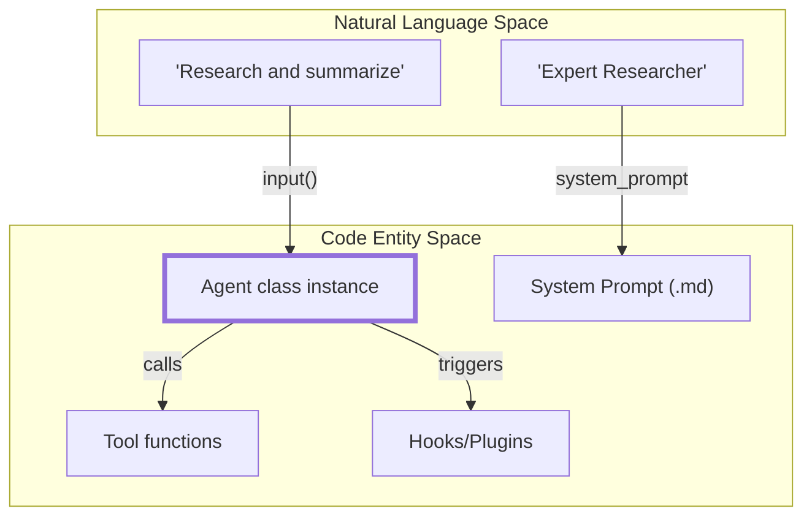
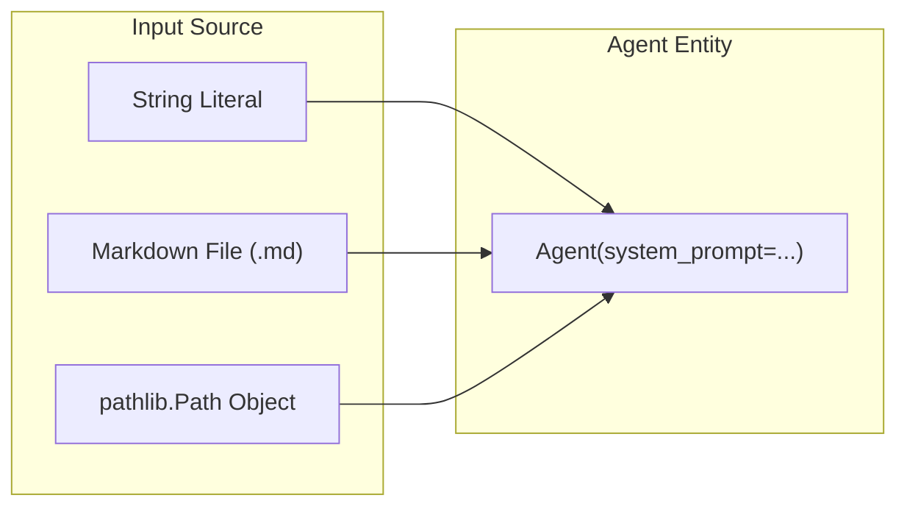
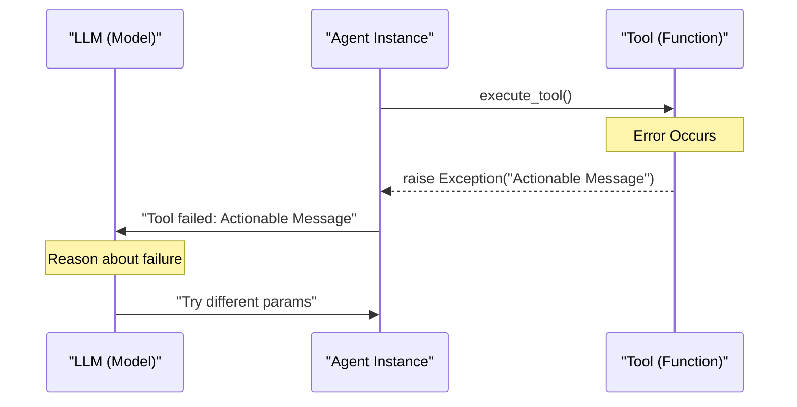

<!-- source: DeepWiki mcp.deepwiki.com · repo openonion/connectonion · page 10 Best Practices · fetched 2026-10-27 -->

# Best Practices

Relevant source files

The following files were used as context for generating this wiki page:

- [README.md](README.md)
- [connectonion/cli/co_ai/prompts/connectonion/agent-design.md](connectonion/cli/co_ai/prompts/connectonion/agent-design.md)
- [connectonion/cli/co_ai/prompts/connectonion/index.md](connectonion/cli/co_ai/prompts/connectonion/index.md)
- [connectonion/cli/co_ai/prompts/tools/bash.md](connectonion/cli/co_ai/prompts/tools/bash.md)
- [connectonion/cli/co_ai/prompts/workflow.md](connectonion/cli/co_ai/prompts/workflow.md)
- [connectonion/cli/co_ai/tools/ask_user.py](connectonion/cli/co_ai/tools/ask_user.py)
- [docs/README.md](docs/README.md)
- [docs/quickstart.md](docs/quickstart.md)
- [docs/templates/README.md](docs/templates/README.md)
- [docs/templates/meta-agent.md](docs/templates/meta-agent.md)
- [docs/templates/minimal.md](docs/templates/minimal.md)
- [docs/templates/playwright.md](docs/templates/playwright.md)
- [docs/templates/web-research.md](docs/templates/web-research.md)

**Purpose**: Recommended patterns, anti-patterns, and design principles for building effective ConnectOnion agents. This page covers tool design, system prompts, architecture decisions, and error handling strategies.

**Scope**: This is a high-level guide for developers. For detailed implementation guidelines, see the child pages:
- [Tool Design](#10.1) — Guidelines for creating effective, maintainable tools
- [System Prompts](#10.2) — Best practices for writing and managing system prompts
- [When to Use LLMs vs Code](#10.3) — Decision framework for choosing between LLM calls and traditional code
- [Error Handling](#10.4) — Patterns for graceful error handling in tools and agents

---

## Core Design Philosophy

ConnectOnion follows the principle: **"Keep simple things simple, make complicated things possible"** [README.md:22-24](). Basic agents require minimal code, while production systems support features like multi-agent networking and plugin architecture.

### Function-Based Design
The framework treats functions as the primary primitive. Tools, event handlers, and trust policies are all defined as Python functions with type hints [connectonion/cli/co_ai/prompts/connectonion/index.md:38-45]().

**Diagram: System Architecture to Code Entities**

Sources: [README.md:28-63](), [connectonion/cli/co_ai/prompts/connectonion/index.md:7-27]()

---

## Tool Design

ConnectOnion tools should be **atomic** and **single-purpose** [connectonion/cli/co_ai/prompts/connectonion/agent-design.md:273-283](). While simple functions are preferred for stateless operations, classes are used when shared state is required (e.g., maintaining a browser session).

| Pattern | Code Entity | Best Practice |
| :--- | :--- | :--- |
| **Stateless** | `def my_tool(...)` | Use plain functions with type hints [connectonion/cli/co_ai/prompts/workflow.md:78]() |
| **Stateful** | `class MyTool: ...` | Pass the class instance to `Agent(tools=[instance])` [connectonion/cli/co_ai/prompts/connectonion/agent-design.md:239-257]() |
| **Description** | `"""Docstring"""` | The first line of the docstring is the tool description [connectonion/cli/co_ai/prompts/connectonion/index.md:43-44]() |

For details, see [Tool Design](#10.1).

---

## System Prompts

System prompts define the agent's persona and constraints. The framework supports loading prompts directly from Markdown files, which is the recommended approach for version control and readability [connectonion/cli/co_ai/prompts/connectonion/agent-design.md:175-181]().

**Diagram: Prompt Loading Logic**

Sources: [docs/quickstart.md:88-115](), [connectonion/cli/co_ai/prompts/connectonion/index.md:17-27]()

For details, see [System Prompts](#10.2).

---

## When to Use LLMs vs Code

A core principle of ConnectOnion is **"Agent reasons, tools act"** [connectonion/cli/co_ai/prompts/connectonion/index.md:40](). Developers should avoid encoding complex logic inside tools; instead, tools should provide primitive actions that the agent orchestrates.

- **Use LLMs** for reasoning, natural language extraction, and decision-making.
- **Use Code** for deterministic calculations, data validation, and high-performance operations.

For details, see [When to Use LLMs vs Code](#10.3).

---

## Error Handling

ConnectOnion encourages a "Fail Fast" approach. Rather than using `try/except` blocks to hide errors, tools should let exceptions surface naturally so the agent can see the error message and attempt a correction or report the failure to the user [connectonion/cli/co_ai/prompts/workflow.md:77]().

**Diagram: Error Propagation Loop**

Sources: [connectonion/cli/co_ai/prompts/workflow.md:75-80](), [connectonion/cli/co_ai/prompts/connectonion/agent-design.md:301-310]()

For details, see [Error Handling](#10.4).

---

## Summary of Best Practices

- **Scaffolding**: Always use `co create` to start new projects to ensure correct environment and directory structure [connectonion/cli/co_ai/prompts/workflow.md:7-14]().
- **Atomic Tools**: Each function should do exactly one thing [connectonion/cli/co_ai/prompts/workflow.md:75]().
- **Type Hints**: Always include type hints as they are used to generate the tool schema for the LLM [connectonion/cli/co_ai/prompts/connectonion/index.md:42]().
- **Built-in First**: Check available built-in tools (e.g., `Shell`, `Gmail`, `WebFetch`) before writing custom ones [connectonion/cli/co_ai/prompts/connectonion/agent-design.md:183-196]().
- **Customization**: Use `co copy <tool>` to bring built-in tool code into your project for modification [README.md:108-112]().

Sources: [README.md:71-112](), [connectonion/cli/co_ai/prompts/workflow.md:109-111]()

---

