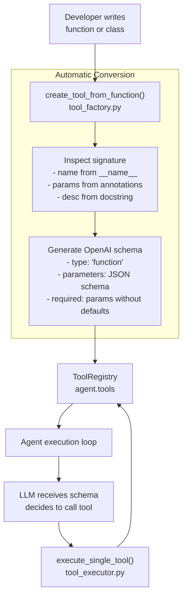
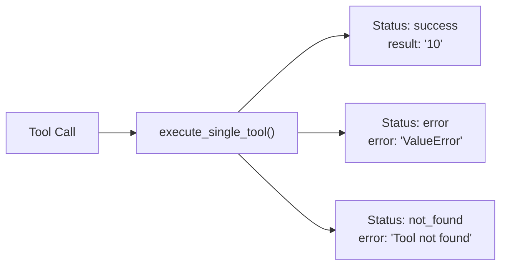

<!-- source: DeepWiki mcp.deepwiki.com · repo openonion/connectonion · page 10.1 Tool Design · fetched 2026-10-27 -->

# Tool Design

<details>
<summary>Relevant source files</summary>

The following files were used as context for generating this wiki page:

- [connectonion/cli/co_ai/prompts/connectonion/agent-design.md](connectonion/cli/co_ai/prompts/connectonion/agent-design.md)
- [connectonion/cli/co_ai/prompts/connectonion/index.md](connectonion/cli/co_ai/prompts/connectonion/index.md)
- [connectonion/cli/co_ai/prompts/tools/bash.md](connectonion/cli/co_ai/prompts/tools/bash.md)
- [connectonion/cli/co_ai/prompts/workflow.md](connectonion/cli/co_ai/prompts/workflow.md)
- [connectonion/cli/co_ai/tools/ask_user.py](connectonion/cli/co_ai/tools/ask_user.py)
- [connectonion/logger.py](connectonion/logger.py)
- [docs/api.md](docs/api.md)
- [docs/concepts/tools.md](docs/concepts/tools.md)
- [tests/real_api/manual/manual_defaults.py](tests/real_api/manual/manual_defaults.py)
- [tests/unit/test_logger.py](tests/unit/test_logger.py)
- [tests/unit/test_tool_executor.py](tests/unit/test_tool_executor.py)
- [tests/unit/test_tool_executor_errors.py](tests/unit/test_tool_executor_errors.py)
- [tests/unit/test_tool_factory.py](tests/unit/test_tool_factory.py)

</details>


This page provides guidelines for creating effective, maintainable tools in ConnectOnion. Tools are the primary way agents interact with external systems and perform actions.

---

## Core Design Philosophy

Tools in ConnectOnion follow a simple principle: **one clear job, one function**. The framework supports two primary patterns:

| Pattern | Use Case | State | Example |
|---------|----------|-------|---------|
| **Function-based** | Stateless operations | None | `def add(a: float, b: float)` |
| **Class-based** | Shared resources/state | Instance variables | `class Browser` with `_page` |

Both patterns are automatically converted to OpenAI-compatible tool schemas via `create_tool_from_function` in [connectonion/core/tool_factory.py:16-16]().

Sources: [connectonion/cli/co_ai/prompts/connectonion/agent-design.md:231-258](), [docs/api.md:107-124](), [docs/concepts/tools.md:35-42]()

---

## Tool Creation Lifecycle



**Key Steps:**

1. **Definition**: Developer writes a function with type hints and a docstring [docs/api.md:112-121]().
2. **Conversion**: `create_tool_from_function` inspects the function signature [connectonion/core/tool_factory.py:16-16]().
3. **Registration**: Tools are added to the agent's internal registry [docs/api.md:77-80]().
4. **Schema Generation**: JSON schema is built from Python type annotations [docs/concepts/tools.md:100-144]().
5. **Execution**: `execute_single_tool` runs the tool, logging the call and result [connectonion/core/tool_executor.py:48-65]().

Sources: [connectonion/core/tool_factory.py:16-16](), [connectonion/core/tool_executor.py:48-65](), [docs/api.md:107-149](), [docs/concepts/tools.md:100-144]()

---

## Function-Based Tool Design

### Basic Structure

Function-based tools are recommended for stateless operations. ConnectOnion uses Python's introspection to build the tool interface.

```python
def search_web(query: str, limit: int = 5) -> str:
    """Search the web for information.
    
    Args:
        query: The search query.
        limit: Max results.
    """
    return f"Results for {query}"
```

**How schemas are generated:**
- `name`: Taken from the function name (`search_web`) [docs/api.md:127-127]().
- `description`: Extracted from the **first paragraph** of the docstring [docs/api.md:128-128]().
- `parameters`: Generated from Python type hints [docs/api.md:129-129]().
- `required`: Parameters without default values (e.g., `query`) [docs/api.md:130-130]().

Sources: [docs/api.md:126-135](), [tests/unit/test_tool_factory.py:72-92]()

### Type Mapping Table

ConnectOnion maps Python types to JSON Schema types via `get_json_schema_type` [connectonion/core/tool_factory.py:16-16]().

| Python Type | JSON Schema Type | Notes |
|-------------|------------------|-------|
| `str` | `string` | Default fallback [docs/api.md:134-134]() |
| `int` | `integer` | [tests/unit/test_tool_factory.py:120-123]() |
| `bool` | `boolean` | [tests/unit/test_tool_factory.py:125-128]() |
| `list` / `List[T]` | `array` | Includes `items` schema [tests/unit/test_tool_factory.py:130-138]() |
| `dict` / `Dict` | `object` | [tests/unit/test_tool_factory.py:156-158]() |
| `Optional[T]` | Same as `T` | Strips `Optional` wrapper [tests/unit/test_tool_factory.py:145-149]() |

Sources: [connectonion/core/tool_factory.py:16-16](), [tests/unit/test_tool_factory.py:112-165](), [docs/api.md:132-135]()

---

## Class-Based Tool Design

### Shared State Management

Use classes when tools need to share state, such as a browser session or an API client [connectonion/cli/co_ai/prompts/connectonion/agent-design.md:239-241]().

```python
class Browser:
    def __init__(self):
        self._page = None

    def navigate(self, url: str) -> str:
        """Go to URL."""
        # ... logic ...
        return f"Navigated to {url}"

browser = Browser()
agent = Agent("web-bot", tools=[browser]) # Pass the instance
```

When an instance is passed, ConnectOnion discovers all public methods and treats them as individual tools sharing the same `self` state [docs/concepts/tools.md:164-169]().

Sources: [connectonion/cli/co_ai/prompts/connectonion/agent-design.md:239-257](), [docs/concepts/tools.md:162-257]()

---

## Error Handling in Tools

### Error as Messages

Instead of letting tools crash the agent, tools should return error information as strings. This allows the LLM to understand what went wrong and potentially correct its parameters [connectonion/cli/co_ai/prompts/connectonion/agent-design.md:301-305]().

```python
def read_file(path: str) -> str:
    if not os.path.exists(path):
        return f"Error: File {path} does not exist."
    # ...
```

### Execution Tracing

The `tool_executor` captures exceptions that occur during tool runs and records them in the session trace with a status of `error` [tests/unit/test_tool_executor_errors.py:180-183]().



Sources: [connectonion/core/tool_executor.py:58-83](), [tests/unit/test_tool_executor_errors.py:88-93](), [tests/unit/test_tool_executor_errors.py:179-185]()

---

## Tool Design Rules

1.  **Atomic Actions**: One tool should perform exactly one action. Avoid "Swiss Army Knife" tools with an `action` parameter [connectonion/cli/co_ai/prompts/connectonion/agent-design.md:273-283]().
2.  **Verb-Noun Naming**: Use clear, descriptive names like `send_email` or `search_web` [connectonion/cli/co_ai/prompts/connectonion/agent-design.md:285-291]().
3.  **Informative Returns**: Return descriptive strings (e.g., "Deleted file.txt") rather than generic "Done" [connectonion/cli/co_ai/prompts/connectonion/agent-design.md:293-299]().
4.  **No Argparse**: Agents do not need CLI argument parsing inside tools; use standard function parameters [connectonion/cli/co_ai/prompts/workflow.md:75-76]().
5.  **Type Hints are Mandatory**: The agent relies on type hints to generate the JSON schema used by the LLM [connectonion/cli/co_ai/prompts/connectonion/index.md:42-42]().

Sources: [connectonion/cli/co_ai/prompts/connectonion/agent-design.md:271-305](), [connectonion/cli/co_ai/prompts/workflow.md:73-80](), [connectonion/cli/co_ai/prompts/connectonion/index.md:38-45]()

---

## Specialized Tool Patterns

### Interactive Tools (`ask_user`)

Tools can interact with the user via the `agent.io` interface. The `ask_user` tool is a prime example: it blocks execution until a response is received from the user [connectonion/cli/co_ai/tools/ask_user.py:5-6]().

```python
def ask_user(agent, question: str, options: List[str]) -> str:
    # tool_executor automatically injects 'agent' if in signature
    agent.io.send({"type": "ask_user", "question": question, "options": options})
    return agent.io.receive().get("answer", "")
```

Sources: [connectonion/cli/co_ai/tools/ask_user.py:1-53]()

### Built-in Tool Customization

ConnectOnion provides several built-in tools (e.g., `Shell`, `Gmail`, `WebFetch`). If a built-in tool doesn't meet specific needs, it can be copied into the project for local modification using the CLI [connectonion/cli/co_ai/prompts/connectonion/agent-design.md:183-203]().

```bash
co copy Gmail  # Creates ./tools/gmail.py
```

Sources: [connectonion/cli/co_ai/prompts/connectonion/agent-design.md:183-208](), [connectonion/cli/co_ai/prompts/connectonion/index.md:34-34]()

---

