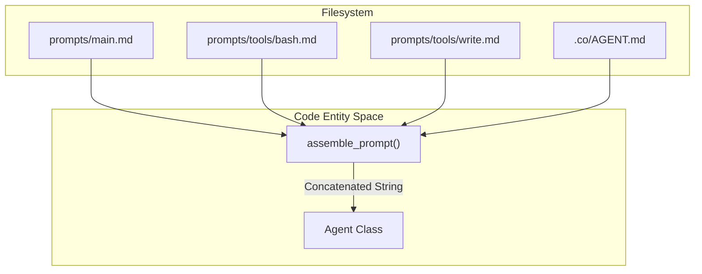
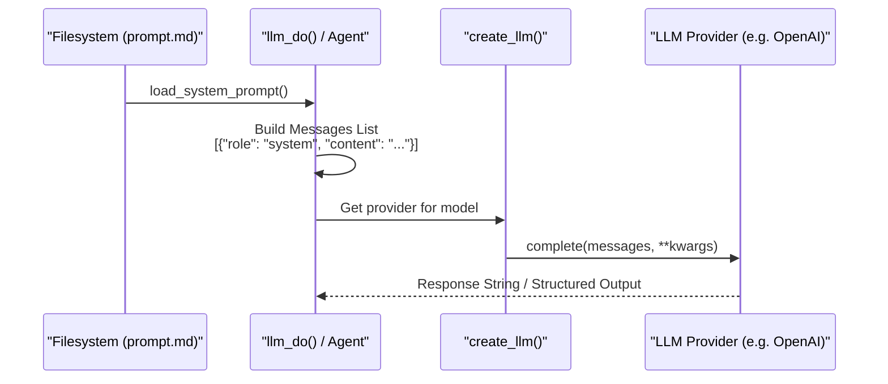

<!-- source: DeepWiki mcp.deepwiki.com · repo openonion/connectonion · page 10.2 System Prompts · fetched 2026-10-27 -->

# System Prompts

<details>
<summary>Relevant source files</summary>

The following files were used as context for generating this wiki page:

- [MANIFEST.in](MANIFEST.in)
- [connectonion/cli/templates/coder/agent.py](connectonion/cli/templates/coder/agent.py)
- [connectonion/cli/templates/coder/prompt.md](connectonion/cli/templates/coder/prompt.md)
- [connectonion/cli/templates/minimal/agent.py](connectonion/cli/templates/minimal/agent.py)
- [connectonion/cli/templates/minimal/prompt.md](connectonion/cli/templates/minimal/prompt.md)
- [connectonion/cli/templates/web-research/agent.py](connectonion/cli/templates/web-research/agent.py)
- [connectonion/llm_do.py](connectonion/llm_do.py)
- [connectonion/useful_prompts/README.md](connectonion/useful_prompts/README.md)
- [connectonion/useful_prompts/__init__.py](connectonion/useful_prompts/__init__.py)
- [connectonion/useful_prompts/coding_agent/README.md](connectonion/useful_prompts/coding_agent/README.md)
- [connectonion/useful_prompts/coding_agent/assembler.py](connectonion/useful_prompts/coding_agent/assembler.py)
- [connectonion/useful_prompts/coding_agent/prompts/main.md](connectonion/useful_prompts/coding_agent/prompts/main.md)
- [connectonion/useful_prompts/coding_agent/prompts/tools/read.md](connectonion/useful_prompts/coding_agent/prompts/tools/read.md)
- [connectonion/useful_prompts/coding_agent/prompts/tools/shell.md](connectonion/useful_prompts/coding_agent/prompts/tools/shell.md)
- [connectonion/useful_prompts/coding_agent/prompts/tools/todo.md](connectonion/useful_prompts/coding_agent/prompts/tools/todo.md)
- [connectonion/useful_prompts/coding_agent/prompts/tools/write.md](connectonion/useful_prompts/coding_agent/prompts/tools/write.md)
- [docs/useful_prompts/README.md](docs/useful_prompts/README.md)

</details>


**Purpose**: This document provides best practices for writing, structuring, and managing system prompts in ConnectOnion agents. System prompts define an agent's personality, behavioral guidelines, and decision-making patterns.

**Scope**: Covers prompt design principles, modular assembly, file organization, and the one-shot `llm_do` prompt pattern. For general agent architecture, see [Agent Architecture](3.1).

---

## What System Prompts Are

A system prompt is the foundational instruction set that defines how an agent behaves. It is injected as the first message in every conversation with the LLM, establishing the agent's:

- **Identity**: Who the agent is ("You are an expert software engineer") [connectonion/cli/templates/coder/prompt.md:3-3]()
- **Capabilities**: What the agent can do (references to available tools) [connectonion/cli/templates/minimal/prompt.md:5-9]()
- **Principles**: Core behavioral rules ("Read files before editing them") [connectonion/cli/templates/coder/prompt.md:13-18]()
- **Decision-making guidelines**: How to approach problems and when to use specific tools.

Sources: [connectonion/cli/templates/coder/prompt.md:1-18](), [connectonion/cli/templates/minimal/prompt.md:1-9]()

---

## Loading Mechanisms

### Agent Interface
System prompts are passed via the `system_prompt` parameter during agent construction. ConnectOnion handles both file paths and raw strings.

```python
from connectonion import Agent

# Option 1: Load from file path (Relative to agent script)
agent = Agent(
    name="coder",
    system_prompt="prompt.md", # Automatically reads file content
    tools=[bash, read_file, edit]
)

# Option 2: Inline string
agent = Agent(
    name="simple",
    system_prompt="You are a helpful assistant."
)
```
Sources: [connectonion/cli/templates/coder/agent.py:4-10](), [connectonion/cli/templates/minimal/agent.py:7-13]()

### One-Shot Interface (`llm_do`)
For simple tasks without agent overhead, `llm_do` accepts a `system_prompt` to guide a single-round completion.

```python
from connectonion import llm_do

# Using a custom system prompt for one-shot extraction
result = llm_do(
    input="John, 30 years old",
    system_prompt="Extract name and age as JSON.",
    model="co/gemini-2.5-flash"
)
```
Sources: [connectonion/llm_do.py:116-120](), [connectonion/llm_do.py:5-7]()

---

## Modular Prompt Assembly

As agents become complex, maintaining a single large markdown file becomes difficult. ConnectOnion promotes a **Modular Assembly** pattern, particularly for coding agents.

### The Assembler Pattern
Instead of a static file, the prompt is built dynamically from components:
1. **Main Prompt**: Core personality and general rules.
2. **Tool Guidance**: Specific "When to Use" and "When NOT to Use" instructions for each active tool.
3. **Project Context**: Local project details (e.g., tech stack, conventions) from `.co/AGENT.md`.



### Implementation Example
The `assemble_prompt` function iterates through provided tools and looks for matching markdown files in a `tools/` subdirectory.

```python
from connectonion.useful_prompts.coding_agent.assembler import assemble_prompt
from connectonion import Agent, bash, write

tools = [bash, write]
prompt = assemble_prompt(
    prompts_dir="my_prompts",
    tools=tools,
    context_file=".co/AGENT.md"
)

agent = Agent("my-agent", system_prompt=prompt, tools=tools)
```
Sources: [connectonion/useful_prompts/coding_agent/assembler.py:33-80](), [docs/useful_prompts/README.md:32-40]()

---

## Tool-Specific Guidance Best Practices

Effective modular prompts provide the LLM with clear boundaries for every tool. This reduces "hallucinated" tool usage and improves success rates.

### Pattern: When to Use vs. When NOT to Use
Each tool prompt should clearly define its scope.

**Example: Shell Tool (`shell.md`)**
- **When to Use**: Git operations, package management, running tests. [connectonion/useful_prompts/coding_agent/prompts/tools/shell.md:5-12]()
- **When NOT to Use**: Reading files (use `read_file`), writing files (use `write`). [connectonion/useful_prompts/coding_agent/prompts/tools/shell.md:14-18]()
- **Guidelines**: Path quoting requirements, absolute path preferences. [connectonion/useful_prompts/coding_agent/prompts/tools/shell.md:20-34]()

**Example: Write Tool (`write.md`)**
- **Principle**: Always read the file first before writing. [connectonion/useful_prompts/coding_agent/prompts/tools/write.md:24-24]()
- **Approval Flow**: Explains how the user will see diffs and approve changes. [connectonion/useful_prompts/coding_agent/prompts/tools/write.md:5-20]()

Sources: [connectonion/useful_prompts/coding_agent/prompts/tools/shell.md:1-68](), [connectonion/useful_prompts/coding_agent/prompts/tools/write.md:1-49]()

---

## Data Flow: Prompt to Provider

The following diagram illustrates how the system prompt moves from a file on disk into the actual LLM API call via the `llm_do` or `Agent` logic.



Sources: [connectonion/llm_do.py:5-9](), [connectonion/llm_do.py:62-80]()

---

## Prompt Engineering Principles

1. **Read Before Writing**: Instruct agents to use discovery tools (`ls`, `glob`, `read_file`) before attempting modifications. [connectonion/cli/templates/coder/prompt.md:14-14]()
2. **Small Changes**: Encourage agents to keep edits focused and incremental. [connectonion/cli/templates/coder/prompt.md:16-16]()
3. **Verify**: Always include instructions to run tests or verify status after a tool action. [connectonion/cli/templates/coder/prompt.md:15-15]()
4. **Path Safety**: Explicitly mandate double-quoting for paths in shell commands to prevent failures with spaces. [connectonion/useful_prompts/coding_agent/prompts/tools/shell.md:27-33]()
5. **Separation of Concerns**: Use modular prompts so you can update a tool's instructions without risking regression in the agent's core personality. [docs/useful_prompts/README.md:43-52]()

Sources: [connectonion/cli/templates/coder/prompt.md:13-18](), [connectonion/useful_prompts/coding_agent/prompts/tools/shell.md:27-33](), [docs/useful_prompts/README.md:43-52]()

---

