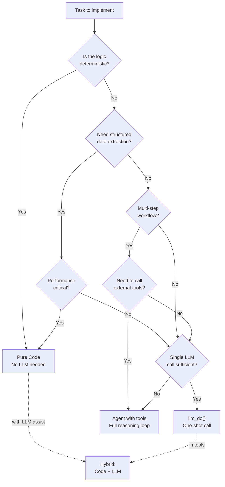
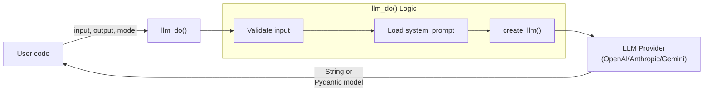
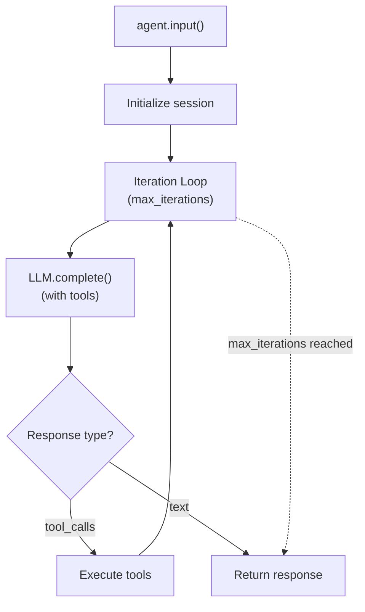

<!-- source: DeepWiki mcp.deepwiki.com · repo openonion/connectonion · page 10.3 When to Use LLMs vs Code · fetched 2026-10-27 -->

# When to Use LLMs vs Code

<details>
<summary>Relevant source files</summary>

The following files were used as context for generating this wiki page:

- [connectonion/cli/co_ai/prompts/connectonion/agent-design.md](connectonion/cli/co_ai/prompts/connectonion/agent-design.md)
- [connectonion/cli/co_ai/prompts/connectonion/index.md](connectonion/cli/co_ai/prompts/connectonion/index.md)
- [connectonion/cli/co_ai/prompts/tools/bash.md](connectonion/cli/co_ai/prompts/tools/bash.md)
- [connectonion/cli/co_ai/prompts/workflow.md](connectonion/cli/co_ai/prompts/workflow.md)
- [connectonion/cli/co_ai/tools/ask_user.py](connectonion/cli/co_ai/tools/ask_user.py)
- [connectonion/cli/templates/coder/agent.py](connectonion/cli/templates/coder/agent.py)
- [connectonion/cli/templates/coder/prompt.md](connectonion/cli/templates/coder/prompt.md)
- [connectonion/cli/templates/minimal/agent.py](connectonion/cli/templates/minimal/agent.py)
- [connectonion/cli/templates/minimal/prompt.md](connectonion/cli/templates/minimal/prompt.md)
- [connectonion/cli/templates/web-research/agent.py](connectonion/cli/templates/web-research/agent.py)
- [connectonion/llm_do.py](connectonion/llm_do.py)

</details>


## Purpose and Scope

This document provides a decision framework for choosing between LLM calls, traditional code, and hybrid approaches when building ConnectOnion agents and tools. It covers cost, latency, and reliability tradeoffs, providing concrete patterns from the codebase.

ConnectOnion offers two primary interfaces for LLM interaction:
1.  `llm_do()`: A one-shot, stateless function for simple tasks [connectonion/llm_do.py:11-31]().
2.  `Agent`: A stateful, multi-turn class supporting tool calling and reasoning loops [connectonion/cli/templates/minimal/agent.py:7-13]().

---

## Decision Framework

The following logic helps determine the implementation strategy for a given task:



**Sources:** [connectonion/llm_do.py:17-31](), [connectonion/cli/co_ai/prompts/connectonion/agent-design.md:5-31]()

---

## Use Case: Pure Code (No LLM)

### When to Use
- **Deterministic operations**: Math, parsing, validation, formatting.
- **Performance-critical paths**: Hot loops or real-time processing.
- **Predictable workflows**: Known input → known output with no ambiguity.
- **Atomic Tool Implementation**: ConnectOnion encourages "Atomic tools" where each function does ONE thing [connectonion/cli/co_ai/prompts/workflow.md:75-80]().

### Examples from Codebase

**1. Tool Design Principles**
ConnectOnion recommends writing tools as plain Python functions for maximum reliability and speed [connectonion/cli/co_ai/prompts/workflow.md:50-51]().

```python
# connectonion/cli/templates/web-research/agent.py:79-102
def save_research(topic: str, findings: List[str], filename: str = None) -> str:
    """Save research findings to a file."""
    if not filename:
        filename = f"research_{topic.replace(' ', '_')}.json"
    
    research_data = {
        "topic": topic,
        "findings": findings,
        "timestamp": __import__('datetime').datetime.now().isoformat()
    }
    
    with open(filename, 'w') as f:
        json.dump(research_data, f, indent=2)
    
    return f"Research saved to {filename}"
```

This is pure code because the logic for saving a file is deterministic and requires no reasoning [connectonion/cli/co_ai/prompts/connectonion/agent-design.md:40-41]().

**Sources:** [connectonion/cli/templates/web-research/agent.py:79-102](), [connectonion/cli/co_ai/prompts/workflow.md:75-80]()

---

## Use Case: llm_do() - One-Shot LLM Calls

### When to Use
- **Simple transformations**: Text → structured data.
- **Data extraction**: Parse unstructured text into Pydantic models [connectonion/llm_do.py:109-115]().
- **Quick analysis**: Summarization or categorization [connectonion/llm_do.py:24]().
- **Stateless tasks**: No need for conversation history or tool calling [connectonion/llm_do.py:44-45]().

### Architecture

The `llm_do()` function is a thin wrapper around the LLM provider abstraction [connectonion/llm_do.py:34-41]().



**Sources:** [connectonion/llm_do.py:34-41](), [connectonion/llm_do.py:62-80]()

### Examples from Codebase

**1. Structured Extraction**
Using Pydantic models with `llm_do()` ensures the LLM returns validated data [connectonion/llm_do.py:109-115]().

```python
# connectonion/llm_do.py:110-114
class Person(BaseModel):
    name: str
    age: int

result = llm_do("John, 30 years old", output=Person)
# result is a validated Pydantic instance
```

**2. Tool-Internal Analysis**
A tool can use `llm_do()` internally to perform a sub-task that requires intelligence without making the tool itself "smart" [connectonion/cli/templates/web-research/agent.py:64-77]().

```python
# connectonion/cli/templates/web-research/agent.py:75-76
def analyze_data(data: str, analysis_type: str = "summary") -> str:
    prompt = f"Perform {analysis_type} analysis on this data: {data[:1000]}"
    return llm_do(prompt)
```

**Sources:** [connectonion/llm_do.py:109-115](), [connectonion/cli/templates/web-research/agent.py:64-77]()

---

## Use Case: Agent with Tools

### When to Use
- **Multi-step workflows**: Tasks requiring planning and iteration [connectonion/llm_do.py:27-30]().
- **Tool calling**: Need to interact with the environment (files, shell, browser) [connectonion/cli/templates/minimal/agent.py:10]().
- **State management**: Shared state between tool calls [connectonion/cli/co_ai/prompts/connectonion/agent-design.md:54-58]().
- **Human-in-the-loop**: Tasks requiring user approval or input [connectonion/cli/co_ai/tools/ask_user.py:14-19]().

### Architecture

The `Agent` maintains a session and executes a loop until the task is complete or `max_iterations` is reached [connectonion/cli/templates/coder/agent.py:4-10]().



**Sources:** [connectonion/cli/co_ai/prompts/connectonion/index.md:16-27](), [connectonion/cli/templates/coder/agent.py:4-10]()

### Examples from Codebase

**1. Coder Agent**
A coding agent needs access to the filesystem and shell to run tests and edit files [connectonion/cli/templates/coder/prompt.md:5-11]().

```python
# connectonion/cli/templates/coder/agent.py:4-10
agent = Agent(
    name="coder",
    system_prompt="prompt.md",
    tools=[bash, read_file, edit, glob, grep, write],
    model="co/gemini-2.5-pro",
    max_iterations=50,
)
```

**2. Stateful Tool Classes**
For tools that share state (like a browser session), use a class instead of individual functions [connectonion/cli/co_ai/prompts/connectonion/agent-design.md:239-257]().

```python
# connectonion/cli/co_ai/prompts/connectonion/agent-design.md:242-257
class Browser:
    def __init__(self):
        self._page = None

    def navigate(self, url: str) -> str:
        """Go to URL."""
        self._page = open_page(url)
        return self._page.title

browser = Browser()
agent = Agent("browser", tools=[browser])
```

**Sources:** [connectonion/cli/templates/coder/agent.py:4-10](), [connectonion/cli/co_ai/prompts/connectonion/agent-design.md:239-257]()

---

## Comparison Table

| Feature | `llm_do()` | `Agent()` |
| :--- | :--- | :--- |
| **Iterations** | Always 1 [connectonion/llm_do.py:55]() | Up to `max_iters` [connectonion/llm_do.py:55]() |
| **Tools** | No [connectonion/llm_do.py:56]() | Yes [connectonion/llm_do.py:56]() |
| **State** | Stateless [connectonion/llm_do.py:57]() | Maintains history [connectonion/llm_do.py:57]() |
| **Overhead** | Minimal [connectonion/llm_do.py:59]() | Full framework [connectonion/llm_do.py:59]() |
| **Use Case** | Quick tasks [connectonion/llm_do.py:58]() | Complex flows [connectonion/llm_do.py:58]() |

**Sources:** [connectonion/llm_do.py:52-60]()

---

## Best Practices

1.  **Atomic Tools**: Don't encode logic in tools; let the agent reason [connectonion/cli/co_ai/prompts/connectonion/index.md:40]().
2.  **Verb_noun Names**: Name tools clearly so the agent understands their purpose (e.g., `send_email`) [connectonion/cli/co_ai/prompts/connectonion/agent-design.md:285-291]().
3.  **Informative Returns**: Tools should return descriptive strings, not just "Done" [connectonion/cli/co_ai/prompts/connectonion/agent-design.md:293-299]().
4.  **One Tool = One Action**: Avoid "Swiss Army Knife" tools with many parameters [connectonion/cli/co_ai/prompts/connectonion/agent-design.md:273-283]().
5.  **Use `llm_do` for Sub-analysis**: If a tool needs to perform a complex string extraction or sentiment check, call `llm_do` inside the tool [connectonion/cli/templates/web-research/agent.py:75-76]().

**Sources:** [connectonion/cli/co_ai/prompts/connectonion/index.md:40-45](), [connectonion/cli/co_ai/prompts/connectonion/agent-design.md:271-306]()

---

