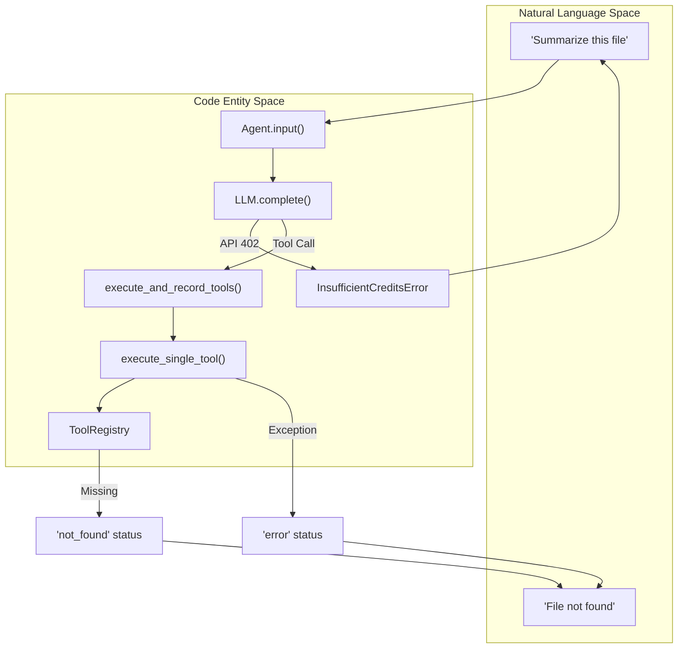
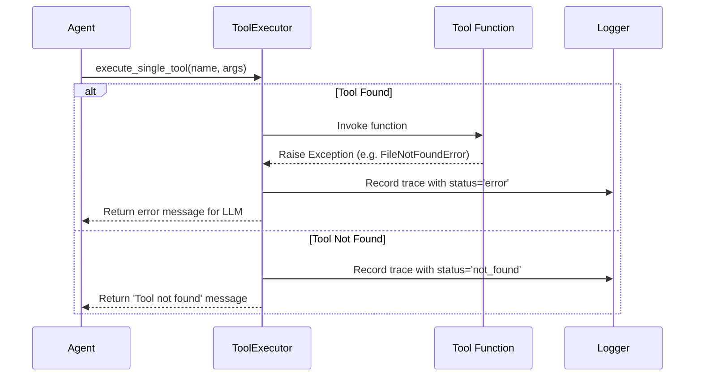

<!-- source: DeepWiki mcp.deepwiki.com · repo openonion/connectonion · page 10.4 Error Handling · fetched 2026-10-27 -->

# Error Handling

<details>
<summary>Relevant source files</summary>

The following files were used as context for generating this wiki page:

- [connectonion/core/agent.py](connectonion/core/agent.py)
- [connectonion/core/exceptions.py](connectonion/core/exceptions.py)
- [connectonion/core/llm.py](connectonion/core/llm.py)
- [docs/concepts/models.md](docs/concepts/models.md)
- [tests/unit/test_agent.py](tests/unit/test_agent.py)
- [tests/unit/test_groq_llm.py](tests/unit/test_groq_llm.py)

</details>


## Purpose and Scope

This document covers error handling patterns and best practices for ConnectOnion agents and tools. It explains how errors are captured, logged, and recovered from during agent execution. The framework distinguishes between provider-level errors (API failures, billing issues) and tool-level errors (logic exceptions, missing resources).

---

## Core Principles

ConnectOnion follows a "fail fast, recover gracefully" philosophy:

| Principle | Implementation |
|-----------|----------------|
| **Fail fast** | Errors raise immediately with descriptive messages [connectonion/core/exceptions.py:4-11]() |
| **Include context** | Stack traces, tool arguments, and execution state captured [connectonion/core/agent.py:5-9]() |
| **Let errors bubble** | Tools raise exceptions; agent catches and retries via LLM [connectonion/core/agent.py:9-10]() |
| **No silent failures** | All errors logged and traced via `Logger` [connectonion/core/agent.py:67-74]() |
| **Explicit error handling** | Custom exceptions for actionable billing and connection issues [connectonion/core/exceptions.py:15-115]() |

**Sources:** [connectonion/core/agent.py:1-10](), [connectonion/core/exceptions.py:1-12]()

---

## Error Flow Architecture

The following diagram bridges the natural language request to the code entities responsible for handling failures.



**Diagram: Mapping Natural Language Failures to Code Entities**

The error flow ensures that:
1. All exceptions during tool execution are caught and converted to trace entries [connectonion/core/agent.py:9-10]().
2. API-specific errors (like 402 Payment Required) are transformed into human-readable exceptions [connectonion/core/exceptions.py:15-54]().
3. Errors are formatted as tool result messages for the LLM to attempt a retry [connectonion/core/agent.py:5-9]().

**Sources:** [connectonion/core/agent.py:1-10](), [connectonion/core/exceptions.py:1-12](), [connectonion/core/llm.py:5-9]()

---

## Provider and Connection Errors

ConnectOnion provides specialized exception classes for common infrastructure failures, ensuring users receive actionable feedback rather than raw stack traces.

### 1. Insufficient Credits (`InsufficientCreditsError`)
Raised when using managed keys (`co/` prefix) and the account balance is too low.
- **Attributes**: `balance`, `required`, `shortfall`, `address` [connectonion/core/exceptions.py:22-27]().
- **Behavior**: Transforms `openai.APIStatusError(402)` into a formatted terminal message with a purchase link [connectonion/core/exceptions.py:55-73]().

### 2. Connection Failures (`LLMConnectionError`)
Raised when the LLM API request times out or fails to connect.
- **Causes**: Proxy/VPN latency, network issues, or provider downtime [connectonion/core/exceptions.py:81-82]().
- **Behavior**: Provides a diagnostic message suggesting `curl` commands to test connectivity [connectonion/core/exceptions.py:109-112]().

### 3. Service Errors (`ProviderServiceError`)
Raised when the provider returns an HTTP 503 or similar service-level failure [connectonion/core/exceptions.py:118-119]().

**Sources:** [connectonion/core/exceptions.py:15-141](), [connectonion/core/llm.py:117-122]()

---

## Tool Execution Error Handling

When a tool is executed via `Agent.input()`, the framework wraps the call to capture failures without crashing the agent loop.



**Diagram: Tool Execution Failure Logic**

### Recovery Patterns in Tools

#### Pattern: Validation with Descriptive Errors
Tools should validate inputs early to provide the LLM with clear instructions on how to fix the call.

```python
def calculator(expression: str) -> str:
    """Performs a mathematical calculation."""
    try:
        allowed_chars = "0123456789+-*/(). "
        if not all(c in allowed_chars for c in expression):
            return "Error: Invalid characters in expression" # Recoverable string
        return f"Result: {eval(expression)}"
    except Exception as e:
        return f"Error: {str(e)}" # Contextual error
```

**Sources:** [tests/unit/test_agent.py:22-31](), [connectonion/core/agent.py:9-10]()

---

## LLM Provider Specific Handling

Each provider has unique error characteristics handled in `connectonion/core/llm.py`:

| Provider | Error Handling Logic |
|----------|----------------------|
| **Groq** | Converts `openai.APIError` into `ValueError` with "Groq API Error" prefix [tests/unit/test_groq_llm.py:168-189](). |
| **OpenOnion** | Catches 402 errors to raise `InsufficientCreditsError` [connectonion/core/exceptions.py:7-9](). |
| **Anthropic** | Forces tool calling for structured output; handles schema validation errors [connectonion/core/llm.py:43-47](). |
| **Gemini** | Uses `response_schema` and handles JSON MIME type parsing errors [connectonion/core/llm.py:43-47](). |

**Sources:** [connectonion/core/llm.py:1-60](), [tests/unit/test_groq_llm.py:168-189]()

---

## Event System and Error Hooks

The `Agent` class supports an `on_error` event hook, allowing developers to inject custom logic when a tool fails.

- **`on_error`**: Fires when a tool execution fails [connectonion/core/agent.py:89]().
- **`after_iteration`**: Useful for logging metrics or checkpoints after a failed turn [connectonion/core/agent.py:82]().

**Sources:** [connectonion/core/agent.py:78-92]()

---

## Iteration Limits

To prevent infinite loops during error recovery (where an LLM might repeatedly try the same failing tool call), the `Agent` enforces a `max_iterations` limit (default: 100) [connectonion/core/agent.py:42-52]().

- **State Tracking**: The agent tracks `iteration` in `self.current_session` [connectonion/core/agent.py:5-6]().
- **Termination**: If the limit is hit, the agent stops and returns the current state [connectonion/core/agent.py:5-6]().

**Sources:** [connectonion/core/agent.py:31-52]()

---

## Summary of Error States

| Status | Meaning | Code Location |
|--------|---------|---------------|
| `success` | Tool executed and returned value | `tool_executor.py` |
| `error` | Tool raised an unhandled exception | `tool_executor.py` |
| `not_found` | LLM requested a tool not in `ToolRegistry` | `tool_executor.py` |
| `InsufficientCredits` | Managed key account balance is zero | `exceptions.py:15` |
| `ConnectionError` | API endpoint unreachable | `exceptions.py:77` |

**Sources:** [connectonion/core/exceptions.py:1-141](), [connectonion/core/agent.py:1-27]()

---

