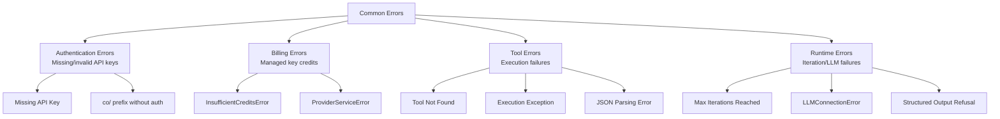
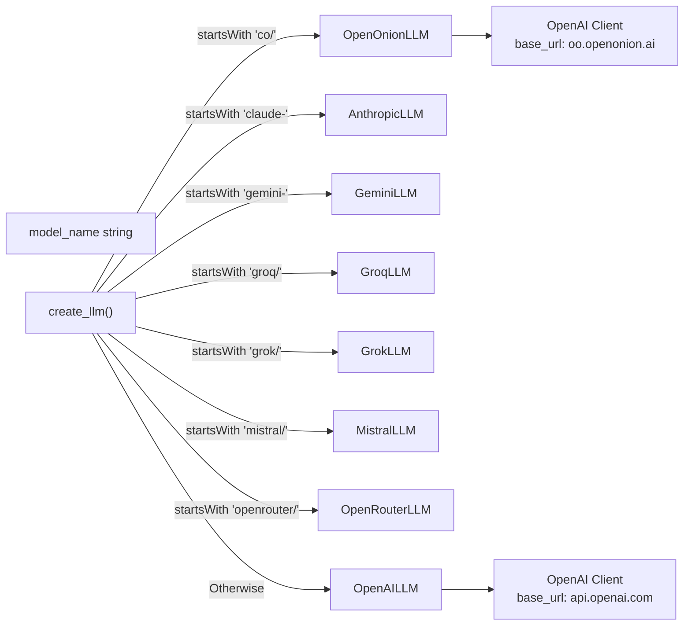

<!-- source: DeepWiki mcp.deepwiki.com · repo openonion/connectonion · page 11.1 Common Errors · fetched 2026-10-27 -->

# Common Errors

<details>
<summary>Relevant source files</summary>

The following files were used as context for generating this wiki page:

- [connectonion/core/exceptions.py](connectonion/core/exceptions.py)
- [connectonion/core/llm.py](connectonion/core/llm.py)
- [docs/concepts/models.md](docs/concepts/models.md)
- [tests/integration/test_memory_integration.py](tests/integration/test_memory_integration.py)
- [tests/unit/test_env_autoload.py](tests/unit/test_env_autoload.py)
- [tests/unit/test_groq_llm.py](tests/unit/test_groq_llm.py)
- [tests/unit/test_llm_errors.py](tests/unit/test_llm_errors.py)
- [tests/unit/test_openonion_llm.py](tests/unit/test_openonion_llm.py)

</details>


## Purpose and Scope

This page catalogs common error messages encountered when using ConnectOnion, their root causes, and technical solutions. It specifically covers implementation details of the LLM provider layer, the tool execution system, and billing-related exceptions.

For general troubleshooting strategies and debugging approaches, see [Troubleshooting](#11). For authentication-specific OAuth and API key setup issues, see [Authentication Problems](#11.3).

---

## Error Categories Overview



Sources: [connectonion/core/llm.py:117-122](), [connectonion/core/exceptions.py:1-120](), [tests/unit/test_llm_errors.py:1-27]()

---

## Authentication & LLM Initialization Errors

### Error: "Missing API key"

**Full Message:**
```
ValueError: OpenAI API key required. Set OPENAI_API_KEY environment variable or pass api_key to constructor.
```

**Cause:** The LLM provider class was initialized without an API key available in either the environment variables or the explicit constructor parameter.

**Technical Implementation:**
The `create_llm` factory function routes to specific provider classes (e.g., `OpenAILLM`, `AnthropicLLM`). Each provider's `__init__` method validates the presence of a key [connectonion/core/llm.py:19-39]().

| Provider Class | Required Environment Variable |
| :--- | :--- |
| `OpenAILLM` | `OPENAI_API_KEY` |
| `AnthropicLLM` | `ANTHROPIC_API_KEY` |
| `GeminiLLM` | `GEMINI_API_KEY` or `GOOGLE_API_KEY` |
| `GroqLLM` | `GROQ_API_KEY` |
| `GrokLLM` | `XAI_API_KEY` |
| `MistralLLM` | `MISTRAL_API_KEY` |
| `OpenRouterLLM` | `OPENROUTER_API_KEY` |
| `OpenOnionLLM` | `OPENONION_API_KEY` |

**Solution:**
Ensure the key is set in a `.env` file in the current working directory. ConnectOnion automatically loads `.env` files upon import [tests/unit/test_env_autoload.py:69-79]().

Sources: [connectonion/core/llm.py:101-112](), [tests/unit/test_llm_errors.py:53-118](), [tests/unit/test_env_autoload.py:151-183]()

---

### Error: "Unknown model"

**Full Message:**
```
ValueError: Unknown model 'unknown-model-xyz-123'.
```

**Cause:** The model name passed to `Agent` or `llm_do` does not match any known provider prefixes in the `create_llm` factory [connectonion/core/llm.py:36-39]().

**Code Entity Space Mapping:**


**Solution:**
Check the model prefix. For managed keys, use the `co/` prefix (e.g., `co/gpt-4o`). For direct provider access, use the native model name or specific prefix [docs/concepts/models.md:41-168]().

Sources: [connectonion/core/llm.py:36-39](), [tests/unit/test_llm_errors.py:130-150](), [docs/concepts/models.md:170-201]()

---

## Managed Key & Billing Errors

### Error: "Insufficient ConnectOnion Credits"

**Full Message:**
```
❌ Insufficient ConnectOnion Credits
Account: 0x...
Balance: $0.0000
Required: $0.0100
Shortfall: $0.0100
```

**Cause:** An `OpenOnionLLM` request returned an HTTP 402 status code from the proxy.

**Implementation:**
The `OpenOnionLLM` catches `openai.APIStatusError` where the status code is 402. It then transforms this into a custom `InsufficientCreditsError` [connectonion/core/exceptions.py:7-9](). This exception parses the JSON body from the API to extract `balance`, `required`, and `shortfall` [connectonion/core/exceptions.py:36-47]().

**Solution:**
1. Run `co status` to check your current balance.
2. Visit the purchase URL provided in the error message to add credits [connectonion/core/exceptions.py:68-71]().

Sources: [connectonion/core/exceptions.py:15-74](), [connectonion/core/llm.py:9-10](), [tests/unit/test_openonion_llm.py:154-162]()

---

## Tool Execution & Structured Output Errors

### Error: "JSON Parsing Error in Tool Arguments"

**Cause:** The LLM returned a tool call with malformed JSON in the `arguments` field.

**Implementation:**
Each provider implementation (e.g., `GroqLLM`, `AnthropicLLM`) attempts to parse tool arguments. If the LLM returns a string that is not valid JSON, the parser fails.
- In `GroqLLM`, it handles both dict and string types for arguments [tests/unit/test_groq_llm.py:190-210]().
- In `AnthropicLLM`, it uses forced tool calling for structured output, which can fail if the model's output doesn't match the schema [connectonion/core/llm.py:28-29]().

**Solution:**
Use a more capable model (like `gpt-4o` or `claude-3-5-sonnet`) which is less likely to produce malformed JSON. If using custom tools, ensure descriptions are clear to guide the LLM's parameter generation.

Sources: [tests/unit/test_llm_errors.py:26-27](), [tests/unit/test_groq_llm.py:190-210](), [connectonion/core/llm.py:43-51]()

---

### Error: Structured Output Refusal

**Full Message:**
```
ValueError: OpenAI structured output refusal: [reason]
```

**Cause:** The model refused to generate output matching the requested Pydantic schema, often due to safety filters or context window limits.

**Implementation:**
- **OpenAI:** `OpenAILLM` uses `responses.parse()` and checks `mock_response.status == "incomplete"` or `refusal` [tests/unit/test_llm_errors.py:155-184]().
- **Anthropic:** Uses forced tool calling. If the model fails to call the tool or provides invalid JSON, a `ValueError` is raised [connectonion/core/llm.py:28-29]().

**Solution:**
1. Check if the input prompt triggers safety filters.
2. Increase `max_tokens` if the output is being truncated [tests/unit/test_llm_errors.py:155-171]().

Sources: [tests/unit/test_llm_errors.py:152-184](), [connectonion/core/llm.py:43-47]()

---

## Connection & Provider Errors

### Error: "LLMConnectionError"

**Cause:** The request timed out or failed to reach the LLM provider's endpoint.

**Implementation:**
The `LLMConnectionError` class formats a message containing the `model`, `base_url`, and the underlying `error_type` (e.g., `ConnectTimeout`) [connectonion/core/exceptions.py:84-115](). It suggests checking connectivity or running a health check against the OpenOnion proxy [connectonion/core/exceptions.py:112]().

**Solution:**
- Verify internet connectivity.
- Check if a VPN or Proxy is interfering with the request.
- Run `curl https://oo.openonion.ai/health` to verify the managed key service status [connectonion/core/exceptions.py:112]().

Sources: [connectonion/core/exceptions.py:77-115](), [connectonion/core/llm.py:9-10]()

---

### Error: "Provider Service Error (HTTP 503)"

**Cause:** The upstream LLM provider (OpenAI, Anthropic, etc.) is experiencing a service outage or temporary instability.

**Implementation:**
The `ProviderServiceError` captures the HTTP status code and the error detail from the provider's response body [connectonion/core/exceptions.py:118-138]().

**Solution:**
Wait and retry the request later. Check the official status pages of the respective provider (e.g., status.openai.com).

Sources: [connectonion/core/exceptions.py:118-140]()

---

