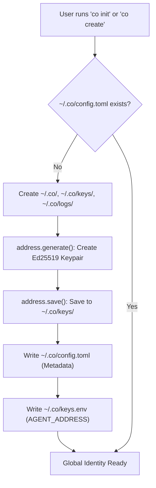
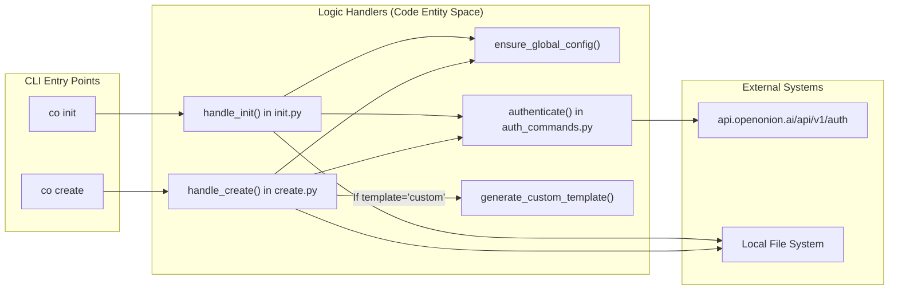

<!-- source: DeepWiki mcp.deepwiki.com · repo openonion/connectonion · page 2.1 Installation · fetched 2026-10-27 -->

# Installation

<details>
<summary>Relevant source files</summary>

The following files were used as context for generating this wiki page:

- [README.md](README.md)
- [connectonion/cli/commands/auth_commands.py](connectonion/cli/commands/auth_commands.py)
- [connectonion/cli/commands/create.py](connectonion/cli/commands/create.py)
- [connectonion/cli/commands/init.py](connectonion/cli/commands/init.py)
- [connectonion/cli/commands/project_cmd_lib.py](connectonion/cli/commands/project_cmd_lib.py)
- [connectonion/cli/commands/reset_commands.py](connectonion/cli/commands/reset_commands.py)
- [connectonion/cli/commands/status_commands.py](connectonion/cli/commands/status_commands.py)
- [docs/README.md](docs/README.md)
- [docs/quickstart.md](docs/quickstart.md)
- [docs/templates/README.md](docs/templates/README.md)
- [docs/templates/meta-agent.md](docs/templates/meta-agent.md)
- [docs/templates/minimal.md](docs/templates/minimal.md)
- [docs/templates/playwright.md](docs/templates/playwright.md)
- [docs/templates/web-research.md](docs/templates/web-research.md)

</details>


This page covers installing ConnectOnion, system requirements, and environment setup. ConnectOnion is designed to be production-ready out of the box, handling everything from API key management to directory scaffolding via its CLI.

---

## System Requirements

ConnectOnion requires Python 3.10 or higher. It is cross-platform and supports Linux, macOS, and Windows.

| Component | Requirement | Source |
|-----------|-------------|--------|
| **Python** | `3.10+` | [README.md:7]() |
| **Operating Systems** | Linux, macOS, Windows | [README.md:7]() |
| **Package Manager** | `pip` | [docs/quickstart.md:8]() |

**Key Dependencies:**
- `rich`: For terminal UI and progress animations [connectonion/cli/commands/project_cmd_lib.py:18-23]()
- `requests`: For authentication and backend communication [connectonion/cli/commands/auth_commands.py:15]()
- `toml`: For configuration management [connectonion/cli/commands/init.py:16]()
- `Ed25519 (via address module)`: For secure identity and signing [connectonion/cli/commands/auth_commands.py:25]()

Sources: [README.md:7](), [docs/quickstart.md:8](), [connectonion/cli/commands/project_cmd_lib.py:18-23]()

---

## Installation Methods

### Via pip (Recommended)

The framework is distributed via PyPI. This installs both the library and the `co` CLI tool.

```bash
pip install connectonion
```

Sources: [docs/quickstart.md:8](), [docs/README.md:59]()

---

## Post-Installation: Global Setup

Upon first run of any project command (`co init` or `co create`), ConnectOnion initializes a global configuration directory at `~/.co/`. This directory stores your agent's unique identity and managed API keys.

### Global Configuration Initialization Flow



**Implementation Details:**
- **Identity:** ConnectOnion generates an Ed25519 keypair for every user [connectonion/cli/commands/init.py:67-68](). This keypair is used to sign requests to the OpenOnion backend.
- **Address:** Your "Agent Address" is derived from your public key [connectonion/cli/commands/init.py:70]().
- **Permissions:** On Unix-like systems, `keys.env` is created with `0o600` permissions to protect your secrets [connectonion/cli/commands/init.py:105]().

Sources: [connectonion/cli/commands/init.py:47-117](), [connectonion/cli/commands/create.py:45-115]()

---

## Project Initialization

Once the global setup is complete, you can initialize a specific project. This sets up the local environment and authenticates you with the managed LLM provider.

### The `co init` vs `co create` Commands

| Command | Behavior | When to use |
|---------|----------|-------------|
| `co init` | Initializes ConnectOnion in the **current** directory. | You already have a folder for your project. |
| `co create <name>` | Creates a **new** directory and initializes it. | You are starting a fresh project from scratch. |

### Data Flow: From CLI to Code Entities

The following diagram bridges the natural language commands to the internal functions that handle the setup logic.



Sources: [connectonion/cli/commands/init.py:120-124](), [connectonion/cli/commands/create.py:118-122](), [connectonion/cli/commands/auth_commands.py:84]()

---

## Authentication & Managed Keys

ConnectOnion provides "Managed Keys" (prefixed with `co/`, e.g., `co/gemini-2.5-pro`) so you don't have to manage individual provider API keys.

### Authentication Process (`authenticate`)
1. **Load Keys:** Loads the Ed25519 keypair from `~/.co/keys/` [connectonion/cli/commands/auth_commands.py:96]().
2. **Sign Challenge:** Creates a timestamped message and signs it with the private key [connectonion/cli/commands/auth_commands.py:104-106]().
3. **Verify:** Sends the public key, message, and signature to `https://oo.openonion.ai/api/v1/auth` [connectonion/cli/commands/auth_commands.py:109-115]().
4. **JWT Retrieval:** The backend verifies the signature and returns a JWT token [connectonion/cli/commands/auth_commands.py:119]().
5. **Storage:** The token is saved as `OPENONION_API_KEY` in `~/.co/keys.env` and the project's `.env` [connectonion/cli/commands/auth_commands.py:136-184]().

Sources: [connectonion/cli/commands/auth_commands.py:84-208]()

---

## Directory Structure Reference

After a successful `co create` or `co init`, your project will look like this:

```text
my-agent/
├── agent.py               # Main agent file (entry point)
├── .env                   # Local API keys (OPENONION_API_KEY, etc.)
├── .gitignore             # Standard ignores plus .co/ metadata
├── requirements.txt       # Project dependencies
└── .co/                   # ConnectOnion Project Metadata
    ├── config.toml        # Project-specific settings
    └── docs/              # Embedded framework documentation for AI
```

### Key Files Created:
- **`agent.py`**: Generated from a template (e.g., `minimal`, `browser`, `coder`) [connectonion/cli/commands/project_cmd_lib.py:116-124]().
- **`.env`**: Automatically populated with your `OPENONION_API_KEY` and `AGENT_ADDRESS` [connectonion/cli/commands/auth_commands.py:30-82]().
- **`.co/config.toml`**: Stores project metadata like the creation date and template type [connectonion/cli/commands/init.py:369-393]().

Sources: [docs/quickstart.md:213-222](), [connectonion/cli/commands/init.py:369-393](), [connectonion/cli/commands/auth_commands.py:30-82]()

---

## Troubleshooting Installation

### Resetting Configuration
If your global configuration becomes corrupted or you wish to start with a fresh identity, use the reset command.

```bash
co reset
```
**Warning:** This is a destructive operation. It deletes `~/.co/keys/`, `~/.co/config.toml`, and `~/.co/keys.env`, effectively creating a brand new account identity [connectonion/cli/commands/reset_commands.py:64-78]().

### Checking Status
To verify your installation and see your current balance/identity:
```bash
co status
```
This function calls the backend to retrieve fresh user data using your signed identity [connectonion/cli/commands/status_commands.py:120-135]().

Sources: [connectonion/cli/commands/reset_commands.py:26-150](), [connectonion/cli/commands/status_commands.py:77-169]()

---

