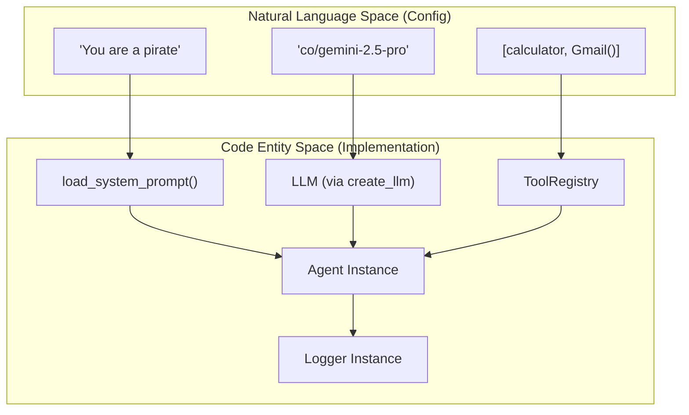
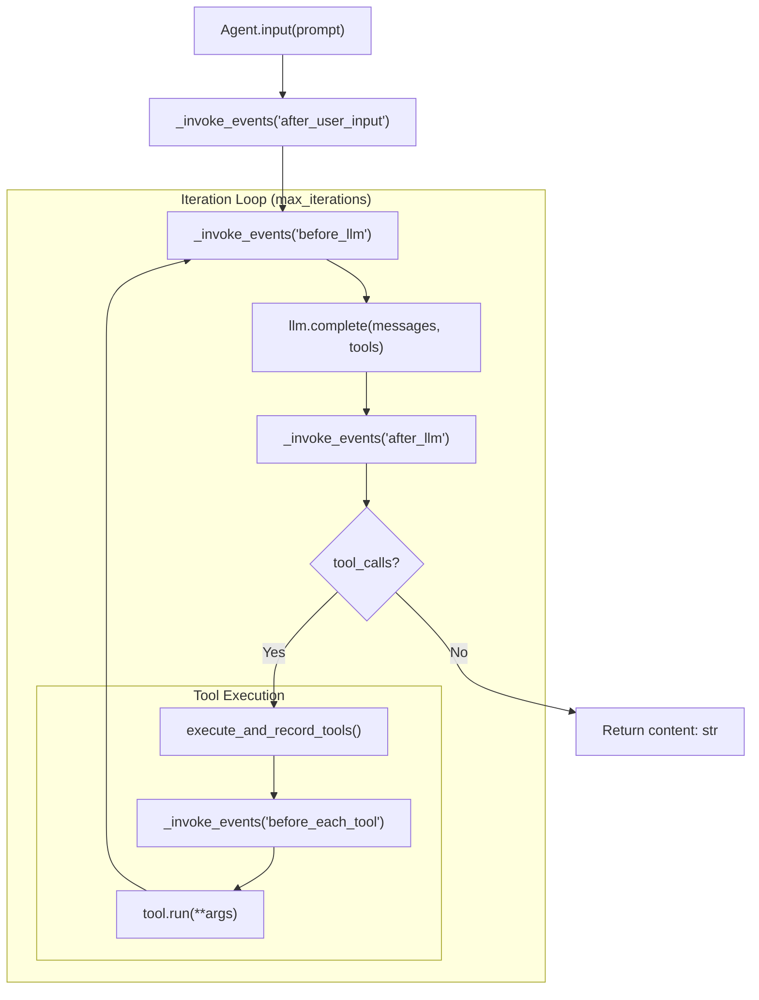
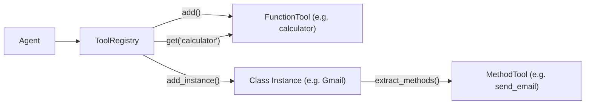

<!-- source: DeepWiki mcp.deepwiki.com · repo openonion/connectonion · page 3.1 Agent Architecture · fetched 2026-10-27 -->

# Agent Architecture

<details>
<summary>Relevant source files</summary>

The following files were used as context for generating this wiki page:

- [.gitignore](.gitignore)
- [CLAUDE.md](CLAUDE.md)
- [connectonion/core/agent.py](connectonion/core/agent.py)
- [connectonion/logger.py](connectonion/logger.py)
- [docs/api.md](docs/api.md)
- [docs/concepts/tools.md](docs/concepts/tools.md)
- [examples/browser-agent/CLAUDE.md](examples/browser-agent/CLAUDE.md)
- [examples/browser-agent/web_automation.py](examples/browser-agent/web_automation.py)
- [tests/real_api/manual/manual_defaults.py](tests/real_api/manual/manual_defaults.py)
- [tests/unit/test_agent.py](tests/unit/test_agent.py)
- [tests/unit/test_logger.py](tests/unit/test_logger.py)
- [tests/unit/test_tool_executor.py](tests/unit/test_tool_executor.py)
- [tests/unit/test_tool_executor_errors.py](tests/unit/test_tool_executor_errors.py)
- [tests/unit/test_tool_factory.py](tests/unit/test_tool_factory.py)

</details>


This page documents the `Agent` class, its execution loop, session management, and lifecycle. The Agent is the core orchestrator that coordinates LLM calls, tool execution, and event handling.

For LLM provider details, see [LLM Integration](3.2). For tool creation patterns, see [Tools System](3.3). For event hook details, see [Event System](3.4).

---

## Agent Class Overview

The `Agent` class is the main entry point for creating AI agents. It orchestrates:
- **LLM Communication**: Manages conversation with language model providers [connectonion/core/agent.py:133-143]()
- **Tool Execution**: Discovers, validates, and executes tools via `ToolExecutor` [connectonion/core/agent.py:27]()
- **Event System**: Fires lifecycle hooks for plugins [connectonion/core/agent.py:78-92]()
- **Session Management**: Tracks conversation state across turns in `current_session` [connectonion/core/agent.py:55]()
- **Logging**: Records all activities to console and files via `Logger` [connectonion/core/agent.py:73]()

Sources: [connectonion/core/agent.py:31-48](), [CLAUDE.md:13-15]()

---

## Agent Initialization

### Constructor Parameters

The `Agent` class constructor accepts the following parameters:

| Parameter | Type | Default | Description |
|-----------|------|---------|-------------|
| `name` | `str` | Required | Unique identifier for agent (used in logs) |
| `model` | `str` | `"co/gemini-2.5-pro"` | Model to use (OpenAI, Anthropic, Gemini, or `co/*` managed) |
| `tools` | `List[Callable]` | `None` | Functions or class instances to expose as tools |
| `system_prompt` | `Union[str, Path]` | Default prompt | Agent personality and instructions |
| `max_iterations` | `int` | `100` | Maximum tool-calling loops per input |
| `plugins` | `List` | `None` | Event handler bundles |
| `on_events` | `List` | `None` | Individual event handlers |
| `quiet` | `bool` | `False` | Suppress console output |
| `log` | `Union[bool, str]` | `None` | Enable file logging or custom path |
| `llm` | `LLM` | `None` | Custom LLM instance (overrides `model`) |
| `api_key` | `str` | `None` | API key for LLM provider |

Sources: [connectonion/core/agent.py:34-48](), [docs/api.md:10-33]()

### Initialization Flow

Initialization bridges the configuration space to the active code entities.

**Diagram: Initialization Entity Mapping**


**Key initialization steps:**
1. **LLM Creation**: `create_llm()` factory routes model string to appropriate provider class [connectonion/core/agent.py:137-143]()
2. **Logger Setup**: `Logger` instance manages console output, plain text logs, and session YAML [connectonion/core/agent.py:73]()
3. **Tool Registry**: `ToolRegistry` stores tools with O(1) lookup [connectonion/core/agent.py:112]()
4. **Tool Processing**: Functions converted via `create_tool_from_function()`, class instances have methods extracted automatically [connectonion/core/agent.py:118-131]()
5. **Event Registration**: Handlers organized by event type in `self.events` [connectonion/core/agent.py:78-92]()

Sources: [connectonion/core/agent.py:49-143](), [connectonion/core/tool_factory.py:20]()

---

## Session Management

### Session State Structure

Each agent maintains a `current_session` dictionary during execution:

```python
current_session = {
    "messages": [           # OpenAI-format conversation history
        {"role": "system", "content": "..."},
        {"role": "user", "content": "..."},
        {"role": "assistant", "tool_calls": [...]},
        {"role": "tool", "tool_call_id": "...", "content": "..."}
    ],
    "trace": [              # Execution trace for debugging
        {
            "type": "tool_result",
            "name": "calculator",
            "args": {"expression": "2+2"},
            "result": "4",
            "status": "success"
        }
    ],
    "turn": 1,              # Current turn number
    "iteration": 1          # Current iteration within this turn
}
```

### Multi-Turn Conversations

Sessions persist across multiple `agent.input()` calls, providing context for subsequent requests. The `messages` list grows with each turn.

Sources: [connectonion/core/agent.py:5-6](), [connectonion/logger.py:204-221]()

---

## Execution Loop

### High-Level Flow

The `agent.input(prompt)` method implements the core execution loop.

**Diagram: Execution Loop Data Flow**


### Detailed Loop Phases

**Phase 1: Initialization**
- User message appended to `current_session["messages"]`.
- `after_user_input` event fires [CLAUDE.md:32]().

**Phase 2: LLM Decision Loop** (repeats up to `max_iterations` [connectonion/core/agent.py:52]())
- `before_llm` event fires [CLAUDE.md:34]().
- `llm.complete()` called with history and tool schemas [CLAUDE.md:35]().
- `after_llm` event fires [CLAUDE.md:36]().

**Phase 3: Tool Execution** (if `tool_calls` present)
- `before_tools` event fires ONCE before batch [CLAUDE.md:38]().
- `execute_and_record_tools()` runs each tool [CLAUDE.md:37]().
- `before_each_tool` and `after_each_tool` fire per tool [CLAUDE.md:39]().
- `after_tools` event fires ONCE after batch [CLAUDE.md:40]().
- Results appended to `messages`, loop continues [CLAUDE.md:41]().

Sources: [CLAUDE.md:30-42](), [connectonion/core/agent.py:5-9]()

---

## Lifecycle Hooks

The Agent fires events at distinct points:

| Event | Timing |
|-------|--------|
| `after_user_input` | After user message added |
| `before_llm` | Before LLM call |
| `after_llm` | After LLM response |
| `before_tools` | Before all tools in a batch |
| `before_each_tool` | Before each individual tool |
| `after_each_tool` | After each individual tool |
| `after_tools` | After all tools in a batch |
| `on_error` | When execution fails |
| `on_complete` | When turn completes |

Sources: [connectonion/core/agent.py:78-92](), [connectonion/core/events.py:11]()

---

## Tool Registry

The `ToolRegistry` manages tool access and instance storage.

**Diagram: Tool Registry Architecture**


**Access Patterns:**
- **By name**: `agent.tools.get("calculator")` [connectonion/core/agent.py:8]()
- **By attribute**: `agent.tools.calculator` [connectonion/core/agent.py:7]()
- **Instance access**: `agent.tools.gmail` (for stateful objects) [connectonion/core/agent.py:7]()

Sources: [connectonion/core/agent.py:112-131](), [connectonion/core/tool_registry.py]()

---

## Logging and Observability

The `Logger` class provides three output destinations:
1. **Console**: Rich-formatted terminal output [connectonion/logger.py:154]()
2. **Plain text**: `.co/logs/{name}.log` [connectonion/logger.py:155]()
3. **Session YAML**: `.co/evals/{slug}.yaml` for replays [connectonion/logger.py:156]()

Sources: [connectonion/logger.py:44-72](), [docs/api.md:151-157]()

---

## Error Handling

### Tool Execution Errors
When a tool raises an exception:
- Exception is captured and formatted as a string [connectonion/core/tool_executor.py:180-202]().
- `status` is set to `"error"` in the trace [tests/unit/test_tool_executor_errors.py:180]().
- Error details are returned to the LLM as a tool result message [tests/unit/test_tool_executor_errors.py:147]().
- `on_error` event fires [tests/unit/test_tool_executor_errors.py:213]().

### Tool Not Found
- Non-existent tools return a `"not_found"` status [tests/unit/test_tool_executor_errors.py:90]().
- An error message is injected into the conversation: `"Tool '{name}' not found"` [tests/unit/test_tool_executor_errors.py:147]().

Sources: [tests/unit/test_tool_executor_errors.py:62-215](), [connectonion/core/tool_executor.py:108-119]()

---

