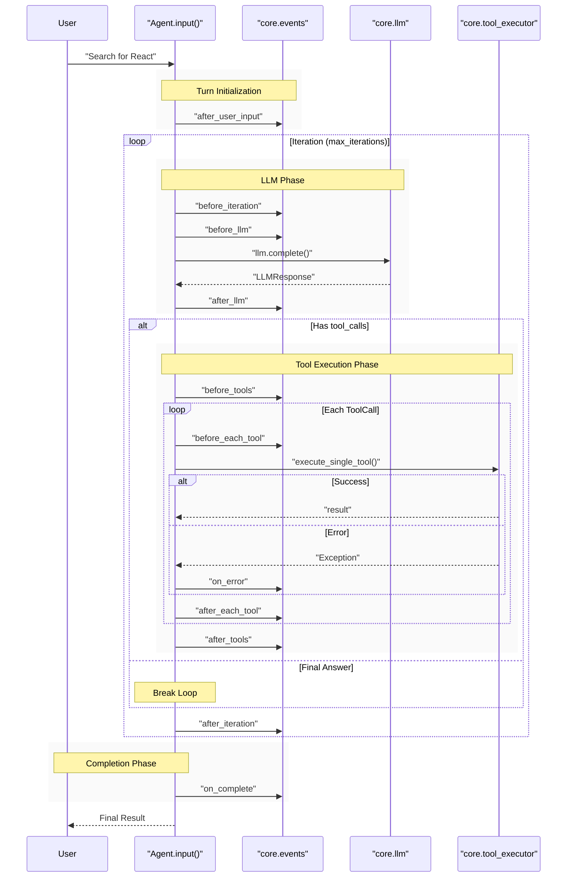

<!-- source: DeepWiki mcp.deepwiki.com · repo openonion/connectonion · page 3.4 Event System · fetched 2026-10-27 -->

# Event System

<details>
<summary>Relevant source files</summary>

The following files were used as context for generating this wiki page:

- [connectonion/core/__init__.py](connectonion/core/__init__.py)
- [connectonion/core/events.py](connectonion/core/events.py)
- [docs/concepts/events.md](docs/concepts/events.md)
- [docs/hook-system-options.md](docs/hook-system-options.md)
- [examples/events_example.py](examples/events_example.py)
- [tests/unit/test_events.py](tests/unit/test_events.py)

</details>


## Purpose and Scope

ConnectOnion's event system provides a robust mechanism to hook into the agent lifecycle. It allows developers to add custom behavior—such as logging, performance monitoring, automated reasoning, or approval workflows—without modifying the core execution engine. The system is designed around the `Agent` instance, providing handlers with full access to the session state, message history, and execution trace.

---

## Event Lifecycle Overview

The agent lifecycle is divided into **Turns** (a single `agent.input()` call) and **Iterations** (the LLM decision cycle of thinking and tool execution). Events fire at specific transition points within these cycles.

### Agent Execution Timeline

The following diagram maps the natural language lifecycle to the specific code entities and event hooks invoked within `Agent.input()`.

**Title: Agent Lifecycle and Event Hook points**

**Sources:** [docs/concepts/events.md:83-122](), [connectonion/core/events.py:21-200](), [connectonion/core/agent.py:1-100]()

---

## Event Handler Implementation

Event handlers are functions that accept the `Agent` instance as their only argument [connectonion/core/events.py:18](). They are registered using wrapper functions (or decorators) that tag the function with a specific `_event_type` attribute [connectonion/core/events.py:38]().

### Registration Syntax
ConnectOnion supports two styles of registration. The wrapper style is recommended for clarity.

| Style | Example |
| :--- | :--- |
| **Wrapper** | `on_events=[after_llm(my_handler)]` |
| **Decorator** | `@after_llm` <br> `def my_handler(agent): ...` |

**Sources:** [docs/concepts/events.md:48-58](), [connectonion/core/events.py:28-36]()

### Accessing Session State
Handlers can inspect and modify the `agent.current_session` object, which contains the conversation history and execution trace [docs/concepts/events.md:138-155]().

```python
def my_event_handler(agent: Agent):
    # Access full conversation
    messages = agent.current_session['messages']
    
    # Access execution history
    last_trace = agent.current_session['trace'][-1]
    
    # Check current iteration number
    iter_count = agent.current_session['iteration']
```
**Sources:** [docs/concepts/events.md:138-144](), [connectonion/core/events.py:5-7]()

---

## Event Types Reference

| Event Hook | Timing | Frequency | Primary Use Case |
| :--- | :--- | :--- | :--- |
| `after_user_input` | After user prompt is added to session | Once per turn | Initialize state, add timestamps |
| `before_iteration` | Start of each LLM/Tool cycle | Per iteration | Poll IO, check mode changes |
| `before_llm` | Before calling the LLM API | Per LLM call | Modify messages/system prompt |
| `after_llm` | After LLM returns a response | Per LLM call | Log tokens, analyze reasoning |
| `before_tools` | Before the first tool in a batch starts | Per batch | User approval for a group of actions |
| `before_each_tool`| Before an individual tool executes | Per tool call | Validate arguments, pre-execution checks |
| `after_each_tool` | After an individual tool finishes | Per tool call | Log performance, per-tool cleanup |
| `after_tools` | After all tools in a batch complete | Per batch | **Safe message injection**, reflection |
| `on_error` | When a tool raises an exception | Per error | Custom retries, error logging |
| `after_iteration` | End of iteration (after tools) | Per iteration | Checkpoints, loop control |
| `on_complete` | After agent finishes the turn | Once per turn | Final metrics, cleanup |

**Sources:** [docs/concepts/events.md:62-77](), [connectonion/core/events.py:21-200]()

---

## Data Flow: The Trace System

The `trace` list within `agent.current_session` provides the context for events. Handlers typically inspect the most recent entry to determine what just occurred [docs/concepts/events.md:162-163]().

**Title: Event Data Association in Session Trace**
```mermaid
classDiagram
    class Agent {
        +dict current_session
        +list on_events
    }
    class Session {
        +list messages
        +list trace
        +int iteration
        +dict pending_tool
    }
    class TraceEntry {
        +string type
        +float duration_ms
        +string status
    }
    class LLMTrace {
        +string model
        +int tool_calls_count
    }
    class ToolTrace {
        +string name
        +dict args
        +any result
        +string error
    }

    Agent --> Session : "manages"
    Session --> TraceEntry : "contains history"
    TraceEntry <|-- LLMTrace : "type: llm_call"
    TraceEntry <|-- ToolTrace : "type: tool_result"
```
**Sources:** [docs/concepts/events.md:157-189](), [examples/events_example.py:38-60]()

---

## Critical Implementation Notes

### Message Injection and Provider Compatibility
When adding messages to `agent.current_session['messages']` (e.g., for reflection or planning), developers should use the `after_tools` hook rather than `after_each_tool` [docs/concepts/events.md:79]().
* **Reason:** Certain providers (like Anthropic Claude) require that all tool results immediately follow the tool calls in the message sequence. Injecting a message via `after_each_tool` when multiple tools are requested will interleave results and break API compatibility [examples/events_example.py:14-16]().

### Error Handling in Events
Exceptions raised within an event handler are not caught by the agent; they propagate immediately and stop the agent execution ("fail fast") [connectonion/core/events.py:9]().

### Tool Cancellation
In the `before_each_tool` event, the tool about to be executed is available in `agent.current_session['pending_tool']` [docs/concepts/events.md:147](). Raising an exception here will cancel the tool execution and trigger the `on_error` event [connectonion/core/events.py:136]().

**Sources:** [docs/concepts/events.md:79](), [connectonion/core/events.py:9](), [connectonion/core/events.py:186-191]()

---

