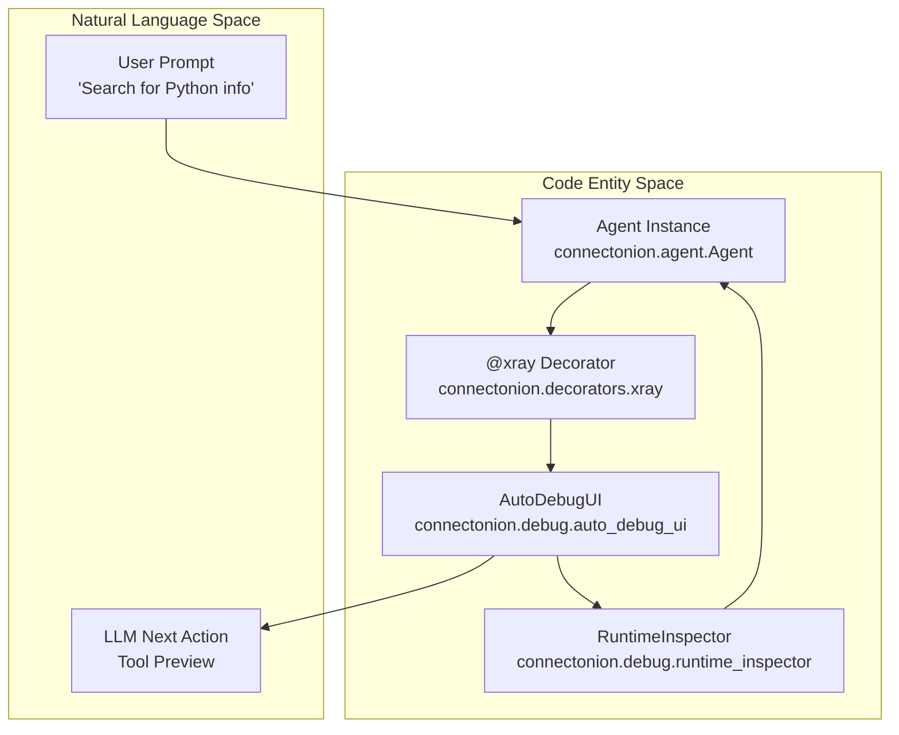
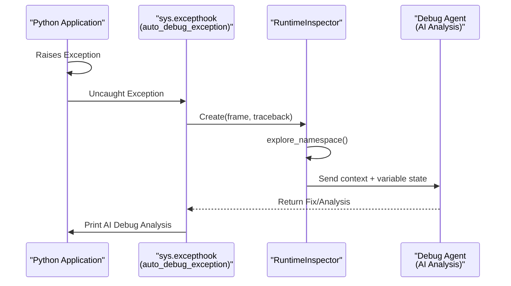

<!-- source: DeepWiki mcp.deepwiki.com · repo openonion/connectonion · page 4.2 Interactive Debugging · fetched 2026-10-27 -->

# Interactive Debugging

<details>
<summary>Relevant source files</summary>

The following files were used as context for generating this wiki page:

- [docs/debug/auto_debug.md](docs/debug/auto_debug.md)
- [docs/debug/xray.md](docs/debug/xray.md)
- [examples/simple-agent/.gitignore](examples/simple-agent/.gitignore)
- [examples/simple-agent/README.md](examples/simple-agent/README.md)
- [examples/simple-agent/agent.py](examples/simple-agent/agent.py)
- [examples/simple-agent/agent_debug.py](examples/simple-agent/agent_debug.py)
- [examples/simple-agent/test_e2e.py](examples/simple-agent/test_e2e.py)
- [examples/simple-agent/test_network.py](examples/simple-agent/test_network.py)
- [examples/simple-agent/tests/test_api_integration.py](examples/simple-agent/tests/test_api_integration.py)
- [examples/simple-agent/tests/test_debug_features.py](examples/simple-agent/tests/test_debug_features.py)
- [examples/simple-agent/tests/test_models.py](examples/simple-agent/tests/test_models.py)
- [tests/unit/test_auto_debug_exception.py](tests/unit/test_auto_debug_exception.py)
- [tests/unit/test_runtime_inspector.py](tests/unit/test_runtime_inspector.py)

</details>


## Purpose and Scope

This document covers ConnectOnion's interactive debugging capabilities that allow developers to inspect and modify agent behavior during execution. The framework provides three primary debugging mechanisms:

1.  **`@xray` decorator**: Marks tools for runtime introspection and serves as a breakpoint trigger.
2.  **`agent.auto_debug()` mode**: Enables an interactive terminal UI for breakpoint management, variable inspection, and next-action prediction.
3.  **`auto_debug_exception()`**: A global hook that triggers AI-powered runtime analysis when uncaught exceptions occur.

Sources: [connectonion/__init__.py:7-34](), [docs/debug/auto_debug.md:24-43]()

---

## Debugging Architecture Overview

The debugging system bridges the gap between the LLM's decision-making loop and the Python runtime. It uses a global `xray` context to track session state across tool calls.

**Diagram: Interactive Debugging Flow**



Sources: [connectonion/debug/auto_debug_ui.py:35-36](), [connectonion/debug/runtime_inspector/runtime_inspector.py:20-22](), [examples/simple-agent/agent_debug.py:29-105]()

---

## The @xray Decorator

The `@xray` decorator marks functions as "transparent" to the debugger. In standard execution, it provides context access; in `auto_debug()` mode, it acts as a breakpoint.

### Context Access
Inside an `@xray` decorated function, the `xray` object provides:
*   `xray.agent`: The active `Agent` instance [docs/debug/xray.md:29]().
*   `xray.task`: The original user request [docs/debug/xray.md:30]().
*   `xray.iteration`: Current tool-use loop count [docs/debug/xray.md:32]().
*   `xray.previous_tools`: History of tools called in this session [docs/debug/xray.md:33]().

### Implementation Example
```python
@xray
def search_info(query: str) -> str:
    """Search for info. Will pause in debug mode."""
    # Access context directly
    if "python" in query.lower():
        return f"Context: {xray.task} | Result: Python is high-level."
    return f"Results for {query}"
```
Sources: [examples/simple-agent/agent_debug.py:29-45](), [docs/debug/xray.md:10-20]()

---

## Interactive Debugging with auto_debug()

Calling `agent.auto_debug(task)` launches the `AutoDebugger` [connectonion/debug/auto_debug.py:36](), which manages the execution loop with interactive pauses.

### Breakpoint Actions
When a tool with `@xray` is called, the `AutoDebugUI` [connectonion/debug/auto_debug_ui.py:35]() presents a menu:

| Action | Shortcut | Description |
| :--- | :--- | :--- |
| **Continue** | `c` / Enter | Resumes execution [docs/debug/auto_debug.md:151-165](). |
| **Edit** | `e` | Opens a Python REPL to modify local variables [docs/debug/auto_debug.md:237-245](). |
| **Quit** | `q` | Terminates the session [docs/debug/auto_debug.md:13-14](). |
| **Preview** | (Auto) | Displays the LLM's planned next step [examples/simple-agent/agent_debug.py:119](). |

### Variable Modification (REPL)
The `Edit` mode allows developers to manipulate the `result` or `tool_args` before they are returned to the LLM. This is useful for testing edge cases or correcting hallucinated parameters.

Sources: [docs/debug/auto_debug.md:117-148](), [examples/simple-agent/tests/test_debug_features.py:188-218]()

---

## AI-Powered Runtime Inspection

ConnectOnion includes a `RuntimeInspector` [connectonion/debug/runtime_inspector/runtime_inspector.py:20]() that can be triggered automatically on exceptions using `auto_debug_exception()`.

**Diagram: Exception Analysis Flow**



Sources: [connectonion/debug/auto_debug_exception.py:23](), [tests/unit/test_auto_debug_exception.py:83-129]()

### Key Inspector Capabilities
The `RuntimeInspector` provides tools for the AI to "probe" the crashed state:
*   `execute_in_frame(code)`: Runs arbitrary Python in the local scope of the crash [tests/unit/test_runtime_inspector.py:72-83]().
*   `validate_assumption(code)`: Checks if a hypothesis about the state is True/False [tests/unit/test_runtime_inspector.py:156-177]().
*   `test_fix(original, fixed)`: Compares the output of the failing code vs. a proposed fix [tests/unit/test_runtime_inspector.py:138-154]().

Sources: [tests/unit/test_runtime_inspector.py:23-220]()

---

## Usage Summary

| Feature | Setup | Best For |
| :--- | :--- | :--- |
| **Passive Xray** | `@xray` decorator | Logging context without stopping execution. |
| **Interactive Debug** | `agent.auto_debug()` | Step-through execution and manual state editing. |
| **Auto-Exception** | `auto_debug_exception()` | Post-mortem analysis of crashes in complex agents. |

Sources: [docs/debug/auto_debug.md:9-19](), [examples/simple-agent/agent_debug.py:77-142]()

---

