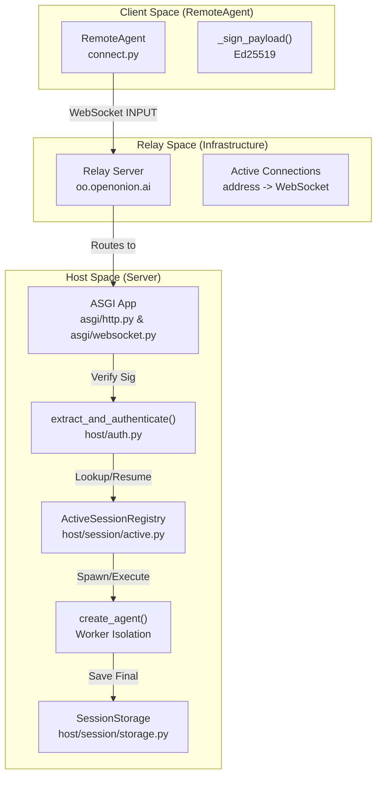
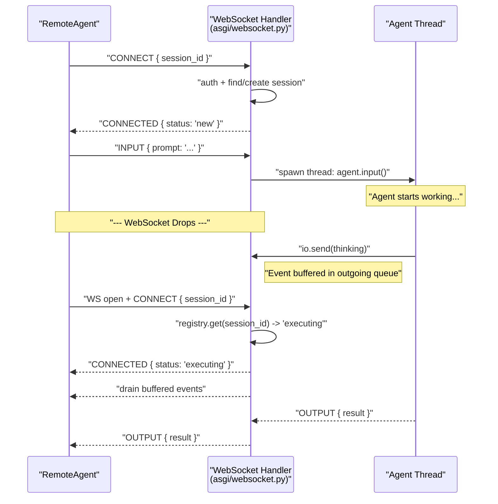

<!-- source: DeepWiki mcp.deepwiki.com · repo openonion/connectonion · page 5 Multi-Agent Networking · fetched 2026-10-27 -->

# Multi-Agent Networking

<details>
<summary>Relevant source files</summary>

The following files were used as context for generating this wiki page:

- [connectonion/network/asgi/http.py](connectonion/network/asgi/http.py)
- [connectonion/network/asgi/websocket.py](connectonion/network/asgi/websocket.py)
- [connectonion/network/connect.py](connectonion/network/connect.py)
- [connectonion/network/host/routes.py](connectonion/network/host/routes.py)
- [connectonion/network/host/server.py](connectonion/network/host/server.py)
- [connectonion/network/host/session/active.py](connectonion/network/host/session/active.py)
- [docs/network/README.md](docs/network/README.md)
- [docs/network/connect.md](docs/network/connect.md)
- [docs/network/session-reconnect.md](docs/network/session-reconnect.md)
- [docs/network/websocket-protocol.md](docs/network/websocket-protocol.md)
- [tests/unit/test_asgi_http.py](tests/unit/test_asgi_http.py)
- [tests/unit/test_host_routes.py](tests/unit/test_host_routes.py)
- [tests/unit/test_host_session.py](tests/unit/test_host_session.py)

</details>


Multi-agent networking enables ConnectOnion agents to communicate over networks. An agent can be deployed as a network service using `host()`, and other agents or clients can interact with it using `connect()`. This creates a distributed system where agents can collaborate across machines, networks, and organizations.

**Scope of this page:** This page provides an architectural overview of ConnectOnion's multi-agent networking capabilities. It covers the core primitives (`host()`, `connect()`, P2P relay), message flow, and design principles. For detailed usage and configuration:
- Hosting agents as network services: see [Hosting Agents](#5.1)
- Connecting to remote agents: see [Connecting to Remote Agents](#5.2)  
- Trust, signatures, and onboarding: see [Trust & Authentication](#5.3)
- Discovery and routing infrastructure: see [P2P Relay System](#5.4)

## Core Components

ConnectOnion's networking layer consists of three main components:

| Component | Purpose | Primary Code Entity |
|-----------|---------|---------------------|
| **Host** | Deploys an agent as HTTP/WebSocket service | `host()` in [connectonion/network/host/server.py:10-26]() |
| **Connect** | Creates proxy to remote agent | `connect()` in [connectonion/network/connect.py:255-276]() |
| **P2P Relay** | Discovery and message routing hub | `wss://oo.openonion.ai` [docs/network/connect.md:23-25]() |

### host()

The `host()` function transforms a local `Agent` instance into a network service. It creates an ASGI application that supports both HTTP and WebSocket protocols.

```python
from connectonion import Agent, host

agent = Agent("assistant", tools=[search, calculate])
host(agent)  # Now accessible via HTTP/WebSocket
```

Key features of a hosted agent:
- **Isolation**: Each request calls a factory to get a fresh agent instance, preventing state bleeding [connectonion/network/host/server.py:22-26]().
- **Trust**: Configurable levels ("open", "careful", "strict") enforced at the request boundary [connectonion/network/host/server.py:15-21]().
- **Persistence**: Sessions are stored in a JSONL `SessionStorage` for durability and recovery [connectonion/network/host/server.py:37]().

### connect()

The `connect()` function creates a `RemoteAgent` instance that communicates with a hosted agent. It supports real-time UI updates via WebSockets and handles session synchronization automatically.

```python
from connectonion import connect

remote = connect("0x3d4017c3e843895a92b70aa74d1b7ebc9c982ccf")
response = remote.input("Search for Python docs")
```

The `RemoteAgent` provides a `.ui` property that contains transformed events (like merged tool calls and results) suitable for rendering in a chat interface [connectonion/network/connect.py:156-165]().

### P2P Relay

The relay server facilitates communication when direct IP access is unavailable. Agents `ANNOUNCE` their presence to the relay, and clients route `INPUT` messages through it [docs/network/connect.md:53-69]().

Sources: [connectonion/network/host/server.py:1-26](), [connectonion/network/connect.py:111-127](), [docs/network/connect.md:1-49]()

## System Architecture

The following diagram bridges the high-level networking concepts to the specific code entities that implement them.



**Architecture Overview:**
- **Worker Isolation**: Each request triggers `create_agent()` to ensure concurrent requests do not share tool state [connectonion/network/host/server.py:22-26]().
- **Session Registry**: The `ActiveSessionRegistry` keeps running agent threads and IO queues alive in memory for 10 minutes to support reconnection [connectonion/network/host/session/active.py:8-15]().
- **Storage**: The `SessionStorage` writes results to `.co/session_results.jsonl` for long-term polling (up to 24h) [connectonion/network/host/session/storage.py:1-10]().

Sources: [connectonion/network/host/server.py:22-26](), [connectonion/network/host/session/active.py:1-15](), [docs/network/session-reconnect.md:1-23]()

## Message Flow & Reconnection

ConnectOnion uses a specialized protocol designed to survive WebSocket drops. The `ActiveSessionRegistry` preserves the agent thread and IO queues even if the client disconnects.



**Key Points:**
- **IO Queue Bridge**: Two thread-safe queues bridge the sync agent thread and the async WebSocket handler [docs/network/session-reconnect.md:129-143]().
- **Status Codes**: The `CONNECTED` response tells the client if the session is `new`, `executing` (running), or `connected` (idle/finished) [connectonion/network/asgi/websocket.py:17-18]().
- **Session Merging**: If a client reconnects with a history, the server merges it with stored state, prioritizing the server's data if it is newer [connectonion/network/host/routes.py:62-70]().

Sources: [docs/network/session-reconnect.md:68-108](), [connectonion/network/asgi/websocket.py:1-23](), [connectonion/network/host/routes.py:27-52]()

## Protocol Reference

### HTTP Endpoints
Hosted agents expose a REST interface for stateless interactions or polling.

| Endpoint | Method | Code Handler | Purpose |
|----------|--------|--------------|---------|
| `/input` | POST | `input_handler` | Run agent task [connectonion/network/host/routes.py:27]() |
| `/sessions` | GET | `sessions_handler` | List all session records [connectonion/network/host/routes.py:124]() |
| `/sessions/{id}`| GET | `session_handler` | Get specific session result [connectonion/network/host/routes.py:118]() |
| `/info` | GET | `info_handler` | Metadata, tools, and trust policy [connectonion/network/host/routes.py:134]() |
| `/health` | GET | `health_handler` | Uptime and status [connectonion/network/host/routes.py:129]() |

### WebSocket Messages
WebSockets are used for streaming events and interactive turns (like `ask_user`).

- **Client → Server**: `CONNECT`, `INPUT`, `PONG`, `APPROVAL_RESPONSE`, `ONBOARD_SUBMIT` [connectonion/network/asgi/websocket.py:7-14]().
- **Server → Client**: `CONNECTED`, `OUTPUT`, `PING`, `ONBOARD_REQUIRED`, and stream events (thinking, tool_call, etc.) [connectonion/network/asgi/websocket.py:16-23]().

Sources: [connectonion/network/host/routes.py:1-170](), [connectonion/network/asgi/websocket.py:1-30]()

## Implementation Details

### Result Persistence
The `SessionStorage` class handles append-only logging of results to a JSONL file. This allows clients to retrieve results even if they were offline when the agent finished.

- **File Path**: Defaults to `.co/session_results.jsonl` [connectonion/network/host/session/storage.py:23]().
- **Lifecycle**: A record is saved with status `running` when a task starts and updated to `done` when it completes [connectonion/network/host/routes.py:78-101]().

### Endpoint Resolution
The `connect()` function doesn't just use the relay; it can resolve direct paths to agents for better performance.

1. **Query Relay**: Fetches announced endpoints for an address [connectonion/network/connect.py:65-72]().
2. **Sort**: Prioritizes `localhost` → local network → public IPs [connectonion/network/connect.py:29-37]().
3. **Verify**: Checks the `/info` endpoint of potential hosts to ensure the address matches [connectonion/network/connect.py:80-97]().

Sources: [connectonion/network/host/session/storage.py:1-40](), [connectonion/network/connect.py:40-101](), [connectonion/network/host/routes.py:78-101]()

## Next Steps

- **[Hosting Agents](#5.1)**: Learn about the `host()` function, worker isolation, and deploying to production.
- **[Connecting to Remote Agents](#5.2)**: Explore the `RemoteAgent` proxy, WebSocket streaming, and session recovery.
- **[Trust & Authentication](#5.3)**: Understand how Ed25519 signatures and `TrustAgent` protect your hosted agents.
- **[P2P Relay System](#5.4)**: Details on the global relay server, agent discovery, and NAT traversal.

---

