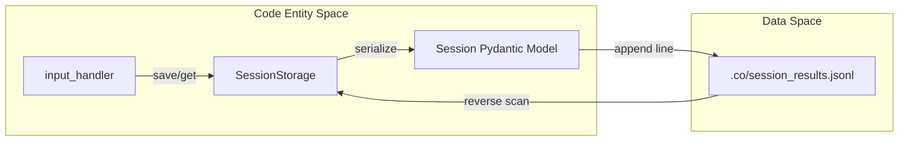

<!-- source: DeepWiki mcp.deepwiki.com · repo openonion/connectonion · page 5.1 Hosting Agents · fetched 2026-10-27 -->

# Hosting Agents

<details>
<summary>Relevant source files</summary>

The following files were used as context for generating this wiki page:

- [connectonion/cli/co_ai/prompts/connectonion/network/host.md](connectonion/cli/co_ai/prompts/connectonion/network/host.md)
- [connectonion/cli/co_ai/prompts/tools/ask_user.md](connectonion/cli/co_ai/prompts/tools/ask_user.md)
- [connectonion/cli/co_ai/tools/todo_list.py](connectonion/cli/co_ai/tools/todo_list.py)
- [connectonion/network/asgi/http.py](connectonion/network/asgi/http.py)
- [connectonion/network/host/__init__.py](connectonion/network/host/__init__.py)
- [connectonion/network/host/routes.py](connectonion/network/host/routes.py)
- [connectonion/network/host/server.py](connectonion/network/host/server.py)
- [connectonion/network/host/session/__init__.py](connectonion/network/host/session/__init__.py)
- [connectonion/network/host/session/merge.py](connectonion/network/host/session/merge.py)
- [connectonion/network/host/session/storage.py](connectonion/network/host/session/storage.py)
- [connectonion/network/host/session/ui.py](connectonion/network/host/session/ui.py)
- [connectonion/network/static/docs.html](connectonion/network/static/docs.html)
- [docs/network/host.md](docs/network/host.md)
- [tests/unit/test_asgi_http.py](tests/unit/test_asgi_http.py)
- [tests/unit/test_host_routes.py](tests/unit/test_host_routes.py)

</details>


This page documents the `host()` function, which transforms a local `Agent` instance into a network-accessible service. It covers the HTTP and WebSocket APIs, session management, request isolation, and deployment.

For connecting to hosted agents, see [Connecting to Remote Agents](5.2). For trust configuration and signature verification details, see [Trust & Authentication](5.3). For P2P relay architecture, see [P2P Relay System](5.4).

---

## Purpose and Function Signature

The `host()` function deploys an agent as a network service with HTTP/WebSocket endpoints and automatic P2P relay registration.

**Basic usage:**
```python
from connectonion import Agent, host

def create_agent():
    return Agent("translator", tools=[translate])

host(create_agent)
```

**Function signature:**
```python
def host(
    create_agent: Callable[[], Agent],
    trust: Union[str, Agent] = "careful",
    blacklist: list = None,
    whitelist: list = None,
    port: int = 8000,
    workers: int = 1,
    result_ttl: int = 86400,
    relay_url: str = "wss://oo.openonion.ai/ws/announce",
    reload: bool = False,
    max_file_size: int = 10,
    max_files_per_request: int = 10,
) -> None
```

**Parameters:**
| Parameter | Type | Default | Purpose |
|-----------|------|---------|---------|
| `create_agent` | `Callable` | required | Factory function returning a fresh `Agent` instance per request |
| `trust` | `str` or `Agent` | `"careful"` | Trust level: `"open"`, `"careful"`, `"strict"`, or custom agent |
| `port` | `int` | `8000` | HTTP server port |
| `workers` | `int` | `1` | Number of uvicorn worker processes |
| `result_ttl` | `int` | `86400` | Session result time-to-live in seconds (24 hours) |
| `relay_url` | `str` | production | P2P relay WebSocket URL for discovery |
| `max_file_size` | `int` | `10` | Max MB per uploaded file |

Sources: [connectonion/network/host/server.py:70-95](), [docs/network/host.md:69-95]()

---

## Request Flow Architecture

The hosting system uses a factory pattern where `create_agent()` is called for every incoming request to ensure complete isolation.

```mermaid
sequenceDiagram
    participant Client
    participant ASGI["ASGI App<br/>(create_app)"]
    participant Auth["extract_and_authenticate()"]
    participant Factory["create_agent()"]
    participant Agent["Agent Instance"]
    participant Storage["SessionStorage<br/>(.co/session_results.jsonl)"]

    Client->>ASGI: "POST /input"
    ASGI->>ASGI: "read_body(receive)"
    ASGI->>Auth: "validate signature / trust"
    
    alt "unauthorized"
        Auth-->>Client: "401/403 Error"
    else "authorized"
        Auth->>ASGI: "authorized"
        ASGI->>Factory: "invoke factory"
        Factory->>Agent: "new Agent()"
        ASGI->>Storage: "save(status='running')"
        ASGI->>Agent: "input(prompt, session)"
        Agent-->>ASGI: "result"
        ASGI->>Storage: "save(status='done', result)"
        ASGI->>ASGI: "send_json(send, response)"
        ASGI-->>Client: "200 OK + result + session"
    end
```

**Key Code Entities:**
- `host()`: Entry point that starts the uvicorn server [connectonion/network/host/server.py:321-365]().
- `input_handler()`: Core logic for processing a prompt, managing sessions, and invoking the agent [connectonion/network/host/routes.py:27-115]().
- `extract_and_authenticate()`: Middleware-like function that enforces trust levels and verifies Ed25519 signatures [connectonion/network/host/auth.py:65-125]().
- `SessionStorage`: Manages persistence in a JSONL format [connectonion/network/host/session/storage.py:32-84]().

Sources: [connectonion/network/host/server.py:5-9](), [connectonion/network/host/routes.py:5-9]()

---

## HTTP API Endpoints

### POST /input
Submit a task to the agent. This endpoint accepts multi-turn conversation context via the `session` object.

**Request Body:**
```json
{
  "prompt": "What is the weather in Tokyo?",
  "session": { "session_id": "optional-uuid" },
  "images": ["data:image/png;base64,..."],
  "files": [{"name": "data.csv", "data": "base64..."}]
}
```

**Response:**
```json
{
  "session_id": "550e8400-e29b-41d4-a716-446655440000",
  "status": "done",
  "result": "The weather is sunny...",
  "duration_ms": 1250,
  "session": { ... },
  "chat_items": [ ... ],
  "server_newer": false
}
```
The `chat_items` field provides a UI-ready list of messages and tool calls converted by `session_to_chat_items()` [connectonion/network/host/session/ui.py:18-52]().

Sources: [connectonion/network/host/routes.py:27-115](), [docs/network/host.md:173-197]()

### GET /info
Returns agent metadata, capabilities, and trust requirements.

**Response:**
```json
{
  "name": "translator",
  "address": "0x3d40...",
  "tools": ["translate"],
  "model": "gpt-4",
  "trust": "careful",
  "version": "0.6.0",
  "accepted_inputs": {
    "text": true,
    "images": true,
    "files": { "max_file_size_mb": 10, "max_files_per_request": 10 }
  }
}
```
Sources: [connectonion/network/host/routes.py:134-173](), [connectonion/network/host/server.py:144-145]()

---

## WebSocket API (`/ws`)

The WebSocket handler `ws_input` supports real-time streaming and bidirectional I/O.

| Message Type | Direction | Purpose |
|--------------|-----------|---------|
| `INPUT` | Client → Agent | Submit prompt |
| `OUTPUT` | Agent → Client | Final result and session state |
| `STREAM` | Agent → Client | Partial tokens (if streaming enabled) |
| `PING/PONG` | Both | Keep-alive (30s interval) |

Sources: [docs/network/host.md:152-168](), [docs/network/host.md:197-201]()

---

## Session Management and Storage

ConnectOnion uses an append-only JSONL file for session persistence. The `SessionStorage` class handles reading the latest state for a given `session_id`.



**Storage Behavior:**
- **Isolation**: Each request calls `create_agent()`. Tools with internal state (like `BrowserTool`) do not leak between requests [connectonion/network/host/server.py:22-25]().
- **TTL**: Sessions are automatically filtered out of `list()` and `get()` calls if they exceed the `result_ttl` [connectonion/network/host/session/storage.py:43-69]().
- **Checkpoints**: The `checkpoint()` method saves session state before blocking operations like `ask_user` [connectonion/network/host/session/storage.py:71-84]().

Sources: [connectonion/network/host/session/storage.py:1-10](), [connectonion/network/host/routes.py:53-56]()

---

## Deployment and Scaling

### Worker Isolation
For horizontal scaling on a single machine, use the `workers` parameter. This spawns multiple OS processes via `uvicorn`.

```python
host(create_agent, workers=4)
```

### Admin Endpoints
Hosting agents provides several admin routes protected by the `OPENONION_API_KEY`:
- `GET /admin/logs`: Returns plain text logs for the agent [connectonion/network/host/routes.py:180-192]().
- `GET /admin/sessions`: Returns a list of all stored session records [connectonion/network/host/routes.py:195-197]().
- **Trust Management**: Endpoints for promoting/demoting/blocking identities (e.g., `POST /admin/trust/block`) [connectonion/network/host/server.py:48-56]().

Sources: [connectonion/network/host/server.py:163-171](), [connectonion/network/asgi/http.py:139-160]()

---

