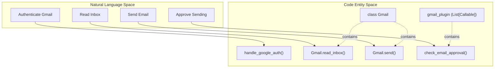
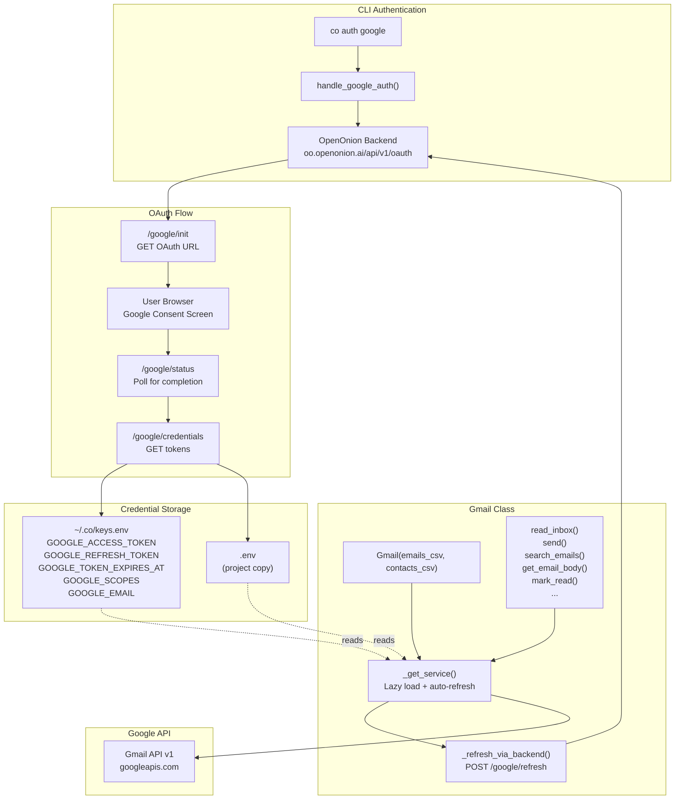
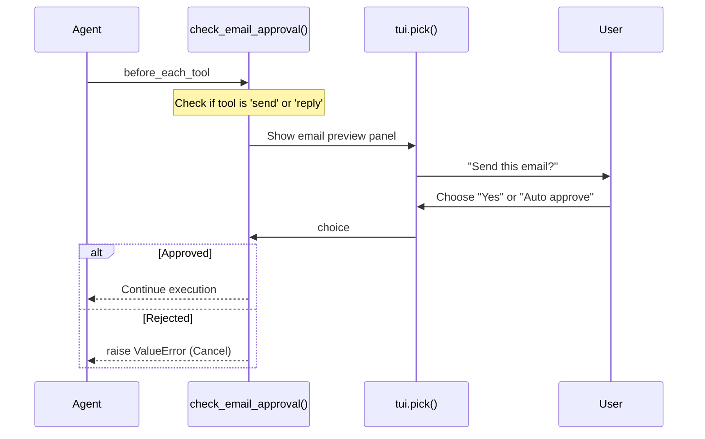

<!-- source: DeepWiki mcp.deepwiki.com · repo openonion/connectonion · page 6.2 Gmail Integration · fetched 2026-10-27 -->

# Gmail Integration

<details>
<summary>Relevant source files</summary>

The following files were used as context for generating this wiki page:

- [connectonion/cli/commands/__init__.py](connectonion/cli/commands/__init__.py)
- [connectonion/useful_plugins/calendar_plugin.py](connectonion/useful_plugins/calendar_plugin.py)
- [connectonion/useful_plugins/gmail_plugin.py](connectonion/useful_plugins/gmail_plugin.py)
- [connectonion/useful_tools/get_emails.py](connectonion/useful_tools/get_emails.py)
- [connectonion/useful_tools/google_calendar.py](connectonion/useful_tools/google_calendar.py)
- [connectonion/useful_tools/microsoft_calendar.py](connectonion/useful_tools/microsoft_calendar.py)
- [connectonion/useful_tools/outlook.py](connectonion/useful_tools/outlook.py)
- [connectonion/useful_tools/send_email.py](connectonion/useful_tools/send_email.py)
- [connectonion/useful_tools/slash_command.py](connectonion/useful_tools/slash_command.py)
- [examples/email-agent/run_test.sh](examples/email-agent/run_test.sh)
- [examples/minimal-agent/.co/docs/co-vibecoding-principles-docs-contexts-all-in-one.md](examples/minimal-agent/.co/docs/co-vibecoding-principles-docs-contexts-all-in-one.md)
- [tests/unit/test_calendar_plugin.py](tests/unit/test_calendar_plugin.py)
- [tests/unit/test_explain_agent.py](tests/unit/test_explain_agent.py)
- [tests/unit/test_gmail.py](tests/unit/test_gmail.py)
- [tests/unit/test_gmail_plugin.py](tests/unit/test_gmail_plugin.py)
- [tests/unit/test_google_calendar.py](tests/unit/test_google_calendar.py)
- [tests/unit/test_interactive_debugger.py](tests/unit/test_interactive_debugger.py)
- [tests/unit/test_shell_approval.py](tests/unit/test_shell_approval.py)

</details>


This page documents the Gmail integration tool, which enables agents to read, send, and manage Gmail emails through the Google API. The integration uses OAuth 2.0 for authentication and provides both low-level email operations and high-level contact management features.

For browser automation capabilities, see [6.3 Browser Agent](). For other utility tools, see [6.1 Useful Tools Reference]().

---

## Purpose and Scope

The Gmail integration provides:

- **OAuth 2.0 authentication** via CLI command `co auth google` [connectonion/cli/commands/auth_commands.py:327-408]()
- **Email operations** through the `Gmail` class (read, send, search, label management) [connectonion/useful_tools/gmail.py:62-736]()
- **Automatic token refresh** through OpenOnion backend [connectonion/useful_tools/gmail.py:140-196]()
- **Contact analysis** and CRM-style features [connectonion/useful_tools/gmail.py:697-736]()
- **Human-in-the-loop approval** via `gmail_plugin` for sensitive operations [connectonion/useful_plugins/gmail_plugin.py:38-132]()

This integration is designed as a class-based tool that maintains a shared Gmail API service instance and handles credential management automatically.

Sources: [connectonion/useful_tools/gmail.py:1-10](), [connectonion/useful_plugins/gmail_plugin.py:1-19]()

---

## Architecture Overview

### Code Entity Mapping



Sources: [connectonion/cli/commands/auth_commands.py:327-328](), [connectonion/useful_tools/gmail.py:54-62](), [connectonion/useful_plugins/gmail_plugin.py:159-162]()

### System Data Flow



Sources: [connectonion/cli/commands/auth_commands.py:327-408](), [connectonion/useful_tools/gmail.py:62-196]()

---

## OAuth Setup Process

### CLI Command Flow

The `handle_google_auth()` function orchestrates the OAuth flow:

1. **Prerequisite Check**: Validates `OPENONION_API_KEY` exists [connectonion/cli/commands/auth_commands.py:330-336]()
2. **Clear Old Credentials**: Sends `DELETE` to `/google/revoke` [connectonion/cli/commands/auth_commands.py:343]()
3. **Initialize OAuth**: Gets authorization URL from backend [connectonion/cli/commands/auth_commands.py:348-351]()
4. **Browser Launch**: Opens Google consent screen [connectonion/cli/commands/auth_commands.py:356-359]()
5. **Poll for Completion**: Checks status every 5 seconds [connectonion/cli/commands/auth_commands.py:365-378]()
6. **Retrieve Credentials**: Fetches tokens after authorization [connectonion/cli/commands/auth_commands.py:381-386]()
7. **Save Credentials**: Writes to both global and local `.env` files [connectonion/cli/commands/auth_commands.py:389-400]()

### Credential Format

Credentials are saved to `.env` files in this format [connectonion/cli/commands/auth_commands.py:310-316]():

```bash
# Google OAuth Credentials
GOOGLE_ACCESS_TOKEN=ya29.a0Af...
GOOGLE_REFRESH_TOKEN=1//0gZ...
GOOGLE_TOKEN_EXPIRES_AT=2024-01-15T12:30:00Z
GOOGLE_SCOPES=https://www.googleapis.com/auth/gmail.readonly,https://www.googleapis.com/auth/gmail.send
GOOGLE_EMAIL=user@gmail.com
```

Sources: [connectonion/cli/commands/auth_commands.py:290-325]()

---

## Gmail Class

### Initialization and Scope Validation

The `Gmail` class constructor validates required OAuth scopes [connectonion/useful_tools/gmail.py:65-93]():

```python
def __init__(self, emails_csv: str = "data/emails.csv", 
             contacts_csv: str = "data/contacts.csv"):
```

**Required Scopes:**
- `gmail.readonly` - Read email content
- `gmail.send` - Send emails

If scopes are missing, initialization raises `ValueError` with instructions to run `co auth google` [connectonion/useful_tools/gmail.py:75-89]().

### Service Lifecycle and Token Refresh

The service handles token expiration transparently [connectonion/useful_tools/gmail.py:95-196]():

1. **Lazy Loading**: Service is created on first method call via `_get_service()` [connectonion/useful_tools/gmail.py:108-110]()
2. **Expiry Check**: Tokens expiring within 5 minutes trigger refresh [connectonion/useful_tools/gmail.py:118-125]()
3. **Backend Refresh**: `_refresh_via_backend()` calls `POST /api/v1/oauth/google/refresh` [connectonion/useful_tools/gmail.py:140-196]()
4. **Environment Update**: Updates both `os.environ` and `.env` file with new token [connectonion/useful_tools/gmail.py:178-194]()
5. **Service Rebuild**: Clears cached service to use new credentials [connectonion/useful_tools/gmail.py:125]()

Sources: [connectonion/useful_tools/gmail.py:95-196]()

---

## Core Methods

### Reading and Content Extraction

- `read_inbox(last, unread)`: Fetches emails from inbox with metadata [connectonion/useful_tools/gmail.py:245-266]().
- `search_emails(query, max_results)`: Uses Gmail search syntax [connectonion/useful_tools/gmail.py:309-332]().
- `get_email_body(email_id)`: Extracts full content, preferring `text/plain` and stripping HTML [connectonion/useful_tools/gmail.py:375-411]().
- `_extract_body(payload)`: Internal helper to normalize email bodies [connectonion/useful_tools/gmail.py:336-373]().

### Sending and Management

- `send(to, subject, body, cc, bcc)`: Sends email via `users().messages().send()` [connectonion/useful_tools/gmail.py:453-489]().
- `reply(email_id, body)`: Replies to thread, maintaining headers like `In-Reply-To` [connectonion/useful_tools/gmail.py:491-537]().
- `mark_read(email_id)` / `mark_unread(email_id)`: Modifies `UNREAD` label [connectonion/useful_tools/gmail.py:541-576]().
- `archive_email(email_id)`: Removes `INBOX` label [connectonion/useful_tools/gmail.py:578-596]().

Sources: [connectonion/useful_tools/gmail.py:245-615]()

---

## Human-in-the-Loop: Gmail Plugin

The `gmail_plugin` provides safety for email operations by requiring user approval before sending [connectonion/useful_plugins/gmail_plugin.py:1-19]().

### Approval Workflow



Sources: [connectonion/useful_plugins/gmail_plugin.py:38-132]()

### Key Features
- **Preview Panel**: Displays "To", "Subject", and body snippet using Rich [connectonion/useful_plugins/gmail_plugin.py:106-106]().
- **Granular Approval**: Options to auto-approve specific recipients or all replies for the session [connectonion/useful_plugins/gmail_plugin.py:119-129]().
- **CRM Sync**: `sync_crm_after_send` automatically updates `last_contact` dates in the contact database after successful sends [connectonion/useful_plugins/gmail_plugin.py:134-157]().

Sources: [connectonion/useful_plugins/gmail_plugin.py:38-162]()

---

## Troubleshooting

### Common Setup Issues

| Error | Cause | Solution |
|-------|-------|----------|
| `ValueError: Google OAuth credentials not found` | Missing tokens in `.env` | Run `co auth google` [connectonion/useful_tools/gmail.py:112-116]() |
| `ValueError: Missing 'gmail.send' scope` | Incomplete authorization | Re-run `co auth google` and grant all permissions [connectonion/useful_tools/gmail.py:75-89]() |
| `ValueError: Failed to refresh token via backend` | Backend unavailable or JWT expired | Run `co auth` then `co auth google` [connectonion/useful_tools/gmail.py:168-171]() |

Sources: [connectonion/useful_tools/gmail.py:75-171]()

---

