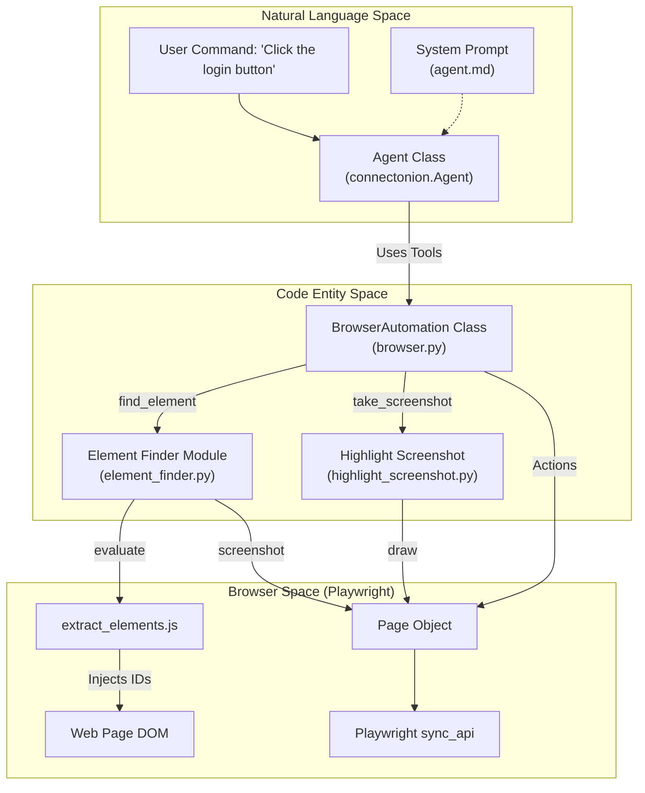
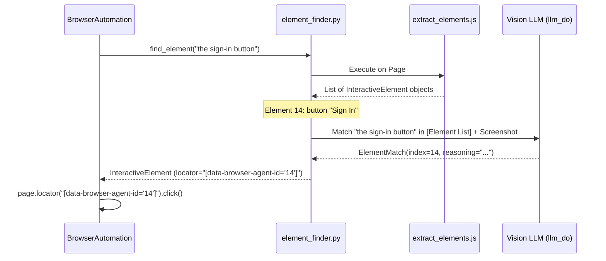

<!-- source: DeepWiki mcp.deepwiki.com · repo openonion/connectonion · page 6.3 Browser Agent · fetched 2026-10-27 -->

# Browser Agent

<details>
<summary>Relevant source files</summary>

The following files were used as context for generating this wiki page:

- [connectonion/cli/browser_agent/__init__.py](connectonion/cli/browser_agent/__init__.py)
- [connectonion/cli/browser_agent/agent.py](connectonion/cli/browser_agent/agent.py)
- [connectonion/cli/browser_agent/prompts/agent.md](connectonion/cli/browser_agent/prompts/agent.md)
- [connectonion/cli/commands/browser_commands.py](connectonion/cli/commands/browser_commands.py)
- [connectonion/cli/templates/browser/prompts/agent.md](connectonion/cli/templates/browser/prompts/agent.md)
- [connectonion/useful_tools/browser_tools/__init__.py](connectonion/useful_tools/browser_tools/__init__.py)
- [connectonion/useful_tools/browser_tools/browser.py](connectonion/useful_tools/browser_tools/browser.py)
- [connectonion/useful_tools/browser_tools/browser_config.py](connectonion/useful_tools/browser_tools/browser_config.py)
- [connectonion/useful_tools/browser_tools/element_finder.py](connectonion/useful_tools/browser_tools/element_finder.py)
- [connectonion/useful_tools/browser_tools/highlight_screenshot.py](connectonion/useful_tools/browser_tools/highlight_screenshot.py)
- [connectonion/useful_tools/browser_tools/prompts/element_matcher.md](connectonion/useful_tools/browser_tools/prompts/element_matcher.md)
- [connectonion/useful_tools/browser_tools/scripts/extract_elements.js](connectonion/useful_tools/browser_tools/scripts/extract_elements.js)
- [docs/useful_tools/browser_tools.md](docs/useful_tools/browser_tools.md)

</details>


## Purpose and Scope

The Browser Agent provides natural language browser automation capabilities by integrating Playwright with LLM-powered reasoning. It enables agents to navigate the web, interact with complex UI elements, and handle authentication without requiring hardcoded CSS selectors or XPath expressions.

This system is exposed primarily through the `BrowserAutomation` class [connectonion/useful_tools/browser_tools/browser.py:50-51](), which provides a suite of tools for navigation, element interaction, and session management.

---

## System Overview

The Browser Agent architecture bridges the gap between natural language intent and the Document Object Model (DOM). It uses a specialized element-finding system that combines JavaScript extraction with vision-capable LLMs to identify interactive components.

### Key Capabilities

| Feature | Description | Implementation |
|---------|-------------|----------------|
| **Natural Language Finding** | Locate elements like "the blue login button" or "search bar" | `element_finder.py` + Vision LLM |
| **Persistent Profiles** | Maintain cookies and sessions across runs | `~/.co/browser_profile/` [connectonion/useful_tools/browser_tools/browser.py:103-104]() |
| **Visual Debugging** | Highlighted screenshots with element indices | `highlight_screenshot.py` [connectonion/useful_tools/browser_tools/highlight_screenshot.py:10-12]() |
| **Anti-Detection** | Stealth configurations to avoid automation blocks | `CHROME_DEFAULT_ARGS` [connectonion/useful_tools/browser_tools/browser.py:128-129]() |
| **Manual Intervention** | Pause for 2FA, CAPTCHAs, or manual logins | `wait_for_manual_login()` [connectonion/useful_tools/browser_tools/browser.py:1120-1121]() |

**Sources:** [connectonion/useful_tools/browser_tools/browser.py:12-22](), [connectonion/useful_tools/browser_tools/element_finder.py:10-23]()

---

## Architecture & Data Flow

The Browser Agent operates by translating high-level goals into discrete Playwright actions. When an agent needs to "click the login button", it triggers a multi-stage pipeline.

### Component Interaction Diagram



**Sources:** [connectonion/useful_tools/browser_tools/browser.py:5-7](), [connectonion/useful_tools/browser_tools/element_finder.py:5-7](), [connectonion/cli/browser_agent/agent.py:35-45]()

---

## Natural Language Element Finding

Unlike traditional automation that relies on fragile selectors, ConnectOnion uses an index-based selection strategy.

### The Finding Pipeline

1.  **Extraction**: `extract_elements.js` traverses the DOM and Shadow DOMs to find interactive tags (a, button, input) and ARIA roles (button, link, textbox) [connectonion/useful_tools/browser_tools/scripts/extract_elements.js:28-38]().
2.  **ID Injection**: Every found element is tagged with a temporary `data-browser-agent-id` attribute [connectonion/useful_tools/browser_tools/scripts/extract_elements.js:8-9]().
3.  **LLM Selection**: The `element_finder.py` module sends a compact text list of elements (with indices, text, and positions) plus a screenshot to a vision-capable LLM [connectonion/useful_tools/browser_tools/element_finder.py:170-185]().
4.  **Action**: The LLM returns an index. The code then targets the element using the pre-built locator `[data-browser-agent-id='N']` [connectonion/useful_tools/browser_tools/element_finder.py:16-17]().

### Element Identification Diagram



**Sources:** [connectonion/useful_tools/browser_tools/element_finder.py:153-185](), [connectonion/useful_tools/browser_tools/scripts/extract_elements.js:119-155](), [connectonion/useful_tools/browser_tools/prompts/element_matcher.md:71-107]()

---

## Session Persistence

The Browser Agent maintains a persistent user profile to handle logins and preferences across sessions.

*   **Profile Location**: `~/.co/browser_profile/` [connectonion/useful_tools/browser_tools/browser.py:103-104]().
*   **Auto-Save Mechanism**: Cookies and storage state are automatically persisted after every navigation and manual login confirmation [connectonion/useful_tools/browser_tools/browser.py:57-60]().
*   **Browser Context**: Uses `launch_persistent_context` to ensure the profile survives browser restarts without manual storage state exports [connectonion/useful_tools/browser_tools/browser.py:124-131]().

---

## Core Tool Reference

The `BrowserAutomation` class exposes several key methods as tools for the Agent:

| Method | Purpose | Key Detail |
|:---|:---|:---|
| `navigate(url)` | Opens a website | Auto-saves cookies after load [connectonion/useful_tools/browser_tools/browser.py:155]() |
| `click(description)` | Clicks an element | Uses `find_element` for NL matching [connectonion/useful_tools/browser_tools/browser.py:182]() |
| `keyboard_type(text)` | Inputs text | Simulates character-by-character typing [connectonion/useful_tools/browser_tools/browser.py:220]() |
| `screenshot()` | Captures current view | Saves to `.tmp/` with timestamp [connectonion/useful_tools/browser_tools/browser.py:273-274]() |
| `wait_for_login()` | Pauses for user | Useful for 2FA or CAPTCHA [connectonion/useful_tools/browser_tools/browser.py:1120]() |
| `scroll(direction)` | Navigates long pages | Uses AI to pick best scroll strategy [connectonion/useful_tools/browser_tools/browser.py:1140]() |

**Sources:** [connectonion/useful_tools/browser_tools/browser.py:5-7](), [docs/useful_tools/browser_tools.md:53-152]()

---

## CLI Integration

The browser agent can be invoked directly from the terminal using the `co browser` command.

```bash
co browser "Go to github.com, find the search bar, and type 'ConnectOnion'"
```

This command triggers `execute_browser_command` [connectonion/cli/browser_agent/agent.py:19-20](), which:
1.  Loads the `OPENONION_API_KEY` [connectonion/cli/browser_agent/agent.py:24-30]().
2.  Initializes a `BrowserAutomation` context manager [connectonion/cli/browser_agent/agent.py:35]().
3.  Spawns an `Agent` with the `co/gemini-3-flash-preview` model and the browser tools [connectonion/cli/browser_agent/agent.py:36-43]().

**Sources:** [connectonion/cli/commands/browser_commands.py:17-28](), [connectonion/cli/browser_agent/agent.py:19-45]()

---

