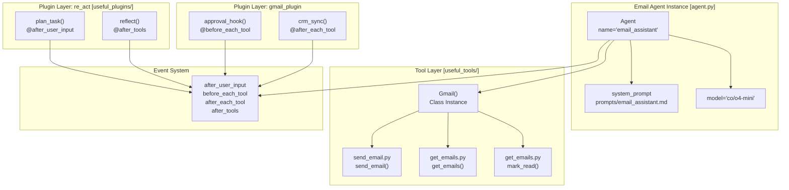
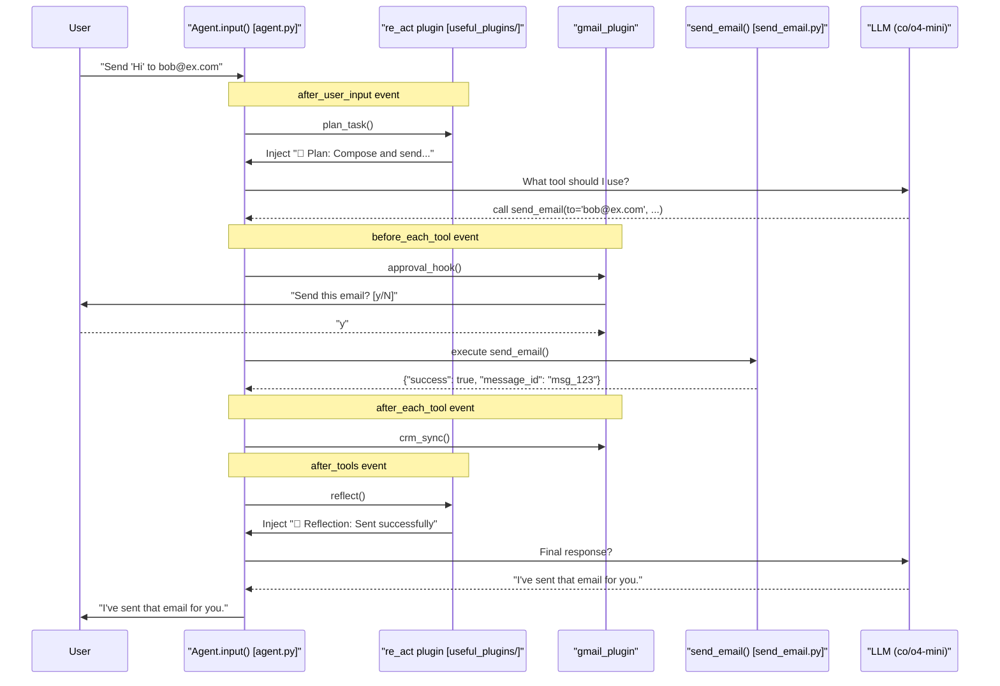

<!-- source: DeepWiki mcp.deepwiki.com · repo openonion/connectonion · page 6.4 Email Agent Example · fetched 2026-10-27 -->

# Email Agent Example

<details>
<summary>Relevant source files</summary>

The following files were used as context for generating this wiki page:

- [connectonion/cli/commands/__init__.py](connectonion/cli/commands/__init__.py)
- [connectonion/useful_tools/get_emails.py](connectonion/useful_tools/get_emails.py)
- [connectonion/useful_tools/send_email.py](connectonion/useful_tools/send_email.py)
- [examples/email-agent/agent.py](examples/email-agent/agent.py)
- [examples/email-agent/prompts/email_assistant.md](examples/email-agent/prompts/email_assistant.md)
- [examples/email-agent/prompts/email_composer.md](examples/email-agent/prompts/email_composer.md)
- [examples/email-agent/run_test.sh](examples/email-agent/run_test.sh)
- [examples/minimal-agent/.co/docs/co-vibecoding-principles-docs-contexts-all-in-one.md](examples/minimal-agent/.co/docs/co-vibecoding-principles-docs-contexts-all-in-one.md)

</details>


This page walks through the complete email agent example located at [examples/email-agent/agent.py](), demonstrating how to compose ConnectOnion's Gmail integration, ReAct reasoning pattern, and approval workflows into a production-ready AI assistant.

**Scope**: This page focuses on the practical implementation and runtime behavior of the email agent example. For Gmail tool reference, see [Gmail Integration](#6.2). For general plugin architecture, see [Plugin System](#3.5). For ReAct pattern theory, see [Event System](#3.4).

---

## Overview

The email agent example showcases ConnectOnion's composability by combining:

| Component | Purpose | Type |
|-----------|---------|------|
| `Gmail` | Email operations (send, search, reply, mark_read) | Tool class |
| `re_act` | Plan-then-act reasoning pattern | Plugin |
| `gmail_plugin` | User approval before sending, CRM sync after | Plugin |
| `system_prompt` | Email assistant personality and guidelines | Configuration |

The agent accepts natural language requests like "Find emails from John about the project" and autonomously selects appropriate tools, plans actions, and executes workflows with human oversight where needed.

**Sources**: [examples/email-agent/agent.py:1-12](), [examples/email-agent/agent.py:35-41]()

---

## Architecture

The diagram below maps the relationship between the high-level agent configuration and the underlying code entities that drive the email workflow.



**Agent Construction**

The email agent is instantiated with specific tools and plugins at [examples/email-agent/agent.py:35-41]():

```python
agent = Agent(
    name="email_assistant",
    tools=[gmail],              # Gmail instance with all methods as tools
    system_prompt="prompts/email_assistant.md",
    model="co/o4-mini",
    plugins=[re_act, gmail_plugin]
)
```

**Sources**: [examples/email-agent/agent.py:21-41](), [connectonion/useful_tools/send_email.py:20-34](), [connectonion/useful_tools/get_emails.py:20-35]()

---

## Gmail Tools Integration

The `Gmail` class is passed directly as a tool. ConnectOnion automatically discovers methods and exposes them to the LLM. The underlying implementation for these tools interacts with the OpenOnion API.

**Core Email Functions**

| Function | File | Purpose |
|-----------|-----------|---------|
| `send_email` | [connectonion/useful_tools/send_email.py:20-34]() | Sends email via POST to `/api/v1/email/send` |
| `get_emails` | [connectonion/useful_tools/get_emails.py:20-35]() | Fetches emails via GET from `/api/v1/email/received` |
| `mark_read` | [connectonion/useful_tools/get_emails.py:90-135]() | Updates status via POST to `/api/v1/email/s/mark-read` |

**Data Flow for Sending**
1. **Auth Check**: `send_email` searches for `.env` or `~/.co/keys.env` to find `OPENONION_API_KEY` [connectonion/useful_tools/send_email.py:35-60]().
2. **Validation**: Validates recipient format and detects HTML content [connectonion/useful_tools/send_email.py:77-85]().
3. **API Call**: Executes a synchronous HTTP POST request to the backend [connectonion/useful_tools/send_email.py:94-109]().

**Sources**: [connectonion/useful_tools/send_email.py:1-150](), [connectonion/useful_tools/get_emails.py:1-135]()

---

## ReAct Pattern Implementation

The `re_act` plugin implements the Reasoning and Acting pattern through event handlers that inject "thoughts" into the conversation history.

### Plan Phase: `plan_task`

When a user provides input, the `plan_task` handler (registered to `after_user_input`) triggers. It uses a specialized planning prompt to generate a high-level strategy before the agent starts calling tools.

### Reflect Phase: `reflect`

After tools are executed, the `reflect` handler (registered to `after_tools`) analyzes the results. It compresses the message history to save tokens while ensuring the LLM understands what was accomplished [connectonion/cli/docs/co-vibecoding-principles-docs-contexts-all-in-one.md:235-245]().

**Sources**: [examples/email-agent/agent.py:40](), [examples/email-agent/agent.py:46](), [connectonion/useful_plugins/re_act.py:1-79]()

---

## Gmail Plugin Approval Workflow

The `gmail_plugin` adds human-in-the-loop controls specifically for destructive or outward-facing actions like sending emails.

### Before Send Approval

**Hook**: `@before_each_tool` fires before any tool executes.

**Behavior**:
1. Checks if the requested tool is a "send" operation.
2. Displays the proposed email (Recipient, Subject, Body) to the user.
3. Pauses execution for user confirmation `[y/N]`.
4. If the user declines, the tool execution is aborted.

### After Send CRM Sync

**Hook**: `@after_each_tool` fires after successful tool execution.

**Behavior**:
1. Detects a successful email transmission.
2. Automatically triggers a "CRM Sync" to update contact records with the latest interaction metadata [examples/email-agent/agent.py:48]().

**Sources**: [examples/email-agent/agent.py:34-40](), [examples/email-agent/agent.py:47-48]()

---

## Complete Execution Flow

This diagram illustrates how Natural Language requests are transformed into Code Entity operations through the plugin-mediated loop.



**Sources**: [examples/email-agent/agent.py:66-79](), [connectonion/useful_tools/send_email.py:20-34](), [connectonion/useful_plugins/re_act.py:1-79]()

---

## Running the Email Agent

### Setup

The agent requires an environment configured with an API key and an agent email address. These are typically managed via the CLI or `.env` files.

```bash
# Initialize environment
co auth
# Or manually create .env
echo "OPENONION_API_KEY=your_key" > .env
echo "AGENT_EMAIL=your_agent@mail.openonion.ai" >> .env
```

### Execution Loop

The agent runs in a standard interactive loop at [examples/email-agent/agent.py:66-87]():

```python
while True:
    user_input = input("\n💌 What would you like to do? ")
    if user_input.lower() in ['quit', 'exit', 'bye', 'q']:
        break
    
    # Process through the Agent instance
    response = agent.input(user_input)
    print(f"\n{response}")
```

**Sources**: [examples/email-agent/agent.py:66-90](), [connectonion/useful_tools/send_email.py:35-75]()

---

