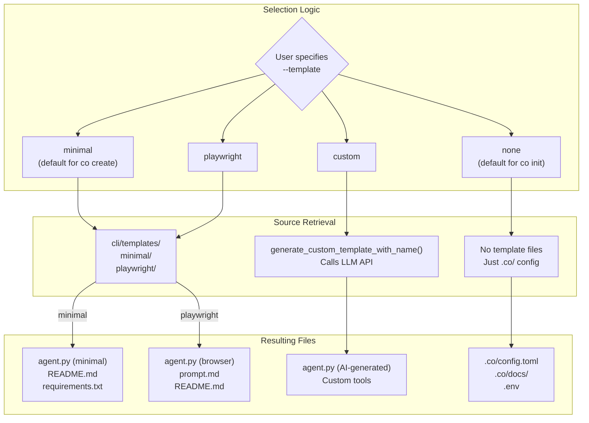

<!-- source: DeepWiki mcp.deepwiki.com · repo openonion/connectonion · page 7.1 Project Commands · fetched 2026-10-27 -->

# Project Commands

<details>
<summary>Relevant source files</summary>

The following files were used as context for generating this wiki page:

- [connectonion/cli/co_ai/plugins/system_reminder.py](connectonion/cli/co_ai/plugins/system_reminder.py)
- [connectonion/cli/co_ai/prompts/assembler.py](connectonion/cli/co_ai/prompts/assembler.py)
- [connectonion/cli/co_ai/prompts/main.md](connectonion/cli/co_ai/prompts/main.md)
- [connectonion/cli/commands/auth_commands.py](connectonion/cli/commands/auth_commands.py)
- [connectonion/cli/commands/create.py](connectonion/cli/commands/create.py)
- [connectonion/cli/commands/init.py](connectonion/cli/commands/init.py)
- [connectonion/cli/commands/project_cmd_lib.py](connectonion/cli/commands/project_cmd_lib.py)
- [connectonion/cli/commands/reset_commands.py](connectonion/cli/commands/reset_commands.py)
- [connectonion/cli/commands/status_commands.py](connectonion/cli/commands/status_commands.py)
- [connectonion/useful_tools/memory.py](connectonion/useful_tools/memory.py)
- [docs/cli/copy.md](docs/cli/copy.md)
- [tests/cli/argparse_runner.py](tests/cli/argparse_runner.py)
- [tests/cli/test_cli.py](tests/cli/test_cli.py)
- [tests/cli/test_cli_auth_google.py](tests/cli/test_cli_auth_google.py)
- [tests/cli/test_cli_copy.py](tests/cli/test_cli_copy.py)
- [tests/cli/test_cli_create.py](tests/cli/test_cli_create.py)
- [tests/cli/test_cli_init.py](tests/cli/test_cli_init.py)
- [tests/unit/test_agent_prompts.py](tests/unit/test_agent_prompts.py)
- [tests/unit/test_imports.py](tests/unit/test_imports.py)

</details>


This page documents the `co init` and `co create` commands used to scaffold ConnectOnion projects. These commands create the necessary directory structure, configuration files, and optionally copy template code to get started quickly. For authentication-related commands like `co auth`, see [Authentication Commands](#7.2). For account management commands like `co status` and `co reset`, see [Status & Management](#7.4).

## Command Overview

ConnectOnion provides two project initialization commands with different use cases:

| Command | Use Case | Creates Directory | Default Template | Target Workflow |
|---------|----------|-------------------|------------------|-----------------|
| `co init` | Add ConnectOnion to existing directory | No (uses current dir) | `none` (config only) | Integrate with existing project |
| `co create <name>` | Start new project from scratch | Yes (creates `<name>/`) | `minimal` | New standalone agent |

Both commands perform similar operations:
1. Ensure global `~/.co/` configuration exists with Ed25519 keypair.
2. Authenticate to obtain `OPENONION_API_KEY` for managed models (`co/*`).
3. Create project-specific `.co/config.toml` and `.env` files.
4. Copy template files (if template specified).
5. Copy vibe coding documentation for AI-assisted development.

**Key Difference**: `co init` defaults to adding only the `.co/` configuration folder (no template code), while `co create` defaults to the `minimal` template with a working `agent.py` file.

Sources: [connectonion/cli/commands/init.py:120-134](), [connectonion/cli/commands/create.py:118-130]()

## Command Execution Flow

```mermaid
graph TB
    User["User invokes command"]
    
    subgraph "co_init_logic" ["co init [connectonion/cli/commands/init.py]"]
        InitCmd["handle_init()"]
        InitCheck{"is_directory_empty()?"}
        InitTemplate{"Template<br/>specified?"}
        InitCopy["Copy template files"]
        InitConfig["Create .co/ config only"]
    end
    
    subgraph "co_create_logic" ["co create [connectonion/cli/commands/create.py]"]
        CreateCmd["handle_create()"]
        CreateValidate["validate_project_name()"]
        CreateDir["Create directory"]
        CreateTemplate{"Template<br/>choice"}
        CreateCopy["Copy template files"]
    end
    
    subgraph "Shared_Operations" ["Shared Logic [project_cmd_lib.py]"]
        GlobalConfig["ensure_global_config()<br/>~/.co/ with Ed25519 keys"]
        DetectKeys["check_environment_for_api_keys()<br/>Scan env vars"]
        Auth["authenticate()<br/>POST to oo.openonion.ai"]
        ProjectSetup["Create .co/config.toml<br/>Create/update .env<br/>Copy vibe docs"]
        Success["Display success message"]
    end
    
    User -->|co init| InitCmd
    User -->|co create name| CreateCmd
    
    InitCmd --> InitCheck
    InitCheck -->|No, warn| GlobalConfig
    InitCheck -->|Yes| GlobalConfig
    
    CreateCmd --> CreateValidate
    CreateValidate --> CreateDir
    CreateDir --> GlobalConfig
    
    GlobalConfig --> DetectKeys
    DetectKeys --> Auth
    Auth --> InitTemplate
    Auth --> CreateTemplate
    
    InitTemplate -->|--template provided| InitCopy
    InitTemplate -->|none (default)| InitConfig
    
    CreateTemplate -->|minimal (default)| CreateCopy
    CreateTemplate -->|playwright| CreateCopy
    CreateTemplate -->|custom| CreateCopy
    
    InitCopy --> ProjectSetup
    InitConfig --> ProjectSetup
    CreateCopy --> ProjectSetup
    
    ProjectSetup --> Success
```

**Key Functions:**
- `handle_init()`: Entry point for `co init` [connectonion/cli/commands/init.py:120-134]().
- `handle_create()`: Entry point for `co create` [connectonion/cli/commands/create.py:118-130]().
- `ensure_global_config()`: Ensures `~/.co/` exists with keypair [connectonion/cli/commands/init.py:47-117]().
- `authenticate()`: Obtains JWT token from backend [connectonion/cli/commands/auth_commands.py:84-208]().
- `validate_project_name()`: Checks name follows conventions [connectonion/cli/commands/project_cmd_lib.py:50-68]().

Sources: [connectonion/cli/commands/init.py:120-470](), [connectonion/cli/commands/create.py:118-512](), [connectonion/cli/commands/project_cmd_lib.py:50-68](), [connectonion/cli/commands/auth_commands.py:84-208]()

## co init Command

Initialize ConnectOnion in the current directory. This command adds the `.co/` configuration folder and optionally copies template files.

### Syntax

```bash
co init [OPTIONS]
```

### Options

| Option | Type | Default | Description |
|--------|------|---------|-------------|
| `--template <name>` | string | `none` | Template to use: `minimal`, `playwright`, `custom`, or `none` |
| `--description <text>` | string | - | Description for custom template (AI generation) |
| `--key <api_key>` | string | - | Provide API key directly (auto-detected from env if omitted) |
| `--force` | flag | false | Overwrite existing files without prompting |
| `--yes` | flag | false | Skip all confirmation prompts (auto mode) |

### Behavior

**Directory Validation** [connectonion/cli/commands/init.py:136-149]():
- Warns if directory is home (`~`), root (`/`), or system directory (`/usr`, `/etc`, etc.) via `get_special_directory_warning()`.
- Warns if directory is non-empty via `is_directory_empty()` (requires `--force` or confirmation).

**Global Configuration Setup** [connectonion/cli/commands/init.py:47-117]():
- Creates `~/.co/` directory structure on first run.
- Generates Ed25519 keypair via `address.generate()` [connectonion/cli/commands/init.py:67]().
- Saves keypair to `~/.co/keys/` via `address.save()`.
- Creates `~/.co/config.toml` with framework metadata.
- Creates `~/.co/keys.env` with `AGENT_ADDRESS` and `AGENT_CONFIG_PATH`.

**Authentication** [connectonion/cli/commands/init.py:240-246]():
- Calls `authenticate(global_co_dir, save_to_project=False)` to obtain JWT token.
- JWT token saved to `~/.co/keys.env` as `OPENONION_API_KEY`.
- Enables use of `co/*` managed models (e.g., `co/gemini-2.5-pro`).

**Environment File Creation** [connectonion/cli/commands/init.py:248-329]():
- Creates or updates `.env` in current directory.
- Copies API keys from `~/.co/keys.env` (including `OPENONION_API_KEY`).
- Adds detected API keys from environment variables via `check_environment_for_api_keys()`.

**Template File Copying** [connectonion/cli/commands/init.py:202-237]():
- If `--template` specified, copies files from `cli/templates/{template}/`.
- Skips existing files unless `--force` provided.

**Project Configuration** [connectonion/cli/commands/init.py:332-393]():
- Creates `.co/config.toml` with project metadata (name, created timestamp, template used).
- Copies vibe coding documentation to both `.co/docs/` and project root.

**Git Integration** [connectonion/cli/commands/init.py:396-417]():
- If `.git` directory exists, updates or creates `.gitignore`.
- Adds ConnectOnion-specific ignore patterns (`.env`, `.co/keys/`, `.co/cache/`, `.co/logs/`).

Sources: [connectonion/cli/commands/init.py:120-470](), [connectonion/cli/commands/project_cmd_lib.py:50-68]()

## co create Command

Create a new ConnectOnion project in a new directory with the specified name.

### Syntax

```bash
co create <name> [OPTIONS]
```

### Arguments

| Argument | Required | Description |
|----------|----------|-------------|
| `<name>` | Yes | Project name (becomes directory name) |

### Options

| Option | Type | Default | Description |
|--------|------|---------|-------------|
| `--template <name>` | string | `minimal` | Template to use: `minimal`, `playwright`, or `custom` |
| `--description <text>` | string | - | Description for custom template (AI generation) |
| `--key <api_key>` | string | - | Provide API key directly (auto-detected from env if omitted) |
| `--yes` | flag | false | Skip all confirmation prompts (auto mode) |

### Behavior

**Project Name Validation** [connectonion/cli/commands/project_cmd_lib.py:50-68]():
- Must start with a letter and contain only letters, numbers, hyphens, and underscores.
- Cannot contain spaces.
- Maximum 50 characters.
- Validation performed by `validate_project_name()`.

**Directory Creation** [connectonion/cli/commands/create.py:305-321]():
- Creates new directory with project name.
- Fails if directory already exists.

**Custom Template AI Generation** [connectonion/cli/commands/create.py:193-219]():
- Uses `generate_custom_template_with_name()` to call LLM API [connectonion/cli/commands/project_cmd_lib.py:605-733]().
- Generates both agent code and suggested project name.
- Shows `LoadingAnimation` during generation [connectonion/cli/commands/project_cmd_lib.py:86-114]().

**File Structure Creation** [connectonion/cli/commands/create.py:335-406]():
- Copies template files from `cli/templates/{template}/`.
- Creates `.co/` directory with subdirectories (`docs/`, `keys/`, `logs/`).
- Creates `.env` with API keys copied from `~/.co/keys.env`.

Sources: [connectonion/cli/commands/create.py:118-512](), [connectonion/cli/commands/project_cmd_lib.py:50-68](), [connectonion/cli/commands/project_cmd_lib.py:605-733]()

## Template System

ConnectOnion provides built-in templates plus AI-generated custom templates.



Sources: [connectonion/cli/commands/project_cmd_lib.py:116-124](), [connectonion/cli/commands/project_cmd_lib.py:605-733]()

### Available Templates

| Name | Display Name | Description |
|------|--------------|-------------|
| `minimal` | 📦 Minimal | Basic agent structure [connectonion/cli/commands/project_cmd_lib.py:119]() |
| `playwright` | 🎭 Playwright | Browser automation agent [connectonion/cli/commands/project_cmd_lib.py:120]() |
| `coder` | 💻 Coder | Coding agent with bash/read/edit/grep/write [connectonion/cli/commands/project_cmd_lib.py:121]() |
| `web-research` | 🔍 Web Research | Web research and data extraction agent [connectonion/cli/commands/project_cmd_lib.py:122]() |
| `custom` | ✨ Custom | AI-generated agent based on description [connectonion/cli/commands/project_cmd_lib.py:123]() |

### Custom Template AI Generation

When using `--template custom`, the system generates code via LLM:

**Generation Process** [connectonion/cli/commands/project_cmd_lib.py:605-733]():
1. Constructs LLM prompt using the user's description.
2. Calls the LLM (defaulting to `co/gemini-2.5-pro` via managed keys).
3. Parses the response for `PROJECT_NAME` and `CODE`.
4. Returns the generated name and code string.

**Fallback Behavior** [connectonion/cli/commands/project_cmd_lib.py:685-731]():
If the LLM call fails, it generates a fallback agent skeleton with a placeholder tool based on the first few words of the description.

Sources: [connectonion/cli/commands/project_cmd_lib.py:605-733]()

## Authentication Integration

Both project commands automatically authenticate with the OpenOnion backend.

**Signature-Based Authentication**:
1. Load Ed25519 keypair from `~/.co/keys/agent.key` via `address.load()` [connectonion/cli/commands/auth_commands.py:96]().
2. Create message: `ConnectOnion-Auth-{public_key}-{timestamp}` [connectonion/cli/commands/auth_commands.py:105]().
3. Sign message with private key using `address.sign()` [connectonion/cli/commands/auth_commands.py:106]().
4. POST to `https://oo.openonion.ai/api/v1/auth` with signature [connectonion/cli/commands/auth_commands.py:111-115]().

**Token Storage**:
- **Global**: `~/.co/keys.env` (shared across projects) [connectonion/cli/commands/auth_commands.py:136-186]().
- **Project**: `./.env` (copied during init/create) [connectonion/cli/commands/auth_commands.py:30-82]().

Sources: [connectonion/cli/commands/auth_commands.py:84-208](), [connectonion/cli/commands/init.py:240-246](), [connectonion/cli/commands/create.py:147-155]()

## API Key Detection

Both commands automatically detect existing API keys from environment variables.

**Provider Detection** [connectonion/cli/commands/project_cmd_lib.py:496-521]():
Inspects key format to identify provider:
- `sk-ant-` → Anthropic
- `sk-` → OpenAI (default)
- `AIzaSy` → Google
- `gsk-` → Groq
- `xai-` → Grok
- `sk-or-` → OpenRouter

**Detection Function**: `check_environment_for_api_keys()` scans for `OPENAI_API_KEY`, `ANTHROPIC_API_KEY`, `GEMINI_API_KEY`, `GOOGLE_API_KEY`, `GROQ_API_KEY`, `XAI_API_KEY`, and `OPENROUTER_API_KEY` [connectonion/cli/commands/project_cmd_lib.py:471-493]().

Sources: [connectonion/cli/commands/project_cmd_lib.py:471-521]()

---

