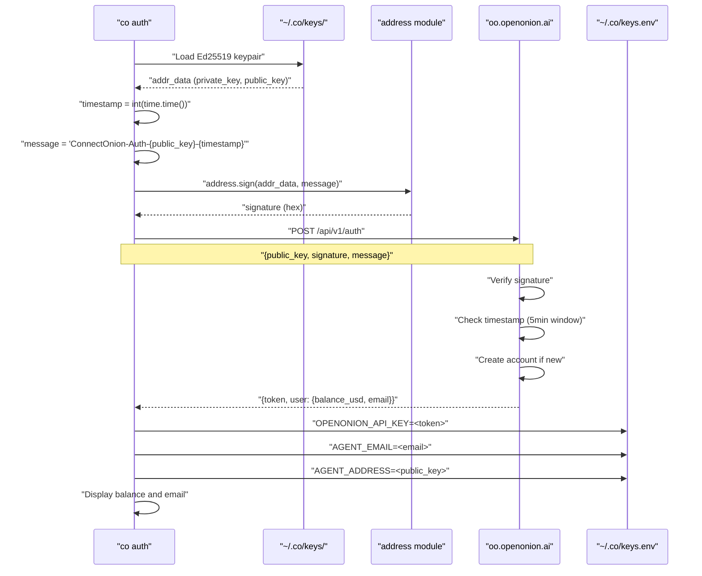
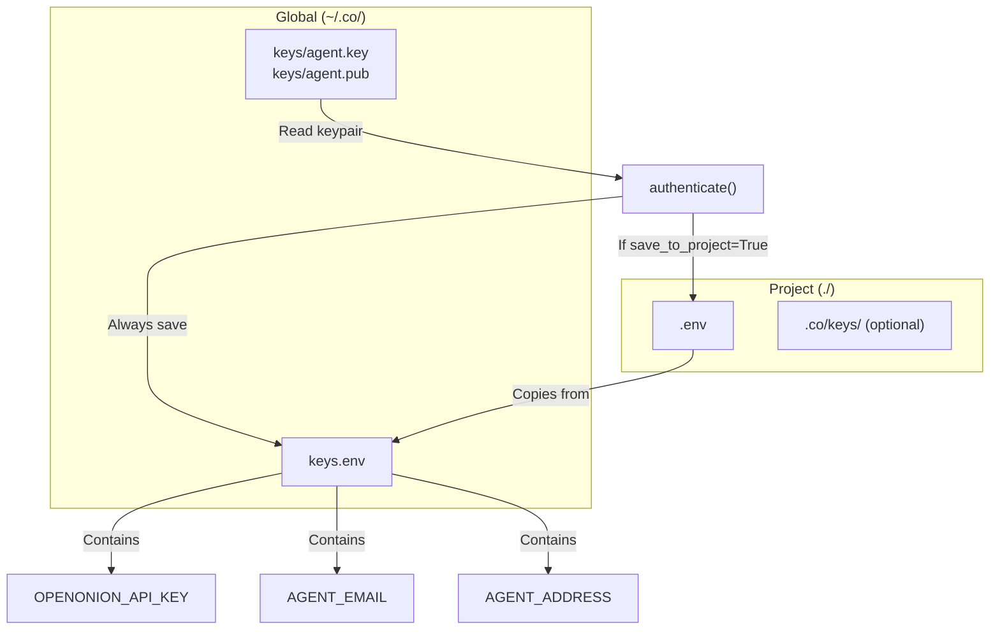
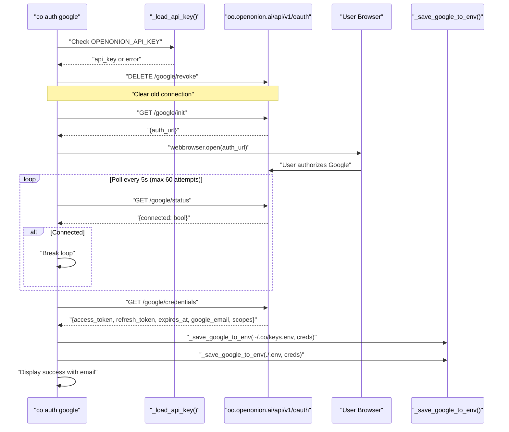
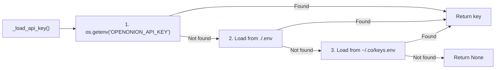
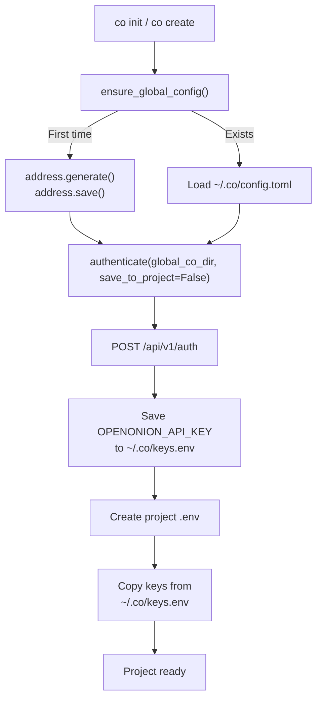

<!-- source: DeepWiki mcp.deepwiki.com · repo openonion/connectonion · page 7.2 Authentication Commands · fetched 2026-10-27 -->

# Authentication Commands

<details>
<summary>Relevant source files</summary>

The following files were used as context for generating this wiki page:

- [connectonion/cli/commands/auth_commands.py](connectonion/cli/commands/auth_commands.py)
- [connectonion/cli/commands/create.py](connectonion/cli/commands/create.py)
- [connectonion/cli/commands/init.py](connectonion/cli/commands/init.py)
- [connectonion/cli/commands/project_cmd_lib.py](connectonion/cli/commands/project_cmd_lib.py)
- [connectonion/cli/commands/reset_commands.py](connectonion/cli/commands/reset_commands.py)
- [connectonion/cli/commands/status_commands.py](connectonion/cli/commands/status_commands.py)
- [connectonion/useful_tools/memory.py](connectonion/useful_tools/memory.py)
- [tests/cli/argparse_runner.py](tests/cli/argparse_runner.py)
- [tests/cli/test_cli.py](tests/cli/test_cli.py)
- [tests/cli/test_cli_auth_google.py](tests/cli/test_cli_auth_google.py)
- [tests/cli/test_cli_create.py](tests/cli/test_cli_create.py)
- [tests/cli/test_cli_init.py](tests/cli/test_cli_init.py)
- [tests/unit/test_agent_prompts.py](tests/unit/test_agent_prompts.py)

</details>


## Purpose and Scope

This document covers the CLI authentication commands that establish credentials for ConnectOnion agents. These commands handle Ed25519-based authentication with the OpenOnion backend for managed keys (`co/*` models) and OAuth flows for third-party service integration (Gmail, Outlook, Calendar).

For project initialization commands that call authentication during setup, see [Project Commands](#7.1). For account management including balance checks and account reset, see [Status & Management](#7.4).

## Command Overview

ConnectOnion provides three authentication commands:

| Command | Purpose | Output |
|---------|---------|--------|
| `co auth` | Authenticate with OpenOnion using Ed25519 signature | JWT token saved to `~/.co/keys.env` |
| `co auth google` | OAuth flow for Gmail/Google Calendar access | Google credentials saved to `.env` and `~/.co/keys.env` |
| `co auth microsoft` | OAuth flow for Outlook/Microsoft Calendar access | Microsoft credentials saved to `.env` and `~/.co/keys.env` |

All authentication commands require an existing global configuration at `~/.co/` with an Ed25519 keypair. If this doesn't exist, run `co init` or `co create` first.

Sources: [connectonion/cli/commands/auth_commands.py:212-253](), [connectonion/cli/commands/init.py:47-117]()

---

## Ed25519 Authentication Flow

### Authentication Architecture



### `co auth` Command

The `handle_auth()` function [connectonion/cli/commands/auth_commands.py:212-253]() orchestrates the authentication process:

1. **Key Location Detection**: Checks for keys in local `.co/keys/` first, falls back to global `~/.co/keys/` [connectonion/cli/commands/auth_commands.py:221-224]().
2. **Authentication Call**: Invokes `authenticate(co_dir, save_to_project=True)` [connectonion/cli/commands/auth_commands.py:226]().
3. **User Feedback**: Displays account balance, email status, and next steps via Rich UI components [connectonion/cli/commands/auth_commands.py:228-253]().

### Core Authentication Logic

The `authenticate()` function [connectonion/cli/commands/auth_commands.py:84-208]() implements the cryptographic authentication protocol:

**Parameters:**
- `co_dir: Path` - Directory containing `.co/keys/`
- `save_to_project: bool = True` - Whether to save token to current directory's `.env`
- `quiet: bool = False` - Suppress verbose output

**Returns:** `bool` - `True` if authentication succeeds

**Authentication Steps:**

1. **Load Keypair** [connectonion/cli/commands/auth_commands.py:96-99]()
   ```python
   addr_data = address.load(co_dir)
   public_key = addr_data["address"]
   ```

2. **Create Signed Message** [connectonion/cli/commands/auth_commands.py:104-106]()
   ```python
   timestamp = int(time.time())
   message = f"ConnectOnion-Auth-{public_key}-{timestamp}"
   signature = address.sign(addr_data, message.encode()).hex()
   ```

3. **Backend Request** [connectonion/cli/commands/auth_commands.py:109-115]()
   The client makes a POST request to `https://oo.openonion.ai/api/v1/auth` with the public key and signature.

4. **Token Storage** [connectonion/cli/commands/auth_commands.py:132-194]()
   - Saves to `~/.co/keys.env` (global)
   - Optionally saves to project `.env` if `save_to_project=True`
   - Sets file permissions to `0o600` on Unix/Mac [connectonion/cli/commands/auth_commands.py:80-81]().

### Key Storage Locations

The authentication system uses a hierarchical storage model:



**Global Keys File** (`~/.co/keys.env`):
- Contains `OPENONION_API_KEY`, `AGENT_EMAIL`, `AGENT_ADDRESS` [connectonion/cli/commands/init.py:95-103]().
- Shared across all projects.
- Automatically updated by `co auth`.
- Permissions: `0o600` (read/write for owner only) [connectonion/cli/commands/init.py:105]().

**Project Environment File** (`./.env`):
- Copies keys from global `keys.env` if `save_to_project=True` [connectonion/cli/commands/auth_commands.py:84-89]().
- Used by agents at runtime via `dotenv`.
- Can be customized per project.

Sources: [connectonion/cli/commands/auth_commands.py:84-208](), [connectonion/cli/commands/auth_commands.py:30-82](), [connectonion/cli/commands/init.py:46-116]()

---

## OAuth Integration Flow

### Google OAuth Architecture



### `co auth google` Command

The `handle_google_auth()` function implements the Google OAuth flow:

**Prerequisites:**
- Must run `co auth` first to obtain `OPENONION_API_KEY` [connectonion/cli/commands/auth_commands.py:331-336]().
- Backend proxy handles OAuth client credentials.

**Flow Steps:**

1. **Verify OpenOnion Authentication**: Calls `_load_api_key()` to check for `OPENONION_API_KEY` in env vars, local `.env`, or global `keys.env` [connectonion/cli/commands/auth_commands.py:255-287]().
2. **Initialize OAuth**: Requests an authorization URL from the backend and opens it in the user's browser [connectonion/cli/commands/auth_commands.py:348-353]().
3. **Poll for Completion**: Polls the `/google/status` endpoint every 5 seconds until authorization is complete or timeout occurs [connectonion/cli/commands/auth_commands.py:365-378]().
4. **Retrieve and Save Credentials**: Fetches final tokens and saves them using `_save_google_to_env()` [connectonion/cli/commands/auth_commands.py:381-400]().

**Saved Environment Variables:**
- `GOOGLE_ACCESS_TOKEN`
- `GOOGLE_REFRESH_TOKEN`
- `GOOGLE_TOKEN_EXPIRES_AT`
- `GOOGLE_SCOPES`
- `GOOGLE_EMAIL`

### `co auth microsoft` Command

The `handle_microsoft_auth()` function [connectonion/cli/commands/auth_commands.py:447-527]() follows an identical flow to Google OAuth, targeting Microsoft endpoints:
- `/api/v1/oauth/microsoft/init`
- `/api/v1/oauth/microsoft/status`
- `/api/v1/oauth/microsoft/credentials`

Sources: [connectonion/cli/commands/auth_commands.py:327-408](), [connectonion/cli/commands/auth_commands.py:447-527](), [connectonion/cli/commands/auth_commands.py:255-287]()

---

## Key Storage and Priority

### API Key Lookup Order

The `_load_api_key()` function [connectonion/cli/commands/auth_commands.py:255-287]() defines the priority order for finding `OPENONION_API_KEY`:



**Lookup Sequence:**
1. **Environment Variable**: `os.getenv("OPENONION_API_KEY")` [connectonion/cli/commands/auth_commands.py:265]().
2. **Local Project**: `load_dotenv("./.env")` [connectonion/cli/commands/auth_commands.py:271-276]().
3. **Global Config**: `load_dotenv("~/.co/keys.env")` [connectonion/cli/commands/auth_commands.py:279-284]().

### File Structure

**Global Configuration** (`~/.co/`):
- `keys/`: Contains binary Ed25519 `agent.key` and `agent.pub` [connectonion/cli/commands/init.py:63]().
- `keys.env`: Stores global API keys with `0o600` permissions [connectonion/cli/commands/init.py:105]().
- `config.toml`: Framework metadata including version and creation dates [connectonion/cli/commands/init.py:73-87]().

Sources: [connectonion/cli/commands/auth_commands.py:255-287](), [connectonion/cli/commands/init.py:46-116]()

---

## Integration with Other Commands

### Authentication in Project Initialization

Both `co init` and `co create` automatically call `authenticate()` during project setup:



1. **`co init`** [connectonion/cli/commands/init.py:244-245](): Calls `authenticate(global_co_dir, save_to_project=False)`.
2. **`co create`** [connectonion/cli/commands/create.py:152-154](): Calls `authenticate(global_dir, save_to_project=False)`.

### Authentication in Account Reset

The `co reset` command [connectonion/cli/commands/reset_commands.py:26-149]() is a destructive operation that deletes global configuration and creates a fresh account:

1. Deletes `~/.co/keys/`, `~/.co/config.toml`, and `~/.co/keys.env` [connectonion/cli/commands/reset_commands.py:64-78]().
2. Generates a new Ed25519 keypair and displays the 12-word seed phrase [connectonion/cli/commands/reset_commands.py:86-98]().
3. Calls `authenticate()` to register the new account [connectonion/cli/commands/reset_commands.py:133-135]().

Sources: [connectonion/cli/commands/init.py:244-329](), [connectonion/cli/commands/create.py:148-175](), [connectonion/cli/commands/reset_commands.py:26-149]()

---

## Security Considerations

### Ed25519 Signature Verification

Authentication uses Ed25519 signatures to prove ownership of the private key without transmitting it. The client signs a message containing the public key and a timestamp [connectonion/cli/commands/auth_commands.py:104-106](). The backend verifies this signature and checks the timestamp for replay protection.

### File Permissions

ConnectOnion enforces restrictive file permissions on environment files containing sensitive keys:
- Global `keys.env` and project `.env` are set to `0o600` (read/write for owner only) on Unix-like systems [connectonion/cli/commands/auth_commands.py:80-81](), [connectonion/cli/commands/init.py:105]().

Sources: [connectonion/cli/commands/auth_commands.py:84-208](), [connectonion/cli/commands/init.py:105]()

---

