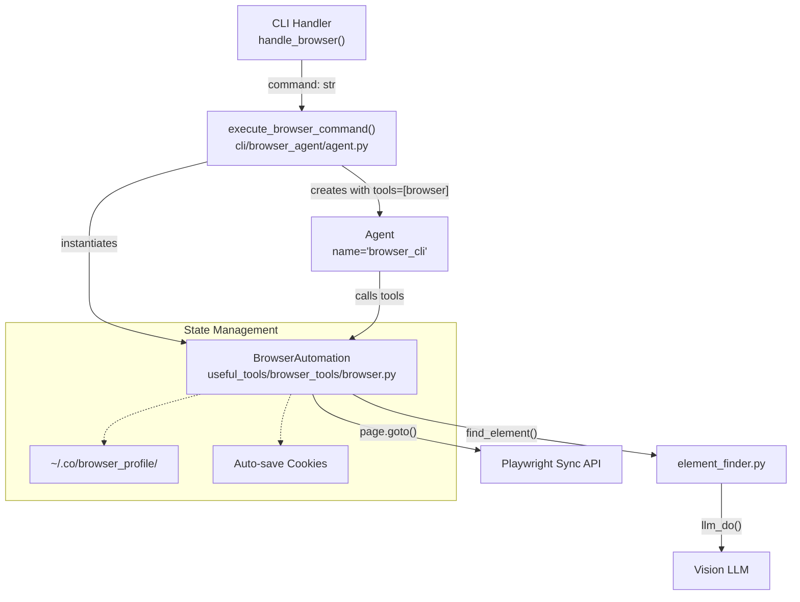
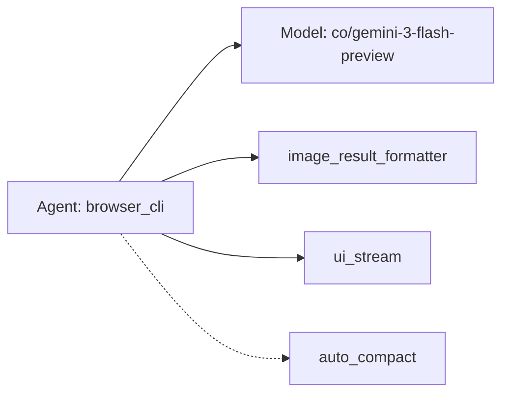

<!-- source: DeepWiki mcp.deepwiki.com · repo openonion/connectonion · page 7.3 Browser Commands · fetched 2026-10-27 -->

# Browser Commands

<details>
<summary>Relevant source files</summary>

The following files were used as context for generating this wiki page:

- [connectonion/cli/browser_agent/__init__.py](connectonion/cli/browser_agent/__init__.py)
- [connectonion/cli/browser_agent/agent.py](connectonion/cli/browser_agent/agent.py)
- [connectonion/cli/co_ai/main.py](connectonion/cli/co_ai/main.py)
- [connectonion/cli/commands/browser_commands.py](connectonion/cli/commands/browser_commands.py)
- [connectonion/network/trust/__init__.py](connectonion/network/trust/__init__.py)
- [connectonion/network/trust/factory.py](connectonion/network/trust/factory.py)
- [connectonion/network/trust/fast_rules.py](connectonion/network/trust/fast_rules.py)
- [connectonion/network/trust/trust_agent.py](connectonion/network/trust/trust_agent.py)
- [connectonion/useful_plugins/auto_compact.py](connectonion/useful_plugins/auto_compact.py)
- [connectonion/useful_plugins/system_reminder.py](connectonion/useful_plugins/system_reminder.py)
- [connectonion/useful_tools/bash.py](connectonion/useful_tools/bash.py)
- [connectonion/useful_tools/browser_tools/browser.py](connectonion/useful_tools/browser_tools/browser.py)

</details>


The `co browser` command provides natural language browser automation directly from the command line. It enables users to control web browsers using conversational commands like "screenshot localhost:3000" or "fill out the contact form with my details" without writing code.

## Overview

Browser commands execute through a Playwright-based agent that understands natural language instructions. The system translates user intent into browser actions, handling element finding, form filling, and navigation automatically.

**Key Features:**
- **Persistent Profiles**: Dedicated profile at `~/.co/browser_profile/` with crash-resistant auto-save [connectonion/useful_tools/browser_tools/browser.py:101-104]().
- **AI-Powered Element Finding**: Uses vision-capable LLMs to locate elements by description [connectonion/useful_tools/browser_tools/browser.py:5-7]().
- **Anti-Detection**: Includes 53 arguments and 30 disabled features to mimic human browsing [connectonion/useful_tools/browser_tools/browser.py:123-131]().
- **Universal Scroll**: AI-driven strategy selection for scrolling through content [connectonion/useful_tools/browser_tools/browser.py:20]().
- **Manual Login Support**: Pause for 2FA/CAPTCHA with automatic cookie persistence [connectonion/useful_tools/browser_tools/browser.py:57-62]().

Sources: [connectonion/useful_tools/browser_tools/browser.py:1-22](), [connectonion/cli/commands/browser_commands.py:1-10]()

## Command Invocation

### Basic Syntax

```bash
# Using the browser subcommand
co browser "navigate to google.com and search for ConnectOnion"

# Using the -b flag (equivalent)
co -b "screenshot github.com"
```

The CLI entry point `handle_browser` delegates the command string to the high-level `execute_browser_command` function [connectonion/cli/commands/browser_commands.py:17-28]().

### Authentication Requirement

Browser commands require an authenticated OpenOnion API key. The agent checks for the key in environment variables or the global `~/.co/keys.env` file [connectonion/cli/browser_agent/agent.py:24-33]().

Sources: [connectonion/cli/commands/browser_commands.py:17-28](), [connectonion/cli/browser_agent/agent.py:19-46]()

## System Architecture

The browser command system operates through three layers: the CLI handler, the high-level Agent wrapper, and the low-level `BrowserAutomation` tool.

### Execution Data Flow



**Architecture:** Data flow from CLI input to Playwright execution via the Agent loop.

Sources: [connectonion/cli/commands/browser_commands.py:17-28](), [connectonion/cli/browser_agent/agent.py:19-46](), [connectonion/useful_tools/browser_tools/browser.py:50-148]()

## BrowserAutomation Class

The `BrowserAutomation` class is the primary interface for web interaction. It manages the Playwright lifecycle and provides natural language tools to the agent.

### Core Implementation Details

- **Initialization**: Sets up a persistent Chromium context at `~/.co/browser_profile/` [connectonion/useful_tools/browser_tools/browser.py:124-131]().
- **Session Persistence**: Cookies and storage are automatically saved after every navigation and manual login confirmation [connectonion/useful_tools/browser_tools/browser.py:55-62]().
- **Headless Mode**: Supports both headless (default) and headed modes via the CLI `--headless` flag or `BrowserAutomation(headless=...)` parameter [connectonion/useful_tools/browser_tools/browser.py:65-80]().
- **Large Viewport**: Defaults to `1920x1200` to maximize visible content for LLM analysis [connectonion/useful_tools/browser_tools/browser.py:137]().

### Tool Methods

| Method | Description |
| :--- | :--- |
| `navigate(url)` | Navigates to a URL and auto-saves cookies [connectonion/useful_tools/browser_tools/browser.py:5](). |
| `find_element(description)` | Uses vision LLM to locate elements by natural language [connectonion/useful_tools/browser_tools/browser.py:5](). |
| `click(description)` | Locates and clicks an element [connectonion/useful_tools/browser_tools/browser.py:7](). |
| `keyboard_type(text)` | Types text into the currently focused element [connectonion/useful_tools/browser_tools/browser.py:7](). |
| `wait_for_login(seconds)` | Pauses execution for manual 2FA/login, then saves state [connectonion/useful_tools/browser_tools/browser.py:7](). |

Sources: [connectonion/useful_tools/browser_tools/browser.py:50-148](), [connectonion/cli/browser_agent/agent.py:35-45]()

## Agent Configuration

The browser CLI agent is configured with specific plugins to enhance output and context management.



**Configuration:** The `browser_cli` agent uses the `image_result_formatter` to handle screenshots and `ui_stream` for real-time terminal updates [connectonion/cli/browser_agent/agent.py:36-44]().

### Context Management
The agent uses the `auto_compact` plugin to prevent context overflow. When context usage reaches 90%, it uses `co/gemini-2.5-flash` to summarize the conversation history, preserving the system prompt and the most recent 5 messages [connectonion/useful_plugins/auto_compact.py:29-41](), [connectonion/useful_plugins/auto_compact.py:104-107]().

Sources: [connectonion/cli/browser_agent/agent.py:35-46](), [connectonion/useful_plugins/auto_compact.py:1-21]()

## Common Workflows

### Manual Login & Session Persistence
The browser agent is designed to handle authenticated sessions gracefully.

1. **User Request**: "Log into GitHub and check my notifications."
2. **Agent Action**: Navigates to GitHub and detects a login wall.
3. **Manual Intervention**: Agent calls `wait_for_login()`. The browser stays open (if not headless) for the user to complete 2FA.
4. **Auto-Save**: Once the user confirms login in the terminal, the agent saves cookies to `~/.co/browser_profile/` [connectonion/useful_tools/browser_tools/browser.py:59-62]().
5. **Persistence**: Subsequent runs of `co browser` will reuse these cookies, skipping the login step.

### Natural Language Navigation
Instead of complex CSS selectors, the agent uses `element_finder.py` which leverages vision-capable models to "see" the page.

```python
# Internal flow within BrowserAutomation.click(description)
element = self.find_element(description) # Uses Vision LLM
self.page.mouse.click(element.x, element.y)
```

Sources: [connectonion/useful_tools/browser_tools/browser.py:5-9](), [connectonion/useful_tools/browser_tools/browser.py:55-63]()

## Error Handling

- **Missing Playwright**: If Playwright is not installed, the system returns a descriptive error message with installation instructions [connectonion/useful_tools/browser_tools/browser.py:93-94]().
- **Navigation Timeout**: Default navigation timeout is set to 60 seconds [connectonion/useful_tools/browser_tools/browser.py:134]().
- **Authentication**: If `OPENONION_API_KEY` is missing, the command directs the user to run `co auth` [connectonion/cli/browser_agent/agent.py:32-33]().

Sources: [connectonion/useful_tools/browser_tools/browser.py:93-98](), [connectonion/cli/browser_agent/agent.py:24-34]()

---

