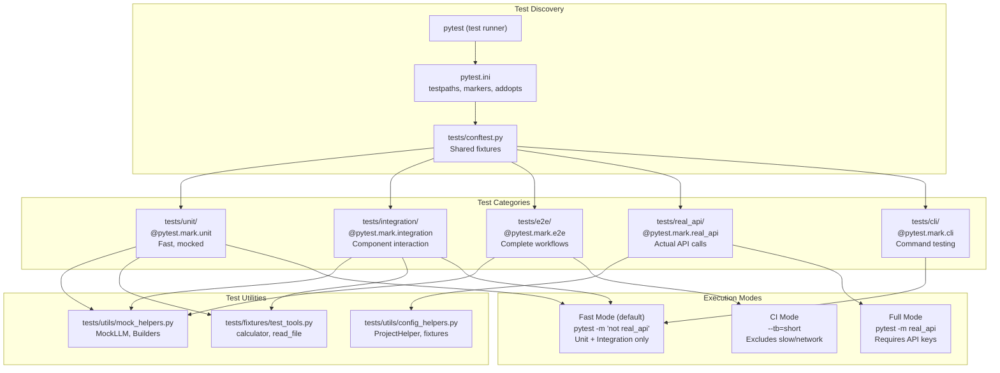
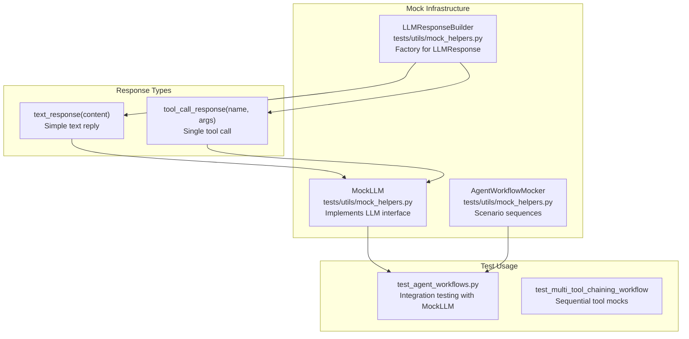

<!-- source: DeepWiki mcp.deepwiki.com · repo openonion/connectonion · page 8 Development Guide · fetched 2026-10-27 -->

# Development Guide

<details>
<summary>Relevant source files</summary>

The following files were used as context for generating this wiki page:

- [.github/workflows/tests.yml](.github/workflows/tests.yml)
- [pytest.ini](pytest.ini)
- [tests/.env.example](tests/.env.example)
- [tests/README.md](tests/README.md)
- [tests/conftest.py](tests/conftest.py)
- [tests/fixtures/test_tools.py](tests/fixtures/test_tools.py)
- [tests/integration/test_agent_workflows.py](tests/integration/test_agent_workflows.py)
- [tests/integration/test_announce_only.py](tests/integration/test_announce_only.py)
- [tests/integration/test_auth_integration.py](tests/integration/test_auth_integration.py)
- [tests/integration/test_benchmarks.py](tests/integration/test_benchmarks.py)
- [tests/real_api/__init__.py](tests/real_api/__init__.py)
- [tests/real_api/conftest.py](tests/real_api/conftest.py)
- [tests/real_api/test_real_email.py](tests/real_api/test_real_email.py)
- [tests/utils/config_helpers.py](tests/utils/config_helpers.py)
- [tox.ini](tox.ini)

</details>


This guide covers the development workflow for contributors to the ConnectOnion framework. It explains how to set up your development environment, run tests, work with the mock system, and contribute code changes. For information about using ConnectOnion to build agents, see [Getting Started](#2). For API reference documentation, see [API Reference](#9).

## Purpose and Scope

This document provides:
- Development environment setup instructions
- Test suite organization and execution patterns
- Mock system usage for deterministic testing
- CI/CD pipeline configuration and behavior
- Code quality standards and contribution guidelines
- Debugging tools and practices for framework development

**Audience**: Contributors to the ConnectOnion framework itself, not end users building agents.

---

## Development Environment Setup

### Prerequisites

```bash
# Python 3.10+ required
python --version  # Should be 3.10, 3.11, 3.12, or 3.13

# Clone repository
git clone https://github.com/openonion/connectonion.git
cd connectonion

# Install in editable mode with dev dependencies
pip install -e .
pip install pytest pytest-cov pytest-mock pytest-asyncio psutil
```

### Project Structure for Development

```
connectonion/
├── connectonion/           # Core framework code
│   ├── __init__.py        # Public API exports
│   ├── core/              # Core engine components
│   │   ├── agent.py       # Agent class
│   │   ├── llm.py         # LLM abstraction
│   │   ├── tool_factory.py
│   │   └── events.py      # Event system
│   ├── tools/             # Built-in tools
│   ├── networking/        # host/connect primitives
│   └── cli/               # CLI commands
├── tests/                 # Test suite
│   ├── unit/             # Fast, isolated tests
│   ├── integration/      # Component interaction tests
│   ├── real_api/         # Tests requiring API keys
│   ├── fixtures/         # Reusable test tools
│   └── utils/            # Test helpers and mocks
├── pytest.ini            # Test configuration
├── tox.ini               # Multi-version testing
└── .github/workflows/    # CI/CD configuration
```

**Sources**: [pytest.ini:1-50](), [.github/workflows/tests.yml:15-30]()

---

## Test Organization Architecture



**Test Markers**: Each test category is automatically marked based on directory structure. Markers are configured in [pytest.ini:11-22]() and include `unit`, `integration`, `e2e`, `e2e_online`, `real_api`, `cli`, `benchmark`, `slow`, `network`, and `asyncio`.

**Sources**: [pytest.ini:1-50](), [tests/conftest.py:1-40](), [tests/README.md:7-24]()

---

## Running Tests

### Basic Test Execution

| Command | Purpose | Speed | API Keys Required |
|---------|---------|-------|-------------------|
| `pytest` | Default (fast tests only) | Fast | No |
| `pytest -m unit` | Unit tests only | Very fast | No |
| `pytest -m integration` | Integration tests only | Fast | No |
| `pytest -m "not real_api and not network"` | All except external | Fast | No |
| `pytest -m real_api` | Real API tests | Slow | Yes |
| `pytest -m benchmark` | Performance benchmarks | Slow | No |
| `pytest tests/unit/test_agent.py` | Single test file | Fast | No |

### Test Configuration

The default test behavior is configured in [pytest.ini:25-33]():

```ini
addopts =
    -v                    # Verbose output
    -rs                   # Show skipped test reasons
    --tb=short           # Short traceback format
    --strict-markers     # Fail on unknown markers
    --durations=10       # Show 10 slowest tests
    -m "not real_api and not network"  # Exclude by default
```

### Environment Setup for Real API Tests

Real API tests require environment variables. Copy the template and add your keys:

```bash
# Copy template
cp tests/.env.example tests/.env

# Edit tests/.env and add your keys:
# OPENAI_API_KEY=sk-...
# ANTHROPIC_API_KEY=sk-ant-...
# GEMINI_API_KEY=...
```

**Auto-skip behavior**: Tests in the `real_api` folder are automatically marked. Static skip decorators like `requires_openai` are used to avoid failures when keys are missing [tests/real_api/conftest.py:67-80]().

**Sources**: [pytest.ini:1-50](), [tests/README.md:31-71](), [tests/real_api/conftest.py:57-61]()

---

## Mock System Architecture



### MockLLM Implementation

The `MockLLM` class is used to simulate LLM behavior deterministically [tests/conftest.py:71-80](). It allows queuing `LLMResponse` objects that include content and `ToolCall` lists [tests/conftest.py:37-39]().

**Usage Example**:
```python
# From tests/integration/test_agent_workflows.py:56-62
mock_llm = MockLLM(responses=[
    LLMResponseBuilder.tool_call_response("calculator", {"expression": "25 * 4"}),
    LLMResponseBuilder.text_response("The result of 25 × 4 is 100.")
])
agent = Agent(name="single_tool_test", llm=mock_llm, tools=[calculator], log=False)
```

**Sources**: [tests/conftest.py:71-80](), [tests/integration/test_agent_workflows.py:34-108]()

---

## Test Fixtures Reference

### Standard Fixtures

Defined in [tests/conftest.py:47-224]():

| Fixture | Type | Purpose |
|---------|------|---------|
| `temp_dir` | Path | Temporary directory, auto-cleanup |
| `mock_llm` | MockLLM | Pre-configured mock LLM |
| `sample_tools` | List | [calculator, current_time, read_file] |
| `test_agent` | Agent | Configured agent with mock LLM |
| `test_files` | Dict | Pre-created test files (normal, empty, large, unicode) |

### Real API Test Fixtures

Defined in [tests/real_api/conftest.py:102-173]():

| Fixture | Purpose |
|---------|---------|
| `localhost_available` | Skips if local dev server (port 8000) is down |
| `auth_token` | Gets JWT from production API via Ed25519 signing |
| `api_headers` | Headers with Bearer token for API requests |
| `test_tools` | Bundle of [calculator_tool, greeting_tool] |

**Sources**: [tests/conftest.py:47-224](), [tests/real_api/conftest.py:102-173]()

---

## CI/CD Pipeline

The CI pipeline uses GitHub Actions to ensure code quality across multiple Python versions.

### Workflow Configuration

The workflow is defined in [.github/workflows/tests.yml:1-40]():

**Matrix Strategy** ([.github/workflows/tests.yml:12-15]()):
- **Python versions**: 3.10, 3.11, 3.12, 3.13
- **OS**: Ubuntu latest

**Test Execution** ([.github/workflows/tests.yml:32-39]()):
```bash
pytest tests/ -v --tb=short -m "not slow and not real_api"
```

### Tox Integration

`tox` is used to manage local test environments and linting [tox.ini:1-5]() :
- `tox -e py311`: Run tests on Python 3.11
- `tox -e lint`: Run `flake8`, `black`, and `isort` checks [tox.ini:59-68]()
- `tox -e format`: Automatically format code using `black` and `isort` [tox.ini:70-77]()

**Sources**: [.github/workflows/tests.yml:1-40](), [tox.ini:1-96]()

---

## Benchmark Tests

ConnectOnion includes performance benchmarks to track resource usage and latency.

### Performance Tracking

Benchmarks are marked with `@pytest.mark.benchmark` [pytest.ini:17](). They track:
- **Response Time**: Simple vs Tool-based workflows [tests/integration/test_benchmarks.py:32-84]()
- **Memory Usage**: RSS tracking using `psutil` [tests/integration/test_benchmarks.py:117-145]()
- **Concurrency**: Threaded agent execution performance [tests/integration/test_benchmarks.py:147-181]()

**Sources**: [tests/integration/test_benchmarks.py:1-181](), [pytest.ini:17-18]()

---

## Writing New Tests

For detailed instructions on writing new tests, mocking strategies, and using the `ProjectHelper` context manager, see the child pages.

- For test structure and markers: [Testing](#8.1)
- For MockLLM and Response Builders: [Mock System](#8.2)
- For CI/CD and deployment checks: [CI/CD Pipeline](#8.3)

**ProjectHelper Example**:
```python
# From tests/README.md:157-165
from tests.utils.config_helpers import ProjectHelper

with ProjectHelper() as project_dir:
    from connectonion import get_emails
    emails = get_emails()
```

**Sources**: [tests/README.md:152-193](), [tests/utils/config_helpers.py:173-199]()

---

