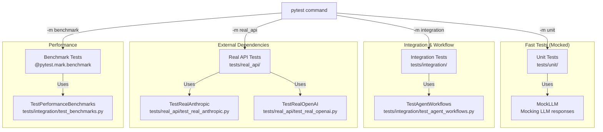
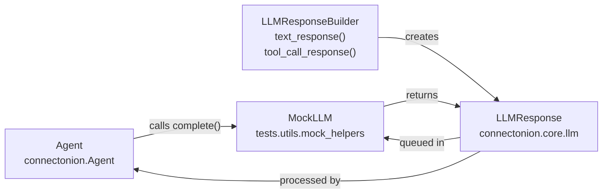

<!-- source: DeepWiki mcp.deepwiki.com · repo openonion/connectonion · page 8.1 Testing · fetched 2026-10-27 -->

# Testing

<details>
<summary>Relevant source files</summary>

The following files were used as context for generating this wiki page:

- [.github/workflows/tests.yml](.github/workflows/tests.yml)
- [pytest.ini](pytest.ini)
- [tests/.env.example](tests/.env.example)
- [tests/README.md](tests/README.md)
- [tests/conftest.py](tests/conftest.py)
- [tests/fixtures/test_tools.py](tests/fixtures/test_tools.py)
- [tests/integration/test_agent_workflows.py](tests/integration/test_agent_workflows.py)
- [tests/integration/test_announce_only.py](tests/integration/test_announce_only.py)
- [tests/integration/test_auth_integration.py](tests/integration/test_auth_integration.py)
- [tests/integration/test_benchmarks.py](tests/integration/test_benchmarks.py)
- [tests/integration/test_llm.py](tests/integration/test_llm.py)
- [tests/real_api/__init__.py](tests/real_api/__init__.py)
- [tests/real_api/conftest.py](tests/real_api/conftest.py)
- [tests/real_api/test_real_anthropic.py](tests/real_api/test_real_anthropic.py)
- [tests/real_api/test_real_email.py](tests/real_api/test_real_email.py)
- [tests/real_api/test_real_openai.py](tests/real_api/test_real_openai.py)
- [tests/utils/config_helpers.py](tests/utils/config_helpers.py)
- [tox.ini](tox.ini)

</details>


## Purpose and Scope

This document explains ConnectOnion's testing infrastructure, including test organization, running tests, the mock system, and writing new tests. For information about the CI/CD pipeline configuration, see [CI/CD Pipeline](8.3). For details about the mock system implementation, see [Mock System](8.2).

---

## Test Organization

ConnectOnion uses `pytest` with a marker-based organization system. Tests are categorized by type in separate directories, with automatic marker assignment based on location via `tests/conftest.py`.

### Directory Structure

```
tests/
├── conftest.py              # Shared fixtures and configuration
├── pytest.ini               # Pytest configuration
├── .env.example             # Template for API keys
├── README.md                # Testing documentation
│
├── unit/                    # Fast, isolated tests (auto-marked: unit)
├── integration/             # Component interaction tests (auto-marked: integration)
├── e2e/                     # End-to-end workflows (auto-marked: e2e)
├── cli/                     # CLI command tests (auto-marked: cli)
├── real_api/                # Tests requiring real API keys (auto-marked: real_api)
│   └── conftest.py          # Real API fixtures and markers
│
├── fixtures/                # Reusable test tools
│   └── test_tools.py        # calculator, current_time, read_file
│
└── utils/                   # Test utilities
    ├── mock_helpers.py      # MockLLM, builders, mockers
    └── config_helpers.py    # Test project creation helpers
```

**Sources:** [tests/README.md:7-24](), [tests/conftest.py:1-44](), [pytest.ini:1-9]()

### Pytest Markers

Markers are defined in `pytest.ini` and control test execution. Many are applied automatically based on the directory path in `tests/conftest.py`.

| Marker | Purpose | Default in CI |
|--------|---------|---------------|
| `unit` | Fast, isolated tests with mocks | ✅ Included |
| `integration` | Component interaction tests | ✅ Included |
| `e2e` | End-to-end workflow tests | ✅ Included |
| `cli` | CLI-specific tests | ✅ Included |
| `real_api` | Tests requiring real API keys (OpenAI, Anthropic, Gemini) | ❌ Excluded |
| `network` | Tests requiring relay server connection | ❌ Excluded |
| `benchmark` | Performance benchmark tests | ✅ Included |
| `slow` | Tests taking >10 seconds | ❌ Excluded |
| `asyncio` | Async tests using `pytest-asyncio` | ✅ Included |

**Sources:** [pytest.ini:11-22](), [pytest.ini:33](), [tests/conftest.py:7-10]()

---

## Running Tests

### Basic Commands

The `pytest.ini` file includes `addopts` that exclude `real_api` and `network` tests by default to prevent accidental costs or failures due to missing environment variables.

```bash
# Run all standard tests (excludes real_api and network)
pytest

# Run specific test categories using markers
pytest -m unit           # Unit tests only
pytest -m integration    # Integration tests only
pytest -m e2e           # End-to-end tests
pytest -m cli           # CLI tests

# Include real API tests (requires API keys in environment)
pytest -m real_api

# Run performance benchmarks
pytest -m benchmark

# Combine markers (e.g., everything except slow tests)
pytest -m "not slow"
```

**Sources:** [tests/README.md:48-71](), [pytest.ini:25-33]()

### Environment Setup

For tests in `tests/real_api/`, you must provide valid API keys. The suite loads environment variables from a `tests/.env` file if it exists.

```bash
# Copy template
cp tests/.env.example tests/.env

# Edit tests/.env and add your keys:
# OPENAI_API_KEY=sk-...
# ANTHROPIC_API_KEY=sk-...
# GEMINI_API_KEY=...
```

**Sources:** [tests/README.md:33-46](), [tests/conftest.py:43-44](), [tests/real_api/conftest.py:49-50]()

---

## Test Categories

### Diagram: Test Category Flow

This diagram maps natural language test categories to their corresponding code entities and execution markers.



**Sources:** [tests/README.md:75-107](), [pytest.ini:11-22]()

### Integration Tests

Integration tests verify that components like the `Agent`, `Tools`, and `LLM` interfaces work together. They typically use `MockLLM` to avoid external costs while executing real tool logic.

**Example: Agent Workflow**
The `TestAgentWorkflows` class tests multi-turn conversations and tool chaining.
- `test_simple_conversation_workflow`: Text-only interactions [tests/integration/test_agent_workflows.py:34-51]().
- `test_single_tool_workflow`: Using the `calculator` tool [tests/integration/test_agent_workflows.py:53-69]().
- `test_iteration_limit_protection`: Ensures the agent stops after `max_iterations` (default 10) [tests/integration/test_agent_workflows.py:146-165]().

### Real API Tests

These tests verify compatibility with actual provider APIs. They are auto-marked as `real_api` in `tests/real_api/conftest.py`.

**Provider Tests:**
- `AnthropicLLM`: Tested in `tests/real_api/test_real_anthropic.py` using models like `claude-3-5-haiku-latest` [tests/real_api/test_real_anthropic.py:39-111]().
- `OpenAILLM`: Tested in `tests/real_api/test_real_openai.py`.
- `GeminiLLM`: Tested in `tests/real_api/test_real_gemini.py`.

**Skip Logic:**
Markers like `requires_openai`, `requires_anthropic`, and `requires_gemini` are used to skip tests if the corresponding environment variable is missing [tests/real_api/conftest.py:67-80]().

---

## Mock System

ConnectOnion provides a robust mocking layer to simulate LLM behavior deterministically.

### MockLLM and Response Builders

The `MockLLM` class (located in `tests.utils.mock_helpers`) allows developers to queue a sequence of `LLMResponse` objects.

```python
from tests.utils.mock_helpers import MockLLM, LLMResponseBuilder

# Create a mock that first calls a tool, then gives a text response
mock_llm = MockLLM(responses=[
    LLMResponseBuilder.tool_call_response("calculator", {"expression": "25 * 4"}),
    LLMResponseBuilder.text_response("The result is 100.")
])
```

**Sources:** [tests/integration/test_agent_workflows.py:56-60](), [tests/conftest.py:71-81]()

### Diagram: Mock System Data Flow

This diagram illustrates how `MockLLM` intercepts calls from the `Agent` to provide simulated data.



**Sources:** [tests/conftest.py:71-81](), [tests/integration/test_agent_workflows.py:53-69]()

---

## Performance Benchmarks

The `TestPerformanceBenchmarks` class in `tests/integration/test_benchmarks.py` tracks system resource usage and timing.

- **Response Time**: `test_agent_response_time_simple` measures the overhead of the agent loop [tests/integration/test_benchmarks.py:32-55]().
- **Memory Usage**: `test_memory_usage_single_agent` uses `psutil` to monitor RSS memory increase over 50 iterations [tests/integration/test_benchmarks.py:117-145]().
- **Concurrency**: `test_concurrent_agents_performance` runs 5 agents in a `ThreadPoolExecutor` to verify thread safety and performance [tests/integration/test_benchmarks.py:147-181]().

**Sources:** [tests/integration/test_benchmarks.py:28-181]()

---

## CI/CD Pipeline

The project uses GitHub Actions to run tests on every push and pull request to `main` or `master`.

**Configuration:**
- **Runs on**: `ubuntu-latest` [ .github/workflows/tests.yml:11]()
- **Python Matrix**: 3.10, 3.11, 3.12, 3.13 [ .github/workflows/tests.yml:15]()
- **Command**: `pytest tests/ -v --tb=short -m "not slow and not real_api"` [ .github/workflows/tests.yml:39]()

The `tox.ini` file is also provided for local multi-environment testing, including specialized environments for `lint`, `integration`, and `real_api` [tox.ini:1-96]().

**Sources:** [.github/workflows/tests.yml:1-40](), [tox.ini:1-96]()

---

## Writing New Tests

### Using ProjectHelper

When testing features that require a `.co` directory or configuration, use the `ProjectHelper` context manager. It creates a temporary project structure and cleans it up automatically.

```python
from tests.utils.config_helpers import ProjectHelper

def test_with_temp_project():
    with ProjectHelper() as project_dir:
        # Current working directory is now inside the temp project
        # .co/config.toml and keys are pre-generated
        from connectonion import Agent
        agent = Agent(name="test")
        assert agent.name == "test"
```

**Sources:** [tests/utils/config_helpers.py:173-199](), [tests/README.md:152-165]()

### Adding a Unit Test
1. Create a file in `tests/unit/` named `test_<module_name>.py`.
2. Use the `mock_llm` or `test_agent` fixtures from `tests/conftest.py`.
3. Assert both the final output and the internal state (e.g., `mock_llm.call_count`).

**Sources:** [tests/conftest.py:114-119](), [tests/README.md:180-193]()

---

