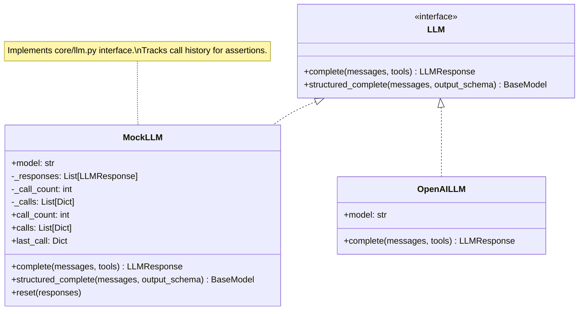
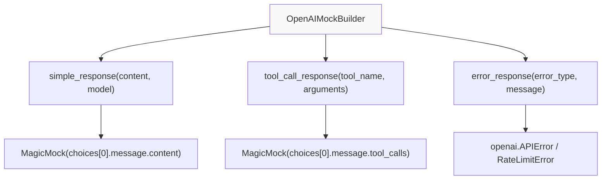
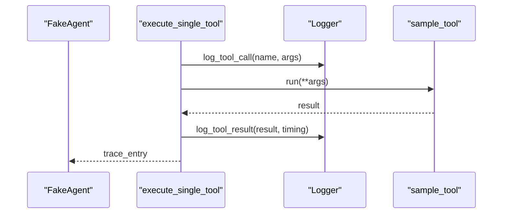

<!-- source: DeepWiki mcp.deepwiki.com · repo openonion/connectonion · page 8.2 Mock System · fetched 2026-10-27 -->

# Mock System

<details>
<summary>Relevant source files</summary>

The following files were used as context for generating this wiki page:

- [connectonion/logger.py](connectonion/logger.py)
- [docs/api.md](docs/api.md)
- [docs/concepts/tools.md](docs/concepts/tools.md)
- [examples/xray_debug_example.py](examples/xray_debug_example.py)
- [tests/real_api/manual/manual_defaults.py](tests/real_api/manual/manual_defaults.py)
- [tests/unit/test_logger.py](tests/unit/test_logger.py)
- [tests/unit/test_tool_executor.py](tests/unit/test_tool_executor.py)
- [tests/unit/test_tool_executor_errors.py](tests/unit/test_tool_executor_errors.py)
- [tests/unit/test_tool_factory.py](tests/unit/test_tool_factory.py)
- [tests/utils/__init__.py](tests/utils/__init__.py)
- [tests/utils/mock_helpers.py](tests/utils/mock_helpers.py)

</details>


This page documents the mock system used for testing ConnectOnion agents without making actual LLM API calls. The mock system provides deterministic, fast test execution by simulating LLM responses and tool behaviors.

For general testing practices and test organization, see [Testing](#8.1). For CI/CD configuration using these mocks, see [CI/CD Pipeline](#8.3).

---

## Overview

The ConnectOnion mock system consists of four main components:

| Component | Purpose | File Location |
|-----------|---------|---------------|
| `MockLLM` | LLM interface implementation with pre-configured responses | [tests/utils/mock_helpers.py:24-133]() |
| Response Builders | Factory classes for creating mock responses | [tests/utils/mock_helpers.py:134-210]() |
| Workflow Mockers | Pre-built multi-turn conversation sequences | [tests/utils/mock_helpers.py:235-283]() |
| Test Fixtures | Reusable pytest fixtures for common test scenarios | [tests/conftest.py:21-285]() |

The mock system is designed to:
- Eliminate external API dependencies during testing.
- Provide deterministic, reproducible test results.
- Enable fast test execution (tests complete in milliseconds).
- Support both simple and complex multi-turn agent workflows.

**Sources:** [tests/utils/mock_helpers.py:1-13]()

---

## Core Mock Classes

### MockLLM Class

The `MockLLM` class is the primary mock implementation of the `LLM` interface [tests/utils/mock_helpers.py:24-24](). Unlike simple mocks, it properly implements the full interface to support YAML serialization in agent logs and structured output.

**Mock System Entity Mapping**


**Key Characteristics:**

| Feature | Implementation |
|---------|----------------|
| Interface Compliance | Fully implements `LLM.complete()` [tests/utils/mock_helpers.py:63-90]() and `LLM.structured_complete()` [tests/utils/mock_helpers.py:92-111](). |
| Response Queue | Pops responses from `_responses` list in order [tests/utils/mock_helpers.py:77-77](). |
| Call Tracking | Records all calls in `_calls` list for test assertions [tests/utils/mock_helpers.py:71-71](). |
| Usage Factory | Can attach generated `TokenUsage` via an optional `usage_factory` [tests/utils/mock_helpers.py:81-88](). |
| Structured Output | Supports a queue of Pydantic models via `structured_responses` [tests/utils/mock_helpers.py:103-108](). |

**Sources:** [tests/utils/mock_helpers.py:24-133]()

---

### Response Builder Classes

#### LLMResponseBuilder

Creates `LLMResponse` objects for use with `MockLLM`. It supports text, single tool calls, and multi-tool responses [tests/utils/mock_helpers.py:160-210]().

| Method | Parameters | Returns | Use Case |
|--------|------------|---------|----------|
| `text_response()` | `content: str` | `LLMResponse` | Final text responses from agent. |
| `tool_call_response()` | `tool_name: str`, `arguments: Dict` | `LLMResponse` | Single tool execution request. |
| `multi_tool_response()` | `tool_calls: List[Dict]` | `LLMResponse` | Parallel tool execution. |

**Sources:** [tests/utils/mock_helpers.py:160-210]()

#### OpenAIMockBuilder

Provides static methods to create mock OpenAI API response objects, useful for testing the `OpenAILLM` provider class [tests/utils/mock_helpers.py:134-158]().



**Sources:** [tests/utils/mock_helpers.py:134-184]()

---

## Workflow Mockers

`AgentWorkflowMocker` provides pre-built sequences of responses for common agent interaction patterns, such as a calculator loop or error recovery [tests/utils/mock_helpers.py:235-283]().

| Workflow Method | Response Sequence |
|----------------|-------------------|
| `calculator_workflow()` | 1. Tool call: `calculator` | 2. Text response with result. |
| `multi_tool_workflow()` | 1. `calculator` | 2. `current_time` | 3. Final text summary. |
| `error_recovery_workflow()`| 1. Failing tool call | 2. Apology text | 3. Correct tool call | 4. Success text. |

**Sources:** [tests/utils/mock_helpers.py:235-283]()

---

## Tool Execution Testing

Testing tool execution involves the `ToolRegistry` and `execute_single_tool` utility. The system ensures that tool calls are logged before execution and results are logged after [tests/unit/test_tool_executor.py:161-210]().

**Data Flow: Tool Execution to Logger**


**Sources:** [tests/unit/test_tool_executor.py:158-210](), [connectonion/logger.py:134-143]()

---

## Test Fixtures

Pytest fixtures in `tests/conftest.py` provide reusable mock objects for tests.

| Fixture Name | Type | Provides |
|--------------|------|----------|
| `mock_llm` | `MockLLM` | A mock LLM initialized with a default text response [tests/conftest.py:45-54](). |
| `mock_openai_client` | `MagicMock` | A mock of the OpenAI client [tests/conftest.py:30-41](). |
| `temp_dir` | `Path` | A temporary directory for file-based tool tests [tests/conftest.py:22-26](). |
| `test_agent` | `Agent` | An agent pre-configured with `mock_llm` and sample tools [tests/conftest.py:88-93](). |

**Sources:** [tests/conftest.py:21-285]()

---

## Usage Patterns

### Pattern 1: Asserting Tool Calls

You can verify that an agent called a specific tool with expected arguments by inspecting `MockLLM.calls` [tests/utils/mock_helpers.py:117-121]().

```python
# Setup
mock_llm = MockLLM(responses=[
    LLMResponseBuilder.tool_call_response("add", {"a": 2, "b": 3}),
    LLMResponseBuilder.text_response("The sum is 5")
])
agent = Agent(name="test", llm=mock_llm, tools=[add])

# Act
agent.input("What is 2 + 3?")

# Assert
assert mock_llm.call_count == 2
last_call = mock_llm.calls[0]
assert last_call["tools"][0]["function"]["name"] == "add"
```

**Sources:** [tests/utils/mock_helpers.py:112-125]()

### Pattern 2: Testing Error Handling

Use `MockLLM` to simulate a tool that doesn't exist or returns an error to verify the agent's resilience [tests/unit/test_tool_executor_errors.py:153-185]().

```python
def test_tool_exception_creates_error_trace():
    # Setup failing tool
    def failing_tool(x):
        raise ValueError("Invalid input")
    
    # execute_single_tool captures the exception
    trace_entry = execute_single_tool(
        tool_name="failing_tool",
        tool_args={"x": "bad"},
        tools={"failing_tool": failing_tool},
        agent=mock_agent,
        logger=logger
    )
    
    assert trace_entry["status"] == "error"
    assert trace_entry["error_type"] == "ValueError"
```

**Sources:** [tests/unit/test_tool_executor_errors.py:153-185]()

---

## Summary

The ConnectOnion mock system provides a comprehensive testing infrastructure:

| Component | Purpose | Key Classes |
|-----------|---------|-------------|
| Mock LLM | Simulate LLM responses without API calls | `MockLLM` [tests/utils/mock_helpers.py:24]() |
| Response Builders | Create deterministic mock responses | `LLMResponseBuilder` [tests/utils/mock_helpers.py:160]() |
| Workflow Mockers | Pre-built multi-turn sequences | `AgentWorkflowMocker` [tests/utils/mock_helpers.py:235]() |
| Test Fixtures | Reusable test configurations | `mock_llm`, `test_agent` [tests/conftest.py:45-93]() |

**Sources:** [tests/utils/mock_helpers.py:1-300](), [tests/conftest.py:1-285]()

---

