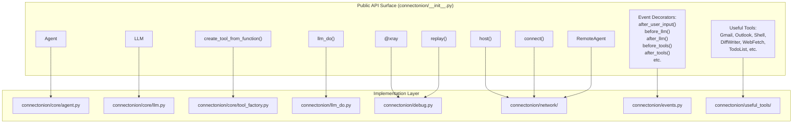
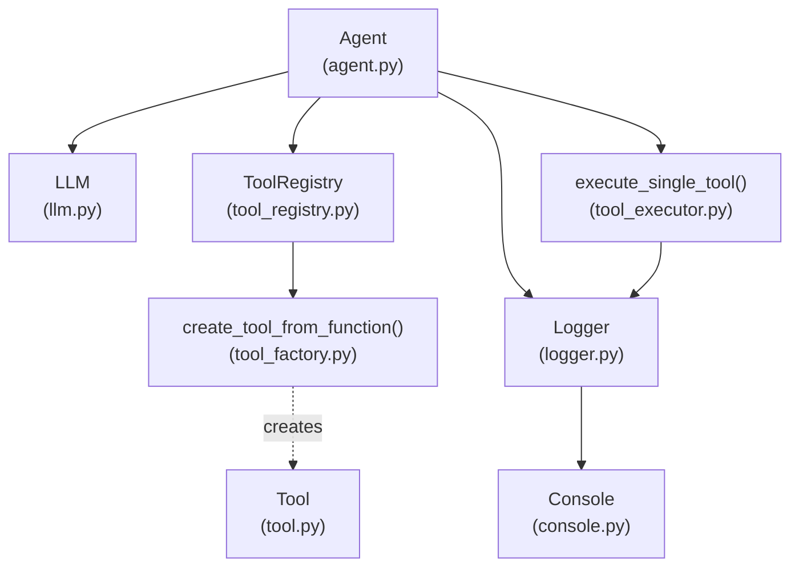

<!-- source: DeepWiki mcp.deepwiki.com · repo openonion/connectonion · page 9 API Reference · fetched 2026-10-27 -->

# API Reference

<details>
<summary>Relevant source files</summary>

The following files were used as context for generating this wiki page:

- [VERSIONING.md](VERSIONING.md)
- [connectonion/__init__.py](connectonion/__init__.py)
- [connectonion/cli/co_ai/agent.py](connectonion/cli/co_ai/agent.py)
- [connectonion/cli/main.py](connectonion/cli/main.py)
- [connectonion/logger.py](connectonion/logger.py)
- [docs/api.md](docs/api.md)
- [docs/concepts/tools.md](docs/concepts/tools.md)
- [pyproject.toml](pyproject.toml)
- [tests/real_api/manual/manual_defaults.py](tests/real_api/manual/manual_defaults.py)
- [tests/unit/test_logger.py](tests/unit/test_logger.py)
- [tests/unit/test_tool_executor.py](tests/unit/test_tool_executor.py)
- [tests/unit/test_tool_executor_errors.py](tests/unit/test_tool_executor_errors.py)
- [tests/unit/test_tool_factory.py](tests/unit/test_tool_factory.py)

</details>


## Purpose and Scope

This document provides comprehensive reference documentation for all public interfaces in the ConnectOnion framework. It covers class constructors, method signatures, function parameters, return types, and type definitions. For conceptual explanations, see [Core Concepts](#3). For practical usage examples, see [Getting Started](#2).

Child pages provide detailed documentation for specific API domains:
- [Agent API](#9.1) - `Agent` class methods and session management
- [LLM API](#9.2) - LLM provider interfaces and `llm_do` function
- [Tool API](#9.3) - Tool creation and registration functions
- [Networking API](#9.4) - `host()`, `connect()`, and `RemoteAgent` interfaces

---

## Public API Organization

The following diagram maps the primary public exports to their implementation locations in the codebase:



**Sources:** [connectonion/__init__.py:33-64](), [connectonion/__init__.py:66-135]()

---

## Import Patterns

All public APIs are exported from the top-level `connectonion` module. The framework auto-loads `.env` files from the current working directory or `~/.co/keys.env` upon import.

```python
# Core classes and functions
from connectonion import Agent, LLM, create_tool_from_function

# LLM utilities
from connectonion import llm_do, transcribe

# Debugging
from connectonion import xray, replay, xray_replay, auto_debug_exception

# Networking
from connectonion import host, connect, RemoteAgent, Response, IO
from connectonion import relay, announce, address

# Event decorators
from connectonion import (
    on_agent_ready,
    after_user_input,
    before_llm,
    after_llm,
    before_each_tool,
    before_tools,
    after_each_tool,
    after_tools,
    on_error,
    on_complete
)

# Built-in tools
from connectonion import (
    Gmail, Outlook, GoogleCalendar, MicrosoftCalendar,
    Shell, DiffWriter, WebFetch, TodoList, Memory,
    SlashCommand, pick, yes_no, autocomplete,
    send_email, get_emails, mark_read, mark_unread,
    read_file, edit, multi_edit, glob, grep, write
)
```

**Sources:** [connectonion/__init__.py:15-31](), [connectonion/__init__.py:33-64]()

---

## Core API Modules

### Module Dependency Diagram



**Sources:** [connectonion/logger.py:4-11](), [connectonion/core/tool_executor.py:15-19](), [connectonion/core/tool_factory.py:16-16]()

---

## Agent API Summary

The `Agent` class is the primary orchestrator for LLM-based task execution with tools.

### Constructor Signature

```python
Agent(
    name: str,
    llm: Optional[LLM] = None,
    tools: Optional[List[Callable]] = None,
    system_prompt: Union[str, Path, None] = None,
    api_key: Optional[str] = None,
    model: str = "co/gemini-2.5-pro",
    max_iterations: int = 10,
    quiet: bool = False,
    log: Union[bool, str, Path, None] = None,
    co_dir: Union[str, Path, None] = None
)
```

### Key Methods

| Method | Signature | Description |
|--------|-----------|-------------|
| `input()` | `input(prompt: str, max_iterations: Optional[int] = None) -> str` | Execute task and return final response |
| `add_tool()` | `add_tool(tool: Callable) -> None` | Add tool to agent |
| `remove_tool()` | `remove_tool(tool_name: str) -> None` | Remove tool by name |
| `list_tools()` | `list_tools() -> List[str]` | Get list of available tool names |

**Sources:** [docs/api.md:9-103](), [connectonion/cli/co_ai/agent.py:97-106]()

For detailed Agent API documentation, see [Agent API](#9.1).

---

## LLM API Summary

The `LLM` abstract base class defines the interface for language model providers.

### Provider Routing

The `create_llm()` factory function routes models based on prefixes:
- `gpt-*`, `o4-*` → `OpenAILLM`
- `claude-*` → `AnthropicLLM`
- `gemini-*` → `GeminiLLM`
- `co/*` → `OpenOnionLLM` (managed keys)

### Core Interface

| Method | Description |
|--------|-------------|
| `complete()` | Standard completion with optional tool calls |
| `structured_complete()` | Returns response matching a Pydantic model |

**Sources:** [docs/api.md:223-261]()

For detailed LLM API documentation, see [LLM API](#9.2).

---

## llm_do Function

Single-turn LLM call utility for quick queries without an Agent:

```python
llm_do(
    prompt: str,
    model: str = "co/gpt-4o",
    system_prompt: Optional[str] = None,
    api_key: Optional[str] = None,
    **kwargs
) -> str
```

**Sources:** [connectonion/llm_do.py:1-100](), [connectonion/__init__.py:50-50]()

---

## Tool API Summary

### Function-Based Tool Creation

ConnectOnion automatically converts Python functions into tools using type hints and docstrings.

```python
from connectonion import create_tool_from_function

def simple_function(x: int) -> int:
    """Double a number."""
    return x * 2

tool = create_tool_from_function(simple_function)
```

### Schema Generation Rules

| Source | Schema Field |
|--------|--------------|
| `func.__name__` | `name` |
| First paragraph of docstring | `description` |
| Type hints | `parameters` |
| No default value | `required` |

**Sources:** [docs/api.md:136-149](), [tests/unit/test_tool_factory.py:22-110]()

For detailed Tool API documentation, see [Tool API](#9.3).

---

## Networking API Summary

### host() Function

Deploy an agent as a network service:

```python
host(agent: Agent, host: str = "0.0.0.0", port: int = 8000)
```

### connect() Function

Create proxy to remote agent:

```python
remote = connect("address_or_name")
result = remote.input("Task for remote agent")
```

**Sources:** [connectonion/__init__.py:62-63](), [connectonion/network/__init__.py:1-100]()

For detailed Networking API documentation, see [Networking API](#9.4).

---

## Logger API

The `Logger` class provides unified output to the console, plain text logs, and structured YAML evals.

### Configuration

| `quiet` | `log` | Console | Plain Text | Sessions | Use Case |
|---------|-------|---------|------------|----------|----------|
| False | True | ✓ | ✓ | ✓ | Development (default) |
| True | True | ✗ | ✗ | ✓ | Eval/testing |
| False | False | ✓ | ✗ | ✗ | Benchmarking |

### File Locations

- **Logs:** `.co/logs/{agent_name}.log`
- **Evals:** `.co/evals/{input_slug}.yaml`

**Sources:** [connectonion/logger.py:44-117](), [docs/api.md:151-184]()

---

## Built-in Tools Reference

ConnectOnion includes production-ready tools for common tasks:

| Tool | Description |
|------|-------------|
| `Shell` / `bash` | Execute shell commands (with approval flows) |
| `DiffWriter` | Intelligent file editing with diffs |
| `WebFetch` | Fetch and parse web content |
| `TodoList` | Manage task state within a session |
| `Gmail` / `Outlook` | Email management via official APIs |
| `read_file` / `edit` | Claude Code-style file manipulation tools |

**Sources:** [connectonion/__init__.py:54-61](), [connectonion/cli/co_ai/agent.py:7-22]()

---

## Error Handling

### Tool Execution Errors

When a tool fails, the `execute_single_tool` function captures the exception:
1. The trace entry status is set to `"error"`.
2. The exception type and message are recorded.
3. An `on_error` event is triggered.
4. The error is returned to the LLM to allow for potential self-correction.

**Sources:** [connectonion/core/tool_executor.py:48-84](), [tests/unit/test_tool_executor_errors.py:153-214]()

---

## Version Information

Current version: `0.9.1`

ConnectOnion follows semantic versioning (`MAJOR.MINOR.PATCH`). Version increments are tracked in `VERSIONING.md`.

**Sources:** [connectonion/__init__.py:13-13](), [pyproject.toml:7-7](), [VERSIONING.md:3-28]()

---

