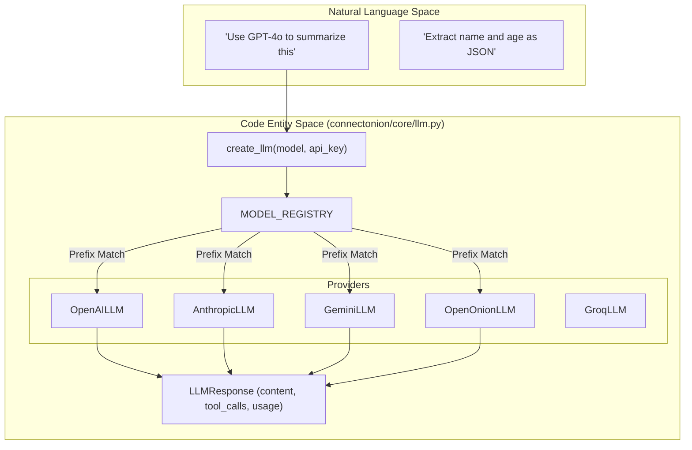
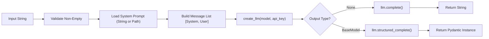

<!-- source: DeepWiki mcp.deepwiki.com · repo openonion/connectonion · page 9.2 LLM API · fetched 2026-10-27 -->

# LLM API

<details>
<summary>Relevant source files</summary>

The following files were used as context for generating this wiki page:

- [connectonion/cli/templates/coder/agent.py](connectonion/cli/templates/coder/agent.py)
- [connectonion/cli/templates/coder/prompt.md](connectonion/cli/templates/coder/prompt.md)
- [connectonion/cli/templates/minimal/agent.py](connectonion/cli/templates/minimal/agent.py)
- [connectonion/cli/templates/minimal/prompt.md](connectonion/cli/templates/minimal/prompt.md)
- [connectonion/cli/templates/web-research/agent.py](connectonion/cli/templates/web-research/agent.py)
- [connectonion/core/exceptions.py](connectonion/core/exceptions.py)
- [connectonion/core/llm.py](connectonion/core/llm.py)
- [connectonion/llm_do.py](connectonion/llm_do.py)
- [docs/concepts/models.md](docs/concepts/models.md)
- [tests/real_api/manual/manual_llm_do_examples.py](tests/real_api/manual/manual_llm_do_examples.py)
- [tests/real_api/test_real_gemini.py](tests/real_api/test_real_gemini.py)
- [tests/real_api/test_real_multi_llm.py](tests/real_api/test_real_multi_llm.py)
- [tests/real_api/test_responses_parse.py](tests/real_api/test_responses_parse.py)
- [tests/unit/test_groq_llm.py](tests/unit/test_groq_llm.py)

</details>


**Purpose**: This document provides a comprehensive API reference for ConnectOnion's LLM abstraction layer, including provider implementations, the `llm_do()` function, model registry, and structured output capabilities.

**Scope**: This page covers the programmatic interfaces for working with LLMs in ConnectOnion. For conceptual information about LLM integration patterns, see [LLM Integration](3.2). For agent-level usage, see [Agent API](9.1). For practical guidance on when to use LLMs vs code, see [When to Use LLMs vs Code](10.3).

---

## Overview

ConnectOnion's LLM abstraction provides a unified interface across multiple providers including OpenAI, Anthropic, Google Gemini, Groq, Grok, Mistral, and OpenRouter. It also includes a first-class "Managed Keys" system via OpenOnion. The system consists of:

1.  **Base LLM Interface**: Abstract base class defining `complete()` and `structured_complete()` [connectonion/core/llm.py:21-24]().
2.  **Provider Implementations**: Concrete classes for each LLM provider (e.g., `OpenAILLM`, `GeminiLLM`, `AnthropicLLM`) [connectonion/core/llm.py:26-34]().
3.  **Factory Layer**: `create_llm()` function for model name resolution and instance creation [connectonion/core/llm.py:36-39]().
4.  **One-Shot Function**: `llm_do()` for simple single-round calls without agent overhead [connectonion/llm_do.py:13-15]().

### Architecture Diagram: Natural Language to Code Entity

This diagram bridges high-level model requests to the specific code entities that handle them.


**Sources**: [connectonion/core/llm.py:1-76](), [connectonion/llm_do.py:32-41]()

---

## Provider Factory

### `create_llm()`

The primary entry point for obtaining an LLM instance. It routes model names to the appropriate provider class and handles API key initialization [connectonion/core/llm.py:36-39]().

**Signature**:
```python
def create_llm(model: str, api_key: Optional[str] = None) -> LLM
```

**Resolution Logic**:
- **Prefix Detection**:
    - `gpt-*`, `o1-*`, `o4-*` → `OpenAILLM` [connectonion/core/llm.py:27]().
    - `claude-*` → `AnthropicLLM` [connectonion/core/llm.py:28]().
    - `gemini-*` → `GeminiLLM` [connectonion/core/llm.py:29]().
    - `groq/*` → `GroqLLM` (strips prefix) [connectonion/unit/test_groq_llm.py:46-50]().
    - `co/*` → `OpenOnionLLM` (Managed keys) [connectonion/core/llm.py:34]().

**Sources**: [connectonion/core/llm.py:36-40](), [tests/unit/test_groq_llm.py:46-50]()

---

## Base LLM Interface

All provider implementations inherit from the `LLM` abstract base class [connectonion/core/llm.py:21-24]().

### `complete()`
Performs a standard chat completion. It accepts OpenAI-format messages and returns an `LLMResponse` dataclass [connectonion/core/llm.py:63-69]().

### `structured_complete()`
Returns a validated Pydantic model instance. Each provider uses its native structured output API:
- **OpenAI**: `responses.parse()` [connectonion/core/llm.py:43-44]().
- **Anthropic**: Forced tool calling [connectonion/core/llm.py:45]().
- **Gemini**: `response_schema` [connectonion/core/llm.py:46]().

**Sources**: [connectonion/core/llm.py:41-55](), [connectonion/core/llm.py:71-76]()

---

## llm_do() Function

`llm_do()` is a stateless, one-shot wrapper around the LLM providers [connectonion/llm_do.py:44-49]().

### Data Flow: llm_do Execution


**Sources**: [connectonion/llm_do.py:5-9](), [connectonion/llm_do.py:62-80]()

### Usage Examples

| Pattern | Code Snippet |
| :--- | :--- |
| **Simple Q&A** | `answer = llm_do("What is 2+2?")` [connectonion/llm_do.py:105-107]() |
| **Structured** | `result = llm_do("John, 30", output=Person)` [connectonion/llm_do.py:109-114]() |
| **Managed Keys** | `llm_do("Hi", model="co/gpt-4o")` [connectonion/llm_do.py:98-101]() |
| **Parameters** | `llm_do("Story", temperature=0.9)` [connectonion/llm_do.py:125-130]() |

---

## Managed Keys (OpenOnion)

ConnectOnion provides managed API keys to simplify development. Users run `co auth` to authenticate, which stores credentials in `~/.co/config.toml` [connectonion/core/llm.py:6]().

### Model Naming
Prepend `co/` to any supported model name to use managed credits [docs/concepts/models.md:17-18]().
- `co/gemini-2.5-flash` (Default for `llm_do`) [connectonion/llm_do.py:46]()
- `co/gpt-5` [docs/concepts/models.md:48]()
- `co/claude-sonnet-4-5` [docs/concepts/models.md:131]()

### Error Handling: Insufficient Credits
When using `OpenOnionLLM`, if a request fails with HTTP 402, the system raises a formatted `InsufficientCreditsError` [connectonion/core/exceptions.py:15-17]().

**Attributes**:
- `balance`: Current USD balance [connectonion/core/exceptions.py:41]().
- `shortfall`: Credits needed for the request [connectonion/core/exceptions.py:43]().
- `address`: The ConnectOnion account address [connectonion/core/exceptions.py:44]().

**Sources**: [connectonion/core/llm.py:9](), [connectonion/core/exceptions.py:22-27](), [docs/concepts/models.md:9-12]()

---

## Provider Reference

### Supported Providers & Models

| Provider | Prefix / Examples | Auth Env Var |
| :--- | :--- | :--- |
| **OpenAI** | `gpt-4o`, `o4-mini` | `OPENAI_API_KEY` |
| **Anthropic** | `claude-3-5-sonnet` | `ANTHROPIC_API_KEY` |
| **Google** | `gemini-2.5-pro` | `GEMINI_API_KEY` |
| **Groq** | `groq/llama-3.3-70b` | `GROQ_API_KEY` |
| **xAI** | `grok/` | `XAI_API_KEY` |
| **Mistral** | `mistral/` | `MISTRAL_API_KEY` |
| **OpenRouter**| `openrouter/` | `OPENROUTER_API_KEY` |

**Sources**: [connectonion/core/llm.py:101-112](), [docs/concepts/models.md:154-166]()

### Gemini 3 & Thinking Models
ConnectOnion supports "Thinking" models like `gemini-3-pro-preview` [docs/concepts/models.md:83](). These models use dynamic thinking and may return `thought_signatures` that the framework handles internally during multi-turn tool calling [tests/real_api/test_real_gemini.py:110-116]().

**Sources**: [docs/concepts/models.md:80-93](), [tests/real_api/test_real_gemini.py:110-116]()

---

