# Page: Overview

# Overview

<details>
<summary>Relevant source files</summary>

The following files were used as context for generating this wiki page:

- [.gitignore](.gitignore)
- [CLAUDE.md](CLAUDE.md)
- [README.md](README.md)
- [VERSIONING.md](VERSIONING.md)
- [connectonion/__init__.py](connectonion/__init__.py)
- [connectonion/cli/co_ai/agent.py](connectonion/cli/co_ai/agent.py)
- [connectonion/cli/main.py](connectonion/cli/main.py)
- [docs/README.md](docs/README.md)
- [docs/quickstart.md](docs/quickstart.md)
- [docs/templates/README.md](docs/templates/README.md)
- [docs/templates/meta-agent.md](docs/templates/meta-agent.md)
- [docs/templates/minimal.md](docs/templates/minimal.md)
- [docs/templates/playwright.md](docs/templates/playwright.md)
- [docs/templates/web-research.md](docs/templates/web-research.md)
- [examples/browser-agent/CLAUDE.md](examples/browser-agent/CLAUDE.md)
- [examples/browser-agent/web_automation.py](examples/browser-agent/web_automation.py)
- [pyproject.toml](pyproject.toml)

</details>


## Purpose and Scope

ConnectOnion is a simple yet powerful Python framework for creating AI agents with built-in behavior tracking, interactive debugging, and multi-agent collaboration capabilities. It is designed to bridge the gap between simple LLM scripts and production-ready agentic systems by providing the "infrastructure around the LLM" — including tool execution, event hooks, and a distributed networking layer. [README.md:14-15](), [CLAUDE.md:7-9]()

The framework handles the complexities of tool schema generation, conversation state management, and activity logging, allowing developers to focus on writing prompts and Python functions. [README.md:73-74]()

## Philosophy

ConnectOnion follows a single guiding principle: **"Keep simple things simple, make complicated things possible"**. [README.md:22-25]()

*   **Simple:** Create and run an agent in two lines of code. [README.md:29-34]()
*   **Complicated:** Support for multi-agent trust verification, context window management (`auto_compact`), autonomous sub-agent spawning, and P2P relay networking. [README.md:153-165](), [connectonion/network/trust/]()

## High-Level Architecture

ConnectOnion is structured into three distinct layers that manage the agent lifecycle from local execution to distributed networking.

### System Architecture Diagram

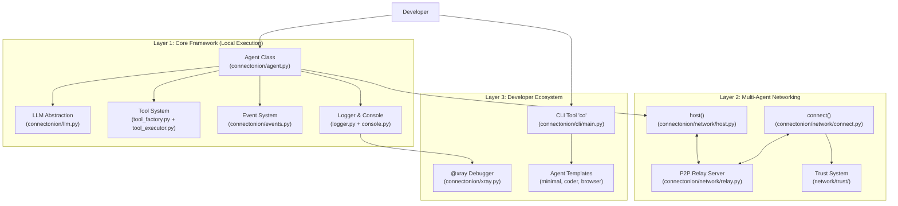
**Sources:** [CLAUDE.md:9-22](), [connectonion/__init__.py:33-64](), [connectonion/cli/main.py:1-9]()

---

## Core Components

### 1. The Agent Orchestrator
The `Agent` class is the central entity. It manages the `current_session` (messages and traces), interacts with the `LLM` provider, and triggers lifecycle events. [CLAUDE.md:13](), [connectonion/agent.py:29]()

### 2. Multi-Provider LLM Abstraction
ConnectOnion uses a factory pattern (`create_llm`) to support OpenAI, Anthropic, Gemini, and its own managed keys (`co/` prefix). All provider outputs are normalized into a unified `ToolCall` and message format. [CLAUDE.md:44-49](), [connectonion/llm.py:11]()

### 3. Automatic Tool System
The framework converts standard Python functions into AI-ready tools using `create_tool_from_function`. It inspects type hints for parameter schemas and docstrings for tool descriptions. [CLAUDE.md:24-28](), [connectonion/tool_factory.py]()

### 4. Event & Plugin System
There are 12 lifecycle hooks (e.g., `before_llm`, `after_tools`) that allow injecting logic. Plugins are simply collections of these handlers. [connectonion/events.py:11](), [connectonion/__init__.py:122-134]()

---

## Data Flow: Agent Execution Loop

This diagram maps the natural language "Reasoning Loop" to specific code entities and files.

### Code Entity Execution Flow

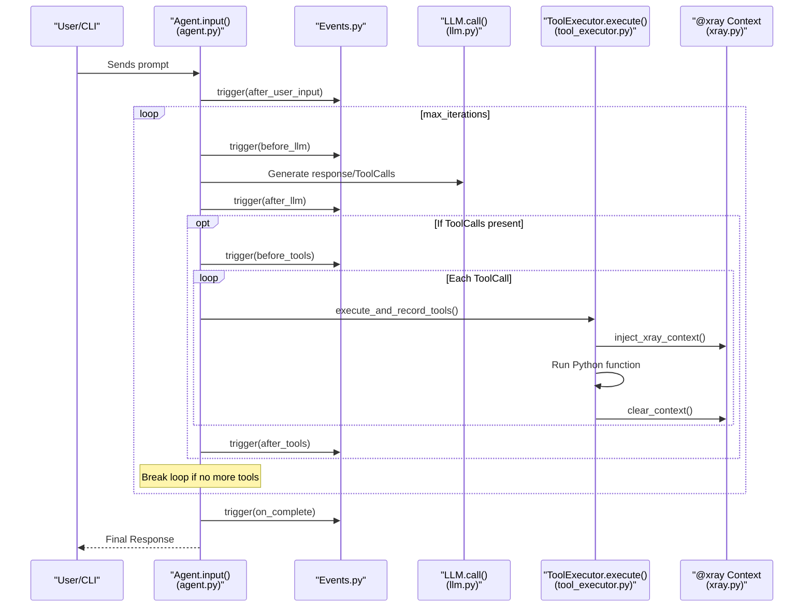
**Sources:** [CLAUDE.md:30-42](), [connectonion/agent.py:29](), [connectonion/tool_executor.py:24](), [connectonion/xray.py:32]()

---

## Key Features

### Observability & "X-Ray" Debugging
Every tool execution is wrapped in an `xray` context. By decorating functions with `@xray`, developers can see a full trace of agent activity and even trigger interactive breakpoints via `agent.auto_debug()`. [CLAUDE.md:65-70](), [connectonion/xray.py:32]()

### Distributed Multi-Agent Networking
Agents can be hosted as services using `host(agent)`. This starts a Uvicorn-powered ASGI server and optionally announces the agent to a P2P relay for discovery. Other agents can then use `connect(address)` to interact with them as `RemoteAgent` proxies. [README.md:65-70](), [connectonion/network/host.py](), [connectonion/network/connect.py]()

### Built-in Tool Ecosystem
ConnectOnion ships with production-ready tools that include:
*   **FileTools:** Safe file operations with tracking. [connectonion/useful_tools/]()
*   **BrowserAutomation:** Natural language browser control via Playwright. [examples/browser-agent/web_automation.py]()
*   **Communication:** Gmail and Outlook integrations. [connectonion/__init__.py:80-83]()
*   **System:** Shell execution (with `bash` and approval plugins). [connectonion/cli/co_ai/agent.py:13]()

### "co ai" Coding Assistant
The framework includes a built-in coding assistant (`co ai`) that is itself built using ConnectOnion. It demonstrates advanced features like context window management (`auto_compact`), autonomous work modes (`ulw`), and sub-agent delegation. [connectonion/cli/co_ai/agent.py:58-108](), [README.md:75-82]()

---

## Project Structure Reference

| Directory / File | Responsibility |
| :--- | :--- |
| `connectonion/agent.py` | Core Agent class and execution loop logic. |
| `connectonion/llm.py` | Multi-provider abstraction (OpenAI, Anthropic, Gemini). |
| `connectonion/tool_executor.py` | Logic for running tools and recording traces. |
| `connectonion/network/` | Distributed agent primitives (host, connect, relay). |
| `connectonion/cli/` | Command-line interface implementation. |
| `connectonion/useful_tools/` | Pre-built tools for browser, email, and files. |
| `connectonion/useful_plugins/` | Reusable behavior like `re_act`, `auto_compact`, and `tool_approval`. |

**Sources:** [CLAUDE.md:144-165](), [connectonion/__init__.py:33-64]()

---

# Page: Getting Started

# Getting Started

<details>
<summary>Relevant source files</summary>

The following files were used as context for generating this wiki page:

- [README.md](README.md)
- [connectonion/cli/commands/auth_commands.py](connectonion/cli/commands/auth_commands.py)
- [connectonion/cli/commands/create.py](connectonion/cli/commands/create.py)
- [connectonion/cli/commands/init.py](connectonion/cli/commands/init.py)
- [connectonion/cli/commands/project_cmd_lib.py](connectonion/cli/commands/project_cmd_lib.py)
- [connectonion/cli/commands/reset_commands.py](connectonion/cli/commands/reset_commands.py)
- [connectonion/cli/commands/status_commands.py](connectonion/cli/commands/status_commands.py)
- [docs/README.md](docs/README.md)
- [docs/quickstart.md](docs/quickstart.md)
- [docs/templates/README.md](docs/templates/README.md)
- [docs/templates/meta-agent.md](docs/templates/meta-agent.md)
- [docs/templates/minimal.md](docs/templates/minimal.md)
- [docs/templates/playwright.md](docs/templates/playwright.md)
- [docs/templates/web-research.md](docs/templates/web-research.md)

</details>


This page provides an overview of the ConnectOnion installation and initial setup workflow. It covers the essential steps needed to create and run your first agent, including installation, project creation, authentication, and basic usage patterns.

For detailed information on specific topics:
- Installation requirements and environment setup: see [Installation](#2.1)
- Step-by-step tutorial for creating your first agent: see [Your First Agent](#2.2)
- Understanding the `.co/` directory and project organization: see [Project Structure](#2.3)
- CLI command reference: see [CLI Reference](#7)

---

## Overview: Two Development Paths

ConnectOnion supports two approaches to getting started, both using the same underlying framework.

| Approach | Best For | Key Command | Result |
|----------|----------|-------------|--------|
| **CLI-Managed** | Quick start, templates | `co create my-agent` | New directory with template files |
| **Manual** | Existing projects, custom setup | `pip install connectonion` | Import framework directly |

Both paths result in the same core workflow: define an `Agent` with tools, provide a task via `agent.input()`, and inspect results.

**Sources:** [README.md:28-63](), [docs/quickstart.md:5-26](), [docs/README.md:70-101]()

---

## Quick Start Workflow

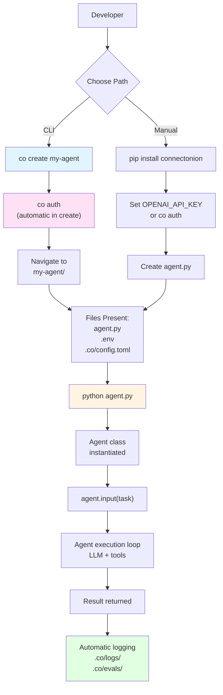

**Diagram: Quick Start Workflow - From Installation to First Run**

The workflow converges at runtime by instantiating an `Agent` and calling `input()` to execute tasks. CLI templates like `minimal` or `coder` provide a pre-configured `agent.py` to accelerate this process.

**Sources:** [docs/quickstart.md:11-26](), [connectonion/cli/commands/create.py:118-128](), [docs/README.md:194-228]()

---

## CLI-Managed Path: Project Creation Flow

The CLI commands automate project setup, authentication, and configuration management.

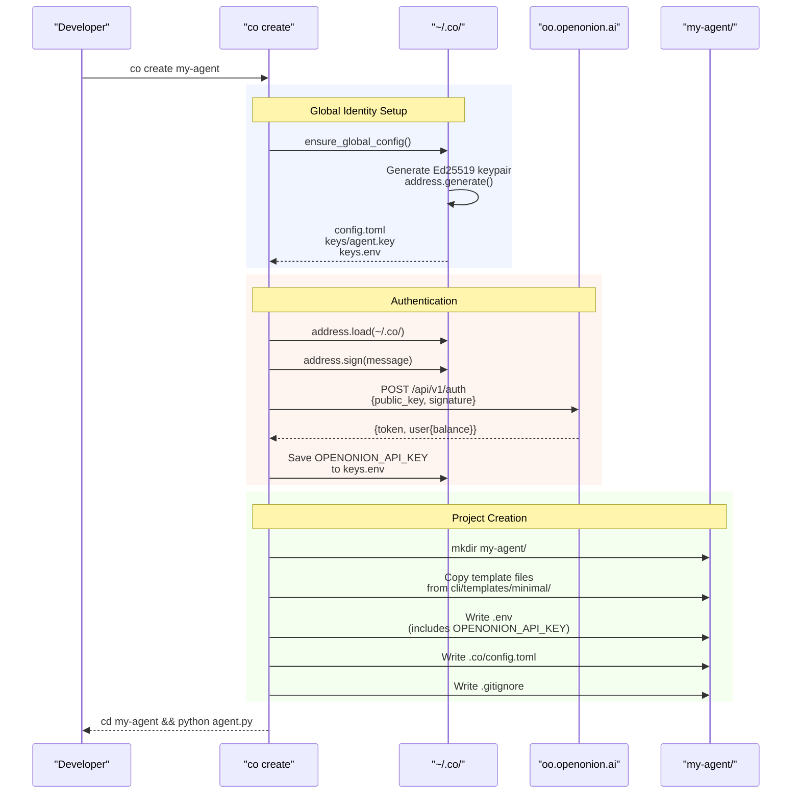

**Diagram: CLI Project Creation - Code Entity Flow**

Key functions involved in this flow:
- `ensure_global_config()` at [connectonion/cli/commands/create.py:45-115]() creates the global identity in `~/.co/`.
- `authenticate()` at [connectonion/cli/commands/auth_commands.py:84-150]() performs signature-based login to obtain a JWT.
- `validate_project_name()` at [connectonion/cli/commands/project_cmd_lib.py:50-68]() ensures directory names are safe.

**Sources:** [connectonion/cli/commands/create.py:118-150](), [connectonion/cli/commands/auth_commands.py:103-130](), [connectonion/cli/commands/project_cmd_lib.py:50-68]()

---

## Authentication System

ConnectOnion uses Ed25519 signature-based authentication to provide managed LLM API keys.

### Global Identity Model

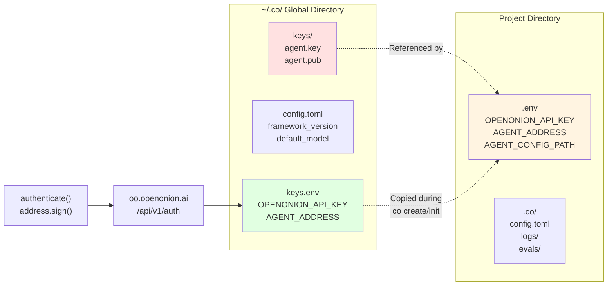

**Diagram: Global Identity and Project Configuration**

- One Ed25519 keypair per developer is stored in `~/.co/keys/` via `ensure_global_config()` [connectonion/cli/commands/init.py:47-69]().
- `OPENONION_API_KEY` is stored in `~/.co/keys.env` and copied to project `.env` files during `co init` or `co create`.
- Managed models (e.g., `co/gemini-2.5-pro`) use this key for authentication [connectonion/cli/commands/init.py:83]().

**Sources:** [connectonion/cli/commands/init.py:47-117](), [connectonion/cli/commands/auth_commands.py:30-82](), [connectonion/cli/commands/status_commands.py:23-55]()

---

## Manual Path: Direct Framework Import

For existing projects, you can skip the CLI and import the framework directly.

### Minimal Working Example

```python
from connectonion import Agent

# Define a tool as a regular function
def calculate(expression: str) -> str:
    """Do math calculations."""
    return str(eval(expression))

# Create your agent
agent = Agent(
    "assistant", 
    tools=[calculate],
    max_iterations=5
)

# Use it!
result = agent.input("What is 42 * 17?")
print(result)
```

This minimal example demonstrates the core framework API:
- `Agent` class: main orchestrator [docs/quickstart.md:39]().
- Function-based tools: automatic schema generation from docstrings [docs/quickstart.md:34-36]().
- `agent.input()`: synchronous task execution [docs/quickstart.md:46]().

**Sources:** [docs/quickstart.md:30-48](), [README.md:28-34]()

---

## Project Structure Overview

After running `co create` or `co init`, a ConnectOnion project contains:

```
my-agent/
├── agent.py                    # Main agent implementation
├── .env                        # API keys (auto-configured)
├── .gitignore                  # Excludes .env and logs
├── .co/                        # Framework metadata
│   ├── config.toml            # Project configuration
│   └── docs/                  # Framework documentation for AI
└── co-vibecoding-principles-docs-contexts-all-in-one.md  # Reference doc
```

The `.co/` directory is automatically created and managed. The `co-vibecoding-principles...` file is a flattened documentation source designed to provide context to LLM coding assistants [connectonion/cli/commands/init.py:5]().

**Sources:** [docs/quickstart.md:210-222](), [docs/templates/README.md:59-71](), [connectonion/cli/commands/init.py:5]()

---

## First Agent Execution

When you run `python agent.py`, the agent enters an execution loop:

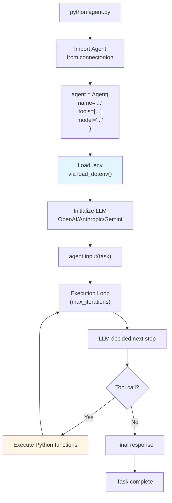

**Diagram: Agent Execution Loop - Runtime Flow**

This loop is governed by the `max_iterations` parameter (default: 100), which prevents infinite tool-call loops [docs/quickstart.md:78]().

**Sources:** [docs/README.md:194-228](), [docs/quickstart.md:75-84]()

---

## Next Steps

1. **Installation Details**: For system requirements and dependency management, see [Installation](#2.1).
2. **Create Your First Agent**: Follow the step-by-step tutorial at [Your First Agent](#2.2).
3. **Understand Project Organization**: Learn about the `.co/` directory and config files at [Project Structure](#2.3).
4. **Account Management**: Use `co status` [connectonion/cli/commands/status_commands.py:77]() to check your balance or `co reset` [connectonion/cli/commands/reset_commands.py:26]() to refresh your identity.

**Sources:** [connectonion/cli/commands/status_commands.py:77-87](), [connectonion/cli/commands/reset_commands.py:26-35]()

---

# Page: Installation

# Installation

<details>
<summary>Relevant source files</summary>

The following files were used as context for generating this wiki page:

- [README.md](README.md)
- [connectonion/cli/commands/auth_commands.py](connectonion/cli/commands/auth_commands.py)
- [connectonion/cli/commands/create.py](connectonion/cli/commands/create.py)
- [connectonion/cli/commands/init.py](connectonion/cli/commands/init.py)
- [connectonion/cli/commands/project_cmd_lib.py](connectonion/cli/commands/project_cmd_lib.py)
- [connectonion/cli/commands/reset_commands.py](connectonion/cli/commands/reset_commands.py)
- [connectonion/cli/commands/status_commands.py](connectonion/cli/commands/status_commands.py)
- [docs/README.md](docs/README.md)
- [docs/quickstart.md](docs/quickstart.md)
- [docs/templates/README.md](docs/templates/README.md)
- [docs/templates/meta-agent.md](docs/templates/meta-agent.md)
- [docs/templates/minimal.md](docs/templates/minimal.md)
- [docs/templates/playwright.md](docs/templates/playwright.md)
- [docs/templates/web-research.md](docs/templates/web-research.md)

</details>


This page covers installing ConnectOnion, system requirements, and environment setup. ConnectOnion is designed to be production-ready out of the box, handling everything from API key management to directory scaffolding via its CLI.

---

## System Requirements

ConnectOnion requires Python 3.10 or higher. It is cross-platform and supports Linux, macOS, and Windows.

| Component | Requirement | Source |
|-----------|-------------|--------|
| **Python** | `3.10+` | [README.md:7]() |
| **Operating Systems** | Linux, macOS, Windows | [README.md:7]() |
| **Package Manager** | `pip` | [docs/quickstart.md:8]() |

**Key Dependencies:**
- `rich`: For terminal UI and progress animations [connectonion/cli/commands/project_cmd_lib.py:18-23]()
- `requests`: For authentication and backend communication [connectonion/cli/commands/auth_commands.py:15]()
- `toml`: For configuration management [connectonion/cli/commands/init.py:16]()
- `Ed25519 (via address module)`: For secure identity and signing [connectonion/cli/commands/auth_commands.py:25]()

Sources: [README.md:7](), [docs/quickstart.md:8](), [connectonion/cli/commands/project_cmd_lib.py:18-23]()

---

## Installation Methods

### Via pip (Recommended)

The framework is distributed via PyPI. This installs both the library and the `co` CLI tool.

```bash
pip install connectonion
```

Sources: [docs/quickstart.md:8](), [docs/README.md:59]()

---

## Post-Installation: Global Setup

Upon first run of any project command (`co init` or `co create`), ConnectOnion initializes a global configuration directory at `~/.co/`. This directory stores your agent's unique identity and managed API keys.

### Global Configuration Initialization Flow

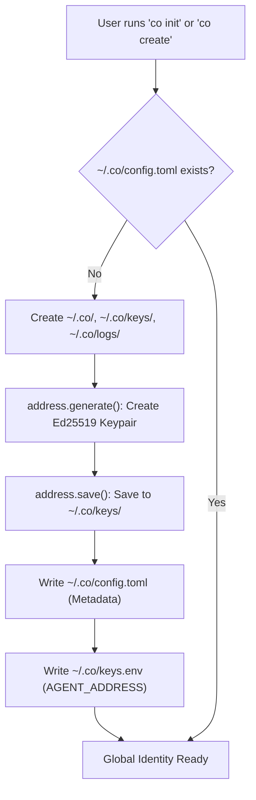

**Implementation Details:**
- **Identity:** ConnectOnion generates an Ed25519 keypair for every user [connectonion/cli/commands/init.py:67-68](). This keypair is used to sign requests to the OpenOnion backend.
- **Address:** Your "Agent Address" is derived from your public key [connectonion/cli/commands/init.py:70]().
- **Permissions:** On Unix-like systems, `keys.env` is created with `0o600` permissions to protect your secrets [connectonion/cli/commands/init.py:105]().

Sources: [connectonion/cli/commands/init.py:47-117](), [connectonion/cli/commands/create.py:45-115]()

---

## Project Initialization

Once the global setup is complete, you can initialize a specific project. This sets up the local environment and authenticates you with the managed LLM provider.

### The `co init` vs `co create` Commands

| Command | Behavior | When to use |
|---------|----------|-------------|
| `co init` | Initializes ConnectOnion in the **current** directory. | You already have a folder for your project. |
| `co create <name>` | Creates a **new** directory and initializes it. | You are starting a fresh project from scratch. |

### Data Flow: From CLI to Code Entities

The following diagram bridges the natural language commands to the internal functions that handle the setup logic.

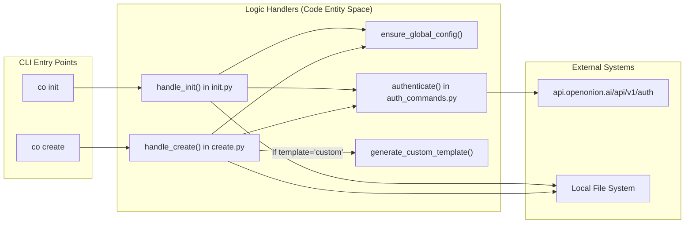

Sources: [connectonion/cli/commands/init.py:120-124](), [connectonion/cli/commands/create.py:118-122](), [connectonion/cli/commands/auth_commands.py:84]()

---

## Authentication & Managed Keys

ConnectOnion provides "Managed Keys" (prefixed with `co/`, e.g., `co/gemini-2.5-pro`) so you don't have to manage individual provider API keys.

### Authentication Process (`authenticate`)
1. **Load Keys:** Loads the Ed25519 keypair from `~/.co/keys/` [connectonion/cli/commands/auth_commands.py:96]().
2. **Sign Challenge:** Creates a timestamped message and signs it with the private key [connectonion/cli/commands/auth_commands.py:104-106]().
3. **Verify:** Sends the public key, message, and signature to `https://oo.openonion.ai/api/v1/auth` [connectonion/cli/commands/auth_commands.py:109-115]().
4. **JWT Retrieval:** The backend verifies the signature and returns a JWT token [connectonion/cli/commands/auth_commands.py:119]().
5. **Storage:** The token is saved as `OPENONION_API_KEY` in `~/.co/keys.env` and the project's `.env` [connectonion/cli/commands/auth_commands.py:136-184]().

Sources: [connectonion/cli/commands/auth_commands.py:84-208]()

---

## Directory Structure Reference

After a successful `co create` or `co init`, your project will look like this:

```text
my-agent/
├── agent.py               # Main agent file (entry point)
├── .env                   # Local API keys (OPENONION_API_KEY, etc.)
├── .gitignore             # Standard ignores plus .co/ metadata
├── requirements.txt       # Project dependencies
└── .co/                   # ConnectOnion Project Metadata
    ├── config.toml        # Project-specific settings
    └── docs/              # Embedded framework documentation for AI
```

### Key Files Created:
- **`agent.py`**: Generated from a template (e.g., `minimal`, `browser`, `coder`) [connectonion/cli/commands/project_cmd_lib.py:116-124]().
- **`.env`**: Automatically populated with your `OPENONION_API_KEY` and `AGENT_ADDRESS` [connectonion/cli/commands/auth_commands.py:30-82]().
- **`.co/config.toml`**: Stores project metadata like the creation date and template type [connectonion/cli/commands/init.py:369-393]().

Sources: [docs/quickstart.md:213-222](), [connectonion/cli/commands/init.py:369-393](), [connectonion/cli/commands/auth_commands.py:30-82]()

---

## Troubleshooting Installation

### Resetting Configuration
If your global configuration becomes corrupted or you wish to start with a fresh identity, use the reset command.

```bash
co reset
```
**Warning:** This is a destructive operation. It deletes `~/.co/keys/`, `~/.co/config.toml`, and `~/.co/keys.env`, effectively creating a brand new account identity [connectonion/cli/commands/reset_commands.py:64-78]().

### Checking Status
To verify your installation and see your current balance/identity:
```bash
co status
```
This function calls the backend to retrieve fresh user data using your signed identity [connectonion/cli/commands/status_commands.py:120-135]().

Sources: [connectonion/cli/commands/reset_commands.py:26-150](), [connectonion/cli/commands/status_commands.py:77-169]()

---

# Page: Your First Agent

# Your First Agent

<details>
<summary>Relevant source files</summary>

The following files were used as context for generating this wiki page:

- [connectonion/cli/templates/coder/agent.py](connectonion/cli/templates/coder/agent.py)
- [connectonion/cli/templates/coder/prompt.md](connectonion/cli/templates/coder/prompt.md)
- [connectonion/cli/templates/minimal/agent.py](connectonion/cli/templates/minimal/agent.py)
- [connectonion/cli/templates/minimal/prompt.md](connectonion/cli/templates/minimal/prompt.md)
- [connectonion/cli/templates/web-research/agent.py](connectonion/cli/templates/web-research/agent.py)
- [connectonion/llm_do.py](connectonion/llm_do.py)
- [examples/minimal-agent/.co/config.toml](examples/minimal-agent/.co/config.toml)
- [examples/minimal-agent/.co/keys/DO_NOT_SHARE](examples/minimal-agent/.co/keys/DO_NOT_SHARE)
- [examples/minimal-agent/.co/keys/agent.key](examples/minimal-agent/.co/keys/agent.key)
- [examples/minimal-agent/.co/keys/recovery.txt](examples/minimal-agent/.co/keys/recovery.txt)
- [examples/minimal-agent/agent.py](examples/minimal-agent/agent.py)
- [examples/simple-agent/.gitignore](examples/simple-agent/.gitignore)
- [examples/simple-agent/README.md](examples/simple-agent/README.md)
- [examples/simple-agent/agent.py](examples/simple-agent/agent.py)
- [examples/simple-agent/agent_debug.py](examples/simple-agent/agent_debug.py)
- [examples/simple-agent/test_e2e.py](examples/simple-agent/test_e2e.py)
- [examples/simple-agent/test_network.py](examples/simple-agent/test_network.py)
- [examples/simple-agent/tests/test_api_integration.py](examples/simple-agent/tests/test_api_integration.py)
- [examples/simple-agent/tests/test_debug_features.py](examples/simple-agent/tests/test_debug_features.py)
- [examples/simple-agent/tests/test_models.py](examples/simple-agent/tests/test_models.py)

</details>


This page guides you through creating your first ConnectOnion agent in under 5 minutes. You'll learn how to define tools as Python functions, create an agent that can use them, and execute your first task using both standard execution and the interactive `auto_debug` mode.

For project scaffolding and CLI commands, see [Project Commands](#7.1). For detailed tool design patterns, see [Tools System](#3.3). For agent configuration options, see [Agent Architecture](#3.1).

---

## Minimal Working Agent

The simplest agent requires just three components: import the `Agent` class, define a tool function, and create an agent instance.

```python
from connectonion import Agent, xray

@xray
def hello_world(name: str = "World") -> str:
    """Simple greeting function.
    
    Args:
        name: Name to greet
    """
    return f"Hello, {name}! Welcome to ConnectOnion."

agent = Agent(
    name="minimal-agent",
    tools=[hello_world],
    model="co/gemini-2.5-pro"
)
```

Run it:

```python
result = agent.input("Say hello to Alice")
print(result)  # "Hello, Alice! Welcome to ConnectOnion."
```

**Sources:** [examples/minimal-agent/agent.py:40-66](), [connectonion/cli/templates/minimal/agent.py:7-16]()

---

## Agent Creation Flow

The following diagram shows how components connect when you create an `Agent` instance:

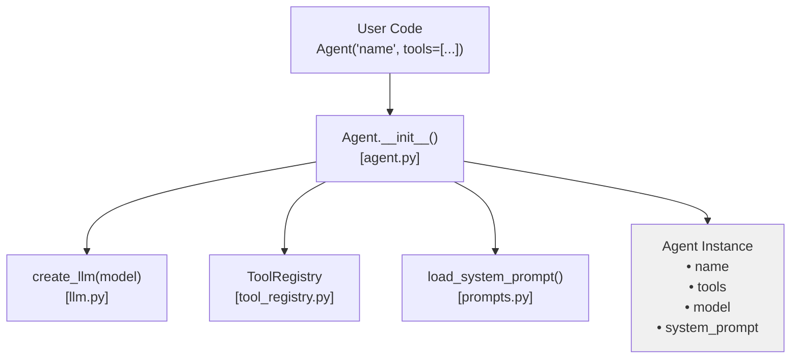

**Sources:** [connectonion/cli/templates/minimal/agent.py:7-13](), [connectonion/llm_do.py:32-41](), [connectonion/llm_do.py:165-168]()

---

## Adding Tools

Tools are regular Python functions. ConnectOnion automatically converts them to LLM-compatible tool schemas using type hints and docstrings.

### Function-Based Tools (Recommended)

```python
def search_web(query: str) -> str:
    """Search the web for information.
    
    Args:
        query: Search query
    """
    return f"Searching for: {query}"

def analyze_data(data: str, analysis_type: str = "summary") -> str:
    """Analyze extracted data.
    
    Args:
        data: Data to analyze
        analysis_type: Type of analysis (summary, sentiment)
    """
    # Use llm_do for a sub-task
    return llm_do(f"Analyze this: {data}", temperature=0.1)

agent = Agent(
    name="researcher",
    tools=[search_web, analyze_data]
)
```

The framework extracts:
- **Name**: `search_web` (function name)
- **Description**: First paragraph of docstring
- **Parameters**: From type hints (`str`, `int`, etc.)
- **Required fields**: Parameters without default values

**Sources:** [connectonion/cli/templates/web-research/agent.py:21-76](), [connectonion/llm_do.py:133-140]()

---

## Task Execution Flow

When you call `agent.input(prompt)`, the framework enters a loop of reasoning and tool execution.

```mermaid
sequenceDiagram
    participant User
    participant Agent["Agent.input()<br/>[agent.py]"]
    participant LLM["LLM Provider<br/>[llm.py]"]
    participant Tool["Tool Function<br/>(your code)"]
    
    User->>Agent: agent.input("Research AI trends")
    
    loop until task complete or max_iterations
        Agent->>LLM: complete(messages, tools)
        LLM-->>Agent: tool_call: search_web(query="AI trends")
        
        rect rgb(240, 240, 240)
            Note over Agent,Tool: Tool Execution
            Agent->>Tool: search_web("AI trends")
            Tool-->>Agent: "Found: Trend A, Trend B"
        end
        
        Agent->>LLM: complete(messages + tool_result)
        LLM-->>Agent: "The latest trends are..."
    end
    
    Agent-->>User: Final summary string
```

**Sources:** [connectonion/cli/templates/web-research/agent.py:105-118](), [connectonion/llm_do.py:52-60](), [connectonion/cli/templates/coder/agent.py:17-28]()

---

## Interactive Debugging with @xray

One of ConnectOnion's unique features is the `@xray` decorator and `auto_debug()` method. This allows you to pause execution at specific tools to inspect arguments and results.

```python
from connectonion import Agent, xray

@xray  # Marks this function as a breakpoint
def calculate(operation: str, a: int, b: int) -> int:
    """Perform a calculation."""
    if operation == "add": return a + b
    return 0

agent = Agent(name="math-bot", tools=[calculate])

# Use auto_debug instead of input for interactive mode
agent.auto_debug("What is 5 + 3?")
```

When the agent calls `calculate`, the terminal will display an interactive menu:
- **(c)ontinue**: Execute the tool and proceed.
- **(e)dit**: Modify the tool arguments before execution.
- **(q)uit**: Stop the agent immediately.

**Sources:** [examples/simple-agent/tests/test_debug_features.py:43-65](), [examples/simple-agent/tests/test_debug_features.py:110-138](), [examples/simple-agent/agent.py:10-20]()

---

## LLM-Do: The One-Shot Alternative

For simple tasks that don't require multiple steps or tool usage, use `llm_do()`. It is a stateless, single-round function.

```python
from connectonion import llm_do
from pydantic import BaseModel

class Person(BaseModel):
    name: str
    age: int

# Structured output
result = llm_do("John is 30 years old", output=Person)
print(result.name)  # "John"

# Simple string output
answer = llm_do("What is 2+2?", model="co/gemini-2.5-flash")
```

**Sources:** [connectonion/llm_do.py:105-114](), [connectonion/llm_do.py:13-30](), [connectonion/llm_do.py:52-60]()

---

## Agent Configuration

The `Agent` constructor accepts these key parameters:

| Parameter | Type | Default | Description |
|-----------|------|---------|-------------|
| `name` | `str` | Required | Unique identifier for logging |
| `tools` | `List[Callable]` | `[]` | Functions or class instances |
| `system_prompt` | `str \| Path` | `None` | Personality/instructions (file path or string) |
| `model` | `str` | `"co/gemini-2.5-flash"` | LLM model to use |
| `max_iterations` | `int` | `10` | Max tool calls per task |
| `plugins` | `List` | `[]` | Lifecycle hooks (e.g., `tool_approval`) |

Example with template configuration:

```python
from connectonion import Agent, bash, read_file, edit
from connectonion.useful_plugins import tool_approval

agent = Agent(
    name="coder",
    system_prompt="prompt.md", # Loads from local file
    tools=[bash, read_file, edit],
    plugins=[tool_approval],   # Requires user confirmation for every tool
    model="co/gemini-2.5-pro",
    max_iterations=50
)
```

**Sources:** [connectonion/cli/templates/minimal/agent.py:7-13](), [connectonion/cli/templates/coder/agent.py:4-10](), [connectonion/llm_do.py:137-140]()

---

## Authentication for Managed Keys

ConnectOnion provides managed API keys for several models (prefixed with `co/`).

1. Run `co auth` in your terminal to log in.
2. This creates a secure identity for your agent.
3. You can now use models like `co/gemini-2.5-pro` or `co/gpt-4o` without setting your own environment variables.

If you prefer using your own keys, set them in a `.env` file:
- `OPENAI_API_KEY`
- `ANTHROPIC_API_KEY`
- `GEMINI_API_KEY`

**Sources:** [connectonion/llm_do.py:98-101](), [examples/simple-agent/agent.py:54-68](), [examples/minimal-agent/agent.py:8-37]()

---

## Next Steps

Now that you have a working agent, explore:

- **[Project Structure](#2.3)**: Understanding the `.co/` directory and configuration files.
- **[Tools System](#3.3)**: Advanced tool patterns (class-based tools, stateful tools).
- **[LLM Integration](#3.2)**: Using different LLM providers and models.
- **[Interactive Debugging](#4.2)**: Deep dive into the `AutoDebugger` and `xray` mechanics.

**Sources:** [connectonion/llm_do.py:163-171](), [examples/simple-agent/tests/test_debug_features.py:27-37]()

---

# Page: Project Structure

# Project Structure

<details>
<summary>Relevant source files</summary>

The following files were used as context for generating this wiki page:

- [connectonion/cli/commands/auth_commands.py](connectonion/cli/commands/auth_commands.py)
- [connectonion/cli/commands/copy_commands.py](connectonion/cli/commands/copy_commands.py)
- [connectonion/cli/commands/create.py](connectonion/cli/commands/create.py)
- [connectonion/cli/commands/init.py](connectonion/cli/commands/init.py)
- [connectonion/cli/commands/project_cmd_lib.py](connectonion/cli/commands/project_cmd_lib.py)
- [connectonion/cli/commands/reset_commands.py](connectonion/cli/commands/reset_commands.py)
- [connectonion/cli/commands/status_commands.py](connectonion/cli/commands/status_commands.py)
- [connectonion/useful_skills/__init__.py](connectonion/useful_skills/__init__.py)
- [connectonion/useful_skills/ship-feature/SKILL.md](connectonion/useful_skills/ship-feature/SKILL.md)

</details>


This page documents the directory structure and configuration files used by ConnectOnion projects, including both global configuration (shared across all projects) and project-local configuration (specific to each agent).

For information about CLI commands that create and manage projects, see [Project Commands](#7.1). For authentication and key management concepts, see [Trust & Authentication](#5.3).

---

## Overview

ConnectOnion uses a two-tier configuration architecture:

| Level | Location | Purpose | Created By |
|-------|----------|---------|------------|
| **Global** | `~/.co/` | User identity, master keypair, shared credentials | `co auth`, `co init`, `co create` |
| **Project** | `{project}/.co/` | Project metadata, logs, evaluation data | `co init`, `co create` |

This design provides:
- **Single Identity**: One Ed25519 keypair per developer (stored globally) [connectonion/cli/commands/init.py:67-68]().
- **Project Isolation**: Each project has its own logs and configuration [connectonion/cli/commands/init.py:361-393]().
- **Credential Sharing**: API keys from global config are copied to project `.env` files [connectonion/cli/commands/init.py:247-330]().

Sources: [connectonion/cli/commands/init.py:46-116](), [connectonion/cli/commands/create.py:44-114]()

---

## Global Configuration (`~/.co/`)

The global configuration directory is created automatically on first use of `co init`, `co create`, or `co auth`. It contains your developer identity and shared credentials.

### Directory Structure

```
~/.co/
├── config.toml          # Framework and agent defaults
├── keys.env             # API keys and agent address (chmod 600)
├── keys/                # Ed25519 keypair
│   ├── agent.key        # Private key (binary)
│   ├── agent.pub        # Public key (binary)
│   └── seed.txt         # 12-word recovery phrase
└── logs/                # Global logs
```

Sources: [connectonion/cli/commands/init.py:61-65](), [connectonion/cli/commands/create.py:59-63]()

### `config.toml` Schema

```toml
[connectonion]
framework_version = "1.0.0"
created = "2024-01-15T10:30:00"

[cli]
version = "1.0.0"

[agent]
algorithm = "ed25519"
default_model = "co/gemini-2.5-pro"  # Managed keys with free credits
max_iterations = 10
created_at = "2024-01-15T10:30:00"
```

The global config stores framework metadata and default agent settings. Individual projects inherit these defaults but can override them in their local config [connectonion/cli/commands/init.py:73-87]().

Sources: [connectonion/cli/commands/init.py:73-91](), [connectonion/cli/commands/create.py:71-89]()

### `keys.env` Contents

```bash
AGENT_CONFIG_PATH=/home/user/.co
AGENT_ADDRESS=0x04e1c4ae3c57d716383153479dae869e51e86d43d88db8dfa22fba7533f3968d
# Your agent address (Ed25519 public key) is used for:
#   - Secure agent communication (encrypt/decrypt with private key)
#   - Authentication with OpenOnion managed LLM provider
#   - Email address: 04e1c4ae3c@mail.openonion.ai

OPENONION_API_KEY=eyJ0eXAiOiJKV1QiLCJhbGciOiJIUzI1NiJ9...
AGENT_EMAIL=04e1c4ae3c@mail.openonion.ai
```

This file has restricted permissions (`chmod 0o600` on Unix/Mac) to protect credentials [connectonion/cli/commands/init.py:105](). It serves as the source of truth for managed API keys [connectonion/cli/commands/auth_commands.py:134-160]().

Sources: [connectonion/cli/commands/init.py:93-115](), [connectonion/cli/commands/auth_commands.py:134-160]()

### Ed25519 Keypair

The `keys/` directory contains your cryptographic identity:
- **`agent.key`**: Private key (Ed25519 format)
- **`agent.pub`**: Public key
- **`seed.txt`**: 12-word recovery phrase

The public key serves as your agent address. The private key is used to sign messages for authentication with `https://oo.openonion.ai/api/v1/auth` [connectonion/cli/commands/auth_commands.py:108-115]().

Sources: [connectonion/cli/commands/init.py:67-68](), [connectonion/cli/commands/reset_commands.py:85-98]()

---

## Project Configuration (`.co/`)

Each ConnectOnion project contains a `.co/` directory with project-specific metadata and runtime data.

### Directory Structure

```
{project}/.co/
├── config.toml                                  # Project metadata
├── docs/
│   └── co-vibecoding-principles-docs-contexts-all-in-one.md  # Development reference
├── logs/
│   └── {agent-name}.log                        # Plain text execution logs
└── skills/                                      # Local skill definitions
```

Sources: [connectonion/cli/commands/init.py:332-393](), [connectonion/cli/commands/copy_commands.py:187-190]()

### `config.toml` Schema

```toml
[connectonion]
framework_version = "1.0.0"
created = "2024-01-15T11:00:00"

[agent]
algorithm = "ed25519"
default_model = "co/gemini-2.5-pro"
max_iterations = 10
created_at = "2024-01-15T11:00:00"
```

Sources: [connectonion/cli/commands/init.py:369-391](), [connectonion/cli/commands/create.py:383-406]()

---

## Project Root Files

### `.env` File

API keys and configuration variables are stored here (copied from global `~/.co/keys.env` or environment) [connectonion/cli/commands/init.py:247-330]().

```bash
AGENT_CONFIG_PATH=/home/user/.co
AGENT_ADDRESS=0x04e1c4ae3c57d716383153479dae869e51e86d43d88db8dfa22fba7533f3968d
AGENT_EMAIL=04e1c4ae3c@mail.openonion.ai
OPENONION_API_KEY=eyJ0eXAiOiJKV1QiLCJhbGciOiJIUzI1NiJ9...
```

Sources: [connectonion/cli/commands/auth_commands.py:30-82](), [connectonion/cli/commands/init.py:247-330]()

### `agent.py` File

The main entry point for your agent, created from templates such as `minimal`, `playwright`, or `coder` [connectonion/cli/commands/project_cmd_lib.py:118-124]().

### `co-vibecoding-principles-docs-contexts-all-in-one.md`

Development reference documentation copied to both project root and `.co/docs/`. Contains best practices for building agents [connectonion/cli/commands/init.py:342-358]().

---

## Complete File Hierarchy

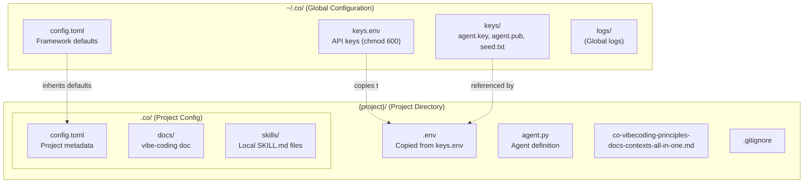

Sources: [connectonion/cli/commands/init.py:46-417](), [connectonion/cli/commands/create.py:44-512]()

---

## Configuration Initialization Flow

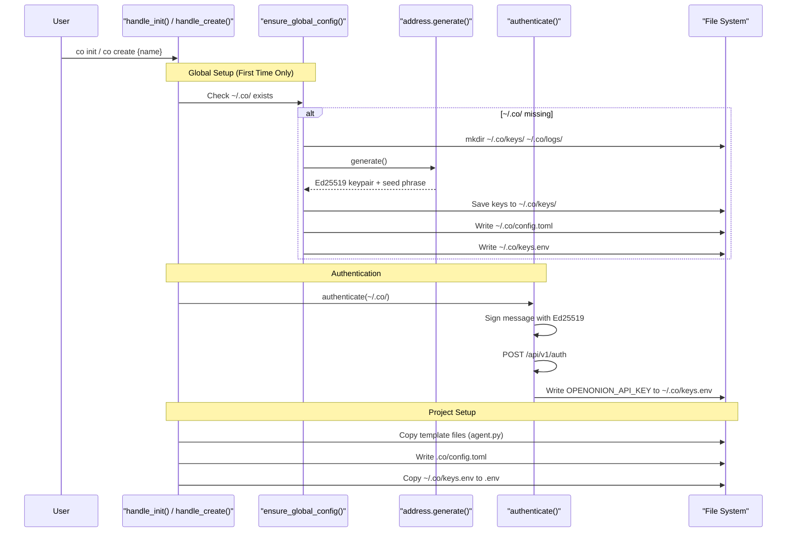

Sources: [connectonion/cli/commands/init.py:119-454](), [connectonion/cli/commands/create.py:117-512](), [connectonion/cli/commands/auth_commands.py:84-208]()

---

## Key Management Architecture

ConnectOnion uses a **global identity model** where all projects share a single Ed25519 keypair:

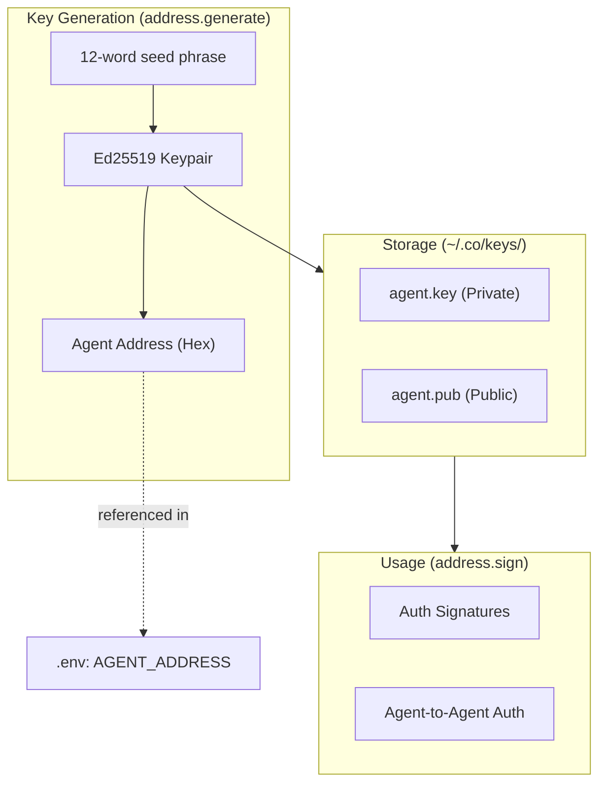

Sources: [connectonion/cli/commands/init.py:46-116](), [connectonion/cli/commands/auth_commands.py:84-208](), [connectonion/cli/commands/reset_commands.py:85-98]()

---

## Environment Variable Resolution

ConnectOnion uses a cascading lookup for configuration and API keys [connectonion/cli/commands/status_commands.py:23-56]():

| Priority | Location | Purpose |
|----------|----------|---------|
| 1 | Environment variables | Runtime overrides |
| 2 | Project `.env` | Project-specific config |
| 3 | Global `~/.co/keys.env` | Shared fallback credentials |

Sources: [connectonion/cli/commands/status_commands.py:23-56](), [connectonion/cli/commands/auth_commands.py:30-82]()

---

## Managed Files and Skills

ConnectOnion allows copying built-in assets into your project for customization using `co copy` [connectonion/cli/commands/copy_commands.py:103-109]().

### Skills Directory
Skills are stored in `.co/skills/` and contain a `SKILL.md` file that defines a high-level workflow for the agent [connectonion/useful_skills/ship-feature/SKILL.md:1-17]().

Sources: [connectonion/cli/commands/copy_commands.py:187-190](), [connectonion/useful_skills/ship-feature/SKILL.md:1-17]()

---

# Page: Core Concepts

# Core Concepts

<details>
<summary>Relevant source files</summary>

The following files were used as context for generating this wiki page:

- [connectonion/core/__init__.py](connectonion/core/__init__.py)
- [connectonion/core/agent.py](connectonion/core/agent.py)
- [connectonion/core/events.py](connectonion/core/events.py)
- [connectonion/core/exceptions.py](connectonion/core/exceptions.py)
- [connectonion/core/llm.py](connectonion/core/llm.py)
- [docs/concepts/events.md](docs/concepts/events.md)
- [docs/concepts/models.md](docs/concepts/models.md)
- [tests/unit/test_agent.py](tests/unit/test_agent.py)
- [tests/unit/test_events.py](tests/unit/test_events.py)
- [tests/unit/test_groq_llm.py](tests/unit/test_groq_llm.py)

</details>


This page provides a technical overview of ConnectOnion's fundamental architecture and core components. It introduces the major subsystems that work together to create AI agents: **Agent**, **LLM**, **Tools**, **Events**, and **Plugins**.

For implementation details of each subsystem, see:
- Agent execution loop and session management: [Agent Architecture](#3.1)
- LLM provider routing and model selection: [LLM Integration](#3.2)
- Tool creation patterns and schema generation: [Tools System](#3.3)
- Lifecycle hooks and event handlers: [Event System](#3.4)
- Reusable behavior composition: [Plugin System](#3.5)
- Task delegation and cost optimization: [Sub-Agent System](#3.6)

---

## Framework Architecture Overview

ConnectOnion's architecture separates **capabilities** (tools) from **behaviors** (plugins), orchestrated by a central `Agent` class that communicates with `LLM` providers through a unified interface. All activity flows through an **Event System** that enables extensibility.

### System Architecture Diagram

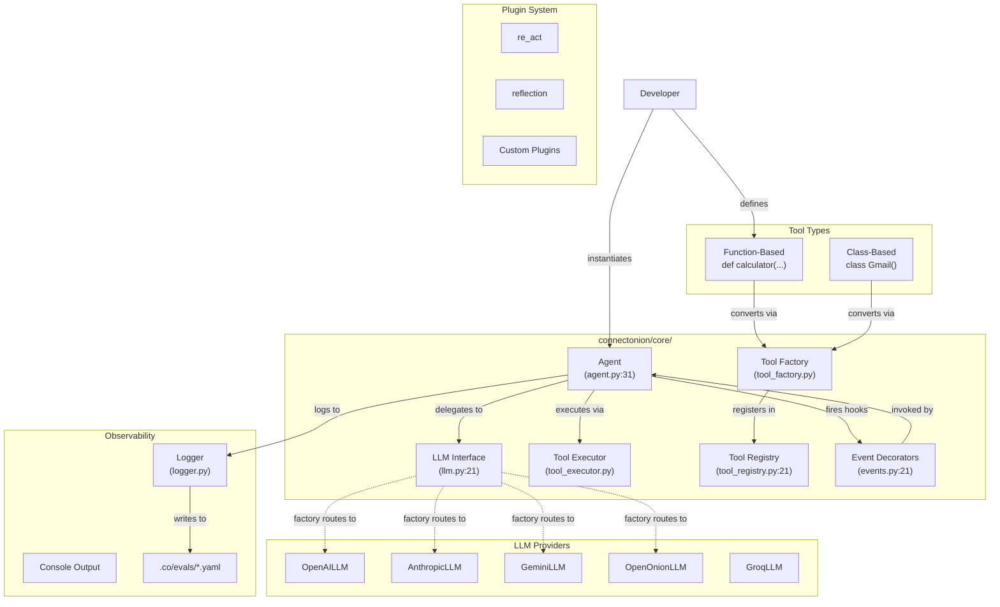

**Sources:** [connectonion/core/__init__.py:1-70](), [connectonion/core/agent.py:31-150]()

---

## The Agent Class

The `Agent` class ([connectonion/core/agent.py:31]()) is the main orchestrator that coordinates LLM calls, tool execution, event firing, and logging. Each agent maintains a `current_session` dictionary with execution state.

### Key Responsibilities

| Responsibility | Implementation |
|---|---|
| **LLM Communication** | Calls `llm.complete()` with messages and tool schemas [connectonion/core/agent.py:5-6]() |
| **Tool Execution** | Delegates to `tool_executor.execute_and_record_tools()` [connectonion/core/agent.py:27]() |
| **Event Lifecycle** | Fires hooks such as `after_user_input`, `before_llm`, `after_tools` [connectonion/core/agent.py:78-92]() |
| **Session State** | Manages `messages`, `trace`, `turn`, `iteration` in `current_session` [connectonion/core/agent.py:5-6]() |
| **Logging** | Delegates to `Logger` for console output and file logging [connectonion/core/agent.py:73]() |

### Agent Constructor

```python
# [connectonion/core/agent.py:34-48]()
Agent(
    name: str,
    llm: Optional[LLM] = None,
    tools: Optional[Union[List[Callable], Callable, Any]] = None,
    system_prompt: Union[str, Path, None] = None,
    model: str = "co/gemini-2.5-pro",
    max_iterations: int = 100,
    log: Optional[Union[bool, str, Path]] = None,
    quiet: bool = False,
    plugins: Optional[List[List[EventHandler]]] = None,
    on_events: Optional[List[EventHandler]] = None
)
```

**Sources:** [connectonion/core/agent.py:31-150](), [tests/unit/test_agent.py:40-128]()

---

## LLM Integration

ConnectOnion provides a unified `LLM` interface ([connectonion/core/llm.py:21]()) that abstracts differences between providers. The factory function `create_llm(model, api_key)` routes model strings to the appropriate provider class.

### Model Routing Logic

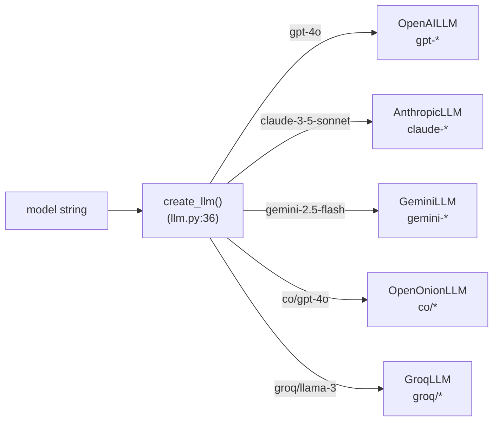

### Managed Keys (`co/` prefix)

Models prefixed with `co/` use ConnectOnion's managed API keys through the `OpenOnionLLM` provider ([connectonion/core/llm.py:34]()). This allows usage without providing your own API keys after running `co auth`.

**Sources:** [connectonion/core/llm.py:1-130](), [docs/concepts/models.md:1-200]()

---

## Tools System

Tools define **what** an agent can do. ConnectOnion supports two patterns: **function-based** (stateless) and **class-based** (stateful).

### Function-Based Tools

Regular Python functions automatically convert to tools via `create_tool_from_function()` ([connectonion/core/tool_factory.py]()). Type hints become parameter schemas, and docstrings become descriptions.

```python
# [tests/unit/test_agent.py:22-31]()
def calculator(expression: str) -> str:
    """Performs a mathematical calculation and returns the result."""
    # Implementation...
```

### Class-Based Tools

Class instances with typed public methods are automatically discovered. Each method becomes a separate tool, sharing the instance state ([tests/unit/test_agent.py:96-129]()).

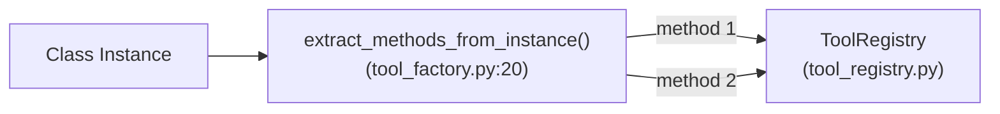

**Sources:** [connectonion/core/tool_factory.py:20](), [connectonion/core/tool_registry.py:21](), [tests/unit/test_agent.py:96-129]()

---

## Event System

The event system ([connectonion/core/events.py:2]()) provides lifecycle hooks that fire at specific points during agent execution. Plugins and custom handlers hook into these events to modify behavior.

### Lifecycle Hook Reference

| Event | When Fired | Use Case |
|---|---|---|
| `after_user_input` | After user prompt processed | Context injection [events.py:21]() |
| `before_llm` | Before LLM API call | Message preprocessing [events.py:84]() |
| `after_llm` | After LLM response received | Logging LLM calls [events.py:103]() |
| `before_tools` | Once before a batch of tools | Batch validation [events.py:151]() |
| `before_each_tool` | Before each individual tool | Approval prompts [events.py:124]() |
| `after_each_tool` | After each individual tool | Per-tool cleanup [events.py:179]() |
| `after_tools` | Once after all tools complete | Reflection [events.py:205]() |
| `on_error` | When tool execution fails | Error recovery [events.py:227]() |
| `on_complete` | After final response | Final summary [events.py:245]() |

**Sources:** [connectonion/core/events.py:1-250](), [docs/concepts/events.md:62-80](), [tests/unit/test_events.py:73-205]()

---

## Plugin System

Plugins are **lists of event handlers** that bundle reusable behaviors. They define **how** an agent thinks, such as implementing the ReAct pattern or self-reflection.

### Plugin Composition

```python
# [connectonion/core/agent.py:95-98]()
if plugins:
    for event_list in plugins:
        for event_func in event_list:
            self._register_event(event_func)
```

**Sources:** [connectonion/core/agent.py:95-98](), [docs/concepts/events.md:27-44]()

---

## Execution Flow: Component Interaction

This diagram shows how a user input flows through the agent execution loop.

```mermaid
sequenceDiagram
    participant User
    participant Agent["Agent<br/>(agent.py)"]
    participant Events["Event System<br/>(events.py)"]
    participant LLM["LLM Provider<br/>(llm.py)"]
    participant ToolExec["Tool Executor<br/>(tool_executor.py)"]
    
    User->>Agent: agent.input("task")
    Agent->>Events: fire(after_user_input)
    
    loop until no tool_calls or max_iterations
        Agent->>Events: fire(before_llm)
        Agent->>LLM: complete(messages, tools)
        LLM-->>Agent: response (text or tool_calls)
        Agent->>Events: fire(after_llm)
        
        alt has tool_calls
            Agent->>Events: fire(before_tools)
            Agent->>ToolExec: execute_and_record_tools()
            ToolExec-->>Agent: tool results
            Agent->>Events: fire(after_tools)
        end
    end
    
    Agent->>Events: fire(on_complete)
    Agent-->>User: final response
```

**Sources:** [connectonion/core/agent.py:5-10](), [docs/concepts/events.md:83-122]()

---

# Page: Agent Architecture

# Agent Architecture

<details>
<summary>Relevant source files</summary>

The following files were used as context for generating this wiki page:

- [.gitignore](.gitignore)
- [CLAUDE.md](CLAUDE.md)
- [connectonion/core/agent.py](connectonion/core/agent.py)
- [connectonion/logger.py](connectonion/logger.py)
- [docs/api.md](docs/api.md)
- [docs/concepts/tools.md](docs/concepts/tools.md)
- [examples/browser-agent/CLAUDE.md](examples/browser-agent/CLAUDE.md)
- [examples/browser-agent/web_automation.py](examples/browser-agent/web_automation.py)
- [tests/real_api/manual/manual_defaults.py](tests/real_api/manual/manual_defaults.py)
- [tests/unit/test_agent.py](tests/unit/test_agent.py)
- [tests/unit/test_logger.py](tests/unit/test_logger.py)
- [tests/unit/test_tool_executor.py](tests/unit/test_tool_executor.py)
- [tests/unit/test_tool_executor_errors.py](tests/unit/test_tool_executor_errors.py)
- [tests/unit/test_tool_factory.py](tests/unit/test_tool_factory.py)

</details>


This page documents the `Agent` class, its execution loop, session management, and lifecycle. The Agent is the core orchestrator that coordinates LLM calls, tool execution, and event handling.

For LLM provider details, see [LLM Integration](3.2). For tool creation patterns, see [Tools System](3.3). For event hook details, see [Event System](3.4).

---

## Agent Class Overview

The `Agent` class is the main entry point for creating AI agents. It orchestrates:
- **LLM Communication**: Manages conversation with language model providers [connectonion/core/agent.py:133-143]()
- **Tool Execution**: Discovers, validates, and executes tools via `ToolExecutor` [connectonion/core/agent.py:27]()
- **Event System**: Fires lifecycle hooks for plugins [connectonion/core/agent.py:78-92]()
- **Session Management**: Tracks conversation state across turns in `current_session` [connectonion/core/agent.py:55]()
- **Logging**: Records all activities to console and files via `Logger` [connectonion/core/agent.py:73]()

Sources: [connectonion/core/agent.py:31-48](), [CLAUDE.md:13-15]()

---

## Agent Initialization

### Constructor Parameters

The `Agent` class constructor accepts the following parameters:

| Parameter | Type | Default | Description |
|-----------|------|---------|-------------|
| `name` | `str` | Required | Unique identifier for agent (used in logs) |
| `model` | `str` | `"co/gemini-2.5-pro"` | Model to use (OpenAI, Anthropic, Gemini, or `co/*` managed) |
| `tools` | `List[Callable]` | `None` | Functions or class instances to expose as tools |
| `system_prompt` | `Union[str, Path]` | Default prompt | Agent personality and instructions |
| `max_iterations` | `int` | `100` | Maximum tool-calling loops per input |
| `plugins` | `List` | `None` | Event handler bundles |
| `on_events` | `List` | `None` | Individual event handlers |
| `quiet` | `bool` | `False` | Suppress console output |
| `log` | `Union[bool, str]` | `None` | Enable file logging or custom path |
| `llm` | `LLM` | `None` | Custom LLM instance (overrides `model`) |
| `api_key` | `str` | `None` | API key for LLM provider |

Sources: [connectonion/core/agent.py:34-48](), [docs/api.md:10-33]()

### Initialization Flow

Initialization bridges the configuration space to the active code entities.

**Diagram: Initialization Entity Mapping**
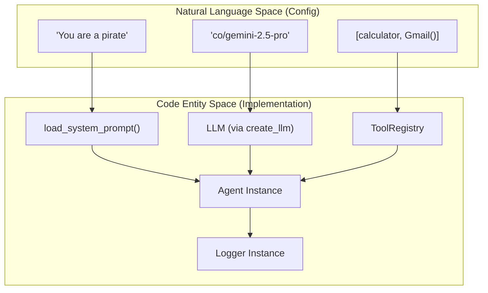

**Key initialization steps:**
1. **LLM Creation**: `create_llm()` factory routes model string to appropriate provider class [connectonion/core/agent.py:137-143]()
2. **Logger Setup**: `Logger` instance manages console output, plain text logs, and session YAML [connectonion/core/agent.py:73]()
3. **Tool Registry**: `ToolRegistry` stores tools with O(1) lookup [connectonion/core/agent.py:112]()
4. **Tool Processing**: Functions converted via `create_tool_from_function()`, class instances have methods extracted automatically [connectonion/core/agent.py:118-131]()
5. **Event Registration**: Handlers organized by event type in `self.events` [connectonion/core/agent.py:78-92]()

Sources: [connectonion/core/agent.py:49-143](), [connectonion/core/tool_factory.py:20]()

---

## Session Management

### Session State Structure

Each agent maintains a `current_session` dictionary during execution:

```python
current_session = {
    "messages": [           # OpenAI-format conversation history
        {"role": "system", "content": "..."},
        {"role": "user", "content": "..."},
        {"role": "assistant", "tool_calls": [...]},
        {"role": "tool", "tool_call_id": "...", "content": "..."}
    ],
    "trace": [              # Execution trace for debugging
        {
            "type": "tool_result",
            "name": "calculator",
            "args": {"expression": "2+2"},
            "result": "4",
            "status": "success"
        }
    ],
    "turn": 1,              # Current turn number
    "iteration": 1          # Current iteration within this turn
}
```

### Multi-Turn Conversations

Sessions persist across multiple `agent.input()` calls, providing context for subsequent requests. The `messages` list grows with each turn.

Sources: [connectonion/core/agent.py:5-6](), [connectonion/logger.py:204-221]()

---

## Execution Loop

### High-Level Flow

The `agent.input(prompt)` method implements the core execution loop.

**Diagram: Execution Loop Data Flow**
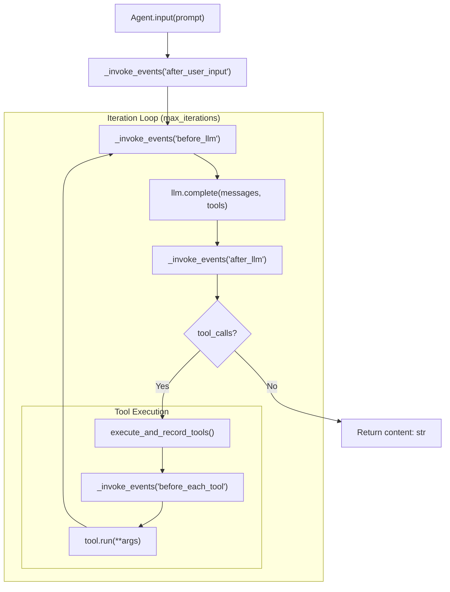

### Detailed Loop Phases

**Phase 1: Initialization**
- User message appended to `current_session["messages"]`.
- `after_user_input` event fires [CLAUDE.md:32]().

**Phase 2: LLM Decision Loop** (repeats up to `max_iterations` [connectonion/core/agent.py:52]())
- `before_llm` event fires [CLAUDE.md:34]().
- `llm.complete()` called with history and tool schemas [CLAUDE.md:35]().
- `after_llm` event fires [CLAUDE.md:36]().

**Phase 3: Tool Execution** (if `tool_calls` present)
- `before_tools` event fires ONCE before batch [CLAUDE.md:38]().
- `execute_and_record_tools()` runs each tool [CLAUDE.md:37]().
- `before_each_tool` and `after_each_tool` fire per tool [CLAUDE.md:39]().
- `after_tools` event fires ONCE after batch [CLAUDE.md:40]().
- Results appended to `messages`, loop continues [CLAUDE.md:41]().

Sources: [CLAUDE.md:30-42](), [connectonion/core/agent.py:5-9]()

---

## Lifecycle Hooks

The Agent fires events at distinct points:

| Event | Timing |
|-------|--------|
| `after_user_input` | After user message added |
| `before_llm` | Before LLM call |
| `after_llm` | After LLM response |
| `before_tools` | Before all tools in a batch |
| `before_each_tool` | Before each individual tool |
| `after_each_tool` | After each individual tool |
| `after_tools` | After all tools in a batch |
| `on_error` | When execution fails |
| `on_complete` | When turn completes |

Sources: [connectonion/core/agent.py:78-92](), [connectonion/core/events.py:11]()

---

## Tool Registry

The `ToolRegistry` manages tool access and instance storage.

**Diagram: Tool Registry Architecture**
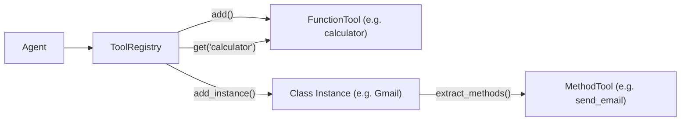

**Access Patterns:**
- **By name**: `agent.tools.get("calculator")` [connectonion/core/agent.py:8]()
- **By attribute**: `agent.tools.calculator` [connectonion/core/agent.py:7]()
- **Instance access**: `agent.tools.gmail` (for stateful objects) [connectonion/core/agent.py:7]()

Sources: [connectonion/core/agent.py:112-131](), [connectonion/core/tool_registry.py]()

---

## Logging and Observability

The `Logger` class provides three output destinations:
1. **Console**: Rich-formatted terminal output [connectonion/logger.py:154]()
2. **Plain text**: `.co/logs/{name}.log` [connectonion/logger.py:155]()
3. **Session YAML**: `.co/evals/{slug}.yaml` for replays [connectonion/logger.py:156]()

Sources: [connectonion/logger.py:44-72](), [docs/api.md:151-157]()

---

## Error Handling

### Tool Execution Errors
When a tool raises an exception:
- Exception is captured and formatted as a string [connectonion/core/tool_executor.py:180-202]().
- `status` is set to `"error"` in the trace [tests/unit/test_tool_executor_errors.py:180]().
- Error details are returned to the LLM as a tool result message [tests/unit/test_tool_executor_errors.py:147]().
- `on_error` event fires [tests/unit/test_tool_executor_errors.py:213]().

### Tool Not Found
- Non-existent tools return a `"not_found"` status [tests/unit/test_tool_executor_errors.py:90]().
- An error message is injected into the conversation: `"Tool '{name}' not found"` [tests/unit/test_tool_executor_errors.py:147]().

Sources: [tests/unit/test_tool_executor_errors.py:62-215](), [connectonion/core/tool_executor.py:108-119]()

---

# Page: LLM Integration

# LLM Integration

<details>
<summary>Relevant source files</summary>

The following files were used as context for generating this wiki page:

- [connectonion/cli/templates/coder/agent.py](connectonion/cli/templates/coder/agent.py)
- [connectonion/cli/templates/coder/prompt.md](connectonion/cli/templates/coder/prompt.md)
- [connectonion/cli/templates/minimal/agent.py](connectonion/cli/templates/minimal/agent.py)
- [connectonion/cli/templates/minimal/prompt.md](connectonion/cli/templates/minimal/prompt.md)
- [connectonion/cli/templates/web-research/agent.py](connectonion/cli/templates/web-research/agent.py)
- [connectonion/core/exceptions.py](connectonion/core/exceptions.py)
- [connectonion/core/llm.py](connectonion/core/llm.py)
- [connectonion/llm_do.py](connectonion/llm_do.py)
- [docs/concepts/models.md](docs/concepts/models.md)
- [tests/integration/test_llm.py](tests/integration/test_llm.py)
- [tests/integration/test_memory_integration.py](tests/integration/test_memory_integration.py)
- [tests/real_api/test_real_anthropic.py](tests/real_api/test_real_anthropic.py)
- [tests/real_api/test_real_openai.py](tests/real_api/test_real_openai.py)
- [tests/unit/test_env_autoload.py](tests/unit/test_env_autoload.py)
- [tests/unit/test_groq_llm.py](tests/unit/test_groq_llm.py)
- [tests/unit/test_llm_errors.py](tests/unit/test_llm_errors.py)
- [tests/unit/test_openonion_llm.py](tests/unit/test_openonion_llm.py)

</details>


## Purpose and Scope

This page covers ConnectOnion's LLM integration layer, including supported providers, model selection, the `llm_do()` function, and the managed keys system. ConnectOnion provides a unified abstraction that allows switching between frontier models from OpenAI, Anthropic, Google, and others with minimal configuration.

**What this page covers:**
- LLM provider abstraction and factory pattern via `create_llm()` [connectonion/core/llm.py:36-39]()
- Supported providers (OpenAI, Anthropic, Google Gemini, Groq, Grok, Mistral, OpenRouter, and OpenOnion) [connectonion/core/llm.py:13-15]()
- Model selection and registry system [connectonion/core/llm.py:1000-1100]()
- The `llm_do()` one-shot function for simple LLM calls [connectonion/llm_do.py:11-15]()
- Structured output with Pydantic models [connectonion/llm_do.py:47-48]()
- API key configuration and managed keys [connectonion/core/llm.py:99-105]()

**What this page does NOT cover:**
- Agent orchestration (see [Agent Architecture](3.1))
- Tool calling mechanics (see [Tools System](3.3))
- Multi-agent networking (see [Multi-Agent Networking](5))

**Sources:** [connectonion/core/llm.py:1-40](), [connectonion/llm_do.py:1-50]()

---

## LLM Provider Architecture

ConnectOnion implements a unified abstraction layer that allows agents to work with multiple LLM providers through a single interface. This design enables provider switching without code changes and supports both standard API keys and ConnectOnion's managed key system.

### Provider Abstraction Diagram

```mermaid
graph TB
    Agent["Agent<br/>(agent.py)"]
    LLMDo["llm_do()<br/>(llm_do.py)"]
    Factory["create_llm()<br/>(core/llm.py)"]
    LLMBase["LLM Interface<br/>complete()<br/>structured_complete()"]
    
    Registry["MODEL_REGISTRY<br/>(core/llm.py)"]
    
    subgraph "Provider Implementations"
        OpenAI["OpenAILLM"]
        Anthropic["AnthropicLLM"]
        Gemini["GeminiLLM"]
        OpenOnion["OpenOnionLLM<br/>(co/ prefix)"]
        Other["GroqLLM / GrokLLM / MistralLLM"]
    end
    
    subgraph "External SDKs"
        OpenAISDK["openai.OpenAI"]
        AnthropicSDK["anthropic.Anthropic"]
        GeminiSDK["google.generativeai"]
    end
    
    Agent --> Factory
    LLMDo --> Factory
    Factory --> Registry
    Registry --> Factory
    
    Factory --> OpenAI
    Factory --> Anthropic
    Factory --> Gemini
    Factory --> OpenOnion
    Factory --> Other
    
    OpenAI --> LLMBase
    Anthropic --> LLMBase
    Gemini --> LLMBase
    OpenOnion --> LLMBase
    
    OpenAI --> OpenAISDK
    Anthropic --> AnthropicSDK
    Gemini --> GeminiSDK
    OpenOnion --> OpenAISDK
```

**Sources:** [connectonion/core/llm.py:17-40](), [connectonion/llm_do.py:62-81]()

### Core Components

| Component | File Location | Purpose |
|-----------|---------------|---------|
| `LLM` | [connectonion/core/llm.py:21-24]() | Abstract base class defining the provider contract |
| `create_llm()` | [connectonion/core/llm.py:36-39]() | Factory function that routes model names to provider classes |
| `MODEL_REGISTRY` | [connectonion/core/llm.py:1000-1100]() | Mapping of specific model strings to their provider type |
| `OpenOnionLLM` | [connectonion/core/llm.py:34]() | Managed keys implementation using a proxy endpoint |
| `llm_do()` | [connectonion/llm_do.py:132-140]() | One-shot function for stateless LLM interactions |

**Sources:** [connectonion/core/llm.py:21-40](), [connectonion/llm_do.py:11-15]()

---

## The LLM Interface

All provider implementations inherit from the `LLM` abstract base class. This ensures that regardless of the underlying API (REST, SDK, etc.), the framework interacts with them identically.

### Core Methods

| Method | Parameters | Returns | Purpose |
|--------|-----------|---------|---------|
| `complete()` | `messages: list`, `tools: list`, `**kwargs` | `LLMResponse` | Standard text generation with optional tool calling [connectonion/core/llm.py:65-69]() |
| `structured_complete()` | `messages: list`, `output_schema: Type[BaseModel]`, `**kwargs` | `BaseModel` | Generates response conforming to a Pydantic schema [connectonion/core/llm.py:72-76]() |

**Data Structures:**
- **`LLMResponse`**: A dataclass containing `content` (str), `tool_calls` (list), and `raw_response`. [connectonion/core/llm.py:69]()
- **`ToolCall`**: A dataclass containing `name`, `arguments` (dict), and `id`. [connectonion/core/llm.py:50]()

**Sources:** [connectonion/core/llm.py:49-77]()

---

## Supported Providers & Models

ConnectOnion supports a wide array of models, accessible either via your own API keys or managed `co/` keys.

### Managed Keys (OpenOnion)
Managed keys allow zero-setup access to frontier models. By running `co auth`, you authenticate your machine and can use models prefixed with `co/`.

- **Authentication**: Uses `OPENONION_API_KEY` (stored in `~/.co/config.toml`) [connectonion/core/llm.py:6-105]().
- **Default**: `llm_do()` defaults to `co/gemini-2.5-flash` [connectonion/llm_do.py:46]().
- **Models**: `co/gpt-4o`, `co/o4-mini`, `co/gemini-2.5-pro`, `co/claude-3-5-sonnet`, etc [docs/concepts/models.md:43-152]().

### Bring Your Own Keys (BYOK)
| Provider | Model Prefix / Examples | Env Variable |
|----------|-------------------------|--------------|
| **OpenAI** | `gpt-4o`, `gpt-5`, `o4-mini` | `OPENAI_API_KEY` |
| **Anthropic** | `claude-3-5-sonnet`, `claude-4.5` | `ANTHROPIC_API_KEY` |
| **Google** | `gemini-2.5-flash`, `gemini-3-pro` | `GEMINI_API_KEY` |
| **Groq** | `groq/llama-3.3-70b` | `GROQ_KEY` |
| **Mistral** | `mistral/mistral-large-latest` | `MISTRAL_API_KEY` |

**Sources:** [docs/concepts/models.md:5-168](), [connectonion/core/llm.py:99-112]()

---

## The `llm_do()` Function

`llm_do()` is a thin wrapper around the LLM provider abstraction for one-shot calls. It is stateless and does not maintain conversation history or support tool calling.

### Comparison with Agent

| Feature | `llm_do()` | `Agent()` |
|---------|------------|-----------|
| **Iterations** | Always 1 | Up to `max_iters` |
| **Tools** | No | Yes |
| **State** | Stateless | Maintains history |
| **Use Case** | Extraction, Analysis | Complex workflows |

**Sources:** [connectonion/llm_do.py:52-60]()

### Usage Examples

**Simple Text Generation:**
```python
from connectonion import llm_do
result = llm_do("What is the capital of France?")
```
[connectonion/llm_do.py:105-107]()

**Structured Data Extraction:**
```python
from pydantic import BaseModel
from connectonion import llm_do

class Person(BaseModel):
    name: str
    age: int

result = llm_do("John is 30 years old", output=Person)
# Returns a Person instance
```
[connectonion/llm_do.py:109-114]()

---

## Error Handling and Credits

The LLM layer provides actionable error messages for common failure modes.

### Insufficient Credits
When using managed `co/` keys, if your balance is too low, the system raises an `InsufficientCreditsError`. This exception parses the 402 error from the proxy and provides:
- **Balance**: Your current USD balance [connectonion/core/exceptions.py:23]().
- **Required**: The cost of the attempted request [connectonion/core/exceptions.py:24]().
- **Action**: A formatted message explaining how to add credits via `co status` or the purchase URL [connectonion/core/exceptions.py:68-71]().

### Connection Issues
The `LLMConnectionError` is raised when requests time out or fail to connect, often due to VPNs or proxy settings [connectonion/core/exceptions.py:77-83]().

**Sources:** [connectonion/core/exceptions.py:15-115](), [connectonion/core/llm.py:9]()

---

## Technical Implementation Details

### Model Registry and Inference
The `create_llm` factory uses `MODEL_REGISTRY` for known strings. If a model is unknown, it attempts to infer the provider based on prefixes:
- `gpt-` or `o1-` $\rightarrow$ `OpenAILLM` [tests/integration/test_llm.py:87-89]()
- `claude-` $\rightarrow$ `AnthropicLLM` [tests/integration/test_llm.py:92-94]()
- `gemini-` $\rightarrow$ `GeminiLLM` [tests/integration/test_llm.py:97-99]()
- `co/` $\rightarrow$ `OpenOnionLLM` [tests/unit/test_openonion_llm.py:146-153]()

### Structured Output Implementation
- **OpenAI**: Uses native `responses.parse()` [connectonion/core/llm.py:27]().
- **Anthropic**: Implemented via forced tool calling (the LLM is forced to call a "format_output" tool) [connectonion/core/llm.py:28]().
- **Gemini**: Uses the native `response_schema` [connectonion/core/llm.py:29]().

**Sources:** [connectonion/core/llm.py:43-56](), [tests/integration/test_llm.py:42-61]()

---

# Page: Tools System

# Tools System

<details>
<summary>Relevant source files</summary>

The following files were used as context for generating this wiki page:

- [CHANGELOG.md](CHANGELOG.md)
- [connectonion/core/agent.py](connectonion/core/agent.py)
- [connectonion/logger.py](connectonion/logger.py)
- [connectonion/useful_tools/browser_tools/scroll.py](connectonion/useful_tools/browser_tools/scroll.py)
- [connectonion/useful_tools/file_tools/README.md](connectonion/useful_tools/file_tools/README.md)
- [connectonion/useful_tools/file_tools/__init__.py](connectonion/useful_tools/file_tools/__init__.py)
- [connectonion/useful_tools/file_tools/edit.py](connectonion/useful_tools/file_tools/edit.py)
- [connectonion/useful_tools/file_tools/file_tools.py](connectonion/useful_tools/file_tools/file_tools.py)
- [connectonion/useful_tools/file_tools/glob.py](connectonion/useful_tools/file_tools/glob.py)
- [connectonion/useful_tools/file_tools/grep.py](connectonion/useful_tools/file_tools/grep.py)
- [connectonion/useful_tools/file_tools/multi_edit.py](connectonion/useful_tools/file_tools/multi_edit.py)
- [connectonion/useful_tools/file_tools/read.py](connectonion/useful_tools/file_tools/read.py)
- [docs/api.md](docs/api.md)
- [docs/concepts/tools.md](docs/concepts/tools.md)
- [tests/real_api/manual/manual_defaults.py](tests/real_api/manual/manual_defaults.py)
- [tests/unit/test_agent.py](tests/unit/test_agent.py)
- [tests/unit/test_logger.py](tests/unit/test_logger.py)
- [tests/unit/test_tool_executor.py](tests/unit/test_tool_executor.py)
- [tests/unit/test_tool_executor_errors.py](tests/unit/test_tool_executor_errors.py)
- [tests/unit/test_tool_factory.py](tests/unit/test_tool_factory.py)

</details>


**Purpose**: The Tools System enables agents to interact with the world by converting Python functions and classes into callable actions that LLMs can invoke. This page covers tool creation patterns, schema generation, tool registry architecture, and the execution lifecycle.

**Scope**: This page focuses on the technical implementation of the tools system. For practical guidance on designing tools, see [10.1 Tool Design](). For information about the event system that hooks into tool execution, see [3.4 Event System]().

---

## System Architecture

The tools system consists of four primary components that work together to transform Python code into LLM-callable actions:

**Tool Transformation Flow**
```mermaid
graph TB
    subgraph "Tool Creation"
        Func["Python Function<br/>def search(query: str) -> str"]
        Class["Python Class<br/>class Gmail:<br/>  def send(...)<br/>  def read(...)"]
        Factory["Tool Factory<br/>create_tool_from_function()"]
        
        Func -->|"Type hints + docstring"| Factory
        Class -->|"Auto-discover methods"| Factory
    end
    
    subgraph "Tool Registry"
        Registry["ToolRegistry<br/>O(1) lookup by name"]
        Schema["OpenAI Tool Schema<br/>{name, description, parameters}"]
        
        Factory -->|"Creates"| Schema
        Schema -->|"Stored in"| Registry
    end
    
    subgraph "Tool Execution"
        Executor["Tool Executor<br/>execute_single_tool()"]
        XRay["XRay Context<br/>inject_xray_context()"]
        Trace["Trace Entry<br/>{type, status, timing, result}"]
        
        Registry -->|"Lookup"| Executor
        Executor -->|"Injects"| XRay
        Executor -->|"Records"| Trace
    end
    
    subgraph "Agent Integration"
        Agent["Agent.input()"]
        LLM["LLM Provider"]
        Session["current_session<br/>{messages, trace, iteration}"]
        
        Agent -->|"Sends schemas"| LLM
        LLM -->|"Returns tool_calls"| Agent
        Agent -->|"Executes via"| Executor
        Executor -->|"Updates"| Session
    end
```

**Sources**: [connectonion/core/tool_factory.py:1-150](), [connectonion/core/tool_registry.py:1-100](), [connectonion/core/tool_executor.py:1-250](), [connectonion/core/agent.py:111-132]()

---

## Tool Creation Patterns

### Function-Based Tools (Recommended)

Function-based tools are the simplest way to create tools. Any Python function with type hints can be automatically converted to a tool using `create_tool_from_function` [connectonion/core/tool_factory.py:20-20]().

```python
def search(query: str, limit: int = 10) -> str:
    """Search for information."""
    return f"Found results for {query}"

agent = Agent("assistant", tools=[search])
```

**Schema Generation Process**:

| Input | Source | Output Schema Field |
|-------|--------|---------------------|
| Function name | `func.__name__` | `"name": "search"` |
| Type hints | `query: str` | `"query": {"type": "string"}` |
| Docstring | First paragraph | `"description": "Search for..."` |
| Default values | `limit: int = 10` | `"required": ["query"]` (limit is optional) |

**Type Mapping via `get_json_schema_type`**:

| Python Type | JSON Schema Type |
|-------------|------------------|
| `str` | `"string"` |
| `int` | `"integer"` |
| `float` | `"number"` |
| `bool` | `"boolean"` |
| `list`, `List[T]` | `"array"` |
| `dict`, `Dict[K,V]` | `"object"` |

**Sources**: [connectonion/core/tool_factory.py:20-120](), [tests/unit/test_tool_factory.py:116-165](), [docs/api.md:126-131]()

### Class-Based Tools (Stateful Operations)

For tools that need shared state, caching, or resource management, pass class instances directly to the `Agent` [connectonion/core/agent.py:118-125]().

```python
class Gmail:
    def __init__(self):
        self._service = None  # Shared state
    
    def send(self, to: str, subject: str, body: str) -> str:
        """Send an email."""
        return f"Sent to {to}"
    
    def read_inbox(self, last: int = 10) -> str:
        """Read recent emails."""
        return f"Read {last} emails"

gmail = Gmail()
agent = Agent("assistant", tools=[gmail])  # Auto-discovers methods
```

**Method Discovery Rules**:
- Only `public` methods (not starting with `_`) are registered as tools [connectonion/core/tool_factory.py:80-100]().
- Each method must have type hints for parameters and return type to be included [tests/unit/test_agent.py:125-128]().
- The class instance itself is stored in the registry for direct access [connectonion/core/agent.py:121-121]().

**Sources**: [connectonion/core/tool_factory.py:80-150](), [tests/unit/test_agent.py:96-129](), [docs/concepts/tools.md:162-175]()

---

## Schema Generation Pipeline

### Docstring Processing

The tool factory extracts only the first paragraph of docstrings to minimize token usage and exclude implementation details like `Args` or `Returns` sections [connectonion/core/tool_factory.py:45-70]().

**Docstring Extraction Logic**
```mermaid
graph LR
    Docstring["Docstring<br/>Search the web for info.<br/><br/>Args:<br/>  query: Search terms<br/>Returns:<br/>  Search results"]
    Extract["Extract First Paragraph"]
    Schema["Schema Description<br/>'Search the web for info.'"]
    
    Docstring -->|"Split by blank line"| Extract
    Extract -->|"Before Args/Returns"| Schema
```

**Sources**: [connectonion/core/tool_factory.py:45-70](), [tests/unit/test_tool_factory.py:72-110]()

---

## Tool Registry Architecture

The `ToolRegistry` [connectonion/core/tool_registry.py:1-100]() provides O(1) lookup and attribute-style access to tools and their underlying class instances.

**Registry Internal Structure**
```mermaid
graph TB
    subgraph "ToolRegistry Structure"
        Registry["ToolRegistry"]
        ToolsDict["_tools: Dict[str, Tool]"]
        InstancesDict["_instances: Dict[str, Any]"]
        
        Registry -->|"stores"| ToolsDict
        Registry -->|"stores"| InstancesDict
    end
    
    subgraph "Access Patterns"
        Lookup1["agent.tools.get('search')"]
        Lookup2["agent.tools.search"]
        Lookup3["agent.tools.gmail"]
        
        Lookup1 -->|"Dict lookup"| ToolsDict
        Lookup2 -->|"__getattr__()"| ToolsDict
        Lookup3 -->|"Instance access"| InstancesDict
    end
```

**Sources**: [connectonion/core/tool_registry.py:1-100](), [connectonion/core/agent.py:112-132]()

---

## Tool Execution Lifecycle

### Execution Flow with Events

The `execute_and_record_tools` function manages the batch execution of tool calls returned by an LLM [connectonion/core/tool_executor.py:24-100]().

**Tool Execution Sequence**
```mermaid
sequenceDiagram
    participant Agent
    participant Executor as "Tool Executor"
    participant XRay as "XRay Context"
    participant Tool as "Tool Function"
    participant Logger
    participant Trace as "Session Trace"
    
    Note over Agent: LLM returns tool_calls
    Agent->>Executor: execute_and_record_tools(tool_calls)
    
    rect rgb(240, 240, 240)
        Note over Agent,Executor: Add Assistant Message
        Executor->>Agent: _add_assistant_message(tool_calls)
    end
    
    rect rgb(240, 240, 240)
        Note over Agent,Logger: Fire before_tools Event
        Executor->>Agent: _invoke_events('before_tools')
    end
    
    loop For each tool_call
        rect rgb(250, 250, 250)
            Note over Executor,Tool: Execute Single Tool
            Executor->>Agent: _invoke_events('before_each_tool')
            Executor->>Logger: log_tool_call(name, args)
            
            Executor->>Tool: tool.run(**arguments)
            Tool-->>Executor: result or Exception
            
            Executor->>Logger: log_tool_result(result, timing_ms)
            Executor->>Trace: trace.append({type, status, timing, result})
            
            alt Tool raised Exception
                Executor->>Agent: _invoke_events('on_error')
            end
            
            Executor->>Agent: _invoke_events('after_each_tool')
            Executor->>Agent: _add_tool_result_message(result)
        end
    end
    
    rect rgb(240, 240, 240)
        Note over Agent,Logger: Fire after_tools Event
        Executor->>Agent: _invoke_events('after_tools')
    end
```

**Sources**: [connectonion/core/tool_executor.py:24-250](), [tests/unit/test_tool_executor.py:1-238](), [connectonion/core/agent.py:78-92]()

### Error Handling

Tool execution captures failures and returns them as strings to the LLM so the agent can attempt to self-correct [connectonion/core/tool_executor.py:180-202]().

| Error Type | Status | Result Format |
|------------|--------|---------------|
| **Tool Not Found** | `not_found` | `"Error: Tool {name} not found"` |
| **Execution Exception** | `error` | `"Error: {exception_message}"` |
| **Success** | `success` | Raw return value (as string) |

**Sources**: [connectonion/core/tool_executor.py:108-202](), [tests/unit/test_tool_executor_errors.py:62-214]()

---

## File Tools (Special Case)

The `FileTools` system implements a "Claude Code-style" safety pattern where edits require prior reads [connectonion/useful_tools/file_tools/README.md:1-40]().

**File Safety Logic**
```mermaid
graph TD
    Read["read_file(path)"]
    Hash["Calculate MD5 Snapshot"]
    Edit["edit(path, old, new)"]
    Verify["Verify Read Snapshot"]
    VerifyHash["Verify Current MD5 == Snapshot"]
    Apply["Apply Edit"]
    
    Read --> Hash
    Hash --> Edit
    Edit --> Verify
    Verify -->|"Missing"| Error1["Error: Read file first"]
    Verify -->|"Exists"| VerifyHash
    VerifyHash -->|"Different"| Error2["Error: Stale read detected"]
    VerifyHash -->|"Same"| Apply
```

**Key Implementation Details**:
- **MD5 Snapshots**: Tracks file state at the moment of reading to detect external changes [connectonion/useful_tools/file_tools/README.md:58-68]().
- **Write Restriction**: `write()` is restricted to creating *new* files only; existing files must be modified via `edit()` or `multi_edit()` [connectonion/useful_tools/file_tools/README.md:70-84]().
- **Permission Modes**: Supports `read` (read-only) and `write` (full access) modes [connectonion/useful_tools/file_tools/README.md:86-104]().

**Sources**: [connectonion/useful_tools/file_tools/README.md:1-205](), [CHANGELOG.md:9-42]()

---

## Performance and Observability

### Logging
The `Logger` [connectonion/logger.py:44-116]() delegates tool execution events to the `Console` for terminal output and records them in structured YAML evals for replay [connectonion/logger.py:134-143]().

### Token Usage
Tool execution results are appended to the session message history, contributing to context window usage. Structured returns (like `List[Dict]`) are automatically serialized to JSON for the LLM [docs/concepts/tools.md:70-98]().

**Sources**: [connectonion/logger.py:1-160](), [connectonion/core/agent.py:63-65](), [docs/api.md:151-220]()

---

# Page: Event System

# Event System

<details>
<summary>Relevant source files</summary>

The following files were used as context for generating this wiki page:

- [connectonion/core/__init__.py](connectonion/core/__init__.py)
- [connectonion/core/events.py](connectonion/core/events.py)
- [docs/concepts/events.md](docs/concepts/events.md)
- [docs/hook-system-options.md](docs/hook-system-options.md)
- [examples/events_example.py](examples/events_example.py)
- [tests/unit/test_events.py](tests/unit/test_events.py)

</details>


## Purpose and Scope

ConnectOnion's event system provides a robust mechanism to hook into the agent lifecycle. It allows developers to add custom behavior—such as logging, performance monitoring, automated reasoning, or approval workflows—without modifying the core execution engine. The system is designed around the `Agent` instance, providing handlers with full access to the session state, message history, and execution trace.

---

## Event Lifecycle Overview

The agent lifecycle is divided into **Turns** (a single `agent.input()` call) and **Iterations** (the LLM decision cycle of thinking and tool execution). Events fire at specific transition points within these cycles.

### Agent Execution Timeline

The following diagram maps the natural language lifecycle to the specific code entities and event hooks invoked within `Agent.input()`.

**Title: Agent Lifecycle and Event Hook points**
```mermaid
sequenceDiagram
    participant User
    participant Agent as "Agent.input()"
    participant Events as "core.events"
    participant LLM as "core.llm"
    participant Tools as "core.tool_executor"
    
    User->>Agent: "Search for React"
    
    rect rgb(250, 250, 250)
        Note over Agent,Events: Turn Initialization
        Agent->>Events: "after_user_input"
    end
    
    loop Iteration (max_iterations)
        rect rgb(250, 250, 250)
            Note over Agent,LLM: LLM Phase
            Agent->>Events: "before_iteration"
            Agent->>Events: "before_llm"
            Agent->>LLM: "llm.complete()"
            LLM-->>Agent: "LLMResponse"
            Agent->>Events: "after_llm"
        end
        
        alt Has tool_calls
            rect rgb(250, 250, 250)
                Note over Agent,Tools: Tool Execution Phase
                Agent->>Events: "before_tools"
                
                loop Each ToolCall
                    Agent->>Events: "before_each_tool"
                    Agent->>Tools: "execute_single_tool()"
                    alt Success
                        Tools-->>Agent: "result"
                    else Error
                        Tools-->>Agent: "Exception"
                        Agent->>Events: "on_error"
                    end
                    Agent->>Events: "after_each_tool"
                end
                
                Agent->>Events: "after_tools"
            end
        else Final Answer
            Note over Agent: Break Loop
        end
        Agent->>Events: "after_iteration"
    end
    
    rect rgb(250, 250, 250)
        Note over Agent,User: Completion Phase
        Agent->>Events: "on_complete"
    end
    Agent-->>User: Final Result
```
**Sources:** [docs/concepts/events.md:83-122](), [connectonion/core/events.py:21-200](), [connectonion/core/agent.py:1-100]()

---

## Event Handler Implementation

Event handlers are functions that accept the `Agent` instance as their only argument [connectonion/core/events.py:18](). They are registered using wrapper functions (or decorators) that tag the function with a specific `_event_type` attribute [connectonion/core/events.py:38]().

### Registration Syntax
ConnectOnion supports two styles of registration. The wrapper style is recommended for clarity.

| Style | Example |
| :--- | :--- |
| **Wrapper** | `on_events=[after_llm(my_handler)]` |
| **Decorator** | `@after_llm` <br> `def my_handler(agent): ...` |

**Sources:** [docs/concepts/events.md:48-58](), [connectonion/core/events.py:28-36]()

### Accessing Session State
Handlers can inspect and modify the `agent.current_session` object, which contains the conversation history and execution trace [docs/concepts/events.md:138-155]().

```python
def my_event_handler(agent: Agent):
    # Access full conversation
    messages = agent.current_session['messages']
    
    # Access execution history
    last_trace = agent.current_session['trace'][-1]
    
    # Check current iteration number
    iter_count = agent.current_session['iteration']
```
**Sources:** [docs/concepts/events.md:138-144](), [connectonion/core/events.py:5-7]()

---

## Event Types Reference

| Event Hook | Timing | Frequency | Primary Use Case |
| :--- | :--- | :--- | :--- |
| `after_user_input` | After user prompt is added to session | Once per turn | Initialize state, add timestamps |
| `before_iteration` | Start of each LLM/Tool cycle | Per iteration | Poll IO, check mode changes |
| `before_llm` | Before calling the LLM API | Per LLM call | Modify messages/system prompt |
| `after_llm` | After LLM returns a response | Per LLM call | Log tokens, analyze reasoning |
| `before_tools` | Before the first tool in a batch starts | Per batch | User approval for a group of actions |
| `before_each_tool`| Before an individual tool executes | Per tool call | Validate arguments, pre-execution checks |
| `after_each_tool` | After an individual tool finishes | Per tool call | Log performance, per-tool cleanup |
| `after_tools` | After all tools in a batch complete | Per batch | **Safe message injection**, reflection |
| `on_error` | When a tool raises an exception | Per error | Custom retries, error logging |
| `after_iteration` | End of iteration (after tools) | Per iteration | Checkpoints, loop control |
| `on_complete` | After agent finishes the turn | Once per turn | Final metrics, cleanup |

**Sources:** [docs/concepts/events.md:62-77](), [connectonion/core/events.py:21-200]()

---

## Data Flow: The Trace System

The `trace` list within `agent.current_session` provides the context for events. Handlers typically inspect the most recent entry to determine what just occurred [docs/concepts/events.md:162-163]().

**Title: Event Data Association in Session Trace**
```mermaid
classDiagram
    class Agent {
        +dict current_session
        +list on_events
    }
    class Session {
        +list messages
        +list trace
        +int iteration
        +dict pending_tool
    }
    class TraceEntry {
        +string type
        +float duration_ms
        +string status
    }
    class LLMTrace {
        +string model
        +int tool_calls_count
    }
    class ToolTrace {
        +string name
        +dict args
        +any result
        +string error
    }

    Agent --> Session : "manages"
    Session --> TraceEntry : "contains history"
    TraceEntry <|-- LLMTrace : "type: llm_call"
    TraceEntry <|-- ToolTrace : "type: tool_result"
```
**Sources:** [docs/concepts/events.md:157-189](), [examples/events_example.py:38-60]()

---

## Critical Implementation Notes

### Message Injection and Provider Compatibility
When adding messages to `agent.current_session['messages']` (e.g., for reflection or planning), developers should use the `after_tools` hook rather than `after_each_tool` [docs/concepts/events.md:79]().
* **Reason:** Certain providers (like Anthropic Claude) require that all tool results immediately follow the tool calls in the message sequence. Injecting a message via `after_each_tool` when multiple tools are requested will interleave results and break API compatibility [examples/events_example.py:14-16]().

### Error Handling in Events
Exceptions raised within an event handler are not caught by the agent; they propagate immediately and stop the agent execution ("fail fast") [connectonion/core/events.py:9]().

### Tool Cancellation
In the `before_each_tool` event, the tool about to be executed is available in `agent.current_session['pending_tool']` [docs/concepts/events.md:147](). Raising an exception here will cancel the tool execution and trigger the `on_error` event [connectonion/core/events.py:136]().

**Sources:** [docs/concepts/events.md:79](), [connectonion/core/events.py:9](), [connectonion/core/events.py:186-191]()

---

# Page: Plugin System

# Plugin System

<details>
<summary>Relevant source files</summary>

The following files were used as context for generating this wiki page:

- [connectonion/network/asgi/__init__.py](connectonion/network/asgi/__init__.py)
- [connectonion/useful_events_handlers/reflect.py](connectonion/useful_events_handlers/reflect.py)
- [connectonion/useful_plugins/__init__.py](connectonion/useful_plugins/__init__.py)
- [connectonion/useful_plugins/image_result_formatter.py](connectonion/useful_plugins/image_result_formatter.py)
- [connectonion/useful_plugins/prefer_write_tool.py](connectonion/useful_plugins/prefer_write_tool.py)
- [connectonion/useful_plugins/re_act.py](connectonion/useful_plugins/re_act.py)
- [connectonion/useful_plugins/skills.py](connectonion/useful_plugins/skills.py)
- [connectonion/useful_plugins/tool_approval/bash_parser.py](connectonion/useful_plugins/tool_approval/bash_parser.py)
- [docs/concepts/plugins.md](docs/concepts/plugins.md)
- [docs/features/transcribe.md](docs/features/transcribe.md)
- [docs/features/trust.md](docs/features/trust.md)
- [docs/useful_plugins/prefer_write_tool.md](docs/useful_plugins/prefer_write_tool.md)
- [tests/e2e/test_example_agent.py](tests/e2e/test_example_agent.py)
- [tests/unit/test_skills.py](tests/unit/test_skills.py)
- [tests/unit/test_tool_approval.py](tests/unit/test_tool_approval.py)

</details>


The plugin system provides a composable architecture for extending agent behavior through reusable event handler bundles. Plugins inject logic at specific points in the agent execution lifecycle without modifying core agent code.

This page covers plugin architecture, built-in plugins, and custom plugin creation. For details on the underlying event hooks, see [Event System (3.4)](). For tool creation patterns, see [Tools System (3.3)]().

---

## Plugin Architecture

### Core Concept

A plugin is a **list of event handlers** that fire during agent execution. Plugins modify agent behavior by intercepting lifecycle events and injecting messages, making LLM calls, or mutating session state.

```python
# Plugin = list of decorated event handlers
my_plugin = [
    after_user_input(plan_function),
    after_tools(reflect_function)
]

# Use in agent
agent = Agent(
    name="assistant",
    tools=[search, analyze],
    plugins=[my_plugin, another_plugin]  # Composable
)
```

**Key Properties:**
- **Reusable**: Package behavior once, use across multiple agents [docs/concepts/plugins.md:95-104]().
- **Composable**: Combine multiple plugins without conflicts [docs/concepts/plugins.md:68-73]().
- **Declarative**: List of event handlers, not imperative code [connectonion/useful_plugins/re_act.py:162-164]().
- **Non-invasive**: No inheritance or agent subclassing required [docs/concepts/plugins.md:39-47]().

Sources: [connectonion/useful_plugins/__init__.py:1-28](), [docs/concepts/plugins.md:1-111]()

---

### Plugin to Event System Mapping

The diagram below bridges the natural language concepts of "planning" and "reflecting" to the specific code entities in the event system.

```mermaid
graph TB
    subgraph "Plugin Definition"
        Plugin["my_plugin = [handler1, handler2]"]
        H1["@after_user_input<br/>def plan(agent):"]
        H2["@after_tools<br/>def reflect(agent):"]
    end
    
    subgraph "Agent Registration"
        Agent["Agent(plugins=[my_plugin])"]
        Registry["Event Registry"]
    end
    
    subgraph "Event System (3.4)"
        E1["after_user_input"]
        E2["before_llm"]
        E3["after_llm"]
        E4["before_tools"]
        E5["before_each_tool"]
        E6["after_each_tool"]
        E7["after_tools"]
        E8["on_error"]
        E9["on_complete"]
    end
    
    subgraph "Runtime Execution"
        Loop["Agent Loop"]
        Fire["Event.fire()"]
    end
    
    Plugin --> H1
    Plugin --> H2
    H1 --> Agent
    H2 --> Agent
    
    Agent --> Registry
    Registry --> E1
    Registry --> E7
    
    Loop --> Fire
    Fire --> E1
    Fire --> E7
    
    E1 -.triggers.-> H1
    E7 -.triggers.-> H2
```

**Execution Flow:**
1. Agent initialization registers plugin handlers to event system.
2. During `agent.input()`, agent loop fires events at lifecycle points.
3. Registered handlers execute in registration order [docs/useful_plugins/prefer_write_tool.md:113-119]().
4. Handlers receive `agent` instance with full session access [connectonion/useful_plugins/re_act.py:120-160]().

Sources: [connectonion/useful_plugins/re_act.py:119-165](), [connectonion/useful_plugins/image_result_formatter.py:105-155](), [connectonion/useful_plugins/prefer_write_tool.py:77-143]()

---

## Plugin Structure

### Anatomy of a Plugin

A plugin is defined as a collection of functions decorated with event hooks from `connectonion.core.events`.

```python
from connectonion.core.events import after_user_input, after_tools
from connectonion.llm_do import llm_do

@after_user_input
def plan_task(agent: 'Agent') -> None:
    """Generate task plan after user input."""
    user_prompt = agent.current_session.get('user_prompt', '')
    # Inject into conversation
    agent.current_session['messages'].append({
        'role': 'assistant',
        'content': f"💭 I will handle: {user_prompt}"
    })

@after_tools
def evaluate_result(agent: 'Agent') -> None:
    """Evaluate tool execution success."""
    trace = agent.current_session.get('trace', [])
    if trace and trace[-1]['status'] == 'success':
        agent.logger.print("✓ Tool succeeded")

# Bundle as plugin
my_plugin = [plan_task, evaluate_result]
```

**Handler Requirements:**
- **Signature**: `def handler(agent: Agent) -> None` [connectonion/useful_plugins/re_act.py:120]()
- **Decorator**: One of the event decorators from `connectonion.core.events` [connectonion/useful_plugins/prefer_write_tool.py:77]()
- **Return**: `None` (side effects only)
- **State Access**: Via `agent.current_session` dictionary [connectonion/useful_plugins/image_result_formatter.py:121-122]()

**Session State Keys often used by Plugins:**
| Key | Type | Description |
|-----|------|-------------|
| `user_prompt` | `str` | Original user input [connectonion/useful_plugins/re_act.py:122]() |
| `messages` | `List[Dict]` | Full conversation history [connectonion/useful_plugins/re_act.py:127]() |
| `trace` | `List[Dict]` | Execution trace (tool results, errors) [connectonion/useful_plugins/image_result_formatter.py:121]() |
| `pending_tool`| `Dict` | Tool currently awaiting execution [connectonion/useful_plugins/prefer_write_tool.py:80]() |
| `permissions` | `Dict` | Tool-level approval/denial state [tests/unit/test_tool_approval.py:199-203]() |

Sources: [connectonion/useful_plugins/re_act.py:119-160](), [connectonion/useful_plugins/image_result_formatter.py:105-155](), [connectonion/useful_plugins/prefer_write_tool.py:77-143]()

---

## Built-in Plugins

### Plugin Catalog

ConnectOnion includes several built-in plugins that extend agent functionality:

| Plugin | Purpose | Implementation |
|--------|---------|----------------|
| `re_act` | Reasoning (Intent Recognition + Reflection) | [re_act.py:164]() |
| `image_result_formatter` | Formats base64 images for multimodal LLMs | [image_result_formatter.py:105]() |
| `tool_approval` | Web-based approval for dangerous tools | [tool_approval/approval.py]() |
| `prefer_write_tool` | Blocks bash file creation, nudges toward `Write` tool | [prefer_write_tool.py:143]() |
| `skills` | Invoke pre-packaged workflows with scoped permissions | [skills.py:274]() |
| `subagents` | Task delegation to parallel sub-agents | [subagents.py]() |

Sources: [connectonion/useful_plugins/__init__.py:12-28](), [docs/concepts/plugins.md:49-67]()

---

### re_act Plugin

**Purpose**: Implements the Reasoning + Acting pattern. It acknowledges the user's intent and reflects on tool results to improve planning.

**Event Handlers:**
- `acknowledge_request` (`after_user_input`): Summarizes the agent's understanding of the task [connectonion/useful_plugins/re_act.py:120-160]().
- `reflect` (`after_tools`): Generates reasoning about tool outcomes using `llm_do` [connectonion/useful_events_handlers/reflect.py:74-132]().

**Behavior:**
1. **After User Input**: Calls `llm_do` with `react_acknowledge.md` prompt [connectonion/useful_plugins/re_act.py:140-145]().
2. **Trace Recording**: Records a `thinking` trace with `kind: intent` [connectonion/useful_plugins/re_act.py:149-153]().
3. **Reflection**: After tools finish, it summarizes the conversation (truncating tool results to 150 chars) and asks the LLM to evaluate next steps [connectonion/useful_events_handlers/reflect.py:40-70]().

Sources: [connectonion/useful_plugins/re_act.py:1-165](), [connectonion/useful_events_handlers/reflect.py:1-132]()

---

### prefer_write_tool Plugin

**Purpose**: Prevents agents from using error-prone bash redirections (e.g., `cat <<EOF > file.py`) to create files, forcing them to use the structured `Write` tool.

**Implementation Logic:**
- **Hard Block**: If `before_each_tool` detects patterns like `>` or `tee` in a bash command, it raises a `ValueError` [connectonion/useful_plugins/prefer_write_tool.py:91-115]().
- **Soft Reminder**: If the agent uses `cat` or `head` to read files, the plugin sets a flag and appends a `<system-reminder>` to the tool result in `after_each_tool` [connectonion/useful_plugins/prefer_write_tool.py:118-141]().

Sources: [connectonion/useful_plugins/prefer_write_tool.py:1-143](), [docs/useful_plugins/prefer_write_tool.md:1-119]()

---

### image_result_formatter Plugin

**Purpose**: Detects base64 encoded strings in tool results and transforms them into multimodal message structures that vision-capable LLMs can interpret.

**Transformation Flow:**
1. **Detection**: Scans the `trace` for `tool_result` entries containing base64 data [connectonion/useful_plugins/image_result_formatter.py:129-141]().
2. **Shortening**: Replaces the massive base64 string in the `tool` message with a placeholder ("Screenshot captured") to save tokens [connectonion/useful_plugins/image_result_formatter.py:149]().
3. **Injection**: Inserts a new `user` message immediately after containing the actual image URL/data [connectonion/useful_plugins/image_result_formatter.py:152-155]().

Sources: [connectonion/useful_plugins/image_result_formatter.py:1-155]()

---

## Creating Custom Plugins

### Advanced Plugin with Permission Logic

This diagram maps the code entities involved in creating a plugin that interacts with the permission system, such as the `skills` or `tool_approval` plugins.

```mermaid
graph LR
    subgraph "Natural Language Space"
        P1["'I want to grant permission for this turn'"]
        P2["'I want to block this command'"]
    end

    subgraph "Code Entity Space"
        SkillHandler["handle_skill_invocation"]
        GrantFn["_grant_skill_permissions"]
        RestoreFn["_restore_permissions"]
        Session["agent.current_session['permissions']"]
        MatchFn["matches_permission_pattern"]
    end

    P1 --> SkillHandler
    SkillHandler --> GrantFn
    GrantFn --> Session
    
    P2 --> MatchFn
    MatchFn --> Session
    
    RestoreFn -- "clears" --> Session
```

### Pattern: Scoped Permissions (Skills)
Plugins can manage temporary permissions by taking a snapshot of the current `permissions` dict and restoring it later.

1. **Snapshot**: Store existing permissions in `agent.current_session['_permission_snapshot']` [tests/unit/test_skills.py:61-64]().
2. **Grant**: Add new patterns (e.g., `Bash(git status)`) to `agent.current_session['permissions']` [tests/unit/test_skills.py:71-76]().
3. **Cleanup**: Use `on_complete` or `on_turn_end` to restore the snapshot [tests/unit/test_skills.py:131-140]().

Sources: [connectonion/useful_plugins/skills.py:1-66](), [tests/unit/test_skills.py:43-141]()

### Pattern: Bash Command Chain Validation
If creating a security-focused plugin, use the `bash_parser` utilities to ensure sub-commands hidden in pipes or chains are also validated.

```python
from connectonion.useful_plugins.tool_approval.bash_parser import check_bash_chain_permitted

@before_each_tool
def secure_bash(agent):
    pending = agent.current_session.get('pending_tool')
    if pending['name'] == 'bash':
        cmd = pending['arguments'].get('command', '')
        # check_bash_chain_permitted parses AST to find 'rm -rf' hidden in 'ls && rm -rf'
        permitted, reason, source = check_bash_chain_permitted(cmd, agent.current_session['permissions'])
        if not permitted:
            raise ValueError(f"Blocked: {reason}")
```

Sources: [connectonion/useful_plugins/tool_approval/bash_parser.py:136-171]()

---

## Best Practices

1. **Order Matters**: Place blocking plugins (like `prefer_write_tool`) before interactive plugins (like `tool_approval`) so the agent is corrected before the user is bothered [docs/useful_plugins/prefer_write_tool.md:113-119]().
2. **Use `llm_do` for Reasoning**: Plugins should use the `llm_do` utility for internal reasoning calls to keep the main agent loop clean [connectonion/useful_plugins/re_act.py:140-145]().
3. **Context Management**: When generating reasoning in plugins, use conversation compression (e.g., `_format_conversation`) to avoid blowing out the token budget [connectonion/useful_plugins/re_act.py:47-116]().
4. **Trace Recording**: Use `agent._record_trace()` to ensure plugin actions are visible in the UI/logs [connectonion/useful_plugins/re_act.py:149-153]().

Sources: [connectonion/useful_plugins/re_act.py:47-153](), [docs/useful_plugins/prefer_write_tool.md:108-119]()

---

# Page: Sub-Agent System

# Sub-Agent System

<details>
<summary>Relevant source files</summary>

The following files were used as context for generating this wiki page:

- [README.md](README.md)
- [connectonion/core/agent.py](connectonion/core/agent.py)
- [docs/README.md](docs/README.md)
- [docs/quickstart.md](docs/quickstart.md)
- [docs/templates/README.md](docs/templates/README.md)
- [docs/templates/meta-agent.md](docs/templates/meta-agent.md)
- [docs/templates/minimal.md](docs/templates/minimal.md)
- [docs/templates/playwright.md](docs/templates/playwright.md)
- [docs/templates/web-research.md](docs/templates/web-research.md)
- [tests/unit/test_agent.py](tests/unit/test_agent.py)

</details>


The Sub-Agent System in ConnectOnion allows a primary agent to delegate complex, specialized, or resource-intensive tasks to secondary agents. This hierarchical structure enables cost optimization, specialized tool scoping, and parallel processing capabilities.

## Overview

ConnectOnion implements sub-agent spawning primarily through the `subagents` plugin and the `task()` function. When an agent is equipped with the sub-agent capability, it can create "child" agents that operate with their own independent system prompts, toolsets, and memory contexts [README.md:152-165]().

### Key Benefits
*   **Cost Optimization**: Use cheaper models (e.g., GPT-4o-mini) for sub-tasks while the "manager" uses a more capable model [README.md:175-181]().
*   **Context Management**: Sub-agents start with a clean or scoped context, preventing the main conversation from becoming bloated [README.md:157-160]().
*   **Tool Isolation**: Limit a sub-agent's capabilities to only the tools required for its specific task [connectonion/core/agent.py:111-132]().

## The `subagents` Plugin

The `subagents` plugin is a built-in extension that mirrors high-level autonomous capabilities. When registered, it provides the agent with the ability to spawn and manage lifecycle events for secondary agents [README.md:152-165]().

### Implementation and Hooks
The sub-agent system leverages the `Agent` class's event registry to manage the hand-off between the parent and child [connectonion/core/agent.py:78-92]().

| Hook Name | Role in Sub-Agent System |
| :--- | :--- |
| `before_iteration` | Checks for stop signals from parent or pending sub-agent results [connectonion/core/agent.py:81](). |
| `after_tools` | Processes the output of sub-agent tool calls to format them for the parent's context [connectonion/core/agent.py:88](). |
| `on_stop_signal` | Ensures child agents are terminated if the parent is stopped [connectonion/core/agent.py:91](). |

**Sources:** [connectonion/core/agent.py:78-92](), [README.md:152-165]()

## Task Delegation via `task()`

The `task()` function is the primary mechanism for one-shot sub-agent execution. It allows the agent to treat a complex natural language prompt as a single tool call.

### Data Flow: Parent to Sub-Agent
1.  **Tool Call**: The parent LLM decides to use the `task` tool.
2.  **Instantiation**: A new `Agent` instance is created dynamically [connectonion/core/agent.py:34-48]().
3.  **Execution**: The child agent runs its own execution loop until completion or `max_iterations` is reached [connectonion/core/agent.py:5-9]().
4.  **Return**: The final response of the child is returned to the parent as a string.

### Sub-Agent System Architecture
This diagram illustrates how the `Agent` class interacts with the `subagents` plugin to spawn child entities.

```mermaid
graph TD
    subgraph "Code Entity Space"
        A["Agent (Parent)"]
        P["subagents Plugin"]
        T["task() Function"]
        C["Agent (Child)"]
    end

    subgraph "Natural Language Space"
        U["User Prompt"]
        D["Delegated Task"]
    end

    U --> A
    A -- "registers" --> P
    P -- "provides tool" --> T
    T -- "spawns" --> C
    D -- "assigned to" --> C
    C -- "returns string" --> T
    T -- "tool_result" --> A
```
**Sources:** [connectonion/core/agent.py:31-48](), [connectonion/core/agent.py:78-92](), [README.md:152-165]()

## File-Based Sub-Agent Definitions

ConnectOnion supports defining sub-agent behaviors through the filesystem using the `.co/skills/` directory structure. This allows for reusable sub-agent logic that can be auto-discovered by any agent using the `skills` plugin [README.md:127-146]().

### Discovery Hierarchy
The system searches for sub-agent/skill definitions in the following order:
1.  **Project-level**: `.co/skills/skill-name/SKILL.md` [README.md:141]()
2.  **User-level**: `~/.co/skills/skill-name/SKILL.md` [README.md:142]()
3.  **Built-in**: Framework-provided skills [README.md:143]()

This hierarchy allows developers to override global sub-agent behaviors with project-specific instructions without modifying the core framework code.

**Sources:** [README.md:127-146]()

## Cost Optimization Patterns

The sub-agent system is frequently used to implement the "Manager-Worker" pattern to reduce API costs.

### Pattern: Cheap Workers
In this pattern, a high-intelligence model (the Manager) orchestrates several low-cost models (the Workers).

```python
from connectonion import Agent
from connectonion.useful_plugins import subagents

# The Manager uses a premium model
manager = Agent(
    name="manager",
    model="gpt-4o", 
    plugins=[subagents]
)

# Internally, the subagents plugin can be configured 
# to spawn workers using "gpt-4o-mini"
```

### Resource Tracking
The parent agent tracks the cumulative cost of all its operations, including those performed by sub-agents, via the `total_cost` attribute [connectonion/core/agent.py:64]().

### Sub-Agent Lifecycle and Cost Flow
This diagram maps the association between the `Agent` state and the cost accumulation during delegation.

```mermaid
sequenceDiagram
    participant M as "Agent (Manager)"
    participant L as "LLM (Premium)"
    participant W as "Agent (Worker)"
    participant S as "LLM (Cheap)"

    M->>L: complete() call
    L-->>M: tool_call: task("do research")
    M->>W: __init__(model="cheap-model")
    Note over W: [connectonion/core/agent.py:34-48]
    W->>S: complete() call
    S-->>W: response content
    W-->>M: return result string
    M->>M: update total_cost
    Note right of M: self.total_cost += worker_cost [connectonion/core/agent.py:64]
```
**Sources:** [connectonion/core/agent.py:34-66](), [README.md:175-181]()

---

# Page: Observability & Debugging

# Observability & Debugging

<details>
<summary>Relevant source files</summary>

The following files were used as context for generating this wiki page:

- [connectonion/console.py](connectonion/console.py)
- [docs/debug/auto_debug.md](docs/debug/auto_debug.md)
- [docs/debug/xray.md](docs/debug/xray.md)
- [tests/unit/test_address.py](tests/unit/test_address.py)
- [tests/unit/test_console.py](tests/unit/test_console.py)

</details>


## Purpose and Scope

This page provides an overview of ConnectOnion's observability and debugging infrastructure. ConnectOnion provides three integrated layers of visibility into agent execution: real-time console output, persistent logging, and interactive debugging tools. All observability features are enabled by default following the principle that good developer experience requires visibility.

For detailed information on specific features, see:
- [Console & Logging](#4.1) — Document console output, log files, and structured session logging
- [Interactive Debugging](#4.2) — Explain `@xray` decorator, `auto_debug` mode, and breakpoint functionality
- [Session Replay](#4.3) — Document replay functionality and how to analyze past executions

## Architecture Overview

ConnectOnion's observability system consists of three primary components that work together to provide comprehensive visibility:

**Observability System Architecture**
```mermaid
graph TB
    subgraph "Agent_Execution_Space"
        Agent["Agent<br/>(agent.py)"]
        ToolExecutor["ToolExecutor<br/>(tool_executor.py)"]
        LLM["LLM_Providers<br/>(llm.py)"]
    end
    
    subgraph "Observability_Layer"
        Console["Console<br/>(console.py)<br/>Rich formatting<br/>stderr output"]
        Logger["Logger<br/>(logger.py)<br/>YAML sessions<br/>plain text logs"]
        Debug["Debug_Tools<br/>(debug.py)<br/>@xray decorator<br/>auto_debug REPL"]
    end
    
    subgraph "Output_Destinations"
        Terminal["Terminal<br/>Real-time feedback"]
        PlainLog[".co/logs/*.log<br/>Plain text audit trail"]
        SessionLog[".co/evals/*.yaml<br/>Structured sessions"]
        Breakpoint["Interactive_REPL<br/>Inspection & modification"]
    end
    
    Agent --> Console
    Agent --> Logger
    ToolExecutor --> Console
    ToolExecutor --> Logger
    ToolExecutor --> Debug
    LLM --> Console
    LLM --> Logger
    
    Console --> Terminal
    Logger --> PlainLog
    Logger --> SessionLog
    Debug --> Breakpoint
```

**Sources:** [connectonion/console.py:1-10](), [connectonion/console.py:68-81](), [docs/debug/xray.md:1-22](), [docs/debug/auto_debug.md:24-43]()

### Design Principles

| Principle | Implementation | Rationale |
|-----------|---------------|-----------|
| **Visibility by Default** | Console output always enabled | Developers need to see what's happening, like FastAPI/npm/cargo [connectonion/console.py:71-72]() |
| **Multi-Level Logging** | Terminal + plain text + structured YAML | Different formats for different use cases (monitoring vs analysis) [connectonion/console.py:5-6]() |
| **Zero Configuration** | Automatic log directory creation | No setup required, works out of the box [connectonion/console.py:88-90]() |
| **Non-Intrusive** | stderr for console, separate files for logs | Agent results on stdout remain clean [connectonion/console.py:21-22]() |
| **Interactive Debugging** | `@xray` breakpoints + REPL | Pause and inspect without modifying source code [docs/debug/auto_debug.md:1-5]() |

**Sources:** [connectonion/console.py:21-22](), [connectonion/console.py:71-72](), [connectonion/console.py:88-90](), [docs/debug/auto_debug.md:1-5]()

## Execution Flow with Observability Hooks

The observability system integrates with the agent execution loop at multiple points to capture comprehensive information:

**Agent Lifecycle Observability Flow**
```mermaid
sequenceDiagram
    participant User
    participant Agent["Agent (agent.py)"]
    participant Console["Console (console.py)"]
    participant Logger["Logger (logger.py)"]
    participant Tool["Tool (@xray)"]
    participant Debug["Debug (debug.py)"]
    
    User->>Agent: input("task")
    
    Agent->>Console: print_banner()
    Agent->>Console: print_task()
    Agent->>Logger: start_session()
    
    loop Until complete or max_iterations
        Agent->>Console: print_llm_request()
        Note over Agent,Console: "○ model · iteration"
        
        Agent->>LLM: complete()
        LLM-->>Agent: response
        
        Agent->>Console: log_llm_response()
        Note over Agent,Console: "● model · N tools · tokens · cost · time"
        Agent->>Logger: log_turn()
        
        alt Tool calls requested
            loop For each tool
                Agent->>Console: log_tool_call()
                
                alt Tool has @xray decorator
                    Agent->>Debug: check_breakpoint()
                    Debug->>Console: print_xray_table()
                    Debug->>User: REPL prompt
                    User-->>Debug: continue/edit/quit
                end
                
                Agent->>Tool: execute()
                Tool-->>Agent: result
                
                Agent->>Console: log_tool_result()
                Note over Agent,Console: "▸ tool(args) · ✓ time"
                Agent->>Logger: log_tool_execution()
            end
        end
    end
    
    Agent->>Console: print_completion()
    Agent->>Logger: save_session()
    Note over Logger: ".co/evals/*.yaml"
    
    Agent-->>User: final result
```

**Sources:** [connectonion/console.py:98-107](), [connectonion/console.py:315-320](), [connectonion/console.py:410-418](), [docs/debug/auto_debug.md:41-89]()

## Console Output System

The `Console` class in [connectonion/console.py]() provides formatted terminal output using the Rich library. All output goes to stderr to avoid mixing with agent results on stdout [connectonion/console.py:21-22]().

### Console Architecture

```mermaid
graph LR
    subgraph "Console_Class_Methods"
        PrintBanner["print_banner()<br/>Onion stack display"]
        PrintTask["print_task()<br/>User input"]
        LogToolCall["log_tool_call()<br/>Store info"]
        LogToolResult["log_tool_result()<br/>Display with timing"]
        PrintLLMRequest["print_llm_request()<br/>Empty circle ○"]
        LogLLMResponse["log_llm_response()<br/>Filled circle ●"]
        PrintXrayTable["print_xray_table()<br/>Rich table for @xray"]
        PrintCompletion["print_completion()<br/>Summary statistics"]
    end
    
    subgraph "Output_Channels"
        Stderr["stderr<br/>Rich formatted"]
        LogFile[".co/logs/*.log<br/>Plain text"]
    end
    
    PrintBanner --> Stderr
    PrintBanner --> LogFile
    PrintTask --> Stderr
    PrintTask --> LogFile
    LogToolResult --> Stderr
    LogToolResult --> LogFile
    LogLLMResponse --> Stderr
    LogLLMResponse --> LogFile
    PrintXrayTable --> Stderr
    PrintXrayTable --> LogFile
    PrintCompletion --> Stderr
    PrintCompletion --> LogFile
```

**Sources:** [connectonion/console.py:68-539]()

### Visual Elements

The console uses a consistent symbol system for different operations:

| Symbol | Purpose | Color | Usage |
|--------|---------|-------|-------|
| `○` `◎` `●` | Onion layers / LLM state | Cyan/Magenta | Banner and LLM thinking indicators [connectonion/console.py:28-30]() |
| `▸` | Tool execution | Green | Tool action marker [connectonion/console.py:33]() |
| `✓` | Success | Green | Tool completion [connectonion/console.py:34]() |
| `✗` | Error | Red | Tool failure [connectonion/console.py:36]() |
| `⚡` | LLM completion | Magenta | Thinking complete [connectonion/console.py:35]() |

**Sources:** [connectonion/console.py:24-46]()

## Interactive Debugging

The debugging system provides two main features: the `@xray` decorator for tool-level breakpoints and `auto_debug()` for interactive sessions.

### @xray Decorator

The `@xray` decorator marks tools for enhanced observability. Inside a decorated tool, developers can access `xray.agent`, `xray.task`, and `xray.iteration` to understand the agent's context [docs/debug/xray.md:10-20]().

### auto_debug Mode

The `auto_debug()` method enables an interactive session where execution pauses at each `@xray` breakpoint [docs/debug/auto_debug.md:41-43]().

**Interactive Menu Options:**
- **Continue (c/Enter)**: Resume execution [docs/debug/auto_debug.md:151-165]().
- **Edit (e)**: Launch a Python shell to modify local variables like `result` or `tool_args` [docs/debug/auto_debug.md:237-260]().
- **Quit (q)**: Exit the debugging session [docs/debug/auto_debug.md:12-13]().

For details, see [Interactive Debugging](#4.2).

**Sources:** [docs/debug/xray.md:1-22](), [docs/debug/auto_debug.md:1-25]()

## Session Replay

ConnectOnion supports analyzing past executions by capturing structured session data in YAML format. These files include the full conversation history and a detailed execution trace [connectonion/console.py:5-6]().

For details, see [Session Replay](#4.3).

**Sources:** [connectonion/console.py:5-6](), [connectonion/console.py:83-96]()

---

# Page: Console & Logging

# Console & Logging

<details>
<summary>Relevant source files</summary>

The following files were used as context for generating this wiki page:

- [connectonion/console.py](connectonion/console.py)
- [connectonion/logger.py](connectonion/logger.py)
- [docs/api.md](docs/api.md)
- [docs/concepts/tools.md](docs/concepts/tools.md)
- [tests/real_api/manual/manual_defaults.py](tests/real_api/manual/manual_defaults.py)
- [tests/unit/test_address.py](tests/unit/test_address.py)
- [tests/unit/test_console.py](tests/unit/test_console.py)
- [tests/unit/test_logger.py](tests/unit/test_logger.py)
- [tests/unit/test_tool_executor.py](tests/unit/test_tool_executor.py)
- [tests/unit/test_tool_executor_errors.py](tests/unit/test_tool_executor_errors.py)
- [tests/unit/test_tool_factory.py](tests/unit/test_tool_factory.py)

</details>


This page documents ConnectOnion's observability system: console output formatting, plain text logging, and structured session recording. These features provide visibility into agent execution without requiring special configuration.

For interactive debugging with breakpoints and variable inspection, see [Interactive Debugging](). For analyzing past executions, see [Session Replay]().

---

## Architecture Overview

ConnectOnion's logging system uses a two-layer architecture:

```mermaid
graph TB
    Agent["Agent<br/>(connectonion/core/agent.py)"]
    ToolExec["ToolExecutor<br/>(connectonion/core/tool_executor.py)"]
    
    Logger["Logger<br/>(connectonion/logger.py)<br/>Facade Pattern"]
    
    Console["Console<br/>(connectonion/console.py)<br/>Rich Formatting"]
    
    Terminal["Terminal<br/>(stderr)"]
    PlainLog[".co/logs/{name}.log<br/>Plain Text"]
    SessionYAML[".co/evals/{slug}.yaml<br/>YAML Metadata"]
    RunYAML[".co/evals/{slug}/run_N.yaml<br/>Messages + Context"]
    
    Agent -->|"log_tool_call()<br/>log_llm_response()<br/>log_turn()"| Logger
    ToolExec -->|"log_tool_call()<br/>log_tool_result()"| Logger
    
    Logger -->|"Delegates terminal output"| Console
    Logger -->|"Writes session data"| SessionYAML
    Logger -->|"Writes run data"| RunYAML
    
    Console -->|"Rich-formatted"| Terminal
    Console -->|"Plain text (optional)"| PlainLog
    
    style Logger fill:#f9f9f9
    style Console fill:#f0f0f0
```

**Sources:** [connectonion/logger.py:1-11](), [connectonion/console.py:1-10](), [connectonion/core/tool_executor.py:158-210]()

### Component Responsibilities

| Component | Purpose | Output |
|-----------|---------|--------|
| **Logger** | Unified facade for all logging | Delegates to Console + writes YAML |
| **Console** | Terminal formatting | Rich-formatted stderr + optional plain file |
| **Agent/ToolExecutor** | Log events during execution | Calls Logger methods at lifecycle points |

**Sources:** [connectonion/logger.py:44-72](), [connectonion/console.py:68-73]()

---

## Output Destinations

### Three Logging Channels

```mermaid
graph LR
    Event["Agent Event<br/>(tool call, LLM response, completion)"]
    
    Logger["Logger"]
    
    Terminal["Terminal Output<br/>Rich-formatted<br/>Real-time feedback"]
    Plain[".co/logs/{name}.log<br/>Plain text<br/>Audit trail"]
    Session[".co/evals/{slug}.yaml<br/>Structured metadata<br/>Per-input tracking"]
    Run[".co/evals/{slug}/run_N.yaml<br/>Full messages<br/>Replay-ready"]
    
    Event --> Logger
    Logger -->|"console.print()"| Terminal
    Logger -->|"console.log_file (optional)"| Plain
    Logger -->|"_write_eval()"| Session
    Logger -->|"_write_run_yaml()"| Run
    
    style Logger fill:#f9f9f9
```

**Sources:** [connectonion/logger.py:44-72](), [connectonion/logger.py:119-142](), [connectonion/logger.py:158-177]()

#### 1. Terminal Output (Console)

Real-time formatted output to `stderr` using the Rich library. Using `stderr` ensures console output doesn't mix with agent results if redirected [connectonion/console.py:21-22]().

#### 2. Plain Text Log (Optional)

Timestamped plain text log at `.co/logs/{agent_name}.log`. This file includes a session separator and start time on initialization [connectonion/console.py:86-96]().

#### 3. Session YAML (Evals)

Structured YAML at `.co/evals/{input_slug}.yaml` for evaluation. It tracks the number of runs for a specific input and stores a history of previous run metadata [connectonion/logger.py:225-330]().

#### 4. Run YAML (Messages)

Full conversation history at `.co/evals/{input_slug}/run_N.yaml`. This includes the `system_prompt`, `model`, `cwd`, and the full `messages` list as a JSON string [connectonion/logger.py:332-403]().

---

## Console Output Format

### Visual Design System

ConnectOnion uses a consistent visual language based on the "onion stack" metaphor:

| Symbol | Name | Meaning | Code Entity |
| :--- | :--- | :--- | :--- |
| `○` | `CIRCLE_EMPTY` | LLM request / AI thinking | [connectonion/console.py:29]() |
| `◎` | Onion Layer | Middle layer (Banner) | [connectonion/console.py:166]() |
| `●` | `CIRCLE_FILLED` | LLM response / thinking complete | [connectonion/console.py:30]() |
| `▸` | `TOOL_SYMBOL` | Tool execution | [connectonion/console.py:33]() |
| `✓` | `SUCCESS_SYMBOL` | Tool success | [connectonion/console.py:34]() |
| `⚡` | `LLM_DONE_SYMBOL` | LLM thinking complete | [connectonion/console.py:35]() |
| `✗` | `ERROR_SYMBOL` | Error occurred | [connectonion/console.py:36]() |

**Constants defined in:** [connectonion/console.py:24-46]()

### Banner Format

The `print_banner()` method formats the "Onion Stack" style header, displaying the agent name, model, tool count, and skills [connectonion/console.py:98-172]().

### Tool Display Formatting

The `_format_tool_display()` method implements smart truncation for tool calls to keep terminal output readable. It attempts to fit the call within 45 characters, progressively truncating argument values if necessary [connectonion/console.py:355-408]().

---

## Configuration Modes

### Logger Initialization

The `Logger` class constructor accepts parameters controlling output behavior [connectonion/logger.py:74-113]():

```python
Logger(
    agent_name: str,
    quiet: bool = False,              # Suppress console output
    log: Union[bool, str, Path, None] = None, # File/session logging
    co_dir: Union[str, Path, None] = None     # Base .co directory
)
```

### Configuration Matrix

| `quiet` | `log` | Console | Plain Text | Sessions | Use Case |
| :--- | :--- | :--- | :--- | :--- | :--- |
| `False` | `True`/`None` | ✓ | ✓ | ✓ | **Development (default)** |
| `True` | `True`/`None` | ✗ | ✗ | ✓ | **Eval/Testing** |
| `False` | `False` | ✓ | ✗ | ✗ | **Benchmarking** |
| `False` | `"path"` | ✓ | ✓ (custom) | ✓ | **Custom log path** |

**Sources:** [connectonion/logger.py:74-113](), [docs/api.md:178-183]()

---

## Session Logging (Evals)

### File Naming Strategy

Session files are named from the **first input** using the `_slugify()` function, which converts text to a URL-friendly lowercase string [connectonion/logger.py:24-42]().

### Run Tracking

When the same input is executed multiple times, ConnectOnion tracks runs by incrementing a counter in the YAML file and moving the previous run's metadata into a `history` list [connectonion/logger.py:225-330]().

### Run YAML Format

Full conversation history is stored in `.co/evals/{slug}/run_N.yaml`. The `messages` are stored as a multi-line JSON string to ensure compatibility with various YAML parsers [connectonion/logger.py:332-403]().

---

## Tool Execution Logging

Tool execution logging is handled within `connectonion/core/tool_executor.py`. The `execute_single_tool` function ensures that both the call and the result (or error) are logged via the unified `Logger` interface.

```mermaid
sequenceDiagram
    participant TE as "tool_executor.py"
    participant L as "Logger"
    participant C as "Console"

    TE->>L: log_tool_call(name, args)
    L->>C: log_tool_call(name, args)
    Note over TE: Execute Tool Function
    alt Success
        TE->>L: log_tool_result(result, timing)
        L->>C: log_tool_result(result, timing)
        C->>C: print(TOOL_SYMBOL + name + SUCCESS_SYMBOL)
    else Error
        TE->>L: log_tool_result(error, timing, success=False)
        L->>C: log_tool_result(error, timing, success=False)
        C->>C: print(TOOL_SYMBOL + name + ERROR_SYMBOL)
    end
```

**Sources:** [connectonion/core/tool_executor.py:158-210](), [connectonion/console.py:315-354](), [tests/unit/test_tool_executor.py:161-210]()

### Error Handling in Logs

When a tool fails, the `status` is set to `"error"` in the trace, and the `error_type` and `error` message are recorded [tests/unit/test_tool_executor_errors.py:153-185](). The console displays the `ERROR_SYMBOL` (`✗`) in red [connectonion/console.py:45, 95]().

---

## Performance Considerations

- **Direct stderr writes**: Console output uses `stderr` directly to avoid buffering delays and mixing with stdout results [connectonion/console.py:5, 22]().
- **Lazy Eval Initialization**: The eval file is created only when the first input is available to generate the filename [connectonion/logger.py:164-165]().
- **Regex Markup Removal**: When writing to plain text log files, Rich markup is stripped using regex to keep the files readable [connectonion/console.py:8, 528-539]().

**Sources:** [connectonion/console.py:1-10](), [connectonion/logger.py:161-180]()

---

# Page: Interactive Debugging

# Interactive Debugging

<details>
<summary>Relevant source files</summary>

The following files were used as context for generating this wiki page:

- [docs/debug/auto_debug.md](docs/debug/auto_debug.md)
- [docs/debug/xray.md](docs/debug/xray.md)
- [examples/simple-agent/.gitignore](examples/simple-agent/.gitignore)
- [examples/simple-agent/README.md](examples/simple-agent/README.md)
- [examples/simple-agent/agent.py](examples/simple-agent/agent.py)
- [examples/simple-agent/agent_debug.py](examples/simple-agent/agent_debug.py)
- [examples/simple-agent/test_e2e.py](examples/simple-agent/test_e2e.py)
- [examples/simple-agent/test_network.py](examples/simple-agent/test_network.py)
- [examples/simple-agent/tests/test_api_integration.py](examples/simple-agent/tests/test_api_integration.py)
- [examples/simple-agent/tests/test_debug_features.py](examples/simple-agent/tests/test_debug_features.py)
- [examples/simple-agent/tests/test_models.py](examples/simple-agent/tests/test_models.py)
- [tests/unit/test_auto_debug_exception.py](tests/unit/test_auto_debug_exception.py)
- [tests/unit/test_runtime_inspector.py](tests/unit/test_runtime_inspector.py)

</details>


## Purpose and Scope

This document covers ConnectOnion's interactive debugging capabilities that allow developers to inspect and modify agent behavior during execution. The framework provides three primary debugging mechanisms:

1.  **`@xray` decorator**: Marks tools for runtime introspection and serves as a breakpoint trigger.
2.  **`agent.auto_debug()` mode**: Enables an interactive terminal UI for breakpoint management, variable inspection, and next-action prediction.
3.  **`auto_debug_exception()`**: A global hook that triggers AI-powered runtime analysis when uncaught exceptions occur.

Sources: [connectonion/__init__.py:7-34](), [docs/debug/auto_debug.md:24-43]()

---

## Debugging Architecture Overview

The debugging system bridges the gap between the LLM's decision-making loop and the Python runtime. It uses a global `xray` context to track session state across tool calls.

**Diagram: Interactive Debugging Flow**

```mermaid
graph TB
    subgraph "Natural Language Space"
        UserTask["User Prompt<br/>'Search for Python info'"]
        LLMPlan["LLM Next Action<br/>Tool Preview"]
    end
    
    subgraph "Code Entity Space"
        AgentObj["Agent Instance<br/>connectonion.agent.Agent"]
        XrayDec["@xray Decorator<br/>connectonion.decorators.xray"]
        UI["AutoDebugUI<br/>connectonion.debug.auto_debug_ui"]
        Inspector["RuntimeInspector<br/>connectonion.debug.runtime_inspector"]
    end

    UserTask --> AgentObj
    AgentObj --> XrayDec
    XrayDec --> UI
    UI --> LLMPlan
    UI --> Inspector
    Inspector --> AgentObj
```

Sources: [connectonion/debug/auto_debug_ui.py:35-36](), [connectonion/debug/runtime_inspector/runtime_inspector.py:20-22](), [examples/simple-agent/agent_debug.py:29-105]()

---

## The @xray Decorator

The `@xray` decorator marks functions as "transparent" to the debugger. In standard execution, it provides context access; in `auto_debug()` mode, it acts as a breakpoint.

### Context Access
Inside an `@xray` decorated function, the `xray` object provides:
*   `xray.agent`: The active `Agent` instance [docs/debug/xray.md:29]().
*   `xray.task`: The original user request [docs/debug/xray.md:30]().
*   `xray.iteration`: Current tool-use loop count [docs/debug/xray.md:32]().
*   `xray.previous_tools`: History of tools called in this session [docs/debug/xray.md:33]().

### Implementation Example
```python
@xray
def search_info(query: str) -> str:
    """Search for info. Will pause in debug mode."""
    # Access context directly
    if "python" in query.lower():
        return f"Context: {xray.task} | Result: Python is high-level."
    return f"Results for {query}"
```
Sources: [examples/simple-agent/agent_debug.py:29-45](), [docs/debug/xray.md:10-20]()

---

## Interactive Debugging with auto_debug()

Calling `agent.auto_debug(task)` launches the `AutoDebugger` [connectonion/debug/auto_debug.py:36](), which manages the execution loop with interactive pauses.

### Breakpoint Actions
When a tool with `@xray` is called, the `AutoDebugUI` [connectonion/debug/auto_debug_ui.py:35]() presents a menu:

| Action | Shortcut | Description |
| :--- | :--- | :--- |
| **Continue** | `c` / Enter | Resumes execution [docs/debug/auto_debug.md:151-165](). |
| **Edit** | `e` | Opens a Python REPL to modify local variables [docs/debug/auto_debug.md:237-245](). |
| **Quit** | `q` | Terminates the session [docs/debug/auto_debug.md:13-14](). |
| **Preview** | (Auto) | Displays the LLM's planned next step [examples/simple-agent/agent_debug.py:119](). |

### Variable Modification (REPL)
The `Edit` mode allows developers to manipulate the `result` or `tool_args` before they are returned to the LLM. This is useful for testing edge cases or correcting hallucinated parameters.

Sources: [docs/debug/auto_debug.md:117-148](), [examples/simple-agent/tests/test_debug_features.py:188-218]()

---

## AI-Powered Runtime Inspection

ConnectOnion includes a `RuntimeInspector` [connectonion/debug/runtime_inspector/runtime_inspector.py:20]() that can be triggered automatically on exceptions using `auto_debug_exception()`.

**Diagram: Exception Analysis Flow**

```mermaid
sequenceDiagram
    participant App as "Python Application"
    participant Hook as "sys.excepthook<br/>(auto_debug_exception)"
    participant RI as "RuntimeInspector"
    participant LLM as "Debug Agent<br/>(AI Analysis)"

    App->>App: Raises Exception
    App->>Hook: Uncaught Exception
    Hook->>RI: Create(frame, traceback)
    RI->>RI: explore_namespace()
    RI->>LLM: Send context + variable state
    LLM-->>Hook: Return Fix/Analysis
    Hook->>App: Print AI Debug Analysis
```

Sources: [connectonion/debug/auto_debug_exception.py:23](), [tests/unit/test_auto_debug_exception.py:83-129]()

### Key Inspector Capabilities
The `RuntimeInspector` provides tools for the AI to "probe" the crashed state:
*   `execute_in_frame(code)`: Runs arbitrary Python in the local scope of the crash [tests/unit/test_runtime_inspector.py:72-83]().
*   `validate_assumption(code)`: Checks if a hypothesis about the state is True/False [tests/unit/test_runtime_inspector.py:156-177]().
*   `test_fix(original, fixed)`: Compares the output of the failing code vs. a proposed fix [tests/unit/test_runtime_inspector.py:138-154]().

Sources: [tests/unit/test_runtime_inspector.py:23-220]()

---

## Usage Summary

| Feature | Setup | Best For |
| :--- | :--- | :--- |
| **Passive Xray** | `@xray` decorator | Logging context without stopping execution. |
| **Interactive Debug** | `agent.auto_debug()` | Step-through execution and manual state editing. |
| **Auto-Exception** | `auto_debug_exception()` | Post-mortem analysis of crashes in complex agents. |

Sources: [docs/debug/auto_debug.md:9-19](), [examples/simple-agent/agent_debug.py:77-142]()

---

# Page: Session Replay

# Session Replay

<details>
<summary>Relevant source files</summary>

The following files were used as context for generating this wiki page:

- [connectonion/cli/commands/ai_commands.py](connectonion/cli/commands/ai_commands.py)
- [connectonion/core/tool_executor.py](connectonion/core/tool_executor.py)
- [connectonion/useful_plugins/eval.py](connectonion/useful_plugins/eval.py)
- [connectonion/useful_plugins/ulw.py](connectonion/useful_plugins/ulw.py)
- [docs/session-persistence.md](docs/session-persistence.md)

</details>


Session Replay enables you to step through past agent executions without re-running them or making new LLM calls. This saves API costs and allows retrospective analysis of agent behavior using recorded session data.

**Scope:** This page covers the replay functionality for analyzing past executions. For real-time debugging with breakpoints, see [Interactive Debugging](4.2). For console output and log file formats, see [Console & Logging](4.1).

---

## Overview

ConnectOnion automatically records every agent execution to structured YAML files in `.co/evals/`. The `replay()` function loads these sessions and allows you to step through the execution history, inspect state at each point, and understand agent decision-making without incurring new API costs.

**Key characteristics:**
- **No re-execution**: Replay reads from logs; no new LLM calls are made.
- **Automatic recording**: All sessions captured by default via the `Logger` system.
- **Cost-free analysis**: Inspect past executions without API charges.
- **Full context**: Access to messages, tool calls, results, and timing.

Sources: [connectonion/core/tool_executor.py:119-158](), [connectonion/useful_plugins/eval.py:132-164]()

---

## Session Recording Architecture

Every agent execution automatically records a complete audit trail. The `tool_executor` records granular `tool_call` and `tool_result` events into the `agent.current_session['trace']`.

### Execution to Code Entity Mapping

```mermaid
graph TB
    subgraph "Agent Execution Space"
        AgentInput["Agent.input()"]
        SessionDict["agent.current_session"]
        Executor["execute_and_record_tools()"]
    end
    
    subgraph "Logging & Persistence"
        Logger["Logger.log_turn()"]
        EvalPlugin["evaluate_completion()"]
    end
    
    subgraph "Storage Entities"
        PlainLog[".co/logs/{name}.log"]
        SessionYAML[".co/evals/{name}.yaml"]
    end
    
    subgraph "Analysis Tools"
        ReplayFunc["replay()"]
        EvalResult["EvalResult Pydantic Model"]
    end
    
    AgentInput --> SessionDict
    Executor -- "appends to trace" --> SessionDict
    SessionDict --> Logger
    Logger -- "writes" --> PlainLog
    Logger -- "writes" --> SessionYAML
    
    EvalPlugin -- "reads trace" --> EvalResult
    EvalResult -- "stored in" --> SessionDict
    
    SessionYAML -. "parsed by" .-> ReplayFunc
```

**Recording Flow:**

1.  **Execution Phase**: `execute_single_tool` records a `tool_call` event before execution and a `tool_result` event after completion into the session trace [connectonion/core/tool_executor.py:151-158]().
2.  **Evaluation Phase**: If the `eval` plugin is active, `evaluate_completion` summarizes the trace and uses `llm_do` to verify if the user's intent was met [connectonion/useful_plugins/eval.py:114-154]().
3.  **Persistence**: The session state, including the trace and evaluation results, is persisted to disk.

Sources: [connectonion/core/tool_executor.py:119-141](), [connectonion/useful_plugins/eval.py:114-141]()

---

## Session Data Structure

Each session captured in `.co/evals/` contains the complete execution context. The `trace` is the primary source for replay analysis.

| Field | Description | Code Reference |
| :--- | :--- | :--- |
| `messages` | List of role/content dicts representing the conversation. | [connectonion/core/tool_executor.py:40-41]() |
| `trace` | Chronological list of `tool_call` and `tool_result` entries. | [connectonion/core/tool_executor.py:119-127]() |
| `evaluation` | Results from the `EvalResult` model (passed/summary). | [connectonion/useful_plugins/eval.py:38-41]() |
| `status` | The final state of a tool execution (e.g., `success`, `error`, `not_found`). | [connectonion/core/tool_executor.py:124-135]() |

**Trace Entry Example:**
A `tool_result` entry in the trace includes timing and status data used by the replay system to visualize performance.
```python
trace_entry = {
    "type": "tool_result",
    "tool_id": tool_id,
    "name": tool_name,
    "args": tool_args,
    "status": "pending",
    "result": None,
    "timing_ms": 0,
}
```
Sources: [connectonion/core/tool_executor.py:119-127](), [connectonion/useful_plugins/eval.py:196-201]()

---

## Evaluation and Replay Logic

The `eval` plugin enhances session replays by providing an automated "Expected vs Actual" analysis. It generates an expectation based on the `user_prompt` and compares it against the `actions_summary` derived from the trace.

### Logic Flow: Natural Language to Code

```mermaid
graph TD
    subgraph "Natural Language Intent"
        UserReq["'List files in src'"]
        Expected["'Agent should use shell to ls src'"]
    end

    subgraph "Code Execution (Trace)"
        ToolCall["trace: type=tool_call, name='shell'"]
        ToolRes["trace: type=tool_result, status='success'"]
    end

    subgraph "Evaluation Logic"
        Summarizer["_summarize_trace()"]
        LLMDo["llm_do(EvalResult)"]
    end

    UserReq --> Expected
    ToolCall --> Summarizer
    ToolRes --> Summarizer
    Summarizer --> LLMDo
    Expected --> LLMDo
    LLMDo --> FinalStatus["EvalResult.passed (bool)"]
```

**Key Functions:**
- `_summarize_trace(trace)`: Iterates through the session trace to build a concise string of actions taken (e.g., `- shell: file1.py, file2.py`) [connectonion/useful_plugins/eval.py:97-110]().
- `evaluate_completion(agent)`: The core hook that triggers after the task is done. It builds a prompt containing the user request, the summary of actions, and the final response [connectonion/useful_plugins/eval.py:114-164]().

Sources: [connectonion/useful_plugins/eval.py:97-110](), [connectonion/useful_plugins/eval.py:143-164]()

---

## Replay vs. Autonomous Modes (ULW)

Session replay behavior is influenced by the agent's operating mode. In **ULW (Ultra Light Work)** mode, the agent operates autonomously without tool approval.

- **ULW Checkpoints**: In ULW mode, the agent continues until `ulw_turns` is reached [connectonion/useful_plugins/ulw.py:107-114]().
- **Replay Impact**: When replaying a ULW session, the trace will contain many more iterations. The `eval` plugin explicitly skips evaluation during ULW mode because the agent is considered "still working" until a checkpoint is reached [connectonion/useful_plugins/eval.py:125-126]().

Sources: [connectonion/useful_plugins/ulw.py:95-138](), [connectonion/useful_plugins/eval.py:125-126]()

---

## Client-Side Persistence

While the server saves structured YAML for replay, the live session state is maintained by the client (SDK/UI) as the source of truth.

- **Persistence**: The TypeScript SDK saves the `SessionState` to `localStorage` under the key `connectonion_session_{session_id}` [docs/session-persistence.md:101-104]().
- **Recovery**: Upon browser refresh, the SDK loads the active session from `localStorage`, ensuring the replay of the current conversation context is seamless [docs/session-persistence.md:119-128]().

Sources: [docs/session-persistence.md:11-25](), [docs/session-persistence.md:101-115]()

---

## Best Practices for Replayable Tools

To ensure tools provide high-quality data for session replay:
1.  **Use `@xray`**: Decorating tools with `@xray` allows the `tool_executor` to inject context and record detailed execution state that the replay system can visualize [connectonion/core/tool_executor.py:144-166]().
2.  **Return Structured Data**: Tools should return strings or objects that are easily serializable into the trace [connectonion/core/tool_executor.py:66-70]().
3.  **Handle Errors**: Ensure errors are caught so the `tool_executor` can record a `status: "error"` entry in the trace, allowing the replay to highlight exactly where a sequence failed [connectonion/core/tool_executor.py:131-141]().

Sources: [connectonion/core/tool_executor.py:144-166](), [connectonion/core/tool_executor.py:77-78]()

---

# Page: Multi-Agent Networking

# Multi-Agent Networking

<details>
<summary>Relevant source files</summary>

The following files were used as context for generating this wiki page:

- [connectonion/network/asgi/http.py](connectonion/network/asgi/http.py)
- [connectonion/network/asgi/websocket.py](connectonion/network/asgi/websocket.py)
- [connectonion/network/connect.py](connectonion/network/connect.py)
- [connectonion/network/host/routes.py](connectonion/network/host/routes.py)
- [connectonion/network/host/server.py](connectonion/network/host/server.py)
- [connectonion/network/host/session/active.py](connectonion/network/host/session/active.py)
- [docs/network/README.md](docs/network/README.md)
- [docs/network/connect.md](docs/network/connect.md)
- [docs/network/session-reconnect.md](docs/network/session-reconnect.md)
- [docs/network/websocket-protocol.md](docs/network/websocket-protocol.md)
- [tests/unit/test_asgi_http.py](tests/unit/test_asgi_http.py)
- [tests/unit/test_host_routes.py](tests/unit/test_host_routes.py)
- [tests/unit/test_host_session.py](tests/unit/test_host_session.py)

</details>


Multi-agent networking enables ConnectOnion agents to communicate over networks. An agent can be deployed as a network service using `host()`, and other agents or clients can interact with it using `connect()`. This creates a distributed system where agents can collaborate across machines, networks, and organizations.

**Scope of this page:** This page provides an architectural overview of ConnectOnion's multi-agent networking capabilities. It covers the core primitives (`host()`, `connect()`, P2P relay), message flow, and design principles. For detailed usage and configuration:
- Hosting agents as network services: see [Hosting Agents](#5.1)
- Connecting to remote agents: see [Connecting to Remote Agents](#5.2)  
- Trust, signatures, and onboarding: see [Trust & Authentication](#5.3)
- Discovery and routing infrastructure: see [P2P Relay System](#5.4)

## Core Components

ConnectOnion's networking layer consists of three main components:

| Component | Purpose | Primary Code Entity |
|-----------|---------|---------------------|
| **Host** | Deploys an agent as HTTP/WebSocket service | `host()` in [connectonion/network/host/server.py:10-26]() |
| **Connect** | Creates proxy to remote agent | `connect()` in [connectonion/network/connect.py:255-276]() |
| **P2P Relay** | Discovery and message routing hub | `wss://oo.openonion.ai` [docs/network/connect.md:23-25]() |

### host()

The `host()` function transforms a local `Agent` instance into a network service. It creates an ASGI application that supports both HTTP and WebSocket protocols.

```python
from connectonion import Agent, host

agent = Agent("assistant", tools=[search, calculate])
host(agent)  # Now accessible via HTTP/WebSocket
```

Key features of a hosted agent:
- **Isolation**: Each request calls a factory to get a fresh agent instance, preventing state bleeding [connectonion/network/host/server.py:22-26]().
- **Trust**: Configurable levels ("open", "careful", "strict") enforced at the request boundary [connectonion/network/host/server.py:15-21]().
- **Persistence**: Sessions are stored in a JSONL `SessionStorage` for durability and recovery [connectonion/network/host/server.py:37]().

### connect()

The `connect()` function creates a `RemoteAgent` instance that communicates with a hosted agent. It supports real-time UI updates via WebSockets and handles session synchronization automatically.

```python
from connectonion import connect

remote = connect("0x3d4017c3e843895a92b70aa74d1b7ebc9c982ccf")
response = remote.input("Search for Python docs")
```

The `RemoteAgent` provides a `.ui` property that contains transformed events (like merged tool calls and results) suitable for rendering in a chat interface [connectonion/network/connect.py:156-165]().

### P2P Relay

The relay server facilitates communication when direct IP access is unavailable. Agents `ANNOUNCE` their presence to the relay, and clients route `INPUT` messages through it [docs/network/connect.md:53-69]().

Sources: [connectonion/network/host/server.py:1-26](), [connectonion/network/connect.py:111-127](), [docs/network/connect.md:1-49]()

## System Architecture

The following diagram bridges the high-level networking concepts to the specific code entities that implement them.

```mermaid
graph TB
    subgraph "Client Space (RemoteAgent)"
        RemoteAgent["RemoteAgent<br/>connect.py"]
        Signer["_sign_payload()<br/>Ed25519"]
    end
    
    subgraph "Relay Space (Infrastructure)"
        Relay["Relay Server<br/>oo.openonion.ai"]
        Registry["Active Connections<br/>address -> WebSocket"]
    end
    
    subgraph "Host Space (Server)"
        ASGI["ASGI App<br/>asgi/http.py & asgi/websocket.py"]
        Auth["extract_and_authenticate()<br/>host/auth.py"]
        Registry_Mem["ActiveSessionRegistry<br/>host/session/active.py"]
        Disk["SessionStorage<br/>host/session/storage.py"]
        AgentFactory["create_agent()<br/>Worker Isolation"]
    end
    
    RemoteAgent -->|"WebSocket INPUT"| Relay
    Relay -->|"Routes to"| ASGI
    ASGI -->|"Verify Sig"| Auth
    Auth -->|"Lookup/Resume"| Registry_Mem
    Registry_Mem -->|"Spawn/Execute"| AgentFactory
    AgentFactory -->|"Save Final"| Disk
```

**Architecture Overview:**
- **Worker Isolation**: Each request triggers `create_agent()` to ensure concurrent requests do not share tool state [connectonion/network/host/server.py:22-26]().
- **Session Registry**: The `ActiveSessionRegistry` keeps running agent threads and IO queues alive in memory for 10 minutes to support reconnection [connectonion/network/host/session/active.py:8-15]().
- **Storage**: The `SessionStorage` writes results to `.co/session_results.jsonl` for long-term polling (up to 24h) [connectonion/network/host/session/storage.py:1-10]().

Sources: [connectonion/network/host/server.py:22-26](), [connectonion/network/host/session/active.py:1-15](), [docs/network/session-reconnect.md:1-23]()

## Message Flow & Reconnection

ConnectOnion uses a specialized protocol designed to survive WebSocket drops. The `ActiveSessionRegistry` preserves the agent thread and IO queues even if the client disconnects.

```mermaid
sequenceDiagram
    participant Client as "RemoteAgent"
    participant Handler as "WebSocket Handler<br/>(asgi/websocket.py)"
    participant Agent as "Agent Thread"

    Client->>Handler: "CONNECT { session_id }"
    Handler->>Handler: "auth + find/create session"
    Handler-->>Client: "CONNECTED { status: 'new' }"
    
    Client->>Handler: "INPUT { prompt: '...' }"
    Handler->>Agent: "spawn thread: agent.input()"
    
    Note over Agent: "Agent starts working..."
    
    Note over Client, Handler: "--- WebSocket Drops ---"
    
    Agent->>Handler: "io.send(thinking)"
    Note right of Handler: "Event buffered in outgoing queue"
    
    Client->>Handler: "WS open + CONNECT { session_id }"
    Handler->>Handler: "registry.get(session_id) -> 'executing'"
    Handler-->>Client: "CONNECTED { status: 'executing' }"
    Handler-->>Client: "drain buffered events"
    
    Agent-->>Handler: "OUTPUT { result }"
    Handler-->>Client: "OUTPUT { result }"
```

**Key Points:**
- **IO Queue Bridge**: Two thread-safe queues bridge the sync agent thread and the async WebSocket handler [docs/network/session-reconnect.md:129-143]().
- **Status Codes**: The `CONNECTED` response tells the client if the session is `new`, `executing` (running), or `connected` (idle/finished) [connectonion/network/asgi/websocket.py:17-18]().
- **Session Merging**: If a client reconnects with a history, the server merges it with stored state, prioritizing the server's data if it is newer [connectonion/network/host/routes.py:62-70]().

Sources: [docs/network/session-reconnect.md:68-108](), [connectonion/network/asgi/websocket.py:1-23](), [connectonion/network/host/routes.py:27-52]()

## Protocol Reference

### HTTP Endpoints
Hosted agents expose a REST interface for stateless interactions or polling.

| Endpoint | Method | Code Handler | Purpose |
|----------|--------|--------------|---------|
| `/input` | POST | `input_handler` | Run agent task [connectonion/network/host/routes.py:27]() |
| `/sessions` | GET | `sessions_handler` | List all session records [connectonion/network/host/routes.py:124]() |
| `/sessions/{id}`| GET | `session_handler` | Get specific session result [connectonion/network/host/routes.py:118]() |
| `/info` | GET | `info_handler` | Metadata, tools, and trust policy [connectonion/network/host/routes.py:134]() |
| `/health` | GET | `health_handler` | Uptime and status [connectonion/network/host/routes.py:129]() |

### WebSocket Messages
WebSockets are used for streaming events and interactive turns (like `ask_user`).

- **Client → Server**: `CONNECT`, `INPUT`, `PONG`, `APPROVAL_RESPONSE`, `ONBOARD_SUBMIT` [connectonion/network/asgi/websocket.py:7-14]().
- **Server → Client**: `CONNECTED`, `OUTPUT`, `PING`, `ONBOARD_REQUIRED`, and stream events (thinking, tool_call, etc.) [connectonion/network/asgi/websocket.py:16-23]().

Sources: [connectonion/network/host/routes.py:1-170](), [connectonion/network/asgi/websocket.py:1-30]()

## Implementation Details

### Result Persistence
The `SessionStorage` class handles append-only logging of results to a JSONL file. This allows clients to retrieve results even if they were offline when the agent finished.

- **File Path**: Defaults to `.co/session_results.jsonl` [connectonion/network/host/session/storage.py:23]().
- **Lifecycle**: A record is saved with status `running` when a task starts and updated to `done` when it completes [connectonion/network/host/routes.py:78-101]().

### Endpoint Resolution
The `connect()` function doesn't just use the relay; it can resolve direct paths to agents for better performance.

1. **Query Relay**: Fetches announced endpoints for an address [connectonion/network/connect.py:65-72]().
2. **Sort**: Prioritizes `localhost` → local network → public IPs [connectonion/network/connect.py:29-37]().
3. **Verify**: Checks the `/info` endpoint of potential hosts to ensure the address matches [connectonion/network/connect.py:80-97]().

Sources: [connectonion/network/host/session/storage.py:1-40](), [connectonion/network/connect.py:40-101](), [connectonion/network/host/routes.py:78-101]()

## Next Steps

- **[Hosting Agents](#5.1)**: Learn about the `host()` function, worker isolation, and deploying to production.
- **[Connecting to Remote Agents](#5.2)**: Explore the `RemoteAgent` proxy, WebSocket streaming, and session recovery.
- **[Trust & Authentication](#5.3)**: Understand how Ed25519 signatures and `TrustAgent` protect your hosted agents.
- **[P2P Relay System](#5.4)**: Details on the global relay server, agent discovery, and NAT traversal.

---

# Page: Hosting Agents

# Hosting Agents

<details>
<summary>Relevant source files</summary>

The following files were used as context for generating this wiki page:

- [connectonion/cli/co_ai/prompts/connectonion/network/host.md](connectonion/cli/co_ai/prompts/connectonion/network/host.md)
- [connectonion/cli/co_ai/prompts/tools/ask_user.md](connectonion/cli/co_ai/prompts/tools/ask_user.md)
- [connectonion/cli/co_ai/tools/todo_list.py](connectonion/cli/co_ai/tools/todo_list.py)
- [connectonion/network/asgi/http.py](connectonion/network/asgi/http.py)
- [connectonion/network/host/__init__.py](connectonion/network/host/__init__.py)
- [connectonion/network/host/routes.py](connectonion/network/host/routes.py)
- [connectonion/network/host/server.py](connectonion/network/host/server.py)
- [connectonion/network/host/session/__init__.py](connectonion/network/host/session/__init__.py)
- [connectonion/network/host/session/merge.py](connectonion/network/host/session/merge.py)
- [connectonion/network/host/session/storage.py](connectonion/network/host/session/storage.py)
- [connectonion/network/host/session/ui.py](connectonion/network/host/session/ui.py)
- [connectonion/network/static/docs.html](connectonion/network/static/docs.html)
- [docs/network/host.md](docs/network/host.md)
- [tests/unit/test_asgi_http.py](tests/unit/test_asgi_http.py)
- [tests/unit/test_host_routes.py](tests/unit/test_host_routes.py)

</details>


This page documents the `host()` function, which transforms a local `Agent` instance into a network-accessible service. It covers the HTTP and WebSocket APIs, session management, request isolation, and deployment.

For connecting to hosted agents, see [Connecting to Remote Agents](5.2). For trust configuration and signature verification details, see [Trust & Authentication](5.3). For P2P relay architecture, see [P2P Relay System](5.4).

---

## Purpose and Function Signature

The `host()` function deploys an agent as a network service with HTTP/WebSocket endpoints and automatic P2P relay registration.

**Basic usage:**
```python
from connectonion import Agent, host

def create_agent():
    return Agent("translator", tools=[translate])

host(create_agent)
```

**Function signature:**
```python
def host(
    create_agent: Callable[[], Agent],
    trust: Union[str, Agent] = "careful",
    blacklist: list = None,
    whitelist: list = None,
    port: int = 8000,
    workers: int = 1,
    result_ttl: int = 86400,
    relay_url: str = "wss://oo.openonion.ai/ws/announce",
    reload: bool = False,
    max_file_size: int = 10,
    max_files_per_request: int = 10,
) -> None
```

**Parameters:**
| Parameter | Type | Default | Purpose |
|-----------|------|---------|---------|
| `create_agent` | `Callable` | required | Factory function returning a fresh `Agent` instance per request |
| `trust` | `str` or `Agent` | `"careful"` | Trust level: `"open"`, `"careful"`, `"strict"`, or custom agent |
| `port` | `int` | `8000` | HTTP server port |
| `workers` | `int` | `1` | Number of uvicorn worker processes |
| `result_ttl` | `int` | `86400` | Session result time-to-live in seconds (24 hours) |
| `relay_url` | `str` | production | P2P relay WebSocket URL for discovery |
| `max_file_size` | `int` | `10` | Max MB per uploaded file |

Sources: [connectonion/network/host/server.py:70-95](), [docs/network/host.md:69-95]()

---

## Request Flow Architecture

The hosting system uses a factory pattern where `create_agent()` is called for every incoming request to ensure complete isolation.

```mermaid
sequenceDiagram
    participant Client
    participant ASGI["ASGI App<br/>(create_app)"]
    participant Auth["extract_and_authenticate()"]
    participant Factory["create_agent()"]
    participant Agent["Agent Instance"]
    participant Storage["SessionStorage<br/>(.co/session_results.jsonl)"]

    Client->>ASGI: "POST /input"
    ASGI->>ASGI: "read_body(receive)"
    ASGI->>Auth: "validate signature / trust"
    
    alt "unauthorized"
        Auth-->>Client: "401/403 Error"
    else "authorized"
        Auth->>ASGI: "authorized"
        ASGI->>Factory: "invoke factory"
        Factory->>Agent: "new Agent()"
        ASGI->>Storage: "save(status='running')"
        ASGI->>Agent: "input(prompt, session)"
        Agent-->>ASGI: "result"
        ASGI->>Storage: "save(status='done', result)"
        ASGI->>ASGI: "send_json(send, response)"
        ASGI-->>Client: "200 OK + result + session"
    end
```

**Key Code Entities:**
- `host()`: Entry point that starts the uvicorn server [connectonion/network/host/server.py:321-365]().
- `input_handler()`: Core logic for processing a prompt, managing sessions, and invoking the agent [connectonion/network/host/routes.py:27-115]().
- `extract_and_authenticate()`: Middleware-like function that enforces trust levels and verifies Ed25519 signatures [connectonion/network/host/auth.py:65-125]().
- `SessionStorage`: Manages persistence in a JSONL format [connectonion/network/host/session/storage.py:32-84]().

Sources: [connectonion/network/host/server.py:5-9](), [connectonion/network/host/routes.py:5-9]()

---

## HTTP API Endpoints

### POST /input
Submit a task to the agent. This endpoint accepts multi-turn conversation context via the `session` object.

**Request Body:**
```json
{
  "prompt": "What is the weather in Tokyo?",
  "session": { "session_id": "optional-uuid" },
  "images": ["data:image/png;base64,..."],
  "files": [{"name": "data.csv", "data": "base64..."}]
}
```

**Response:**
```json
{
  "session_id": "550e8400-e29b-41d4-a716-446655440000",
  "status": "done",
  "result": "The weather is sunny...",
  "duration_ms": 1250,
  "session": { ... },
  "chat_items": [ ... ],
  "server_newer": false
}
```
The `chat_items` field provides a UI-ready list of messages and tool calls converted by `session_to_chat_items()` [connectonion/network/host/session/ui.py:18-52]().

Sources: [connectonion/network/host/routes.py:27-115](), [docs/network/host.md:173-197]()

### GET /info
Returns agent metadata, capabilities, and trust requirements.

**Response:**
```json
{
  "name": "translator",
  "address": "0x3d40...",
  "tools": ["translate"],
  "model": "gpt-4",
  "trust": "careful",
  "version": "0.6.0",
  "accepted_inputs": {
    "text": true,
    "images": true,
    "files": { "max_file_size_mb": 10, "max_files_per_request": 10 }
  }
}
```
Sources: [connectonion/network/host/routes.py:134-173](), [connectonion/network/host/server.py:144-145]()

---

## WebSocket API (`/ws`)

The WebSocket handler `ws_input` supports real-time streaming and bidirectional I/O.

| Message Type | Direction | Purpose |
|--------------|-----------|---------|
| `INPUT` | Client → Agent | Submit prompt |
| `OUTPUT` | Agent → Client | Final result and session state |
| `STREAM` | Agent → Client | Partial tokens (if streaming enabled) |
| `PING/PONG` | Both | Keep-alive (30s interval) |

Sources: [docs/network/host.md:152-168](), [docs/network/host.md:197-201]()

---

## Session Management and Storage

ConnectOnion uses an append-only JSONL file for session persistence. The `SessionStorage` class handles reading the latest state for a given `session_id`.

```mermaid
graph LR
    subgraph "Code Entity Space"
        Route[input_handler]
        Store[SessionStorage]
        Record[Session Pydantic Model]
    end

    subgraph "Data Space"
        File[".co/session_results.jsonl"]
    end

    Route -->|save/get| Store
    Store -->|serialize| Record
    Record -->|append line| File
    File -->|reverse scan| Store
```

**Storage Behavior:**
- **Isolation**: Each request calls `create_agent()`. Tools with internal state (like `BrowserTool`) do not leak between requests [connectonion/network/host/server.py:22-25]().
- **TTL**: Sessions are automatically filtered out of `list()` and `get()` calls if they exceed the `result_ttl` [connectonion/network/host/session/storage.py:43-69]().
- **Checkpoints**: The `checkpoint()` method saves session state before blocking operations like `ask_user` [connectonion/network/host/session/storage.py:71-84]().

Sources: [connectonion/network/host/session/storage.py:1-10](), [connectonion/network/host/routes.py:53-56]()

---

## Deployment and Scaling

### Worker Isolation
For horizontal scaling on a single machine, use the `workers` parameter. This spawns multiple OS processes via `uvicorn`.

```python
host(create_agent, workers=4)
```

### Admin Endpoints
Hosting agents provides several admin routes protected by the `OPENONION_API_KEY`:
- `GET /admin/logs`: Returns plain text logs for the agent [connectonion/network/host/routes.py:180-192]().
- `GET /admin/sessions`: Returns a list of all stored session records [connectonion/network/host/routes.py:195-197]().
- **Trust Management**: Endpoints for promoting/demoting/blocking identities (e.g., `POST /admin/trust/block`) [connectonion/network/host/server.py:48-56]().

Sources: [connectonion/network/host/server.py:163-171](), [connectonion/network/asgi/http.py:139-160]()

---

# Page: Connecting to Remote Agents

# Connecting to Remote Agents

<details>
<summary>Relevant source files</summary>

The following files were used as context for generating this wiki page:

- [connectonion/network/asgi/websocket.py](connectonion/network/asgi/websocket.py)
- [connectonion/network/connect.py](connectonion/network/connect.py)
- [connectonion/network/host/session/active.py](connectonion/network/host/session/active.py)
- [docs/network/README.md](docs/network/README.md)
- [docs/network/connect.md](docs/network/connect.md)
- [docs/network/io.md](docs/network/io.md)
- [docs/network/session-reconnect.md](docs/network/session-reconnect.md)
- [docs/network/session-websocket-lifecycle.md](docs/network/session-websocket-lifecycle.md)
- [docs/network/websocket-protocol.md](docs/network/websocket-protocol.md)
- [tests/unit/test_host_session.py](tests/unit/test_host_session.py)

</details>


This page explains how to connect to and interact with remote agents using the `connect()` function and `RemoteAgent` proxy class. It covers client-side networking, the WebSocket-based message protocol, session management, and automatic reconnection.

For hosting agents as network services, see **5.1 Hosting Agents**. For trust and authentication policies, see **5.3 Trust & Authentication**.

---

## Overview

The `connect()` function creates a `RemoteAgent` proxy that communicates with a remote agent over a WebSocket. This proxy exposes an `.input()` interface that mirrors the local `Agent` class, allowing remote agents to be used as if they were running locally.

**Basic usage:**

```python
from connectonion import connect

# Connect to remote agent by its hex address
agent = connect("0x3d4017c3e843895a92b70aa74d1b7ebc9c982ccf")

# Use like a local agent
response = agent.input("Analyze this data")
print(response.text)
```

**Sources:** [connectonion/network/connect.py:111-127](), [docs/network/connect.md:72-77]()

---

## Network Architecture

ConnectOnion uses a Relay Server to route messages between clients and agents. This allows agents to be hosted behind NATs or firewalls without public IP addresses.

### Data Flow Diagram

The following diagram maps the high-level flow to specific code entities:

```mermaid
graph TB
    subgraph "Client (SDK)"
        Connect["connect()"]
        RemoteAgent["RemoteAgent Class"]
        WS_Client["WebSocket (connect.py)"]
    end
    
    subgraph "Relay Server (oo.openonion.ai)"
        WS_Input["/ws/input Handler"]
        Registry["Active Connections Registry"]
    end
    
    subgraph "Remote Agent (Host)"
        HostFn["host() Function"]
        WS_Handler["websocket.py (handle_websocket)"]
        Agent["Agent Instance"]
    end
    
    Connect -->|"instantiates"| RemoteAgent
    RemoteAgent -->|"input()"| WS_Client
    WS_Client -->|"INPUT message"| WS_Input
    WS_Input -->|"lookup 'to' address"| Registry
    Registry -->|"forward"| WS_Handler
    WS_Handler -->|"agent.input()"| Agent
    Agent -->|"events (thinking, tool_call)"| WS_Handler
    WS_Handler -->|"stream"| WS_Input
    WS_Input -->|"stream"| WS_Client
    WS_Client -->|"Response(text, done)"| RemoteAgent
```

**Sources:** [docs/network/connect.md:9-49](), [connectonion/network/connect.py:7-15]()

---

## The Connection Protocol

The communication follows a specific lifecycle to ensure authentication and session persistence.

### WebSocket Lifecycle

1.  **CONNECT**: The client sends a `CONNECT` message first on every new WebSocket. This carries authentication (signatures) and the `session_id`.
2.  **CONNECTED**: The server responds with the session status (`new`, `running`, or `connected`).
3.  **INPUT**: The client sends the actual prompt.
4.  **STREAMING**: The agent sends real-time events (`thinking`, `tool_call`, `tool_result`).
5.  **OUTPUT**: The final result is sent, and the session enters an idle `connected` state.

### Message Reference (Client → Server)

| Type | Purpose | Key Fields |
| :--- | :--- | :--- |
| `CONNECT` | Authenticate & restore session | `session_id`, `signature`, `payload` |
| `INPUT` | Execute a task | `prompt`, `images`, `files` |
| `PONG` | Keep-alive response | (Empty) |

**Sources:** [connectonion/network/asgi/websocket.py:4-23](), [docs/network/websocket-protocol.md:9-28]()

---

## Session Management & Reconnection

One of ConnectOnion's core features is **Session Survival**. If a WebSocket drops, the agent continues running on the server.

### Active Session Registry

The server maintains an in-memory `ActiveSessionRegistry` that preserves running agents across reconnections.

```mermaid
stateDiagram-v2
    [*] --> executing: INPUT received
    executing --> connected: Agent finishes (OUTPUT)
    executing --> suspended: WS Disconnects
    suspended --> executing: CONNECT (session_id)
    connected --> executing: New INPUT
    connected --> [*]: 10min idle (Cleanup)
    suspended --> [*]: 10min idle (Cleanup)
```

**Key Mechanisms:**
*   **IO Queue Bridge**: The agent runs in a synchronous thread. Two thread-safe queues (`incoming` and `outgoing`) bridge it to the asynchronous WebSocket handler. These queues survive even if the WebSocket is closed.
*   **Heartbeat**: The server sends a `PING` every 30 seconds. The client must respond with `PONG` to prevent the session from being marked as `suspended`.
*   **Cleanup**: Sessions in `connected` or `suspended` states are removed from memory after 10 minutes of inactivity, though final results remain in `SessionStorage` (disk) for 24 hours.

**Sources:** [connectonion/network/host/session/active.py:8-15](), [docs/network/session-reconnect.md:129-143](), [connectonion/network/host/session/active.py:89-106]()

---

## Endpoint Resolution (Direct vs. Relay)

While the Relay Server is the default, the `connect()` system can resolve direct endpoints for better performance (e.g., when the client and agent are on the same local network).

### Resolution Logic

When `connect(address)` is called, the client:
1.  Queries the relay's `/api/relay/agents/{address}` endpoint to get a list of announced endpoints.
2.  Sorts endpoints by priority: `localhost` > `local network (192.168.x.x)` > `public IP`.
3.  Verifies the endpoint by calling its `/info` HTTP route to confirm the agent address matches.
4.  Upgrades to WebSocket (`ws://`) if verification succeeds.

**Sources:** [connectonion/network/connect.py:40-101](), [docs/network/connect.md:140-158]()

---

## Client-Side UI Events

The `RemoteAgent` class transforms raw network events into a format suitable for UI rendering via the `.ui` property.

| Network Event | UI Transformation |
| :--- | :--- |
| `tool_call` + `tool_result` | Merged into a single "tool" component entry |
| `thinking` | Becomes a "thinking" component |
| `ask_user` | Sets `agent.status` to `waiting` |

**Example of checking status:**
```python
agent = connect("0x...")
response = agent.input("Delete the database")

if not response.done:
    print(f"Agent is {agent.status}") # Likely 'waiting' for approval
    # The .ui list will contain the 'approval_needed' event
```

**Sources:** [connectonion/network/connect.py:156-164](), [docs/network/io.md:44-61]()

---

## Summary of Key Classes

| Class | Location | Role |
| :--- | :--- | :--- |
| `RemoteAgent` | `connectonion/network/connect.py` | Client-side proxy managing WS state and UI event transformation. |
| `ActiveSession` | `connectonion/network/host/session/active.py` | Server-side container for the agent thread and IO queues. |
| `ActiveSessionRegistry` | `connectonion/network/host/session/active.py` | Thread-safe manager for all live sessions on a host. |
| `WebSocketIO` | `connectonion/network/io.py` | Bridges the sync Agent code to the async WS protocol. |

**Sources:** [connectonion/network/connect.py:111-127](), [connectonion/network/host/session/active.py:24-32](), [connectonion/network/asgi/websocket.py:39-61]()

---

# Page: Trust & Authentication

# Trust & Authentication

<details>
<summary>Relevant source files</summary>

The following files were used as context for generating this wiki page:

- [connectonion/address.py](connectonion/address.py)
- [connectonion/network/host/config.py](connectonion/network/host/config.py)
- [connectonion/network/host/host.yaml](connectonion/network/host/host.yaml)
- [docs/features/permissions.md](docs/features/permissions.md)
- [docs/network/host-config.md](docs/network/host-config.md)
- [docs/useful_plugins/tool_approval.md](docs/useful_plugins/tool_approval.md)
- [docs/windows-support.md](docs/windows-support.md)
- [tests/integration/test_config_permissions.py](tests/integration/test_config_permissions.py)
- [tests/unit/test_announce.py](tests/unit/test_announce.py)
- [tests/unit/test_decorators.py](tests/unit/test_decorators.py)
- [tests/unit/test_email_functions.py](tests/unit/test_email_functions.py)
- [tests/unit/test_trust.py](tests/unit/test_trust.py)
- [tests/unit/test_trust_agents.py](tests/unit/test_trust_agents.py)
- [tests/unit/test_xray.py](tests/unit/test_xray.py)

</details>


This page documents the cryptographic identity, message signing, and trust verification systems used in ConnectOnion's multi-agent networking. When agents communicate over the network, they can sign requests with Ed25519 signatures, and hosting agents can enforce trust policies to control access.

**Scope:** This page covers the authentication protocol, trust levels, and access control mechanisms. For deploying agents as network services, see [Hosting Agents](5.1). For connecting to remote agents, see [Connecting to Remote Agents](5.2). For the P2P relay infrastructure, see [P2P Relay System](5.4).

---

## Ed25519 Identity System

ConnectOnion uses Ed25519 public-key cryptography for agent identity. Each agent has a keypair generated during initialization and stored in the `.co/` directory.

### Keypair Structure

The identity system relies on a data structure containing the public address, signing keys, and a recovery seed.

```python
# Internal address data structure
{
    "address": "0x3d4017c3e843895a92b70aa74d1b7ebc9c982ccf2ec4968cc0cd55f12af4660c",
    "signing_key": b"...",  # Ed25519 private key bytes
    "verify_key": b"...",   # Ed25519 public key bytes
    "seed_phrase": "word1 word2 ... word12"  # BIP39 mnemonic
}
```

The `address` is the hex-encoded public key with a `0x` prefix, serving as the agent's unique identifier.

**Sources:** [connectonion/network/announce.py:26-33](), [tests/unit/test_announce.py:24-40]()

### Key Generation and Storage

The following diagram illustrates the flow from key generation to persistent storage in the file system.

```mermaid
graph TB
    subgraph "Key Generation Flow"
        Gen["address.generate()"]
        Save["address.save(addr_data, co_dir)"]
        
        Gen -->|"Creates keypair"| Keys["Ed25519 Keypair<br/>+ BIP39 seed phrase"]
        Keys --> Save
    end
    
    subgraph "Code Entity Space"
        AddrMod["connectonion/address.py"]
        InitCmd["connectonion/cli/commands/init.py"]
        AuthCmd["connectonion/cli/commands/auth_commands.py"]
    end
    
    subgraph "Storage Locations"
        Global["~/.co/keys.env<br/>AGENT_ADDRESS=0x..."]
        Local[".co/host.yaml<br/>trust: careful"]
        Logs[".co/logs/"]
    end
    
    Gen -.-> AddrMod
    Save -.-> AddrMod
    InitCmd --> Gen
    AuthCmd --> Save
    Save --> Global
    Save --> Local
```

**Sources:** [connectonion/network/host/config.py:51-62](), [connectonion/network/host/host.yaml:1-7](), [docs/network/host-config.md:31-41]()

---

## Message Signing Protocol

All network communications, including `ANNOUNCE` messages for discovery and `INPUT` requests for task execution, use a signed message format.

### ANNOUNCE Message Structure

When an agent announces itself to a relay, it signs a deterministic JSON representation of its metadata.

```python
# connectonion/network/announce.py
message = {
    "type": "ANNOUNCE",
    "address": address_data["address"],
    "timestamp": int(time.time()),
    "summary": summary,
    "endpoints": endpoints or [],
    "relay": relay_url
}
# Signed using sort_keys=True for determinism
```

**Sources:** [connectonion/network/announce.py:18-33](), [tests/unit/test_announce.py:85-104]()

### Signature Verification Flow

The `extract_and_authenticate` function processes incoming requests by verifying the Ed25519 signature against the message payload.

```mermaid
sequenceDiagram
    participant Peer as "Remote Agent / Client"
    participant Host as "host() Server"
    participant Trust as "TrustAgent / extract_and_authenticate"

    Peer->>Host: POST /input {payload, from, signature}
    Host->>Trust: extract_and_authenticate(request)
    
    Note over Trust: Canonicalize JSON (sort_keys=True)
    Note over Trust: nacl.signing.VerifyKey.verify(signature)

    alt Signature Valid
        Trust->>Trust: Check Timestamp (Replay Protection)
        alt Timestamp < 5m old
            Trust-->>Host: Authenticated (Identity=0x...)
            Host->>Host: Execute Agent Loop
        else Expired
            Trust-->>Host: 401 Unauthorized (Timestamp Expired)
        end
    else Invalid Signature
        Trust-->>Host: 401 Unauthorized (Invalid Signature)
    end
```

**Sources:** [tests/unit/test_trust.py:196-205](), [tests/unit/test_announce.py:71-84]()

---

## Trust Levels & Policies

ConnectOnion defines three standard trust levels that determine how the `host()` function handles incoming requests. These levels are implemented via `TrustAgent` and markdown policy files.

### Standard Trust Levels

| Level | Behavior | Environment | Source File |
|-------|----------|-------------|-------------|
| `open` | Accept all requests, even unsigned | Development | `prompts/trust/open.md` |
| `careful` | Recommend signatures, allow unsigned with warning | Staging / Default | `prompts/trust/careful.md` |
| `strict` | Require valid signatures for all requests | Production | `prompts/trust/strict.md` |

**Sources:** [connectonion/network/trust/factory.py:16-47](), [tests/unit/test_trust.py:58-69](), [docs/network/host-config.md:92-101]()

### Unified Permission System

ConnectOnion uses a unified data structure for permissions, whether they originate from `host.yaml`, user approvals, or internal "safe" tool lists.

```python
# Runtime structure in session['permissions']
{
    "tool_name": {
        "allowed": True,
        "source": "config" | "skill" | "user" | "safe",
        "reason": "description",
        "when": {"param": "pattern"},  # Granular matching
        "expires": {"type": "never" | "turn_end" | "session_end"}
    }
}
```

**Sources:** [docs/features/permissions.md:7-22](), [connectonion/network/host/host.yaml:15-22]()

### Config-Based Auto-Approval

The `host.yaml` file allows developers to pre-approve specific tools or command patterns.

```yaml
# .co/host.yaml
permissions:
  "read_file":
    allowed: true
    source: config
    reason: safe read operation
    expires: { type: never }

  "Bash(git status)":
    allowed: true
    source: config
    reason: safe git read
    expires: { type: never }
```

At runtime, `load_config_permissions` converts `Bash(command)` patterns into the internal `when` parameter matching format.

**Sources:** [connectonion/network/host/host.yaml:24-30](), [tests/integration/test_config_permissions.py:40-45](), [docs/features/permissions.md:161-185]()

---

## Tool Approval Lifecycle

The `tool_approval` plugin intercepts tool calls and checks them against the unified permission structure.

```mermaid
graph TD
    subgraph "Code Entity Space"
        Executor["connectonion/core/tool_executor.py"]
        Plugin["connectonion/useful_plugins/tool_approval.py"]
        Check["check_approval()"]
        Load["load_config_permissions()"]
    end

    Start["Agent calls Tool"] --> Executor
    Executor -->|"before_each_tool"| Plugin
    Plugin --> Check
    Check -->|"Lookup"| Perms["session['permissions']"]
    
    Perms -->|"Not Found / Dangerous"| Ask["Ask User (WebSocket)"]
    Perms -->|"Allowed (Safe/Config)"| Run["Execute Tool"]
    
    Ask -->|"Approved"| Run
    Ask -->|"Rejected"| Stop["Stop/Skip Tool"]
```

**Sources:** [docs/useful_plugins/tool_approval.md:20-63](), [tests/integration/test_config_permissions.py:146-155]()

---

## Authentication with OpenOnion Backend

The `co auth` command handles authentication with the central OpenOnion backend to enable managed LLM keys and email services.

### API Key and Email Activation

The system uses environment variables for authenticated services:
- `OPENONION_API_KEY`: A JWT token obtained via Ed25519 signature challenge.
- `AGENT_EMAIL`: The assigned agent email address for the `send_email` tool.

```python
# Example: Email tool checking activation
def test_send_email_not_activated(mock_post):
    mock_response.status_code = 403
    mock_response.json.return_value = {"detail": "Email not activated. Run 'co auth' to activate."}
    # ...
```

**Sources:** [tests/unit/test_email_functions.py:38-57](), [tests/unit/test_email_functions.py:59-73]()

---

## Security Best Practices

1. **Environment-Based Trust**: Use `CONNECTONION_ENV` to automatically set trust levels (`production` defaults to `strict`). [tests/unit/test_trust.py:76-100]()
2. **Deterministic Signing**: Always use `sort_keys=True` when serializing JSON for signatures to prevent verification failure due to key ordering. [tests/unit/test_announce.py:85-104]()
3. **Replay Protection**: Ensure system clocks are synchronized as the server rejects timestamps older than 5 minutes. [tests/unit/test_announce.py:56-69]()
4. **Granular Permissions**: Use the `when` field in `host.yaml` to restrict tools like `write` to specific file patterns (e.g., `*.md`). [docs/features/permissions.md:93-101]()
5. **Tool-Level Approvals**: Remember that user approvals via the `tool_approval` plugin are tool-level (e.g., approving one `bash` command approves all `bash` commands for that session). [docs/features/permissions.md:61-80]()

**Sources:** [connectonion/network/host/config.py:116-153](), [docs/useful_plugins/tool_approval.md:143-187]()

---

# Page: P2P Relay System

# P2P Relay System

<details>
<summary>Relevant source files</summary>

The following files were used as context for generating this wiki page:

- [connectonion/network/asgi/http.py](connectonion/network/asgi/http.py)
- [connectonion/network/host/routes.py](connectonion/network/host/routes.py)
- [connectonion/network/host/server.py](connectonion/network/host/server.py)
- [docs/design-decisions/022-raw-asgi-implementation.md](docs/design-decisions/022-raw-asgi-implementation.md)
- [tests/integration/test_host.py](tests/integration/test_host.py)
- [tests/integration/test_host_ws.py](tests/integration/test_host_ws.py)
- [tests/unit/test_asgi.py](tests/unit/test_asgi.py)
- [tests/unit/test_asgi_http.py](tests/unit/test_asgi_http.py)
- [tests/unit/test_asgi_websocket_admin_onboard.py](tests/unit/test_asgi_websocket_admin_onboard.py)
- [tests/unit/test_connect.py](tests/unit/test_connect.py)
- [tests/unit/test_host_relay.py](tests/unit/test_host_relay.py)
- [tests/unit/test_host_routes.py](tests/unit/test_host_routes.py)

</details>


**Purpose**: The P2P Relay System provides agent discovery and message routing infrastructure that enables ConnectOnion agents to communicate across networks. It acts as a central WebSocket server that maintains an agent registry, routes messages between agents, and handles authentication via Ed25519 signatures.

**Scope**: This document covers the relay server protocol, agent announcement mechanism, message routing, and security features. For information about hosting agents on the relay, see [Hosting Agents](#5.1). For connecting to remote agents via the relay, see [Connecting to Remote Agents](#5.2). For authentication details, see [Trust & Authentication](#5.3).

---

## Architecture Overview

The relay system forms the networking backbone of ConnectOnion's multi-agent infrastructure. It bridges the gap between agents hosted behind NAT/firewalls and clients wishing to reach them.

```mermaid
graph TB
    subgraph "Hosted Agents (Code Entity Space)"
        A1["Agent A<br/>network/host/server.py"]
        A2["Agent B<br/>network/host/server.py"]
    end
    
    subgraph "Relay Server<br/>wss://oo.openonion.ai"
        Registry["Agent Registry<br/>ActiveSessionRegistry"]
        Router["Message Router<br/>input_handler()"]
        Auth["Signature Validator<br/>extract_and_authenticate()"]
    end
    
    subgraph "Client Agents (Code Entity Space)"
        C1["Client 1<br/>network/connect.py:RemoteAgent"]
    end
    
    A1 -->|"ANNOUNCE<br/>_create_relay_lifespan"| Registry
    A2 -->|"ANNOUNCE<br/>_create_relay_lifespan"| Registry
    
    Registry --> Auth
    Auth --> Router
    
    C1 -->|"INPUT<br/>RemoteAgent.input_async"| Router
    
    Router -->|"Route to endpoint"| A1
    Router -->|"Route to endpoint"| A2
    
    A1 -->|"OUTPUT"| Router
    Router -->|"OUTPUT"| C1
```

**Sources**: [connectonion/network/host/server.py:7-8](), [connectonion/network/host/server.py:117-128](), [connectonion/network/connect.py:28-29]()

---

## Relay Server Endpoints

The production relay server at `wss://oo.openonion.ai` provides two primary communication patterns:

| Endpoint | Purpose | Used By |
|----------|---------|---------|
| `/ws/announce` | Agent registration and discovery | `host()` for announcing agent availability |
| `/ws/input` | Task submission and routing | `connect()` for sending tasks to remote agents |
| `/info` | Metadata discovery | Clients fetching agent capabilities (tools, model) |

**Default Configuration**:
The system defaults to `wss://oo.openonion.ai` unless overridden in the `host()` call.
[connectonion/network/host/server.py:8]()

---

## Message Protocol

### ANNOUNCE Message

When an agent calls `host(agent)`, it automatically initiates a relay connection if a `relay_url` is provided. This process involves loading or generating Ed25519 keys for the agent's identity.

```mermaid
sequenceDiagram
    participant Agent as "Agent (host)"
    participant Relay as "Relay Server (/ws/announce)"
    
    Agent->>Agent: "address.load() or address.generate()"
    Agent->>Relay: "ANNOUNCE message"
    Note over Agent,Relay: "{"<br/>"  type: ANNOUNCE,<br/>"  address: 0x...,<br/>"  name: agent-name,<br/>"  tools: [...]<br/>"  signature: 0x...<br/>"}"
    
    Relay->>Relay: "verify_signature()"
    Relay-->>Agent: "Success"
```

In `server.py`, the relay connection is managed as a background task via `_create_relay_lifespan`.
[connectonion/network/host/server.py:76-79](), [tests/unit/test_host_relay.py:64-70]()

### INPUT/OUTPUT Message Flow

The `input_handler` in `routes.py` is the core logic for processing incoming tasks, whether they arrive via direct HTTP or a relayed WebSocket.

1. **INPUT**: The client sends a prompt, often accompanied by a `session_id`.
2. **Processing**: The server calls `create_agent()` to get a fresh instance for isolation.
3. **OUTPUT**: The result is returned to the client and persisted in `SessionStorage`.

```python
# connectonion/network/host/routes.py:27-29
def input_handler(create_agent: Callable, storage: SessionStorage, prompt: str, result_ttl: int,
                  session: dict | None = None, connection=None, images: list[str] | None = None,
                  files: list[dict] | None = None) -> dict:
```

**Sources**: [connectonion/network/host/routes.py:27-53](), [connectonion/network/host/server.py:133-139]()

---

## Agent Discovery & Metadata

### Address Management
Agents are identified by Ed25519 public keys. If no keys exist in the `.co/` directory, `host()` generates them automatically.
[tests/unit/test_host_relay.py:84-91]()

### Info Endpoint
The `/info` route provides a way for clients to discover an agent's capabilities before sending a task. It returns:
- Agent name and address
- Available tools and "skills"
- Supported LLM model
- Accepted input types (text, images, files)
- Trust level requirements (onboard info)

[connectonion/network/host/routes.py:134-168]()

---

## Session Persistence and Recovery

The relay system is designed for reliability. If a WebSocket connection drops during a long-running task, the result is not lost.

1. **Storage**: All results are saved to `SessionStorage` (typically a `.jsonl` file).
2. **Recovery**: Clients can poll `GET /sessions/{id}` to retrieve results after a disconnect.
3. **State Sync**: The `merge_sessions` utility ensures that conversation history is synchronized between the client's local state and the server's record.

```mermaid
graph LR
    subgraph "Session Management (Code Entity Space)"
        Handler["routes.py:input_handler"]
        Store["session.py:SessionStorage"]
        Merge["session.py:merge_sessions"]
    end
    
    Handler -->|"1. Save 'running'"| Store
    Handler -->|"2. Execute Agent"| Agent["Agent.input()"]
    Agent -->|"3. Update Session"| Handler
    Handler -->|"4. Save 'done'"| Store
    Client["Remote Client"] -->|"GET /sessions/{id}"| Store
```

**Sources**: [connectonion/network/host/routes.py:63-69](), [connectonion/network/host/routes.py:96-101](), [connectonion/network/host/session.py:24]()

---

## Security & Trust

### Signature Verification
The `extract_and_authenticate` function is the gatekeeper for all hosted routes. It verifies the Ed25519 signature of the incoming request against the claimed sender address.
[connectonion/network/host/server.py:38](), [connectonion/network/host/server.py:156]()

### Onboarding Flow
When an agent is in `careful` or `strict` mode, the relay system can trigger an onboarding flow. If a user is "forbidden," the server sends an `ONBOARD_REQUIRED` message via WebSocket, detailing the required invite code or payment.

[tests/unit/test_asgi_websocket_admin_onboard.py:58-88](), [tests/unit/test_asgi_websocket_admin_onboard.py:149-164]()

---

## Implementation Details: Raw ASGI

ConnectOnion uses a raw ASGI implementation rather than a framework like FastAPI to maintain zero dependencies and full protocol control.

- **HTTP Routing**: Handled in `connectonion/network/asgi/http.py` via `handle_http`.
- **WebSocket Pumping**: The `_pipe_ws_io` function in `asgi.py` manages the bidirectional flow between the ASGI `receive/send` channels and the agent's `WebSocketIO` object.
- **CORS**: Manually implemented to allow cross-origin requests from web-based agent controllers.

[connectonion/network/asgi/http.py:102-128](), [connectonion/network/asgi/http.py:58-62](), [connectonion/network/asgi/__init__.py:22]()

**Sources**: [docs/design-decisions/022-raw-asgi-implementation.md:107-122](), [tests/unit/test_asgi.py:81-110]()

---

# Page: Built-in Tools & Agents

# Built-in Tools & Agents

<details>
<summary>Relevant source files</summary>

The following files were used as context for generating this wiki page:

- [connectonion/cli/browser_agent/__init__.py](connectonion/cli/browser_agent/__init__.py)
- [connectonion/cli/browser_agent/agent.py](connectonion/cli/browser_agent/agent.py)
- [connectonion/cli/commands/browser_commands.py](connectonion/cli/commands/browser_commands.py)
- [connectonion/useful_plugins/shell_approval.py](connectonion/useful_plugins/shell_approval.py)
- [connectonion/useful_tools/__init__.py](connectonion/useful_tools/__init__.py)
- [connectonion/useful_tools/browser_tools/browser.py](connectonion/useful_tools/browser_tools/browser.py)
- [connectonion/useful_tools/diff_writer.py](connectonion/useful_tools/diff_writer.py)
- [connectonion/useful_tools/gmail.py](connectonion/useful_tools/gmail.py)
- [connectonion/useful_tools/shell.py](connectonion/useful_tools/shell.py)
- [connectonion/useful_tools/terminal.py](connectonion/useful_tools/terminal.py)
- [connectonion/useful_tools/todo_list.py](connectonion/useful_tools/todo_list.py)
- [connectonion/useful_tools/web_fetch.py](connectonion/useful_tools/web_fetch.py)

</details>


**Purpose and Scope**: This document provides an overview of the pre-built tools and specialized agents included with ConnectOnion. These components are production-ready implementations that cover common agent capabilities: file manipulation, shell execution, task tracking, web fetching, email management, and browser automation.

For detailed usage of individual tools, see:
- Terminal utilities (DiffWriter, pick, yes_no, etc.): [Useful Tools Reference](#6.1)
- Gmail integration and OAuth setup: [Gmail Integration](#6.2)
- Browser automation with Playwright: [Browser Agent](#6.3)
- Complete agent example with ReAct plugin: [Email Agent Example](#6.4)

For information about creating custom tools, see [Tools System](#3.3). For extending agent behavior, see [Plugin System](#3.5).

---

## Tool Architecture

ConnectOnion ships with two categories of built-in capabilities:

1. **Useful Tools**: Reusable tool classes and functions exported via `connectonion.useful_tools` [connectonion/useful_tools/__init__.py:1-73]().
2. **Specialized Agents**: Complete agent implementations, such as the `BrowserAutomation` agent used by the CLI [connectonion/cli/browser_agent/agent.py:19-45]().

All tools follow the same integration pattern established by the framework's tool system, supporting both function-based and class-based implementations with automatic schema generation.

**Tool Integration Pattern**

```mermaid
graph TB
    subgraph "connectonion/useful_tools/__init__.py"
        Exports["Exported Tools<br/>DiffWriter, Shell, TodoList<br/>WebFetch, Gmail, FileTools"]
    end
    
    subgraph "connectonion/useful_tools/"
        DiffWriter["diff_writer.py<br/>DiffWriter class"]
        Shell["shell.py<br/>Shell class"]
        TodoList["todo_list.py<br/>TodoList class"]
        WebFetch["web_fetch.py<br/>WebFetch class"]
        Gmail["gmail.py<br/>Gmail class"]
        FileTools["file_tools.py<br/>read_file, edit, write"]
        Terminal["terminal.py<br/>pick(), yes_no()<br/>autocomplete()"]
    end
    
    subgraph "Agent Integration"
        Agent["Agent class<br/>tools=[...]"]
        ToolRegistry["Tool Registry<br/>O(1) lookup"]
        ToolExecutor["Tool Executor<br/>@xray support"]
    end
    
    subgraph "External Dependencies"
        Rich["rich<br/>Console output"]
        Httpx["httpx<br/>HTTP client"]
        Google["googleapiclient<br/>Gmail API"]
        Subprocess["subprocess<br/>Shell execution"]
        Playwright["playwright<br/>Browser automation"]
    end
    
    Exports --> DiffWriter
    Exports --> Shell
    Exports --> TodoList
    Exports --> WebFetch
    Exports --> Gmail
    Exports --> Terminal
    Exports --> FileTools
    
    DiffWriter --> Agent
    Shell --> Agent
    TodoList --> Agent
    WebFetch --> Agent
    Gmail --> Agent
    
    Agent --> ToolRegistry
    ToolRegistry --> ToolExecutor
    
    DiffWriter --> Rich
    TodoList --> Rich
    Terminal --> Rich
    WebFetch --> Httpx
    Gmail --> Google
    Shell --> Subprocess
    BrowserAutomation --> Playwright
```

**Sources**: [connectonion/useful_tools/__init__.py:11-73](), [connectonion/useful_tools/diff_writer.py:44-63](), [connectonion/useful_tools/shell.py:30-41](), [connectonion/useful_tools/todo_list.py:28-46](), [connectonion/useful_tools/web_fetch.py:35-44](), [connectonion/useful_tools/gmail.py:62-93](), [connectonion/useful_tools/browser_tools/browser.py:50-81]()

---

## Tool Categories

### Human-in-the-Loop Tools

Tools that pause agent execution for user approval or input, enabling safe automation with human oversight.

| Tool | Purpose | Key Methods | User Interaction |
|------|---------|-------------|------------------|
| `DiffWriter` | File writing with diff display | `write(path, content)` | Shows unified diff, prompts for approval [connectonion/useful_tools/diff_writer.py:65-110]() |
| `pick` | Single-keypress selection | `pick(title, options)` | Arrow keys + Enter or number keys [connectonion/useful_tools/terminal.py:94-116]() |
| `yes_no` | Binary confirmation | `yes_no(message, default)` | Single keypress (y/n) [connectonion/useful_tools/terminal.py:186-200]() |
| `ask_user` | General feedback | `ask_user(question)` | Blocks for agent.io input [connectonion/useful_tools/diff_writer.py:178-186]() |

**DiffWriter Workflow**

```mermaid
sequenceDiagram
    participant Agent
    participant DiffWriter
    participant Console["Rich Console"]
    participant User
    
    Agent->>DiffWriter: write(path, content)
    DiffWriter->>DiffWriter: _generate_diff()
    DiffWriter->>Console: _send_preview()
    Console->>User: Show unified diff panel
    DiffWriter->>DiffWriter: _ask_approval()
    DiffWriter->>User: pick("Apply changes?")
    
    alt User approves
        User->>DiffWriter: "Yes, apply"
        DiffWriter->>DiffWriter: file_path.write_text()
        DiffWriter->>Agent: "Wrote N bytes to path"
    else User rejects
        User->>DiffWriter: "No, reject"
        DiffWriter->>User: _ask_feedback()
        User->>DiffWriter: feedback text
        DiffWriter->>Agent: "User rejected. Feedback: ..."
    end
```

**Sources**: [connectonion/useful_tools/diff_writer.py:65-110](), [connectonion/useful_tools/terminal.py:94-184]()

### System Interaction Tools

Tools that execute system-level operations.

| Tool | Purpose | Key Methods | Capabilities |
|------|---------|-------------|--------------|
| `Shell` | Execute shell commands | `run(command)` | Captures stdout/stderr via `subprocess.run` [connectonion/useful_tools/shell.py:41-65]() |
| `bash` | Unix-specific shell | `bash(command)` | Optimized for bash environments [connectonion/useful_tools/__init__.py:20]() |
| `FileTools` | Claude-style file ops | `read_file`, `edit`, `write` | High-level file manipulation [connectonion/useful_tools/__init__.py:29-37]() |

**Shell Approval Plugin**: The `shell_approval` plugin [connectonion/useful_plugins/shell_approval.py:167]() wraps the `Shell` tool to provide human-in-the-loop safety. It automatically bypasses approval for safe commands like `ls`, `cat`, or `pwd` [connectonion/useful_plugins/shell_approval.py:35-84]().

**Sources**: [connectonion/useful_tools/shell.py:30-92](), [connectonion/useful_plugins/shell_approval.py:87-163]()

### Progress Tracking Tools

Tools for visualizing multi-step task progress.

| Tool | Purpose | Key Methods | Display |
|------|---------|-------------|---------|
| `TodoList` | Track task progress | `add()`, `start()`, `complete()` | Rich panel with status indicators (○ pending, ◐ in progress, ● completed) [connectonion/useful_tools/todo_list.py:28-110]() |

**Sources**: [connectonion/useful_tools/todo_list.py:20-242]()

### Web & Browser Tools

Tools for HTTP requests, web analysis, and browser automation.

| Tool | Purpose | Key Methods | Features |
|------|---------|-------------|----------|
| `WebFetch` | Fetch and parse pages | `fetch(url)`, `strip_tags()` | Uses `httpx` for requests [connectonion/useful_tools/web_fetch.py:46-66]() |
| `BrowserAutomation` | Playwright automation | `navigate()`, `click()`, `screenshot()` | Natural language element finding via vision LLM [connectonion/useful_tools/browser_tools/browser.py:50-81]() |

**Sources**: [connectonion/useful_tools/web_fetch.py:35-217](), [connectonion/useful_tools/browser_tools/browser.py:12-22]()

### Communication Tools

Tools for email and calendar management.

| Tool | Purpose | Key Methods | OAuth Setup |
|------|---------|-------------|-------------|
| `Gmail` | Read/send Gmail | `read_inbox()`, `send()` | `co auth google` [connectonion/useful_tools/gmail.py:62-93]() |
| `Outlook` | Outlook email | `Outlook()` | `co auth microsoft` [connectonion/useful_tools/__init__.py:16]() |

**Sources**: [connectonion/useful_tools/gmail.py:62-138](), [connectonion/useful_tools/__init__.py:11-21]()

---

## Specialized Agents

### Browser Agent
The Browser Agent is a specialized implementation that uses `BrowserAutomation` to perform complex web tasks. It uses a persistent profile at `~/.co/browser_profile/` to maintain sessions across runs [connectonion/useful_tools/browser_tools/browser.py:101-104]().

**Execution Flow**:
1. CLI receives command via `handle_browser` [connectonion/cli/commands/browser_commands.py:17-28]().
2. `execute_browser_command` initializes a ConnectOnion `Agent` with `BrowserAutomation` as a tool [connectonion/cli/browser_agent/agent.py:19-45]().
3. The agent uses a vision-capable model (e.g., `co/gemini-3-flash-preview`) to locate elements based on natural language descriptions [connectonion/cli/browser_agent/agent.py:38]().

For details, see [Browser Agent](#6.3).

### Email Agent
The Email Agent example demonstrates the use of the `ReAct` plugin to coordinate multiple tools (Gmail, WebFetch, DiffWriter) to handle complex inbox management tasks.

For details, see [Email Agent Example](#6.4).

---

## Tool Quick Reference

**All Built-in Tools by Module [connectonion/useful_tools/__init__.py:39-73]()**

| Module | Exports | Purpose |
|--------|---------|---------|
| `diff_writer` | `DiffWriter` | Human-in-the-loop file writing |
| `shell` | `Shell`, `bash` | Command execution |
| `todo_list` | `TodoList` | Task progress tracking |
| `web_fetch` | `WebFetch` | Web scraping and analysis |
| `gmail` | `Gmail` | Gmail API integration |
| `terminal` | `pick`, `yes_no` | CLI input utilities |
| `file_tools` | `read_file`, `edit`, `write` | Claude-style file operations |

**Sources**: [connectonion/useful_tools/__init__.py:1-73]()

---

## Next Steps

- **Detailed Tool Documentation**: See [Useful Tools Reference](#6.1) for comprehensive method documentation and examples.
- **Gmail OAuth Setup**: See [Gmail Integration](#6.2) for authentication flow and scope configuration.
- **Browser Automation**: See [Browser Agent](#6.3) for Playwright integration and natural language selectors.
- **Complete Example**: See [Email Agent Example](#6.4) for a full agent implementation with ReAct reasoning.

---

# Page: Useful Tools Reference

# Useful Tools Reference

<details>
<summary>Relevant source files</summary>

The following files were used as context for generating this wiki page:

- [CHANGELOG.md](CHANGELOG.md)
- [connectonion/useful_plugins/shell_approval.py](connectonion/useful_plugins/shell_approval.py)
- [connectonion/useful_tools/__init__.py](connectonion/useful_tools/__init__.py)
- [connectonion/useful_tools/browser_tools/scroll.py](connectonion/useful_tools/browser_tools/scroll.py)
- [connectonion/useful_tools/diff_writer.py](connectonion/useful_tools/diff_writer.py)
- [connectonion/useful_tools/file_tools/README.md](connectonion/useful_tools/file_tools/README.md)
- [connectonion/useful_tools/file_tools/__init__.py](connectonion/useful_tools/file_tools/__init__.py)
- [connectonion/useful_tools/file_tools/edit.py](connectonion/useful_tools/file_tools/edit.py)
- [connectonion/useful_tools/file_tools/file_tools.py](connectonion/useful_tools/file_tools/file_tools.py)
- [connectonion/useful_tools/file_tools/glob.py](connectonion/useful_tools/file_tools/glob.py)
- [connectonion/useful_tools/file_tools/grep.py](connectonion/useful_tools/file_tools/grep.py)
- [connectonion/useful_tools/file_tools/multi_edit.py](connectonion/useful_tools/file_tools/multi_edit.py)
- [connectonion/useful_tools/file_tools/read.py](connectonion/useful_tools/file_tools/read.py)
- [connectonion/useful_tools/gmail.py](connectonion/useful_tools/gmail.py)
- [connectonion/useful_tools/shell.py](connectonion/useful_tools/shell.py)
- [connectonion/useful_tools/terminal.py](connectonion/useful_tools/terminal.py)
- [connectonion/useful_tools/todo_list.py](connectonion/useful_tools/todo_list.py)
- [connectonion/useful_tools/web_fetch.py](connectonion/useful_tools/web_fetch.py)
- [docs/useful_tools/README.md](docs/useful_tools/README.md)
- [docs/useful_tools/diff_writer.md](docs/useful_tools/diff_writer.md)
- [docs/useful_tools/shell.md](docs/useful_tools/shell.md)
- [docs/useful_tools/web_fetch.md](docs/useful_tools/web_fetch.md)
- [tests/cli/test_cli_help.py](tests/cli/test_cli_help.py)

</details>


## Purpose and Scope

This page documents the general-purpose tools provided in the `connectonion/useful_tools/` module. These tools extend agent capabilities with file operations, shell execution, task tracking, web fetching, and interactive terminal inputs. 

For Gmail integration specifically, see [Gmail Integration](#6.2). For browser automation, see [Browser Agent](#6.3).

---

## Tool Architecture Overview

ConnectOnion provides a collection of reusable tools that agents can use to interact with the filesystem, execute commands, track progress, and fetch web content. All tools follow the same integration pattern: instantiate the tool class and pass it to the agent's `tools` parameter [connectonion/useful_tools/__init__.py:11-37]().

**Tool Integration Pattern Diagram**

```mermaid
graph TB
    Agent["Agent<br/>name='assistant'<br/>tools=[...]"]
    
    subgraph "useful_tools Module"
        DiffWriter["DiffWriter(mode='normal')<br/>write(agent, path, content)<br/>diff(path, content)<br/>read(path)"]
        Shell["Shell(cwd='.')<br/>run(command)<br/>run_in_dir(command, dir)"]
        TodoList["TodoList()<br/>add(content, active_form)<br/>start(content)<br/>complete(content)"]
        WebFetch["WebFetch(timeout=15)<br/>fetch(url)<br/>strip_tags(html)"]
        FileTools["FileTools(permission='write')<br/>read_file(path)<br/>edit(path, edits)<br/>write(path, content)"]
    end
    
    subgraph "Terminal Utilities (terminal.py)"
        pick_func["pick(title, options)<br/>returns: selected option"]
        yes_no_func["yes_no(message)<br/>returns: bool"]
        browse_func["browse_files()<br/>returns: file path"]
        autocomplete_func["autocomplete(suggestions)<br/>returns: selected item"]
    end
    
    Agent -->|"instantiates"| DiffWriter
    Agent -->|"instantiates"| Shell
    Agent -->|"instantiates"| TodoList
    Agent -->|"instantiates"| WebFetch
    Agent -->|"instantiates"| FileTools
    
    DiffWriter -.->|"uses for approval"| pick_func
    
    User["User/Developer"]
    User -->|"provides tools to"| Agent
    User -->|"calls directly"| pick_func
    User -->|"calls directly"| yes_no_func
    User -->|"calls directly"| browse_func
```

**Sources:** [connectonion/useful_tools/diff_writer.py:44-63](), [connectonion/useful_tools/shell.py:30-41](), [connectonion/useful_tools/todo_list.py:28-47](), [connectonion/useful_tools/terminal.py:94-286](), [connectonion/useful_tools/__init__.py:1-73]()

---

## FileTools - Claude Code-style Operations

The `FileTools` class provides a unified interface for file operations with safety tracking and permission control. It is the modern successor to `DiffWriter` for complex editing tasks [CHANGELOG.md:9-15]().

### Key Features

| Feature | Description |
|---------|-------------|
| **Read-Before-Edit** | Prevents editing files that haven't been read first to ensure context [CHANGELOG.md:11]() |
| **Stale Read Detection** | Uses MD5 hash snapshots to detect if a file changed externally since reading [CHANGELOG.md:12]() |
| **Permission Modes** | Supports `write` (full access) and `read` (read-only) modes [CHANGELOG.md:13]() |
| **Atomic Multi-Edit** | All edits in a `multi_edit` call succeed or none are applied [CHANGELOG.md:39]() |

### API Reference

- **`read_file(path, offset, limit)`**: Read file content with pagination support [connectonion/useful_tools/__init__.py:31]().
- **`write(path, content)`**: Create a NEW file. Returns an error if the file already exists, guiding agents to use `edit()` instead [CHANGELOG.md:22]().
- **`edit(path, edits)`**: Apply string replacements to an existing file [connectonion/useful_tools/__init__.py:32]().
- **`glob(pattern)`**: Find files matching a pattern [connectonion/useful_tools/__init__.py:35]().
- **`grep(query)`**: Search for text within files [connectonion/useful_tools/__init__.py:36]().

**Sources:** [CHANGELOG.md:9-42](), [connectonion/useful_tools/__init__.py:28-37]()

---

## DiffWriter - Interactive File Writing

The `DiffWriter` class provides file writing capabilities with diff preview and user approval, enabling human oversight of agent-generated code changes.

### Permission Modes

`DiffWriter` supports three modes [connectonion/useful_tools/diff_writer.py:39-41]():
- **`normal`**: Prompt for every edit (default).
- **`auto`**: Auto-approve all edits without prompting.
- **`plan`**: Read-only mode; only shows what would happen.

### API Reference

**DiffWriter Class Diagram**

```mermaid
classDiagram
    class DiffWriter {
        +__init__(mode: str, preview_limit: int)
        +write(agent, path: str, content: str) str
        +diff(path: str, content: str) str
        +read(path: str) str
        -_generate_diff(path: str, content: str) str
        -_send_preview(io, path, preview, truncated, exists)
        -_ask_approval(io, path, preview, truncated) str
        
        +mode: str
        +preview_limit: int
    }
    
    class difflib {
        +unified_diff(a, b, fromfile, tofile)
    }
    
    DiffWriter --> difflib : generates diffs
```

**Methods:**

- **`write(agent, path: str, content: str) -> str`**: Write file with diff preview and approval. It automatically injects the `agent` parameter via the tool executor to communicate with the frontend [connectonion/useful_tools/diff_writer.py:65-78]().
- **`diff(path: str, content: str) -> str`**: Preview diff without writing [connectonion/useful_tools/diff_writer.py:112-125]().
- **`read(path: str) -> str`**: Read file contents [connectonion/useful_tools/diff_writer.py:127-139]().

### Approval Workflow

**DiffWriter Approval Flow Diagram**

```mermaid
sequenceDiagram
    participant Agent
    participant DiffWriter
    participant AgentIO as agent.io
    participant User
    participant FileSystem
    
    Agent->>DiffWriter: write(agent, path, content)
    
    DiffWriter->>FileSystem: read existing file
    DiffWriter->>DiffWriter: _generate_diff()
    DiffWriter->>AgentIO: send("diff_preview")
    
    alt mode == "normal"
        DiffWriter->>AgentIO: ask_user(question, options)
        AgentIO->>User: Display Diff & Prompt
        User->>AgentIO: Choice (Apply/Auto/Reject)
        AgentIO-->>DiffWriter: response
    end
    
    alt Approved
        DiffWriter->>FileSystem: write file
        DiffWriter-->>Agent: "Wrote N bytes to path"
    else Rejected
        DiffWriter->>AgentIO: ask_feedback()
        User->>AgentIO: "Use snake_case"
        AgentIO-->>DiffWriter: feedback
        DiffWriter-->>Agent: "User rejected. Feedback: ..."
    end
```

**Sources:** [connectonion/useful_tools/diff_writer.py:65-110](), [connectonion/useful_tools/diff_writer.py:146-186]()

---

## Shell - Command Execution

The `Shell` class enables agents to execute terminal commands and capture output.

### Key Features

| Feature | Description |
|---------|-------------|
| **Command Execution** | Run any shell command via `subprocess.run(shell=True)` [connectonion/useful_tools/shell.py:54-61]() |
| **Output Capture** | Returns combined stdout + stderr [connectonion/useful_tools/shell.py:49]() |
| **Timeout Control** | Default 120s, max 600s [connectonion/useful_tools/shell.py:41-51]() |
| **Output Truncation** | Limits output to 10,000 characters to prevent token overflow [connectonion/useful_tools/shell.py:107-110]() |

### Safety with `shell_approval` Plugin

To prevent destructive commands, the `shell_approval` plugin can be used. It intercepts shell tools and asks for user approval unless the command matches a `SAFE_PATTERNS` list (e.g., `ls`, `cat`, `grep`, `git status`) [connectonion/useful_plugins/shell_approval.py:35-84]().

**Shell Command Security Diagram**

```mermaid
graph LR
    Agent["Agent"]
    Plugin["shell_approval Plugin<br/>(before_each_tool)"]
    Shell["Shell.run(cmd)"]
    SafePatterns["SAFE_PATTERNS<br/>(regex match)"]
    User["User Prompt<br/>(pick)"]
    
    Agent -->|"calls"| Shell
    Plugin -->|"intercepts"| Shell
    Plugin --> SafePatterns
    SafePatterns --"No Match"--> User
    User --"Approved"--> Shell
    User --"Rejected"--> Agent["Agent<br/>(ToolCancelled)"]
    SafePatterns --"Match"--> Shell
```

**Sources:** [connectonion/useful_tools/shell.py:30-111](), [connectonion/useful_plugins/shell_approval.py:1-167]()

---

## TodoList - Task Tracking

The `TodoList` class provides visual task tracking for multi-step agent workflows.

### Key Features

| Feature | Description |
|---------|-------------|
| **Status Tracking** | Three states: `pending` (○), `in_progress` (◐), `completed` (●) [connectonion/useful_tools/todo_list.py:180-186]() |
| **Visual Display** | Rich-formatted table with status indicators [connectonion/useful_tools/todo_list.py:196-223]() |
| **Single Active Task** | Enforces one `in_progress` task at a time [connectonion/useful_tools/todo_list.py:86-88]() |

**Methods:**

- **`add(content, active_form)`**: Add a new task [connectonion/useful_tools/todo_list.py:48-67]().
- **`start(content)`**: Mark a task as in progress [connectonion/useful_tools/todo_list.py:69-93]().
- **`complete(content)`**: Mark a task as finished [connectonion/useful_tools/todo_list.py:94-110]().
- **`list()`**: Get all todos as formatted text [connectonion/useful_tools/todo_list.py:128-142]().

**Sources:** [connectonion/useful_tools/todo_list.py:28-223]()

---

## WebFetch - Web Content Retrieval

The `WebFetch` class provides web page fetching and parsing capabilities.

### Key Features

| Feature | Description |
|---------|-------------|
| **HTTP Requests** | Fetches raw HTML using `httpx` [connectonion/useful_tools/web_fetch.py:35-50]() |
| **Content Extraction** | `strip_tags` removes scripts/styles to reduce token count [connectonion/useful_tools/web_fetch.py:52-65]() |
| **LLM Analysis** | `analyze_page` uses LLM to summarize website purpose [connectonion/useful_tools/web_fetch.py:160-185]() |

**Sources:** [connectonion/useful_tools/web_fetch.py:1-217]()

---

## Terminal Utilities - Interactive Inputs

The terminal utilities in `connectonion/useful_tools/terminal.py` provide interactive CLI prompts for human-in-the-loop workflows.

| Function | Purpose |
|----------|---------|
| `pick(title, options)` | Single keypress selection via arrow keys or numbers [connectonion/useful_tools/terminal.py:94-116]() |
| `yes_no(message)` | Binary confirmation (y/n) [connectonion/useful_tools/terminal.py:186-213]() |
| `browse_files()` | Interactive file system navigator [connectonion/useful_tools/terminal.py:40-44]() |
| `input_with_at(prompt)` | Standard input with `@` triggering the file browser [connectonion/useful_tools/terminal.py:45-49]() |

**Sources:** [connectonion/useful_tools/terminal.py:11-286]()

---

# Page: Gmail Integration

# Gmail Integration

<details>
<summary>Relevant source files</summary>

The following files were used as context for generating this wiki page:

- [connectonion/cli/commands/__init__.py](connectonion/cli/commands/__init__.py)
- [connectonion/useful_plugins/calendar_plugin.py](connectonion/useful_plugins/calendar_plugin.py)
- [connectonion/useful_plugins/gmail_plugin.py](connectonion/useful_plugins/gmail_plugin.py)
- [connectonion/useful_tools/get_emails.py](connectonion/useful_tools/get_emails.py)
- [connectonion/useful_tools/google_calendar.py](connectonion/useful_tools/google_calendar.py)
- [connectonion/useful_tools/microsoft_calendar.py](connectonion/useful_tools/microsoft_calendar.py)
- [connectonion/useful_tools/outlook.py](connectonion/useful_tools/outlook.py)
- [connectonion/useful_tools/send_email.py](connectonion/useful_tools/send_email.py)
- [connectonion/useful_tools/slash_command.py](connectonion/useful_tools/slash_command.py)
- [examples/email-agent/run_test.sh](examples/email-agent/run_test.sh)
- [examples/minimal-agent/.co/docs/co-vibecoding-principles-docs-contexts-all-in-one.md](examples/minimal-agent/.co/docs/co-vibecoding-principles-docs-contexts-all-in-one.md)
- [tests/unit/test_calendar_plugin.py](tests/unit/test_calendar_plugin.py)
- [tests/unit/test_explain_agent.py](tests/unit/test_explain_agent.py)
- [tests/unit/test_gmail.py](tests/unit/test_gmail.py)
- [tests/unit/test_gmail_plugin.py](tests/unit/test_gmail_plugin.py)
- [tests/unit/test_google_calendar.py](tests/unit/test_google_calendar.py)
- [tests/unit/test_interactive_debugger.py](tests/unit/test_interactive_debugger.py)
- [tests/unit/test_shell_approval.py](tests/unit/test_shell_approval.py)

</details>


This page documents the Gmail integration tool, which enables agents to read, send, and manage Gmail emails through the Google API. The integration uses OAuth 2.0 for authentication and provides both low-level email operations and high-level contact management features.

For browser automation capabilities, see [6.3 Browser Agent](). For other utility tools, see [6.1 Useful Tools Reference]().

---

## Purpose and Scope

The Gmail integration provides:

- **OAuth 2.0 authentication** via CLI command `co auth google` [connectonion/cli/commands/auth_commands.py:327-408]()
- **Email operations** through the `Gmail` class (read, send, search, label management) [connectonion/useful_tools/gmail.py:62-736]()
- **Automatic token refresh** through OpenOnion backend [connectonion/useful_tools/gmail.py:140-196]()
- **Contact analysis** and CRM-style features [connectonion/useful_tools/gmail.py:697-736]()
- **Human-in-the-loop approval** via `gmail_plugin` for sensitive operations [connectonion/useful_plugins/gmail_plugin.py:38-132]()

This integration is designed as a class-based tool that maintains a shared Gmail API service instance and handles credential management automatically.

Sources: [connectonion/useful_tools/gmail.py:1-10](), [connectonion/useful_plugins/gmail_plugin.py:1-19]()

---

## Architecture Overview

### Code Entity Mapping

```mermaid
graph TB
    subgraph "Natural Language Space"
        auth["Authenticate Gmail"]
        read["Read Inbox"]
        send["Send Email"]
        approve["Approve Sending"]
    end
    
    subgraph "Code Entity Space"
        handle_google_auth["handle_google_auth()"]
        GmailClass["class Gmail"]
        read_inbox["Gmail.read_inbox()"]
        send_method["Gmail.send()"]
        gmail_plugin["gmail_plugin (List[Callable])"]
        check_approval["check_email_approval()"]
    end
    
    auth --> handle_google_auth
    read --> read_inbox
    send --> send_method
    approve --> check_approval
    
    GmailClass -. contains .-> read_inbox
    GmailClass -. contains .-> send_method
    gmail_plugin -. contains .-> check_approval
```

Sources: [connectonion/cli/commands/auth_commands.py:327-328](), [connectonion/useful_tools/gmail.py:54-62](), [connectonion/useful_plugins/gmail_plugin.py:159-162]()

### System Data Flow

```mermaid
graph TB
    subgraph "CLI Authentication"
        cmd["co auth google"]
        handle_google_auth["handle_google_auth()"]
        backend["OpenOnion Backend<br/>oo.openonion.ai/api/v1/oauth"]
    end
    
    subgraph "OAuth Flow"
        init["/google/init<br/>GET OAuth URL"]
        browser["User Browser<br/>Google Consent Screen"]
        status["/google/status<br/>Poll for completion"]
        creds["/google/credentials<br/>GET tokens"]
    end
    
    subgraph "Credential Storage"
        global_keys["~/.co/keys.env<br/>GOOGLE_ACCESS_TOKEN<br/>GOOGLE_REFRESH_TOKEN<br/>GOOGLE_TOKEN_EXPIRES_AT<br/>GOOGLE_SCOPES<br/>GOOGLE_EMAIL"]
        local_env[".env<br/>(project copy)"]
    end
    
    subgraph "Gmail Class"
        Gmail["Gmail(emails_csv, contacts_csv)"]
        _get_service["_get_service()<br/>Lazy load + auto-refresh"]
        _refresh_via_backend["_refresh_via_backend()<br/>POST /google/refresh"]
        methods["read_inbox()<br/>send()<br/>search_emails()<br/>get_email_body()<br/>mark_read()<br/>..."]
    end
    
    subgraph "Google API"
        gmail_api["Gmail API v1<br/>googleapis.com"]
    end
    
    cmd --> handle_google_auth
    handle_google_auth --> backend
    backend --> init
    init --> browser
    browser --> status
    status --> creds
    creds --> global_keys
    creds --> local_env
    
    Gmail --> _get_service
    _get_service --> _refresh_via_backend
    _refresh_via_backend --> backend
    _get_service --> gmail_api
    methods --> _get_service
    
    global_keys -.reads.-> _get_service
    local_env -.reads.-> _get_service
```

Sources: [connectonion/cli/commands/auth_commands.py:327-408](), [connectonion/useful_tools/gmail.py:62-196]()

---

## OAuth Setup Process

### CLI Command Flow

The `handle_google_auth()` function orchestrates the OAuth flow:

1. **Prerequisite Check**: Validates `OPENONION_API_KEY` exists [connectonion/cli/commands/auth_commands.py:330-336]()
2. **Clear Old Credentials**: Sends `DELETE` to `/google/revoke` [connectonion/cli/commands/auth_commands.py:343]()
3. **Initialize OAuth**: Gets authorization URL from backend [connectonion/cli/commands/auth_commands.py:348-351]()
4. **Browser Launch**: Opens Google consent screen [connectonion/cli/commands/auth_commands.py:356-359]()
5. **Poll for Completion**: Checks status every 5 seconds [connectonion/cli/commands/auth_commands.py:365-378]()
6. **Retrieve Credentials**: Fetches tokens after authorization [connectonion/cli/commands/auth_commands.py:381-386]()
7. **Save Credentials**: Writes to both global and local `.env` files [connectonion/cli/commands/auth_commands.py:389-400]()

### Credential Format

Credentials are saved to `.env` files in this format [connectonion/cli/commands/auth_commands.py:310-316]():

```bash
# Google OAuth Credentials
GOOGLE_ACCESS_TOKEN=ya29.a0Af...
GOOGLE_REFRESH_TOKEN=1//0gZ...
GOOGLE_TOKEN_EXPIRES_AT=2024-01-15T12:30:00Z
GOOGLE_SCOPES=https://www.googleapis.com/auth/gmail.readonly,https://www.googleapis.com/auth/gmail.send
GOOGLE_EMAIL=user@gmail.com
```

Sources: [connectonion/cli/commands/auth_commands.py:290-325]()

---

## Gmail Class

### Initialization and Scope Validation

The `Gmail` class constructor validates required OAuth scopes [connectonion/useful_tools/gmail.py:65-93]():

```python
def __init__(self, emails_csv: str = "data/emails.csv", 
             contacts_csv: str = "data/contacts.csv"):
```

**Required Scopes:**
- `gmail.readonly` - Read email content
- `gmail.send` - Send emails

If scopes are missing, initialization raises `ValueError` with instructions to run `co auth google` [connectonion/useful_tools/gmail.py:75-89]().

### Service Lifecycle and Token Refresh

The service handles token expiration transparently [connectonion/useful_tools/gmail.py:95-196]():

1. **Lazy Loading**: Service is created on first method call via `_get_service()` [connectonion/useful_tools/gmail.py:108-110]()
2. **Expiry Check**: Tokens expiring within 5 minutes trigger refresh [connectonion/useful_tools/gmail.py:118-125]()
3. **Backend Refresh**: `_refresh_via_backend()` calls `POST /api/v1/oauth/google/refresh` [connectonion/useful_tools/gmail.py:140-196]()
4. **Environment Update**: Updates both `os.environ` and `.env` file with new token [connectonion/useful_tools/gmail.py:178-194]()
5. **Service Rebuild**: Clears cached service to use new credentials [connectonion/useful_tools/gmail.py:125]()

Sources: [connectonion/useful_tools/gmail.py:95-196]()

---

## Core Methods

### Reading and Content Extraction

- `read_inbox(last, unread)`: Fetches emails from inbox with metadata [connectonion/useful_tools/gmail.py:245-266]().
- `search_emails(query, max_results)`: Uses Gmail search syntax [connectonion/useful_tools/gmail.py:309-332]().
- `get_email_body(email_id)`: Extracts full content, preferring `text/plain` and stripping HTML [connectonion/useful_tools/gmail.py:375-411]().
- `_extract_body(payload)`: Internal helper to normalize email bodies [connectonion/useful_tools/gmail.py:336-373]().

### Sending and Management

- `send(to, subject, body, cc, bcc)`: Sends email via `users().messages().send()` [connectonion/useful_tools/gmail.py:453-489]().
- `reply(email_id, body)`: Replies to thread, maintaining headers like `In-Reply-To` [connectonion/useful_tools/gmail.py:491-537]().
- `mark_read(email_id)` / `mark_unread(email_id)`: Modifies `UNREAD` label [connectonion/useful_tools/gmail.py:541-576]().
- `archive_email(email_id)`: Removes `INBOX` label [connectonion/useful_tools/gmail.py:578-596]().

Sources: [connectonion/useful_tools/gmail.py:245-615]()

---

## Human-in-the-Loop: Gmail Plugin

The `gmail_plugin` provides safety for email operations by requiring user approval before sending [connectonion/useful_plugins/gmail_plugin.py:1-19]().

### Approval Workflow

```mermaid
sequenceDiagram
    participant Agent
    participant Plugin as check_email_approval()
    participant TUI as tui.pick()
    participant User
    
    Agent->>Plugin: before_each_tool
    Note over Plugin: Check if tool is 'send' or 'reply'
    Plugin->>TUI: Show email preview panel
    TUI->>User: "Send this email?"
    User->>TUI: Choose "Yes" or "Auto approve"
    TUI->>Plugin: choice
    
    alt Approved
        Plugin-->>Agent: Continue execution
    else Rejected
        Plugin-->>Agent: raise ValueError (Cancel)
    end
```

Sources: [connectonion/useful_plugins/gmail_plugin.py:38-132]()

### Key Features
- **Preview Panel**: Displays "To", "Subject", and body snippet using Rich [connectonion/useful_plugins/gmail_plugin.py:106-106]().
- **Granular Approval**: Options to auto-approve specific recipients or all replies for the session [connectonion/useful_plugins/gmail_plugin.py:119-129]().
- **CRM Sync**: `sync_crm_after_send` automatically updates `last_contact` dates in the contact database after successful sends [connectonion/useful_plugins/gmail_plugin.py:134-157]().

Sources: [connectonion/useful_plugins/gmail_plugin.py:38-162]()

---

## Troubleshooting

### Common Setup Issues

| Error | Cause | Solution |
|-------|-------|----------|
| `ValueError: Google OAuth credentials not found` | Missing tokens in `.env` | Run `co auth google` [connectonion/useful_tools/gmail.py:112-116]() |
| `ValueError: Missing 'gmail.send' scope` | Incomplete authorization | Re-run `co auth google` and grant all permissions [connectonion/useful_tools/gmail.py:75-89]() |
| `ValueError: Failed to refresh token via backend` | Backend unavailable or JWT expired | Run `co auth` then `co auth google` [connectonion/useful_tools/gmail.py:168-171]() |

Sources: [connectonion/useful_tools/gmail.py:75-171]()

---

# Page: Browser Agent

# Browser Agent

<details>
<summary>Relevant source files</summary>

The following files were used as context for generating this wiki page:

- [connectonion/cli/browser_agent/__init__.py](connectonion/cli/browser_agent/__init__.py)
- [connectonion/cli/browser_agent/agent.py](connectonion/cli/browser_agent/agent.py)
- [connectonion/cli/browser_agent/prompts/agent.md](connectonion/cli/browser_agent/prompts/agent.md)
- [connectonion/cli/commands/browser_commands.py](connectonion/cli/commands/browser_commands.py)
- [connectonion/cli/templates/browser/prompts/agent.md](connectonion/cli/templates/browser/prompts/agent.md)
- [connectonion/useful_tools/browser_tools/__init__.py](connectonion/useful_tools/browser_tools/__init__.py)
- [connectonion/useful_tools/browser_tools/browser.py](connectonion/useful_tools/browser_tools/browser.py)
- [connectonion/useful_tools/browser_tools/browser_config.py](connectonion/useful_tools/browser_tools/browser_config.py)
- [connectonion/useful_tools/browser_tools/element_finder.py](connectonion/useful_tools/browser_tools/element_finder.py)
- [connectonion/useful_tools/browser_tools/highlight_screenshot.py](connectonion/useful_tools/browser_tools/highlight_screenshot.py)
- [connectonion/useful_tools/browser_tools/prompts/element_matcher.md](connectonion/useful_tools/browser_tools/prompts/element_matcher.md)
- [connectonion/useful_tools/browser_tools/scripts/extract_elements.js](connectonion/useful_tools/browser_tools/scripts/extract_elements.js)
- [docs/useful_tools/browser_tools.md](docs/useful_tools/browser_tools.md)

</details>


## Purpose and Scope

The Browser Agent provides natural language browser automation capabilities by integrating Playwright with LLM-powered reasoning. It enables agents to navigate the web, interact with complex UI elements, and handle authentication without requiring hardcoded CSS selectors or XPath expressions.

This system is exposed primarily through the `BrowserAutomation` class [connectonion/useful_tools/browser_tools/browser.py:50-51](), which provides a suite of tools for navigation, element interaction, and session management.

---

## System Overview

The Browser Agent architecture bridges the gap between natural language intent and the Document Object Model (DOM). It uses a specialized element-finding system that combines JavaScript extraction with vision-capable LLMs to identify interactive components.

### Key Capabilities

| Feature | Description | Implementation |
|---------|-------------|----------------|
| **Natural Language Finding** | Locate elements like "the blue login button" or "search bar" | `element_finder.py` + Vision LLM |
| **Persistent Profiles** | Maintain cookies and sessions across runs | `~/.co/browser_profile/` [connectonion/useful_tools/browser_tools/browser.py:103-104]() |
| **Visual Debugging** | Highlighted screenshots with element indices | `highlight_screenshot.py` [connectonion/useful_tools/browser_tools/highlight_screenshot.py:10-12]() |
| **Anti-Detection** | Stealth configurations to avoid automation blocks | `CHROME_DEFAULT_ARGS` [connectonion/useful_tools/browser_tools/browser.py:128-129]() |
| **Manual Intervention** | Pause for 2FA, CAPTCHAs, or manual logins | `wait_for_manual_login()` [connectonion/useful_tools/browser_tools/browser.py:1120-1121]() |

**Sources:** [connectonion/useful_tools/browser_tools/browser.py:12-22](), [connectonion/useful_tools/browser_tools/element_finder.py:10-23]()

---

## Architecture & Data Flow

The Browser Agent operates by translating high-level goals into discrete Playwright actions. When an agent needs to "click the login button", it triggers a multi-stage pipeline.

### Component Interaction Diagram

```mermaid
graph TB
    subgraph "Natural Language Space"
        UserCmd["User Command: 'Click the login button'"]
        Agent["Agent Class<br/>(connectonion.Agent)"]
        SysPrompt["System Prompt<br/>(agent.md)"]
    end

    subgraph "Code Entity Space"
        BA["BrowserAutomation Class<br/>(browser.py)"]
        EF["Element Finder Module<br/>(element_finder.py)"]
        HS["Highlight Screenshot<br/>(highlight_screenshot.py)"]
    end

    subgraph "Browser Space (Playwright)"
        PW["Playwright sync_api"]
        Page["Page Object"]
        DOM["Web Page DOM"]
        JS["extract_elements.js"]
    end

    UserCmd --> Agent
    Agent -->|Uses Tools| BA
    SysPrompt -.-> Agent

    BA -->|find_element| EF
    EF -->|evaluate| JS
    JS -->|Injects IDs| DOM
    EF -->|screenshot| Page
    
    BA -->|take_screenshot| HS
    HS -->|draw| Page
    
    BA -->|Actions| Page
    Page --> PW
```

**Sources:** [connectonion/useful_tools/browser_tools/browser.py:5-7](), [connectonion/useful_tools/browser_tools/element_finder.py:5-7](), [connectonion/cli/browser_agent/agent.py:35-45]()

---

## Natural Language Element Finding

Unlike traditional automation that relies on fragile selectors, ConnectOnion uses an index-based selection strategy.

### The Finding Pipeline

1.  **Extraction**: `extract_elements.js` traverses the DOM and Shadow DOMs to find interactive tags (a, button, input) and ARIA roles (button, link, textbox) [connectonion/useful_tools/browser_tools/scripts/extract_elements.js:28-38]().
2.  **ID Injection**: Every found element is tagged with a temporary `data-browser-agent-id` attribute [connectonion/useful_tools/browser_tools/scripts/extract_elements.js:8-9]().
3.  **LLM Selection**: The `element_finder.py` module sends a compact text list of elements (with indices, text, and positions) plus a screenshot to a vision-capable LLM [connectonion/useful_tools/browser_tools/element_finder.py:170-185]().
4.  **Action**: The LLM returns an index. The code then targets the element using the pre-built locator `[data-browser-agent-id='N']` [connectonion/useful_tools/browser_tools/element_finder.py:16-17]().

### Element Identification Diagram

```mermaid
sequenceDiagram
    participant BA as BrowserAutomation
    participant EF as element_finder.py
    participant JS as extract_elements.js
    participant LLM as Vision LLM (llm_do)

    BA->>EF: find_element("the sign-in button")
    EF->>JS: Execute on Page
    JS-->>EF: List of InteractiveElement objects
    Note over EF: Element 14: button "Sign In"
    EF->>LLM: Match "the sign-in button" in [Element List] + Screenshot
    LLM-->>EF: ElementMatch(index=14, reasoning="...")
    EF-->>BA: InteractiveElement (locator="[data-browser-agent-id='14']")
    BA->>BA: page.locator("[data-browser-agent-id='14']").click()
```

**Sources:** [connectonion/useful_tools/browser_tools/element_finder.py:153-185](), [connectonion/useful_tools/browser_tools/scripts/extract_elements.js:119-155](), [connectonion/useful_tools/browser_tools/prompts/element_matcher.md:71-107]()

---

## Session Persistence

The Browser Agent maintains a persistent user profile to handle logins and preferences across sessions.

*   **Profile Location**: `~/.co/browser_profile/` [connectonion/useful_tools/browser_tools/browser.py:103-104]().
*   **Auto-Save Mechanism**: Cookies and storage state are automatically persisted after every navigation and manual login confirmation [connectonion/useful_tools/browser_tools/browser.py:57-60]().
*   **Browser Context**: Uses `launch_persistent_context` to ensure the profile survives browser restarts without manual storage state exports [connectonion/useful_tools/browser_tools/browser.py:124-131]().

---

## Core Tool Reference

The `BrowserAutomation` class exposes several key methods as tools for the Agent:

| Method | Purpose | Key Detail |
|:---|:---|:---|
| `navigate(url)` | Opens a website | Auto-saves cookies after load [connectonion/useful_tools/browser_tools/browser.py:155]() |
| `click(description)` | Clicks an element | Uses `find_element` for NL matching [connectonion/useful_tools/browser_tools/browser.py:182]() |
| `keyboard_type(text)` | Inputs text | Simulates character-by-character typing [connectonion/useful_tools/browser_tools/browser.py:220]() |
| `screenshot()` | Captures current view | Saves to `.tmp/` with timestamp [connectonion/useful_tools/browser_tools/browser.py:273-274]() |
| `wait_for_login()` | Pauses for user | Useful for 2FA or CAPTCHA [connectonion/useful_tools/browser_tools/browser.py:1120]() |
| `scroll(direction)` | Navigates long pages | Uses AI to pick best scroll strategy [connectonion/useful_tools/browser_tools/browser.py:1140]() |

**Sources:** [connectonion/useful_tools/browser_tools/browser.py:5-7](), [docs/useful_tools/browser_tools.md:53-152]()

---

## CLI Integration

The browser agent can be invoked directly from the terminal using the `co browser` command.

```bash
co browser "Go to github.com, find the search bar, and type 'ConnectOnion'"
```

This command triggers `execute_browser_command` [connectonion/cli/browser_agent/agent.py:19-20](), which:
1.  Loads the `OPENONION_API_KEY` [connectonion/cli/browser_agent/agent.py:24-30]().
2.  Initializes a `BrowserAutomation` context manager [connectonion/cli/browser_agent/agent.py:35]().
3.  Spawns an `Agent` with the `co/gemini-3-flash-preview` model and the browser tools [connectonion/cli/browser_agent/agent.py:36-43]().

**Sources:** [connectonion/cli/commands/browser_commands.py:17-28](), [connectonion/cli/browser_agent/agent.py:19-45]()

---

# Page: Email Agent Example

# Email Agent Example

<details>
<summary>Relevant source files</summary>

The following files were used as context for generating this wiki page:

- [connectonion/cli/commands/__init__.py](connectonion/cli/commands/__init__.py)
- [connectonion/useful_tools/get_emails.py](connectonion/useful_tools/get_emails.py)
- [connectonion/useful_tools/send_email.py](connectonion/useful_tools/send_email.py)
- [examples/email-agent/agent.py](examples/email-agent/agent.py)
- [examples/email-agent/prompts/email_assistant.md](examples/email-agent/prompts/email_assistant.md)
- [examples/email-agent/prompts/email_composer.md](examples/email-agent/prompts/email_composer.md)
- [examples/email-agent/run_test.sh](examples/email-agent/run_test.sh)
- [examples/minimal-agent/.co/docs/co-vibecoding-principles-docs-contexts-all-in-one.md](examples/minimal-agent/.co/docs/co-vibecoding-principles-docs-contexts-all-in-one.md)

</details>


This page walks through the complete email agent example located at [examples/email-agent/agent.py](), demonstrating how to compose ConnectOnion's Gmail integration, ReAct reasoning pattern, and approval workflows into a production-ready AI assistant.

**Scope**: This page focuses on the practical implementation and runtime behavior of the email agent example. For Gmail tool reference, see [Gmail Integration](#6.2). For general plugin architecture, see [Plugin System](#3.5). For ReAct pattern theory, see [Event System](#3.4).

---

## Overview

The email agent example showcases ConnectOnion's composability by combining:

| Component | Purpose | Type |
|-----------|---------|------|
| `Gmail` | Email operations (send, search, reply, mark_read) | Tool class |
| `re_act` | Plan-then-act reasoning pattern | Plugin |
| `gmail_plugin` | User approval before sending, CRM sync after | Plugin |
| `system_prompt` | Email assistant personality and guidelines | Configuration |

The agent accepts natural language requests like "Find emails from John about the project" and autonomously selects appropriate tools, plans actions, and executes workflows with human oversight where needed.

**Sources**: [examples/email-agent/agent.py:1-12](), [examples/email-agent/agent.py:35-41]()

---

## Architecture

The diagram below maps the relationship between the high-level agent configuration and the underlying code entities that drive the email workflow.

```mermaid
graph TB
    subgraph "Email Agent Instance [agent.py]"
        Agent["Agent<br/>name='email_assistant'"]
        SystemPrompt["system_prompt<br/>prompts/email_assistant.md"]
        Model["model='co/o4-mini'"]
    end
    
    subgraph "Tool Layer [useful_tools/]"
        Gmail["Gmail()<br/>Class Instance"]
        SendEmail["send_email.py<br/>send_email()"]
        GetEmails["get_emails.py<br/>get_emails()"]
        MarkRead["get_emails.py<br/>mark_read()"]
    end
    
    subgraph "Plugin Layer: re_act [useful_plugins/]"
        PlanTask["plan_task()<br/>@after_user_input"]
        Reflect["reflect()<br/>@after_tools"]
    end
    
    subgraph "Plugin Layer: gmail_plugin"
        ApprovalHook["approval_hook()<br/>@before_each_tool"]
        CRMSync["crm_sync()<br/>@after_each_tool"]
    end
    
    subgraph "Event System"
        Events["after_user_input<br/>before_each_tool<br/>after_each_tool<br/>after_tools"]
    end
    
    Agent --> Gmail
    Agent --> SystemPrompt
    Agent --> Model
    Gmail --> SendEmail
    Gmail --> GetEmails
    Gmail --> MarkRead
    
    Agent --> Events
    
    PlanTask --> Events
    Reflect --> Events
    
    ApprovalHook --> Events
    CRMSync --> Events
```

**Agent Construction**

The email agent is instantiated with specific tools and plugins at [examples/email-agent/agent.py:35-41]():

```python
agent = Agent(
    name="email_assistant",
    tools=[gmail],              # Gmail instance with all methods as tools
    system_prompt="prompts/email_assistant.md",
    model="co/o4-mini",
    plugins=[re_act, gmail_plugin]
)
```

**Sources**: [examples/email-agent/agent.py:21-41](), [connectonion/useful_tools/send_email.py:20-34](), [connectonion/useful_tools/get_emails.py:20-35]()

---

## Gmail Tools Integration

The `Gmail` class is passed directly as a tool. ConnectOnion automatically discovers methods and exposes them to the LLM. The underlying implementation for these tools interacts with the OpenOnion API.

**Core Email Functions**

| Function | File | Purpose |
|-----------|-----------|---------|
| `send_email` | [connectonion/useful_tools/send_email.py:20-34]() | Sends email via POST to `/api/v1/email/send` |
| `get_emails` | [connectonion/useful_tools/get_emails.py:20-35]() | Fetches emails via GET from `/api/v1/email/received` |
| `mark_read` | [connectonion/useful_tools/get_emails.py:90-135]() | Updates status via POST to `/api/v1/email/s/mark-read` |

**Data Flow for Sending**
1. **Auth Check**: `send_email` searches for `.env` or `~/.co/keys.env` to find `OPENONION_API_KEY` [connectonion/useful_tools/send_email.py:35-60]().
2. **Validation**: Validates recipient format and detects HTML content [connectonion/useful_tools/send_email.py:77-85]().
3. **API Call**: Executes a synchronous HTTP POST request to the backend [connectonion/useful_tools/send_email.py:94-109]().

**Sources**: [connectonion/useful_tools/send_email.py:1-150](), [connectonion/useful_tools/get_emails.py:1-135]()

---

## ReAct Pattern Implementation

The `re_act` plugin implements the Reasoning and Acting pattern through event handlers that inject "thoughts" into the conversation history.

### Plan Phase: `plan_task`

When a user provides input, the `plan_task` handler (registered to `after_user_input`) triggers. It uses a specialized planning prompt to generate a high-level strategy before the agent starts calling tools.

### Reflect Phase: `reflect`

After tools are executed, the `reflect` handler (registered to `after_tools`) analyzes the results. It compresses the message history to save tokens while ensuring the LLM understands what was accomplished [connectonion/cli/docs/co-vibecoding-principles-docs-contexts-all-in-one.md:235-245]().

**Sources**: [examples/email-agent/agent.py:40](), [examples/email-agent/agent.py:46](), [connectonion/useful_plugins/re_act.py:1-79]()

---

## Gmail Plugin Approval Workflow

The `gmail_plugin` adds human-in-the-loop controls specifically for destructive or outward-facing actions like sending emails.

### Before Send Approval

**Hook**: `@before_each_tool` fires before any tool executes.

**Behavior**:
1. Checks if the requested tool is a "send" operation.
2. Displays the proposed email (Recipient, Subject, Body) to the user.
3. Pauses execution for user confirmation `[y/N]`.
4. If the user declines, the tool execution is aborted.

### After Send CRM Sync

**Hook**: `@after_each_tool` fires after successful tool execution.

**Behavior**:
1. Detects a successful email transmission.
2. Automatically triggers a "CRM Sync" to update contact records with the latest interaction metadata [examples/email-agent/agent.py:48]().

**Sources**: [examples/email-agent/agent.py:34-40](), [examples/email-agent/agent.py:47-48]()

---

## Complete Execution Flow

This diagram illustrates how Natural Language requests are transformed into Code Entity operations through the plugin-mediated loop.

```mermaid
sequenceDiagram
    participant User
    participant Agent as "Agent.input() [agent.py]"
    participant ReAct as "re_act plugin [useful_plugins/]"
    participant GPlugin as "gmail_plugin"
    participant GTool as "send_email() [send_email.py]"
    participant LLM as "LLM (co/o4-mini)"
    
    User->>Agent: "Send 'Hi' to bob@ex.com"
    
    Note over Agent,ReAct: after_user_input event
    Agent->>ReAct: plan_task()
    ReAct->>Agent: Inject "💭 Plan: Compose and send..."
    
    Agent->>LLM: What tool should I use?
    LLM-->>Agent: call send_email(to='bob@ex.com', ...)
    
    Note over Agent,GPlugin: before_each_tool event
    Agent->>GPlugin: approval_hook()
    GPlugin->>User: "Send this email? [y/N]"
    User-->>GPlugin: "y"
    
    Agent->>GTool: execute send_email()
    GTool-->>Agent: {"success": true, "message_id": "msg_123"}
    
    Note over Agent,GPlugin: after_each_tool event
    Agent->>GPlugin: crm_sync()
    
    Note over Agent,ReAct: after_tools event
    Agent->>ReAct: reflect()
    ReAct->>Agent: Inject "🤔 Reflection: Sent successfully"
    
    Agent->>LLM: Final response?
    LLM-->>Agent: "I've sent that email for you."
    Agent->>User: "I've sent that email for you."
```

**Sources**: [examples/email-agent/agent.py:66-79](), [connectonion/useful_tools/send_email.py:20-34](), [connectonion/useful_plugins/re_act.py:1-79]()

---

## Running the Email Agent

### Setup

The agent requires an environment configured with an API key and an agent email address. These are typically managed via the CLI or `.env` files.

```bash
# Initialize environment
co auth
# Or manually create .env
echo "OPENONION_API_KEY=your_key" > .env
echo "AGENT_EMAIL=your_agent@mail.openonion.ai" >> .env
```

### Execution Loop

The agent runs in a standard interactive loop at [examples/email-agent/agent.py:66-87]():

```python
while True:
    user_input = input("\n💌 What would you like to do? ")
    if user_input.lower() in ['quit', 'exit', 'bye', 'q']:
        break
    
    # Process through the Agent instance
    response = agent.input(user_input)
    print(f"\n{response}")
```

**Sources**: [examples/email-agent/agent.py:66-90](), [connectonion/useful_tools/send_email.py:35-75]()

---

# Page: CLI Reference

# CLI Reference

<details>
<summary>Relevant source files</summary>

The following files were used as context for generating this wiki page:

- [VERSIONING.md](VERSIONING.md)
- [connectonion/__init__.py](connectonion/__init__.py)
- [connectonion/cli/co_ai/agent.py](connectonion/cli/co_ai/agent.py)
- [connectonion/cli/commands/auth_commands.py](connectonion/cli/commands/auth_commands.py)
- [connectonion/cli/commands/create.py](connectonion/cli/commands/create.py)
- [connectonion/cli/commands/init.py](connectonion/cli/commands/init.py)
- [connectonion/cli/commands/project_cmd_lib.py](connectonion/cli/commands/project_cmd_lib.py)
- [connectonion/cli/commands/reset_commands.py](connectonion/cli/commands/reset_commands.py)
- [connectonion/cli/commands/status_commands.py](connectonion/cli/commands/status_commands.py)
- [connectonion/cli/main.py](connectonion/cli/main.py)
- [pyproject.toml](pyproject.toml)

</details>


This page provides a complete reference for all ConnectOnion CLI commands and their options. The CLI (`co`) is the primary interface for project management, authentication, and agent deployment.

For detailed guides on specific command categories, see:
- Project creation and initialization: [Project Commands](#7.1)
- Authentication and OAuth: [Authentication Commands](#7.2)
- Browser automation: [Browser Commands](#7.3)
- Account management: [Status & Management](#7.4)

---

## Command Structure

The ConnectOnion CLI is built using the `typer` framework [connectonion/cli/main.py:26](). It follows a consistent command structure with global flags and subcommand-specific options:

```
co [global-flags] <command> [command-options] [arguments]
```

### Global Flags

| Flag | Description | Default |
|------|-------------|---------|
| `--version`, `-v` | Display ConnectOnion version | `false` |
| `--help` | Show help for any command | N/A |

Sources: [connectonion/cli/main.py:38-42]()

---

## Command Overview

### Command Categories

```mermaid
graph TB
    CLI["co CLI"]
    
    subgraph "Project Management"
        Init["co init"]
        Create["co create"]
        Copy["co copy"]
    end
    
    subgraph "Authentication"
        Auth["co auth"]
        AuthGoogle["co auth google"]
        AuthMicrosoft["co auth microsoft"]
        Keys["co keys"]
    end
    
    subgraph "Account Management"
        Status["co status"]
        Reset["co reset"]
        Doctor["co doctor"]
    end
    
    subgraph "Execution"
        AI["co ai"]
        Browser["co browser"]
    end
    
    CLI --> Init
    CLI --> Create
    CLI --> Auth
    CLI --> Status
    CLI --> Reset
    CLI --> Browser
    CLI --> AI
    Auth --> AuthGoogle
    Auth --> AuthMicrosoft
    
    Init -.creates.-> GlobalConfig["~/.co/config.toml<br/>~/.co/keys/<br/>~/.co/keys.env"]
    Create -.creates.-> ProjectDir["project-name/<br/>.co/config.toml<br/>.env<br/>agent.py"]
    Auth -.writes.-> APIKey["OPENONION_API_KEY<br/>in ~/.co/keys.env"]
    Status -.reads.-> APIKey
    Reset -.deletes.-> GlobalConfig
```

**Command Flow Overview**

Sources: [connectonion/cli/main.py:45-160](), [connectonion/cli/commands/init.py:120-125](), [connectonion/cli/commands/create.py:118-123](), [connectonion/cli/commands/auth_commands.py:84-94](), [connectonion/cli/commands/status_commands.py:77-87](), [connectonion/cli/commands/reset_commands.py:26-35]()

---

## Quick Reference Table

| Command | Purpose | Modifies | Network Call |
|---------|---------|----------|--------------|
| `co init` | Add ConnectOnion to current directory | `.co/`, `.env`, `~/.co/` | ✓ (auth) |
| `co create <name>` | Create new project in new directory | `<name>/`, `~/.co/` | ✓ (auth) |
| `co auth` | Authenticate with OpenOnion backend | `~/.co/keys.env` | ✓ |
| `co auth google` | Connect Google OAuth | `.env`, `~/.co/keys.env` | ✓ |
| `co auth microsoft` | Connect Microsoft OAuth | `.env`, `~/.co/keys.env` | ✓ |
| `co status` | Display account balance and usage | None | ✓ |
| `co reset` | Delete global config and create new account | `~/.co/` (delete all) | ✓ |
| `co browser <cmd>` | Execute browser automation command | None | ✗ |
| `co ai [prompt]` | Launch the coding agent | `~/.co/logs/` | ✓ (LLM) |

Sources: [connectonion/cli/main.py:56-67](), [connectonion/cli/main.py:161-170]()

---

## Project Commands

### `co init`

Initialize ConnectOnion in the current directory. This adds the `.co/` configuration folder and authentication setup to an existing project.

**Syntax:**
```bash
co init [options]
```

**Options:**

| Option | Type | Description | Default |
|--------|------|-------------|---------|
| `--template`, `-t` | string | Template: `minimal`, `playwright`, `custom` | `none` |
| `--description` | string | Description for custom template | None |
| `--yes`, `-y` | flag | Skip all prompts | `false` |
| `--force` | flag | Overwrite existing files | `false` |
| `--key` | string | API key to use | Auto-detect |

**Behavior:**

1. **Global Setup**: Creates `~/.co/` and generates Ed25519 keypair via `address.generate()` if not present [connectonion/cli/commands/init.py:61-68]().
2. **Authentication**: Calls `authenticate()` to obtain an `OPENONION_API_KEY` [connectonion/cli/commands/init.py:245]().
3. **Local Setup**: Creates `.co/config.toml` and `.env` [connectonion/cli/commands/init.py:369-393]().

For details, see [Project Commands](#7.1).

Sources: [connectonion/cli/main.py:73-83](), [connectonion/cli/commands/init.py:120-150]()

---

### `co create`

Create a new ConnectOnion project in a new directory.

**Syntax:**
```bash
co create <name> [options]
```

**Options:**

| Option | Type | Description | Default |
|--------|------|-------------|---------|
| `name` | string | Project directory name | Interactive prompt |
| `--template`, `-t` | string | Template: `minimal`, `playwright`, `custom` | `minimal` |
| `--yes`, `-y` | flag | Skip all prompts | `false` |

**Behavior:**

1. **Validation**: Validates the project name [connectonion/cli/commands/create.py:283-287]().
2. **Directory Creation**: Creates a new folder and populates it with template files [connectonion/cli/commands/create.py:321-349]().

For details, see [Project Commands](#7.1).

Sources: [connectonion/cli/main.py:86-97](), [connectonion/cli/commands/create.py:118-130]()

---

## Authentication Commands

### `co auth`

Authenticate with OpenOnion backend to obtain a JWT token for managed keys (`co/*` models).

**Syntax:**
```bash
co auth [service]
```

**Arguments:**
- `service`: Optional. Can be `google` or `microsoft` for OAuth flows [connectonion/cli/main.py:107-118]().

**Behavior:**
Uses the agent's Ed25519 keypair to sign an authentication message [connectonion/cli/commands/auth_commands.py:103-107](). The signature is verified by `https://oo.openonion.ai/api/v1/auth` [connectonion/cli/commands/auth_commands.py:109-115]().

For details, see [Authentication Commands](#7.2).

Sources: [connectonion/cli/commands/auth_commands.py:84-115](), [connectonion/cli/main.py:107-118]()

---

## Browser Commands

### `co browser`

Execute browser automation commands using natural language.

**Syntax:**
```bash
co browser <command> [options]
```

**Options:**
- `--headless / --no-headless`: Run browser in headless mode [connectonion/cli/main.py:152]().

**Behavior:**
Initializes a `BrowserAutomation` agent and executes the provided command string [connectonion/cli/commands/browser_commands.py:17-27]().

For details, see [Browser Commands](#7.3).

Sources: [connectonion/cli/main.py:150-158](), [connectonion/cli/commands/browser_commands.py:17-27]()

---

## Status & Management

### `co status`

Display account status including balance, usage, and agent identity.

**Syntax:**
```bash
co status
```

**Behavior:**
Loads the `OPENONION_API_KEY` and queries the backend for user data including `balance_usd` and `total_cost_usd` [connectonion/cli/commands/status_commands.py:122-152]().

### `co reset`

Destructive operation to delete global configuration and create a fresh account.

**Syntax:**
```bash
co reset
```

**Behavior:**
Deletes `~/.co/keys/`, `~/.co/config.toml`, and `~/.co/keys.env` before regenerating a new identity [connectonion/cli/commands/reset_commands.py:64-91]().

For details, see [Status & Management](#7.4).

Sources: [connectonion/cli/main.py:130-141](), [connectonion/cli/commands/status_commands.py:77-169](), [connectonion/cli/commands/reset_commands.py:26-150]()

---

## Execution: `co ai`

The `co ai` command launches a powerful coding agent (named "oo") equipped with file tools, shell access, and browser automation [connectonion/cli/co_ai/agent.py:67-82]().

**Syntax:**
```bash
co ai [prompt] [options]
```

**Options:**
- `--model`, `-m`: Model to use (default: `co/gemini-3-flash-preview`) [connectonion/cli/main.py:164]().
- `--port`, `-p`: Port for the web server interface [connectonion/cli/main.py:163]().
- `--max-iterations`: Maximum execution turns [connectonion/cli/main.py:165]().

**Behavior:**
Creates a coding agent using `create_coding_agent()` [connectonion/cli/co_ai/agent.py:58](). It includes the `subagents` and `eval` plugins for complex task handling and observability [connectonion/cli/co_ai/agent.py:95]().

Sources: [connectonion/cli/main.py:161-170](), [connectonion/cli/co_ai/agent.py:58-108]()

---

# Page: Project Commands

# Project Commands

<details>
<summary>Relevant source files</summary>

The following files were used as context for generating this wiki page:

- [connectonion/cli/co_ai/plugins/system_reminder.py](connectonion/cli/co_ai/plugins/system_reminder.py)
- [connectonion/cli/co_ai/prompts/assembler.py](connectonion/cli/co_ai/prompts/assembler.py)
- [connectonion/cli/co_ai/prompts/main.md](connectonion/cli/co_ai/prompts/main.md)
- [connectonion/cli/commands/auth_commands.py](connectonion/cli/commands/auth_commands.py)
- [connectonion/cli/commands/create.py](connectonion/cli/commands/create.py)
- [connectonion/cli/commands/init.py](connectonion/cli/commands/init.py)
- [connectonion/cli/commands/project_cmd_lib.py](connectonion/cli/commands/project_cmd_lib.py)
- [connectonion/cli/commands/reset_commands.py](connectonion/cli/commands/reset_commands.py)
- [connectonion/cli/commands/status_commands.py](connectonion/cli/commands/status_commands.py)
- [connectonion/useful_tools/memory.py](connectonion/useful_tools/memory.py)
- [docs/cli/copy.md](docs/cli/copy.md)
- [tests/cli/argparse_runner.py](tests/cli/argparse_runner.py)
- [tests/cli/test_cli.py](tests/cli/test_cli.py)
- [tests/cli/test_cli_auth_google.py](tests/cli/test_cli_auth_google.py)
- [tests/cli/test_cli_copy.py](tests/cli/test_cli_copy.py)
- [tests/cli/test_cli_create.py](tests/cli/test_cli_create.py)
- [tests/cli/test_cli_init.py](tests/cli/test_cli_init.py)
- [tests/unit/test_agent_prompts.py](tests/unit/test_agent_prompts.py)
- [tests/unit/test_imports.py](tests/unit/test_imports.py)

</details>


This page documents the `co init` and `co create` commands used to scaffold ConnectOnion projects. These commands create the necessary directory structure, configuration files, and optionally copy template code to get started quickly. For authentication-related commands like `co auth`, see [Authentication Commands](#7.2). For account management commands like `co status` and `co reset`, see [Status & Management](#7.4).

## Command Overview

ConnectOnion provides two project initialization commands with different use cases:

| Command | Use Case | Creates Directory | Default Template | Target Workflow |
|---------|----------|-------------------|------------------|-----------------|
| `co init` | Add ConnectOnion to existing directory | No (uses current dir) | `none` (config only) | Integrate with existing project |
| `co create <name>` | Start new project from scratch | Yes (creates `<name>/`) | `minimal` | New standalone agent |

Both commands perform similar operations:
1. Ensure global `~/.co/` configuration exists with Ed25519 keypair.
2. Authenticate to obtain `OPENONION_API_KEY` for managed models (`co/*`).
3. Create project-specific `.co/config.toml` and `.env` files.
4. Copy template files (if template specified).
5. Copy vibe coding documentation for AI-assisted development.

**Key Difference**: `co init` defaults to adding only the `.co/` configuration folder (no template code), while `co create` defaults to the `minimal` template with a working `agent.py` file.

Sources: [connectonion/cli/commands/init.py:120-134](), [connectonion/cli/commands/create.py:118-130]()

## Command Execution Flow

```mermaid
graph TB
    User["User invokes command"]
    
    subgraph "co_init_logic" ["co init [connectonion/cli/commands/init.py]"]
        InitCmd["handle_init()"]
        InitCheck{"is_directory_empty()?"}
        InitTemplate{"Template<br/>specified?"}
        InitCopy["Copy template files"]
        InitConfig["Create .co/ config only"]
    end
    
    subgraph "co_create_logic" ["co create [connectonion/cli/commands/create.py]"]
        CreateCmd["handle_create()"]
        CreateValidate["validate_project_name()"]
        CreateDir["Create directory"]
        CreateTemplate{"Template<br/>choice"}
        CreateCopy["Copy template files"]
    end
    
    subgraph "Shared_Operations" ["Shared Logic [project_cmd_lib.py]"]
        GlobalConfig["ensure_global_config()<br/>~/.co/ with Ed25519 keys"]
        DetectKeys["check_environment_for_api_keys()<br/>Scan env vars"]
        Auth["authenticate()<br/>POST to oo.openonion.ai"]
        ProjectSetup["Create .co/config.toml<br/>Create/update .env<br/>Copy vibe docs"]
        Success["Display success message"]
    end
    
    User -->|co init| InitCmd
    User -->|co create name| CreateCmd
    
    InitCmd --> InitCheck
    InitCheck -->|No, warn| GlobalConfig
    InitCheck -->|Yes| GlobalConfig
    
    CreateCmd --> CreateValidate
    CreateValidate --> CreateDir
    CreateDir --> GlobalConfig
    
    GlobalConfig --> DetectKeys
    DetectKeys --> Auth
    Auth --> InitTemplate
    Auth --> CreateTemplate
    
    InitTemplate -->|--template provided| InitCopy
    InitTemplate -->|none (default)| InitConfig
    
    CreateTemplate -->|minimal (default)| CreateCopy
    CreateTemplate -->|playwright| CreateCopy
    CreateTemplate -->|custom| CreateCopy
    
    InitCopy --> ProjectSetup
    InitConfig --> ProjectSetup
    CreateCopy --> ProjectSetup
    
    ProjectSetup --> Success
```

**Key Functions:**
- `handle_init()`: Entry point for `co init` [connectonion/cli/commands/init.py:120-134]().
- `handle_create()`: Entry point for `co create` [connectonion/cli/commands/create.py:118-130]().
- `ensure_global_config()`: Ensures `~/.co/` exists with keypair [connectonion/cli/commands/init.py:47-117]().
- `authenticate()`: Obtains JWT token from backend [connectonion/cli/commands/auth_commands.py:84-208]().
- `validate_project_name()`: Checks name follows conventions [connectonion/cli/commands/project_cmd_lib.py:50-68]().

Sources: [connectonion/cli/commands/init.py:120-470](), [connectonion/cli/commands/create.py:118-512](), [connectonion/cli/commands/project_cmd_lib.py:50-68](), [connectonion/cli/commands/auth_commands.py:84-208]()

## co init Command

Initialize ConnectOnion in the current directory. This command adds the `.co/` configuration folder and optionally copies template files.

### Syntax

```bash
co init [OPTIONS]
```

### Options

| Option | Type | Default | Description |
|--------|------|---------|-------------|
| `--template <name>` | string | `none` | Template to use: `minimal`, `playwright`, `custom`, or `none` |
| `--description <text>` | string | - | Description for custom template (AI generation) |
| `--key <api_key>` | string | - | Provide API key directly (auto-detected from env if omitted) |
| `--force` | flag | false | Overwrite existing files without prompting |
| `--yes` | flag | false | Skip all confirmation prompts (auto mode) |

### Behavior

**Directory Validation** [connectonion/cli/commands/init.py:136-149]():
- Warns if directory is home (`~`), root (`/`), or system directory (`/usr`, `/etc`, etc.) via `get_special_directory_warning()`.
- Warns if directory is non-empty via `is_directory_empty()` (requires `--force` or confirmation).

**Global Configuration Setup** [connectonion/cli/commands/init.py:47-117]():
- Creates `~/.co/` directory structure on first run.
- Generates Ed25519 keypair via `address.generate()` [connectonion/cli/commands/init.py:67]().
- Saves keypair to `~/.co/keys/` via `address.save()`.
- Creates `~/.co/config.toml` with framework metadata.
- Creates `~/.co/keys.env` with `AGENT_ADDRESS` and `AGENT_CONFIG_PATH`.

**Authentication** [connectonion/cli/commands/init.py:240-246]():
- Calls `authenticate(global_co_dir, save_to_project=False)` to obtain JWT token.
- JWT token saved to `~/.co/keys.env` as `OPENONION_API_KEY`.
- Enables use of `co/*` managed models (e.g., `co/gemini-2.5-pro`).

**Environment File Creation** [connectonion/cli/commands/init.py:248-329]():
- Creates or updates `.env` in current directory.
- Copies API keys from `~/.co/keys.env` (including `OPENONION_API_KEY`).
- Adds detected API keys from environment variables via `check_environment_for_api_keys()`.

**Template File Copying** [connectonion/cli/commands/init.py:202-237]():
- If `--template` specified, copies files from `cli/templates/{template}/`.
- Skips existing files unless `--force` provided.

**Project Configuration** [connectonion/cli/commands/init.py:332-393]():
- Creates `.co/config.toml` with project metadata (name, created timestamp, template used).
- Copies vibe coding documentation to both `.co/docs/` and project root.

**Git Integration** [connectonion/cli/commands/init.py:396-417]():
- If `.git` directory exists, updates or creates `.gitignore`.
- Adds ConnectOnion-specific ignore patterns (`.env`, `.co/keys/`, `.co/cache/`, `.co/logs/`).

Sources: [connectonion/cli/commands/init.py:120-470](), [connectonion/cli/commands/project_cmd_lib.py:50-68]()

## co create Command

Create a new ConnectOnion project in a new directory with the specified name.

### Syntax

```bash
co create <name> [OPTIONS]
```

### Arguments

| Argument | Required | Description |
|----------|----------|-------------|
| `<name>` | Yes | Project name (becomes directory name) |

### Options

| Option | Type | Default | Description |
|--------|------|---------|-------------|
| `--template <name>` | string | `minimal` | Template to use: `minimal`, `playwright`, or `custom` |
| `--description <text>` | string | - | Description for custom template (AI generation) |
| `--key <api_key>` | string | - | Provide API key directly (auto-detected from env if omitted) |
| `--yes` | flag | false | Skip all confirmation prompts (auto mode) |

### Behavior

**Project Name Validation** [connectonion/cli/commands/project_cmd_lib.py:50-68]():
- Must start with a letter and contain only letters, numbers, hyphens, and underscores.
- Cannot contain spaces.
- Maximum 50 characters.
- Validation performed by `validate_project_name()`.

**Directory Creation** [connectonion/cli/commands/create.py:305-321]():
- Creates new directory with project name.
- Fails if directory already exists.

**Custom Template AI Generation** [connectonion/cli/commands/create.py:193-219]():
- Uses `generate_custom_template_with_name()` to call LLM API [connectonion/cli/commands/project_cmd_lib.py:605-733]().
- Generates both agent code and suggested project name.
- Shows `LoadingAnimation` during generation [connectonion/cli/commands/project_cmd_lib.py:86-114]().

**File Structure Creation** [connectonion/cli/commands/create.py:335-406]():
- Copies template files from `cli/templates/{template}/`.
- Creates `.co/` directory with subdirectories (`docs/`, `keys/`, `logs/`).
- Creates `.env` with API keys copied from `~/.co/keys.env`.

Sources: [connectonion/cli/commands/create.py:118-512](), [connectonion/cli/commands/project_cmd_lib.py:50-68](), [connectonion/cli/commands/project_cmd_lib.py:605-733]()

## Template System

ConnectOnion provides built-in templates plus AI-generated custom templates.

```mermaid
graph TB
    subgraph "Template_Selection" ["Selection Logic"]
        UserChoice{"User specifies<br/>--template"}
        
        MinimalOpt["minimal<br/>(default for co create)"]
        PlaywrightOpt["playwright"]
        CustomOpt["custom"]
        NoneOpt["none<br/>(default for co init)"]
    end
    
    subgraph "Template_Sources" ["Source Retrieval"]
        BuiltIn["cli/templates/<br/>minimal/<br/>playwright/"]
        AIGen["generate_custom_template_with_name()<br/>Calls LLM API"]
        ConfigOnly["No template files<br/>Just .co/ config"]
    end
    
    subgraph "Template_Contents" ["Resulting Files"]
        MinimalFiles["agent.py (minimal)<br/>README.md<br/>requirements.txt"]
        PlaywrightFiles["agent.py (browser)<br/>prompt.md<br/>README.md"]
        CustomFiles["agent.py (AI-generated)<br/>Custom tools"]
        ConfigFiles[".co/config.toml<br/>.co/docs/<br/>.env"]
    end
    
    UserChoice --> MinimalOpt
    UserChoice --> PlaywrightOpt
    UserChoice --> CustomOpt
    UserChoice --> NoneOpt
    
    MinimalOpt --> BuiltIn
    PlaywrightOpt --> BuiltIn
    CustomOpt --> AIGen
    NoneOpt --> ConfigOnly
    
    BuiltIn -->|minimal| MinimalFiles
    BuiltIn -->|playwright| PlaywrightFiles
    AIGen --> CustomFiles
    ConfigOnly --> ConfigFiles
```

Sources: [connectonion/cli/commands/project_cmd_lib.py:116-124](), [connectonion/cli/commands/project_cmd_lib.py:605-733]()

### Available Templates

| Name | Display Name | Description |
|------|--------------|-------------|
| `minimal` | 📦 Minimal | Basic agent structure [connectonion/cli/commands/project_cmd_lib.py:119]() |
| `playwright` | 🎭 Playwright | Browser automation agent [connectonion/cli/commands/project_cmd_lib.py:120]() |
| `coder` | 💻 Coder | Coding agent with bash/read/edit/grep/write [connectonion/cli/commands/project_cmd_lib.py:121]() |
| `web-research` | 🔍 Web Research | Web research and data extraction agent [connectonion/cli/commands/project_cmd_lib.py:122]() |
| `custom` | ✨ Custom | AI-generated agent based on description [connectonion/cli/commands/project_cmd_lib.py:123]() |

### Custom Template AI Generation

When using `--template custom`, the system generates code via LLM:

**Generation Process** [connectonion/cli/commands/project_cmd_lib.py:605-733]():
1. Constructs LLM prompt using the user's description.
2. Calls the LLM (defaulting to `co/gemini-2.5-pro` via managed keys).
3. Parses the response for `PROJECT_NAME` and `CODE`.
4. Returns the generated name and code string.

**Fallback Behavior** [connectonion/cli/commands/project_cmd_lib.py:685-731]():
If the LLM call fails, it generates a fallback agent skeleton with a placeholder tool based on the first few words of the description.

Sources: [connectonion/cli/commands/project_cmd_lib.py:605-733]()

## Authentication Integration

Both project commands automatically authenticate with the OpenOnion backend.

**Signature-Based Authentication**:
1. Load Ed25519 keypair from `~/.co/keys/agent.key` via `address.load()` [connectonion/cli/commands/auth_commands.py:96]().
2. Create message: `ConnectOnion-Auth-{public_key}-{timestamp}` [connectonion/cli/commands/auth_commands.py:105]().
3. Sign message with private key using `address.sign()` [connectonion/cli/commands/auth_commands.py:106]().
4. POST to `https://oo.openonion.ai/api/v1/auth` with signature [connectonion/cli/commands/auth_commands.py:111-115]().

**Token Storage**:
- **Global**: `~/.co/keys.env` (shared across projects) [connectonion/cli/commands/auth_commands.py:136-186]().
- **Project**: `./.env` (copied during init/create) [connectonion/cli/commands/auth_commands.py:30-82]().

Sources: [connectonion/cli/commands/auth_commands.py:84-208](), [connectonion/cli/commands/init.py:240-246](), [connectonion/cli/commands/create.py:147-155]()

## API Key Detection

Both commands automatically detect existing API keys from environment variables.

**Provider Detection** [connectonion/cli/commands/project_cmd_lib.py:496-521]():
Inspects key format to identify provider:
- `sk-ant-` → Anthropic
- `sk-` → OpenAI (default)
- `AIzaSy` → Google
- `gsk-` → Groq
- `xai-` → Grok
- `sk-or-` → OpenRouter

**Detection Function**: `check_environment_for_api_keys()` scans for `OPENAI_API_KEY`, `ANTHROPIC_API_KEY`, `GEMINI_API_KEY`, `GOOGLE_API_KEY`, `GROQ_API_KEY`, `XAI_API_KEY`, and `OPENROUTER_API_KEY` [connectonion/cli/commands/project_cmd_lib.py:471-493]().

Sources: [connectonion/cli/commands/project_cmd_lib.py:471-521]()

---

# Page: Authentication Commands

# Authentication Commands

<details>
<summary>Relevant source files</summary>

The following files were used as context for generating this wiki page:

- [connectonion/cli/commands/auth_commands.py](connectonion/cli/commands/auth_commands.py)
- [connectonion/cli/commands/create.py](connectonion/cli/commands/create.py)
- [connectonion/cli/commands/init.py](connectonion/cli/commands/init.py)
- [connectonion/cli/commands/project_cmd_lib.py](connectonion/cli/commands/project_cmd_lib.py)
- [connectonion/cli/commands/reset_commands.py](connectonion/cli/commands/reset_commands.py)
- [connectonion/cli/commands/status_commands.py](connectonion/cli/commands/status_commands.py)
- [connectonion/useful_tools/memory.py](connectonion/useful_tools/memory.py)
- [tests/cli/argparse_runner.py](tests/cli/argparse_runner.py)
- [tests/cli/test_cli.py](tests/cli/test_cli.py)
- [tests/cli/test_cli_auth_google.py](tests/cli/test_cli_auth_google.py)
- [tests/cli/test_cli_create.py](tests/cli/test_cli_create.py)
- [tests/cli/test_cli_init.py](tests/cli/test_cli_init.py)
- [tests/unit/test_agent_prompts.py](tests/unit/test_agent_prompts.py)

</details>


## Purpose and Scope

This document covers the CLI authentication commands that establish credentials for ConnectOnion agents. These commands handle Ed25519-based authentication with the OpenOnion backend for managed keys (`co/*` models) and OAuth flows for third-party service integration (Gmail, Outlook, Calendar).

For project initialization commands that call authentication during setup, see [Project Commands](#7.1). For account management including balance checks and account reset, see [Status & Management](#7.4).

## Command Overview

ConnectOnion provides three authentication commands:

| Command | Purpose | Output |
|---------|---------|--------|
| `co auth` | Authenticate with OpenOnion using Ed25519 signature | JWT token saved to `~/.co/keys.env` |
| `co auth google` | OAuth flow for Gmail/Google Calendar access | Google credentials saved to `.env` and `~/.co/keys.env` |
| `co auth microsoft` | OAuth flow for Outlook/Microsoft Calendar access | Microsoft credentials saved to `.env` and `~/.co/keys.env` |

All authentication commands require an existing global configuration at `~/.co/` with an Ed25519 keypair. If this doesn't exist, run `co init` or `co create` first.

Sources: [connectonion/cli/commands/auth_commands.py:212-253](), [connectonion/cli/commands/init.py:47-117]()

---

## Ed25519 Authentication Flow

### Authentication Architecture

```mermaid
sequenceDiagram
    participant CLI as "co auth"
    participant Keys as "~/.co/keys/"
    participant Addr as "address module"
    participant Backend as "oo.openonion.ai"
    participant Env as "~/.co/keys.env"
    
    CLI->>Keys: "Load Ed25519 keypair"
    Keys-->>CLI: "addr_data (private_key, public_key)"
    
    CLI->>CLI: "timestamp = int(time.time())"
    CLI->>CLI: "message = 'ConnectOnion-Auth-{public_key}-{timestamp}'"
    
    CLI->>Addr: "address.sign(addr_data, message)"
    Addr-->>CLI: "signature (hex)"
    
    CLI->>Backend: "POST /api/v1/auth"
    Note over CLI,Backend: "{public_key, signature, message}"
    
    Backend->>Backend: "Verify signature"
    Backend->>Backend: "Check timestamp (5min window)"
    Backend->>Backend: "Create account if new"
    Backend-->>CLI: "{token, user: {balance_usd, email}}"
    
    CLI->>Env: "OPENONION_API_KEY=<token>"
    CLI->>Env: "AGENT_EMAIL=<email>"
    CLI->>Env: "AGENT_ADDRESS=<public_key>"
    
    CLI->>CLI: "Display balance and email"
```

### `co auth` Command

The `handle_auth()` function [connectonion/cli/commands/auth_commands.py:212-253]() orchestrates the authentication process:

1. **Key Location Detection**: Checks for keys in local `.co/keys/` first, falls back to global `~/.co/keys/` [connectonion/cli/commands/auth_commands.py:221-224]().
2. **Authentication Call**: Invokes `authenticate(co_dir, save_to_project=True)` [connectonion/cli/commands/auth_commands.py:226]().
3. **User Feedback**: Displays account balance, email status, and next steps via Rich UI components [connectonion/cli/commands/auth_commands.py:228-253]().

### Core Authentication Logic

The `authenticate()` function [connectonion/cli/commands/auth_commands.py:84-208]() implements the cryptographic authentication protocol:

**Parameters:**
- `co_dir: Path` - Directory containing `.co/keys/`
- `save_to_project: bool = True` - Whether to save token to current directory's `.env`
- `quiet: bool = False` - Suppress verbose output

**Returns:** `bool` - `True` if authentication succeeds

**Authentication Steps:**

1. **Load Keypair** [connectonion/cli/commands/auth_commands.py:96-99]()
   ```python
   addr_data = address.load(co_dir)
   public_key = addr_data["address"]
   ```

2. **Create Signed Message** [connectonion/cli/commands/auth_commands.py:104-106]()
   ```python
   timestamp = int(time.time())
   message = f"ConnectOnion-Auth-{public_key}-{timestamp}"
   signature = address.sign(addr_data, message.encode()).hex()
   ```

3. **Backend Request** [connectonion/cli/commands/auth_commands.py:109-115]()
   The client makes a POST request to `https://oo.openonion.ai/api/v1/auth` with the public key and signature.

4. **Token Storage** [connectonion/cli/commands/auth_commands.py:132-194]()
   - Saves to `~/.co/keys.env` (global)
   - Optionally saves to project `.env` if `save_to_project=True`
   - Sets file permissions to `0o600` on Unix/Mac [connectonion/cli/commands/auth_commands.py:80-81]().

### Key Storage Locations

The authentication system uses a hierarchical storage model:

```mermaid
graph TB
    subgraph Global["Global (~/.co/)"]
        GKeys["keys.env"]
        GKeypair["keys/agent.key<br/>keys/agent.pub"]
    end
    
    subgraph Project["Project (./)"]
        PEnv[".env"]
        PKeys[".co/keys/ (optional)"]
    end
    
    Auth["authenticate()"]
    
    GKeypair-->|"Read keypair"|Auth
    Auth-->|"Always save"|GKeys
    Auth-->|"If save_to_project=True"|PEnv
    
    GKeys-->|"Contains"|OAK["OPENONION_API_KEY"]
    GKeys-->|"Contains"|AE["AGENT_EMAIL"]
    GKeys-->|"Contains"|AA["AGENT_ADDRESS"]
    
    PEnv-->|"Copies from"|GKeys
```

**Global Keys File** (`~/.co/keys.env`):
- Contains `OPENONION_API_KEY`, `AGENT_EMAIL`, `AGENT_ADDRESS` [connectonion/cli/commands/init.py:95-103]().
- Shared across all projects.
- Automatically updated by `co auth`.
- Permissions: `0o600` (read/write for owner only) [connectonion/cli/commands/init.py:105]().

**Project Environment File** (`./.env`):
- Copies keys from global `keys.env` if `save_to_project=True` [connectonion/cli/commands/auth_commands.py:84-89]().
- Used by agents at runtime via `dotenv`.
- Can be customized per project.

Sources: [connectonion/cli/commands/auth_commands.py:84-208](), [connectonion/cli/commands/auth_commands.py:30-82](), [connectonion/cli/commands/init.py:46-116]()

---

## OAuth Integration Flow

### Google OAuth Architecture

```mermaid
sequenceDiagram
    participant CLI as "co auth google"
    participant Load as "_load_api_key()"
    participant Backend as "oo.openonion.ai/api/v1/oauth"
    participant Browser as "User Browser"
    participant Save as "_save_google_to_env()"
    
    CLI->>Load: "Check OPENONION_API_KEY"
    Load-->>CLI: "api_key or error"
    
    CLI->>Backend: "DELETE /google/revoke"
    Note over CLI,Backend: "Clear old connection"
    
    CLI->>Backend: "GET /google/init"
    Backend-->>CLI: "{auth_url}"
    
    CLI->>Browser: "webbrowser.open(auth_url)"
    Browser->>Backend: "User authorizes Google"
    
    loop Poll every 5s (max 60 attempts)
        CLI->>Backend: "GET /google/status"
        Backend-->>CLI: "{connected: bool}"
        alt Connected
            CLI->>CLI: "Break loop"
        end
    end
    
    CLI->>Backend: "GET /google/credentials"
    Backend-->>CLI: "{access_token, refresh_token, expires_at, google_email, scopes}"
    
    CLI->>Save: "_save_google_to_env(~/.co/keys.env, creds)"
    CLI->>Save: "_save_google_to_env(./.env, creds)"
    
    CLI->>CLI: "Display success with email"
```

### `co auth google` Command

The `handle_google_auth()` function implements the Google OAuth flow:

**Prerequisites:**
- Must run `co auth` first to obtain `OPENONION_API_KEY` [connectonion/cli/commands/auth_commands.py:331-336]().
- Backend proxy handles OAuth client credentials.

**Flow Steps:**

1. **Verify OpenOnion Authentication**: Calls `_load_api_key()` to check for `OPENONION_API_KEY` in env vars, local `.env`, or global `keys.env` [connectonion/cli/commands/auth_commands.py:255-287]().
2. **Initialize OAuth**: Requests an authorization URL from the backend and opens it in the user's browser [connectonion/cli/commands/auth_commands.py:348-353]().
3. **Poll for Completion**: Polls the `/google/status` endpoint every 5 seconds until authorization is complete or timeout occurs [connectonion/cli/commands/auth_commands.py:365-378]().
4. **Retrieve and Save Credentials**: Fetches final tokens and saves them using `_save_google_to_env()` [connectonion/cli/commands/auth_commands.py:381-400]().

**Saved Environment Variables:**
- `GOOGLE_ACCESS_TOKEN`
- `GOOGLE_REFRESH_TOKEN`
- `GOOGLE_TOKEN_EXPIRES_AT`
- `GOOGLE_SCOPES`
- `GOOGLE_EMAIL`

### `co auth microsoft` Command

The `handle_microsoft_auth()` function [connectonion/cli/commands/auth_commands.py:447-527]() follows an identical flow to Google OAuth, targeting Microsoft endpoints:
- `/api/v1/oauth/microsoft/init`
- `/api/v1/oauth/microsoft/status`
- `/api/v1/oauth/microsoft/credentials`

Sources: [connectonion/cli/commands/auth_commands.py:327-408](), [connectonion/cli/commands/auth_commands.py:447-527](), [connectonion/cli/commands/auth_commands.py:255-287]()

---

## Key Storage and Priority

### API Key Lookup Order

The `_load_api_key()` function [connectonion/cli/commands/auth_commands.py:255-287]() defines the priority order for finding `OPENONION_API_KEY`:

```mermaid
graph LR
    Start["_load_api_key()"]
    
    Start-->Env["1. os.getenv('OPENONION_API_KEY')"]
    Env-->|"Found"|Return["Return key"]
    Env-->|"Not found"|Local["2. Load from ./.env"]
    
    Local-->|"Found"|Return
    Local-->|"Not found"|Global["3. Load from ~/.co/keys.env"]
    
    Global-->|"Found"|Return
    Global-->|"Not found"|None["Return None"]
```

**Lookup Sequence:**
1. **Environment Variable**: `os.getenv("OPENONION_API_KEY")` [connectonion/cli/commands/auth_commands.py:265]().
2. **Local Project**: `load_dotenv("./.env")` [connectonion/cli/commands/auth_commands.py:271-276]().
3. **Global Config**: `load_dotenv("~/.co/keys.env")` [connectonion/cli/commands/auth_commands.py:279-284]().

### File Structure

**Global Configuration** (`~/.co/`):
- `keys/`: Contains binary Ed25519 `agent.key` and `agent.pub` [connectonion/cli/commands/init.py:63]().
- `keys.env`: Stores global API keys with `0o600` permissions [connectonion/cli/commands/init.py:105]().
- `config.toml`: Framework metadata including version and creation dates [connectonion/cli/commands/init.py:73-87]().

Sources: [connectonion/cli/commands/auth_commands.py:255-287](), [connectonion/cli/commands/init.py:46-116]()

---

## Integration with Other Commands

### Authentication in Project Initialization

Both `co init` and `co create` automatically call `authenticate()` during project setup:

```mermaid
graph TB
    Init["co init / co create"]
    
    Init-->Global["ensure_global_config()"]
    Global-->|"First time"|GenKeys["address.generate()<br/>address.save()"]
    Global-->|"Exists"|LoadConfig["Load ~/.co/config.toml"]
    
    GenKeys-->Auth["authenticate(global_co_dir, save_to_project=False)"]
    LoadConfig-->Auth
    
    Auth-->Backend["POST /api/v1/auth"]
    Backend-->SaveGlobal["Save OPENONION_API_KEY<br/>to ~/.co/keys.env"]
    
    SaveGlobal-->CreateEnv["Create project .env"]
    CreateEnv-->CopyKeys["Copy keys from<br/>~/.co/keys.env"]
    
    CopyKeys-->Success["Project ready"]
```

1. **`co init`** [connectonion/cli/commands/init.py:244-245](): Calls `authenticate(global_co_dir, save_to_project=False)`.
2. **`co create`** [connectonion/cli/commands/create.py:152-154](): Calls `authenticate(global_dir, save_to_project=False)`.

### Authentication in Account Reset

The `co reset` command [connectonion/cli/commands/reset_commands.py:26-149]() is a destructive operation that deletes global configuration and creates a fresh account:

1. Deletes `~/.co/keys/`, `~/.co/config.toml`, and `~/.co/keys.env` [connectonion/cli/commands/reset_commands.py:64-78]().
2. Generates a new Ed25519 keypair and displays the 12-word seed phrase [connectonion/cli/commands/reset_commands.py:86-98]().
3. Calls `authenticate()` to register the new account [connectonion/cli/commands/reset_commands.py:133-135]().

Sources: [connectonion/cli/commands/init.py:244-329](), [connectonion/cli/commands/create.py:148-175](), [connectonion/cli/commands/reset_commands.py:26-149]()

---

## Security Considerations

### Ed25519 Signature Verification

Authentication uses Ed25519 signatures to prove ownership of the private key without transmitting it. The client signs a message containing the public key and a timestamp [connectonion/cli/commands/auth_commands.py:104-106](). The backend verifies this signature and checks the timestamp for replay protection.

### File Permissions

ConnectOnion enforces restrictive file permissions on environment files containing sensitive keys:
- Global `keys.env` and project `.env` are set to `0o600` (read/write for owner only) on Unix-like systems [connectonion/cli/commands/auth_commands.py:80-81](), [connectonion/cli/commands/init.py:105]().

Sources: [connectonion/cli/commands/auth_commands.py:84-208](), [connectonion/cli/commands/init.py:105]()

---

# Page: Browser Commands

# Browser Commands

<details>
<summary>Relevant source files</summary>

The following files were used as context for generating this wiki page:

- [connectonion/cli/browser_agent/__init__.py](connectonion/cli/browser_agent/__init__.py)
- [connectonion/cli/browser_agent/agent.py](connectonion/cli/browser_agent/agent.py)
- [connectonion/cli/co_ai/main.py](connectonion/cli/co_ai/main.py)
- [connectonion/cli/commands/browser_commands.py](connectonion/cli/commands/browser_commands.py)
- [connectonion/network/trust/__init__.py](connectonion/network/trust/__init__.py)
- [connectonion/network/trust/factory.py](connectonion/network/trust/factory.py)
- [connectonion/network/trust/fast_rules.py](connectonion/network/trust/fast_rules.py)
- [connectonion/network/trust/trust_agent.py](connectonion/network/trust/trust_agent.py)
- [connectonion/useful_plugins/auto_compact.py](connectonion/useful_plugins/auto_compact.py)
- [connectonion/useful_plugins/system_reminder.py](connectonion/useful_plugins/system_reminder.py)
- [connectonion/useful_tools/bash.py](connectonion/useful_tools/bash.py)
- [connectonion/useful_tools/browser_tools/browser.py](connectonion/useful_tools/browser_tools/browser.py)

</details>


The `co browser` command provides natural language browser automation directly from the command line. It enables users to control web browsers using conversational commands like "screenshot localhost:3000" or "fill out the contact form with my details" without writing code.

## Overview

Browser commands execute through a Playwright-based agent that understands natural language instructions. The system translates user intent into browser actions, handling element finding, form filling, and navigation automatically.

**Key Features:**
- **Persistent Profiles**: Dedicated profile at `~/.co/browser_profile/` with crash-resistant auto-save [connectonion/useful_tools/browser_tools/browser.py:101-104]().
- **AI-Powered Element Finding**: Uses vision-capable LLMs to locate elements by description [connectonion/useful_tools/browser_tools/browser.py:5-7]().
- **Anti-Detection**: Includes 53 arguments and 30 disabled features to mimic human browsing [connectonion/useful_tools/browser_tools/browser.py:123-131]().
- **Universal Scroll**: AI-driven strategy selection for scrolling through content [connectonion/useful_tools/browser_tools/browser.py:20]().
- **Manual Login Support**: Pause for 2FA/CAPTCHA with automatic cookie persistence [connectonion/useful_tools/browser_tools/browser.py:57-62]().

Sources: [connectonion/useful_tools/browser_tools/browser.py:1-22](), [connectonion/cli/commands/browser_commands.py:1-10]()

## Command Invocation

### Basic Syntax

```bash
# Using the browser subcommand
co browser "navigate to google.com and search for ConnectOnion"

# Using the -b flag (equivalent)
co -b "screenshot github.com"
```

The CLI entry point `handle_browser` delegates the command string to the high-level `execute_browser_command` function [connectonion/cli/commands/browser_commands.py:17-28]().

### Authentication Requirement

Browser commands require an authenticated OpenOnion API key. The agent checks for the key in environment variables or the global `~/.co/keys.env` file [connectonion/cli/browser_agent/agent.py:24-33]().

Sources: [connectonion/cli/commands/browser_commands.py:17-28](), [connectonion/cli/browser_agent/agent.py:19-46]()

## System Architecture

The browser command system operates through three layers: the CLI handler, the high-level Agent wrapper, and the low-level `BrowserAutomation` tool.

### Execution Data Flow

```mermaid
graph TB
    CLI["CLI Handler<br/>handle_browser()"]
    Wrapper["execute_browser_command()<br/>cli/browser_agent/agent.py"]
    Agent["Agent<br/>name='browser_cli'"]
    Browser["BrowserAutomation<br/>useful_tools/browser_tools/browser.py"]
    Playwright["Playwright Sync API"]
    Finder["element_finder.py"]
    
    CLI -->|"command: str"| Wrapper
    Wrapper -->|"instantiates"| Browser
    Wrapper -->|"creates with tools=[browser]"| Agent
    Agent -->|"calls tools"| Browser
    Browser -->|"find_element()"| Finder
    Browser -->|"page.goto()"| Playwright
    Finder -->|"llm_do()"| VisionLLM["Vision LLM"]
    
    subgraph "State Management"
        Profile["~/.co/browser_profile/"]
        Cookies["Auto-save Cookies"]
        Browser -.-> Profile
        Browser -.-> Cookies
    end
```

**Architecture:** Data flow from CLI input to Playwright execution via the Agent loop.

Sources: [connectonion/cli/commands/browser_commands.py:17-28](), [connectonion/cli/browser_agent/agent.py:19-46](), [connectonion/useful_tools/browser_tools/browser.py:50-148]()

## BrowserAutomation Class

The `BrowserAutomation` class is the primary interface for web interaction. It manages the Playwright lifecycle and provides natural language tools to the agent.

### Core Implementation Details

- **Initialization**: Sets up a persistent Chromium context at `~/.co/browser_profile/` [connectonion/useful_tools/browser_tools/browser.py:124-131]().
- **Session Persistence**: Cookies and storage are automatically saved after every navigation and manual login confirmation [connectonion/useful_tools/browser_tools/browser.py:55-62]().
- **Headless Mode**: Supports both headless (default) and headed modes via the CLI `--headless` flag or `BrowserAutomation(headless=...)` parameter [connectonion/useful_tools/browser_tools/browser.py:65-80]().
- **Large Viewport**: Defaults to `1920x1200` to maximize visible content for LLM analysis [connectonion/useful_tools/browser_tools/browser.py:137]().

### Tool Methods

| Method | Description |
| :--- | :--- |
| `navigate(url)` | Navigates to a URL and auto-saves cookies [connectonion/useful_tools/browser_tools/browser.py:5](). |
| `find_element(description)` | Uses vision LLM to locate elements by natural language [connectonion/useful_tools/browser_tools/browser.py:5](). |
| `click(description)` | Locates and clicks an element [connectonion/useful_tools/browser_tools/browser.py:7](). |
| `keyboard_type(text)` | Types text into the currently focused element [connectonion/useful_tools/browser_tools/browser.py:7](). |
| `wait_for_login(seconds)` | Pauses execution for manual 2FA/login, then saves state [connectonion/useful_tools/browser_tools/browser.py:7](). |

Sources: [connectonion/useful_tools/browser_tools/browser.py:50-148](), [connectonion/cli/browser_agent/agent.py:35-45]()

## Agent Configuration

The browser CLI agent is configured with specific plugins to enhance output and context management.

```mermaid
graph LR
    Agent["Agent: browser_cli"]
    Model["Model: co/gemini-3-flash-preview"]
    Plugin1["image_result_formatter"]
    Plugin2["ui_stream"]
    Plugin3["auto_compact"]
    
    Agent --> Model
    Agent --> Plugin1
    Agent --> Plugin2
    Agent -.-> Plugin3
```

**Configuration:** The `browser_cli` agent uses the `image_result_formatter` to handle screenshots and `ui_stream` for real-time terminal updates [connectonion/cli/browser_agent/agent.py:36-44]().

### Context Management
The agent uses the `auto_compact` plugin to prevent context overflow. When context usage reaches 90%, it uses `co/gemini-2.5-flash` to summarize the conversation history, preserving the system prompt and the most recent 5 messages [connectonion/useful_plugins/auto_compact.py:29-41](), [connectonion/useful_plugins/auto_compact.py:104-107]().

Sources: [connectonion/cli/browser_agent/agent.py:35-46](), [connectonion/useful_plugins/auto_compact.py:1-21]()

## Common Workflows

### Manual Login & Session Persistence
The browser agent is designed to handle authenticated sessions gracefully.

1. **User Request**: "Log into GitHub and check my notifications."
2. **Agent Action**: Navigates to GitHub and detects a login wall.
3. **Manual Intervention**: Agent calls `wait_for_login()`. The browser stays open (if not headless) for the user to complete 2FA.
4. **Auto-Save**: Once the user confirms login in the terminal, the agent saves cookies to `~/.co/browser_profile/` [connectonion/useful_tools/browser_tools/browser.py:59-62]().
5. **Persistence**: Subsequent runs of `co browser` will reuse these cookies, skipping the login step.

### Natural Language Navigation
Instead of complex CSS selectors, the agent uses `element_finder.py` which leverages vision-capable models to "see" the page.

```python
# Internal flow within BrowserAutomation.click(description)
element = self.find_element(description) # Uses Vision LLM
self.page.mouse.click(element.x, element.y)
```

Sources: [connectonion/useful_tools/browser_tools/browser.py:5-9](), [connectonion/useful_tools/browser_tools/browser.py:55-63]()

## Error Handling

- **Missing Playwright**: If Playwright is not installed, the system returns a descriptive error message with installation instructions [connectonion/useful_tools/browser_tools/browser.py:93-94]().
- **Navigation Timeout**: Default navigation timeout is set to 60 seconds [connectonion/useful_tools/browser_tools/browser.py:134]().
- **Authentication**: If `OPENONION_API_KEY` is missing, the command directs the user to run `co auth` [connectonion/cli/browser_agent/agent.py:32-33]().

Sources: [connectonion/useful_tools/browser_tools/browser.py:93-98](), [connectonion/cli/browser_agent/agent.py:24-34]()

---

# Page: Status & Management

# Status & Management

<details>
<summary>Relevant source files</summary>

The following files were used as context for generating this wiki page:

- [connectonion/cli/commands/auth_commands.py](connectonion/cli/commands/auth_commands.py)
- [connectonion/cli/commands/create.py](connectonion/cli/commands/create.py)
- [connectonion/cli/commands/deploy_commands.py](connectonion/cli/commands/deploy_commands.py)
- [connectonion/cli/commands/init.py](connectonion/cli/commands/init.py)
- [connectonion/cli/commands/project_cmd_lib.py](connectonion/cli/commands/project_cmd_lib.py)
- [connectonion/cli/commands/reset_commands.py](connectonion/cli/commands/reset_commands.py)
- [connectonion/cli/commands/status_commands.py](connectonion/cli/commands/status_commands.py)
- [tests/e2e/test_deploy.py](tests/e2e/test_deploy.py)

</details>


This page documents the CLI commands for checking account status and resetting your ConnectOnion configuration. These commands manage your global `~/.co/` directory and associated OpenOnion backend account.

For authentication setup, see [Authentication Commands](#7.2). For initial project creation, see [Project Commands](#7.1).

---

## Commands Overview

ConnectOnion provides two management commands:

| Command | Purpose | Destructive | Network Call |
|---------|---------|-------------|--------------|
| `co status` | Display account balance, usage, and email | No | Yes (read-only) |
| `co reset` | Delete all data and create fresh account | **Yes** | Yes (new registration) |

Both commands operate on the global `~/.co/` directory, not project-specific configurations.

---

## `co status` - Account Status Display

### Purpose

The `co status` command displays your current OpenOnion account information without requiring re-authentication. It provides a read-only view of your balance, spending, and configuration by performing a signature-based verification against the backend.

**Command Invocation:**
```bash
co status
```

**Sources:** [connectonion/cli/commands/status_commands.py:77-168]()

### Output Information

The command displays:

| Field | Description | Source |
|-------|-------------|--------|
| **Agent Address** | Full Ed25519 public key | `~/.co/keys/agent.pub` |
| **Agent ID** | Shortened address (`first6...last4`) | Computed from address |
| **Email** | OpenOnion email address | Backend response or `AGENT_EMAIL` env var |
| **API Key** | First 20 chars of `OPENONION_API_KEY` | Environment/`.env`/`~/.co/keys.env` |
| **Balance** | Current account balance in USD | Backend `/api/v1/auth` response |
| **Total Spent** | Cumulative spending | Backend response |
| **Credits** | Available free credits | Backend response |

### API Key Lookup Order

The command searches for `OPENONION_API_KEY` in this priority order:

```mermaid
graph TB
    Start["handle_status()"]
    LoadKey["_load_api_key()"]
    
    Check1{"1. Environment variable<br/>OPENONION_API_KEY?"}
    Check2{"2. Local .env file<br/>OPENONION_API_KEY?"}
    Check3{"3. Global ~/.co/keys.env<br/>OPENONION_API_KEY?"}
    
    NotFound["Print error:<br/>'No API key found'<br/>Suggest: co auth"]
    
    LoadConfig["_load_config()<br/>Load .co/config.toml or<br/>~/.co/config.toml"]
    
    LoadKeys["address.load(co_dir)<br/>Load Ed25519 keypair<br/>from ~/.co/keys/"]
    
    Sign["Create auth message:<br/>ConnectOnion-Auth-{pubkey}-{timestamp}<br/>address.sign(message)"]
    
    Auth["POST https://oo.openonion.ai/api/v1/auth<br/>{public_key, signature, message}"]
    
    Success["Parse response.json()<br/>Extract user data"]
    
    Display["Display Rich Panel with:<br/>- Agent info<br/>- Balance/Credits<br/>- Total spent"]
    
    Start --> LoadKey
    LoadKey --> Check1
    
    Check1 -->|"Found"| LoadConfig
    Check1 -->|"Not found"| Check2
    
    Check2 -->|"Found"| LoadConfig
    Check2 -->|"Not found"| Check3
    
    Check3 -->|"Found"| LoadConfig
    Check3 -->|"Not found"| NotFound
    
    LoadConfig --> LoadKeys
    LoadKeys --> Sign
    Sign --> Auth
    Auth --> Success
    Success --> Display
```

**Sources:** [connectonion/cli/commands/status_commands.py:23-56](), [connectonion/cli/commands/status_commands.py:77-168]()

### Re-Authentication Flow

Despite having an API key, `co status` performs a fresh authentication to get current account data. This ensures balance and usage information is up-to-date:

1. **Load Ed25519 keypair** from `~/.co/keys/agent.key` [connectonion/cli/commands/status_commands.py:104-112]()
2. **Create timestamp-bound message**: `ConnectOnion-Auth-{public_key}-{timestamp}` [connectonion/cli/commands/status_commands.py:115-116]()
3. **Sign message** with private key using `address.sign()` [connectonion/cli/commands/status_commands.py:117]()
4. **POST to `/api/v1/auth`** with signature [connectonion/cli/commands/status_commands.py:120-127]()
5. **Extract user data** from response JSON [connectonion/cli/commands/status_commands.py:134-152]()

This approach provides fresh data without requiring a full `co auth` flow, which would update stored credentials.

---

## `co reset` - Full Account Reset

### Purpose

The `co reset` command performs a **destructive** operation that deletes all ConnectOnion data and creates a fresh account with a new Ed25519 keypair. This is useful for starting over or creating a new identity.

**Command Invocation:**
```bash
co reset
```

### What Gets Deleted

The command removes:

| Path | Contents | Recoverable |
|------|----------|-------------|
| `~/.co/keys/` | Ed25519 private/public keys | No (unless seed phrase saved) |
| `~/.co/config.toml` | Global configuration | No |
| `~/.co/keys.env` | API keys and credentials | No |

**All data is permanently deleted.** The only recovery option is the 12-word seed phrase displayed during reset.

**Sources:** [connectonion/cli/commands/reset_commands.py:26-79]()

### Reset and Recreation Workflow

```mermaid
graph TB
    Start["handle_reset()"]
    
    CheckExists{"~/.co/ exists?"}
    NoConfig["Print: 'No global configuration found'<br/>Suggest: co init"]
    
    ShowWarning["Display Rich warning:<br/>- Data to be lost<br/>- New account benefits<br/>- Seed phrase reminder"]
    
    ConfirmPrompt["Prompt.ask('Type Y to confirm')"]
    CheckConfirm{"Input == 'Y'?"}
    Cancel["Print: 'Cancelled'<br/>Exit"]
    
    DeleteKeys["shutil.rmtree(~/.co/keys/)"]
    DeleteConfig["unlink(~/.co/config.toml)"]
    DeleteEnv["unlink(~/.co/keys.env)"]
    
    RecreateDir["mkdir ~/.co/<br/>mkdir ~/.co/keys/<br/>mkdir ~/.co/logs/"]
    
    GenerateKeys["address.generate()<br/>Create new Ed25519 keypair<br/>with seed phrase"]
    
    SaveKeys["address.save(addr_data, global_dir)<br/>Write to ~/.co/keys/"]
    
    DisplaySeed["Rich Panel.fit()<br/>Show 12-word seed phrase<br/>Border: yellow, bold"]
    
    CreateConfig["Create config.toml:<br/>- framework_version<br/>- agent metadata<br/>- default_model"]
    
    WriteConfig["toml.dump(config, ~/.co/config.toml)"]
    
    CreateKeysEnv["touch ~/.co/keys.env<br/>chmod 0o600 (Unix/Mac)"]
    
    Authenticate["authenticate(global_dir, save_to_project=False)<br/>Register new account<br/>Get bonus credits"]
    
    Success["Display success message<br/>Warn: Update project .env files<br/>Suggest: cd project && co init"]
    
    Start --> CheckExists
    CheckExists -->|"No"| NoConfig
    CheckExists -->|"Yes"| ShowWarning
    
    ShowWarning --> ConfirmPrompt
    ConfirmPrompt --> CheckConfirm
    CheckConfirm -->|"No"| Cancel
    CheckConfirm -->|"Yes"| DeleteKeys
    
    DeleteKeys --> DeleteConfig
    DeleteConfig --> DeleteEnv
    DeleteEnv --> RecreateDir
    
    RecreateDir --> GenerateKeys
    GenerateKeys --> SaveKeys
    SaveKeys --> DisplaySeed
    
    DisplaySeed --> CreateConfig
    CreateConfig --> WriteConfig
    WriteConfig --> CreateKeysEnv
    CreateKeysEnv --> Authenticate
    Authenticate --> Success
```

**Sources:** [connectonion/cli/commands/reset_commands.py:26-149]()

### Fresh Account Registration

After recreating the directory structure, the reset flow calls `authenticate()` to register the new keypair with the OpenOnion backend:

```python
# Authenticate to get fresh bonus
console.print("\n🔐 Authenticating with OpenOnion...")
success = authenticate(global_dir, save_to_project=False)
```

This creates a new backend account and assigns initial bonus credits. The `save_to_project=False` parameter ensures the `OPENONION_API_KEY` is only written to `~/.co/keys.env`, not the current directory's `.env`.

**Sources:** [connectonion/cli/commands/reset_commands.py:133-149]()

### Seed Phrase Display

The reset command displays the 12-word seed phrase in a prominent Rich panel:

```python
console.print(Panel.fit(
    f"[bold yellow]{addr_data['seed_phrase']}[/bold yellow]",
    title="🔐 Your 12-Word Seed Phrase (SAVE THIS!)",
    border_style="yellow"
))
```

This is the **only** opportunity to save the seed phrase. If lost, the keypair cannot be recovered.

**Sources:** [connectonion/cli/commands/reset_commands.py:94-98]()

---

## Deployment Status & Management

While `co status` covers account-level information, `co deploy` (documented in [Project Commands](#7.1)) includes its own status polling mechanism to manage the lifecycle of a deployed agent.

### Deployment Polling Logic

When an agent is deployed via `handle_deploy()`, the CLI polls the backend status endpoint until the agent is either running or has encountered an error.

```mermaid
graph TD
    Deploy["POST /api/v1/deploy<br/>Upload Tarball + Secrets"]
    Poll["GET /api/v1/deploy/{id}/status"]
    Check{"Status?"}
    Success["Print: Deployment Successful<br/>Show Agent URL"]
    Error["Print: Deploy Failed<br/>Show Backend Error"]
    Wait["Sleep 3s"]

    Deploy --> Poll
    Poll --> Check
    Check -->|"running"| Success
    Check -->|"error"| Error
    Check -->|"building/pending"| Wait
    Wait --> Poll
```

**Sources:** [connectonion/cli/commands/deploy_commands.py:142-189]()

---

## Error Handling

### `co status` Errors

| Error Condition | Message | Resolution |
|----------------|---------|------------|
| No `OPENONION_API_KEY` found | `"No API key found"` | Run `co auth` |
| No Ed25519 keys in `~/.co/keys/` | `"No keys found"` | Run `co auth` |
| Backend returns HTTP error | `"Error {status_code}"` | Check network, retry |

**Sources:** [connectonion/cli/commands/status_commands.py:90-132]()

### `co reset` Errors

| Error Condition | Message | Resolution |
|----------------|---------|------------|
| No `~/.co/` directory | `"No global configuration found"` | Run `co init` instead |
| User input != `'Y'` | `"Cancelled."` | Re-run if desired |
| Authentication fails | `"Reset complete, but authentication failed"` | Run `co auth` manually |

**Sources:** [connectonion/cli/commands/reset_commands.py:39-149]()

---

## Code Entity Mapping

### Key Functions

| Function | File | Purpose |
|----------|------|---------|
| `handle_status()` | [status_commands.py:77]() | Entry point for `co status` |
| `_load_api_key()` | [status_commands.py:23]() | Load API key with priority order |
| `handle_reset()` | [reset_commands.py:26]() | Entry point for `co reset` |
| `handle_deploy()` | [deploy_commands.py:66]() | Entry point for `co deploy` and status polling |

### Integration Points

```mermaid
graph LR
    CLI["cli/main.py"]
    
    Status["status_commands.py<br/>handle_status()"]
    Reset["reset_commands.py<br/>handle_reset()"]
    Deploy["deploy_commands.py<br/>handle_deploy()"]
    
    Auth["auth_commands.py<br/>authenticate()"]
    Address["address module<br/>generate(), load(), sign()"]
    
    Backend["https://oo.openonion.ai/api/v1/"]
    
    CLI -->|"'co status'"| Status
    CLI -->|"'co reset'"| Reset
    CLI -->|"'co deploy'"| Deploy
    
    Status -->|"Load keys"| Address
    Status -->|"GET account data"| Backend
    
    Reset -->|"Delete & regenerate"| Address
    Reset -->|"Register new account"| Auth
    
    Deploy -->|"Poll status"| Backend
    
    Auth -->|"POST signature"| Backend
    
    Address -.->|"Read/Write"| Files["~/.co/keys/<br/>agent.key<br/>agent.pub"]
```

**Sources:** [connectonion/cli/commands/status_commands.py:1-168](), [connectonion/cli/commands/reset_commands.py:1-150](), [connectonion/cli/commands/deploy_commands.py:1-190]()

---

# Page: Development Guide

# Development Guide

<details>
<summary>Relevant source files</summary>

The following files were used as context for generating this wiki page:

- [.github/workflows/tests.yml](.github/workflows/tests.yml)
- [pytest.ini](pytest.ini)
- [tests/.env.example](tests/.env.example)
- [tests/README.md](tests/README.md)
- [tests/conftest.py](tests/conftest.py)
- [tests/fixtures/test_tools.py](tests/fixtures/test_tools.py)
- [tests/integration/test_agent_workflows.py](tests/integration/test_agent_workflows.py)
- [tests/integration/test_announce_only.py](tests/integration/test_announce_only.py)
- [tests/integration/test_auth_integration.py](tests/integration/test_auth_integration.py)
- [tests/integration/test_benchmarks.py](tests/integration/test_benchmarks.py)
- [tests/real_api/__init__.py](tests/real_api/__init__.py)
- [tests/real_api/conftest.py](tests/real_api/conftest.py)
- [tests/real_api/test_real_email.py](tests/real_api/test_real_email.py)
- [tests/utils/config_helpers.py](tests/utils/config_helpers.py)
- [tox.ini](tox.ini)

</details>


This guide covers the development workflow for contributors to the ConnectOnion framework. It explains how to set up your development environment, run tests, work with the mock system, and contribute code changes. For information about using ConnectOnion to build agents, see [Getting Started](#2). For API reference documentation, see [API Reference](#9).

## Purpose and Scope

This document provides:
- Development environment setup instructions
- Test suite organization and execution patterns
- Mock system usage for deterministic testing
- CI/CD pipeline configuration and behavior
- Code quality standards and contribution guidelines
- Debugging tools and practices for framework development

**Audience**: Contributors to the ConnectOnion framework itself, not end users building agents.

---

## Development Environment Setup

### Prerequisites

```bash
# Python 3.10+ required
python --version  # Should be 3.10, 3.11, 3.12, or 3.13

# Clone repository
git clone https://github.com/openonion/connectonion.git
cd connectonion

# Install in editable mode with dev dependencies
pip install -e .
pip install pytest pytest-cov pytest-mock pytest-asyncio psutil
```

### Project Structure for Development

```
connectonion/
├── connectonion/           # Core framework code
│   ├── __init__.py        # Public API exports
│   ├── core/              # Core engine components
│   │   ├── agent.py       # Agent class
│   │   ├── llm.py         # LLM abstraction
│   │   ├── tool_factory.py
│   │   └── events.py      # Event system
│   ├── tools/             # Built-in tools
│   ├── networking/        # host/connect primitives
│   └── cli/               # CLI commands
├── tests/                 # Test suite
│   ├── unit/             # Fast, isolated tests
│   ├── integration/      # Component interaction tests
│   ├── real_api/         # Tests requiring API keys
│   ├── fixtures/         # Reusable test tools
│   └── utils/            # Test helpers and mocks
├── pytest.ini            # Test configuration
├── tox.ini               # Multi-version testing
└── .github/workflows/    # CI/CD configuration
```

**Sources**: [pytest.ini:1-50](), [.github/workflows/tests.yml:15-30]()

---

## Test Organization Architecture

```mermaid
graph TB
    subgraph "Test Discovery"
        PyTest["pytest (test runner)"]
        Config["pytest.ini<br/>testpaths, markers, addopts"]
        Conftest["tests/conftest.py<br/>Shared fixtures"]
    end
    
    subgraph "Test Categories"
        Unit["tests/unit/<br/>@pytest.mark.unit<br/>Fast, mocked"]
        Integration["tests/integration/<br/>@pytest.mark.integration<br/>Component interaction"]
        E2E["tests/e2e/<br/>@pytest.mark.e2e<br/>Complete workflows"]
        RealAPI["tests/real_api/<br/>@pytest.mark.real_api<br/>Actual API calls"]
        CLI["tests/cli/<br/>@pytest.mark.cli<br/>Command testing"]
    end
    
    subgraph "Test Utilities"
        MockHelpers["tests/utils/mock_helpers.py<br/>MockLLM, Builders"]
        ConfigHelpers["tests/utils/config_helpers.py<br/>ProjectHelper, fixtures"]
        TestTools["tests/fixtures/test_tools.py<br/>calculator, read_file"]
    end
    
    subgraph "Execution Modes"
        Fast["Fast Mode (default)<br/>pytest -m 'not real_api'<br/>Unit + Integration only"]
        Full["Full Mode<br/>pytest -m real_api<br/>Requires API keys"]
        CI["CI Mode<br/>--tb=short<br/>Excludes slow/network"]
    end
    
    PyTest --> Config
    Config --> Conftest
    Conftest --> Unit
    Conftest --> Integration
    Conftest --> E2E
    Conftest --> RealAPI
    Conftest --> CLI
    
    Unit --> MockHelpers
    Integration --> MockHelpers
    E2E --> MockHelpers
    
    Unit --> TestTools
    Integration --> TestTools
    RealAPI --> ConfigHelpers
    
    Unit --> Fast
    Integration --> Fast
    E2E --> CI
    RealAPI --> Full
    CLI --> Fast
```

**Test Markers**: Each test category is automatically marked based on directory structure. Markers are configured in [pytest.ini:11-22]() and include `unit`, `integration`, `e2e`, `e2e_online`, `real_api`, `cli`, `benchmark`, `slow`, `network`, and `asyncio`.

**Sources**: [pytest.ini:1-50](), [tests/conftest.py:1-40](), [tests/README.md:7-24]()

---

## Running Tests

### Basic Test Execution

| Command | Purpose | Speed | API Keys Required |
|---------|---------|-------|-------------------|
| `pytest` | Default (fast tests only) | Fast | No |
| `pytest -m unit` | Unit tests only | Very fast | No |
| `pytest -m integration` | Integration tests only | Fast | No |
| `pytest -m "not real_api and not network"` | All except external | Fast | No |
| `pytest -m real_api` | Real API tests | Slow | Yes |
| `pytest -m benchmark` | Performance benchmarks | Slow | No |
| `pytest tests/unit/test_agent.py` | Single test file | Fast | No |

### Test Configuration

The default test behavior is configured in [pytest.ini:25-33]():

```ini
addopts =
    -v                    # Verbose output
    -rs                   # Show skipped test reasons
    --tb=short           # Short traceback format
    --strict-markers     # Fail on unknown markers
    --durations=10       # Show 10 slowest tests
    -m "not real_api and not network"  # Exclude by default
```

### Environment Setup for Real API Tests

Real API tests require environment variables. Copy the template and add your keys:

```bash
# Copy template
cp tests/.env.example tests/.env

# Edit tests/.env and add your keys:
# OPENAI_API_KEY=sk-...
# ANTHROPIC_API_KEY=sk-ant-...
# GEMINI_API_KEY=...
```

**Auto-skip behavior**: Tests in the `real_api` folder are automatically marked. Static skip decorators like `requires_openai` are used to avoid failures when keys are missing [tests/real_api/conftest.py:67-80]().

**Sources**: [pytest.ini:1-50](), [tests/README.md:31-71](), [tests/real_api/conftest.py:57-61]()

---

## Mock System Architecture

```mermaid
graph TB
    subgraph "Mock Infrastructure"
        MockLLM["MockLLM<br/>tests/utils/mock_helpers.py<br/>Implements LLM interface"]
        ResponseBuilder["LLMResponseBuilder<br/>tests/utils/mock_helpers.py<br/>Factory for LLMResponse"]
        WorkflowMocker["AgentWorkflowMocker<br/>tests/utils/mock_helpers.py<br/>Scenario sequences"]
    end
    
    subgraph "Response Types"
        TextResponse["text_response(content)<br/>Simple text reply"]
        ToolCallResponse["tool_call_response(name, args)<br/>Single tool call"]
    end
    
    subgraph "Test Usage"
        AgentWorkflows["test_agent_workflows.py<br/>Integration testing with MockLLM"]
        WorkflowChain["test_multi_tool_chaining_workflow<br/>Sequential tool mocks"]
    end
    
    ResponseBuilder --> TextResponse
    ResponseBuilder --> ToolCallResponse
    TextResponse --> MockLLM
    ToolCallResponse --> MockLLM
    MockLLM --> AgentWorkflows
    WorkflowMocker --> AgentWorkflows
```

### MockLLM Implementation

The `MockLLM` class is used to simulate LLM behavior deterministically [tests/conftest.py:71-80](). It allows queuing `LLMResponse` objects that include content and `ToolCall` lists [tests/conftest.py:37-39]().

**Usage Example**:
```python
# From tests/integration/test_agent_workflows.py:56-62
mock_llm = MockLLM(responses=[
    LLMResponseBuilder.tool_call_response("calculator", {"expression": "25 * 4"}),
    LLMResponseBuilder.text_response("The result of 25 × 4 is 100.")
])
agent = Agent(name="single_tool_test", llm=mock_llm, tools=[calculator], log=False)
```

**Sources**: [tests/conftest.py:71-80](), [tests/integration/test_agent_workflows.py:34-108]()

---

## Test Fixtures Reference

### Standard Fixtures

Defined in [tests/conftest.py:47-224]():

| Fixture | Type | Purpose |
|---------|------|---------|
| `temp_dir` | Path | Temporary directory, auto-cleanup |
| `mock_llm` | MockLLM | Pre-configured mock LLM |
| `sample_tools` | List | [calculator, current_time, read_file] |
| `test_agent` | Agent | Configured agent with mock LLM |
| `test_files` | Dict | Pre-created test files (normal, empty, large, unicode) |

### Real API Test Fixtures

Defined in [tests/real_api/conftest.py:102-173]():

| Fixture | Purpose |
|---------|---------|
| `localhost_available` | Skips if local dev server (port 8000) is down |
| `auth_token` | Gets JWT from production API via Ed25519 signing |
| `api_headers` | Headers with Bearer token for API requests |
| `test_tools` | Bundle of [calculator_tool, greeting_tool] |

**Sources**: [tests/conftest.py:47-224](), [tests/real_api/conftest.py:102-173]()

---

## CI/CD Pipeline

The CI pipeline uses GitHub Actions to ensure code quality across multiple Python versions.

### Workflow Configuration

The workflow is defined in [.github/workflows/tests.yml:1-40]():

**Matrix Strategy** ([.github/workflows/tests.yml:12-15]()):
- **Python versions**: 3.10, 3.11, 3.12, 3.13
- **OS**: Ubuntu latest

**Test Execution** ([.github/workflows/tests.yml:32-39]()):
```bash
pytest tests/ -v --tb=short -m "not slow and not real_api"
```

### Tox Integration

`tox` is used to manage local test environments and linting [tox.ini:1-5]() :
- `tox -e py311`: Run tests on Python 3.11
- `tox -e lint`: Run `flake8`, `black`, and `isort` checks [tox.ini:59-68]()
- `tox -e format`: Automatically format code using `black` and `isort` [tox.ini:70-77]()

**Sources**: [.github/workflows/tests.yml:1-40](), [tox.ini:1-96]()

---

## Benchmark Tests

ConnectOnion includes performance benchmarks to track resource usage and latency.

### Performance Tracking

Benchmarks are marked with `@pytest.mark.benchmark` [pytest.ini:17](). They track:
- **Response Time**: Simple vs Tool-based workflows [tests/integration/test_benchmarks.py:32-84]()
- **Memory Usage**: RSS tracking using `psutil` [tests/integration/test_benchmarks.py:117-145]()
- **Concurrency**: Threaded agent execution performance [tests/integration/test_benchmarks.py:147-181]()

**Sources**: [tests/integration/test_benchmarks.py:1-181](), [pytest.ini:17-18]()

---

## Writing New Tests

For detailed instructions on writing new tests, mocking strategies, and using the `ProjectHelper` context manager, see the child pages.

- For test structure and markers: [Testing](#8.1)
- For MockLLM and Response Builders: [Mock System](#8.2)
- For CI/CD and deployment checks: [CI/CD Pipeline](#8.3)

**ProjectHelper Example**:
```python
# From tests/README.md:157-165
from tests.utils.config_helpers import ProjectHelper

with ProjectHelper() as project_dir:
    from connectonion import get_emails
    emails = get_emails()
```

**Sources**: [tests/README.md:152-193](), [tests/utils/config_helpers.py:173-199]()

---

# Page: Testing

# Testing

<details>
<summary>Relevant source files</summary>

The following files were used as context for generating this wiki page:

- [.github/workflows/tests.yml](.github/workflows/tests.yml)
- [pytest.ini](pytest.ini)
- [tests/.env.example](tests/.env.example)
- [tests/README.md](tests/README.md)
- [tests/conftest.py](tests/conftest.py)
- [tests/fixtures/test_tools.py](tests/fixtures/test_tools.py)
- [tests/integration/test_agent_workflows.py](tests/integration/test_agent_workflows.py)
- [tests/integration/test_announce_only.py](tests/integration/test_announce_only.py)
- [tests/integration/test_auth_integration.py](tests/integration/test_auth_integration.py)
- [tests/integration/test_benchmarks.py](tests/integration/test_benchmarks.py)
- [tests/integration/test_llm.py](tests/integration/test_llm.py)
- [tests/real_api/__init__.py](tests/real_api/__init__.py)
- [tests/real_api/conftest.py](tests/real_api/conftest.py)
- [tests/real_api/test_real_anthropic.py](tests/real_api/test_real_anthropic.py)
- [tests/real_api/test_real_email.py](tests/real_api/test_real_email.py)
- [tests/real_api/test_real_openai.py](tests/real_api/test_real_openai.py)
- [tests/utils/config_helpers.py](tests/utils/config_helpers.py)
- [tox.ini](tox.ini)

</details>


## Purpose and Scope

This document explains ConnectOnion's testing infrastructure, including test organization, running tests, the mock system, and writing new tests. For information about the CI/CD pipeline configuration, see [CI/CD Pipeline](8.3). For details about the mock system implementation, see [Mock System](8.2).

---

## Test Organization

ConnectOnion uses `pytest` with a marker-based organization system. Tests are categorized by type in separate directories, with automatic marker assignment based on location via `tests/conftest.py`.

### Directory Structure

```
tests/
├── conftest.py              # Shared fixtures and configuration
├── pytest.ini               # Pytest configuration
├── .env.example             # Template for API keys
├── README.md                # Testing documentation
│
├── unit/                    # Fast, isolated tests (auto-marked: unit)
├── integration/             # Component interaction tests (auto-marked: integration)
├── e2e/                     # End-to-end workflows (auto-marked: e2e)
├── cli/                     # CLI command tests (auto-marked: cli)
├── real_api/                # Tests requiring real API keys (auto-marked: real_api)
│   └── conftest.py          # Real API fixtures and markers
│
├── fixtures/                # Reusable test tools
│   └── test_tools.py        # calculator, current_time, read_file
│
└── utils/                   # Test utilities
    ├── mock_helpers.py      # MockLLM, builders, mockers
    └── config_helpers.py    # Test project creation helpers
```

**Sources:** [tests/README.md:7-24](), [tests/conftest.py:1-44](), [pytest.ini:1-9]()

### Pytest Markers

Markers are defined in `pytest.ini` and control test execution. Many are applied automatically based on the directory path in `tests/conftest.py`.

| Marker | Purpose | Default in CI |
|--------|---------|---------------|
| `unit` | Fast, isolated tests with mocks | ✅ Included |
| `integration` | Component interaction tests | ✅ Included |
| `e2e` | End-to-end workflow tests | ✅ Included |
| `cli` | CLI-specific tests | ✅ Included |
| `real_api` | Tests requiring real API keys (OpenAI, Anthropic, Gemini) | ❌ Excluded |
| `network` | Tests requiring relay server connection | ❌ Excluded |
| `benchmark` | Performance benchmark tests | ✅ Included |
| `slow` | Tests taking >10 seconds | ❌ Excluded |
| `asyncio` | Async tests using `pytest-asyncio` | ✅ Included |

**Sources:** [pytest.ini:11-22](), [pytest.ini:33](), [tests/conftest.py:7-10]()

---

## Running Tests

### Basic Commands

The `pytest.ini` file includes `addopts` that exclude `real_api` and `network` tests by default to prevent accidental costs or failures due to missing environment variables.

```bash
# Run all standard tests (excludes real_api and network)
pytest

# Run specific test categories using markers
pytest -m unit           # Unit tests only
pytest -m integration    # Integration tests only
pytest -m e2e           # End-to-end tests
pytest -m cli           # CLI tests

# Include real API tests (requires API keys in environment)
pytest -m real_api

# Run performance benchmarks
pytest -m benchmark

# Combine markers (e.g., everything except slow tests)
pytest -m "not slow"
```

**Sources:** [tests/README.md:48-71](), [pytest.ini:25-33]()

### Environment Setup

For tests in `tests/real_api/`, you must provide valid API keys. The suite loads environment variables from a `tests/.env` file if it exists.

```bash
# Copy template
cp tests/.env.example tests/.env

# Edit tests/.env and add your keys:
# OPENAI_API_KEY=sk-...
# ANTHROPIC_API_KEY=sk-...
# GEMINI_API_KEY=...
```

**Sources:** [tests/README.md:33-46](), [tests/conftest.py:43-44](), [tests/real_api/conftest.py:49-50]()

---

## Test Categories

### Diagram: Test Category Flow

This diagram maps natural language test categories to their corresponding code entities and execution markers.

```mermaid
graph TB
    subgraph "Fast Tests (Mocked)"
        Unit["Unit Tests<br/>tests/unit/"]
        MockLLM["MockLLM<br/>Mocking LLM responses"]
    end
    
    subgraph "Integration & Workflow"
        Integration["Integration Tests<br/>tests/integration/"]
        AgentWorkflows["TestAgentWorkflows<br/>tests/integration/test_agent_workflows.py"]
    end
    
    subgraph "External Dependencies"
        RealAPI["Real API Tests<br/>tests/real_api/"]
        AnthropicTests["TestRealAnthropic<br/>tests/real_api/test_real_anthropic.py"]
        OpenAITests["TestRealOpenAI<br/>tests/real_api/test_real_openai.py"]
    end
    
    subgraph "Performance"
        Benchmarks["Benchmark Tests<br/>@pytest.mark.benchmark"]
        PerfTests["TestPerformanceBenchmarks<br/>tests/integration/test_benchmarks.py"]
    end

    Unit -- "Uses" --> MockLLM
    Integration -- "Uses" --> AgentWorkflows
    RealAPI -- "Uses" --> AnthropicTests
    RealAPI -- "Uses" --> OpenAITests
    Benchmarks -- "Uses" --> PerfTests

    pytest["pytest command"] -- "-m unit" --> Unit
    pytest -- "-m integration" --> Integration
    pytest -- "-m real_api" --> RealAPI
    pytest -- "-m benchmark" --> Benchmarks
```

**Sources:** [tests/README.md:75-107](), [pytest.ini:11-22]()

### Integration Tests

Integration tests verify that components like the `Agent`, `Tools`, and `LLM` interfaces work together. They typically use `MockLLM` to avoid external costs while executing real tool logic.

**Example: Agent Workflow**
The `TestAgentWorkflows` class tests multi-turn conversations and tool chaining.
- `test_simple_conversation_workflow`: Text-only interactions [tests/integration/test_agent_workflows.py:34-51]().
- `test_single_tool_workflow`: Using the `calculator` tool [tests/integration/test_agent_workflows.py:53-69]().
- `test_iteration_limit_protection`: Ensures the agent stops after `max_iterations` (default 10) [tests/integration/test_agent_workflows.py:146-165]().

### Real API Tests

These tests verify compatibility with actual provider APIs. They are auto-marked as `real_api` in `tests/real_api/conftest.py`.

**Provider Tests:**
- `AnthropicLLM`: Tested in `tests/real_api/test_real_anthropic.py` using models like `claude-3-5-haiku-latest` [tests/real_api/test_real_anthropic.py:39-111]().
- `OpenAILLM`: Tested in `tests/real_api/test_real_openai.py`.
- `GeminiLLM`: Tested in `tests/real_api/test_real_gemini.py`.

**Skip Logic:**
Markers like `requires_openai`, `requires_anthropic`, and `requires_gemini` are used to skip tests if the corresponding environment variable is missing [tests/real_api/conftest.py:67-80]().

---

## Mock System

ConnectOnion provides a robust mocking layer to simulate LLM behavior deterministically.

### MockLLM and Response Builders

The `MockLLM` class (located in `tests.utils.mock_helpers`) allows developers to queue a sequence of `LLMResponse` objects.

```python
from tests.utils.mock_helpers import MockLLM, LLMResponseBuilder

# Create a mock that first calls a tool, then gives a text response
mock_llm = MockLLM(responses=[
    LLMResponseBuilder.tool_call_response("calculator", {"expression": "25 * 4"}),
    LLMResponseBuilder.text_response("The result is 100.")
])
```

**Sources:** [tests/integration/test_agent_workflows.py:56-60](), [tests/conftest.py:71-81]()

### Diagram: Mock System Data Flow

This diagram illustrates how `MockLLM` intercepts calls from the `Agent` to provide simulated data.

```mermaid
graph LR
    Agent["Agent<br/>connectonion.Agent"]
    MockLLM["MockLLM<br/>tests.utils.mock_helpers"]
    Builder["LLMResponseBuilder<br/>text_response()<br/>tool_call_response()"]
    Response["LLMResponse<br/>connectonion.core.llm"]

    Agent -- "calls complete()" --> MockLLM
    Builder -- "creates" --> Response
    Response -- "queued in" --> MockLLM
    MockLLM -- "returns" --> Response
    Response -- "processed by" --> Agent
```

**Sources:** [tests/conftest.py:71-81](), [tests/integration/test_agent_workflows.py:53-69]()

---

## Performance Benchmarks

The `TestPerformanceBenchmarks` class in `tests/integration/test_benchmarks.py` tracks system resource usage and timing.

- **Response Time**: `test_agent_response_time_simple` measures the overhead of the agent loop [tests/integration/test_benchmarks.py:32-55]().
- **Memory Usage**: `test_memory_usage_single_agent` uses `psutil` to monitor RSS memory increase over 50 iterations [tests/integration/test_benchmarks.py:117-145]().
- **Concurrency**: `test_concurrent_agents_performance` runs 5 agents in a `ThreadPoolExecutor` to verify thread safety and performance [tests/integration/test_benchmarks.py:147-181]().

**Sources:** [tests/integration/test_benchmarks.py:28-181]()

---

## CI/CD Pipeline

The project uses GitHub Actions to run tests on every push and pull request to `main` or `master`.

**Configuration:**
- **Runs on**: `ubuntu-latest` [ .github/workflows/tests.yml:11]()
- **Python Matrix**: 3.10, 3.11, 3.12, 3.13 [ .github/workflows/tests.yml:15]()
- **Command**: `pytest tests/ -v --tb=short -m "not slow and not real_api"` [ .github/workflows/tests.yml:39]()

The `tox.ini` file is also provided for local multi-environment testing, including specialized environments for `lint`, `integration`, and `real_api` [tox.ini:1-96]().

**Sources:** [.github/workflows/tests.yml:1-40](), [tox.ini:1-96]()

---

## Writing New Tests

### Using ProjectHelper

When testing features that require a `.co` directory or configuration, use the `ProjectHelper` context manager. It creates a temporary project structure and cleans it up automatically.

```python
from tests.utils.config_helpers import ProjectHelper

def test_with_temp_project():
    with ProjectHelper() as project_dir:
        # Current working directory is now inside the temp project
        # .co/config.toml and keys are pre-generated
        from connectonion import Agent
        agent = Agent(name="test")
        assert agent.name == "test"
```

**Sources:** [tests/utils/config_helpers.py:173-199](), [tests/README.md:152-165]()

### Adding a Unit Test
1. Create a file in `tests/unit/` named `test_<module_name>.py`.
2. Use the `mock_llm` or `test_agent` fixtures from `tests/conftest.py`.
3. Assert both the final output and the internal state (e.g., `mock_llm.call_count`).

**Sources:** [tests/conftest.py:114-119](), [tests/README.md:180-193]()

---

# Page: Mock System

# Mock System

<details>
<summary>Relevant source files</summary>

The following files were used as context for generating this wiki page:

- [connectonion/logger.py](connectonion/logger.py)
- [docs/api.md](docs/api.md)
- [docs/concepts/tools.md](docs/concepts/tools.md)
- [examples/xray_debug_example.py](examples/xray_debug_example.py)
- [tests/real_api/manual/manual_defaults.py](tests/real_api/manual/manual_defaults.py)
- [tests/unit/test_logger.py](tests/unit/test_logger.py)
- [tests/unit/test_tool_executor.py](tests/unit/test_tool_executor.py)
- [tests/unit/test_tool_executor_errors.py](tests/unit/test_tool_executor_errors.py)
- [tests/unit/test_tool_factory.py](tests/unit/test_tool_factory.py)
- [tests/utils/__init__.py](tests/utils/__init__.py)
- [tests/utils/mock_helpers.py](tests/utils/mock_helpers.py)

</details>


This page documents the mock system used for testing ConnectOnion agents without making actual LLM API calls. The mock system provides deterministic, fast test execution by simulating LLM responses and tool behaviors.

For general testing practices and test organization, see [Testing](#8.1). For CI/CD configuration using these mocks, see [CI/CD Pipeline](#8.3).

---

## Overview

The ConnectOnion mock system consists of four main components:

| Component | Purpose | File Location |
|-----------|---------|---------------|
| `MockLLM` | LLM interface implementation with pre-configured responses | [tests/utils/mock_helpers.py:24-133]() |
| Response Builders | Factory classes for creating mock responses | [tests/utils/mock_helpers.py:134-210]() |
| Workflow Mockers | Pre-built multi-turn conversation sequences | [tests/utils/mock_helpers.py:235-283]() |
| Test Fixtures | Reusable pytest fixtures for common test scenarios | [tests/conftest.py:21-285]() |

The mock system is designed to:
- Eliminate external API dependencies during testing.
- Provide deterministic, reproducible test results.
- Enable fast test execution (tests complete in milliseconds).
- Support both simple and complex multi-turn agent workflows.

**Sources:** [tests/utils/mock_helpers.py:1-13]()

---

## Core Mock Classes

### MockLLM Class

The `MockLLM` class is the primary mock implementation of the `LLM` interface [tests/utils/mock_helpers.py:24-24](). Unlike simple mocks, it properly implements the full interface to support YAML serialization in agent logs and structured output.

**Mock System Entity Mapping**
```mermaid
classDiagram
    class LLM {
        <<interface>>
        +complete(messages, tools) LLMResponse
        +structured_complete(messages, output_schema) BaseModel
    }
    
    class MockLLM {
        +model: str
        -_responses: List[LLMResponse]
        -_call_count: int
        -_calls: List[Dict]
        +complete(messages, tools) LLMResponse
        +structured_complete(messages, output_schema) BaseModel
        +call_count: int
        +calls: List[Dict]
        +last_call: Dict
        +reset(responses)
    }
    
    class OpenAILLM {
        +model: str
        +complete(messages, tools) LLMResponse
    }
    
    LLM <|.. MockLLM
    LLM <|.. OpenAILLM
    
    note for MockLLM "Implements core/llm.py interface.\nTracks call history for assertions."
```

**Key Characteristics:**

| Feature | Implementation |
|---------|----------------|
| Interface Compliance | Fully implements `LLM.complete()` [tests/utils/mock_helpers.py:63-90]() and `LLM.structured_complete()` [tests/utils/mock_helpers.py:92-111](). |
| Response Queue | Pops responses from `_responses` list in order [tests/utils/mock_helpers.py:77-77](). |
| Call Tracking | Records all calls in `_calls` list for test assertions [tests/utils/mock_helpers.py:71-71](). |
| Usage Factory | Can attach generated `TokenUsage` via an optional `usage_factory` [tests/utils/mock_helpers.py:81-88](). |
| Structured Output | Supports a queue of Pydantic models via `structured_responses` [tests/utils/mock_helpers.py:103-108](). |

**Sources:** [tests/utils/mock_helpers.py:24-133]()

---

### Response Builder Classes

#### LLMResponseBuilder

Creates `LLMResponse` objects for use with `MockLLM`. It supports text, single tool calls, and multi-tool responses [tests/utils/mock_helpers.py:160-210]().

| Method | Parameters | Returns | Use Case |
|--------|------------|---------|----------|
| `text_response()` | `content: str` | `LLMResponse` | Final text responses from agent. |
| `tool_call_response()` | `tool_name: str`, `arguments: Dict` | `LLMResponse` | Single tool execution request. |
| `multi_tool_response()` | `tool_calls: List[Dict]` | `LLMResponse` | Parallel tool execution. |

**Sources:** [tests/utils/mock_helpers.py:160-210]()

#### OpenAIMockBuilder

Provides static methods to create mock OpenAI API response objects, useful for testing the `OpenAILLM` provider class [tests/utils/mock_helpers.py:134-158]().

```mermaid
graph TB
    OMB["OpenAIMockBuilder"]
    
    OMB --> SR["simple_response(content, model)"]
    OMB --> TCR["tool_call_response(tool_name, arguments)"]
    OMB --> ER["error_response(error_type, message)"]
    
    SR --> MR["MagicMock(choices[0].message.content)"]
    TCR --> MR2["MagicMock(choices[0].message.tool_calls)"]
    ER --> EX["openai.APIError / RateLimitError"]
    
    style OMB fill:#f9f9f9
```

**Sources:** [tests/utils/mock_helpers.py:134-184]()

---

## Workflow Mockers

`AgentWorkflowMocker` provides pre-built sequences of responses for common agent interaction patterns, such as a calculator loop or error recovery [tests/utils/mock_helpers.py:235-283]().

| Workflow Method | Response Sequence |
|----------------|-------------------|
| `calculator_workflow()` | 1. Tool call: `calculator` | 2. Text response with result. |
| `multi_tool_workflow()` | 1. `calculator` | 2. `current_time` | 3. Final text summary. |
| `error_recovery_workflow()`| 1. Failing tool call | 2. Apology text | 3. Correct tool call | 4. Success text. |

**Sources:** [tests/utils/mock_helpers.py:235-283]()

---

## Tool Execution Testing

Testing tool execution involves the `ToolRegistry` and `execute_single_tool` utility. The system ensures that tool calls are logged before execution and results are logged after [tests/unit/test_tool_executor.py:161-210]().

**Data Flow: Tool Execution to Logger**
```mermaid
sequenceDiagram
    participant Agent as "FakeAgent"
    participant Executor as "execute_single_tool"
    participant Logger as "Logger"
    participant Tool as "sample_tool"

    Executor->>Logger: log_tool_call(name, args)
    Executor->>Tool: run(**args)
    Tool-->>Executor: result
    Executor->>Logger: log_tool_result(result, timing)
    Executor-->>Agent: trace_entry
```

**Sources:** [tests/unit/test_tool_executor.py:158-210](), [connectonion/logger.py:134-143]()

---

## Test Fixtures

Pytest fixtures in `tests/conftest.py` provide reusable mock objects for tests.

| Fixture Name | Type | Provides |
|--------------|------|----------|
| `mock_llm` | `MockLLM` | A mock LLM initialized with a default text response [tests/conftest.py:45-54](). |
| `mock_openai_client` | `MagicMock` | A mock of the OpenAI client [tests/conftest.py:30-41](). |
| `temp_dir` | `Path` | A temporary directory for file-based tool tests [tests/conftest.py:22-26](). |
| `test_agent` | `Agent` | An agent pre-configured with `mock_llm` and sample tools [tests/conftest.py:88-93](). |

**Sources:** [tests/conftest.py:21-285]()

---

## Usage Patterns

### Pattern 1: Asserting Tool Calls

You can verify that an agent called a specific tool with expected arguments by inspecting `MockLLM.calls` [tests/utils/mock_helpers.py:117-121]().

```python
# Setup
mock_llm = MockLLM(responses=[
    LLMResponseBuilder.tool_call_response("add", {"a": 2, "b": 3}),
    LLMResponseBuilder.text_response("The sum is 5")
])
agent = Agent(name="test", llm=mock_llm, tools=[add])

# Act
agent.input("What is 2 + 3?")

# Assert
assert mock_llm.call_count == 2
last_call = mock_llm.calls[0]
assert last_call["tools"][0]["function"]["name"] == "add"
```

**Sources:** [tests/utils/mock_helpers.py:112-125]()

### Pattern 2: Testing Error Handling

Use `MockLLM` to simulate a tool that doesn't exist or returns an error to verify the agent's resilience [tests/unit/test_tool_executor_errors.py:153-185]().

```python
def test_tool_exception_creates_error_trace():
    # Setup failing tool
    def failing_tool(x):
        raise ValueError("Invalid input")
    
    # execute_single_tool captures the exception
    trace_entry = execute_single_tool(
        tool_name="failing_tool",
        tool_args={"x": "bad"},
        tools={"failing_tool": failing_tool},
        agent=mock_agent,
        logger=logger
    )
    
    assert trace_entry["status"] == "error"
    assert trace_entry["error_type"] == "ValueError"
```

**Sources:** [tests/unit/test_tool_executor_errors.py:153-185]()

---

## Summary

The ConnectOnion mock system provides a comprehensive testing infrastructure:

| Component | Purpose | Key Classes |
|-----------|---------|-------------|
| Mock LLM | Simulate LLM responses without API calls | `MockLLM` [tests/utils/mock_helpers.py:24]() |
| Response Builders | Create deterministic mock responses | `LLMResponseBuilder` [tests/utils/mock_helpers.py:160]() |
| Workflow Mockers | Pre-built multi-turn sequences | `AgentWorkflowMocker` [tests/utils/mock_helpers.py:235]() |
| Test Fixtures | Reusable test configurations | `mock_llm`, `test_agent` [tests/conftest.py:45-93]() |

**Sources:** [tests/utils/mock_helpers.py:1-300](), [tests/conftest.py:1-285]()

---

# Page: CI/CD Pipeline

# CI/CD Pipeline

<details>
<summary>Relevant source files</summary>

The following files were used as context for generating this wiki page:

- [.github/workflows/tests.yml](.github/workflows/tests.yml)
- [connectonion/cli/commands/deploy_commands.py](connectonion/cli/commands/deploy_commands.py)
- [tests/e2e/test_deploy.py](tests/e2e/test_deploy.py)
- [tests/fixtures/test_tools.py](tests/fixtures/test_tools.py)
- [tests/integration/test_agent_workflows.py](tests/integration/test_agent_workflows.py)
- [tests/integration/test_auth_integration.py](tests/integration/test_auth_integration.py)
- [tests/integration/test_benchmarks.py](tests/integration/test_benchmarks.py)
- [tests/real_api/__init__.py](tests/real_api/__init__.py)
- [tests/real_api/conftest.py](tests/real_api/conftest.py)
- [tox.ini](tox.ini)

</details>


This document describes ConnectOnion's continuous integration and deployment infrastructure, including GitHub Actions workflow configuration, test categorization, performance benchmarking, and multi-version testing strategy. For information about writing tests and using the mock system, see [Testing](8.1) and [Mock System](8.2).

## Overview

ConnectOnion uses GitHub Actions for automated testing across multiple Python versions (3.10-3.13) on every push and pull request [[.github/workflows/tests.yml:1-15]](). The CI pipeline runs a curated subset of tests that are fast, deterministic, and do not require external API keys [[.github/workflows/tests.yml:38-39]](). This enables rapid feedback while maintaining comprehensive coverage through optional real API tests and local multi-version testing via `tox` [[tox.ini:1-24]]().

**Sources:** [.github/workflows/tests.yml:1-40](), [tox.ini:1-24]()

## GitHub Actions Workflow

The main CI pipeline is defined in a single workflow file that executes on every push to main/master branches and all pull requests [[.github/workflows/tests.yml:3-7]]().

### Workflow Structure

```mermaid
graph TB
    trigger["Trigger: push/PR<br/>branches: main, master"]
    
    job["Job: test<br/>runs-on: ubuntu-latest"]
    
    matrix["Strategy Matrix<br/>fail-fast: false"]
    py310["Python 3.10"]
    py311["Python 3.11"]
    py312["Python 3.12"]
    py313["Python 3.13"]
    
    checkout["Step: Checkout<br/>actions/checkout@v4"]
    setup["Step: Set up Python<br/>actions/setup-python@v5"]
    install["Step: Install dependencies<br/>pip install -e .<br/>pytest, pytest-cov, pytest-mock<br/>pytest-asyncio, psutil"]
    test["Step: Run all tests<br/>pytest tests/ -v --tb=short<br/>-m 'not slow and not real_api'"]
    
    trigger --> job
    job --> matrix
    matrix --> py310
    matrix --> py311
    matrix --> py312
    matrix --> py313
    
    py310 --> checkout
    py311 --> checkout
    py312 --> checkout
    py313 --> checkout
    
    checkout --> setup
    setup --> install
    install --> test
    
    secrets["Environment Secrets<br/>OPENAI_API_KEY<br/>ANTHROPIC_API_KEY<br/>GEMINI_API_KEY<br/>OPENONION_API_KEY"]
    
    secrets -.available to.-> test
```

**Sources:** [.github/workflows/tests.yml:1-40]()

### Key Configuration Details

| Aspect | Value | Purpose |
|--------|-------|---------|
| **Trigger Events** | `push`, `pull_request` | Validate all code changes [[.github/workflows/tests.yml:3-7]]() |
| **Target Branches** | `main`, `master` | Primary development branches [[.github/workflows/tests.yml:5-7]]() |
| **Runner OS** | `ubuntu-latest` | Consistent Linux environment [[.github/workflows/tests.yml:11]]() |
| **Python Versions** | 3.10, 3.11, 3.12, 3.13 | Broad compatibility testing [[.github/workflows/tests.yml:15]]() |
| **Fail Fast** | `false` | Test all versions even if one fails [[.github/workflows/tests.yml:13]]() |
| **Test Command** | `pytest tests/ -v --tb=short -m "not slow and not real_api"` | Fast, deterministic tests only [[.github/workflows/tests.yml:39]]() |

**Sources:** [.github/workflows/tests.yml:3-15](), [.github/workflows/tests.yml:38-39]()

### Dependency Installation

The workflow installs ConnectOnion in editable mode and includes all testing dependencies [[.github/workflows/tests.yml:27-30]]():

```bash
python -m pip install --upgrade pip
pip install -e .
pip install pytest pytest-cov pytest-mock pytest-asyncio psutil
```

- **`-e .`**: Editable install allows testing the exact source code [[.github/workflows/tests.yml:29]]().
- **`pytest-cov`**: Code coverage reporting [[.github/workflows/tests.yml:30]]().
- **`pytest-asyncio`**: Support for async test functions [[.github/workflows/tests.yml:30]]().
- **`psutil`**: Process utilities for performance benchmarks [[.github/workflows/tests.yml:30]]().

**Sources:** [.github/workflows/tests.yml:26-30]()

### API Key Management

The workflow provides API keys via GitHub Secrets, making them available to tests that might need them for optional validation [[.github/workflows/tests.yml:33-38]]():

```yaml
env:
  OPENAI_API_KEY: ${{ secrets.OPENAI_API_KEY }}
  ANTHROPIC_API_KEY: ${{ secrets.ANTHROPIC_API_KEY }}
  GEMINI_API_KEY: ${{ secrets.GEMINI_API_KEY }}
  OPENONION_API_KEY: ${{ secrets.OPENONION_API_KEY }}
```

However, tests marked with `@pytest.mark.real_api` are **explicitly excluded** from standard CI execution [[.github/workflows/tests.yml:39]]().

**Sources:** [.github/workflows/tests.yml:33-39]()

## Test Categories and Markers

ConnectOnion uses `pytest` markers to categorize tests by speed, dependencies, and purpose.

### Test Marker Hierarchy

```mermaid
graph TB
    all["All Tests<br/>tests/"]
    
    unit["@pytest.mark.unit<br/>Unit Tests"]
    integration["@pytest.mark.integration<br/>Integration Tests"]
    e2e["@pytest.mark.e2e<br/>E2E Tests"]
    
    real_api["@pytest.mark.real_api<br/>Real API Tests"]
    benchmark["@pytest.mark.benchmark<br/>Performance Tests"]
    slow["@pytest.mark.slow<br/>Slow Tests"]
    
    all --> unit
    all --> integration
    all --> e2e
    
    integration -.may also be.-> real_api
    integration -.may also be.-> slow
    
    ci_include["Included in CI<br/>Fast, deterministic<br/>mocked dependencies"]
    ci_exclude["Excluded from CI<br/>-m 'not slow and not real_api'"]
    
    unit --> ci_include
    integration --> ci_include
    e2e --> ci_include
    
    real_api --> ci_exclude
    slow --> ci_exclude
    benchmark --> ci_exclude
```

**Sources:** [.github/workflows/tests.yml:39](), [tests/integration/test_benchmarks.py:28-29](), [tests/real_api/conftest.py:57-60]()

### Marker Definitions

| Marker | Purpose | CI Execution | Typical Location |
|--------|---------|--------------|------------------|
| **`unit`** | Fast, isolated tests with mocked LLMs | ✅ Yes | `tests/unit/` [[tox.ini:26-28]]() |
| **`integration`** | Component interaction tests | ✅ Yes | `tests/integration/` [[tests/integration/test_agent_workflows.py:30-31]]() |
| **`e2e`** | Complete workflow tests | ✅ Yes | `tests/e2e/` [[tests/e2e/test_deploy.py:41-42]]() |
| **`real_api`** | Tests requiring actual API calls | ❌ No | `tests/real_api/` [[tests/real_api/conftest.py:57-60]]() |
| **`benchmark`** | Performance measurements | ❌ No | `tests/integration/test_benchmarks.py` [[tests/integration/test_benchmarks.py:28-29]]() |

**Sources:** [tox.ini:26-40](), [tests/integration/test_agent_workflows.py:30-31](), [tests/real_api/conftest.py:57-60]()

### Real API Test Auto-Marking

All tests in the `tests/real_api/` directory are automatically marked with `@pytest.mark.real_api` via a `pytest` hook in `conftest.py` [[tests/real_api/conftest.py:57-60]]():

```python
def pytest_collection_modifyitems(items):
    for item in items:
        if "real_api" in str(item.fspath):
            item.add_marker(pytest.mark.real_api)
```

**Sources:** [tests/real_api/conftest.py:57-60]()

## Performance Benchmarking

Performance tests are marked with `@pytest.mark.benchmark` and measure timing, memory usage, and throughput [[tests/integration/test_benchmarks.py:28-29]](). They use **psutil** to track resource usage [[tests/integration/test_benchmarks.py:20]]().

### Benchmark Categories

| Test | Metric | Threshold | Purpose |
|------|--------|-----------|---------|
| `test_agent_response_time_simple` | Average response time | < 5.0s | Agent overhead measurement [[tests/integration/test_benchmarks.py:55]]() |
| `test_agent_response_time_with_tools` | Tool execution time | < 5.0s | Tool invocation overhead [[tests/integration/test_benchmarks.py:83]]() |
| `test_memory_usage_single_agent` | Memory increase | < 50 MB | Memory leak detection [[tests/integration/test_benchmarks.py:142]]() |
| `test_concurrent_agents_performance` | Total/average time | < 10s / < 5s | Thread safety validation [[tests/integration/test_benchmarks.py:177-178]]() |

**Sources:** [tests/integration/test_benchmarks.py:32-181]()

## Deployment Infrastructure

ConnectOnion includes a deployment pipeline for hosting agents on **ConnectOnion Cloud** via the `co deploy` command [[connectonion/cli/commands/deploy_commands.py:66-68]]().

### Deployment Flow

```mermaid
graph TD
    CLI["co deploy command"]
    Git["Git Archive<br/>(HEAD tarball)"]
    Config[".co/config.toml<br/>Entrypoint & Project Name"]
    Secrets[".env Secrets"]
    
    API["OpenOnion Cloud API<br/>/api/v1/deploy"]
    Build["Cloud Build Engine<br/>(Docker Build)"]
    Deploy["Running Agent Instance"]
    
    CLI --> Config
    CLI --> Git
    CLI --> Secrets
    
    Git --> API
    Config --> API
    Secrets --> API
    
    API --> Build
    Build --> Deploy
    
    CLI -- "Poll Status" --> API
```

**Sources:** [connectonion/cli/commands/deploy_commands.py:4-10](), [connectonion/cli/commands/deploy_commands.py:118-152]()

### Deployment Validation
The deployment process performs several checks before uploading:
1. **Git Repository**: Must be a git repo to use `git archive` [[connectonion/cli/commands/deploy_commands.py:73-75]]().
2. **Project Config**: Requires `.co/config.toml` [[connectonion/cli/commands/deploy_commands.py:78-81]]().
3. **Entrypoint**: Must exist and export an ASGI app via `host()` [[connectonion/cli/commands/deploy_commands.py:101-112]]().
4. **Authentication**: Requires a valid `OPENONION_API_KEY` [[connectonion/cli/commands/deploy_commands.py:84-87]]().

**Sources:** [connectonion/cli/commands/deploy_commands.py:70-112]()

## Tox Configuration

`tox` provides local multi-version testing and linting environments [[tox.ini:1-5]]().

### Tox Environments

| Environment | Purpose |
|-------------|---------|
| `py310`, `py311`, `py312` | Run tests on specific Python versions [[tox.ini:8-10]]() |
| `unit`, `integration`, `cli`, `e2e` | Run specific subsets of the test suite [[tox.ini:26-40]]() |
| `lint` | Run `flake8`, `black`, and `isort` checks [[tox.ini:59-68]]() |
| `format` | Run `black` and `isort` to fix code style [[tox.ini:70-77]]() |
| `real_api` | Run tests that require actual API keys [[tox.ini:79-95]]() |

**Sources:** [tox.ini:1-96]()

### Real API Test Setup
Tests in the `real_api` environment pass through several API keys to allow testing against live providers [[tox.ini:81-93]]():
- `OPENAI_API_KEY`
- `ANTHROPIC_API_KEY`
- `GEMINI_API_KEY`
- `OPENONION_API_KEY`

**Sources:** [tox.ini:81-93](), [tests/real_api/conftest.py:67-85]()

---

# Page: API Reference

# API Reference

<details>
<summary>Relevant source files</summary>

The following files were used as context for generating this wiki page:

- [VERSIONING.md](VERSIONING.md)
- [connectonion/__init__.py](connectonion/__init__.py)
- [connectonion/cli/co_ai/agent.py](connectonion/cli/co_ai/agent.py)
- [connectonion/cli/main.py](connectonion/cli/main.py)
- [connectonion/logger.py](connectonion/logger.py)
- [docs/api.md](docs/api.md)
- [docs/concepts/tools.md](docs/concepts/tools.md)
- [pyproject.toml](pyproject.toml)
- [tests/real_api/manual/manual_defaults.py](tests/real_api/manual/manual_defaults.py)
- [tests/unit/test_logger.py](tests/unit/test_logger.py)
- [tests/unit/test_tool_executor.py](tests/unit/test_tool_executor.py)
- [tests/unit/test_tool_executor_errors.py](tests/unit/test_tool_executor_errors.py)
- [tests/unit/test_tool_factory.py](tests/unit/test_tool_factory.py)

</details>


## Purpose and Scope

This document provides comprehensive reference documentation for all public interfaces in the ConnectOnion framework. It covers class constructors, method signatures, function parameters, return types, and type definitions. For conceptual explanations, see [Core Concepts](#3). For practical usage examples, see [Getting Started](#2).

Child pages provide detailed documentation for specific API domains:
- [Agent API](#9.1) - `Agent` class methods and session management
- [LLM API](#9.2) - LLM provider interfaces and `llm_do` function
- [Tool API](#9.3) - Tool creation and registration functions
- [Networking API](#9.4) - `host()`, `connect()`, and `RemoteAgent` interfaces

---

## Public API Organization

The following diagram maps the primary public exports to their implementation locations in the codebase:

```mermaid
graph TB
    subgraph "Public API Surface (connectonion/__init__.py)"
        Agent["Agent"]
        LLM["LLM"]
        create_tool["create_tool_from_function()"]
        llm_do["llm_do()"]
        xray_decorator["@xray"]
        replay["replay()"]
        
        host_func["host()"]
        connect_func["connect()"]
        RemoteAgent_cls["RemoteAgent"]
        
        event_decorators["Event Decorators:<br/>after_user_input()<br/>before_llm()<br/>after_llm()<br/>before_tools()<br/>after_tools()<br/>etc."]
        
        tools_exports["Useful Tools:<br/>Gmail, Outlook, Shell,<br/>DiffWriter, WebFetch,<br/>TodoList, etc."]
    end
    
    subgraph "Implementation Layer"
        agent_module["connectonion/core/agent.py"]
        llm_module["connectonion/core/llm.py"]
        tool_factory["connectonion/core/tool_factory.py"]
        llm_do_module["connectonion/llm_do.py"]
        debug_module["connectonion/debug.py"]
        network_module["connectonion/network/"]
        events_module["connectonion/events.py"]
        useful_tools["connectonion/useful_tools/"]
    end
    
    Agent --> agent_module
    LLM --> llm_module
    create_tool --> tool_factory
    llm_do --> llm_do_module
    xray_decorator --> debug_module
    replay --> debug_module
    
    host_func --> network_module
    connect_func --> network_module
    RemoteAgent_cls --> network_module
    
    event_decorators --> events_module
    tools_exports --> useful_tools
```

**Sources:** [connectonion/__init__.py:33-64](), [connectonion/__init__.py:66-135]()

---

## Import Patterns

All public APIs are exported from the top-level `connectonion` module. The framework auto-loads `.env` files from the current working directory or `~/.co/keys.env` upon import.

```python
# Core classes and functions
from connectonion import Agent, LLM, create_tool_from_function

# LLM utilities
from connectonion import llm_do, transcribe

# Debugging
from connectonion import xray, replay, xray_replay, auto_debug_exception

# Networking
from connectonion import host, connect, RemoteAgent, Response, IO
from connectonion import relay, announce, address

# Event decorators
from connectonion import (
    on_agent_ready,
    after_user_input,
    before_llm,
    after_llm,
    before_each_tool,
    before_tools,
    after_each_tool,
    after_tools,
    on_error,
    on_complete
)

# Built-in tools
from connectonion import (
    Gmail, Outlook, GoogleCalendar, MicrosoftCalendar,
    Shell, DiffWriter, WebFetch, TodoList, Memory,
    SlashCommand, pick, yes_no, autocomplete,
    send_email, get_emails, mark_read, mark_unread,
    read_file, edit, multi_edit, glob, grep, write
)
```

**Sources:** [connectonion/__init__.py:15-31](), [connectonion/__init__.py:33-64]()

---

## Core API Modules

### Module Dependency Diagram

```mermaid
graph TB
    Agent["Agent<br/>(agent.py)"]
    LLM["LLM<br/>(llm.py)"]
    ToolRegistry["ToolRegistry<br/>(tool_registry.py)"]
    ToolExecutor["execute_single_tool()<br/>(tool_executor.py)"]
    Logger_cls["Logger<br/>(logger.py)"]
    Console["Console<br/>(console.py)"]
    
    ToolFactory["create_tool_from_function()<br/>(tool_factory.py)"]
    
    Agent --> LLM
    Agent --> ToolRegistry
    Agent --> ToolExecutor
    Agent --> Logger_cls
    
    Logger_cls --> Console
    
    ToolRegistry --> ToolFactory
    ToolExecutor --> Logger_cls
    
    ToolFactory -.creates.-> Tool["Tool<br/>(tool.py)"]
```

**Sources:** [connectonion/logger.py:4-11](), [connectonion/core/tool_executor.py:15-19](), [connectonion/core/tool_factory.py:16-16]()

---

## Agent API Summary

The `Agent` class is the primary orchestrator for LLM-based task execution with tools.

### Constructor Signature

```python
Agent(
    name: str,
    llm: Optional[LLM] = None,
    tools: Optional[List[Callable]] = None,
    system_prompt: Union[str, Path, None] = None,
    api_key: Optional[str] = None,
    model: str = "co/gemini-2.5-pro",
    max_iterations: int = 10,
    quiet: bool = False,
    log: Union[bool, str, Path, None] = None,
    co_dir: Union[str, Path, None] = None
)
```

### Key Methods

| Method | Signature | Description |
|--------|-----------|-------------|
| `input()` | `input(prompt: str, max_iterations: Optional[int] = None) -> str` | Execute task and return final response |
| `add_tool()` | `add_tool(tool: Callable) -> None` | Add tool to agent |
| `remove_tool()` | `remove_tool(tool_name: str) -> None` | Remove tool by name |
| `list_tools()` | `list_tools() -> List[str]` | Get list of available tool names |

**Sources:** [docs/api.md:9-103](), [connectonion/cli/co_ai/agent.py:97-106]()

For detailed Agent API documentation, see [Agent API](#9.1).

---

## LLM API Summary

The `LLM` abstract base class defines the interface for language model providers.

### Provider Routing

The `create_llm()` factory function routes models based on prefixes:
- `gpt-*`, `o4-*` → `OpenAILLM`
- `claude-*` → `AnthropicLLM`
- `gemini-*` → `GeminiLLM`
- `co/*` → `OpenOnionLLM` (managed keys)

### Core Interface

| Method | Description |
|--------|-------------|
| `complete()` | Standard completion with optional tool calls |
| `structured_complete()` | Returns response matching a Pydantic model |

**Sources:** [docs/api.md:223-261]()

For detailed LLM API documentation, see [LLM API](#9.2).

---

## llm_do Function

Single-turn LLM call utility for quick queries without an Agent:

```python
llm_do(
    prompt: str,
    model: str = "co/gpt-4o",
    system_prompt: Optional[str] = None,
    api_key: Optional[str] = None,
    **kwargs
) -> str
```

**Sources:** [connectonion/llm_do.py:1-100](), [connectonion/__init__.py:50-50]()

---

## Tool API Summary

### Function-Based Tool Creation

ConnectOnion automatically converts Python functions into tools using type hints and docstrings.

```python
from connectonion import create_tool_from_function

def simple_function(x: int) -> int:
    """Double a number."""
    return x * 2

tool = create_tool_from_function(simple_function)
```

### Schema Generation Rules

| Source | Schema Field |
|--------|--------------|
| `func.__name__` | `name` |
| First paragraph of docstring | `description` |
| Type hints | `parameters` |
| No default value | `required` |

**Sources:** [docs/api.md:136-149](), [tests/unit/test_tool_factory.py:22-110]()

For detailed Tool API documentation, see [Tool API](#9.3).

---

## Networking API Summary

### host() Function

Deploy an agent as a network service:

```python
host(agent: Agent, host: str = "0.0.0.0", port: int = 8000)
```

### connect() Function

Create proxy to remote agent:

```python
remote = connect("address_or_name")
result = remote.input("Task for remote agent")
```

**Sources:** [connectonion/__init__.py:62-63](), [connectonion/network/__init__.py:1-100]()

For detailed Networking API documentation, see [Networking API](#9.4).

---

## Logger API

The `Logger` class provides unified output to the console, plain text logs, and structured YAML evals.

### Configuration

| `quiet` | `log` | Console | Plain Text | Sessions | Use Case |
|---------|-------|---------|------------|----------|----------|
| False | True | ✓ | ✓ | ✓ | Development (default) |
| True | True | ✗ | ✗ | ✓ | Eval/testing |
| False | False | ✓ | ✗ | ✗ | Benchmarking |

### File Locations

- **Logs:** `.co/logs/{agent_name}.log`
- **Evals:** `.co/evals/{input_slug}.yaml`

**Sources:** [connectonion/logger.py:44-117](), [docs/api.md:151-184]()

---

## Built-in Tools Reference

ConnectOnion includes production-ready tools for common tasks:

| Tool | Description |
|------|-------------|
| `Shell` / `bash` | Execute shell commands (with approval flows) |
| `DiffWriter` | Intelligent file editing with diffs |
| `WebFetch` | Fetch and parse web content |
| `TodoList` | Manage task state within a session |
| `Gmail` / `Outlook` | Email management via official APIs |
| `read_file` / `edit` | Claude Code-style file manipulation tools |

**Sources:** [connectonion/__init__.py:54-61](), [connectonion/cli/co_ai/agent.py:7-22]()

---

## Error Handling

### Tool Execution Errors

When a tool fails, the `execute_single_tool` function captures the exception:
1. The trace entry status is set to `"error"`.
2. The exception type and message are recorded.
3. An `on_error` event is triggered.
4. The error is returned to the LLM to allow for potential self-correction.

**Sources:** [connectonion/core/tool_executor.py:48-84](), [tests/unit/test_tool_executor_errors.py:153-214]()

---

## Version Information

Current version: `0.9.1`

ConnectOnion follows semantic versioning (`MAJOR.MINOR.PATCH`). Version increments are tracked in `VERSIONING.md`.

**Sources:** [connectonion/__init__.py:13-13](), [pyproject.toml:7-7](), [VERSIONING.md:3-28]()

---

# Page: Agent API

# Agent API

<details>
<summary>Relevant source files</summary>

The following files were used as context for generating this wiki page:

- [connectonion/core/agent.py](connectonion/core/agent.py)
- [connectonion/logger.py](connectonion/logger.py)
- [docs/api.md](docs/api.md)
- [docs/cli/README.md](docs/cli/README.md)
- [docs/cli/create.md](docs/cli/create.md)
- [docs/cli/init.md](docs/cli/init.md)
- [docs/concepts/agent.md](docs/concepts/agent.md)
- [docs/concepts/llm_do.md](docs/concepts/llm_do.md)
- [docs/concepts/max_iterations.md](docs/concepts/max_iterations.md)
- [docs/concepts/tools.md](docs/concepts/tools.md)
- [docs/connectonion.md](docs/connectonion.md)
- [docs/useful_plugins/README.md](docs/useful_plugins/README.md)
- [tests/real_api/manual/manual_defaults.py](tests/real_api/manual/manual_defaults.py)
- [tests/unit/test_agent.py](tests/unit/test_agent.py)
- [tests/unit/test_logger.py](tests/unit/test_logger.py)
- [tests/unit/test_tool_executor.py](tests/unit/test_tool_executor.py)
- [tests/unit/test_tool_executor_errors.py](tests/unit/test_tool_executor_errors.py)
- [tests/unit/test_tool_factory.py](tests/unit/test_tool_factory.py)

</details>


## Purpose and Scope

This page provides a comprehensive API reference for the `Agent` class, the core orchestrator in ConnectOnion. The `Agent` class manages LLM interactions, tool execution, event systems, and session state.

For tool creation, see [Tool API](#9.3). For networking capabilities, see [Networking API](#9.4). For LLM provider configuration, see [LLM API](#9.2).

---

## Class Entity Mapping

The following diagram bridges the conceptual "Agent" with the specific code entities and data structures defined in the `Agent` class.

```mermaid
graph TB
    subgraph "Code Entity: connectonion.core.agent.Agent"
        Agent["Agent Class"]
        
        subgraph "Internal Components"
            TR["ToolRegistry [core/tool_registry.py]"]
            Log["Logger [logger.py]"]
            LLM["LLM Interface [core/llm.py]"]
        end
        
        subgraph "State Structures"
            CS["self.current_session: dict"]
            Msg["messages: list[dict]"]
            Trace["trace: list[dict]"]
        end
        
        subgraph "Key Methods"
            Input["input(prompt, max_iterations)"]
            AddTool["add_tool(tool)"]
            InvEv["_invoke_events(event_type)"]
        end
        
        Agent --> TR
        Agent --> Log
        Agent --> LLM
        Agent --> CS
        CS --> Msg
        CS --> Trace
        Agent --> Input
        Agent --> AddTool
        Agent --> InvEv
    end
```
**Sources:** [connectonion/core/agent.py:31-48](), [connectonion/core/agent.py:112-112](), [connectonion/core/agent.py:54-55]()

---

## Constructor

### `Agent.__init__()`

```python
Agent(
    name: str,
    llm: Optional[LLM] = None,
    tools: Optional[Union[List[Callable], Callable, Any]] = None,
    system_prompt: Union[str, Path, None] = None,
    api_key: Optional[str] = None,
    model: str = "co/gemini-2.5-pro",
    max_iterations: int = 100,
    log: Optional[Union[bool, str, Path]] = None,
    quiet: bool = False,
    plugins: Optional[List[List[EventHandler]]] = None,
    on_events: Optional[List[EventHandler]] = None,
    co_dir: Optional[Union[str, Path]] = None
)
```

Creates a new agent instance. The constructor initializes the tool registry, event system, and logging infrastructure.

### Parameters

| Parameter | Type | Default | Description |
|-----------|------|---------|-------------|
| `name` | `str` | Required | Unique identifier for the agent. Used in log filenames. |
| `llm` | `Optional[LLM]` | `None` | Custom LLM instance. If provided, overrides `model`. |
| `tools` | `Optional[List[...]]` | `None` | Functions, class instances, or Tool objects. Functions are auto-converted to tools via `create_tool_from_function`. |
| `system_prompt` | `Union[str, Path, None]` | `None` | Agent behavior definition. Can be string or file path. Loaded via `load_system_prompt`. |
| `model` | `str` | `"co/gemini-2.5-pro"` | LLM model identifier. Prefix `co/` uses managed keys via `OpenOnionLLM`. |
| `max_iterations` | `int` | `100` | Maximum tool calling loops per turn. |
| `quiet` | `bool` | `False` | Suppresses console output while maintaining session logs. |
| `log` | `Union[bool, str, Path, None]` | `None` | `False` disables file logging. String/Path sets custom log location. |
| `plugins` | `Optional[List[List[EventHandler]]]` | `None` | List of event handler bundles. |
| `co_dir` | `Optional[Union[str, Path]]` | `None` | Base directory for `.co` metadata (defaults to `.co`). |

**Sources:** [connectonion/core/agent.py:34-48](), [connectonion/core/agent.py:126-131](), [connectonion/core/agent.py:143-150]()

---

## Core Methods

### `input()`

The primary entry point for agent execution. It manages the loop between the LLM and tool execution.

```python
def input(
    self,
    prompt: str,
    max_iterations: Optional[int] = None
) -> str
```

#### Execution Logic
1. **Initialization**: Initializes or extends `self.current_session` [connectonion/core/agent.py:186-193]().
2. **LLM Loop**: Calls `self.llm.complete()` with current messages and tool schemas [connectonion/core/agent.py:228-232]().
3. **Tool Execution**: If the LLM returns `tool_calls`, it delegates to `execute_and_record_tools` in the `tool_executor` module [connectonion/core/agent.py:255-261]().
4. **Recursion**: The loop continues until no more tool calls are made or `max_iterations` is reached.

```mermaid
sequenceDiagram
    participant U as User
    participant A as Agent
    participant L as LLM Provider
    participant TE as tool_executor.py
    
    U->>A: input("Find and calculate...")
    A->>A: _invoke_events("after_user_input")
    loop Tool Loop
        A->>L: complete(messages, tools)
        L-->>A: LLMResponse(tool_calls=[...])
        A->>TE: execute_and_record_tools(tool_calls, tools, agent, logger)
        TE-->>A: Record tool results in messages
    end
    A-->>U: Final Text Response
```
**Sources:** [connectonion/core/agent.py:180-280](), [connectonion/core/tool_executor.py:23-45]()

### `add_tool()`

Adds a function or class instance to the agent's registry.

```python
def add_tool(self, tool: Union[Callable, Any]) -> None
```
- If `tool` is a class instance, it extracts methods using `extract_methods_from_instance` [connectonion/core/agent.py:118-125]().
- If `tool` is a function, it wraps it using `create_tool_from_function` [connectonion/core/agent.py:127-131]().

**Sources:** [connectonion/core/agent.py:111-132](), [connectonion/core/tool_factory.py:136-150]()

---

## Session State Structure

The `Agent` maintains state in `self.current_session`. This dictionary is populated during the `input()` call.

| Key | Type | Description |
|-----|------|-------------|
| `messages` | `list[dict]` | The standard OpenAI-style message list (`role`, `content`, `tool_calls`). |
| `trace` | `list[dict]` | Internal execution log for debugging and `Logger` usage. |
| `turn` | `int` | Counter for user-agent interaction cycles. |
| `iteration` | `int` | Counter for tool-call loops within a single turn. |

**Sources:** [connectonion/core/agent.py:54-55](), [connectonion/core/agent.py:192-205]()

---

## Event Lifecycle Hooks

The `Agent` class implements a hook system allowing plugins to intercept execution. Hooks are invoked via `self._invoke_events(event_type)`.

| Event Type | Timing |
|------------|--------|
| `before_llm` | Just before sending messages to the LLM. |
| `after_llm` | Immediately after receiving the LLM response. |
| `before_tools` | Once before a batch of tool calls are executed. |
| `after_tools` | Once after all tool calls in a batch finish (safe for message modification). |
| `before_each_tool` | Before an individual tool execution. |
| `after_each_tool` | After an individual tool execution. |
| `on_error` | When a tool execution raises an exception. |

**Sources:** [connectonion/core/agent.py:78-92](), [docs/useful_plugins/README.md:101-140]()

---

## Tool Registry Access

Tools are managed by the `ToolRegistry` class, which allows both dictionary-style and attribute-style access.

```python
agent = Agent("bot", tools=[my_func])

# Access via attribute
agent.tools.my_func.run(args)

# Access via registry get
tool = agent.tools.get("my_func")
```
**Sources:** [connectonion/core/agent.py:112-112](), [connectonion/core/tool_registry.py:1-20]()

---

## Logging & Observability

The `Agent` utilizes the `Logger` class defined in `connectonion/logger.py`.

- **Console Output**: Real-time rich formatting of LLM calls and tool results [connectonion/logger.py:118-143]().
- **Plain Text Logs**: Saved to `.co/logs/{agent_name}.log` [connectonion/logger.py:89-89]().
- **Eval Sessions**: Structured YAML and JSONL files saved to `.co/evals/` for replay and evaluation [connectonion/logger.py:160-180]().

**Sources:** [connectonion/core/agent.py:67-73](), [connectonion/logger.py:44-72]()

---

## Error Handling

Tool execution errors are handled in `tool_executor.py`. When a tool fails:
1. An `on_error` event is fired [connectonion/core/tool_executor.py:195-195]().
2. The error is caught and formatted as a string [connectonion/core/tool_executor.py:186-192]().
3. A `role: "tool"` message containing the error is appended to the session so the LLM can see the failure and potentially retry [connectonion/core/tool_executor.py:202-202]().

**Sources:** [connectonion/core/tool_executor.py:180-205](), [tests/unit/test_tool_executor_errors.py:153-185]()

---

# Page: LLM API

# LLM API

<details>
<summary>Relevant source files</summary>

The following files were used as context for generating this wiki page:

- [connectonion/cli/templates/coder/agent.py](connectonion/cli/templates/coder/agent.py)
- [connectonion/cli/templates/coder/prompt.md](connectonion/cli/templates/coder/prompt.md)
- [connectonion/cli/templates/minimal/agent.py](connectonion/cli/templates/minimal/agent.py)
- [connectonion/cli/templates/minimal/prompt.md](connectonion/cli/templates/minimal/prompt.md)
- [connectonion/cli/templates/web-research/agent.py](connectonion/cli/templates/web-research/agent.py)
- [connectonion/core/exceptions.py](connectonion/core/exceptions.py)
- [connectonion/core/llm.py](connectonion/core/llm.py)
- [connectonion/llm_do.py](connectonion/llm_do.py)
- [docs/concepts/models.md](docs/concepts/models.md)
- [tests/real_api/manual/manual_llm_do_examples.py](tests/real_api/manual/manual_llm_do_examples.py)
- [tests/real_api/test_real_gemini.py](tests/real_api/test_real_gemini.py)
- [tests/real_api/test_real_multi_llm.py](tests/real_api/test_real_multi_llm.py)
- [tests/real_api/test_responses_parse.py](tests/real_api/test_responses_parse.py)
- [tests/unit/test_groq_llm.py](tests/unit/test_groq_llm.py)

</details>


**Purpose**: This document provides a comprehensive API reference for ConnectOnion's LLM abstraction layer, including provider implementations, the `llm_do()` function, model registry, and structured output capabilities.

**Scope**: This page covers the programmatic interfaces for working with LLMs in ConnectOnion. For conceptual information about LLM integration patterns, see [LLM Integration](3.2). For agent-level usage, see [Agent API](9.1). For practical guidance on when to use LLMs vs code, see [When to Use LLMs vs Code](10.3).

---

## Overview

ConnectOnion's LLM abstraction provides a unified interface across multiple providers including OpenAI, Anthropic, Google Gemini, Groq, Grok, Mistral, and OpenRouter. It also includes a first-class "Managed Keys" system via OpenOnion. The system consists of:

1.  **Base LLM Interface**: Abstract base class defining `complete()` and `structured_complete()` [connectonion/core/llm.py:21-24]().
2.  **Provider Implementations**: Concrete classes for each LLM provider (e.g., `OpenAILLM`, `GeminiLLM`, `AnthropicLLM`) [connectonion/core/llm.py:26-34]().
3.  **Factory Layer**: `create_llm()` function for model name resolution and instance creation [connectonion/core/llm.py:36-39]().
4.  **One-Shot Function**: `llm_do()` for simple single-round calls without agent overhead [connectonion/llm_do.py:13-15]().

### Architecture Diagram: Natural Language to Code Entity

This diagram bridges high-level model requests to the specific code entities that handle them.

```mermaid
graph TD
    subgraph "Natural Language Space"
        UserQuery["'Use GPT-4o to summarize this'"]
        UserSchema["'Extract name and age as JSON'"]
    end

    subgraph "Code Entity Space (connectonion/core/llm.py)"
        Factory["create_llm(model, api_key)"]
        Registry["MODEL_REGISTRY"]
        
        subgraph "Providers"
            OAI["OpenAILLM"]
            ANT["AnthropicLLM"]
            GEM["GeminiLLM"]
            ONION["OpenOnionLLM"]
            GROQ["GroqLLM"]
        end
        
        Response["LLMResponse (content, tool_calls, usage)"]
    end

    UserQuery --> Factory
    Factory --> Registry
    Registry -->|Prefix Match| OAI
    Registry -->|Prefix Match| ANT
    Registry -->|Prefix Match| GEM
    Registry -->|Prefix Match| ONION
    
    OAI --> Response
    ANT --> Response
    GEM --> Response
    ONION --> Response
```
**Sources**: [connectonion/core/llm.py:1-76](), [connectonion/llm_do.py:32-41]()

---

## Provider Factory

### `create_llm()`

The primary entry point for obtaining an LLM instance. It routes model names to the appropriate provider class and handles API key initialization [connectonion/core/llm.py:36-39]().

**Signature**:
```python
def create_llm(model: str, api_key: Optional[str] = None) -> LLM
```

**Resolution Logic**:
- **Prefix Detection**:
    - `gpt-*`, `o1-*`, `o4-*` → `OpenAILLM` [connectonion/core/llm.py:27]().
    - `claude-*` → `AnthropicLLM` [connectonion/core/llm.py:28]().
    - `gemini-*` → `GeminiLLM` [connectonion/core/llm.py:29]().
    - `groq/*` → `GroqLLM` (strips prefix) [connectonion/unit/test_groq_llm.py:46-50]().
    - `co/*` → `OpenOnionLLM` (Managed keys) [connectonion/core/llm.py:34]().

**Sources**: [connectonion/core/llm.py:36-40](), [tests/unit/test_groq_llm.py:46-50]()

---

## Base LLM Interface

All provider implementations inherit from the `LLM` abstract base class [connectonion/core/llm.py:21-24]().

### `complete()`
Performs a standard chat completion. It accepts OpenAI-format messages and returns an `LLMResponse` dataclass [connectonion/core/llm.py:63-69]().

### `structured_complete()`
Returns a validated Pydantic model instance. Each provider uses its native structured output API:
- **OpenAI**: `responses.parse()` [connectonion/core/llm.py:43-44]().
- **Anthropic**: Forced tool calling [connectonion/core/llm.py:45]().
- **Gemini**: `response_schema` [connectonion/core/llm.py:46]().

**Sources**: [connectonion/core/llm.py:41-55](), [connectonion/core/llm.py:71-76]()

---

## llm_do() Function

`llm_do()` is a stateless, one-shot wrapper around the LLM providers [connectonion/llm_do.py:44-49]().

### Data Flow: llm_do Execution

```mermaid
graph LR
    Input["Input String"] --> Valid["Validate Non-Empty"]
    Valid --> SysPrompt["Load System Prompt (String or Path)"]
    SysPrompt --> MsgBuild["Build Message List [System, User]"]
    MsgBuild --> Factory["create_llm(model, api_key)"]
    
    Factory --> Choice{Output Type?}
    Choice -->|None| Complete["llm.complete()"]
    Choice -->|BaseModel| Structured["llm.structured_complete()"]
    
    Complete --> FinalStr["Return String"]
    Structured --> FinalModel["Return Pydantic Instance"]
```
**Sources**: [connectonion/llm_do.py:5-9](), [connectonion/llm_do.py:62-80]()

### Usage Examples

| Pattern | Code Snippet |
| :--- | :--- |
| **Simple Q&A** | `answer = llm_do("What is 2+2?")` [connectonion/llm_do.py:105-107]() |
| **Structured** | `result = llm_do("John, 30", output=Person)` [connectonion/llm_do.py:109-114]() |
| **Managed Keys** | `llm_do("Hi", model="co/gpt-4o")` [connectonion/llm_do.py:98-101]() |
| **Parameters** | `llm_do("Story", temperature=0.9)` [connectonion/llm_do.py:125-130]() |

---

## Managed Keys (OpenOnion)

ConnectOnion provides managed API keys to simplify development. Users run `co auth` to authenticate, which stores credentials in `~/.co/config.toml` [connectonion/core/llm.py:6]().

### Model Naming
Prepend `co/` to any supported model name to use managed credits [docs/concepts/models.md:17-18]().
- `co/gemini-2.5-flash` (Default for `llm_do`) [connectonion/llm_do.py:46]()
- `co/gpt-5` [docs/concepts/models.md:48]()
- `co/claude-sonnet-4-5` [docs/concepts/models.md:131]()

### Error Handling: Insufficient Credits
When using `OpenOnionLLM`, if a request fails with HTTP 402, the system raises a formatted `InsufficientCreditsError` [connectonion/core/exceptions.py:15-17]().

**Attributes**:
- `balance`: Current USD balance [connectonion/core/exceptions.py:41]().
- `shortfall`: Credits needed for the request [connectonion/core/exceptions.py:43]().
- `address`: The ConnectOnion account address [connectonion/core/exceptions.py:44]().

**Sources**: [connectonion/core/llm.py:9](), [connectonion/core/exceptions.py:22-27](), [docs/concepts/models.md:9-12]()

---

## Provider Reference

### Supported Providers & Models

| Provider | Prefix / Examples | Auth Env Var |
| :--- | :--- | :--- |
| **OpenAI** | `gpt-4o`, `o4-mini` | `OPENAI_API_KEY` |
| **Anthropic** | `claude-3-5-sonnet` | `ANTHROPIC_API_KEY` |
| **Google** | `gemini-2.5-pro` | `GEMINI_API_KEY` |
| **Groq** | `groq/llama-3.3-70b` | `GROQ_API_KEY` |
| **xAI** | `grok/` | `XAI_API_KEY` |
| **Mistral** | `mistral/` | `MISTRAL_API_KEY` |
| **OpenRouter**| `openrouter/` | `OPENROUTER_API_KEY` |

**Sources**: [connectonion/core/llm.py:101-112](), [docs/concepts/models.md:154-166]()

### Gemini 3 & Thinking Models
ConnectOnion supports "Thinking" models like `gemini-3-pro-preview` [docs/concepts/models.md:83](). These models use dynamic thinking and may return `thought_signatures` that the framework handles internally during multi-turn tool calling [tests/real_api/test_real_gemini.py:110-116]().

**Sources**: [docs/concepts/models.md:80-93](), [tests/real_api/test_real_gemini.py:110-116]()

---

# Page: Tool API

# Tool API

<details>
<summary>Relevant source files</summary>

The following files were used as context for generating this wiki page:

- [connectonion/logger.py](connectonion/logger.py)
- [connectonion/useful_plugins/shell_approval.py](connectonion/useful_plugins/shell_approval.py)
- [connectonion/useful_tools/__init__.py](connectonion/useful_tools/__init__.py)
- [connectonion/useful_tools/diff_writer.py](connectonion/useful_tools/diff_writer.py)
- [connectonion/useful_tools/gmail.py](connectonion/useful_tools/gmail.py)
- [connectonion/useful_tools/shell.py](connectonion/useful_tools/shell.py)
- [connectonion/useful_tools/terminal.py](connectonion/useful_tools/terminal.py)
- [connectonion/useful_tools/todo_list.py](connectonion/useful_tools/todo_list.py)
- [connectonion/useful_tools/web_fetch.py](connectonion/useful_tools/web_fetch.py)
- [docs/api.md](docs/api.md)
- [docs/concepts/tools.md](docs/concepts/tools.md)
- [tests/real_api/manual/manual_defaults.py](tests/real_api/manual/manual_defaults.py)
- [tests/unit/test_logger.py](tests/unit/test_logger.py)
- [tests/unit/test_tool_executor.py](tests/unit/test_tool_executor.py)
- [tests/unit/test_tool_executor_errors.py](tests/unit/test_tool_executor_errors.py)
- [tests/unit/test_tool_factory.py](tests/unit/test_tool_factory.py)

</details>


This page provides a comprehensive API reference for creating and using tools in ConnectOnion. It covers the `create_tool_from_function()` factory, the `Tool` interface, schema generation rules, and tool registry operations.

For conceptual explanations and design patterns, see [3.3. Tools System](). For documentation of built-in tools, see [6.1. Useful Tools Reference](). For best practices, see [10.1. Tool Design]().

---

## Overview

ConnectOnion tools are Python functions or class methods that agents can invoke. The framework automatically converts Python callables into OpenAI-compatible tool schemas using type hints and docstrings.

**Key Components:**
- `create_tool_from_function()`: Converts Python functions to tool objects. [connectonion/core/tool_factory.py:16-16]()
- `ToolRegistry`: Stores and retrieves tools with O(1) lookup. [connectonion/core/tool_registry.py:1-1]()
- `Tool` interface: Internal representation with `name`, `description`, `run()`, and `to_function_schema()`. [docs/api.md:148-148]()

**Sources:** [connectonion/__init__.py:1-39](), [connectonion/core/tool_factory.py:1-17](), [docs/api.md:105-150]()

---

## Tool Creation Function

### `create_tool_from_function(func: Callable) -> Tool`

Converts a Python function into a tool object that can be used by agents.

**Parameters:**
- `func` (`Callable`): A Python function with type hints.

**Returns:**
- `Tool`: An object with `name`, `description`, `run()`, and `to_function_schema()` methods. [docs/api.md:147-148]()

**Example:**

```python
from connectonion import create_tool_from_function

def simple_function(x: int) -> int:
    """Double a number."""
    return x * 2

tool = create_tool_from_function(simple_function)
# tool now has: .name, .description, .run(), .to_function_schema()
```
[docs/api.md:141-149]()

**Automatic Extraction Logic:**

Title: Tool Schema Extraction Data Flow
```mermaid
graph TB
    subgraph "Natural Language Space"
        Doc["Function Docstring<br/>'Search the web for info.'"]
        ArgNames["Parameter Names<br/>'query', 'limit'"]
    end

    subgraph "Code Entity Space"
        Func["Python Function Object<br/>def search(query: str, limit: int = 10)"]
        Inspect["inspect.signature()"]
        TypeHints["typing.__annotations__"]
        
        ToolObj["Tool Class Instance"]
        Schema["JSON Schema dict"]
    end

    Func --> Inspect
    Func --> Doc
    Doc -->|"First Paragraph"| ToolObj
    Inspect --> ArgNames
    ArgNames --> ToolObj
    TypeHints -->|"get_json_schema_type()"| Schema
    ToolObj -->|"to_function_schema()"| Schema
```
**Sources:** [connectonion/core/tool_factory.py:16-16](), [tests/unit/test_tool_factory.py:45-61](), [docs/api.md:126-135]()

**Schema Generation Rules:**

| Python Element | Schema Field | Logic |
|----------------|--------------|-------|
| Function name | `name` | Direct copy from `func.__name__`. [docs/api.md:127-127]() |
| Type hints | `parameters` | Converted via `get_json_schema_type()`. [tests/unit/test_tool_factory.py:112-165]() |
| Default values | `required` | Parameters without default values are marked required. [docs/api.md:130-130]() |
| Docstring | `description` | First paragraph only (Args/Returns excluded). [tests/unit/test_tool_factory.py:72-92]() |
| No docstring | `description` | Defaults to `"Execute the {name} tool."` [docs/api.md:133-133]() |

**Sources:** [connectonion/core/tool_factory.py:16-17](), [tests/unit/test_tool_factory.py:22-111](), [docs/api.md:126-135]()

---

## Tool Interface

Every tool object implements the following interface (represented here by `FunctionBasedTool` logic):

### Tool Properties

#### `name: str`
The tool's identifier, extracted from the function name. [tests/unit/test_tool_factory.py:30-30]()

#### `description: str`
Human-readable explanation for the LLM. It extracts only the first paragraph and removes "Args" or "Returns" sections. [tests/unit/test_tool_factory.py:86-92]()

### Tool Methods

#### `run(**kwargs) -> Any`
Executes the underlying Python function. Injected parameters like `agent` are handled by the `tool_executor` and excluded from the LLM-facing schema. [connectonion/useful_tools/diff_writer.py:15-19](), [tests/unit/test_tool_executor.py:48-69]()

#### `to_function_schema() -> dict`
Generates the JSON schema for LLM tool-calling. It maps Python types to JSON types:
- `str` → `string`
- `int` → `integer`
- `bool` → `boolean`
- `List[str]` → `array` with `items: {type: string}`
- `Optional[T]` → `T` (handled by `get_json_schema_type`).

**Sources:** [tests/unit/test_tool_factory.py:112-165](), [docs/api.md:105-150]()

---

## Tool Registry & Execution

The `ToolRegistry` stores tools, while the `tool_executor` handles the lifecycle of a tool call.

Title: Tool Execution Pipeline
```mermaid
sequenceDiagram
    participant A as Agent Class
    participant E as execute_single_tool()
    participant R as ToolRegistry
    participant L as Logger Class
    participant T as Tool Instance

    A->>E: tool_name, tool_args
    E->>R: get(tool_name)
    R-->>E: tool_obj
    E->>L: log_tool_call(tool_name, tool_args)
    
    Note over E, T: Injects 'agent' if in signature
    
    E->>T: run(**tool_args)
    
    alt Success
        T-->>E: result_data
        E->>L: log_tool_result(result_str, timing_ms)
    else Exception
        T-->>E: raise Exception
        E->>L: log error details
    end
    
    E-->>A: trace_entry dict
```

### Tool Executor Details
- **Injection:** The `tool_executor` detects `agent` in a tool's signature and injects the current agent instance automatically. [connectonion/useful_tools/diff_writer.py:15-19]()
- **Logging:** `Logger.log_tool_call` is invoked before execution, and `Logger.log_tool_result` is invoked after, capturing execution time in milliseconds. [tests/unit/test_tool_executor.py:161-210]()
- **Error Handling:** If a tool is not found, it returns a `not_found` status. If it crashes, it captures the exception type and message in the trace. [tests/unit/test_tool_executor_errors.py:65-94](), [tests/unit/test_tool_executor_errors.py:153-185]()

**Sources:** [connectonion/core/tool_executor.py:15-16](), [connectonion/logger.py:134-143](), [tests/unit/test_tool_executor.py:48-84]()

---

## Specialized Tool APIs

### IO-Aware Tools (e.g., `DiffWriter`)
Tools can interact with the user via `agent.io`. For example, `DiffWriter.write` requests approval for file changes.
- **Modes:** `MODE_NORMAL` (prompt), `MODE_AUTO` (auto-approve), `MODE_PLAN` (read-only). [connectonion/useful_tools/diff_writer.py:39-41]()
- **Events:** Sends `diff_preview` and `ask_user` events through the IO channel. [connectonion/useful_tools/diff_writer.py:146-160]()

### Terminal Utilities
Used for building interactive tools:
- `pick(title, options)`: Single keypress selection with arrow keys. [connectonion/useful_tools/terminal.py:94-116]()
- `yes_no(message)`: Simple binary confirmation. [connectonion/useful_tools/terminal.py:186-200]()

### Approval Plugins
Plugins like `shell_approval` intercept tool calls using the `before_each_tool` event to enforce human-in-the-loop safety for dangerous commands. [connectonion/useful_plugins/shell_approval.py:1-21](), [connectonion/useful_plugins/shell_approval.py:167-167]()

**Sources:** [connectonion/useful_tools/diff_writer.py:44-110](), [connectonion/useful_tools/terminal.py:1-50](), [connectonion/useful_plugins/shell_approval.py:96-167]()

---

# Page: Networking API

# Networking API

<details>
<summary>Relevant source files</summary>

The following files were used as context for generating this wiki page:

- [connectonion/network/asgi/http.py](connectonion/network/asgi/http.py)
- [connectonion/network/asgi/websocket.py](connectonion/network/asgi/websocket.py)
- [connectonion/network/connect.py](connectonion/network/connect.py)
- [connectonion/network/host/routes.py](connectonion/network/host/routes.py)
- [connectonion/network/host/server.py](connectonion/network/host/server.py)
- [connectonion/network/io/base.py](connectonion/network/io/base.py)
- [connectonion/network/io/websocket.py](connectonion/network/io/websocket.py)
- [docs/network/session-reconnect.md](docs/network/session-reconnect.md)
- [docs/network/websocket-protocol.md](docs/network/websocket-protocol.md)
- [tests/unit/test_asgi_http.py](tests/unit/test_asgi_http.py)
- [tests/unit/test_host_routes.py](tests/unit/test_host_routes.py)

</details>


This page documents the public API for deploying agents as network services and connecting to remote agents. The networking layer enables distributed agent systems through two primary functions: `host()` for serving agents and `connect()` for accessing them.

---

## Overview

The networking API provides the primitives for agent-to-agent and client-to-agent communication. It abstracts away the complexities of WebSocket state management, session persistence, and cryptographic authentication.

| Component | Purpose | Location |
|-----------|---------|----------|
| `host()` | Deploy an agent factory as an HTTP/WebSocket service | [connectonion/network/host/server.py:10-10]() |
| `connect()` | Create a `RemoteAgent` proxy to interact with a remote address | [connectonion/network/connect.py:129-143]() |
| `RemoteAgent` | Client-side proxy class for real-time interaction | [connectonion/network/connect.py:111-127]() |
| `IO` | Abstract interface for bidirectional communication | [connectonion/network/io/base.py:17-37]() |

**Sources:** [connectonion/network/host/server.py](), [connectonion/network/connect.py](), [connectonion/network/io/base.py]()

---

## host() Function

The `host()` function serves an agent over HTTP and WebSockets. Unlike a single agent instance, `host()` takes a factory function (`create_agent`) to ensure worker isolation—each request or WebSocket connection receives a fresh agent instance to prevent state bleeding between users [connectonion/network/host/server.py:22-26]().

### Function Signature

```python
def host(
    create_agent: Callable[[], Agent],
    port: int = 8000,
    trust: Union[str, Agent] = None,
    result_ttl: int = 3600,
    relay_url: str = "wss://oo.openonion.ai"
) -> None
```

**Sources:** [connectonion/network/host/server.py:10-26]()

### Parameters

| Parameter | Type | Default | Description |
|-----------|------|---------|-------------|
| `create_agent`| `Callable` | required | Factory function returning a fresh `Agent` instance per request. |
| `port` | `int` | `8000` | Port to bind the HTTP server. |
| `trust` | `str`/`Agent`| `None` | Trust policy: `"open"`, `"careful"`, `"strict"`, or a custom `TrustAgent`. |
| `result_ttl` | `int` | `3600` | Seconds to retain session results in memory. |
| `relay_url` | `str` | production | URL for the P2P relay server for agent discovery. |

**Sources:** [connectonion/network/host/server.py:5-8](), [connectonion/network/host/server.py:117-128]()

---

## HTTP/WebSocket Architecture

The hosting system is built on a custom ASGI implementation that routes requests to specific handlers.

**Title: Networking Entity Mapping**

```mermaid
graph TB
    subgraph ClientSpace["Client Space (connect.py)"]
        RemoteAgent["RemoteAgent class"]
        Connect["connect() function"]
    end

    subgraph ServerSpace["Server Space (network/host/)"]
        ASGI["asgi_create_app()"]
        Routes["routes.py handlers"]
        SessionStorage["SessionStorage (session.py)"]
        TrustAgent["TrustAgent (network/trust/)"]
    end

    Connect --> RemoteAgent
    RemoteAgent --"WebSocket (JSON Protocol)"--> ASGI
    ASGI --> Routes
    Routes --> SessionStorage
    Routes --"Verifies"--> TrustAgent
```

**Sources:** [connectonion/network/host/server.py:5-8](), [connectonion/network/connect.py:7-15]()

### Endpoint Routing

| Method | Path | Handler | Purpose |
|--------|------|---------|---------|
| `POST` | `/input` | `input_handler` | Synchronous agent execution [connectonion/network/host/routes.py:27-52]() |
| `GET` | `/sessions` | `sessions_handler` | List all active session IDs [connectonion/network/host/routes.py:124-126]() |
| `GET` | `/sessions/{id}`| `session_handler` | Retrieve specific session state [connectonion/network/host/routes.py:118-121]() |
| `GET` | `/info` | `info_handler` | Get agent metadata (tools, model, address) [connectonion/network/host/routes.py:134-145]() |
| `WS` | `/ws` | `handle_websocket` | Real-time bidirectional streaming [connectonion/network/asgi/websocket.py:39-61]() |

**Sources:** [connectonion/network/host/server.py:39-56](), [connectonion/network/host/routes.py:1-17]()

---

## Session Management & Reconnection

ConnectOnion uses a two-layer session system to handle connection drops. The `ActiveSessionRegistry` keeps agent threads alive in memory, while `SessionStorage` persists final results to disk [docs/network/session-reconnect.md:9-23]().

**Title: WebSocket Reconnection Flow**

```mermaid
sequenceDiagram
    participant C as Client
    participant W as WebSocket Handler
    participant A as Agent Thread
    
    C->>W: CONNECT { session_id: "abc" }
    W->>C: CONNECTED { status: "new" }
    C->>W: INPUT { prompt: "..." }
    W->>A: spawn thread: agent.input()
    Note over A: Agent is working...
    A->>W: io.send(thinking)
    W->>C: "thinking"
    Note over C,W: -- Connection Drops --
    Note over A: Agent continues working
    C->>W: WS open + CONNECT { session_id: "abc" }
    W->>W: registry.get("abc") -> Found (executing)
    W->>C: CONNECTED { status: "executing" }
    A->>W: io.send(OUTPUT)
    W->>C: "OUTPUT"
```

**Sources:** [docs/network/session-reconnect.md:68-102](), [connectonion/network/asgi/websocket.py:125-170]()

### Session Storage
Sessions are stored in `.co/session_results.jsonl`. Each entry includes the full conversation context, tool traces, and execution metadata [connectonion/network/host/routes.py:93-101]().

---

## Bidirectional IO Interface

The `IO` class allows hosted agents to communicate with clients in real-time. When an agent is hosted, the server injects a `WebSocketIO` instance into `agent.io` [connectonion/network/host/routes.py:54-55]().

### IO Methods

| Method | Signature | Description |
|--------|-----------|-------------|
| `log` | `log(type, **data)` | Send a one-way event (e.g., "thinking") [connectonion/network/io/base.py:78-90]() |
| `request_approval`| `request_approval(tool, args)` | Block agent execution and wait for user permission [connectonion/network/io/base.py:93-111]() |
| `send` | `send(event)` | Low-level primitive to send any JSON dict [connectonion/network/io/base.py:43-50]() |
| `receive` | `receive()` | Block until a message arrives from the client [connectonion/network/io/base.py:53-59]() |

**Sources:** [connectonion/network/io/base.py:17-37](), [connectonion/network/io/websocket.py:21-28]()

---

## connect() and RemoteAgent

The `connect()` function returns a `RemoteAgent` instance, which acts as a local proxy for a remote agent address.

### Usage Example
```python
from connectonion import connect

# Connect via agent address
agent = connect("0x123...")

# Send input (blocks until result or question)
response = agent.input("Analyze this file", files=[{"name": "data.txt", "data": "..."}])

print(response.text)
if not response.done:
    # Agent asked a question, provide answer
    agent.input("Use the CSV format")
```

**Sources:** [connectonion/network/connect.py:166-193]()

### Endpoint Resolution
`RemoteAgent` resolves the best endpoint for an agent by:
1. Querying the relay server for known endpoints [connectonion/network/connect.py:65-72]().
2. Sorting by priority (localhost > local network > public) [connectonion/network/connect.py:77-78]().
3. Verifying the agent's identity via the `/info` endpoint [connectonion/network/connect.py:83-92]().

**Sources:** [connectonion/network/connect.py:40-56]()

---

## Authentication & Trust

Networking requests are secured using Ed25519 signatures. The `extract_and_authenticate` function verifies that the request comes from the claimed identity and targets the correct agent [connectonion/network/host/auth.py:5-9]().

### Request Verification Steps
1. **Format Check**: Ensure payload, identity (`from`), and `signature` are present.
2. **Identity Verification**: Verify the Ed25519 signature against the canonical JSON payload [connectonion/network/host/routes.py:15-16]().
3. **Trust Policy**: Consult the `TrustAgent` to determine if the verified identity has permission to perform the requested action [connectonion/network/host/server.py:12-13]().

**Sources:** [connectonion/network/asgi/websocket.py:125-142](), [connectonion/network/host/server.py:38-38]()

---

# Page: Best Practices

# Best Practices

<details>
<summary>Relevant source files</summary>

The following files were used as context for generating this wiki page:

- [README.md](README.md)
- [connectonion/cli/co_ai/prompts/connectonion/agent-design.md](connectonion/cli/co_ai/prompts/connectonion/agent-design.md)
- [connectonion/cli/co_ai/prompts/connectonion/index.md](connectonion/cli/co_ai/prompts/connectonion/index.md)
- [connectonion/cli/co_ai/prompts/tools/bash.md](connectonion/cli/co_ai/prompts/tools/bash.md)
- [connectonion/cli/co_ai/prompts/workflow.md](connectonion/cli/co_ai/prompts/workflow.md)
- [connectonion/cli/co_ai/tools/ask_user.py](connectonion/cli/co_ai/tools/ask_user.py)
- [docs/README.md](docs/README.md)
- [docs/quickstart.md](docs/quickstart.md)
- [docs/templates/README.md](docs/templates/README.md)
- [docs/templates/meta-agent.md](docs/templates/meta-agent.md)
- [docs/templates/minimal.md](docs/templates/minimal.md)
- [docs/templates/playwright.md](docs/templates/playwright.md)
- [docs/templates/web-research.md](docs/templates/web-research.md)

</details>


**Purpose**: Recommended patterns, anti-patterns, and design principles for building effective ConnectOnion agents. This page covers tool design, system prompts, architecture decisions, and error handling strategies.

**Scope**: This is a high-level guide for developers. For detailed implementation guidelines, see the child pages:
- [Tool Design](#10.1) — Guidelines for creating effective, maintainable tools
- [System Prompts](#10.2) — Best practices for writing and managing system prompts
- [When to Use LLMs vs Code](#10.3) — Decision framework for choosing between LLM calls and traditional code
- [Error Handling](#10.4) — Patterns for graceful error handling in tools and agents

---

## Core Design Philosophy

ConnectOnion follows the principle: **"Keep simple things simple, make complicated things possible"** [README.md:22-24](). Basic agents require minimal code, while production systems support features like multi-agent networking and plugin architecture.

### Function-Based Design
The framework treats functions as the primary primitive. Tools, event handlers, and trust policies are all defined as Python functions with type hints [connectonion/cli/co_ai/prompts/connectonion/index.md:38-45]().

**Diagram: System Architecture to Code Entities**

```mermaid
graph TD
    subgraph "Natural Language Space"
        UserIntent["'Research and summarize'"]
        Persona["'Expert Researcher'"]
    end

    subgraph "Code Entity Space"
        A["Agent class instance"]
        T["Tool functions"]
        P["System Prompt (.md)"]
        H["Hooks/Plugins"]
    end

    UserIntent -- "input()" --> A
    Persona -- "system_prompt" --> P
    A -- "calls" --> T
    A -- "triggers" --> H

    style A stroke-width:4px
```
Sources: [README.md:28-63](), [connectonion/cli/co_ai/prompts/connectonion/index.md:7-27]()

---

## Tool Design

ConnectOnion tools should be **atomic** and **single-purpose** [connectonion/cli/co_ai/prompts/connectonion/agent-design.md:273-283](). While simple functions are preferred for stateless operations, classes are used when shared state is required (e.g., maintaining a browser session).

| Pattern | Code Entity | Best Practice |
| :--- | :--- | :--- |
| **Stateless** | `def my_tool(...)` | Use plain functions with type hints [connectonion/cli/co_ai/prompts/workflow.md:78]() |
| **Stateful** | `class MyTool: ...` | Pass the class instance to `Agent(tools=[instance])` [connectonion/cli/co_ai/prompts/connectonion/agent-design.md:239-257]() |
| **Description** | `"""Docstring"""` | The first line of the docstring is the tool description [connectonion/cli/co_ai/prompts/connectonion/index.md:43-44]() |

For details, see [Tool Design](#10.1).

---

## System Prompts

System prompts define the agent's persona and constraints. The framework supports loading prompts directly from Markdown files, which is the recommended approach for version control and readability [connectonion/cli/co_ai/prompts/connectonion/agent-design.md:175-181]().

**Diagram: Prompt Loading Logic**

```mermaid
graph LR
    subgraph "Input Source"
        Str["String Literal"]
        File["Markdown File (.md)"]
        Path["pathlib.Path Object"]
    end

    subgraph "Agent Entity"
        AgentInit["Agent(system_prompt=...)"]
    end

    Str --> AgentInit
    File --> AgentInit
    Path --> AgentInit
```
Sources: [docs/quickstart.md:88-115](), [connectonion/cli/co_ai/prompts/connectonion/index.md:17-27]()

For details, see [System Prompts](#10.2).

---

## When to Use LLMs vs Code

A core principle of ConnectOnion is **"Agent reasons, tools act"** [connectonion/cli/co_ai/prompts/connectonion/index.md:40](). Developers should avoid encoding complex logic inside tools; instead, tools should provide primitive actions that the agent orchestrates.

- **Use LLMs** for reasoning, natural language extraction, and decision-making.
- **Use Code** for deterministic calculations, data validation, and high-performance operations.

For details, see [When to Use LLMs vs Code](#10.3).

---

## Error Handling

ConnectOnion encourages a "Fail Fast" approach. Rather than using `try/except` blocks to hide errors, tools should let exceptions surface naturally so the agent can see the error message and attempt a correction or report the failure to the user [connectonion/cli/co_ai/prompts/workflow.md:77]().

**Diagram: Error Propagation Loop**

```mermaid
sequenceDiagram
    participant LLM as "LLM (Model)"
    participant A as "Agent Instance"
    participant T as "Tool (Function)"

    A->>T: execute_tool()
    Note over T: Error Occurs
    T-->>A: raise Exception("Actionable Message")
    A->>LLM: "Tool failed: Actionable Message"
    Note over LLM: Reason about failure
    LLM->>A: "Try different params"
```
Sources: [connectonion/cli/co_ai/prompts/workflow.md:75-80](), [connectonion/cli/co_ai/prompts/connectonion/agent-design.md:301-310]()

For details, see [Error Handling](#10.4).

---

## Summary of Best Practices

- **Scaffolding**: Always use `co create` to start new projects to ensure correct environment and directory structure [connectonion/cli/co_ai/prompts/workflow.md:7-14]().
- **Atomic Tools**: Each function should do exactly one thing [connectonion/cli/co_ai/prompts/workflow.md:75]().
- **Type Hints**: Always include type hints as they are used to generate the tool schema for the LLM [connectonion/cli/co_ai/prompts/connectonion/index.md:42]().
- **Built-in First**: Check available built-in tools (e.g., `Shell`, `Gmail`, `WebFetch`) before writing custom ones [connectonion/cli/co_ai/prompts/connectonion/agent-design.md:183-196]().
- **Customization**: Use `co copy <tool>` to bring built-in tool code into your project for modification [README.md:108-112]().

Sources: [README.md:71-112](), [connectonion/cli/co_ai/prompts/workflow.md:109-111]()

---

# Page: Tool Design

# Tool Design

<details>
<summary>Relevant source files</summary>

The following files were used as context for generating this wiki page:

- [connectonion/cli/co_ai/prompts/connectonion/agent-design.md](connectonion/cli/co_ai/prompts/connectonion/agent-design.md)
- [connectonion/cli/co_ai/prompts/connectonion/index.md](connectonion/cli/co_ai/prompts/connectonion/index.md)
- [connectonion/cli/co_ai/prompts/tools/bash.md](connectonion/cli/co_ai/prompts/tools/bash.md)
- [connectonion/cli/co_ai/prompts/workflow.md](connectonion/cli/co_ai/prompts/workflow.md)
- [connectonion/cli/co_ai/tools/ask_user.py](connectonion/cli/co_ai/tools/ask_user.py)
- [connectonion/logger.py](connectonion/logger.py)
- [docs/api.md](docs/api.md)
- [docs/concepts/tools.md](docs/concepts/tools.md)
- [tests/real_api/manual/manual_defaults.py](tests/real_api/manual/manual_defaults.py)
- [tests/unit/test_logger.py](tests/unit/test_logger.py)
- [tests/unit/test_tool_executor.py](tests/unit/test_tool_executor.py)
- [tests/unit/test_tool_executor_errors.py](tests/unit/test_tool_executor_errors.py)
- [tests/unit/test_tool_factory.py](tests/unit/test_tool_factory.py)

</details>


This page provides guidelines for creating effective, maintainable tools in ConnectOnion. Tools are the primary way agents interact with external systems and perform actions.

---

## Core Design Philosophy

Tools in ConnectOnion follow a simple principle: **one clear job, one function**. The framework supports two primary patterns:

| Pattern | Use Case | State | Example |
|---------|----------|-------|---------|
| **Function-based** | Stateless operations | None | `def add(a: float, b: float)` |
| **Class-based** | Shared resources/state | Instance variables | `class Browser` with `_page` |

Both patterns are automatically converted to OpenAI-compatible tool schemas via `create_tool_from_function` in [connectonion/core/tool_factory.py:16-16]().

Sources: [connectonion/cli/co_ai/prompts/connectonion/agent-design.md:231-258](), [docs/api.md:107-124](), [docs/concepts/tools.md:35-42]()

---

## Tool Creation Lifecycle

```mermaid
graph TB
    Dev["Developer writes<br/>function or class"]
    
    subgraph "Automatic Conversion"
        Factory["create_tool_from_function()<br/>tool_factory.py"]
        Inspect["Inspect signature<br/>- name from __name__<br/>- params from annotations<br/>- desc from docstring"]
        Schema["Generate OpenAI schema<br/>- type: 'function'<br/>- parameters: JSON schema<br/>- required: params without defaults"]
    end
    
    Registry["ToolRegistry<br/>agent.tools"]
    Agent["Agent execution loop"]
    LLM["LLM receives schema<br/>decides to call tool"]
    Executor["execute_single_tool()<br/>tool_executor.py"]
    
    Dev --> Factory
    Factory --> Inspect
    Inspect --> Schema
    Schema --> Registry
    Registry --> Agent
    Agent --> LLM
    LLM --> Executor
    Executor --> Registry
```

**Key Steps:**

1. **Definition**: Developer writes a function with type hints and a docstring [docs/api.md:112-121]().
2. **Conversion**: `create_tool_from_function` inspects the function signature [connectonion/core/tool_factory.py:16-16]().
3. **Registration**: Tools are added to the agent's internal registry [docs/api.md:77-80]().
4. **Schema Generation**: JSON schema is built from Python type annotations [docs/concepts/tools.md:100-144]().
5. **Execution**: `execute_single_tool` runs the tool, logging the call and result [connectonion/core/tool_executor.py:48-65]().

Sources: [connectonion/core/tool_factory.py:16-16](), [connectonion/core/tool_executor.py:48-65](), [docs/api.md:107-149](), [docs/concepts/tools.md:100-144]()

---

## Function-Based Tool Design

### Basic Structure

Function-based tools are recommended for stateless operations. ConnectOnion uses Python's introspection to build the tool interface.

```python
def search_web(query: str, limit: int = 5) -> str:
    """Search the web for information.
    
    Args:
        query: The search query.
        limit: Max results.
    """
    return f"Results for {query}"
```

**How schemas are generated:**
- `name`: Taken from the function name (`search_web`) [docs/api.md:127-127]().
- `description`: Extracted from the **first paragraph** of the docstring [docs/api.md:128-128]().
- `parameters`: Generated from Python type hints [docs/api.md:129-129]().
- `required`: Parameters without default values (e.g., `query`) [docs/api.md:130-130]().

Sources: [docs/api.md:126-135](), [tests/unit/test_tool_factory.py:72-92]()

### Type Mapping Table

ConnectOnion maps Python types to JSON Schema types via `get_json_schema_type` [connectonion/core/tool_factory.py:16-16]().

| Python Type | JSON Schema Type | Notes |
|-------------|------------------|-------|
| `str` | `string` | Default fallback [docs/api.md:134-134]() |
| `int` | `integer` | [tests/unit/test_tool_factory.py:120-123]() |
| `bool` | `boolean` | [tests/unit/test_tool_factory.py:125-128]() |
| `list` / `List[T]` | `array` | Includes `items` schema [tests/unit/test_tool_factory.py:130-138]() |
| `dict` / `Dict` | `object` | [tests/unit/test_tool_factory.py:156-158]() |
| `Optional[T]` | Same as `T` | Strips `Optional` wrapper [tests/unit/test_tool_factory.py:145-149]() |

Sources: [connectonion/core/tool_factory.py:16-16](), [tests/unit/test_tool_factory.py:112-165](), [docs/api.md:132-135]()

---

## Class-Based Tool Design

### Shared State Management

Use classes when tools need to share state, such as a browser session or an API client [connectonion/cli/co_ai/prompts/connectonion/agent-design.md:239-241]().

```python
class Browser:
    def __init__(self):
        self._page = None

    def navigate(self, url: str) -> str:
        """Go to URL."""
        # ... logic ...
        return f"Navigated to {url}"

browser = Browser()
agent = Agent("web-bot", tools=[browser]) # Pass the instance
```

When an instance is passed, ConnectOnion discovers all public methods and treats them as individual tools sharing the same `self` state [docs/concepts/tools.md:164-169]().

Sources: [connectonion/cli/co_ai/prompts/connectonion/agent-design.md:239-257](), [docs/concepts/tools.md:162-257]()

---

## Error Handling in Tools

### Error as Messages

Instead of letting tools crash the agent, tools should return error information as strings. This allows the LLM to understand what went wrong and potentially correct its parameters [connectonion/cli/co_ai/prompts/connectonion/agent-design.md:301-305]().

```python
def read_file(path: str) -> str:
    if not os.path.exists(path):
        return f"Error: File {path} does not exist."
    # ...
```

### Execution Tracing

The `tool_executor` captures exceptions that occur during tool runs and records them in the session trace with a status of `error` [tests/unit/test_tool_executor_errors.py:180-183]().

```mermaid
graph LR
    Call["Tool Call"] --> Exec["execute_single_tool()"]
    Exec --> Success["Status: success<br/>result: '10'"]
    Exec --> Fail["Status: error<br/>error: 'ValueError'"]
    Exec --> Missing["Status: not_found<br/>error: 'Tool not found'"]
```

Sources: [connectonion/core/tool_executor.py:58-83](), [tests/unit/test_tool_executor_errors.py:88-93](), [tests/unit/test_tool_executor_errors.py:179-185]()

---

## Tool Design Rules

1.  **Atomic Actions**: One tool should perform exactly one action. Avoid "Swiss Army Knife" tools with an `action` parameter [connectonion/cli/co_ai/prompts/connectonion/agent-design.md:273-283]().
2.  **Verb-Noun Naming**: Use clear, descriptive names like `send_email` or `search_web` [connectonion/cli/co_ai/prompts/connectonion/agent-design.md:285-291]().
3.  **Informative Returns**: Return descriptive strings (e.g., "Deleted file.txt") rather than generic "Done" [connectonion/cli/co_ai/prompts/connectonion/agent-design.md:293-299]().
4.  **No Argparse**: Agents do not need CLI argument parsing inside tools; use standard function parameters [connectonion/cli/co_ai/prompts/workflow.md:75-76]().
5.  **Type Hints are Mandatory**: The agent relies on type hints to generate the JSON schema used by the LLM [connectonion/cli/co_ai/prompts/connectonion/index.md:42-42]().

Sources: [connectonion/cli/co_ai/prompts/connectonion/agent-design.md:271-305](), [connectonion/cli/co_ai/prompts/workflow.md:73-80](), [connectonion/cli/co_ai/prompts/connectonion/index.md:38-45]()

---

## Specialized Tool Patterns

### Interactive Tools (`ask_user`)

Tools can interact with the user via the `agent.io` interface. The `ask_user` tool is a prime example: it blocks execution until a response is received from the user [connectonion/cli/co_ai/tools/ask_user.py:5-6]().

```python
def ask_user(agent, question: str, options: List[str]) -> str:
    # tool_executor automatically injects 'agent' if in signature
    agent.io.send({"type": "ask_user", "question": question, "options": options})
    return agent.io.receive().get("answer", "")
```

Sources: [connectonion/cli/co_ai/tools/ask_user.py:1-53]()

### Built-in Tool Customization

ConnectOnion provides several built-in tools (e.g., `Shell`, `Gmail`, `WebFetch`). If a built-in tool doesn't meet specific needs, it can be copied into the project for local modification using the CLI [connectonion/cli/co_ai/prompts/connectonion/agent-design.md:183-203]().

```bash
co copy Gmail  # Creates ./tools/gmail.py
```

Sources: [connectonion/cli/co_ai/prompts/connectonion/agent-design.md:183-208](), [connectonion/cli/co_ai/prompts/connectonion/index.md:34-34]()

---

# Page: System Prompts

# System Prompts

<details>
<summary>Relevant source files</summary>

The following files were used as context for generating this wiki page:

- [MANIFEST.in](MANIFEST.in)
- [connectonion/cli/templates/coder/agent.py](connectonion/cli/templates/coder/agent.py)
- [connectonion/cli/templates/coder/prompt.md](connectonion/cli/templates/coder/prompt.md)
- [connectonion/cli/templates/minimal/agent.py](connectonion/cli/templates/minimal/agent.py)
- [connectonion/cli/templates/minimal/prompt.md](connectonion/cli/templates/minimal/prompt.md)
- [connectonion/cli/templates/web-research/agent.py](connectonion/cli/templates/web-research/agent.py)
- [connectonion/llm_do.py](connectonion/llm_do.py)
- [connectonion/useful_prompts/README.md](connectonion/useful_prompts/README.md)
- [connectonion/useful_prompts/__init__.py](connectonion/useful_prompts/__init__.py)
- [connectonion/useful_prompts/coding_agent/README.md](connectonion/useful_prompts/coding_agent/README.md)
- [connectonion/useful_prompts/coding_agent/assembler.py](connectonion/useful_prompts/coding_agent/assembler.py)
- [connectonion/useful_prompts/coding_agent/prompts/main.md](connectonion/useful_prompts/coding_agent/prompts/main.md)
- [connectonion/useful_prompts/coding_agent/prompts/tools/read.md](connectonion/useful_prompts/coding_agent/prompts/tools/read.md)
- [connectonion/useful_prompts/coding_agent/prompts/tools/shell.md](connectonion/useful_prompts/coding_agent/prompts/tools/shell.md)
- [connectonion/useful_prompts/coding_agent/prompts/tools/todo.md](connectonion/useful_prompts/coding_agent/prompts/tools/todo.md)
- [connectonion/useful_prompts/coding_agent/prompts/tools/write.md](connectonion/useful_prompts/coding_agent/prompts/tools/write.md)
- [docs/useful_prompts/README.md](docs/useful_prompts/README.md)

</details>


**Purpose**: This document provides best practices for writing, structuring, and managing system prompts in ConnectOnion agents. System prompts define an agent's personality, behavioral guidelines, and decision-making patterns.

**Scope**: Covers prompt design principles, modular assembly, file organization, and the one-shot `llm_do` prompt pattern. For general agent architecture, see [Agent Architecture](3.1).

---

## What System Prompts Are

A system prompt is the foundational instruction set that defines how an agent behaves. It is injected as the first message in every conversation with the LLM, establishing the agent's:

- **Identity**: Who the agent is ("You are an expert software engineer") [connectonion/cli/templates/coder/prompt.md:3-3]()
- **Capabilities**: What the agent can do (references to available tools) [connectonion/cli/templates/minimal/prompt.md:5-9]()
- **Principles**: Core behavioral rules ("Read files before editing them") [connectonion/cli/templates/coder/prompt.md:13-18]()
- **Decision-making guidelines**: How to approach problems and when to use specific tools.

Sources: [connectonion/cli/templates/coder/prompt.md:1-18](), [connectonion/cli/templates/minimal/prompt.md:1-9]()

---

## Loading Mechanisms

### Agent Interface
System prompts are passed via the `system_prompt` parameter during agent construction. ConnectOnion handles both file paths and raw strings.

```python
from connectonion import Agent

# Option 1: Load from file path (Relative to agent script)
agent = Agent(
    name="coder",
    system_prompt="prompt.md", # Automatically reads file content
    tools=[bash, read_file, edit]
)

# Option 2: Inline string
agent = Agent(
    name="simple",
    system_prompt="You are a helpful assistant."
)
```
Sources: [connectonion/cli/templates/coder/agent.py:4-10](), [connectonion/cli/templates/minimal/agent.py:7-13]()

### One-Shot Interface (`llm_do`)
For simple tasks without agent overhead, `llm_do` accepts a `system_prompt` to guide a single-round completion.

```python
from connectonion import llm_do

# Using a custom system prompt for one-shot extraction
result = llm_do(
    input="John, 30 years old",
    system_prompt="Extract name and age as JSON.",
    model="co/gemini-2.5-flash"
)
```
Sources: [connectonion/llm_do.py:116-120](), [connectonion/llm_do.py:5-7]()

---

## Modular Prompt Assembly

As agents become complex, maintaining a single large markdown file becomes difficult. ConnectOnion promotes a **Modular Assembly** pattern, particularly for coding agents.

### The Assembler Pattern
Instead of a static file, the prompt is built dynamically from components:
1. **Main Prompt**: Core personality and general rules.
2. **Tool Guidance**: Specific "When to Use" and "When NOT to Use" instructions for each active tool.
3. **Project Context**: Local project details (e.g., tech stack, conventions) from `.co/AGENT.md`.

```mermaid
graph TD
    subgraph "Filesystem"
        Main["prompts/main.md"]
        ToolA["prompts/tools/bash.md"]
        ToolB["prompts/tools/write.md"]
        Context[".co/AGENT.md"]
    end

    subgraph "Code Entity Space"
        Assembler["assemble_prompt()"]
        AgentObj["Agent Class"]
    end

    Main --> Assembler
    ToolA --> Assembler
    ToolB --> Assembler
    Context --> Assembler
    
    Assembler -- "Concatenated String" --> AgentObj
```

### Implementation Example
The `assemble_prompt` function iterates through provided tools and looks for matching markdown files in a `tools/` subdirectory.

```python
from connectonion.useful_prompts.coding_agent.assembler import assemble_prompt
from connectonion import Agent, bash, write

tools = [bash, write]
prompt = assemble_prompt(
    prompts_dir="my_prompts",
    tools=tools,
    context_file=".co/AGENT.md"
)

agent = Agent("my-agent", system_prompt=prompt, tools=tools)
```
Sources: [connectonion/useful_prompts/coding_agent/assembler.py:33-80](), [docs/useful_prompts/README.md:32-40]()

---

## Tool-Specific Guidance Best Practices

Effective modular prompts provide the LLM with clear boundaries for every tool. This reduces "hallucinated" tool usage and improves success rates.

### Pattern: When to Use vs. When NOT to Use
Each tool prompt should clearly define its scope.

**Example: Shell Tool (`shell.md`)**
- **When to Use**: Git operations, package management, running tests. [connectonion/useful_prompts/coding_agent/prompts/tools/shell.md:5-12]()
- **When NOT to Use**: Reading files (use `read_file`), writing files (use `write`). [connectonion/useful_prompts/coding_agent/prompts/tools/shell.md:14-18]()
- **Guidelines**: Path quoting requirements, absolute path preferences. [connectonion/useful_prompts/coding_agent/prompts/tools/shell.md:20-34]()

**Example: Write Tool (`write.md`)**
- **Principle**: Always read the file first before writing. [connectonion/useful_prompts/coding_agent/prompts/tools/write.md:24-24]()
- **Approval Flow**: Explains how the user will see diffs and approve changes. [connectonion/useful_prompts/coding_agent/prompts/tools/write.md:5-20]()

Sources: [connectonion/useful_prompts/coding_agent/prompts/tools/shell.md:1-68](), [connectonion/useful_prompts/coding_agent/prompts/tools/write.md:1-49]()

---

## Data Flow: Prompt to Provider

The following diagram illustrates how the system prompt moves from a file on disk into the actual LLM API call via the `llm_do` or `Agent` logic.

```mermaid
sequenceDiagram
    participant Disk as "Filesystem (prompt.md)"
    participant Logic as "llm_do() / Agent"
    participant Factory as "create_llm()"
    participant Provider as "LLM Provider (e.g. OpenAI)"

    Disk->>Logic: load_system_prompt()
    Logic->>Logic: Build Messages List<br/>[{"role": "system", "content": "..."}]
    Logic->>Factory: Get provider for model
    Factory->>Provider: complete(messages, **kwargs)
    Provider-->>Logic: Response String / Structured Output
```

Sources: [connectonion/llm_do.py:5-9](), [connectonion/llm_do.py:62-80]()

---

## Prompt Engineering Principles

1. **Read Before Writing**: Instruct agents to use discovery tools (`ls`, `glob`, `read_file`) before attempting modifications. [connectonion/cli/templates/coder/prompt.md:14-14]()
2. **Small Changes**: Encourage agents to keep edits focused and incremental. [connectonion/cli/templates/coder/prompt.md:16-16]()
3. **Verify**: Always include instructions to run tests or verify status after a tool action. [connectonion/cli/templates/coder/prompt.md:15-15]()
4. **Path Safety**: Explicitly mandate double-quoting for paths in shell commands to prevent failures with spaces. [connectonion/useful_prompts/coding_agent/prompts/tools/shell.md:27-33]()
5. **Separation of Concerns**: Use modular prompts so you can update a tool's instructions without risking regression in the agent's core personality. [docs/useful_prompts/README.md:43-52]()

Sources: [connectonion/cli/templates/coder/prompt.md:13-18](), [connectonion/useful_prompts/coding_agent/prompts/tools/shell.md:27-33](), [docs/useful_prompts/README.md:43-52]()

---

# Page: When to Use LLMs vs Code

# When to Use LLMs vs Code

<details>
<summary>Relevant source files</summary>

The following files were used as context for generating this wiki page:

- [connectonion/cli/co_ai/prompts/connectonion/agent-design.md](connectonion/cli/co_ai/prompts/connectonion/agent-design.md)
- [connectonion/cli/co_ai/prompts/connectonion/index.md](connectonion/cli/co_ai/prompts/connectonion/index.md)
- [connectonion/cli/co_ai/prompts/tools/bash.md](connectonion/cli/co_ai/prompts/tools/bash.md)
- [connectonion/cli/co_ai/prompts/workflow.md](connectonion/cli/co_ai/prompts/workflow.md)
- [connectonion/cli/co_ai/tools/ask_user.py](connectonion/cli/co_ai/tools/ask_user.py)
- [connectonion/cli/templates/coder/agent.py](connectonion/cli/templates/coder/agent.py)
- [connectonion/cli/templates/coder/prompt.md](connectonion/cli/templates/coder/prompt.md)
- [connectonion/cli/templates/minimal/agent.py](connectonion/cli/templates/minimal/agent.py)
- [connectonion/cli/templates/minimal/prompt.md](connectonion/cli/templates/minimal/prompt.md)
- [connectonion/cli/templates/web-research/agent.py](connectonion/cli/templates/web-research/agent.py)
- [connectonion/llm_do.py](connectonion/llm_do.py)

</details>


## Purpose and Scope

This document provides a decision framework for choosing between LLM calls, traditional code, and hybrid approaches when building ConnectOnion agents and tools. It covers cost, latency, and reliability tradeoffs, providing concrete patterns from the codebase.

ConnectOnion offers two primary interfaces for LLM interaction:
1.  `llm_do()`: A one-shot, stateless function for simple tasks [connectonion/llm_do.py:11-31]().
2.  `Agent`: A stateful, multi-turn class supporting tool calling and reasoning loops [connectonion/cli/templates/minimal/agent.py:7-13]().

---

## Decision Framework

The following logic helps determine the implementation strategy for a given task:

```mermaid
flowchart TD
    Start["Task to implement"]
    
    Deterministic{"Is the logic<br/>deterministic?"}
    Structured{"Need structured<br/>data extraction?"}
    MultiStep{"Multi-step<br/>workflow?"}
    Performance{"Performance<br/>critical?"}
    Tools{"Need to call<br/>external tools?"}
    OneShot{"Single LLM<br/>call sufficient?"}
    
    PureCode["Pure Code<br/>No LLM needed"]
    LLMDo["llm_do()<br/>One-shot call"]
    Agent["Agent with tools<br/>Full reasoning loop"]
    Hybrid["Hybrid:<br/>Code + LLM"]
    
    Start --> Deterministic
    Deterministic -->|Yes| PureCode
    Deterministic -->|No| Structured
    
    Structured -->|Yes| Performance
    Performance -->|Yes| PureCode
    Performance -->|No| OneShot
    
    Structured -->|No| MultiStep
    MultiStep -->|Yes| Tools
    MultiStep -->|No| OneShot
    
    Tools -->|Yes| Agent
    Tools -->|No| OneShot
    
    OneShot -->|Yes| LLMDo
    OneShot -->|No| Agent
    
    PureCode -.->|"with LLM assist"| Hybrid
    LLMDo -.->|"in tools"| Hybrid
```

**Sources:** [connectonion/llm_do.py:17-31](), [connectonion/cli/co_ai/prompts/connectonion/agent-design.md:5-31]()

---

## Use Case: Pure Code (No LLM)

### When to Use
- **Deterministic operations**: Math, parsing, validation, formatting.
- **Performance-critical paths**: Hot loops or real-time processing.
- **Predictable workflows**: Known input → known output with no ambiguity.
- **Atomic Tool Implementation**: ConnectOnion encourages "Atomic tools" where each function does ONE thing [connectonion/cli/co_ai/prompts/workflow.md:75-80]().

### Examples from Codebase

**1. Tool Design Principles**
ConnectOnion recommends writing tools as plain Python functions for maximum reliability and speed [connectonion/cli/co_ai/prompts/workflow.md:50-51]().

```python
# connectonion/cli/templates/web-research/agent.py:79-102
def save_research(topic: str, findings: List[str], filename: str = None) -> str:
    """Save research findings to a file."""
    if not filename:
        filename = f"research_{topic.replace(' ', '_')}.json"
    
    research_data = {
        "topic": topic,
        "findings": findings,
        "timestamp": __import__('datetime').datetime.now().isoformat()
    }
    
    with open(filename, 'w') as f:
        json.dump(research_data, f, indent=2)
    
    return f"Research saved to {filename}"
```

This is pure code because the logic for saving a file is deterministic and requires no reasoning [connectonion/cli/co_ai/prompts/connectonion/agent-design.md:40-41]().

**Sources:** [connectonion/cli/templates/web-research/agent.py:79-102](), [connectonion/cli/co_ai/prompts/workflow.md:75-80]()

---

## Use Case: llm_do() - One-Shot LLM Calls

### When to Use
- **Simple transformations**: Text → structured data.
- **Data extraction**: Parse unstructured text into Pydantic models [connectonion/llm_do.py:109-115]().
- **Quick analysis**: Summarization or categorization [connectonion/llm_do.py:24]().
- **Stateless tasks**: No need for conversation history or tool calling [connectonion/llm_do.py:44-45]().

### Architecture

The `llm_do()` function is a thin wrapper around the LLM provider abstraction [connectonion/llm_do.py:34-41]().

```mermaid
graph LR
    User["User code"]
    LLMDo["llm_do()"]
    Validate["Validate input"]
    Prompt["Load system_prompt"]
    Factory["create_llm()"]
    Provider["LLM Provider<br/>(OpenAI/Anthropic/Gemini)"]
    
    User -->|"input, output, model"| LLMDo
    LLMDo --> Validate
    Validate --> Prompt
    Prompt --> Factory
    Factory --> Provider
    Provider -->|"String or<br/>Pydantic model"| User
    
    subgraph "llm_do() Logic"
        Validate
        Prompt
        Factory
    end
```

**Sources:** [connectonion/llm_do.py:34-41](), [connectonion/llm_do.py:62-80]()

### Examples from Codebase

**1. Structured Extraction**
Using Pydantic models with `llm_do()` ensures the LLM returns validated data [connectonion/llm_do.py:109-115]().

```python
# connectonion/llm_do.py:110-114
class Person(BaseModel):
    name: str
    age: int

result = llm_do("John, 30 years old", output=Person)
# result is a validated Pydantic instance
```

**2. Tool-Internal Analysis**
A tool can use `llm_do()` internally to perform a sub-task that requires intelligence without making the tool itself "smart" [connectonion/cli/templates/web-research/agent.py:64-77]().

```python
# connectonion/cli/templates/web-research/agent.py:75-76
def analyze_data(data: str, analysis_type: str = "summary") -> str:
    prompt = f"Perform {analysis_type} analysis on this data: {data[:1000]}"
    return llm_do(prompt)
```

**Sources:** [connectonion/llm_do.py:109-115](), [connectonion/cli/templates/web-research/agent.py:64-77]()

---

## Use Case: Agent with Tools

### When to Use
- **Multi-step workflows**: Tasks requiring planning and iteration [connectonion/llm_do.py:27-30]().
- **Tool calling**: Need to interact with the environment (files, shell, browser) [connectonion/cli/templates/minimal/agent.py:10]().
- **State management**: Shared state between tool calls [connectonion/cli/co_ai/prompts/connectonion/agent-design.md:54-58]().
- **Human-in-the-loop**: Tasks requiring user approval or input [connectonion/cli/co_ai/tools/ask_user.py:14-19]().

### Architecture

The `Agent` maintains a session and executes a loop until the task is complete or `max_iterations` is reached [connectonion/cli/templates/coder/agent.py:4-10]().

```mermaid
graph TB
    UserInput["agent.input()"]
    Session["Initialize session"]
    Loop["Iteration Loop<br/>(max_iterations)"]
    LLM["LLM.complete()<br/>(with tools)"]
    Decision{"Response type?"}
    Tools["Execute tools"]
    Complete["Return response"]
    
    UserInput --> Session
    Session --> Loop
    Loop --> LLM
    LLM --> Decision
    Decision -->|"tool_calls"| Tools
    Tools --> Loop
    Decision -->|"text"| Complete
    Loop -.->|"max_iterations reached"| Complete
```

**Sources:** [connectonion/cli/co_ai/prompts/connectonion/index.md:16-27](), [connectonion/cli/templates/coder/agent.py:4-10]()

### Examples from Codebase

**1. Coder Agent**
A coding agent needs access to the filesystem and shell to run tests and edit files [connectonion/cli/templates/coder/prompt.md:5-11]().

```python
# connectonion/cli/templates/coder/agent.py:4-10
agent = Agent(
    name="coder",
    system_prompt="prompt.md",
    tools=[bash, read_file, edit, glob, grep, write],
    model="co/gemini-2.5-pro",
    max_iterations=50,
)
```

**2. Stateful Tool Classes**
For tools that share state (like a browser session), use a class instead of individual functions [connectonion/cli/co_ai/prompts/connectonion/agent-design.md:239-257]().

```python
# connectonion/cli/co_ai/prompts/connectonion/agent-design.md:242-257
class Browser:
    def __init__(self):
        self._page = None

    def navigate(self, url: str) -> str:
        """Go to URL."""
        self._page = open_page(url)
        return self._page.title

browser = Browser()
agent = Agent("browser", tools=[browser])
```

**Sources:** [connectonion/cli/templates/coder/agent.py:4-10](), [connectonion/cli/co_ai/prompts/connectonion/agent-design.md:239-257]()

---

## Comparison Table

| Feature | `llm_do()` | `Agent()` |
| :--- | :--- | :--- |
| **Iterations** | Always 1 [connectonion/llm_do.py:55]() | Up to `max_iters` [connectonion/llm_do.py:55]() |
| **Tools** | No [connectonion/llm_do.py:56]() | Yes [connectonion/llm_do.py:56]() |
| **State** | Stateless [connectonion/llm_do.py:57]() | Maintains history [connectonion/llm_do.py:57]() |
| **Overhead** | Minimal [connectonion/llm_do.py:59]() | Full framework [connectonion/llm_do.py:59]() |
| **Use Case** | Quick tasks [connectonion/llm_do.py:58]() | Complex flows [connectonion/llm_do.py:58]() |

**Sources:** [connectonion/llm_do.py:52-60]()

---

## Best Practices

1.  **Atomic Tools**: Don't encode logic in tools; let the agent reason [connectonion/cli/co_ai/prompts/connectonion/index.md:40]().
2.  **Verb_noun Names**: Name tools clearly so the agent understands their purpose (e.g., `send_email`) [connectonion/cli/co_ai/prompts/connectonion/agent-design.md:285-291]().
3.  **Informative Returns**: Tools should return descriptive strings, not just "Done" [connectonion/cli/co_ai/prompts/connectonion/agent-design.md:293-299]().
4.  **One Tool = One Action**: Avoid "Swiss Army Knife" tools with many parameters [connectonion/cli/co_ai/prompts/connectonion/agent-design.md:273-283]().
5.  **Use `llm_do` for Sub-analysis**: If a tool needs to perform a complex string extraction or sentiment check, call `llm_do` inside the tool [connectonion/cli/templates/web-research/agent.py:75-76]().

**Sources:** [connectonion/cli/co_ai/prompts/connectonion/index.md:40-45](), [connectonion/cli/co_ai/prompts/connectonion/agent-design.md:271-306]()

---

# Page: Error Handling

# Error Handling

<details>
<summary>Relevant source files</summary>

The following files were used as context for generating this wiki page:

- [connectonion/core/agent.py](connectonion/core/agent.py)
- [connectonion/core/exceptions.py](connectonion/core/exceptions.py)
- [connectonion/core/llm.py](connectonion/core/llm.py)
- [docs/concepts/models.md](docs/concepts/models.md)
- [tests/unit/test_agent.py](tests/unit/test_agent.py)
- [tests/unit/test_groq_llm.py](tests/unit/test_groq_llm.py)

</details>


## Purpose and Scope

This document covers error handling patterns and best practices for ConnectOnion agents and tools. It explains how errors are captured, logged, and recovered from during agent execution. The framework distinguishes between provider-level errors (API failures, billing issues) and tool-level errors (logic exceptions, missing resources).

---

## Core Principles

ConnectOnion follows a "fail fast, recover gracefully" philosophy:

| Principle | Implementation |
|-----------|----------------|
| **Fail fast** | Errors raise immediately with descriptive messages [connectonion/core/exceptions.py:4-11]() |
| **Include context** | Stack traces, tool arguments, and execution state captured [connectonion/core/agent.py:5-9]() |
| **Let errors bubble** | Tools raise exceptions; agent catches and retries via LLM [connectonion/core/agent.py:9-10]() |
| **No silent failures** | All errors logged and traced via `Logger` [connectonion/core/agent.py:67-74]() |
| **Explicit error handling** | Custom exceptions for actionable billing and connection issues [connectonion/core/exceptions.py:15-115]() |

**Sources:** [connectonion/core/agent.py:1-10](), [connectonion/core/exceptions.py:1-12]()

---

## Error Flow Architecture

The following diagram bridges the natural language request to the code entities responsible for handling failures.

```mermaid
flowchart TD
    subgraph "Natural Language Space"
        User["'Summarize this file'"]
        ErrorMsg["'File not found'"]
    end

    subgraph "Code Entity Space"
        Agent["Agent.input()"]
        LLM["LLM.complete()"]
        Executor["execute_and_record_tools()"]
        SingleTool["execute_single_tool()"]
        Registry["ToolRegistry"]
        Exception["InsufficientCreditsError"]
    end

    User --> Agent
    Agent --> LLM
    LLM -- "API 402" --> Exception
    LLM -- "Tool Call" --> Executor
    
    Executor --> SingleTool
    SingleTool --> Registry
    
    Registry -- "Missing" --> NotFound["'not_found' status"]
    SingleTool -- "Exception" --> Catch["'error' status"]
    
    NotFound --> ErrorMsg
    Catch --> ErrorMsg
    Exception --> User
```

**Diagram: Mapping Natural Language Failures to Code Entities**

The error flow ensures that:
1. All exceptions during tool execution are caught and converted to trace entries [connectonion/core/agent.py:9-10]().
2. API-specific errors (like 402 Payment Required) are transformed into human-readable exceptions [connectonion/core/exceptions.py:15-54]().
3. Errors are formatted as tool result messages for the LLM to attempt a retry [connectonion/core/agent.py:5-9]().

**Sources:** [connectonion/core/agent.py:1-10](), [connectonion/core/exceptions.py:1-12](), [connectonion/core/llm.py:5-9]()

---

## Provider and Connection Errors

ConnectOnion provides specialized exception classes for common infrastructure failures, ensuring users receive actionable feedback rather than raw stack traces.

### 1. Insufficient Credits (`InsufficientCreditsError`)
Raised when using managed keys (`co/` prefix) and the account balance is too low.
- **Attributes**: `balance`, `required`, `shortfall`, `address` [connectonion/core/exceptions.py:22-27]().
- **Behavior**: Transforms `openai.APIStatusError(402)` into a formatted terminal message with a purchase link [connectonion/core/exceptions.py:55-73]().

### 2. Connection Failures (`LLMConnectionError`)
Raised when the LLM API request times out or fails to connect.
- **Causes**: Proxy/VPN latency, network issues, or provider downtime [connectonion/core/exceptions.py:81-82]().
- **Behavior**: Provides a diagnostic message suggesting `curl` commands to test connectivity [connectonion/core/exceptions.py:109-112]().

### 3. Service Errors (`ProviderServiceError`)
Raised when the provider returns an HTTP 503 or similar service-level failure [connectonion/core/exceptions.py:118-119]().

**Sources:** [connectonion/core/exceptions.py:15-141](), [connectonion/core/llm.py:117-122]()

---

## Tool Execution Error Handling

When a tool is executed via `Agent.input()`, the framework wraps the call to capture failures without crashing the agent loop.

```mermaid
sequenceDiagram
    participant A as Agent
    participant E as ToolExecutor
    participant T as Tool Function
    participant L as Logger

    A->>E: execute_single_tool(name, args)
    alt Tool Found
        E->>T: Invoke function
        T-->>E: Raise Exception (e.g. FileNotFoundError)
        E->>L: Record trace with status='error'
        E-->>A: Return error message for LLM
    else Tool Not Found
        E->>L: Record trace with status='not_found'
        E-->>A: Return 'Tool not found' message
    end
```

**Diagram: Tool Execution Failure Logic**

### Recovery Patterns in Tools

#### Pattern: Validation with Descriptive Errors
Tools should validate inputs early to provide the LLM with clear instructions on how to fix the call.

```python
def calculator(expression: str) -> str:
    """Performs a mathematical calculation."""
    try:
        allowed_chars = "0123456789+-*/(). "
        if not all(c in allowed_chars for c in expression):
            return "Error: Invalid characters in expression" # Recoverable string
        return f"Result: {eval(expression)}"
    except Exception as e:
        return f"Error: {str(e)}" # Contextual error
```

**Sources:** [tests/unit/test_agent.py:22-31](), [connectonion/core/agent.py:9-10]()

---

## LLM Provider Specific Handling

Each provider has unique error characteristics handled in `connectonion/core/llm.py`:

| Provider | Error Handling Logic |
|----------|----------------------|
| **Groq** | Converts `openai.APIError` into `ValueError` with "Groq API Error" prefix [tests/unit/test_groq_llm.py:168-189](). |
| **OpenOnion** | Catches 402 errors to raise `InsufficientCreditsError` [connectonion/core/exceptions.py:7-9](). |
| **Anthropic** | Forces tool calling for structured output; handles schema validation errors [connectonion/core/llm.py:43-47](). |
| **Gemini** | Uses `response_schema` and handles JSON MIME type parsing errors [connectonion/core/llm.py:43-47](). |

**Sources:** [connectonion/core/llm.py:1-60](), [tests/unit/test_groq_llm.py:168-189]()

---

## Event System and Error Hooks

The `Agent` class supports an `on_error` event hook, allowing developers to inject custom logic when a tool fails.

- **`on_error`**: Fires when a tool execution fails [connectonion/core/agent.py:89]().
- **`after_iteration`**: Useful for logging metrics or checkpoints after a failed turn [connectonion/core/agent.py:82]().

**Sources:** [connectonion/core/agent.py:78-92]()

---

## Iteration Limits

To prevent infinite loops during error recovery (where an LLM might repeatedly try the same failing tool call), the `Agent` enforces a `max_iterations` limit (default: 100) [connectonion/core/agent.py:42-52]().

- **State Tracking**: The agent tracks `iteration` in `self.current_session` [connectonion/core/agent.py:5-6]().
- **Termination**: If the limit is hit, the agent stops and returns the current state [connectonion/core/agent.py:5-6]().

**Sources:** [connectonion/core/agent.py:31-52]()

---

## Summary of Error States

| Status | Meaning | Code Location |
|--------|---------|---------------|
| `success` | Tool executed and returned value | `tool_executor.py` |
| `error` | Tool raised an unhandled exception | `tool_executor.py` |
| `not_found` | LLM requested a tool not in `ToolRegistry` | `tool_executor.py` |
| `InsufficientCredits` | Managed key account balance is zero | `exceptions.py:15` |
| `ConnectionError` | API endpoint unreachable | `exceptions.py:77` |

**Sources:** [connectonion/core/exceptions.py:1-141](), [connectonion/core/agent.py:1-27]()

---

# Page: Troubleshooting

# Troubleshooting

<details>
<summary>Relevant source files</summary>

The following files were used as context for generating this wiki page:

- [connectonion/console.py](connectonion/console.py)
- [docs/debug/xray.md](docs/debug/xray.md)
- [tests/unit/test_address.py](tests/unit/test_address.py)
- [tests/unit/test_console.py](tests/unit/test_console.py)

</details>


This document provides high-level guidance for diagnosing and resolving issues in ConnectOnion. It serves as a central hub for debugging strategies, linking to detailed child pages for specific error categories.

## Diagnostic Workflow

When an agent fails or behaves unexpectedly, follow this systematic diagnostic path to isolate the root cause:

```mermaid
graph TD
    ["Issue Encountered"] --> ["Check Console Output"]
    ["Check Console Output"] --> ["Review .co/logs/"]
    
    subgraph "Code Entity Space"
        ["Review .co/logs/"] -- "Managed by" --> [connectonion_console.py]
        [connectonion_console.py] -- "Writes to" --> [agent_log_file]
    end

    ["Review .co/logs/"] --> ErrorType{"Error Type?"}
    
    ErrorType -- "API/Keys" --> ["Authentication Problems"]
    ErrorType -- "Crashes/Exceptions" --> ["Common Errors"]
    ErrorType -- "Slowness/Timeouts" --> ["Performance Issues"]
    
    ["Authentication Problems"] --> ChildAuth[Authentication Problems](#11.3)"]
    ["Common Errors"] --> ChildErrors[Common Errors](#11.1)"]
    ["Performance Issues"] --> ChildPerf[Performance Issues](#11.2)"]
```

**Sources:** [connectonion/console.py:75-96](), [connectonion/console.py:181-193]()

---

## Debugging Tools & Strategies

ConnectOnion provides several built-in mechanisms to inspect agent behavior in real-time.

### 1. Console & Logging
The `Console` class in `connectonion/console.py` handles all terminal output and session logging. By default, logs are written to `.co/logs/` in plain text with timestamps, while the terminal uses Rich formatting to distinguish between LLM "thinking" and tool "actions".

*   **LLM Thinking:** Marked with `○` (request) and `●` (response) symbols [connectonion/console.py:29-30]().
*   **Tool Execution:** Marked with `▸` (start) and `✓` or `✗` (result) symbols [connectonion/console.py:33-36]().

### 2. Interactive Debugging with `@xray`
The `@xray` decorator allows you to pause execution and inspect the agent's internal state (messages, task, iteration count) from within a tool. This is the primary method for understanding *why* an agent made a specific decision.

```python
@xray
def my_tool(arg: str):
    # Access agent context during execution
    print(xray.task)
    print(xray.iteration)
    xray.trace() # Print visual execution trace
```

**Sources:** [docs/debug/xray.md:10-34](), [docs/debug/xray.md:59-70]()

---

## Common Issue Categories

### Common Errors
This category covers Python exceptions, missing dependencies (like `playwright`), and configuration mismatches. If your agent crashes with a traceback, start here.
For details, see [Common Errors](#11.1).

### Performance Issues
Agents may become slow due to large context windows, high tool counts, or network latency. This section covers model selection trade-offs and iteration limits.
For details, see [Performance Issues](#11.2).

### Authentication Problems
Covers issues with OpenOnion managed keys, local `.env` files, and OAuth flows for integrations like Gmail.
For details, see [Authentication Problems](#11.3).

---

## Code-to-System Mapping

The following diagram maps common troubleshooting scenarios to the specific code entities responsible for handling them.

```mermaid
graph LR
    subgraph "System Issues"
        A["API Key Missing"]
        B["Tool Exception"]
        C["Slow Execution"]
    end

    subgraph "Code Entities"
        [auth_commands.py]
        [console.py]
        [address.py]
        [xray.md]
    end

    A -- "Managed by" --> [auth_commands.py]
    B -- "Logged by" --> [console.py]
    B -- "Inspected via" --> [xray.md]
    C -- "Traced by" --> [console.py]
    A -- "Identity from" --> [address.py]
```

**Sources:** [connectonion/console.py:68-81](), [connectonion/address.py:14-30](), [docs/debug/xray.md:1-20]()

---

# Page: Common Errors

# Common Errors

<details>
<summary>Relevant source files</summary>

The following files were used as context for generating this wiki page:

- [connectonion/core/exceptions.py](connectonion/core/exceptions.py)
- [connectonion/core/llm.py](connectonion/core/llm.py)
- [docs/concepts/models.md](docs/concepts/models.md)
- [tests/integration/test_memory_integration.py](tests/integration/test_memory_integration.py)
- [tests/unit/test_env_autoload.py](tests/unit/test_env_autoload.py)
- [tests/unit/test_groq_llm.py](tests/unit/test_groq_llm.py)
- [tests/unit/test_llm_errors.py](tests/unit/test_llm_errors.py)
- [tests/unit/test_openonion_llm.py](tests/unit/test_openonion_llm.py)

</details>


## Purpose and Scope

This page catalogs common error messages encountered when using ConnectOnion, their root causes, and technical solutions. It specifically covers implementation details of the LLM provider layer, the tool execution system, and billing-related exceptions.

For general troubleshooting strategies and debugging approaches, see [Troubleshooting](#11). For authentication-specific OAuth and API key setup issues, see [Authentication Problems](#11.3).

---

## Error Categories Overview

```mermaid
graph TB
    Errors["Common Errors"]
    
    Auth["Authentication Errors<br/>Missing/invalid API keys"]
    Billing["Billing Errors<br/>Managed key credits"]
    Tools["Tool Errors<br/>Execution failures"]
    Runtime["Runtime Errors<br/>Iteration/LLM failures"]
    
    Errors --> Auth
    Errors --> Billing
    Errors --> Tools
    Errors --> Runtime
    
    Auth --> AuthMissing["Missing API Key"]
    Auth --> AuthCo["co/ prefix without auth"]
    
    Billing --> BillCredits["InsufficientCreditsError"]
    Billing --> BillService["ProviderServiceError"]
    
    Tools --> ToolNotFound["Tool Not Found"]
    Tools --> ToolExec["Execution Exception"]
    Tools --> ToolJSON["JSON Parsing Error"]
    
    Runtime --> RuntimeIter["Max Iterations Reached"]
    Runtime --> RuntimeConn["LLMConnectionError"]
    Runtime --> RuntimeStruct["Structured Output Refusal"]
```

Sources: [connectonion/core/llm.py:117-122](), [connectonion/core/exceptions.py:1-120](), [tests/unit/test_llm_errors.py:1-27]()

---

## Authentication & LLM Initialization Errors

### Error: "Missing API key"

**Full Message:**
```
ValueError: OpenAI API key required. Set OPENAI_API_KEY environment variable or pass api_key to constructor.
```

**Cause:** The LLM provider class was initialized without an API key available in either the environment variables or the explicit constructor parameter.

**Technical Implementation:**
The `create_llm` factory function routes to specific provider classes (e.g., `OpenAILLM`, `AnthropicLLM`). Each provider's `__init__` method validates the presence of a key [connectonion/core/llm.py:19-39]().

| Provider Class | Required Environment Variable |
| :--- | :--- |
| `OpenAILLM` | `OPENAI_API_KEY` |
| `AnthropicLLM` | `ANTHROPIC_API_KEY` |
| `GeminiLLM` | `GEMINI_API_KEY` or `GOOGLE_API_KEY` |
| `GroqLLM` | `GROQ_API_KEY` |
| `GrokLLM` | `XAI_API_KEY` |
| `MistralLLM` | `MISTRAL_API_KEY` |
| `OpenRouterLLM` | `OPENROUTER_API_KEY` |
| `OpenOnionLLM` | `OPENONION_API_KEY` |

**Solution:**
Ensure the key is set in a `.env` file in the current working directory. ConnectOnion automatically loads `.env` files upon import [tests/unit/test_env_autoload.py:69-79]().

Sources: [connectonion/core/llm.py:101-112](), [tests/unit/test_llm_errors.py:53-118](), [tests/unit/test_env_autoload.py:151-183]()

---

### Error: "Unknown model"

**Full Message:**
```
ValueError: Unknown model 'unknown-model-xyz-123'.
```

**Cause:** The model name passed to `Agent` or `llm_do` does not match any known provider prefixes in the `create_llm` factory [connectonion/core/llm.py:36-39]().

**Code Entity Space Mapping:**
```mermaid
graph LR
    Input["model_name string"]
    Factory["create_llm()"]
    
    Factory -->|startsWith 'co/'| OO["OpenOnionLLM"]
    Factory -->|startsWith 'claude-'| AN["AnthropicLLM"]
    Factory -->|startsWith 'gemini-'| GE["GeminiLLM"]
    Factory -->|startsWith 'groq/'| GR["GroqLLM"]
    Factory -->|startsWith 'grok/'| GK["GrokLLM"]
    Factory -->|startsWith 'mistral/'| MI["MistralLLM"]
    Factory -->|startsWith 'openrouter/'| OR["OpenRouterLLM"]
    Factory -->|Otherwise| OA["OpenAILLM"]
    
    OO --> OOC["OpenAI Client<br/>base_url: oo.openonion.ai"]
    OA --> OAC["OpenAI Client<br/>base_url: api.openai.com"]
```

**Solution:**
Check the model prefix. For managed keys, use the `co/` prefix (e.g., `co/gpt-4o`). For direct provider access, use the native model name or specific prefix [docs/concepts/models.md:41-168]().

Sources: [connectonion/core/llm.py:36-39](), [tests/unit/test_llm_errors.py:130-150](), [docs/concepts/models.md:170-201]()

---

## Managed Key & Billing Errors

### Error: "Insufficient ConnectOnion Credits"

**Full Message:**
```
❌ Insufficient ConnectOnion Credits
Account: 0x...
Balance: $0.0000
Required: $0.0100
Shortfall: $0.0100
```

**Cause:** An `OpenOnionLLM` request returned an HTTP 402 status code from the proxy.

**Implementation:**
The `OpenOnionLLM` catches `openai.APIStatusError` where the status code is 402. It then transforms this into a custom `InsufficientCreditsError` [connectonion/core/exceptions.py:7-9](). This exception parses the JSON body from the API to extract `balance`, `required`, and `shortfall` [connectonion/core/exceptions.py:36-47]().

**Solution:**
1. Run `co status` to check your current balance.
2. Visit the purchase URL provided in the error message to add credits [connectonion/core/exceptions.py:68-71]().

Sources: [connectonion/core/exceptions.py:15-74](), [connectonion/core/llm.py:9-10](), [tests/unit/test_openonion_llm.py:154-162]()

---

## Tool Execution & Structured Output Errors

### Error: "JSON Parsing Error in Tool Arguments"

**Cause:** The LLM returned a tool call with malformed JSON in the `arguments` field.

**Implementation:**
Each provider implementation (e.g., `GroqLLM`, `AnthropicLLM`) attempts to parse tool arguments. If the LLM returns a string that is not valid JSON, the parser fails.
- In `GroqLLM`, it handles both dict and string types for arguments [tests/unit/test_groq_llm.py:190-210]().
- In `AnthropicLLM`, it uses forced tool calling for structured output, which can fail if the model's output doesn't match the schema [connectonion/core/llm.py:28-29]().

**Solution:**
Use a more capable model (like `gpt-4o` or `claude-3-5-sonnet`) which is less likely to produce malformed JSON. If using custom tools, ensure descriptions are clear to guide the LLM's parameter generation.

Sources: [tests/unit/test_llm_errors.py:26-27](), [tests/unit/test_groq_llm.py:190-210](), [connectonion/core/llm.py:43-51]()

---

### Error: Structured Output Refusal

**Full Message:**
```
ValueError: OpenAI structured output refusal: [reason]
```

**Cause:** The model refused to generate output matching the requested Pydantic schema, often due to safety filters or context window limits.

**Implementation:**
- **OpenAI:** `OpenAILLM` uses `responses.parse()` and checks `mock_response.status == "incomplete"` or `refusal` [tests/unit/test_llm_errors.py:155-184]().
- **Anthropic:** Uses forced tool calling. If the model fails to call the tool or provides invalid JSON, a `ValueError` is raised [connectonion/core/llm.py:28-29]().

**Solution:**
1. Check if the input prompt triggers safety filters.
2. Increase `max_tokens` if the output is being truncated [tests/unit/test_llm_errors.py:155-171]().

Sources: [tests/unit/test_llm_errors.py:152-184](), [connectonion/core/llm.py:43-47]()

---

## Connection & Provider Errors

### Error: "LLMConnectionError"

**Cause:** The request timed out or failed to reach the LLM provider's endpoint.

**Implementation:**
The `LLMConnectionError` class formats a message containing the `model`, `base_url`, and the underlying `error_type` (e.g., `ConnectTimeout`) [connectonion/core/exceptions.py:84-115](). It suggests checking connectivity or running a health check against the OpenOnion proxy [connectonion/core/exceptions.py:112]().

**Solution:**
- Verify internet connectivity.
- Check if a VPN or Proxy is interfering with the request.
- Run `curl https://oo.openonion.ai/health` to verify the managed key service status [connectonion/core/exceptions.py:112]().

Sources: [connectonion/core/exceptions.py:77-115](), [connectonion/core/llm.py:9-10]()

---

### Error: "Provider Service Error (HTTP 503)"

**Cause:** The upstream LLM provider (OpenAI, Anthropic, etc.) is experiencing a service outage or temporary instability.

**Implementation:**
The `ProviderServiceError` captures the HTTP status code and the error detail from the provider's response body [connectonion/core/exceptions.py:118-138]().

**Solution:**
Wait and retry the request later. Check the official status pages of the respective provider (e.g., status.openai.com).

Sources: [connectonion/core/exceptions.py:118-140]()

---

# Page: Performance Issues

# Performance Issues

<details>
<summary>Relevant source files</summary>

The following files were used as context for generating this wiki page:

- [connectonion/cli/commands/ai_commands.py](connectonion/cli/commands/ai_commands.py)
- [connectonion/core/agent.py](connectonion/core/agent.py)
- [connectonion/core/tool_executor.py](connectonion/core/tool_executor.py)
- [connectonion/useful_plugins/eval.py](connectonion/useful_plugins/eval.py)
- [connectonion/useful_plugins/ulw.py](connectonion/useful_plugins/ulw.py)
- [tests/unit/test_agent.py](tests/unit/test_agent.py)

</details>


This page provides guidance for diagnosing and resolving performance problems in ConnectOnion agents. It covers response time issues, memory usage concerns, iteration limit problems, and optimization strategies.

For authentication-related slowdowns, see [Authentication Problems](#11.3). For general error troubleshooting, see [Common Errors](#11.1).

---

## Common Performance Symptoms

### Slow Response Times

Agent response times depend on several factors that can compound:

| Factor | Typical Impact | Location in Code |
|--------|---------------|------------------|
| LLM API latency | 500ms - 5s per call | [connectonion/core/llm.py:1-100]() |
| Tool execution | Variable (1ms - 10s+) | User-defined tools |
| Multiple iterations | Multiplies LLM calls | [connectonion/core/agent.py:5-10]() |
| Session logging | 10-50ms per turn | [connectonion/logger.py:1-50]() |
| Plugin overhead | 2 LLM calls (eval) | [connectonion/useful_plugins/eval.py:8-9]() |

**Tool Execution Timing:**
The `tool_executor` module automatically tracks execution time for every tool call in milliseconds, storing it in the session trace for analysis.

Sources: [connectonion/core/tool_executor.py:5-9](), [connectonion/core/agent.py:18-28]()

### Memory Growth

Agents maintain session state in memory, which can accumulate over long-running tasks. The `Agent` class stores session context including message history and execution traces.

```mermaid
graph LR
    subgraph AgentInstance ["Agent Class [connectonion/core/agent.py]"]
        A["current_session"]
    end

    A --> B["'messages' list"]
    A --> C["'trace' list"]
    A --> D["'expected'/'evaluation'"]
    
    B --> E["Grows with each LLM exchange"]
    C --> F["Grows with each tool execution"]
    D --> G["Added by Eval Plugin"]
    
    E --> H["Memory Impact: ~1-5 KB per message"]
    F --> I["Memory Impact: ~500 bytes per trace entry"]
```

Sources: [connectonion/core/agent.py:54-56](), [connectonion/core/tool_executor.py:119-128](), [connectonion/useful_plugins/eval.py:5-6]()

### Iteration Limit Exhaustion

When an agent reaches `max_iterations` (default: 100), it stops execution. This is controlled in the initialization and the execution loop.

```python
# connectonion/core/agent.py
self.max_iterations = max_iterations # Default 100 [line 52]
```

This indicates either:
- Task complexity exceeds iteration budget.
- Agent is stuck in a loop (LLM keeps calling the same tool).
- Tool results don't provide enough information for completion.

Sources: [connectonion/core/agent.py:42-52](), [connectonion/core/agent.py:5-10]()

---

## Diagnostic Tools

### Response Time Analysis

The `tool_executor` captures precise timing for every tool execution. This data is recorded in the `agent.current_session['trace']`.

```python
# Data structure recorded in connectonion/core/tool_executor.py:119-128
trace_entry = {
    "type": "tool_result",
    "name": tool_name,
    "status": "success",
    "timing_ms": 145, # Execution time in milliseconds
    "timestamp": 1715263920.123
}
```

### Plugin-Based Evaluation

The `eval` plugin can be used to diagnose if performance issues are leading to task failure. It runs an evaluation after completion to check if the agent's actions achieved the user's intent.

```python
from connectonion import Agent
from connectonion.useful_plugins import eval

# Evaluation happens AFTER completion to avoid blocking the main loop
agent = Agent("diagnostic_agent", plugins=[eval])
```

Sources: [connectonion/useful_plugins/eval.py:11-16](), [connectonion/useful_plugins/eval.py:114-121]()

---

## Performance Optimization Strategies

### Reducing LLM Calls

Each LLM call adds significant latency. Optimize by using specialized plugins or structured prompts.

```mermaid
graph TB
    P1["Problem: Too Many LLM Calls"]
    
    S1["Solution 1: Better System Prompts<br/>Clear instructions reduce back-and-forth"]
    S2["Solution 2: ULW Mode<br/>Autonomous execution without manual approval"]
    S3["Solution 3: Tool Registry Optimization<br/>O(1) tool lookup"]
    
    P1 --> S1
    P1 --> S2
    P1 --> S3
    
    subgraph CodeEntities ["Code Entities"]
        S1 --- L["load_system_prompt()"]
        S2 --- U["ulw.py plugin"]
        S3 --- R["ToolRegistry.get()"]
    end
```

**ULW Mode (Ultra Light Work):**
The `ulw` plugin allows agents to work autonomously for up to 100 turns without stopping for tool approvals, which significantly speeds up complex multi-step tasks.

Sources: [connectonion/useful_plugins/ulw.py:10-22](), [connectonion/core/agent.py:51-52](), [connectonion/core/tool_registry.py:8-10]()

### Optimizing Tool Execution

Tools are executed sequentially. If a tool is slow, it blocks the entire agent iteration.

**Agent Injection Optimization:**
ConnectOnion avoids using expensive `inspect.signature` calls during every tool execution. Instead, it uses a cached `_needs_agent` flag set during tool registration.

```python
# connectonion/core/tool_executor.py:101-103
# Agent injection uses cached _needs_agent flag instead of inspect.signature() for zero overhead
```

Sources: [connectonion/core/tool_executor.py:8-9](), [connectonion/core/tool_factory.py:1-20]()

### Logging Configuration for Performance

The `Logger` class handles terminal output, file logging, and YAML evaluations. In high-performance scenarios, console output can be suppressed.

```python
# connectonion/core/agent.py:44
# quiet=True suppresses console but keeps eval logging
agent = Agent(name="fast_agent", quiet=True)
```

Sources: [connectonion/core/agent.py:7-8](), [connectonion/core/agent.py:73-74]()

---

## Multi-Agent Performance

### Autonomous Mode (ULW)

When agents are hosted or running complex workflows, the `ulw_keep_working` handler manages turn-based checkpoints. This allows the agent to continue working until a `max_turns` limit is reached or the task is "genuinely complete".

```python
# connectonion/useful_plugins/ulw.py:96-107
@on_complete
def ulw_keep_working(agent: 'Agent') -> None:
    # If ULW mode and turns remaining, start another turn.
    # ...
```

Sources: [connectonion/useful_plugins/ulw.py:96-140]()

### Performance Checklist

When experiencing performance issues, check:

- [ ] **LLM Model**: Are you using a "flash" model for evaluation? (e.g., `co/gemini-2.5-flash` used in `eval.py` [line 75]).
- [ ] **Iteration Count**: Check if the agent is hitting the `max_iterations` limit (default 100).
- [ ] **Tool Logic**: Use the `timing_ms` in the session trace to identify slow tools.
- [ ] **ULW Mode**: For complex tasks, enable `ulw` plugin to skip tool approval overhead.
- [ ] **Logging**: Set `quiet=True` if terminal rendering is causing lag in remote environments.

Sources: [connectonion/useful_plugins/eval.py:73-78](), [connectonion/useful_plugins/ulw.py:32-40](), [connectonion/core/agent.py:42-52]()

---

# Page: Authentication Problems

# Authentication Problems

<details>
<summary>Relevant source files</summary>

The following files were used as context for generating this wiki page:

- [connectonion/address.py](connectonion/address.py)
- [connectonion/cli/commands/auth_commands.py](connectonion/cli/commands/auth_commands.py)
- [connectonion/cli/commands/create.py](connectonion/cli/commands/create.py)
- [connectonion/cli/commands/init.py](connectonion/cli/commands/init.py)
- [connectonion/cli/commands/project_cmd_lib.py](connectonion/cli/commands/project_cmd_lib.py)
- [connectonion/cli/commands/reset_commands.py](connectonion/cli/commands/reset_commands.py)
- [connectonion/cli/commands/status_commands.py](connectonion/cli/commands/status_commands.py)
- [docs/windows-support.md](docs/windows-support.md)
- [tests/unit/test_decorators.py](tests/unit/test_decorators.py)
- [tests/unit/test_email_functions.py](tests/unit/test_email_functions.py)
- [tests/unit/test_trust.py](tests/unit/test_trust.py)

</details>


## Purpose and Scope

This page covers troubleshooting authentication issues in ConnectOnion, including API key problems, OAuth failures, and managed key authentication errors. It provides diagnostics and solutions for authentication failures with LLM providers (OpenAI, Anthropic, Google) and the OpenOnion managed key service.

For configuring authentication in new projects, see [7.2 Authentication Commands](). For network-related authentication in multi-agent systems, see [5.3 Trust & Authentication]().

---

## Authentication Architecture Overview

ConnectOnion supports multiple authentication methods depending on which LLM provider is utilized. The framework manages these through environment variables and a global configuration directory located at `~/.co/`.

| Provider | Authentication Method | Environment Variable | Notes |
|----------|----------------------|---------------------|-------|
| OpenAI | API Key | `OPENAI_API_KEY` | Project or user keys (sk-proj-, sk-) |
| Anthropic | API Key | `ANTHROPIC_API_KEY` | Starts with sk-ant- |
| Google Gemini | API Key | `GEMINI_API_KEY` or `GOOGLE_API_KEY` | Starts with AIza |
| OpenOnion (co/) | JWT Token + Ed25519 Signature | `OPENONION_API_KEY` | Obtained via `co auth` |
| Google Services | OAuth2 | `GOOGLE_ACCESS_TOKEN`, `GOOGLE_REFRESH_TOKEN` | For Gmail tools |
| Microsoft Services | OAuth2 | `MICROSOFT_ACCESS_TOKEN`, `MICROSOFT_REFRESH_TOKEN` | For Outlook tools |

### Authentication Flow: OpenOnion Managed Keys

The OpenOnion managed key system uses Ed25519 signatures to verify agent identity and issue a JWT token.

**Managed Auth Logic Flow**
```mermaid
sequenceDiagram
    participant User
    participant CLI["co auth"]
    participant Keys["~/.co/keys/"]
    participant Auth["authenticate()"]
    participant API["oo.openonion.ai/api/v1/auth"]
    participant Env["~/.co/keys.env"]

    User->>CLI: "co auth"
    CLI->>Keys: "address.load(co_dir)"
    Keys-->>CLI: "addr_data (Ed25519 keypair)"
    
    CLI->>Auth: "authenticate(co_dir)"
    Auth->>Auth: "timestamp = int(time.time())"
    Auth->>Auth: "message = f'ConnectOnion-Auth-{public_key}-{timestamp}'"
    Auth->>Keys: "address.sign(addr_data, message)"
    Keys-->>Auth: "signature (hex)"
    
    Auth->>API: "POST {public_key, signature, message}"
    
    alt "Authentication Success"
        API-->>Auth: "{token, user: {balance, email}}"
        Auth->>Env: "Save OPENONION_API_KEY={token}"
        Auth->>Env: "Save AGENT_EMAIL={email}"
        Auth->>Env: "Save AGENT_ADDRESS={public_key}"
        Auth-->>User: "✓ Authenticated (Balance: $X.XX)"
    else "Authentication Failure"
        API-->>Auth: "401 Unauthorized or 500 Error"
        Auth-->>User: "❌ Authentication failed"
    end
```
Sources: [connectonion/cli/commands/auth_commands.py:84-116](), [connectonion/cli/commands/auth_commands.py:134-156](), [connectonion/address.py:183-195]()

---

## Common Error Messages

### "❌ No agent keys found!"
**Error Location**: [connectonion/cli/commands/auth_commands.py:98-99]()

**Cause**: The `~/.co/keys/` directory is missing or doesn't contain the Ed25519 keypair (`agent.key`). This usually happens if `co init` was never run or the global config was manually deleted.

**Solutions**:
1. Run `co init` or `co create <project>` to generate a new identity [connectonion/cli/commands/init.py:61-71]().
2. If you have a 12-word seed phrase, use `co reset` and follow the recovery prompts [connectonion/cli/commands/reset_commands.py:85-98]().
3. Verify file existence: `ls -la ~/.co/keys/agent.key`.

**Related Code**: `address.load()` in [connectonion/address.py:183-195]()

---

### "❌ No API key found"
**Error Location**: [connectonion/cli/commands/status_commands.py:90-94]()

**Cause**: The framework cannot find `OPENONION_API_KEY` in the expected hierarchy.

**Key Lookup Priority**:
ConnectOnion searches for keys in this specific order:
1. Environment variables (e.g., `os.getenv("OPENONION_API_KEY")`) [connectonion/cli/commands/status_commands.py:34-37]()
2. Local project `.env` file [connectonion/cli/commands/status_commands.py:39-45]()
3. Global `~/.co/keys.env` file [connectonion/cli/commands/status_commands.py:47-53]()

**Resolution**:
- Run `co auth` to refresh the global token [connectonion/cli/commands/auth_commands.py:212-253]().
- If using a specific provider (OpenAI/Anthropic), ensure the key is exported: `export OPENAI_API_KEY=sk-...`

---

### "❌ Registration failed: Invalid signature"
**Cause**: The backend rejected the cryptographic signature.
1. **Clock Skew**: The backend verifies the `timestamp` in the message. If your system clock is off by more than 5 minutes, verification fails [connectonion/cli/commands/auth_commands.py:104-106]().
2. **Key Mismatch**: The private key in `agent.key` does not match the public key sent to the server.

**Resolution**:
- Sync your system clock using NTP.
- Run `co status` to see your current address and compare it with the keys in `~/.co/keys/` [connectonion/cli/commands/status_commands.py:145-146]().

---

### "❌ Authorization timed out"
**Error Location**: [connectonion/cli/commands/auth_commands.py:375-378]() (Google) and [connectonion/cli/commands/auth_commands.py:494-497]() (Microsoft).

**Cause**: OAuth flows for external tools (Gmail/Outlook) require browser interaction. The CLI polls the backend for completion but times out after 60 attempts (approx. 5 minutes).

**Resolution**:
- Ensure you complete the browser consent screen immediately after the URL is opened.
- Check if your firewall is blocking the callback from `oo.openonion.ai`.

---

## Provider-Specific Troubleshooting

### OpenOnion Managed Keys (co/ models)
When using models prefixed with `co/` (e.g., `co/gemini-2.5-pro`), the framework uses your `OPENONION_API_KEY`.

**Status Check**:
Use `co status` to verify balance and email activation.
```bash
co status
```
This command re-signs a message with your local key to fetch fresh account data from `https://oo.openonion.ai/api/v1/auth` [connectonion/cli/commands/status_commands.py:120-128]().

**Low Balance**:
If `user.get('balance_usd', 0) <= 0`, API calls will fail [connectonion/cli/commands/status_commands.py:161-162]().

### Windows-Specific Issues
ConnectOnion v0.3.5+ includes specific fixes for Windows authentication problems.

**Common Windows Failures (v0.3.4 and earlier)**:
- `UnicodeEncodeError`: Occurred when writing keys or `.env` files in paths with non-ASCII characters (e.g., `C:\Users\王小明\`) [docs/windows-support.md:19-26]().
- `NotImplementedError`: Occurred when the framework tried to use `chmod(0o600)` on Windows [docs/windows-support.md:48-52]().

**Windows Fixes**:
- Explicit UTF-8 encoding is now used for all file I/O: `encoding='utf-8'` [connectonion/address.py:161]().
- `chmod` is skipped on Windows platforms: `if sys.platform != 'win32':` [connectonion/address.py:155-156]().

Sources: [docs/windows-support.md:33-44](), [docs/windows-support.md:59-70]()

---

## Code Entity Map: Authentication System

The following diagram maps high-level authentication concepts to the specific code entities that implement them.

**Authentication Implementation Map**
```mermaid
graph TD
    subgraph "Identity Generation"
        ["address.generate()"] --> ["address.save()"]
        ["address.save()"] --> ["~/.co/keys/agent.key"]
        ["address.save()"] --> ["~/.co/keys/recovery.txt"]
    end

    subgraph "Credential Discovery"
        ["status_commands._load_api_key()"] --> ["os.getenv('OPENONION_API_KEY')"]
        ["status_commands._load_api_key()"] --> ["Path('.env')"]
        ["status_commands._load_api_key()"] --> ["Path('~/.co/keys.env')"]
    end

    subgraph "Network Authentication"
        ["auth_commands.authenticate()"] --> ["address.sign()"]
        ["address.sign()"] --> ["requests.post('/api/v1/auth')"]
        ["requests.post('/api/v1/auth')"] --> ["auth_commands._save_api_key_to_env()"]
    end

    subgraph "Key Identification"
        ["project_cmd_lib.detect_api_provider()"] --> ["Regex: sk-proj- (OpenAI)"]
        ["project_cmd_lib.detect_api_provider()"] --> ["Regex: sk-ant- (Anthropic)"]
        ["project_cmd_lib.detect_api_provider()"] --> ["Regex: AIza (Google)"]
    end
```
Sources: [connectonion/address.py:27-79](), [connectonion/address.py:135-164](), [connectonion/cli/commands/status_commands.py:23-55](), [connectonion/cli/commands/auth_commands.py:84-116](), [connectonion/cli/commands/project_cmd_lib.py:496-522]()

---

## Recovery Procedures

### Resetting Global Identity
If your keys are corrupted or you wish to start with a fresh account, use the `co reset` command.

**Destructive Reset Process**:
1. Deletes `~/.co/keys/`, `~/.co/config.toml`, and `~/.co/keys.env` [connectonion/cli/commands/reset_commands.py:64-79]().
2. Generates a new Ed25519 keypair and 12-word seed phrase [connectonion/cli/commands/reset_commands.py:85-98]().
3. Automatically triggers `authenticate()` to register the new identity [connectonion/cli/commands/reset_commands.py:133-135]().

**Warning**: Existing projects will still have the old `OPENONION_API_KEY` in their local `.env`. You must run `co init` in those directories to sync with the new global identity [connectonion/cli/commands/reset_commands.py:141-146]().

### Verification and Testing
To verify your authentication setup is working correctly:
1. Run `co status` to check the backend connection.
2. Check your `.env` file: `cat .env | grep OPENONION_API_KEY`.
3. Test a simple LLM call using the `co/` provider:
   ```python
   from connectonion import llm_do
   print(llm_do("Hello", model="co/gemini-2.5-pro"))
   ```

Sources: [connectonion/cli/commands/reset_commands.py:26-150](), [connectonion/cli/commands/status_commands.py:77-169]()

---

# Page: Glossary

# Glossary

<details>
<summary>Relevant source files</summary>

The following files were used as context for generating this wiki page:

- [README.md](README.md)
- [VERSIONING.md](VERSIONING.md)
- [connectonion/__init__.py](connectonion/__init__.py)
- [connectonion/cli/browser_agent/__init__.py](connectonion/cli/browser_agent/__init__.py)
- [connectonion/cli/browser_agent/agent.py](connectonion/cli/browser_agent/agent.py)
- [connectonion/cli/co_ai/agent.py](connectonion/cli/co_ai/agent.py)
- [connectonion/cli/commands/browser_commands.py](connectonion/cli/commands/browser_commands.py)
- [connectonion/cli/main.py](connectonion/cli/main.py)
- [connectonion/core/agent.py](connectonion/core/agent.py)
- [connectonion/network/asgi/http.py](connectonion/network/asgi/http.py)
- [connectonion/network/host/config.py](connectonion/network/host/config.py)
- [connectonion/network/host/host.yaml](connectonion/network/host/host.yaml)
- [connectonion/network/host/routes.py](connectonion/network/host/routes.py)
- [connectonion/network/host/server.py](connectonion/network/host/server.py)
- [connectonion/useful_plugins/__init__.py](connectonion/useful_plugins/__init__.py)
- [connectonion/useful_plugins/skills.py](connectonion/useful_plugins/skills.py)
- [connectonion/useful_plugins/tool_approval/bash_parser.py](connectonion/useful_plugins/tool_approval/bash_parser.py)
- [connectonion/useful_tools/browser_tools/browser.py](connectonion/useful_tools/browser_tools/browser.py)
- [docs/README.md](docs/README.md)
- [docs/features/permissions.md](docs/features/permissions.md)
- [docs/network/host-config.md](docs/network/host-config.md)
- [docs/quickstart.md](docs/quickstart.md)
- [docs/templates/README.md](docs/templates/README.md)
- [docs/templates/meta-agent.md](docs/templates/meta-agent.md)
- [docs/templates/minimal.md](docs/templates/minimal.md)
- [docs/templates/playwright.md](docs/templates/playwright.md)
- [docs/templates/web-research.md](docs/templates/web-research.md)
- [docs/useful_plugins/tool_approval.md](docs/useful_plugins/tool_approval.md)
- [pyproject.toml](pyproject.toml)
- [tests/integration/test_config_permissions.py](tests/integration/test_config_permissions.py)
- [tests/unit/test_agent.py](tests/unit/test_agent.py)
- [tests/unit/test_asgi_http.py](tests/unit/test_asgi_http.py)
- [tests/unit/test_host_routes.py](tests/unit/test_host_routes.py)
- [tests/unit/test_skills.py](tests/unit/test_skills.py)
- [tests/unit/test_tool_approval.py](tests/unit/test_tool_approval.py)

</details>


This page provides definitions for codebase-specific terms, jargon, and architectural concepts used within the ConnectOnion framework. It serves as a technical reference for onboarding engineers to understand how natural language concepts map to specific code entities.

## Core Architectural Terms

### Agent
The central orchestrator that manages the interaction between a Large Language Model (LLM), a set of tools, and a persistent conversation session.
*   **Implementation**: Defined in the `Agent` class [connectonion/core/agent.py:31-31]().
*   **Data Flow**: The agent receives input via `.input()`, manages a `current_session` [connectonion/core/agent.py:55-55](), and enters an execution loop that alternates between LLM completion and tool execution [connectonion/core/agent.py:5-5]().

### Tool / ToolRegistry
A "Tool" is a Python function or class method wrapped with a JSON schema that allows an LLM to invoke it. The `ToolRegistry` manages these tools for an agent.
*   **Implementation**: `ToolRegistry` is in [connectonion/core/agent.py:112-112](). Functions are converted to tools via `create_tool_from_function` [connectonion/core/agent.py:128-128]().
*   **Access**: Tools can be accessed via attribute lookup, e.g., `agent.tools.shell` [connectonion/core/agent.py:7-7]().

### Session
A dictionary-based state object containing the conversation history (`messages`), execution metadata (`trace`), and permission states.
*   **Structure**: Contains `messages`, `trace`, `turn`, and `iteration` [connectonion/core/agent.py:5-6]().
*   **Persistence**: When hosted, sessions are stored in `SessionStorage` [connectonion/network/host/server.py:37-37]() and can be merged between client and server states [connectonion/network/host/routes.py:66-69]().

### Lifecycle Hooks / Events
Specific points in the agent's execution loop where external logic (plugins) can be injected.
*   **Key Hooks**: `before_llm`, `after_llm`, `before_tools`, `after_tools`, `on_error` [connectonion/core/agent.py:78-92]().
*   **Usage**: Plugins register handlers to these hooks to modify agent behavior without changing the core class [connectonion/core/agent.py:95-98]().

---

## Networking & Hosting Jargon

### Host
The process of exposing an `Agent` instance over an HTTP/WebSocket interface.
*   **Implementation**: Handled by the `host()` function [connectonion/network/host/server.py:5-7]().
*   **Isolation**: Uses a factory pattern to create a fresh `Agent` instance for every request to prevent state bleeding [connectonion/network/host/server.py:22-26]().

### Trust / TrustAgent
A security layer that evaluates whether a remote request or a tool execution should be permitted based on a policy.
*   **Implementation**: `TrustAgent` [connectonion/network/host/server.py:35-35]().
*   **Levels**: "open", "careful", and "strict" [connectonion/network/host/server.py:16-16]().
*   **Separation**: Trust enforcement happens at the host level, not inside the `Agent` itself [connectonion/network/host/server.py:12-13]().

### Relay / Announce
A P2P discovery system that allows agents to find and communicate with each other without static IP addresses.
*   **Function**: `announce()` registers an agent with a relay server [connectonion/__init__.py:119-119]().

---

## Technical Mapping: Natural Language to Code

The following diagrams bridge the gap between high-level concepts and the actual class/file names used in the codebase.

### Agent Execution Loop
This diagram shows how a user's request moves through the system components.

```mermaid
graph TD
    User["User Input"] --> Agent_Input["Agent.input() in agent.py"]
    Agent_Input --> Session_Load["current_session creation"]
    Session_Load --> LLM_Call["LLM.complete() in llm.py"]
    LLM_Call --> Tool_Check{"Tool Calls?"}
    Tool_Check -- "Yes" --> Tool_Exec["tool_executor.execute_and_record_tools()"]
    Tool_Exec --> Event_After["after_tools hook"]
    Event_After --> LLM_Call
    Tool_Check -- "No" --> Logger_Save["Logger.log() in logger.py"]
    Logger_Save --> Final_Resp["Final String Response"]
```
**Sources**: [connectonion/core/agent.py:5-9](), [connectonion/core/agent.py:26-27]()

### Hosting and Permission Flow
This diagram maps the networking and security concepts to their implementation entities.

```mermaid
graph LR
    subgraph "Network Space"
        Client["Remote Client"] --> Host_Server["host() in server.py"]
        Host_Server --> ASGI["asgi_create_app()"]
    end

    subgraph "Security Space"
        ASGI --> Auth["extract_and_authenticate()"]
        Auth --> Trust["TrustAgent in trust/"]
        Trust --> Policy["host.yaml / policy.md"]
    end

    subgraph "Execution Space"
        Auth -- "Authorized" --> Factory["create_agent() factory"]
        Factory --> Instance["Agent Instance"]
        Instance --> Route["input_handler() in routes.py"]
    end
```
**Sources**: [connectonion/network/host/server.py:5-9](), [connectonion/network/host/routes.py:27-29](), [connectonion/network/host/host.yaml:1-5]()

---

## Specialized Tools & Plugins

| Term | Definition | Code Pointer |
| :--- | :--- | :--- |
| **`co ai`** | A built-in coding assistant agent that uses the ConnectOnion framework to modify its own source code. | [connectonion/cli/co_ai/agent.py:5-32]() |
| **`xray`** | A debugging decorator that provides interactive inspection of tool calls and LLM prompts. | [connectonion/__init__.py:53-53]() |
| **`auto_compact`** | A plugin that automatically compresses the conversation context when it reaches 90% of the model's limit. | [connectonion/cli/co_ai/agent.py:49-49]() |
| **`ulw`** | "Ultra Light Work" - A plugin for autonomous, multi-turn task execution with continuation logic. | [connectonion/cli/co_ai/agent.py:49-49]() |
| **`skills`** | Reusable workflows (e.g., `/commit`) that inject temporary, scoped permissions into the session. | [connectonion/useful_plugins/skills.py]() |
| **`BrowserAutomation`** | A toolset using Playwright for natural language web interaction with persistent profiles. | [connectonion/useful_tools/browser_tools/browser.py:50-63]() |

---

## Permission Jargon

### Unified Permission Format
A standardized dictionary structure stored in `session['permissions']` that all security layers (Config, Skills, User) must follow.
*   **Fields**: `allowed`, `source`, `reason`, `when`, `expires` [docs/features/permissions.md:10-20]().

### Tool-Level Approval
A behavior where a user's manual approval of a tool (e.g., `bash`) grants permission for that tool for the remainder of the session, regardless of the specific arguments used.
*   **Contrast**: Config-based permissions (from `host.yaml`) are usually **Command-Specific** using the `when` field [docs/features/permissions.md:63-80]().

### Safe Tools
A hardcoded list of read-only tools (like `read_file`, `glob`, `grep`) that are automatically granted `source: safe` permissions with no expiration.
*   **Implementation**: Referenced in the unified permission logic [docs/features/permissions.md:28-31]().

**Sources**: [docs/features/permissions.md:1-80](), [connectonion/network/host/host.yaml:15-70]()