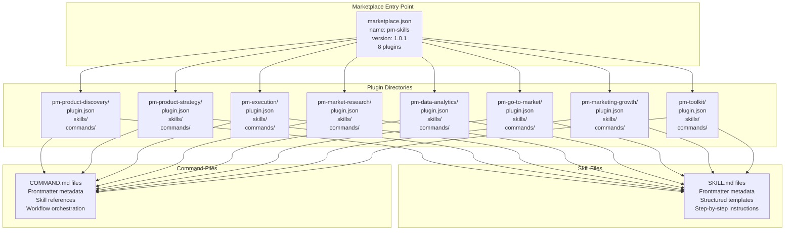
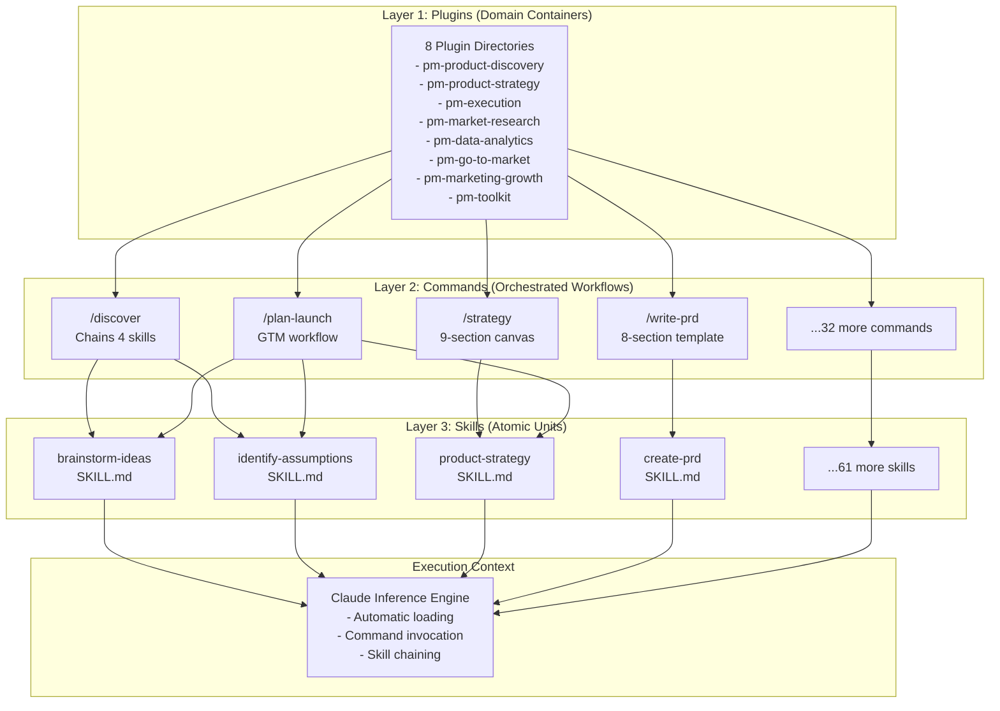
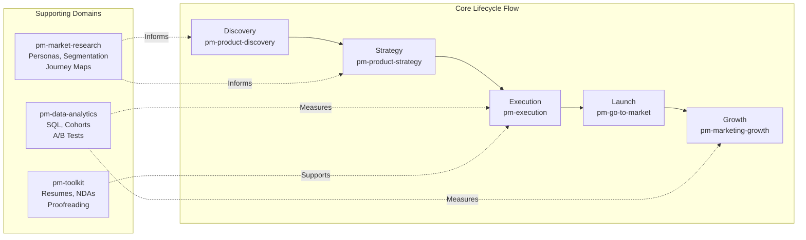
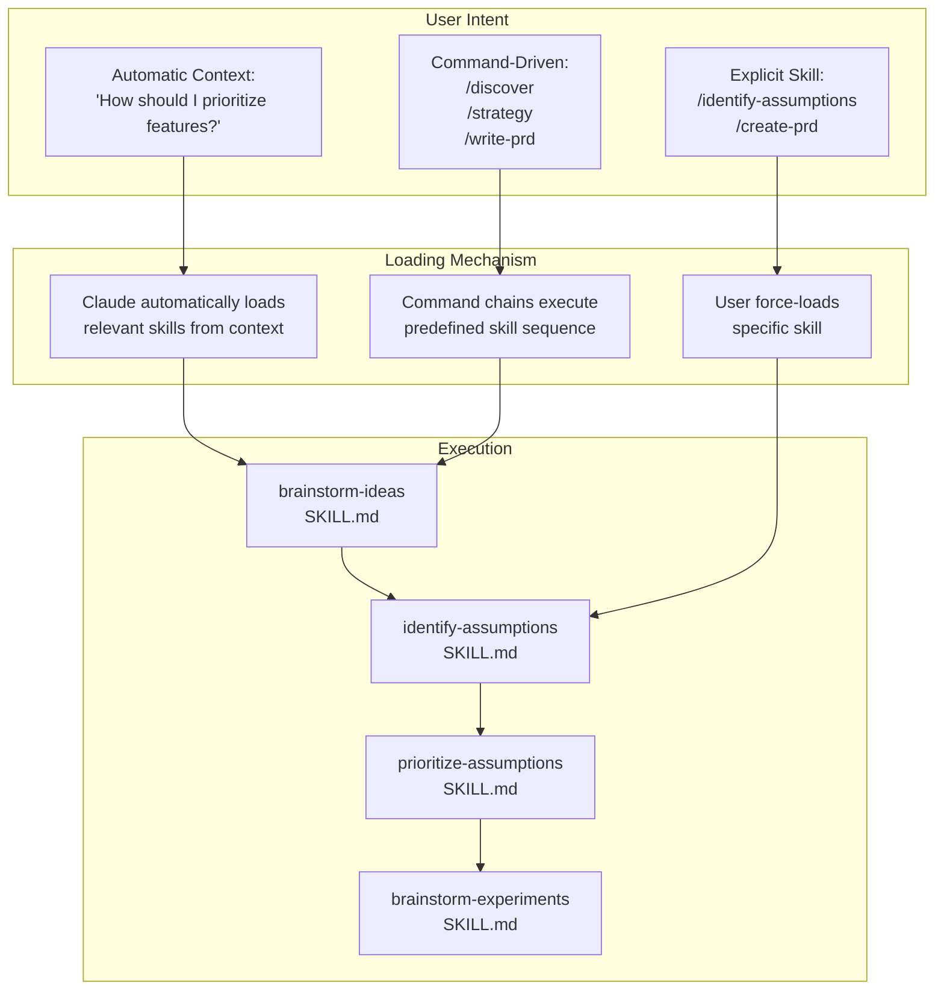

<!-- source: DeepWiki mcp.deepwiki.com · repo phuryn/pm-skills · page 1 Home · fetched 2026-10-27 -->

# Home

<details>
<summary>Relevant source files</summary>

The following files were used as context for generating this wiki page:

- [.claude-plugin/marketplace.json](.claude-plugin/marketplace.json)
- [.docs/images/add-marketplace.webp](.docs/images/add-marketplace.webp)
- [.docs/images/how-skills-work.webp](.docs/images/how-skills-work.webp)
- [README.md](README.md)

</details>


## Purpose and Scope

This document provides a technical overview of the **PM Skills Marketplace**, a structured AI workflow system that encodes product management methodologies into 65 executable skills and 36 orchestrated command workflows across 8 domain-specific plugins. The system is designed primarily for Claude Code CLI and Claude Cowork GUI environments, with graceful degradation to skills-only mode for other AI assistants (Gemini, Cursor, Codex, Kiro).

This page covers:
- System architecture and the three-tier abstraction model (Skills → Commands → Plugins)
- The 8 plugin domains and their lifecycle alignment
- Installation pathways and capability matrices
- Core usage patterns and access mechanisms

For detailed plugin-specific documentation, see [Plugin Reference](#4). For contribution guidelines and validation systems, see [Contributing](#7).

**Sources:** [README.md:1-11](), [.claude-plugin/marketplace.json:1-10]()

---

## System Architecture

The PM Skills Marketplace operates as a **marketplace-based plugin distribution system** defined in `.claude-plugin/marketplace.json`. The marketplace aggregates 8 plugins, each containing domain-specific skills and commands.

### Marketplace Definition



**Marketplace Structure:** The marketplace is defined in [.claude-plugin/marketplace.json:1-61](). Each plugin entry specifies a `name`, `description`, `source` directory path, and `category`. The marketplace owner information is at [.claude-plugin/marketplace.json:6-9]().

**Sources:** [.claude-plugin/marketplace.json:1-61](), [README.md:5-11]()

---

## Three-Tier Abstraction Model

The system implements a layered architecture where **Skills** are atomic units, **Commands** are orchestrated workflows, and **Plugins** are domain containers.

### Architecture Diagram



**Skills** are the foundational units. Each skill is a `SKILL.md` file containing:
- Frontmatter metadata (name, description, tags)
- Structured templates or frameworks
- Step-by-step execution instructions

**Commands** are workflows that chain one or more skills. Defined in `COMMAND.md` files, they orchestrate skill execution in predefined sequences. For example, `/discover` chains `brainstorm-ideas → identify-assumptions → prioritize-assumptions → brainstorm-experiments` ([README.md:37]()).

**Plugins** are domain containers grouping related skills and commands into installable packages. Each plugin has a `plugin.json` manifest and organized `skills/` and `commands/` directories.

**Sources:** [README.md:31-45](), [.claude-plugin/marketplace.json:11-60]()

---

## The Eight Plugin Domains

The marketplace organizes 65 skills and 36 commands across 8 plugins aligned to the product development lifecycle:

| Plugin | Skills | Commands | Lifecycle Stage | Source Directory |
|--------|--------|----------|-----------------|------------------|
| **pm-product-discovery** | 13 | 5 | Discovery | `./pm-product-discovery` |
| **pm-product-strategy** | 12 | 5 | Strategy | `./pm-product-strategy` |
| **pm-execution** | 15 | 10 | Execution | `./pm-execution` |
| **pm-go-to-market** | 6 | 3 | Launch | `./pm-go-to-market` |
| **pm-marketing-growth** | 5 | 2 | Growth | `./pm-marketing-growth` |
| **pm-market-research** | 7 | 3 | Supporting (Discovery/Strategy) | `./pm-market-research` |
| **pm-data-analytics** | 3 | 3 | Supporting (Execution/Growth) | `./pm-data-analytics` |
| **pm-toolkit** | 4 | 5 | Supporting (Operational) | `./pm-toolkit` |

### Lifecycle Alignment Diagram



**Core Lifecycle Plugins** (5 plugins): Map to sequential product development stages from ideation through scaling.

**Supporting Plugins** (3 plugins): Provide cross-cutting capabilities:
- `pm-market-research` informs early-stage discovery and strategy with customer insights
- `pm-data-analytics` measures execution effectiveness and growth metrics
- `pm-toolkit` offers operational utilities (resume review, legal documents, proofreading)

**Example Command Chains:**
- Discovery → Strategy: `/discover` outputs feed into `/strategy`
- Strategy → Execution: `/strategy` outputs feed into `/write-prd`
- Execution → Launch: `/write-prd` outputs feed into `/plan-launch`

**Sources:** [README.md:97-413](), [.claude-plugin/marketplace.json:11-60]()

---

## Installation and Capability Matrix

The marketplace supports three installation pathways with different capability profiles:

### Installation Methods

```mermaid
graph TB
    subgraph "Installation Method 1: Claude Cowork GUI"
        CW1["User Action:<br/>Customize > Browse plugins<br/>Add marketplace from GitHub"]
        CW2["Repository:<br/>phuryn/pm-skills"]
        CW3["Result:<br/>All 8 plugins auto-installed<br/>Full capabilities"]
    end
    
    subgraph "Installation Method 2: Claude Code CLI"
        CC1["claude plugin marketplace add<br/>phuryn/pm-skills"]
        CC2["claude plugin install<br/>pm-product-discovery@pm-skills"]
        CC3["Result:<br/>Selective plugin installation<br/>Full capabilities"]
    end
    
    subgraph "Installation Method 3: Other AI Tools"
        OT1["Manual copy:<br/>cp pm-*/skills/* ~/.gemini/skills/"]
        OT2["Destinations:<br/>.gemini/skills/<br/>.cursor/skills/<br/>.codex/skills/<br/>.kiro/skills/"]
        OT3["Result:<br/>Skills only (no commands)<br/>No orchestration"]
    end
    
    CW1 --> CW2 --> CW3
    CC1 --> CC2 --> CC3
    OT1 --> OT2 --> OT3
```



### Capability Comparison

| Installation Method | Plugins | Commands | Skills | Orchestration | Target Users |
|---------------------|---------|----------|--------|---------------|--------------|
| **Claude Cowork** | ✓ | ✓ | ✓ | ✓ | Non-developers |
| **Claude Code CLI** | ✓ | ✓ | ✓ | ✓ | Developers |
| **Other AI Tools** | ✗ | ✗ | ✓ | ✗ | Universal (limited) |

**Claude Cowork Installation** ([README.md:49-58]()):
1. Open Customize (bottom-left)
2. Navigate to Browse plugins → Personal → +
3. Select "Add marketplace from GitHub"
4. Enter: `phuryn/pm-skills`

**Claude Code CLI Installation** ([README.md:62-75]()):
```bash
# Add marketplace
claude plugin marketplace add phuryn/pm-skills

# Install individual plugins
claude plugin install pm-product-discovery@pm-skills
claude plugin install pm-product-strategy@pm-skills
# ... repeat for other plugins
```

**Other AI Tools Installation** ([README.md:77-93]()):
```bash
# Copy all skills to Gemini CLI
for plugin in pm-*/; do
  cp -r "$plugin/skills/"* ~/.gemini/skills/ 2>/dev/null
done
```

**Capability Degradation:** Other AI tools receive skills only because the universal skill format (`SKILL.md`) is tool-agnostic, but commands (`/slash-commands`) are Claude-specific implementations ([README.md:79]()).

**Sources:** [README.md:47-94](), [.claude-plugin/marketplace.json:1-4]()

---

## Usage Patterns

The system supports three access patterns for different user expertise levels:

### Access Pattern Diagram



### Pattern 1: Automatic Loading

Skills are loaded automatically when relevant to conversation context. Claude's inference engine determines which skills apply based on user intent. No explicit invocation needed.

**Example:** User asks "What are the riskiest assumptions for our AI assistant?" → Claude automatically loads `identify-assumptions` skill.

**Reference Skills** (domain knowledge): `prioritization-frameworks`, `opportunity-solution-tree` are available as reference ([README.md:43]()).

**Sources:** [README.md:33-35]()

### Pattern 2: Command-Driven Workflows

Commands provide structured end-to-end processes. Users invoke with `/command-name` syntax.

**Example Commands:**
- `/discover` → Chains 4 skills: ideation → assumption mapping → prioritization → experiment design ([README.md:120]())
- `/strategy` → Creates 9-section Product Strategy Canvas ([README.md:162]())
- `/write-prd` → Generates 8-section PRD from feature idea ([README.md:207]())
- `/plan-launch` → Builds GTM strategy from beachhead to launch plan ([README.md:313]())

**Command Flow Suggestions:** After any command completes, it suggests relevant next commands to match PM workflow ([README.md:45]()).

**Sources:** [README.md:37-45](), [README.md:118-392]()

### Pattern 3: Explicit Skill Invocation

Power users directly invoke specific skills with `/plugin-name:skill-name` or `/skill-name` syntax (Claude adds prefix). This forces skill loading, prioritizing it over general knowledge.

**Example:** `/identify-assumptions for our checkout flow` → Force-loads the assumption mapping skill regardless of conversation context.

**Use Case:** When user wants specific framework application overriding Claude's automatic selection.

**Sources:** [README.md:35]()

---

## Core Statistics

| Metric | Count |
|--------|-------|
| **Total Plugins** | 8 |
| **Total Skills** | 65 |
| **Total Commands** | 36 |
| **PM Frameworks Encoded** | 11+ |
| **Supported AI Tools (Skills)** | Claude, Gemini, Cursor, Codex, Kiro |
| **Supported AI Tools (Full Stack)** | Claude Code, Claude Cowork |

### Framework Attribution

The skills encode methodologies from established PM practitioners ([README.md:401-414]()):

| Practitioner | Framework/Method | Example Skills |
|--------------|------------------|----------------|
| Teresa Torres | Continuous Discovery Habits, OSTs | `opportunity-solution-tree`, `interview-script` |
| Marty Cagan | INSPIRED, PRDs, Empowerment | `create-prd`, `product-vision` |
| Alberto Savoia | The Right It, Pretotyping | `brainstorm-experiments-new` |
| Ash Maurya | Running Lean, Lean Canvas | `lean-canvas` |
| Roger Martin | Playing to Win | `product-strategy` |
| Anthony Ulwick | Jobs to Be Done | `value-proposition`, `interview-script` |
| Maja Voje | GTM Strategist | `beachhead-segment`, `gtm-strategy` |

**Sources:** [README.md:397-416]()

---

## Quick Start Examples

**Discovery Workflow:**
```
/discover AI-powered meeting summarizer for remote teams
```
Output: Ideation → Assumption map → Prioritization → Experiment designs

**Strategy Development:**
```
/strategy B2B project management tool for agencies
```
Output: 9-section Product Strategy Canvas (vision → defensibility)

**PRD Creation:**
```
/write-prd Smart notification system that reduces alert fatigue
```
Output: Comprehensive 8-section PRD

**Launch Planning:**
```
/plan-launch AI code review tool targeting mid-size engineering teams
```
Output: Full GTM strategy from beachhead to launch plan

**Sources:** [README.md:13-19](), [README.md:134-136](), [README.md:176-178](), [README.md:325-327]()

---

## Repository Structure

```
pm-skills/
├── .claude-plugin/
│   └── marketplace.json          # Marketplace definition
├── pm-product-discovery/
│   ├── plugin.json
│   ├── skills/                   # 13 skills
│   ├── commands/                 # 5 commands
│   └── README.md
├── pm-product-strategy/
│   ├── plugin.json
│   ├── skills/                   # 12 skills
│   ├── commands/                 # 5 commands
│   └── README.md
├── pm-execution/
│   ├── plugin.json
│   ├── skills/                   # 15 skills
│   ├── commands/                 # 10 commands
│   └── README.md
├── pm-market-research/
│   ├── plugin.json
│   ├── skills/                   # 7 skills
│   ├── commands/                 # 3 commands
│   └── README.md
├── pm-data-analytics/
│   ├── plugin.json
│   ├── skills/                   # 3 skills
│   ├── commands/                 # 3 commands
│   └── README.md
├── pm-go-to-market/
│   ├── plugin.json
│   ├── skills/                   # 6 skills
│   ├── commands/                 # 3 commands
│   └── README.md
├── pm-marketing-growth/
│   ├── plugin.json
│   ├── skills/                   # 5 skills
│   ├── commands/                 # 2 commands
│   └── README.md
├── pm-toolkit/
│   ├── plugin.json
│   ├── skills/                   # 4 skills
│   ├── commands/                 # 5 commands
│   └── README.md
├── validate_plugins.py           # Quality gate validation
├── CONTRIBUTING.md               # Contribution guidelines
├── LICENSE                       # MIT license
└── README.md                     # Main documentation
```

**Sources:** [.claude-plugin/marketplace.json:11-60](), [README.md:1-447]()

---

## Next Steps

- **For detailed plugin documentation:** See [Plugin Reference](#4) for comprehensive coverage of all 8 plugins, their skills, and commands.
- **For complex skill deep-dives:** See [Featured Skills](#5) for in-depth documentation of high-value frameworks like Business Model Canvases, Product Strategy Canvas, and Value Proposition Design.
- **For workflow examples:** See [Key Commands](#6) for detailed walkthroughs of `/discover`, `/strategy`, `/write-prd`, and `/plan-launch` workflows.
- **For contributing new skills or plugins:** See [Contributing](#7) for guidelines, validation requirements, and submission process.

**Sources:** [README.md:1-447]()

---

